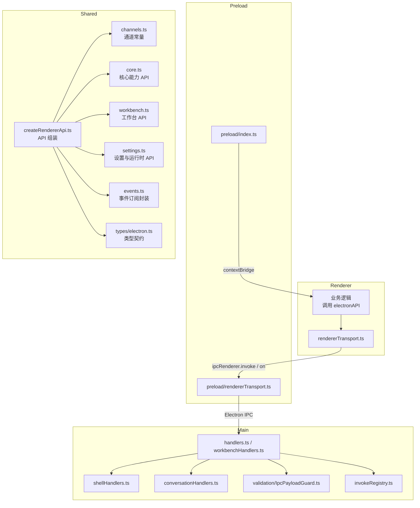
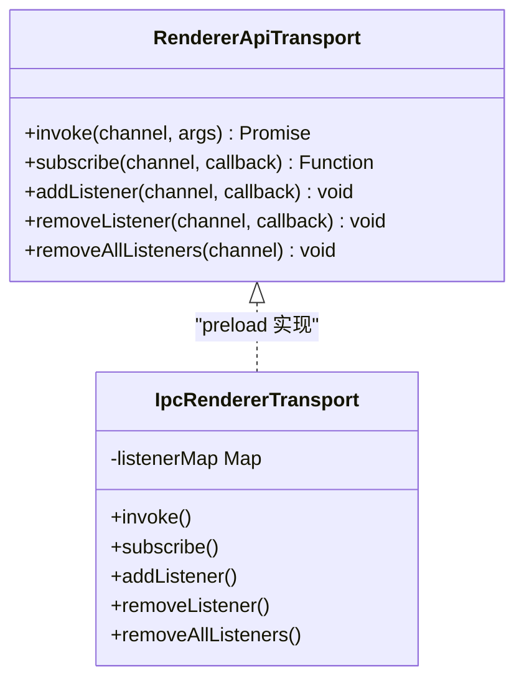
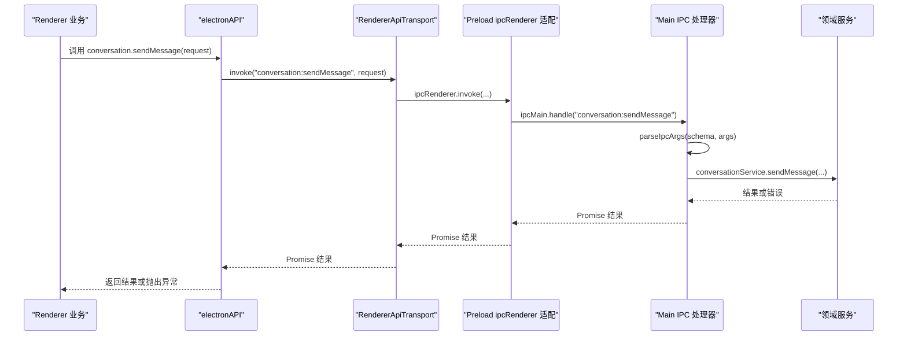
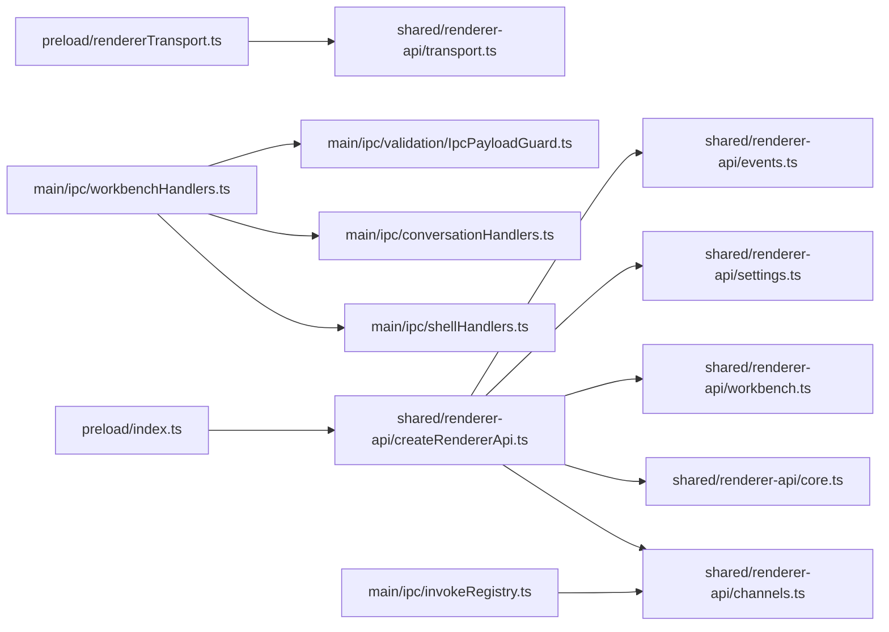

# API 参考

<cite>
**本文引用的文件**
- [src/main/ipc/README.md](file://src/main/ipc/README.md)
- [src/main/ipc/handlers.ts](file://src/main/ipc/handlers.ts)
- [src/main/ipc/invokeRegistry.ts](file://src/main/ipc/invokeRegistry.ts)
- [src/main/ipc/workbenchHandlers.ts](file://src/main/ipc/workbenchHandlers.ts)
- [src/main/ipc/shellHandlers.ts](file://src/main/ipc/shellHandlers.ts)
- [src/main/ipc/conversationHandlers.ts](file://src/main/ipc/conversationHandlers.ts)
- [src/preload/index.ts](file://src/preload/index.ts)
- [src/preload/rendererTransport.ts](file://src/preload/rendererTransport.ts)
- [src/shared/renderer-api/index.ts](file://src/shared/renderer-api/index.ts)
- [src/shared/renderer-api/createRendererApi.ts](file://src/shared/renderer-api/createRendererApi.ts)
- [src/shared/renderer-api/transport.ts](file://src/shared/renderer-api/transport.ts)
- [src/shared/renderer-api/channels.ts](file://src/shared/renderer-api/channels.ts)
- [src/shared/renderer-api/events.ts](file://src/shared/renderer-api/events.ts)
- [src/shared/renderer-api/core.ts](file://src/shared/renderer-api/core.ts)
- [src/shared/renderer-api/settings.ts](file://src/shared/renderer-api/settings.ts)
- [src/shared/renderer-api/workbench.ts](file://src/shared/renderer-api/workbench.ts)
- [src/shared/types/electron-api.ts](file://src/shared/types/electron-api.ts)
- [src/shared/types/electron.ts](file://src/shared/types/electron.ts)
- [src/main/ipc/validation/IpcPayloadGuard.ts](file://src/main/ipc/validation/IpcPayloadGuard.ts)
</cite>

## 目录
1. [简介](#简介)
2. [项目结构](#项目结构)
3. [核心组件](#核心组件)
4. [架构总览](#架构总览)
5. [详细组件分析](#详细组件分析)
6. [依赖关系分析](#依赖关系分析)
7. [性能与容量限制](#性能与容量限制)
8. [客户端实现指南](#客户端实现指南)
9. [错误处理与排障](#错误处理与排障)
10. [版本兼容性与迁移策略](#版本兼容性与迁移策略)
11. [结论](#结论)

## 简介
本 API 参考文档面向 Electron 应用中的 Renderer 进程开发者，系统性说明以下两部分：
- Main-Renderer IPC 通信协议：包括通道命名、消息格式、参数校验、返回值结构与错误传播机制。
- Renderer 暴露的受控接口：通过 preload 注入的 `electronAPI` 对象对外提供的能力集合，涵盖对话、工作流、会话、项目、工具链、设置、知识、追踪等域。

该设计遵循“通道即契约”的原则：所有 IPC 通道集中在共享层定义，渲染端只能调用显式暴露的 API，Main 侧对入参进行严格校验并广播事件，形成清晰的主从边界。

## 项目结构
IPC 相关代码分布在三个关键位置：
- Main 侧：IPC 处理器注册入口、领域处理器、参数校验守卫与运行时上下文。
- Preload 侧：将 Renderer 的传输抽象桥接到 Electron 原生 `ipcRenderer`。
- Shared 侧：统一声明 IPC 通道常量、Renderer API 构造器、类型定义和事件订阅包装。

**图表来源**
- [src/preload/index.ts:1-25](file://src/preload/index.ts#L1-L25)
- [src/preload/rendererTransport.ts:1-44](file://src/preload/rendererTransport.ts#L1-L44)
- [src/shared/renderer-api/createRendererApi.ts:1-80](file://src/shared/renderer-api/createRendererApi.ts#L1-L80)
- [src/shared/renderer-api/channels.ts:1-271](file://src/shared/renderer-api/channels.ts#L1-L271)
- [src/main/ipc/handlers.ts:1-6](file://src/main/ipc/handlers.ts#L1-L6)
- [src/main/ipc/workbenchHandlers.ts:1-120](file://src/main/ipc/workbenchHandlers.ts#L1-L120)
- [src/main/ipc/shellHandlers.ts:1-200](file://src/main/ipc/shellHandlers.ts#L1-L200)
- [src/main/ipc/conversationHandlers.ts:1-200](file://src/main/ipc/conversationHandlers.ts#L1-L200)
- [src/main/ipc/validation/IpcPayloadGuard.ts:1-87](file://src/main/ipc/validation/IpcPayloadGuard.ts#L1-L87)
- [src/main/ipc/invokeRegistry.ts:1-50](file://src/main/ipc/invokeRegistry.ts#L1-L50)

**章节来源**
- [src/main/ipc/README.md:1-9](file://src/main/ipc/README.md#L1-L9)
- [src/main/ipc/handlers.ts:1-6](file://src/main/ipc/handlers.ts#L1-L6)

## 核心组件
本节聚焦构建整个 IPC 体系的关键模块。

### IPC 通道与类型契约
- `RENDERER_INVOKE_CHANNEL`：集中声明所有渲染端可调用的主进程 RPC 通道名，按领域分组，如 shell、conversation、workflow、agent、memory、investigation、plan、knowledge、rdcRuntime、command、tools、llm、settings、project、device、session、run、runtime、capture、context、trace。
- `RENDERER_EVENT_CHANNEL`：集中声明所有主进程向渲染端广播的事件通道名，如 themeChanged、runStatusChanged、agent.message、tool:executionComplete、runtime:logAppended 等。
- `RendererInvokeChannel`、`RendererEventChannel`：由通道常量推导出的联合类型，配合 `isRendererInvokeChannel`、`isRendererEventChannel` 在运行时做白名单校验，避免渲染端误用未声明通道。
- `RENDERER_INVOKE_CHANNELS`、`RENDERER_EVENT_CHANNELS`：冻结的通道数组，用于完整性校验（例如确保渲染端声明的通道都在 Main 侧有对应处理器）。

这些常量是 IPC 契约的唯一真相源，新增或修改 IPC 必须同时更新：
- shared 层通道常量；
- preload 与 renderer API 映射；
- main 侧处理器注册；
- 浏览器 fallback 或测试基线（仓库约定要求）。

**章节来源**
- [src/shared/renderer-api/channels.ts:1-271](file://src/shared/renderer-api/channels.ts#L1-L271)

### Renderer API 构造器
`createRendererApi(platform, transport)` 负责把底层 `RendererApiTransport` 包装成稳定的 `ElectronAPI` 对象，暴露给 Renderer 业务使用。它组合多个子 API：
- 平台信息：`platform`、`isMac`、`isWindows`、`isLinux`。
- 应用元信息与 Shell：`appMeta`、`appShell`、`web`、`windowControls`、`dialog`。
- 对话与工作流：`conversation`、`workflow`、`agent`。
- 项目与会话：`project`、`session`、`run`、`device`、`capture`、`context`。
- 工具与证据：`tool`、`mcp`、`evidence`。
- 知识与计划：`knowledge`、`plan`、`investigation`。
- 运行环境与设置：`rdcRuntime`、`llm`、`settings`、`memory`、`runtimeLog`。
- 追踪：`trace`。
- 事件订阅：`events`，以及全局 `on`、`off`。

所有方法都通过 `transport.invoke(channel, ...args)` 发送请求，或通过 `transport.subscribe` 订阅事件。

**章节来源**
- [src/shared/renderer-api/createRendererApi.ts:1-80](file://src/shared/renderer-api/createRendererApi.ts#L1-L80)
- [src/shared/types/electron-api.ts:1-32](file://src/shared/types/electron-api.ts#L1-L32)

### 传输层抽象
`RendererApiTransport` 定义了渲染端与 Electron IPC 之间的最小接口：
- `invoke<TResult>(channel, ...args)`：同步调用返回 Promise。
- `subscribe(channel, callback)`：返回取消订阅函数。
- `addListener`、`removeListener`、`removeAllListeners`：供内部 API 直接管理事件监听器。

Preload 层的 `createIpcRendererTransport()` 将其适配到 `ipcRenderer.invoke` 和 `ipcRenderer.on`，并通过 Map 维护回调去重与移除逻辑。

**图表来源**
- [src/shared/renderer-api/transport.ts:1-11](file://src/shared/renderer-api/transport.ts#L1-L11)
- [src/preload/rendererTransport.ts:1-44](file://src/preload/rendererTransport.ts#L1-L44)

**章节来源**
- [src/shared/renderer-api/transport.ts:1-11](file://src/shared/renderer-api/transport.ts#L1-L11)
- [src/preload/rendererTransport.ts:1-44](file://src/preload/rendererTransport.ts#L1-L44)

### 预加载注入点
Preload 脚本仅暴露安全能力：
- `electronAPI`：通过 `createRendererApi(process.platform, createIpcRendererTransport())` 创建。
- `rdcDesktop.getPathForFile(file)`：基于 `webUtils.getPathForFile` 的安全包装，失败时返回 null。

Preload 明确禁止引入 Node 内置模块，只允许使用 `contextBridge`、`webUtils` 和 `process.platform`，以降低攻击面。

**章节来源**
- [src/preload/index.ts:1-25](file://src/preload/index.ts#L1-L25)

## 架构总览
Main-Renderer IPC 采用“RPC + 事件”的双通道模型：
- 请求-响应：Renderer 通过 `electronAPI.*` 调用方法，底层走 `ipcRenderer.invoke`，Main 侧通过 `ipcMain.handle` 或自定义 invoke 注册表处理。
- 事件推送：Main 通过 `BrowserWindow.webContents.send` 或事件中心向 Renderer 广播，Renderer 通过 `events` API 或全局 `on/off` 订阅。

**图表来源**
- [src/shared/renderer-api/core.ts:1-167](file://src/shared/renderer-api/core.ts#L1-L167)
- [src/shared/renderer-api/transport.ts:1-11](file://src/shared/renderer-api/transport.ts#L1-L11)
- [src/preload/rendererTransport.ts:1-44](file://src/preload/rendererTransport.ts#L1-L44)
- [src/main/ipc/conversationHandlers.ts:1-200](file://src/main/ipc/conversationHandlers.ts#L1-L200)
- [src/main/ipc/validation/IpcPayloadGuard.ts:1-87](file://src/main/ipc/validation/IpcPayloadGuard.ts#L1-L87)

## 详细组件分析

### 主进程 IPC 注册与一致性检查
- `handlers.ts` 作为 IPC 初始化入口，导出 `initializeIpcState`、`registerIPCHandlers`、`setMainWindow`、`stopAllActiveRuns`，实际注册逻辑集中在 `workbenchHandlers.ts`。
- `workbenchHandlers.ts` 聚合各域处理器：conversation、project/session、workflow、agent、memory、knowledge、plan、shell、web、tools、trace、rdcRuntime 等，并在启动时恢复当前 session/project/run 状态、恢复中断运行。
- `invokeRegistry.ts` 提供：
  - `installIpcInvokeRegistry()`：拦截 `ipcMain.handle`，记录已注册通道。
  - `assertRendererIpcParity()`：断言渲染端声明的所有 invoke 通道都有对应 handler，缺失则抛错。
  - `invokeRegisteredIpcChannel()`：供非标准调用路径触发已注册 handler。

这种设计使“通道列表”成为可验证契约：若 renderer 新增通道但未在主进程注册，构建或运行时会发现不一致。

**章节来源**
- [src/main/ipc/handlers.ts:1-6](file://src/main/ipc/handlers.ts#L1-L6)
- [src/main/ipc/workbenchHandlers.ts:1-120](file://src/main/ipc/workbenchHandlers.ts#L1-L120)
- [src/main/ipc/invokeRegistry.ts:1-50](file://src/main/ipc/invokeRegistry.ts#L1-L50)

### Shell 与窗口能力
Shell 能力通过 `appShell`、`appMeta`、`web`、`windowControls` 暴露，主要通道包括：
- `app:getMeta`、`app:hasSeenGettingStarted`、`app:acknowledgeGettingStarted`
- `app:selectAvatar`、`app:getAvatarDataUrl`、`app:openPath`、`app:copyText`、`app:readClipboardText`
- `dialog:selectFiles`、`dialog:selectRdcFiles`、`dialog:selectKnowledgeImport`、`dialog:selectDirectory`、`dialog:saveFile`
- `web:resolveFavicon`
- `window:minimize`、`window:toggleMaximize`、`window:close`、`window:isMaximized`

返回值多为 Promise，成功时返回结构化数据，失败时可能返回空值或包含 error 字段的结果。具体类型定义见 `types/electron.ts` 中 `ElectronAPI.appMeta`、`ElectronAPI.appShell`、`ElectronAPI.web`、`ElectronAPI.windowControls`。

**章节来源**
- [src/shared/renderer-api/core.ts:1-167](file://src/shared/renderer-api/core.ts#L1-L167)
- [src/shared/renderer-api/channels.ts:1-120](file://src/shared/renderer-api/channels.ts#L1-L120)
- [src/main/ipc/shellHandlers.ts:1-200](file://src/main/ipc/shellHandlers.ts#L1-L200)
- [src/shared/types/electron.ts:1-200](file://src/shared/types/electron.ts#L1-L200)

### 对话能力
对话 API 通过 `conversation` 暴露，典型操作包括：
- `sendMessage`、`rewriteFromMessage`、`cancelActiveTurn`
- `answerUserInput`、`answerToolApproval`、`answerPlanReview`
- `getHistory`、`switchBranch`、`clearHistory`、`undoLastTurn`
- `getDelegationTrace`、`getDelegationContent`
- `stageAttachments`、`releaseAttachments`、`getAttachmentPreview`、`getToolImagePreview`

主进程侧在 `conversationHandlers.ts` 中对每个通道解析参数、更新当前 project/session/run 上下文、调用 `conversationService`，并返回标准化结果。部分方法返回带 `status`、`requestId`、`turn`、`preparedContext` 的结构化响应，错误时转换为拒绝态结果。

**章节来源**
- [src/shared/renderer-api/core.ts:1-167](file://src/shared/renderer-api/core.ts#L1-L167)
- [src/shared/renderer-api/channels.ts:1-120](file://src/shared/renderer-api/channels.ts#L1-L120)
- [src/main/ipc/conversationHandlers.ts:1-200](file://src/main/ipc/conversationHandlers.ts#L1-L200)
- [src/shared/types/electron.ts:1-200](file://src/shared/types/electron.ts#L1-L200)

### 工作流与代理
- `workflow`：获取状态、恢复运行、停止运行、查询运行用量、列举运行。
- `agent`：发送消息、获取状态、获取全部状态、配置 agent。

这两个能力分别通过 `workflowHandlers.ts` 和 `agentHandlers.ts` 对接工作流执行引擎与代理编排器，事件方面会广播 `workflow:runStatusChanged`、`agent:message`、`agent:statusChanged`。

**章节来源**
- [src/shared/renderer-api/core.ts:1-167](file://src/shared/renderer-api/core.ts#L1-L167)
- [src/shared/renderer-api/channels.ts:1-200](file://src/shared/renderer-api/channels.ts#L1-L200)
- [src/main/ipc/workbenchHandlers.ts:120-293](file://src/main/ipc/workbenchHandlers.ts#L120-L293)

### 项目、设备、会话、捕获与上下文
- `project`：增删改查项目、管理项目输入项。
- `device`：列出设备、刷新、开启/续期/关闭 watch。
- `session`：列出、创建、重命名、删除、选择会话，设置模型覆盖与 agent 切换。
- `capture`：列出、选择、打开项目输入、读取回放状态、应用回放事件、刷新帧。
- `context`：获取上下文快照。
- `trace`：读取 trace run、事件、投影，导出 trace，切换分支。

这些 API 由 `workbench.ts` 统一封装，底层通道集中在 `channels.ts` 中。

**章节来源**
- [src/shared/renderer-api/workbench.ts:1-99](file://src/shared/renderer-api/workbench.ts#L1-L99)
- [src/shared/renderer-api/channels.ts:120-271](file://src/shared/renderer-api/channels.ts#L120-L271)

### 设置、LLM、内存与 RDC 运行时
- `settings`：读取设置、导入 agent manifest、保存 provider 定义、获取有效模型/目录、设置模型覆盖、解析 shell。
- `llm`：测试 provider、连接/断开 provider、刷新模型、账户登录流程、检测模型能力。
- `memory`：申请 approvalToken、列出/读取/写入/删除记忆。
- `rdcRuntime`：查看 overview、验证/导入/更新/删除资源、信任/撤销 hook 或 mcp、测试 hook、查看请求快照。

这些能力由 `settings.ts` 与 `core.ts` 组合暴露，参数通常经过 schema 校验后再进入主进程。

**章节来源**
- [src/shared/renderer-api/settings.ts:1-86](file://src/shared/renderer-api/settings.ts#L1-L86)
- [src/shared/renderer-api/core.ts:1-167](file://src/shared/renderer-api/core.ts#L1-L167)
- [src/shared/renderer-api/channels.ts:1-200](file://src/shared/renderer-api/channels.ts#L1-L200)

### 事件订阅机制
`events` 子 API 为常用事件提供语义化订阅方法，包括：
- `onDelegationTraceChanged`
- `onRunStatusChanged`
- `onRunUsageChanged`
- `onTraceProjectionChanged`
- `onEffectiveCatalogChanged`
- `onAgentMessage`
- `onAgentStatusChanged`
- `onToolExecutionComplete`
- `onEvidenceEventAdded`
- `onDeviceStatusChanged`
- `onCaptureStatusChanged`
- `onContextChanged`
- `onProjectInputsChanged`
- `onProjectInputsError`
- `onCaptureReplayChanged`
- `onOpenedCaptureStateChanged`
- `onRuntimeLogAppended`
- `onAppThemeChanged`

底层通过 `transport.subscribe` 绑定 `RENDERER_EVENT_CHANNEL` 中的事件通道，并将原始 payload 转换为更明确的类型。

**章节来源**
- [src/shared/renderer-api/events.ts:1-88](file://src/shared/renderer-api/events.ts#L1-L88)
- [src/shared/renderer-api/channels.ts:200-271](file://src/shared/renderer-api/channels.ts#L200-L271)

## 依赖关系分析

**图表来源**
- [src/shared/renderer-api/createRendererApi.ts:1-80](file://src/shared/renderer-api/createRendererApi.ts#L1-L80)
- [src/shared/renderer-api/channels.ts:1-271](file://src/shared/renderer-api/channels.ts#L1-L271)
- [src/shared/renderer-api/core.ts:1-167](file://src/shared/renderer-api/core.ts#L1-L167)
- [src/shared/renderer-api/workbench.ts:1-99](file://src/shared/renderer-api/workbench.ts#L1-L99)
- [src/shared/renderer-api/settings.ts:1-86](file://src/shared/renderer-api/settings.ts#L1-L86)
- [src/shared/renderer-api/events.ts:1-88](file://src/shared/renderer-api/events.ts#L1-L88)
- [src/preload/index.ts:1-25](file://src/preload/index.ts#L1-L25)
- [src/preload/rendererTransport.ts:1-44](file://src/preload/rendererTransport.ts#L1-L44)
- [src/main/ipc/workbenchHandlers.ts:1-120](file://src/main/ipc/workbenchHandlers.ts#L1-L120)
- [src/main/ipc/shellHandlers.ts:1-200](file://src/main/ipc/shellHandlers.ts#L1-L200)
- [src/main/ipc/conversationHandlers.ts:1-200](file://src/main/ipc/conversationHandlers.ts#L1-L200)
- [src/main/ipc/validation/IpcPayloadGuard.ts:1-87](file://src/main/ipc/validation/IpcPayloadGuard.ts#L1-L87)
- [src/main/ipc/invokeRegistry.ts:1-50](file://src/main/ipc/invokeRegistry.ts#L1-L50)

**章节来源**
- [src/shared/renderer-api/index.ts:1-17](file://src/shared/renderer-api/index.ts#L1-L17)

## 性能与容量限制
IPC 参数在进入主进程处理器前会经过统一校验：
- 默认最大序列化字节长度为 256 KiB。
- 可通过 `parseIpcArgs` 的 `maxBytes` 选项为不同通道调整上限，例如对话消息可达 2 MiB，对话框请求通常为 4 KiB。
- 校验失败会抛出 `IpcValidationError`，错误码为 `IPC_VALIDATION_ERROR`，便于上层区分参数非法与服务异常。
- 支持 `padTo` 补齐可选尾部参数，避免零参调用被 Zod tuple 拒绝。
- 还提供 `ipcString`、`ipcNonEmptyString`、`ipcId`、`ipcStringArray` 等辅助 schema，防止路径遍历、超长字符串和无意义 id。

建议：
- 大型数据优先使用会话级 ID 引用，而非一次性跨进程传递完整正文。
- 流式或增量数据应结合事件通道分片上报。
- 对敏感或外部输入一律使用 `parseIpcArgs` 校验，不要绕过。

**章节来源**
- [src/main/ipc/validation/IpcPayloadGuard.ts:1-87](file://src/main/ipc/validation/IpcPayloadGuard.ts#L1-L87)
- [src/main/ipc/shellHandlers.ts:1-200](file://src/main/ipc/shellHandlers.ts#L1-L200)
- [src/main/ipc/conversationHandlers.ts:1-200](file://src/main/ipc/conversationHandlers.ts#L1-L200)

## 客户端实现指南

### 接入步骤
1. 在 Renderer 中通过全局对象访问 `window.electronAPI`。
2. 使用 `electronAPI.events.on*` 订阅所需事件。
3. 调用 `electronAPI.*` 下的受控方法完成业务操作。
4. 对所有异步调用使用 try/catch 或 Promise reject 处理。
5. 在组件卸载时取消事件订阅，避免内存泄漏。

### 推荐调用模式
- 读取型操作：直接 await 调用，如 `electronAPI.appMeta.get()`、`electronAPI.project.list()`。
- 写型操作：先校验 UI 输入，再调用 `electronAPI.*`，并根据返回结构判断成功或展示错误。
- 事件驱动更新：使用 `events.onRunStatusChanged`、`events.onAgentMessage` 等更新 UI，而不是轮询。
- 文件选择与保存：使用 `electronAPI.dialog.selectFiles`、`electronAPI.dialog.saveFile`，避免直接操作文件系统。

### 最佳实践
- 始终使用 `electronAPI` 暴露的方法，不要尝试直接调用底层 IPC 通道。
- 对可能失败的 API，同时处理 Promise 拒绝与返回值中的错误字段。
- 事件回调应保持幂等和轻量，避免阻塞事件分发。
- 使用 `events.removeAllListeners(channel)` 清理不再需要的事件。
- 不要在 Renderer 中缓存不可变的全局状态，应以事件为准重新计算。

[本节为通用实现指导，不直接分析具体源码]

## 错误处理与排障

### 错误分类
1. **参数校验错误**：由 `IpcPayloadGuard.parseIpcArgs` 抛出，错误码固定为 `IPC_VALIDATION_ERROR`，消息包含字段路径和错误原因。
2. **通道缺失错误**：如果渲染端声明了某个 invoke 通道但主进程没有注册处理器，`assertRendererIpcParity` 会抛出错误，提示缺失通道列表。
3. **业务错误**：某些方法返回结构化结果（如 `{ success, error }`），而非直接抛错，需根据返回体判断。
4. **权限或上下文拒绝**：例如 delegation trace 访问当前 session 不匹配时返回特定错误码或抛出明确错误。

### 常见排查清单
- 调用未声明通道：检查是否通过 `electronAPI` 暴露的方法调用，而非直接使用字符串通道。
- 事件未触发：确认频道名称是否正确、订阅是否在正确时机注册、是否过早销毁组件。
- 大消息失败：检查是否超过默认 256 KiB 或对应 handler 的 `maxBytes`。
- 对话发送失败：查看 `conversationHandlers` 返回的拒绝态结果，定位 requestId 和错误原因。
- 窗口控制无效：确认调用来自正确的 BrowserWindow，某些窗口操作依赖 sender。

**章节来源**
- [src/main/ipc/validation/IpcPayloadGuard.ts:1-87](file://src/main/ipc/validation/IpcPayloadGuard.ts#L1-L87)
- [src/main/ipc/invokeRegistry.ts:1-50](file://src/main/ipc/invokeRegistry.ts#L1-L50)
- [src/main/ipc/conversationHandlers.ts:1-200](file://src/main/ipc/conversationHandlers.ts#L1-L200)

## 版本兼容性与迁移策略

### 向后兼容原则
- 通道名称一旦发布，不应随意更改；如需变更，应新增通道并保持旧通道一段时间。
- 参数扩展应采用可选字段，并使用 `padTo` 保证旧调用方仍能传较少参数。
- 返回值新增字段应保持可选，客户端不得假设字段一定存在。
- 事件 payload 新增字段应视为可选，客户端不应依赖旧版 payload 的完整形状。

### 迁移建议
- 当升级 API 时，先在 shared 层增加新通道或新方法，保持旧方法可用。
- 在 main 侧为新方法添加校验 schema，并为旧方法保留兼容逻辑。
- 在 preload 与 renderer API 中逐步引导调用方迁移到新方法。
- 使用 `assertRendererIpcParity` 在开发阶段发现遗漏的通道实现。
- 对破坏性变更，应在产品层面提供迁移提示，并在日志中记录旧通道使用情况。

### 兼容性检查机制
- `RENDERER_INVOKE_CHANNELS` 与 `RENDERER_EVENT_CHANNELS` 冻结数组可作为契约基线。
- `isRendererInvokeChannel`、`isRendererEventChannel` 可在运行时过滤非法通道。
- `assertRendererIpcParity` 可在应用启动时断言渲染端与主进程通道一致。

**章节来源**
- [src/shared/renderer-api/channels.ts:250-271](file://src/shared/renderer-api/channels.ts#L250-L271)
- [src/main/ipc/invokeRegistry.ts:30-50](file://src/main/ipc/invokeRegistry.ts#L30-L50)

## 结论
本项目将 IPC 协议收敛在共享层，Renderer 只能通过 `electronAPI` 访问受控能力，Main 侧通过统一校验和事件广播保障稳定性与安全。通道常量、传输抽象、API 构造器与类型定义共同构成清晰的边界，适合在长期演进中维持 API 稳定、可测试、可审计。

对于使用者而言，最重要的原则是：
- 使用 `electronAPI`，不直接触碰底层 IPC。
- 使用 `events` 订阅状态变化，避免轮询。
- 正确处理 Promise 错误与结构化返回。
- 关注参数大小与通道兼容性，必要时迁移到新 API。

[本节为总结，不直接分析具体源码]