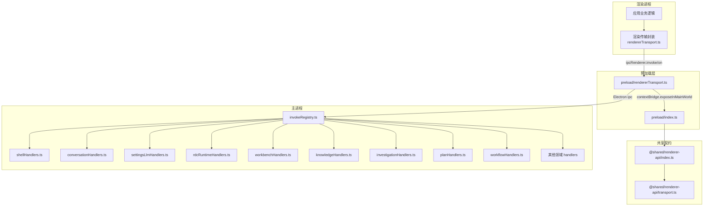
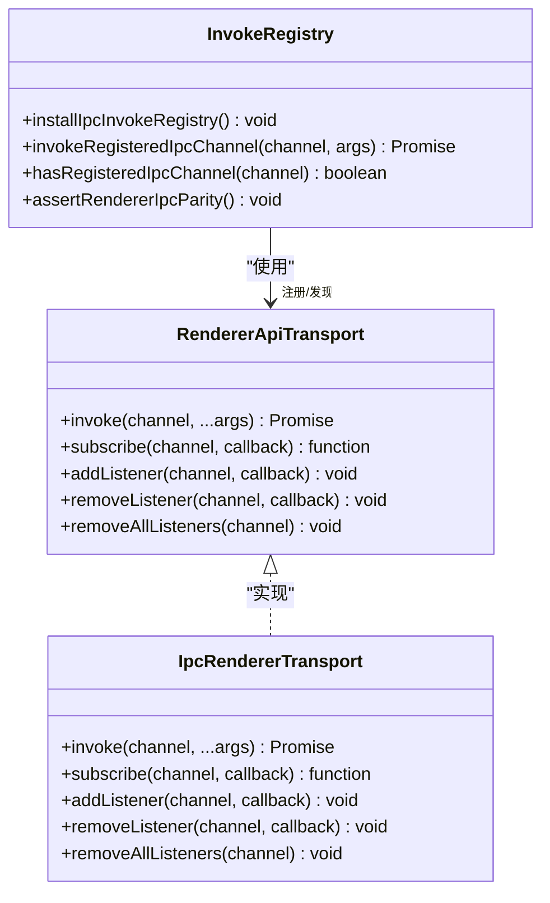
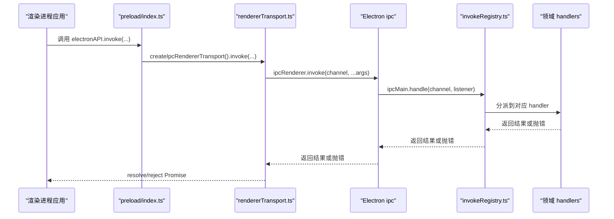
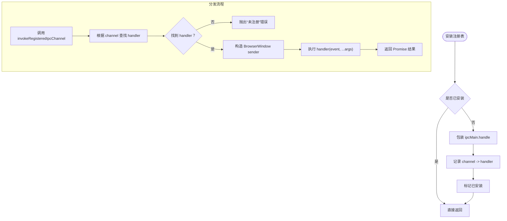
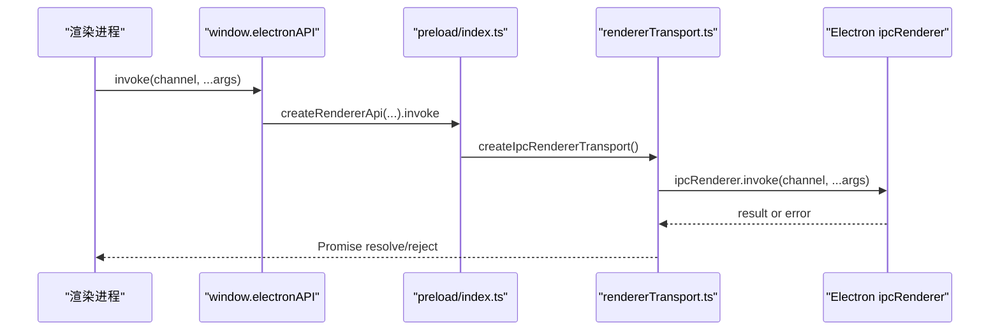
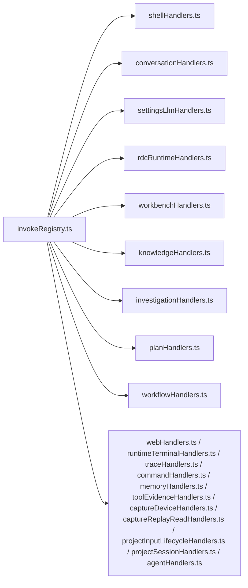
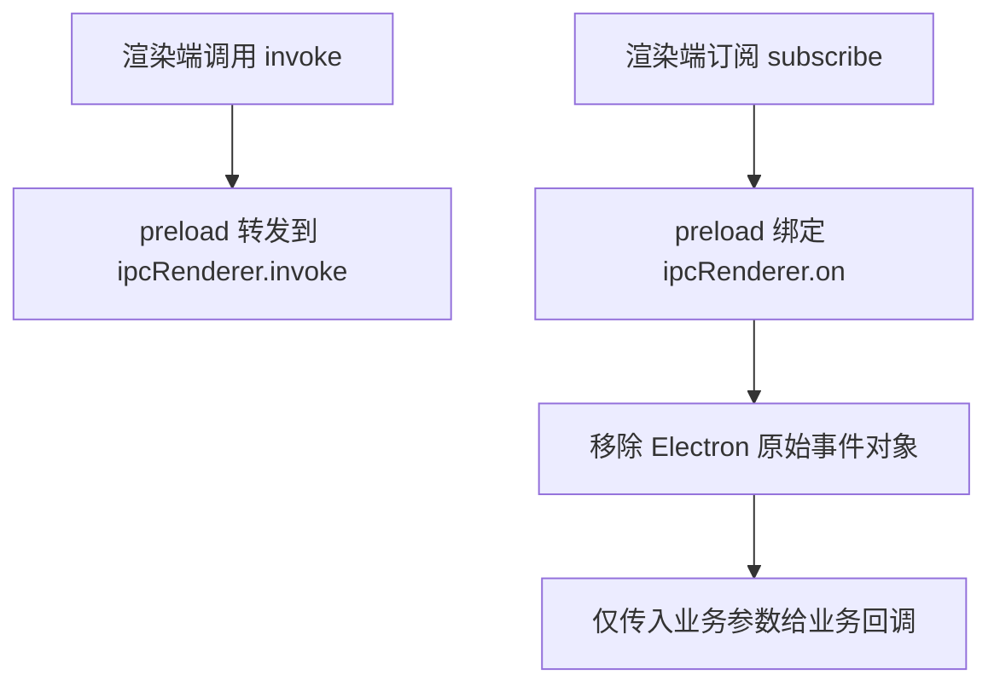
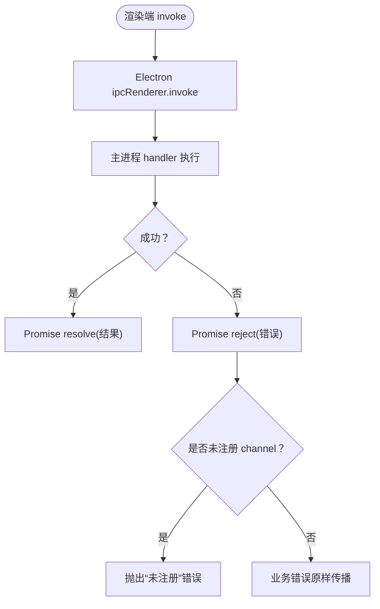
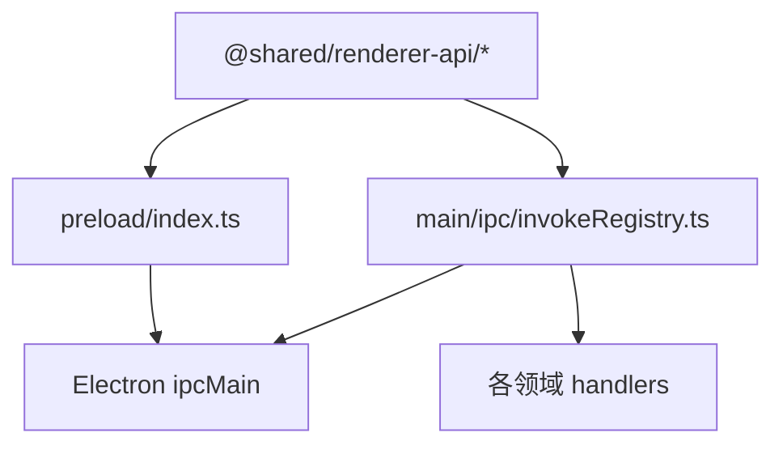

# IPC 通信协议

<cite>
**本文引用的文件**
- [src/main/ipc/invokeRegistry.ts](file://src/main/ipc/invokeRegistry.ts)
- [src/shared/renderer-api/index.ts](file://src/shared/renderer-api/index.ts)
- [src/shared/renderer-api/transport.ts](file://src/shared/renderer-api/transport.ts)
- [src/preload/rendererTransport.ts](file://src/preload/rendererTransport.ts)
- [src/preload/index.ts](file://src/preload/index.ts)
- [src/main/ipc/shellHandlers.ts](file://src/main/ipc/shellHandlers.ts)
- [src/main/ipc/conversationHandlers.ts](file://src/main/ipc/conversationHandlers.ts)
- [src/main/ipc/settingsLlmHandlers.ts](file://src/main/ipc/settingsLlmHandlers.ts)
- [src/main/ipc/rdcRuntimeHandlers.ts](file://src/main/ipc/rdcRuntimeHandlers.ts)
- [src/main/ipc/workbenchHandlers.ts](file://src/main/ipc/workbenchHandlers.ts)
- [src/main/ipc/knowledgeHandlers.ts](file://src/main/ipc/knowledgeHandlers.ts)
- [src/main/ipc/investigationHandlers.ts](file://src/main/ipc/investigationHandlers.ts)
- [src/main/ipc/planHandlers.ts](file://src/main/ipc/planHandlers.ts)
- [src/main/ipc/workflowHandlers.ts](file://src/main/ipc/workflowHandlers.ts)
- [src/main/ipc/webHandlers.ts](file://src/main/ipc/webHandlers.ts)
- [src/main/ipc/runtimeTerminalHandlers.ts](file://src/main/ipc/runtimeTerminalHandlers.ts)
- [src/main/ipc/traceHandlers.ts](file://src/main/ipc/traceHandlers.ts)
- [src/main/ipc/commandHandlers.ts](file://src/main/ipc/commandHandlers.ts)
- [src/main/ipc/memoryHandlers.ts](file://src/main/ipc/memoryHandlers.ts)
- [src/main/ipc/toolEvidenceHandlers.ts](file://src/main/ipc/toolEvidenceHandlers.ts)
- [src/main/ipc/captureDeviceHandlers.ts](file://src/main/ipc/captureDeviceHandlers.ts)
- [src/main/ipc/captureReplayReadHandlers.ts](file://src/main/ipc/captureReplayReadHandlers.ts)
- [src/main/ipc/projectInputLifecycleHandlers.ts](file://src/main/ipc/projectInputLifecycleHandlers.ts)
- [src/main/ipc/projectSessionHandlers.ts](file://src/main/ipc/projectSessionHandlers.ts)
- [src/main/ipc/agentHandlers.ts](file://src/main/ipc/agentHandlers.ts)
</cite>

## 目录
1. [简介](#简介)
2. [项目结构](#项目结构)
3. [核心组件](#核心组件)
4. [架构总览](#架构总览)
5. [详细组件分析](#详细组件分析)
6. [依赖关系分析](#依赖关系分析)
7. [性能与可靠性](#性能与可靠性)
8. [故障排查指南](#故障排查指南)
9. [结论](#结论)

## 简介
本文档定义并解释本仓库中主进程与渲染进程之间的 IPC 通信协议。重点包括：
- 消息注册机制与 `invokeRegistry` 的工作原理
- Handler 的组织方式与领域划分策略
- Preload 层如何桥接渲染进程到主进程 API
- 事件通道与调用通道的映射关系
- 错误传播、超时处理与异步回调模式
- 完整的消息格式、参数验证与返回值约定
- IPC 调试技巧与常见问题解决方案

该协议以 Electron 的 `ipcRenderer.invoke` / `ipcMain.handle` 作为调用通道，以 `ipcRenderer.on` / `ipcMain.send` 作为事件通道；所有双向通信均通过共享的类型与常量约束，保证渲染端与主进程端的一致性。

## 项目结构
IPC 相关代码主要分布在以下位置：
- 主进程侧：`src/main/ipc` 目录下按功能域划分的 handler 文件，以及统一的 `invokeRegistry.ts`
- 共享类型与能力声明：`src/shared/renderer-api`
- 预加载桥接层：`src/preload`
- 渲染进程侧：通过全局 `electronAPI` 访问，由 preload 注入

**图表来源**
- [src/preload/index.ts:1-25](file://src/preload/index.ts#L1-L25)
- [src/preload/rendererTransport.ts:1-44](file://src/preload/rendererTransport.ts#L1-L44)
- [src/shared/renderer-api/index.ts:1-17](file://src/shared/renderer-api/index.ts#L1-L17)
- [src/shared/renderer-api/transport.ts:1-11](file://src/shared/renderer-api/transport.ts#L1-L11)
- [src/main/ipc/invokeRegistry.ts:1-50](file://src/main/ipc/invokeRegistry.ts#L1-L50)

**章节来源**
- [src/preload/index.ts:1-25](file://src/preload/index.ts#L1-L25)
- [src/preload/rendererTransport.ts:1-44](file://src/preload/rendererTransport.ts#L1-L44)
- [src/shared/renderer-api/index.ts:1-17](file://src/shared/renderer-api/index.ts#L1-L17)
- [src/shared/renderer-api/transport.ts:1-11](file://src/shared/renderer-api/transport.ts#L1-L11)
- [src/main/ipc/invokeRegistry.ts:1-50](file://src/main/ipc/invokeRegistry.ts#L1-L50)

## 核心组件
本节从协议角度梳理关键角色：
- 渲染传输抽象：定义渲染端可使用的 `invoke`、`subscribe`、监听器管理等能力
- 预加载桥接：将 Electron `ipcRenderer` 适配为渲染传输抽象，并向渲染进程暴露全局 `electronAPI`
- 主进程调用注册表：统一拦截并记录 `ipcMain.handle` 调用，提供按 channel 查找 handler、校验渲染端覆盖度等能力
- 领域 handler：按 shell、conversation、settings、rdcRuntime、workbench、knowledge、investigation、plan、workflow 等职责拆分

**图表来源**
- [src/shared/renderer-api/transport.ts:1-11](file://src/shared/renderer-api/transport.ts#L1-L11)
- [src/preload/rendererTransport.ts:1-44](file://src/preload/rendererTransport.ts#L1-L44)
- [src/main/ipc/invokeRegistry.ts:1-50](file://src/main/ipc/invokeRegistry.ts#L1-L50)

**章节来源**
- [src/shared/renderer-api/transport.ts:1-11](file://src/shared/renderer-api/transport.ts#L1-L11)
- [src/preload/rendererTransport.ts:1-44](file://src/preload/rendererTransport.ts#L1-L44)
- [src/main/ipc/invokeRegistry.ts:1-50](file://src/main/ipc/invokeRegistry.ts#L1-L50)

## 架构总览
IPC 通信分为两类通道：
- 调用通道（invoke）：渲染进程发起一次请求，主进程返回结果或抛出异常
- 事件通道（event）：主进程向渲染进程推送数据，渲染进程订阅后接收

**图表来源**
- [src/preload/index.ts:1-25](file://src/preload/index.ts#L1-L25)
- [src/preload/rendererTransport.ts:1-44](file://src/preload/rendererTransport.ts#L1-L44)
- [src/main/ipc/invokeRegistry.ts:1-50](file://src/main/ipc/invokeRegistry.ts#L1-L50)

**章节来源**
- [src/preload/index.ts:1-25](file://src/preload/index.ts#L1-L25)
- [src/preload/rendererTransport.ts:1-44](file://src/preload/rendererTransport.ts#L1-L44)
- [src/main/ipc/invokeRegistry.ts:1-50](file://src/main/ipc/invokeRegistry.ts#L1-L50)

## 详细组件分析

### invokeRegistry：调用通道注册与分发
`invokeRegistry.ts` 在首次安装时：
- 保存原生 `ipcMain.handle`
- 重写 `ipcMain.handle`，将所有 channel 及其 handler 记录到内部 Map
- 提供 `invokeRegisteredIpcChannel` 用于非 Electron 上下文下的直接调用
- 提供 `hasRegisteredIpcChannel` 查询某个 channel 是否已注册
- 提供 `assertRendererIpcParity` 校验渲染端声明的所有 invoke channel 是否都有对应 handler，避免接口不一致

此外，它还会构造一个最小化的 `IpcMainInvokeEvent.sender`，优先取聚焦窗口，其次取未销毁窗口中的第一个。

**图表来源**
- [src/main/ipc/invokeRegistry.ts:1-50](file://src/main/ipc/invokeRegistry.ts#L1-L50)

**章节来源**
- [src/main/ipc/invokeRegistry.ts:1-50](file://src/main/ipc/invokeRegistry.ts#L1-L50)

### 预加载层：渲染进程到主进程的桥接
preload 层做两件事：
- 通过 `createRendererApi` 构建渲染端 API，并将基于 `ipcRenderer` 的实现注入
- 使用 `contextBridge.exposeInMainWorld` 将 `electronAPI` 暴露给渲染进程，同时暴露少量安全方法如 `rdcDesktop.getPathForFile`

渲染传输实现：
- `invoke`：直接委托给 `ipcRenderer.invoke`
- `subscribe` / `addListener` / `removeListener` / `removeAllListeners`：维护一个 channel 到回调集合的映射，屏蔽 Electron 原始事件对象，只透传业务参数

**图表来源**
- [src/preload/index.ts:1-25](file://src/preload/index.ts#L1-L25)
- [src/preload/rendererTransport.ts:1-44](file://src/preload/rendererTransport.ts#L1-L44)

**章节来源**
- [src/preload/index.ts:1-25](file://src/preload/index.ts#L1-L25)
- [src/preload/rendererTransport.ts:1-44](file://src/preload/rendererTransport.ts#L1-L44)

### 共享类型与通道命名规范
共享模块导出以下关键内容：
- 事件通道常量：`RENDERER_EVENT_CHANNEL`、`RENDERER_EVENT_CHANNELS`
- 调用通道常量：`RENDERER_INVOKE_CHANNEL`、`RENDERER_INVOKE_CHANNELS`
- 类型守卫：`isRendererEventChannel`、`isRendererInvokeChannel`
- 通道能力解析：`resolveBridgeChannelCapability`、`assertChannelCapabilityCoverage`、`listUnclassifiedInvokeChannels`
- 渲染传输接口：`RendererApiTransport`、`RendererEventCallback`

命名建议：
- 使用短横线分隔的语义化名称，例如 `shell-*`、`conversation-*`、`settings-*`、`rdc-runtime-*`、`workbench-*` 等
- 事件通道与调用通道分别维护清单，便于校验覆盖度
- 新增 channel 时，必须同步更新共享常量与 handler 注册

**章节来源**
- [src/shared/renderer-api/index.ts:1-17](file://src/shared/renderer-api/index.ts#L1-L17)
- [src/shared/renderer-api/transport.ts:1-11](file://src/shared/renderer-api/transport.ts#L1-L11)

### Handler 组织方式与领域划分
主进程侧 handler 按领域拆分为多个文件，每个文件负责一组 channel：
- shell：窗口、系统级操作
- conversation：会话与对话相关
- settings：设置项与 LLM 配置
- rdcRuntime：运行时环境控制
- workbench：工作台界面状态与交互
- knowledge：知识库相关
- investigation：调查任务
- plan：计划与任务
- workflow：工作流
- web、runtimeTerminal、trace、command、memory、toolEvidence、captureDevice、captureReplayRead、projectInputLifecycle、projectSession、agent 等

这种组织方式提高内聚性，降低耦合，并让 channel 归属清晰。

**图表来源**
- [src/main/ipc/invokeRegistry.ts:1-50](file://src/main/ipc/invokeRegistry.ts#L1-L50)
- [src/main/ipc/shellHandlers.ts](file://src/main/ipc/shellHandlers.ts)
- [src/main/ipc/conversationHandlers.ts](file://src/main/ipc/conversationHandlers.ts)
- [src/main/ipc/settingsLlmHandlers.ts](file://src/main/ipc/settingsLlmHandlers.ts)
- [src/main/ipc/rdcRuntimeHandlers.ts](file://src/main/ipc/rdcRuntimeHandlers.ts)
- [src/main/ipc/workbenchHandlers.ts](file://src/main/ipc/workbenchHandlers.ts)
- [src/main/ipc/knowledgeHandlers.ts](file://src/main/ipc/knowledgeHandlers.ts)
- [src/main/ipc/investigationHandlers.ts](file://src/main/ipc/investigationHandlers.ts)
- [src/main/ipc/planHandlers.ts](file://src/main/ipc/planHandlers.ts)
- [src/main/ipc/workflowHandlers.ts](file://src/main/ipc/workflowHandlers.ts)
- [src/main/ipc/webHandlers.ts](file://src/main/ipc/webHandlers.ts)
- [src/main/ipc/runtimeTerminalHandlers.ts](file://src/main/ipc/runtimeTerminalHandlers.ts)
- [src/main/ipc/traceHandlers.ts](file://src/main/ipc/traceHandlers.ts)
- [src/main/ipc/commandHandlers.ts](file://src/main/ipc/commandHandlers.ts)
- [src/main/ipc/memoryHandlers.ts](file://src/main/ipc/memoryHandlers.ts)
- [src/main/ipc/toolEvidenceHandlers.ts](file://src/main/ipc/toolEvidenceHandlers.ts)
- [src/main/ipc/captureDeviceHandlers.ts](file://src/main/ipc/captureDeviceHandlers.ts)
- [src/main/ipc/captureReplayReadHandlers.ts](file://src/main/ipc/captureReplayReadHandlers.ts)
- [src/main/ipc/projectInputLifecycleHandlers.ts](file://src/main/ipc/projectInputLifecycleHandlers.ts)
- [src/main/ipc/projectSessionHandlers.ts](file://src/main/ipc/projectSessionHandlers.ts)
- [src/main/ipc/agentHandlers.ts](file://src/main/ipc/agentHandlers.ts)

**章节来源**
- [src/main/ipc/invokeRegistry.ts:1-50](file://src/main/ipc/invokeRegistry.ts#L1-L50)

### 事件通道与调用通道的映射关系
- 调用通道：渲染端通过 `electronAPI.invoke(channel, ...args)` 发起请求，主进程通过 `ipcMain.handle(channel, handler)` 响应
- 事件通道：渲染端通过 `electronAPI.subscribe(channel, callback)` 订阅事件，主进程通过 Electron 的事件机制推送数据
- preload 层对事件回调进行包装，移除 Electron 原始事件对象，仅传递业务参数

**图表来源**
- [src/preload/rendererTransport.ts:1-44](file://src/preload/rendererTransport.ts#L1-L44)

**章节来源**
- [src/preload/rendererTransport.ts:1-44](file://src/preload/rendererTransport.ts#L1-L44)

### 错误传播、超时处理与异步回调模式
- 错误传播：当主进程 handler 抛出错误或返回被拒绝的 Promise 时，渲染端 `invoke` 对应的 Promise 会被 reject
- 未注册 channel：如果 channel 未在 `invokeRegistry` 中注册，会抛出“未注册”错误
- 超时处理：当前实现未内置超时控制，调用方应在渲染层自行实现超时与重试策略
- 异步回调模式：事件通道适合长连接式推送；调用通道适合请求-响应模型
- 发送者上下文：`invokeRegistry` 会尝试构造 `IpcMainInvokeEvent.sender`，以便 handler 获取当前窗口信息

**图表来源**
- [src/main/ipc/invokeRegistry.ts:1-50](file://src/main/ipc/invokeRegistry.ts#L1-L50)
- [src/preload/rendererTransport.ts:1-44](file://src/preload/rendererTransport.ts#L1-L44)

**章节来源**
- [src/main/ipc/invokeRegistry.ts:1-50](file://src/main/ipc/invokeRegistry.ts#L1-L50)
- [src/preload/rendererTransport.ts:1-44](file://src/preload/rendererTransport.ts#L1-L44)

### 消息格式定义、参数验证规则与返回值结构
由于具体 handler 的参数与返回值由各领域实现决定，协议层面应遵循以下约定：
- 调用通道请求体
  - channel：字符串，来自共享常量
  - args：任意参数数组，应由 handler 进行参数校验
- 调用通道响应体
  - 成功：返回业务数据结构
  - 失败：抛出错误对象，包含错误码、错误消息与可选堆栈
- 事件通道载荷
  - 事件名：来自共享常量
  - 数据：任意业务对象，应避免泄露敏感信息
- 参数验证
  - 建议在 handler 入口处进行严格校验，拒绝非法输入
  - 使用共享的类型与能力检查工具辅助一致性
- 返回值结构
  - 建议统一包装：成功包含 data，失败包含 error；或直接使用 Promise 语义

这些约定适用于各领域 handler，如 shell、conversation、settings、rdcRuntime、workbench、knowledge、investigation、plan、workflow 等。

[本节为协议约定说明，不直接分析具体文件]

## 依赖关系分析
IPC 相关模块之间的依赖如下：
- preload 依赖 shared renderer-api 和 Electron ipc
- shared renderer-api 提供通道常量、类型与能力检查
- main invokeRegistry 依赖 Electron ipcMain 和 shared renderer-api
- 各领域 handler 依赖 invokeRegistry 提供的注册与分发能力

**图表来源**
- [src/shared/renderer-api/index.ts:1-17](file://src/shared/renderer-api/index.ts#L1-L17)
- [src/preload/index.ts:1-25](file://src/preload/index.ts#L1-L25)
- [src/main/ipc/invokeRegistry.ts:1-50](file://src/main/ipc/invokeRegistry.ts#L1-L50)

**章节来源**
- [src/shared/renderer-api/index.ts:1-17](file://src/shared/renderer-api/index.ts#L1-L17)
- [src/preload/index.ts:1-25](file://src/preload/index.ts#L1-L25)
- [src/main/ipc/invokeRegistry.ts:1-50](file://src/main/ipc/invokeRegistry.ts#L1-L50)

## 性能与可靠性
- 调用通道开销：每次 invoke 都会经过 Electron IPC 队列，频繁小消息可能带来一定开销，建议批量或合并
- 事件通道压力：高频推送时应注意渲染端订阅数量与回调复杂度
- 未注册 channel：会在分发阶段抛出错误，建议启动时运行 parity 校验
- 无内置超时：需要调用方自行实现超时与退避重试
- 错误隔离：handler 应捕获自身异常，避免污染整个进程

[本节为通用指导，不直接分析具体文件]

## 故障排查指南
常见问题与定位方法：
- “未注册 channel”错误
  - 现象：调用 invoke 时报错提示没有对应 handler
  - 原因：channel 未在 invokeRegistry 中注册，或共享常量未同步
  - 解决：确认 handler 已注册，并运行 `assertRendererIpcParity` 校验
- 渲染端与主进程接口不一致
  - 现象：某些 channel 只在渲染端声明，主进程缺失
  - 原因：新增 channel 未补齐主进程实现
  - 解决：补充 handler，并确保共享常量列表完整
- 事件回调未触发
  - 现象：subscribe 后未收到数据
  - 原因：主进程未推送对应事件，或订阅已被移除
  - 解决：检查主进程推送逻辑与渲染端 removeListener 调用
- 参数校验失败
  - 现象：handler 抛出参数错误
  - 原因：渲染端传参不符合约定
  - 解决：在 handler 入口增加严格校验，并在渲染端构造正确参数
- 超时问题
  - 现象：调用长时间无响应
  - 原因：主进程处理耗时过长或未返回
  - 解决：在渲染端增加超时检测与重试机制

**章节来源**
- [src/main/ipc/invokeRegistry.ts:1-50](file://src/main/ipc/invokeRegistry.ts#L1-L50)
- [src/preload/rendererTransport.ts:1-44](file://src/preload/rendererTransport.ts#L1-L44)

## 结论
本项目的 IPC 通信协议以 Electron 的 invoke/handle 和 on/send 为基础，通过 preload 层统一桥接，并通过 `invokeRegistry` 集中管理主进程 handler 的注册与分发。共享的 renderer-api 模块提供通道常量、类型与能力检查，确保渲染端与主进程端保持一致。Handler 按领域拆分，提升可维护性与扩展性。实际使用中，应遵循统一的参数校验、错误传播与返回值约定，并结合渲染端超时与重试机制保障可靠性。

[本节为总结，不直接分析具体文件]