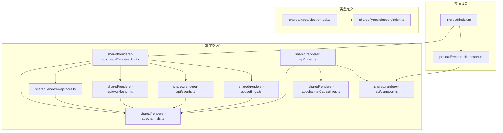
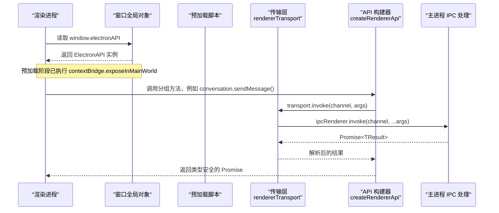
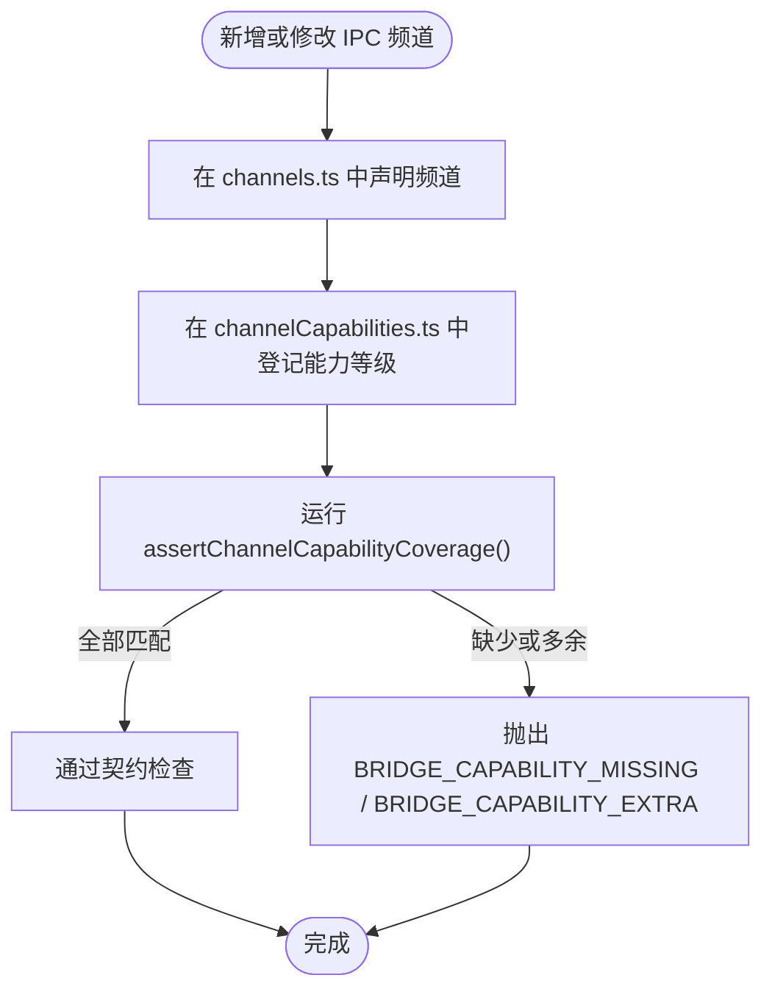
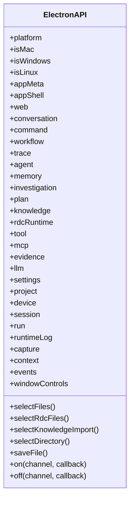
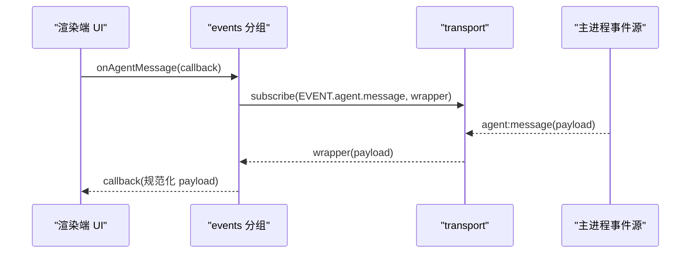
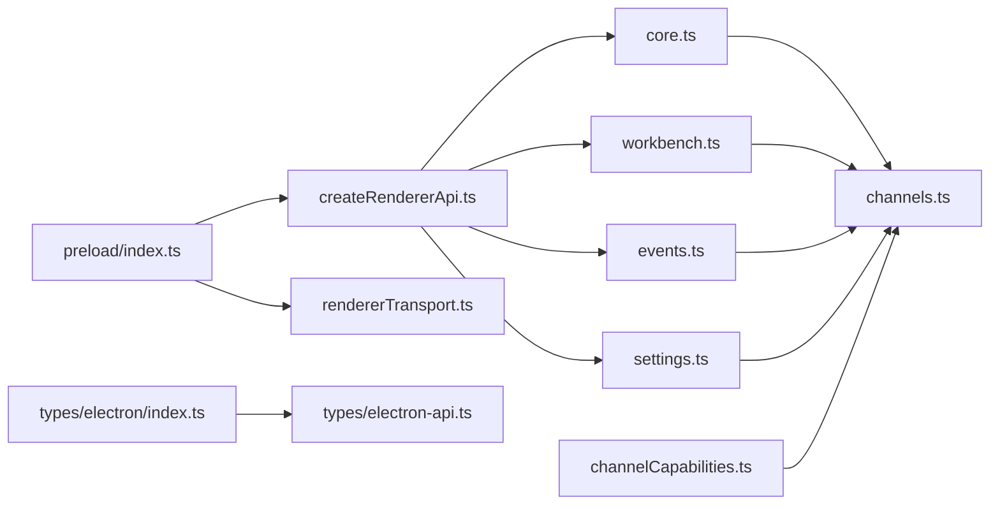

# API 概览与架构

<cite>
**本文引用的文件**   
- [src/preload/index.ts](file://src/preload/index.ts)
- [src/preload/rendererTransport.ts](file://src/preload/rendererTransport.ts)
- [src/shared/renderer-api/createRendererApi.ts](file://src/shared/renderer-api/createRendererApi.ts)
- [src/shared/renderer-api/channels.ts](file://src/shared/renderer-api/channels.ts)
- [src/shared/renderer-api/channelCapabilities.ts](file://src/shared/renderer-api/channelCapabilities.ts)
- [src/shared/renderer-api/transport.ts](file://src/shared/renderer-api/transport.ts)
- [src/shared/renderer-api/core.ts](file://src/shared/renderer-api/core.ts)
- [src/shared/renderer-api/workbench.ts](file://src/shared/renderer-api/workbench.ts)
- [src/shared/renderer-api/events.ts](file://src/shared/renderer-api/events.ts)
- [src/shared/renderer-api/settings.ts](file://src/shared/renderer-api/settings.ts)
- [src/shared/renderer-api/index.ts](file://src/shared/renderer-api/index.ts)
- [src/shared/types/electron-api.ts](file://src/shared/types/electron-api.ts)
- [src/shared/types/electron/index.ts](file://src/shared/types/electron/index.ts)
</cite>

## 目录
1. [引言](#引言)
2. [项目结构](#项目结构)
3. [核心组件](#核心组件)
4. [架构总览](#架构总览)
5. [详细组件分析](#详细组件分析)
6. [依赖关系分析](#依赖关系分析)
7. [性能与可靠性特征](#性能与可靠性特征)
8. [最佳实践与常见陷阱](#最佳实践与常见陷阱)
9. [故障排查指南](#故障排查指南)
10. [结论](#结论)

## 引言
本文件面向 Renderer 进程开发者，系统性说明预加载层暴露给渲染进程的受控接口整体架构。重点包括：
- `createRendererApi` 如何组装 ElectronAPI；
- 平台信息注入 `platform/isMac/isWindows/isLinux`；
- ElectronAPI 的分组命名与职责边界；
- transport 抽象层、channelCapabilities 能力发现机制及其使用限制；
- 完整的 API 树形结构与依赖关系；
- 扩展新 API 时的正确姿势和常见陷阱。

该文档不直接粘贴源码，而是通过路径引用定位实现位置，便于在仓库中交叉查阅。

## 项目结构
Renderer API 的核心由“预加载脚本”“共享 API 构建器”“通道常量”“能力矩阵”“类型定义”五个部分组成：

**图示来源**
- [src/preload/index.ts:1-25](file://src/preload/index.ts#L1-L25)
- [src/preload/rendererTransport.ts:1-44](file://src/preload/rendererTransport.ts#L1-L44)
- [src/shared/renderer-api/createRendererApi.ts:1-80](file://src/shared/renderer-api/createRendererApi.ts#L1-L80)
- [src/shared/renderer-api/channels.ts:1-271](file://src/shared/renderer-api/channels.ts#L1-L271)
- [src/shared/renderer-api/channelCapabilities.ts:1-202](file://src/shared/renderer-api/channelCapabilities.ts#L1-L202)
- [src/shared/renderer-api/transport.ts:1-11](file://src/shared/renderer-api/transport.ts#L1-L11)
- [src/shared/renderer-api/core.ts:1-167](file://src/shared/renderer-api/core.ts#L1-L167)
- [src/shared/renderer-api/workbench.ts:1-99](file://src/shared/renderer-api/workbench.ts#L1-L99)
- [src/shared/renderer-api/events.ts:1-88](file://src/shared/renderer-api/events.ts#L1-L88)
- [src/shared/renderer-api/settings.ts:1-86](file://src/shared/renderer-api/settings.ts#L1-L86)
- [src/shared/renderer-api/index.ts:1-17](file://src/shared/renderer-api/index.ts#L1-L17)
- [src/shared/types/electron/index.ts:1-19](file://src/shared/types/electron/index.ts#L1-L19)
- [src/shared/types/electron-api.ts:1-32](file://src/shared/types/electron-api.ts#L1-L32)

**章节来源**
- [src/preload/index.ts:1-25](file://src/preload/index.ts#L1-L25)
- [src/shared/renderer-api/index.ts:1-17](file://src/shared/renderer-api/index.ts#L1-L17)

## 核心组件
- 预加载入口：将 Node 平台的 `process.platform` 传入 `createRendererApi`，并调用 `contextBridge.exposeInMainWorld` 把最终对象挂载到 `window.electronAPI`。同时额外暴露 `rdcDesktop.getPathForFile`。
- 传输层：`createIpcRendererTransport` 封装 `ipcRenderer.invoke` 与 `ipcRenderer.on/off/removeAllListeners`，并对事件回调做参数透传包装，维护监听映射表。
- API 构建器：`createRendererApi(platform, transport)` 组装平台属性与各功能分组对象。
- 通道常量：集中声明所有 IPC 频道字符串，分为 `RENDERER_INVOKE_CHANNEL` 与 `RENDERER_EVENT_CHANNEL`。
- 能力矩阵：`CHANNEL_CAPABILITY` 为每个 invoke 频道标注能力等级，并提供校验与查询工具。
- 分组模块：按领域拆分为 appMeta/appShell/web/dialog/windowControls/conversation/workflow/agent/memory/investigation/plan/knowledge/command/tools/mcp/evidence/llm/settings/project/device/session/run/runtimeLog/capture/context/trace 等。
- 事件订阅：`events.ts` 提供语义化的 `onXxx` 订阅方法，内部基于 `RENDERER_EVENT_CHANNEL` 转发。
- 类型系统：ElectronAPI 的类型定义集中在 `shared/types/electron`，并通过 `electron-api.ts` 重新导出供业务侧使用。

**章节来源**
- [src/preload/index.ts:1-25](file://src/preload/index.ts#L1-L25)
- [src/preload/rendererTransport.ts:1-44](file://src/preload/rendererTransport.ts#L1-L44)
- [src/shared/renderer-api/createRendererApi.ts:1-80](file://src/shared/renderer-api/createRendererApi.ts#L1-L80)
- [src/shared/renderer-api/channels.ts:1-271](file://src/shared/renderer-api/channels.ts#L1-L271)
- [src/shared/renderer-api/channelCapabilities.ts:1-202](file://src/shared/renderer-api/channelCapabilities.ts#L1-L202)
- [src/shared/renderer-api/transport.ts:1-11](file://src/shared/renderer-api/transport.ts#L1-L11)
- [src/shared/renderer-api/core.ts:1-167](file://src/shared/renderer-api/core.ts#L1-L167)
- [src/shared/renderer-api/workbench.ts:1-99](file://src/shared/renderer-api/workbench.ts#L1-L99)
- [src/shared/renderer-api/events.ts:1-88](file://src/shared/renderer-api/events.ts#L1-L88)
- [src/shared/renderer-api/settings.ts:1-86](file://src/shared/renderer-api/settings.ts#L1-L86)
- [src/shared/types/electron-api.ts:1-32](file://src/shared/types/electron-api.ts#L1-L32)

## 架构总览
Renderer 进程不应直接访问 `ipcRenderer`，而应通过 `window.electronAPI` 调用受控 API。预加载层是安全边界，负责：
1. 获取 Node 平台信息；
2. 构造 transport；
3. 调用 `createRendererApi` 生成统一 API 对象；
4. 通过 `contextBridge` 暴露给渲染进程。

**图示来源**
- [src/preload/index.ts:1-25](file://src/preload/index.ts#L1-L25)
- [src/preload/rendererTransport.ts:1-44](file://src/preload/rendererTransport.ts#L1-L44)
- [src/shared/renderer-api/createRendererApi.ts:1-80](file://src/shared/renderer-api/createRendererApi.ts#L1-L80)

## 详细组件分析

### 预加载层与平台信息注入
预加载脚本的职责非常克制：仅使用 `contextBridge`、`webUtils` 和 `process.platform`。它调用 `createRendererApi(process.platform, transport)`，并将结果挂载到 `window.electronAPI`。此外，还暴露 `rdcDesktop.getPathForFile`，用于从 File 对象获取文件系统路径。

`createRendererApi` 会向 ElectronAPI 注入：
- `platform`：NodeJS.Platform；
- `isMac`：是否 Darwin；
- `isWindows`：是否 win32；
- `isLinux`：是否 linux。

这些字段让渲染端无需再次判断平台，也避免直接依赖 Node 环境。

**章节来源**
- [src/preload/index.ts:1-25](file://src/preload/index.ts#L1-L25)
- [src/shared/renderer-api/createRendererApi.ts:1-80](file://src/shared/renderer-api/createRendererApi.ts#L1-L80)

### Transport 抽象层
`RendererApiTransport` 定义了四个关键操作：
- `invoke(channel, ...args)`：请求响应式调用；
- `subscribe(channel, callback)`：订阅事件并返回取消函数；
- `addListener/removeListener/removeAllListeners`：底层事件管理，方便 API 分组或测试替换。

预加载实现基于 `ipcRenderer.invoke` 和 `ipcRenderer.on/off/removeAllListeners`，并为事件回调添加一层包装，以去掉 Electron 原始事件参数，只透传业务数据。

这种抽象允许：
- 测试时替换为内存通道；
- 未来切换 IPC 实现而不影响上层 API；
- 对事件监听生命周期进行集中管理。

**章节来源**
- [src/shared/renderer-api/transport.ts:1-11](file://src/shared/renderer-api/transport.ts#L1-L11)
- [src/preload/rendererTransport.ts:1-44](file://src/preload/rendererTransport.ts#L1-L44)

### 通道常量与事件通道
`channels.ts` 集中维护两类通道：
- `RENDERER_INVOKE_CHANNEL`：结构化分组，键名对应 API 方法名，值为主进程 IPC channel 字符串；
- `RENDERER_EVENT_CHANNEL`：事件通道，供 `events.ts` 和分组方法中的 `onEvent/offEvent` 使用。

这种设计带来三个好处：
1. 避免在业务代码中出现硬编码字符串；
2. 类型化约束使新增通道必须显式声明；
3. 能力矩阵和审计脚本可以基于这些常量生成契约。

**章节来源**
- [src/shared/renderer-api/channels.ts:1-271](file://src/shared/renderer-api/channels.ts#L1-L271)
- [src/shared/renderer-api/events.ts:1-88](file://src/shared/renderer-api/events.ts#L1-L88)

### 能力发现与 channelCapabilities 机制
`channelCapabilities.ts` 维护 `CHANNEL_CAPABILITY` 映射，将每个 invoke 频道分类为：
- `read`：仅读取状态；
- `mutation`：变更状态；
- `high-impact`：高影响操作，如权限、信任、导入导出、模型配置；
- `desktop-only`：桌面端专属能力，浏览器场景不可用。

配套工具函数包括：
- `hasBridgeChannelCapability(channel)`：运行时判断是否已知频道；
- `resolveBridgeChannelCapability(channel)`：查询能力等级，未知频道抛出错误；
- `listUnclassifiedInvokeChannels()`：列出未登记频道；
- `assertChannelCapabilityCoverage()`：确保“所有 invoke 频道都有能力标记，且没有多余标记”。

这意味着：
- 新增 IPC 频道必须在 `channels.ts` 和 `channelCapabilities.ts` 同步登记；
- 否则编译期或启动期会失败，属于 fail-closed 设计；
- 安全策略、审计脚本、浏览器 QA 可据此决定是否放行某类操作。

**图示来源**
- [src/shared/renderer-api/channels.ts:1-271](file://src/shared/renderer-api/channels.ts#L1-L271)
- [src/shared/renderer-api/channelCapabilities.ts:1-202](file://src/shared/renderer-api/channelCapabilities.ts#L1-L202)

**章节来源**
- [src/shared/renderer-api/channelCapabilities.ts:1-202](file://src/shared/renderer-api/channelCapabilities.ts#L1-L202)

### API 分组与命名约定

#### 顶层 ElectronAPI 树
`createRendererApi` 返回的对象包含以下顶层成员：

- 平台信息：`platform`、`isMac`、`isWindows`、`isLinux`
- 应用元信息：`appMeta`
- 应用外壳：`appShell`
- Web 相关：`web`
- 对话：`conversation`
- 命令：`command`
- 对话框快捷方法：`selectFiles`、`selectRdcFiles`、`selectKnowledgeImport`、`selectDirectory`、`saveFile`
- 工作流：`workflow`
- 追踪：`trace`
- Agent：`agent`
- 记忆：`memory`
- 调查：`investigation`
- 计划：`plan`
- 知识：`knowledge`
- RDC 运行时：`rdcRuntime`
- 工具：`tool`
- MCP：`mcp`
- 证据：`evidence`
- LLM：`llm`
- 设置：`settings`
- 项目：`project`
- 设备：`device`
- 会话：`session`
- 运行：`run`
- 运行时日志：`runtimeLog`
- 捕获：`capture`
- 上下文：`context`
- 事件订阅：`events`
- 窗口控制：`windowControls`
- 事件监听：`on(channel, callback)`、`off(channel, callback)`

其中 `on/off` 会先通过 `isRendererEventChannel` 校验频道，只有合法事件频道才转发到底层 transport。

**图示来源**
- [src/shared/renderer-api/createRendererApi.ts:1-80](file://src/shared/renderer-api/createRendererApi.ts#L1-L80)

**章节来源**
- [src/shared/renderer-api/createRendererApi.ts:1-80](file://src/shared/renderer-api/createRendererApi.ts#L1-L80)

#### 分组职责划分

| 分组 | 主要职责 | 典型能力示例 |
|---|---|---|
| `appMeta` | 应用元数据读取 | 获取应用元信息 |
| `appShell` | 桌面外壳交互 | 打开路径、复制文本、选择头像、读取剪贴板 |
| `web` | Web 资源辅助 | 解析 favicon |
| `dialog` | 文件对话框 | 选择文件、保存文件、选择 RDC 文件、选择知识库导入 |
| `windowControls` | 窗口控制 | 最小化、最大化切换、关闭窗口、查询最大化状态 |
| `conversation` | 对话与会话流程 | 发送消息、重写消息、取消回合、回答输入、切换分支、历史查询、附件管理 |
| `workflow` | 工作流状态与执行 | 获取状态、恢复、停止、用量、运行列表 |
| `agent` | Agent 生命周期与状态 | 发消息、查询状态、批量状态、配置 |
| `memory` | 记忆存储与审批令牌 | 写入、读取、删除、颁发令牌 |
| `investigation` | 调查内容 | 读取、列表 |
| `plan` | 计划读写与导出 | 读取、颁发令牌、保存到项目、导出 |
| `knowledge` | 知识库检索与管理 | 查询、卡片、编译、索引重建、候选、导入、写、提升、导出 |
| `command` | 命令系统 | 列举、执行 |
| `tool` | 工具目录与安装检测 | 获取目录、运行摘要、检测安装、解析安装、验证安装 |
| `mcp` | MCP 状态摘要 | 获取 MCP 状态 |
| `evidence` | 证据链与事件 | 获取证据链、获取事件 |
| `llm` | 大模型提供商与账号 | 测试草稿、连接、刷新模型、登出、登录流程 |
| `settings` | 设置与配置 | 获取设置、模型覆盖、Provider 定义、Agent 清单、Shell 解析 |
| `project` | 项目管理与输入源 | 增删改查、输入项导入/引用/移除 |
| `device` | 设备管理与监视 | 列表、刷新、开启/续期/停止监视 |
| `session` | 会话管理 | 创建、重命名、选择、覆盖模型、切换 Agent |
| `run` | 运行记录 | 列表 |
| `runtimeLog` | 运行时日志 | 列表 |
| `capture` | 录制与回放 | 列表、选择、预览、回放帧、回放状态、项目输入联动 |
| `context` | 上下文快照 | 获取上下文 |
| `trace` | Agentic Trace | 获取运行、事件、投影、导出、切换分支 |
| `events` | 事件订阅 | 代理主题、Agent、工具、设备、捕获、运行时日志等事件 |

**章节来源**
- [src/shared/renderer-api/core.ts:1-167](file://src/shared/renderer-api/core.ts#L1-L167)
- [src/shared/renderer-api/workbench.ts:1-99](file://src/shared/renderer-api/workbench.ts#L1-L99)
- [src/shared/renderer-api/settings.ts:1-86](file://src/shared/renderer-api/settings.ts#L1-L86)
- [src/shared/renderer-api/events.ts:1-88](file://src/shared/renderer-api/events.ts#L1-L88)

#### 命名约定
- 分组名称采用小写名词或名词短语，表示一个领域；
- 方法名采用动词+名词或动作描述，如 `sendMessage`、`getHistory`、`switchBranch`；
- 子命名空间如 `project.inputs.*`、`capture.getReplaySelection` 表示更细粒度的能力；
- 所有 IPC 频道字符串集中在 `channels.ts`，禁止在业务代码中手写；
- 能力等级集中在 `channelCapabilities.ts`，禁止在业务逻辑中自行推断；
- 类型定义与实现分离：`core.ts`、`workbench.ts`、`settings.ts` 负责实现，`shared/types/electron` 负责类型。

**章节来源**
- [src/shared/renderer-api/channels.ts:1-271](file://src/shared/renderer-api/channels.ts#L1-L271)
- [src/shared/renderer-api/channelCapabilities.ts:1-202](file://src/shared/renderer-api/channelCapabilities.ts#L1-L202)
- [src/shared/types/electron/index.ts:1-19](file://src/shared/types/electron/index.ts#L1-L19)

### 事件订阅模型
`events.ts` 提供语义化的订阅方法，例如：
- `onDelegationTraceChanged`
- `onRunStatusChanged`
- `onRunUsageChanged`
- `onTraceProjectionChanged`
- `onEffectiveCatalogChanged`
- `onAgentMessage`
- `onAgentStatusChanged`
- `onToolExecutionComplete`
- `onEvidenceEventAdded`
- `onDeviceStatusChanged`
- `onCaptureStatusChanged`
- `onContextChanged`
- `onProjectInputsChanged`
- `onProjectInputsError`
- `onCaptureReplayChanged`
- `onOpenedCaptureStateChanged`
- `onRuntimeLogAppended`
- `onAppThemeChanged`

这些方法内部调用 `transport.subscribe`，并把原始 payload 转为更明确的业务类型。`events` 分组还提供 `removeAllListeners(channel)`，便于一次性清理某个频道的所有监听器。

**图示来源**
- [src/shared/renderer-api/events.ts:1-88](file://src/shared/renderer-api/events.ts#L1-L88)
- [src/preload/rendererTransport.ts:1-44](file://src/preload/rendererTransport.ts#L1-L44)

**章节来源**
- [src/shared/renderer-api/events.ts:1-88](file://src/shared/renderer-api/events.ts#L1-L88)

## 依赖关系分析

**图示来源**
- [src/shared/renderer-api/createRendererApi.ts:1-80](file://src/shared/renderer-api/createRendererApi.ts#L1-L80)
- [src/shared/renderer-api/core.ts:1-167](file://src/shared/renderer-api/core.ts#L1-L167)
- [src/shared/renderer-api/workbench.ts:1-99](file://src/shared/renderer-api/workbench.ts#L1-L99)
- [src/shared/renderer-api/events.ts:1-88](file://src/shared/renderer-api/events.ts#L1-L88)
- [src/shared/renderer-api/settings.ts:1-86](file://src/shared/renderer-api/settings.ts#L1-L86)
- [src/shared/renderer-api/channels.ts:1-271](file://src/shared/renderer-api/channels.ts#L1-L271)
- [src/shared/renderer-api/channelCapabilities.ts:1-202](file://src/shared/renderer-api/channelCapabilities.ts#L1-L202)
- [src/preload/index.ts:1-25](file://src/preload/index.ts#L1-L25)
- [src/preload/rendererTransport.ts:1-44](file://src/preload/rendererTransport.ts#L1-L44)
- [src/shared/types/electron/index.ts:1-19](file://src/shared/types/electron/index.ts#L1-L19)
- [src/shared/types/electron-api.ts:1-32](file://src/shared/types/electron-api.ts#L1-L32)

耦合特点：
- `createRendererApi` 是聚合点，但只依赖分组工厂函数，不直接关心具体 IPC 细节；
- 所有分组都依赖 `channels.ts`，形成稳定的“常量中心”；
- `channelCapabilities.ts` 独立于实现，只依赖通道常量，适合被测试、审计、安全策略复用；
- 预加载层只依赖 `createRendererApi` 和 `rendererTransport`，保持最小攻击面；
- 类型定义位于 `shared/types`，与实现解耦，便于跨进程契约对齐。

潜在风险：
- 如果新增频道但未更新 `channelCapabilities.ts`，会在运行时或契约检查阶段失败；
- 如果事件频道未注册到 `RENDERER_EVENT_CHANNEL`，`on/off` 会被过滤；
- 如果分组直接拼接字符串而非使用 `INVOKE`，将破坏类型安全和能力审计。

**章节来源**
- [src/shared/renderer-api/createRendererApi.ts:1-80](file://src/shared/renderer-api/createRendererApi.ts#L1-L80)
- [src/shared/renderer-api/channelCapabilities.ts:1-202](file://src/shared/renderer-api/channelCapabilities.ts#L1-L202)
- [src/shared/renderer-api/channels.ts:1-271](file://src/shared/renderer-api/channels.ts#L1-L271)

## 性能与可靠性特征
- 调用路径短：渲染端 → ElectronAPI 分组 → transport → `ipcRenderer.invoke`，无复杂中间路由。
- 事件监听集中：transport 维护回调映射，避免重复监听和泄漏。
- 能力检查 fail-closed：未知频道直接抛错，适合安全策略拦截高风险能力。
- 类型安全：分组方法签名与 IPC 参数一一对应，减少运行时序列化歧义。
- 平台判断前置：平台信息在构建阶段注入，渲染端无需再判断 Node 环境。

优化建议：
- 高频低延迟调用应避免频繁创建请求对象；
- 长生命周期事件订阅应在组件卸载时主动取消；
- 高影响操作应在 UI 层二次确认；
- 对 `settings.set`、`knowledge.write`、`rdcRuntime` 等 high-impact 操作增加幂等性与重试上限。

[本节为通用性能讨论，不直接分析具体文件]

## 最佳实践与常见陷阱

### 推荐做法
1. 始终通过 `window.electronAPI` 调用，不要引入 `ipcRenderer`。
2. 新增能力时同时更新：
   - `channels.ts` 中的频道常量；
   - `channelCapabilities.ts` 中的能力等级；
   - 对应的分组实现；
   - 类型定义（如需新增接口）。
3. 使用分组方法而不是手动拼接 channel 字符串。
4. 对 `events` 订阅使用语义化方法，如 `onAgentMessage`、`onRuntimeLogAppended`。
5. 在高影响操作上添加用户确认和错误提示。
6. 使用 `platform/isMac/isWindows/isLinux` 做平台分支，而不是直接读取 `process.platform`。
7. 对异步调用使用 `try/catch` 或 `.catch`，避免未捕获 Promise 拒绝。

### 常见陷阱
- 忘记在 `channelCapabilities.ts` 登记频道，导致 `BRIDGE_CAPABILITY_MISSING`。
- 新增多余的能力标记，导致 `BRIDGE_CAPABILITY_EXTRA`。
- 直接使用 `electronAPI.events.on(...)` 而未通过 `isRendererEventChannel`，导致事件被过滤。
- 在浏览器环境中调用 `desktop-only` 能力。
- 忽略 `events.removeAllListeners(channel)`，造成监听器泄漏。
- 误以为 `selectFiles` 等方法可以直接绕过 `dialog` 分组；它们只是便捷方法，实际仍走 `dialog` 通道。
- 在渲染端直接比较 `platform === 'darwin'`，而不是使用 `isMac`。

**章节来源**
- [src/shared/renderer-api/channelCapabilities.ts:1-202](file://src/shared/renderer-api/channelCapabilities.ts#L1-L202)
- [src/shared/renderer-api/createRendererApi.ts:1-80](file://src/shared/renderer-api/createRendererApi.ts#L1-L80)
- [src/shared/renderer-api/events.ts:1-88](file://src/shared/renderer-api/events.ts#L1-L88)

## 故障排查指南

### 常见问题定位
1. **无法找到 electronAPI**  
   检查预加载脚本是否成功执行，以及 `contextBridge.exposeInMainWorld('electronAPI', ...)` 是否被调用。

2. **调用方法报通道不存在或能力缺失**  
   检查是否新增频道但未更新 `channelCapabilities.ts`，并运行能力覆盖检查。

3. **事件不触发**  
   确认使用的频道是否在 `RENDERER_EVENT_CHANNEL` 中，并通过 `events` 分组或 `on/off` 正确订阅。

4. **平台判断不正确**  
   检查是否使用了 `isMac/isWindows/isLinux`，而不是直接访问 Node 平台属性。

5. **调试 IPC 调用**  
   可通过 transport 的 `invoke` 行为结合主进程日志定位问题；测试时可替换 transport 为内存实现。

**章节来源**
- [src/preload/index.ts:1-25](file://src/preload/index.ts#L1-L25)
- [src/shared/renderer-api/channelCapabilities.ts:1-202](file://src/shared/renderer-api/channelCapabilities.ts#L1-L202)
- [src/shared/renderer-api/channels.ts:1-271](file://src/shared/renderer-api/channels.ts#L1-L271)

## 结论
Renderer API 的整体架构围绕“预加载安全边界 + 共享 API 构建器 + 通道常量 + 能力矩阵 + 类型契约”展开。`createRendererApi` 是装配中心，`channels.ts` 是通道契约中心，`channelCapabilities.ts` 是能力治理中心，`events.ts` 是事件语义化中心。这个分层使得渲染进程既能获得丰富、类型安全的桌面能力，又能保证安全边界清晰、能力可审计、扩展成本可控。

扩展新 API 的正确路径是：定义类型 → 声明频道 → 登记能力 → 实现分组 → 暴露到 `createRendererApi` → 在渲染端通过 `window.electronAPI` 调用。遵循这一路径，可以避免大多数安全、类型和可维护性问题。

[本节为总结性内容，不直接分析具体文件]