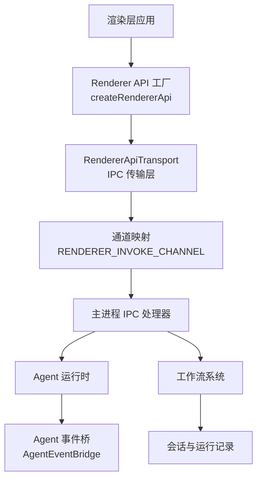
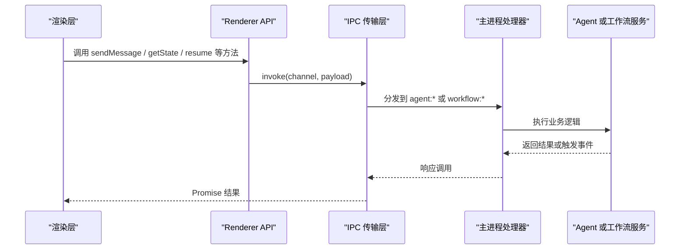
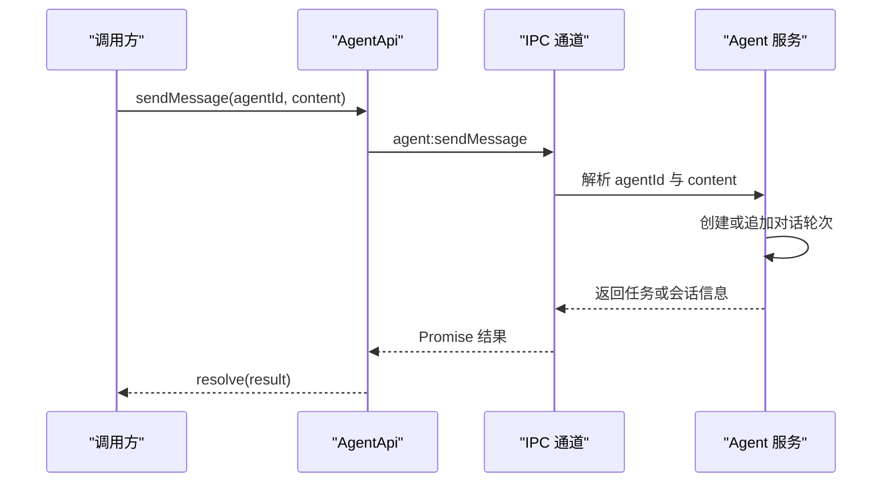
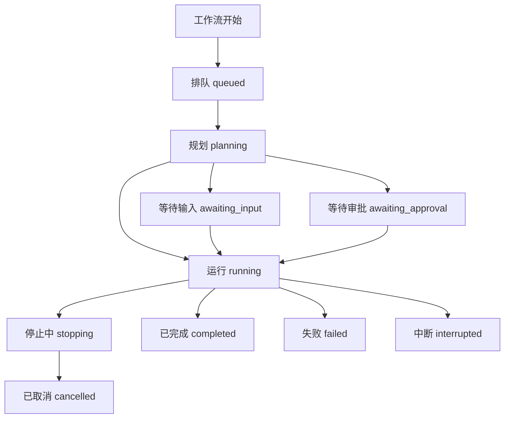
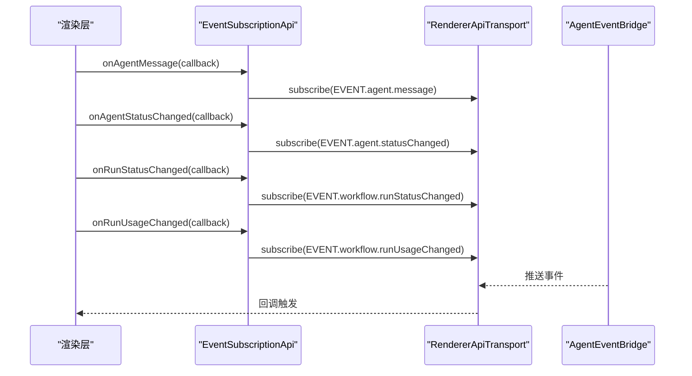
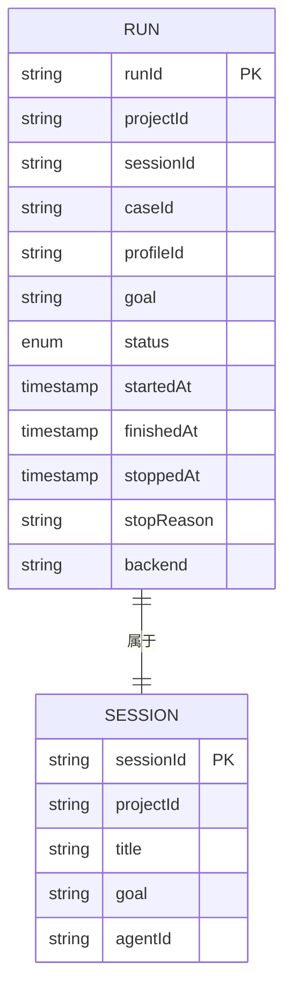
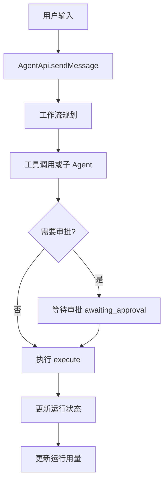
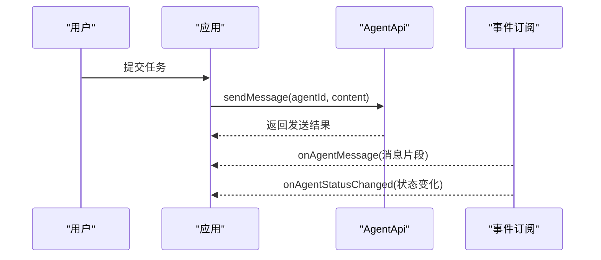
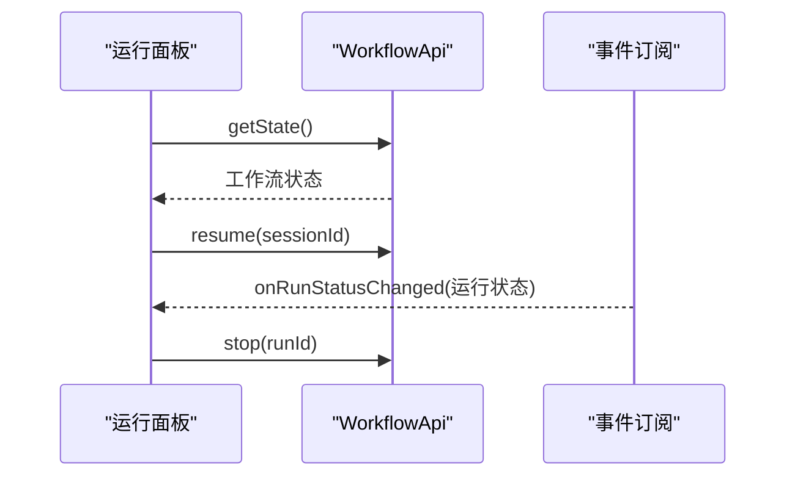
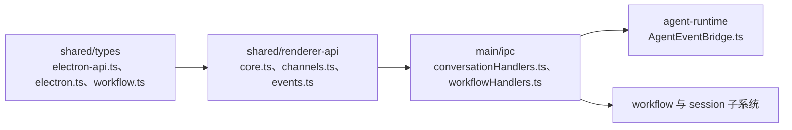

# Agent 与工作流 API

<cite>
**本文引用的文件**   
- [core.ts](file://src/shared/renderer-api/core.ts)
- [events.ts](file://src/shared/renderer-api/events.ts)
- [channels.ts](file://src/shared/renderer-api/channels.ts)
- [electron-api.ts](file://src/shared/types/electron-api.ts)
- [workflow.ts（类型别名）](file://src/shared/types/electron/workflow.ts)
- [electron.ts（ElectronAPI 定义入口）](file://src/shared/types/electron.ts)
- [session.ts（会话与运行状态类型）](file://src/shared/types/session.ts)
- [agentRuntime.ts（Agent 运行时类型）](file://src/shared/types/agentRuntime.ts)
- [conversationHandlers.ts（对话处理入口）](file://src/main/ipc/conversationHandlers.ts)
- [workflowHandlers.ts（工作流 IPC 处理器）](file://src/main/ipc/workflowHandlers.ts)
- [AgentEventBridge.ts（Agent 事件桥）](file://src/main/agent-runtime/AgentEventBridge.ts)
- [WorkflowApi 使用测试](file://src/renderer/stores/workflowStore.test.ts)
</cite>

## 目录
1. [引言](#引言)
2. [项目结构定位](#项目结构定位)
3. [核心 API 概览](#核心-api-概览)
4. [架构总览](#架构总览)
5. [AgentApi 详解](#agentapi-详解)
6. [WorkflowApi 详解](#workflowapi-详解)
7. [事件订阅机制](#事件订阅机制)
8. [Agent 状态、工作流状态与运行上下文](#agent-状态工作流状态与运行上下文)
9. [Agent 配置格式与工作流编排模式](#agent-配置格式与工作流编排模式)
10. [错误恢复策略](#错误恢复策略)
11. [实际使用案例](#实际使用案例)
12. [依赖关系分析](#依赖关系分析)
13. [性能与可观测性建议](#性能与可观测性建议)
14. [故障排查指南](#故障排查指南)
15. [结论](#结论)

## 引言
本文面向需要调用或扩展 RDC Agent 与工作流能力的开发者，说明渲染层如何暴露 `AgentApi` 和 `WorkflowApi`，以及主进程如何通过 IPC 通道将这些能力路由到实际的 Agent 运行时和工作流系统。重点包括：
- `AgentApi.sendMessage`、`getState`、`getAllStates`、`configure` 的调用方式与参数语义。
- `WorkflowApi.getState`、`resume`、`stop`、`getRunUsage`、`listRuns`、`listActiveRuns` 的生命周期语义。
- Agent 状态机、工作流执行状态、运行上下文的概念边界。
- `onAgentMessage`、`onAgentStatusChanged`、`onRunStatusChanged`、`onRunUsageChanged` 的事件结构与触发时机。
- Agent 配置格式、工作流编排模式、错误恢复策略。
- 可复用的编排与控制示例。

## 项目结构定位
本项目的 Agent 与工作流能力位于“渲染层 API 适配”和“主进程 IPC 处理”之间：
- 渲染层通过共享类型 `AgentApi` 和 `WorkflowApi` 暴露方法。
- `createRendererApi` 中的工厂函数把方法包装为基于 `RendererApiTransport` 的 RPC 调用。
- IPC 通道名称集中在 `RENDERER_INVOKE_CHANNEL`，例如 `agent:sendMessage`、`workflow:getState`。
- 主进程侧由 IPC 处理器转发到会话、工作流、Agent 运行时等子系统。

**图表来源**
- [core.ts:1-167](file://src/shared/renderer-api/core.ts#L1-L167)
- [channels.ts:1-200](file://src/shared/renderer-api/channels.ts#L1-L200)
- [events.ts:1-88](file://src/shared/renderer-api/events.ts#L1-L88)

**章节来源**
- [core.ts:1-167](file://src/shared/renderer-api/core.ts#L1-L167)
- [channels.ts:1-200](file://src/shared/renderer-api/channels.ts#L1-L200)
- [electron-api.ts:1-32](file://src/shared/types/electron-api.ts#L1-L32)

## 核心 API 概览
| API | 方法 | 主要用途 | 典型返回值或副作用 |
|---|---|---|---|
| `AgentApi` | `sendMessage(agentId, content)` | 向指定 Agent 发送消息并触发一轮或多轮 Agent 执行 | Promise，包含发送结果或任务标识 |
| `AgentApi` | `getState(agentId, sessionId?)` | 查询单个 Agent 的状态快照 | Promise，返回 `AgentState` 或空值 |
| `AgentApi` | `getAllStates()` | 获取所有已注册 Agent 的状态集合 | Promise，返回状态映射 |
| `AgentApi` | `configure(agentId, config)` | 更新 Agent 配置 | Promise，返回配置生效结果 |
| `WorkflowApi` | `getState()` | 获取当前工作流全局状态 | Promise，返回工作流状态对象 |
| `WorkflowApi` | `resume(sessionId)` | 恢复某个会话对应的工作流执行 | Promise，表示恢复请求是否接受 |
| `WorkflowApi` | `stop(runId)` | 停止指定运行实例 | Promise，表示停止请求是否接受 |
| `WorkflowApi` | `getRunUsage(request)` | 查询某次运行的资源使用情况 | Promise，返回用量摘要 |
| `WorkflowApi` | `listRuns()` | 列出历史运行记录 | Promise，返回运行列表 |
| `WorkflowApi` | `listActiveRuns()` | 列出当前活跃运行 | Promise，返回活跃运行列表 |

这些方法的实现本质上是渲染层对主进程 IPC 的封装；真正的业务逻辑在 Electron 主进程的 Agent 运行时与工作流系统中。

**章节来源**
- [core.ts:70-110](file://src/shared/renderer-api/core.ts#L70-L110)
- [electron-api.ts:1-32](file://src/shared/types/electron-api.ts#L1-L32)

## 架构总览
Agent 与工作流 API 的调用路径分为三层：
1. **渲染层 API 层**：`createAgentApi`、`createWorkflowApi` 提供稳定接口。
2. **通道层**：`RENDERER_INVOKE_CHANNEL` 将方法名映射到 IPC channel。
3. **主进程服务层**：IPC 处理器根据 channel 路由到会话、Agent、工作流等服务。

**图表来源**
- [core.ts:70-110](file://src/shared/renderer-api/core.ts#L70-L110)
- [channels.ts:1-200](file://src/shared/renderer-api/channels.ts#L1-L200)

**章节来源**
- [core.ts:1-167](file://src/shared/renderer-api/core.ts#L1-L167)
- [channels.ts:1-200](file://src/shared/renderer-api/channels.ts#L1-L200)

## AgentApi 详解

### 方法语义

#### `sendMessage(agentId, content)`
- `agentId`：目标 Agent 的角色标识。
- `content`：用户输入内容，通常作为 Agent 的一轮新输入。
- 行为：创建或延续一个 Agent 对话任务，可能触发规划、工具调用、子 Agent 委派等工作流阶段。
- 适用场景：从编辑器、命令面板、自动化脚本中发起一次 Agent 对话。

#### `getState(agentId, sessionId?)`
- `agentId`：要查询的 Agent。
- `sessionId`：可选会话标识；不传时返回默认或最近关联状态。
- 返回：`AgentState` 或空值。
- 适用场景：刷新 UI、判断 Agent 是否空闲、是否需要等待完成。

#### `getAllStates()`
- 返回所有 Agent 的状态快照。
- 适用场景：多 Agent 工作台、并行调试任务、批量状态监控。

#### `configure(agentId, config)`
- `config`：部分 `AgentConfig`，用于覆盖 Agent 的行为、模型、权限或能力开关。
- 返回：配置生效结果，通常用于确认修改是否成功。
- 适用场景：动态切换模型、关闭某些技能、调整 Agent 行为策略。

### 参数规范与约束
- `agentId` 是字符串形式的 Agent 角色标识，必须与已注册 Agent 一致。
- `content` 是文本型输入，具体语义取决于 Agent 的设计契约。
- `config` 是 `Partial<AgentConfig>`，只覆盖传入字段，不会清空未传字段。
- 所有方法均返回 Promise，调用方应处理异常与超时。

### 调用流程示意

**图表来源**
- [core.ts:90-105](file://src/shared/renderer-api/core.ts#L90-L105)
- [channels.ts:1-200](file://src/shared/renderer-api/channels.ts#L1-L200)

**章节来源**
- [core.ts:90-110](file://src/shared/renderer-api/core.ts#L90-L110)
- [electron.ts:235-265](file://src/shared/types/electron.ts#L235-L265)

## WorkflowApi 详解

### 生命周期方法

#### `getState()`
- 作用：获取当前工作流的全局状态。
- 典型用途：判断是否存在待恢复的运行、当前是否有活跃工作流、是否需要展示暂停或恢复按钮。

#### `resume(sessionId)`
- 作用：恢复指定 `sessionId` 对应的工作流。
- 典型用途：用户在界面点击“继续”后，恢复之前因交互、审批、错误或中断而暂停的任务。

#### `stop(runId)`
- 作用：停止指定 `runId` 对应的运行实例。
- 典型用途：用户取消任务、重试失败任务前清理旧运行、释放资源。

#### `getRunUsage(request)`
- 作用：查询某次运行的资源使用情况，例如模型调用、工具调用、上下文消耗。
- 典型用途：用量统计、成本控制、诊断慢任务。

#### `listRuns()`
- 作用：列出历史运行记录。
- 典型用途：运行历史面板、审计日志、回放选择。

#### `listActiveRuns()`
- 作用：列出当前活跃运行。
- 典型用途：并发控制、运行数量限制、后台任务看板。

### 工作流状态与运行记录
工作流运行记录与状态定义在会话类型中，关键概念包括：
- `RunStatus`：`queued`、`planning`、`awaiting_input`、`awaiting_approval`、`running`、`stopping`、`completed`、`failed`、`cancelled`、`interrupted`。
- `RunRecordBase`：包含运行标识、会话标识、项目标识、目标、捕获项、时间戳、后端、报告路径、诊断信息等。
- `SessionScope`：表示运行所属的项目与会话范围。
- `SessionScopedPayload`：事件载荷携带会话归属。

**图表来源**
- [session.ts:120-180](file://src/shared/types/session.ts#L120-L180)

**章节来源**
- [core.ts:70-90](file://src/shared/renderer-api/core.ts#L70-L90)
- [session.ts:120-180](file://src/shared/types/session.ts#L120-L180)

## 事件订阅机制

### 事件 API
事件订阅由 `createEventSubscriptionApi` 暴露，常用事件如下：

| 事件 | 订阅方法 | 触发时机 | 数据含义 |
|---|---|---|---|
| Agent 消息 | `onAgentMessage` | Agent 产生新消息或输出片段 | 包含 Agent 消息内容，用于增量渲染 |
| Agent 状态变化 | `onAgentStatusChanged` | Agent 状态进入新阶段 | 包含 `AgentState`，用于 UI 状态同步 |
| 运行状态变化 | `onRunStatusChanged` | 工作流运行状态变更 | 包含运行状态与运行标识 |
| 运行用量变化 | `onRunUsageChanged` | 运行资源用量更新 | 包含 `SessionScopedPayload<RunContextUsageSummary>` |

### 事件通道映射
- `EVENT.agent.message`：Agent 消息事件。
- `EVENT.agent.statusChanged`：Agent 状态事件。
- `EVENT.workflow.runStatusChanged`：工作流运行状态事件。
- `EVENT.workflow.runUsageChanged`：工作流运行用量事件。

**图表来源**
- [events.ts:1-88](file://src/shared/renderer-api/events.ts#L1-L88)
- [AgentEventBridge.ts](file://src/main/agent-runtime/AgentEventBridge.ts)

**章节来源**
- [events.ts:1-88](file://src/shared/renderer-api/events.ts#L1-L88)
- [channels.ts:1-200](file://src/shared/renderer-api/channels.ts#L1-L200)

## Agent 状态、工作流状态与运行上下文

### Agent 状态
Agent 状态反映单个 Agent 的生命周期与行为阶段，通常包括：
- 空闲、思考、规划、工具调用、等待用户输入、等待审批、完成、失败等。
- 状态变化通过 `onAgentStatusChanged` 通知渲染层。
- `AgentApi.getState` 可用于主动拉取最新状态。

### 工作流执行状态
工作流状态描述更高层的执行流程，包括：
- 排队、规划、等待输入、等待审批、运行、停止、完成、失败、取消、中断。
- `WorkflowApi.getState` 提供工作流全局状态。
- `onRunStatusChanged` 提供运行状态变更事件。

### 运行上下文
运行上下文包含：
- 项目标识、会话标识、目标、捕获项、运行标识、时间戳、后端、报告路径、诊断信息。
- 运行用量摘要通过 `onRunUsageChanged` 推送，类型为 `SessionScopedPayload<RunContextUsageSummary>`。
- `getRunUsage` 支持按请求查询特定运行用量。

**图表来源**
- [session.ts:120-180](file://src/shared/types/session.ts#L120-L180)

**章节来源**
- [session.ts:120-180](file://src/shared/types/session.ts#L120-L180)
- [agentRuntime.ts](file://src/shared/types/agentRuntime.ts)

## Agent 配置格式与工作流编排模式

### Agent 配置格式
- `AgentApi.configure` 接收 `Partial<AgentConfig>`。
- 配置用于覆盖 Agent 的模型、能力、权限、行为开关等。
- 推荐做法：
  - 先读取 `AgentApi.getAllStates` 或相关配置查询接口，了解当前配置。
  - 只传入需要变更的字段。
  - 在 UI 上显示配置变更结果与错误信息。

### 工作流编排模式
工作流编排围绕会话与运行展开：
- 用户输入通过 `AgentApi.sendMessage` 启动或延续任务。
- 工作流在规划阶段决定工具调用、子 Agent、审批点。
- 运行状态通过 `onRunStatusChanged` 驱动界面。
- 用量通过 `onRunUsageChanged` 驱动成本与性能监控。

**图表来源**
- [core.ts:70-110](file://src/shared/renderer-api/core.ts#L70-L110)
- [session.ts:120-180](file://src/shared/types/session.ts#L120-L180)

**章节来源**
- [core.ts:70-110](file://src/shared/renderer-api/core.ts#L70-L110)
- [session.ts:120-180](file://src/shared/types/session.ts#L120-L180)

## 错误恢复策略
工作流状态中包含 `failed`、`cancelled`、`interrupted`、`stopping` 等状态，体现不同错误与恢复路径：
- `failed`：执行失败，可通过重试、修复输入或调整 Agent 配置恢复。
- `cancelled`：被用户或系统取消，通常需要重新发起。
- `interrupted`：被外部中断，可能需要检查资源或依赖。
- `stopping`：正在停止，应避免重复调用 `stop`。
- `awaiting_input`、`awaiting_approval`：需要用户交互恢复，适合通过 `resume` 或对话应答恢复。

恢复建议：
1. 监听 `onRunStatusChanged`，当状态变为非活跃终态时提示用户。
2. 使用 `listActiveRuns` 判断是否存在冲突运行。
3. 使用 `getRunUsage` 诊断高延迟或高成本运行。
4. 对失败运行使用 `resume` 或重新 `sendMessage`，并根据需要调用 `configure` 调整 Agent。

**章节来源**
- [session.ts:120-180](file://src/shared/types/session.ts#L120-L180)

## 实际使用案例

### 案例一：发送消息并观察 Agent 状态
1. 调用 `AgentApi.sendMessage(agentId, content)`。
2. 订阅 `onAgentMessage` 以增量显示 Agent 输出。
3. 订阅 `onAgentStatusChanged` 以更新 Agent 状态标签。
4. 必要时调用 `AgentApi.getState` 拉取完整状态。

**图表来源**
- [core.ts:90-110](file://src/shared/renderer-api/core.ts#L90-L110)
- [events.ts:1-88](file://src/shared/renderer-api/events.ts#L1-L88)

### 案例二：检查工作流并恢复运行
1. 调用 `WorkflowApi.getState()` 获取工作流状态。
2. 若存在可恢复运行，调用 `WorkflowApi.resume(sessionId)`。
3. 订阅 `onRunStatusChanged` 观察恢复进度。
4. 如需终止，调用 `WorkflowApi.stop(runId)`。

**图表来源**
- [core.ts:70-90](file://src/shared/renderer-api/core.ts#L70-L90)
- [events.ts:1-88](file://src/shared/renderer-api/events.ts#L1-L88)

### 案例三：查看运行用量并优化
1. 调用 `WorkflowApi.getRunUsage(request)` 查询用量。
2. 订阅 `onRunUsageChanged` 实时观察用量增长。
3. 对高用量运行考虑：
   - 减少工具调用。
   - 缩短上下文。
   - 调整 Agent 配置或模型。
   - 停止或取消低价值运行。

**章节来源**
- [core.ts:70-110](file://src/shared/renderer-api/core.ts#L70-L110)
- [events.ts:1-88](file://src/shared/renderer-api/events.ts#L1-L88)

## 依赖关系分析

**图表来源**
- [electron-api.ts:1-32](file://src/shared/types/electron-api.ts#L1-L32)
- [workflow.ts（类型别名）:1-4](file://src/shared/types/electron/workflow.ts#L1-L4)
- [core.ts:1-167](file://src/shared/renderer-api/core.ts#L1-L167)
- [channels.ts:1-200](file://src/shared/renderer-api/channels.ts#L1-L200)
- [events.ts:1-88](file://src/shared/renderer-api/events.ts#L1-L88)

**章节来源**
- [electron-api.ts:1-32](file://src/shared/types/electron-api.ts#L1-L32)
- [workflow.ts（类型别名）:1-4](file://src/shared/types/electron/workflow.ts#L1-L4)
- [core.ts:1-167](file://src/shared/renderer-api/core.ts#L1-L167)

## 性能与可观测性建议
- 避免高频轮询 `getState`，优先使用事件订阅。
- 对长任务使用 `onRunStatusChanged` 与 `onRunUsageChanged` 进行渐进式反馈。
- 对大量 Agent 状态，分页或增量更新 UI。
- 对运行用量设置阈值告警，防止模型或工具调用失控。
- 在停止或恢复操作前检查活跃运行，避免竞态。

[本节为通用建议，不直接分析具体文件]

## 故障排查指南
常见问题与定位步骤：
1. **调用无响应**
   - 检查渲染层是否正确调用 `AgentApi` 或 `WorkflowApi`。
   - 检查 IPC 通道名称是否与 `RENDERER_INVOKE_CHANNEL` 一致。
   - 检查主进程是否注册了对应处理器。

2. **Agent 状态不更新**
   - 检查是否订阅了 `onAgentStatusChanged`。
   - 检查 `AgentEventBridge` 是否正常推送状态事件。
   - 使用 `AgentApi.getState` 验证服务端状态。

3. **工作流无法恢复**
   - 检查 `WorkflowApi.getState` 返回的可恢复状态。
   - 检查 `sessionId` 是否有效。
   - 监听 `onRunStatusChanged` 观察恢复是否进入预期状态。

4. **运行用量异常增长**
   - 使用 `getRunUsage` 定位高成本步骤。
   - 检查工具调用、模型选择、上下文长度。
   - 适当调用 `stop` 或调整 `configure`。

**章节来源**
- [channels.ts:1-200](file://src/shared/renderer-api/channels.ts#L1-L200)
- [events.ts:1-88](file://src/shared/renderer-api/events.ts#L1-L88)
- [workflowStore.test.ts](file://src/renderer/stores/workflowStore.test.ts)

## 结论
`AgentApi` 与 `WorkflowApi` 提供了统一、可测试、可扩展的 Agent 与工作流控制面。渲染层通过 IPC 通道与主进程解耦，事件订阅机制使 UI 能实时反映 Agent 与工作流的内部状态。正确使用这些 API 的关键在于：
- 明确 Agent 状态与工作流状态的语义差异。
- 优先使用事件而非轮询。
- 用运行上下文与用量数据指导恢复与优化。
- 通过配置与编排模式实现可控、可观测、可恢复的 Agent 工作流。