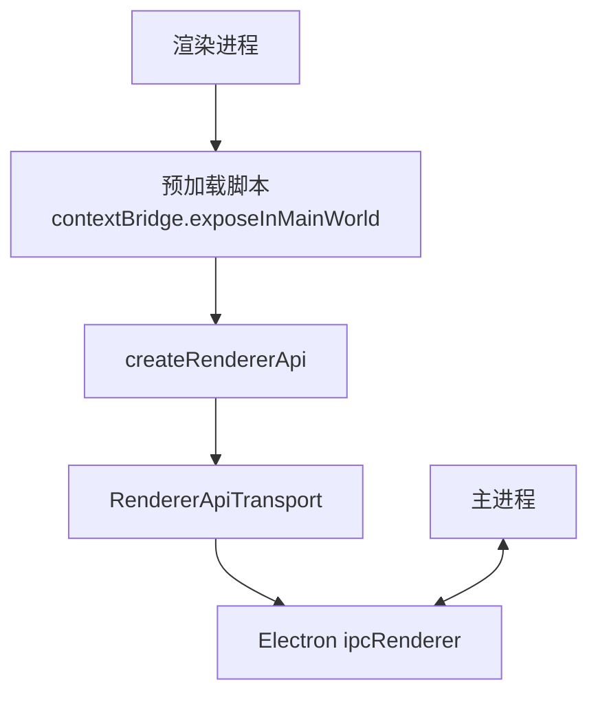
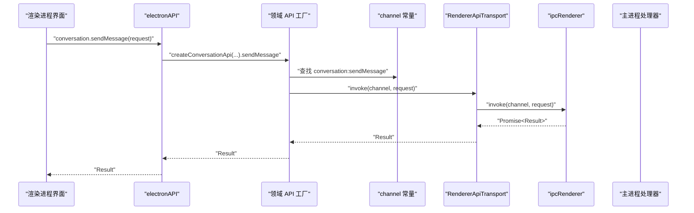
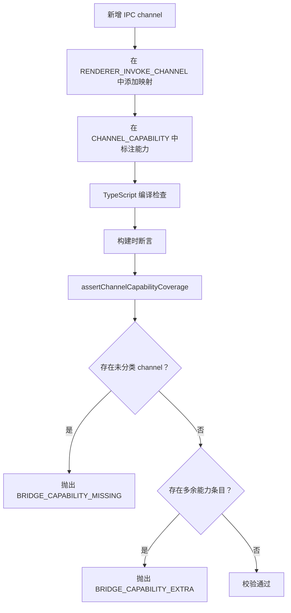
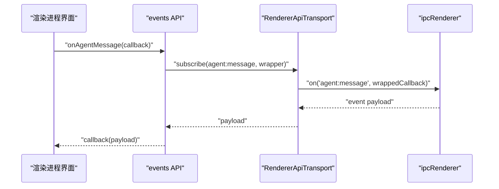
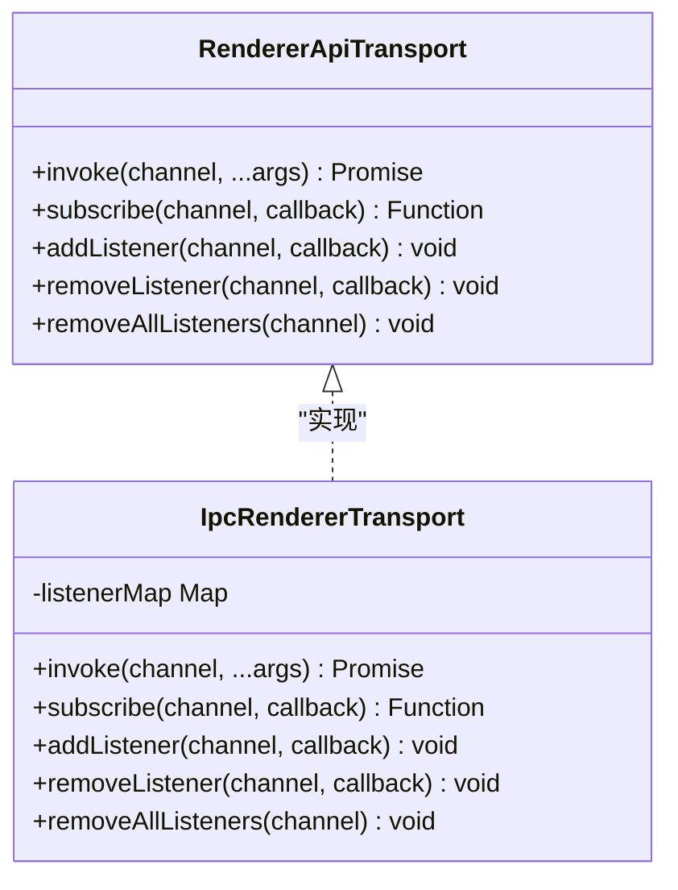
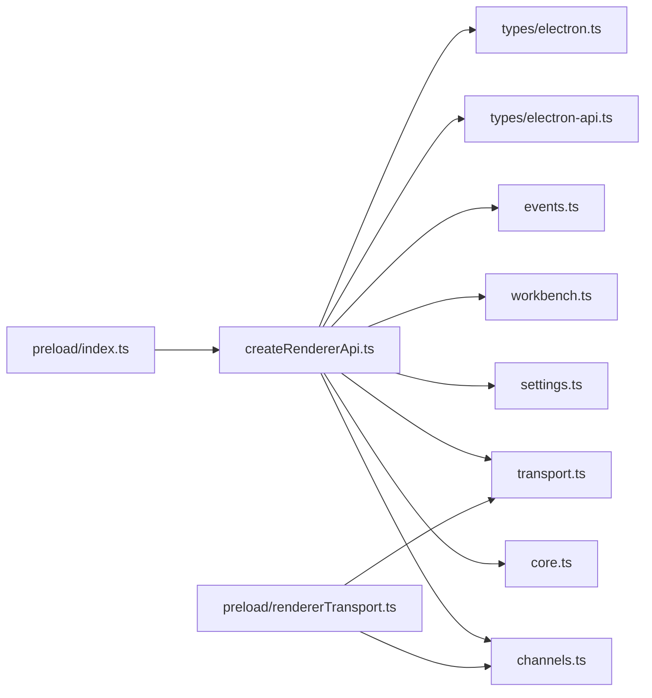
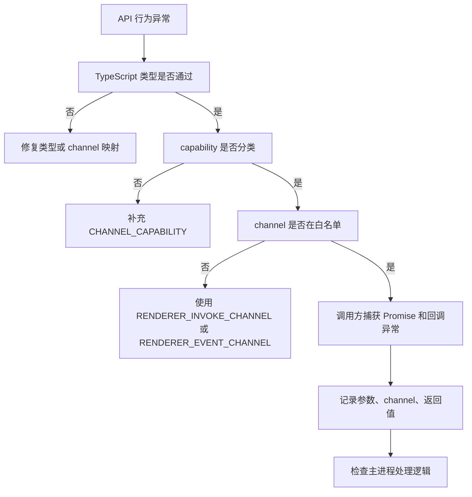

# 渲染进程 API

<cite>
**本文引用的文件**   
- [preload/index.ts](file://src/preload/index.ts)
- [preload/rendererTransport.ts](file://src/preload/rendererTransport.ts)
- [shared/renderer-api/index.ts](file://src/shared/renderer-api/index.ts)
- [shared/renderer-api/createRendererApi.ts](file://src/shared/renderer-api/createRendererApi.ts)
- [shared/renderer-api/channels.ts](file://src/shared/renderer-api/channels.ts)
- [shared/renderer-api/channelCapabilities.ts](file://src/shared/renderer-api/channelCapabilities.ts)
- [shared/renderer-api/events.ts](file://src/shared/renderer-api/events.ts)
- [shared/renderer-api/transport.ts](file://src/shared/renderer-api/transport.ts)
- [shared/renderer-api/core.ts](file://src/shared/renderer-api/core.ts)
- [shared/renderer-api/settings.ts](file://src/shared/renderer-api/settings.ts)
- [shared/renderer-api/workbench.ts](file://src/shared/renderer-api/workbench.ts)
</cite>

## 目录

1. [引言](#引言)
2. [项目结构](#项目结构)
3. [核心组件](#核心组件)
4. [架构总览](#架构总览)
5. [详细组件分析](#详细组件分析)
6. [依赖关系分析](#依赖关系分析)
7. [性能与可靠性](#性能与可靠性)
8. [排错指南](#排错指南)
9. [结论](#结论)
10. [附录：API 参考](#附录api-参考)

## 引言

本文面向需要在 Electron 渲染进程中调用桌面能力的开发者，系统化说明预加载层暴露给渲染进程的受控接口。重点包括：

- `createRendererApi` 如何把平台信息、IPC 传输通道和多个能力域组装成全局 `electronAPI`。
- API 分组职责：Agent、Conversation、Settings、Workbench、对话、工作流、设备、会话、捕获、追踪等。
- `channelCapabilities` 能力矩阵机制、能力发现流程和失败关闭策略。
- 事件订阅系统、事件类型定义和订阅生命周期管理。
- 传输层抽象 `RendererApiTransport`、错误处理策略以及重试建议。
- 完整的 API 方法签名、参数类型、返回值结构和最佳实践。

该文档既适合初次接触 Renderer API 的开发者，也适合作为扩展新能力时的权威参考。

## 项目结构

Renderer API 由三部分构成：

| 层次 | 主要职责 | 关键文件 |
|---|---|---|
| 预加载脚本 | 将 `createRendererApi` 构建出的对象挂载到 `window.electronAPI`，并封装 `rdcDesktop` 辅助方法 | [preload/index.ts](file://src/preload/index.ts) |
| 共享 API 定义 | 描述 IPC channel、能力矩阵、事件通道、传输接口和各能力域工厂 | [shared/renderer-api/*](file://src/shared/renderer-api/index.ts) |
| 传输实现 | 基于 `ipcRenderer.invoke` 和 `ipcRenderer.on` 提供 RPC 与事件订阅 | [preload/rendererTransport.ts](file://src/preload/rendererTransport.ts) |



**图表来源**  
- [preload/index.ts:13-25](file://src/preload/index.ts#L13-L25)
- [shared/renderer-api/createRendererApi.ts:1-80](file://src/shared/renderer-api/createRendererApi.ts#L1-L80)
- [preload/rendererTransport.ts:1-44](file://src/preload/rendererTransport.ts#L1-L44)

**章节来源**  
- [preload/index.ts:1-25](file://src/preload/index.ts#L1-L25)
- [shared/renderer-api/index.ts:1-17](file://src/shared/renderer-api/index.ts#L1-L17)

## 核心组件

### createRendererApi：全局 API 装配器

`createRendererApi` 是渲染进程 API 的唯一入口。它接收两个参数：

| 参数 | 类型 | 含义 |
|---|---|---|
| `platform` | `NodeJS.Platform` | 当前操作系统，用于生成 `isMac`、`isWindows`、`isLinux` |
| `transport` | `RendererApiTransport` | 底层 IPC 传输抽象，屏蔽具体 IPC 实现差异 |

它返回一个 `ElectronAPI` 对象，包含以下顶层字段：

| 字段 | 类型或用途 | 说明 |
|---|---|---|
| `platform` | 原始平台值 | 透传传入的平台标识 |
| `isMac` | `boolean` | 是否为 macOS |
| `isWindows` | `boolean` | 是否为 Windows |
| `isLinux` | `boolean` | 是否为 Linux |
| `appMeta` | 应用元数据 API | 获取应用元数据 |
| `appShell` | 应用外壳 API | 打开路径、剪贴板、头像、引导状态等 |
| `web` | Web 能力 API | 解析 Favicon |
| `conversation` | 对话 API | 发送消息、历史、分支、附件等 |
| `command` | 命令 API | 列出和执行命令 |
| `selectFiles` | 文件选择快捷方法 | 直接委托对话框 API |
| `selectRdcFiles` | RDC 文件选择快捷方法 | 直接委托对话框 API |
| `selectKnowledgeImport` | 知识导入选择快捷方法 | 直接委托对话框 API |
| `selectDirectory` | 目录选择快捷方法 | 直接委托对话框 API |
| `saveFile` | 保存文件快捷方法 | 直接委托对话框 API |
| `workflow` | 工作流 API | 查询状态、恢复、停止、用量、运行列表 |
| `trace` | 追踪 API | 查询运行、事件、投影、导出、切换分支 |
| `agent` | Agent 运行 API | 发送消息、查询状态、配置 |
| `memory` | 内存 API | 授权令牌、读写、删除 |
| `investigation` | 调查 API | 读取和列举 |
| `plan` | 计划 API | 读取、审批令牌、保存到项目、导出 |
| `knowledge` | 知识库 API | 概览、查询、卡片、编译、候选、导入、写入、推广、导出 |
| `rdcRuntime` | RDC 运行时 API | 资源操作、钩子/MCP 信任、快照 |
| `tool` | 工具 API | 目录、运行时摘要、安装检测 |
| `mcp` | MCP API | MCP 状态摘要 |
| `evidence` | 证据链 API | 证据链和事件 |
| `llm` | 大模型提供商 API | 测试、连接、登录、登出、刷新模型 |
| `settings` | 设置 API | 设置、提供商目录、模型覆盖、Agent/Provider 定义 |
| `project` | 项目 API | 增删改查及输入项管理 |
| `device` | 设备 API | 列举、刷新、监听生命周期 |
| `session` | 会话 API | 增删改查、选中、代理和模型覆盖 |
| `run` | 运行 API | 列举运行 |
| `runtimeLog` | 运行时日志 API | 查询日志 |
| `capture` | 捕获 API | 回放、预览、帧刷新、录制列表 |
| `context` | 上下文 API | 获取上下文快照 |
| `events` | 事件订阅 API | 结构化事件订阅入口 |
| `on` / `off` | 通用事件订阅方法 | 安全包装 `transport.addListener/removeListener` |

**章节来源**  
- [shared/renderer-api/createRendererApi.ts:1-80](file://src/shared/renderer-api/createRendererApi.ts#L1-L80)

### 传输层抽象：RendererApiTransport

`RendererApiTransport` 是所有能力域的底层通信契约：

| 方法 | 参数 | 返回值 | 语义 |
|---|---|---|---|
| `invoke` | `channel`、可变参数 | `Promise<TResult>` | 发起一次请求响应式调用 |
| `subscribe` | `channel`、回调 | 取消函数 | 订阅事件并返回清理函数 |
| `addListener` | `channel`、回调 | `void` | 添加事件监听器 |
| `removeListener` | `channel`、回调 | `void` | 移除单个监听器 |
| `removeAllListeners` | `channel` | `void` | 清空某频道所有监听器 |

实际实现由预加载层的 `createIpcRendererTransport` 提供，它封装了 `ipcRenderer.invoke` 和 `ipcRenderer.on`，并维护一个按频道分组的监听器映射，避免重复绑定和泄漏。

**章节来源**  
- [shared/renderer-api/transport.ts:1-11](file://src/shared/renderer-api/transport.ts#L1-L11)
- [preload/rendererTransport.ts:1-44](file://src/preload/rendererTransport.ts#L1-L44)

### 通道定义：channels

`channels.ts` 是 Renderer API 的“总线字典”，集中定义两类常量：

| 常量 | 用途 |
|---|---|
| `RENDERER_INVOKE_CHANNEL` | 所有可调用 IPC 方法的命名空间 + 方法名到真实 IPC 字符串的映射 |
| `RENDERER_EVENT_CHANNEL` | 所有可订阅 IPC 事件的命名空间 + 事件名到真实 IPC 字符串的映射 |

同时导出：

- `RendererInvokeChannel`：所有 invoke channel 字面量联合类型。
- `RendererEventChannel`：所有 event channel 字面量联合类型。
- `RENDERER_INVOKE_CHANNELS` / `RENDERER_EVENT_CHANNELS`：冻结数组，便于校验。
- `isRendererInvokeChannel` / `isRendererEventChannel`：运行时类型守卫。

这种设计让 TypeScript 能检查调用方是否使用了合法 channel，也让运行时可以通过白名单过滤非法事件。

**章节来源**  
- [shared/renderer-api/channels.ts:1-271](file://src/shared/renderer-api/channels.ts#L1-L271)

## 架构总览



**图表来源**  
- [shared/renderer-api/core.ts:60-103](file://src/shared/renderer-api/core.ts#L60-L103)
- [shared/renderer-api/channels.ts:1-200](file://src/shared/renderer-api/channels.ts#L1-L200)
- [preload/rendererTransport.ts:20-33](file://src/preload/rendererTransport.ts#L20-L33)

整体流程如下：

1. 预加载脚本创建 transport。
2. 预加载脚本用 platform 和 transport 调用 `createRendererApi`。
3. `createRendererApi` 调用各领域工厂构造 API 对象。
4. 每个领域工厂通过 `RENDERER_INVOKE_CHANNEL` 把业务方法映射到 IPC channel。
5. transport 把调用转发给 `ipcRenderer.invoke`。
6. 主进程根据 IPC channel 执行对应逻辑并返回结果。

**章节来源**  
- [preload/index.ts:13-25](file://src/preload/index.ts#L13-L25)
- [shared/renderer-api/createRendererApi.ts:1-80](file://src/shared/renderer-api/createRendererApi.ts#L1-L80)

## 详细组件分析

### 能力分组与职责划分

#### AgentApi

负责与独立 Agent 实例交互。

| 方法 | 参数 | 返回值 | 说明 |
|---|---|---|---|
| `sendMessage` | `agentId`、`content` | `Promise` | 向指定 Agent 发送消息 |
| `getState` | `agentId`、`sessionId` | `Promise` | 查询 Agent 当前状态 |
| `getAllStates` | 无 | `Promise` | 获取全部 Agent 状态 |
| `configure` | `agentId`、`config` | `Promise` | 配置 Agent |

**章节来源**  
- [shared/renderer-api/core.ts:105-115](file://src/shared/renderer-api/core.ts#L105-L115)
- [shared/renderer-api/channels.ts:49-56](file://src/shared/renderer-api/channels.ts#L49-L56)

#### ConversationApi

负责用户对话、分支、附件、工具预览和事件。

| 方法 | 参数 | 返回值 | 说明 |
|---|---|---|---|
| `sendMessage` | `request` | `Promise` | 发送对话消息 |
| `rewriteFromMessage` | `request` | `Promise` | 基于已有消息重写 |
| `cancelActiveTurn` | `request` | `Promise` | 取消当前回合 |
| `answerUserInput` | `request` | `Promise` | 回答用户输入 |
| `answerToolApproval` | `request` | `Promise` | 回答工具审批 |
| `answerPlanReview` | `request` | `Promise` | 回答计划评审 |
| `getHistory` | `sessionId` | `Promise` | 获取对话历史 |
| `getDelegationTrace` | `request` | `Promise` | 获取委派追踪 |
| `getDelegationContent` | `request` | `Promise` | 获取委派内容 |
| `switchBranch` | `request` | `Promise` | 切换分支 |
| `clearHistory` | `sessionId` | `Promise` | 清空历史 |
| `undoLastTurn` | `sessionId` | `Promise` | 撤销上一轮 |
| `getToolImagePreview` | `request` | `Promise` | 获取工具图片预览 |
| `stageAttachments` | `request` | `Promise` | 暂存附件 |
| `releaseAttachments` | `request` | `Promise` | 释放附件 |
| `getAttachmentPreview` | `request` | `Promise` | 获取附件预览 |
| `onEvent` | `callback` | `void` | 订阅对话事件 |
| `offEvent` | `callback` | `void` | 取消对话事件订阅 |

**章节来源**  
- [shared/renderer-api/core.ts:60-103](file://src/shared/renderer-api/core.ts#L60-L103)
- [shared/renderer-api/channels.ts:24-47](file://src/shared/renderer-api/channels.ts#L24-L47)

#### SettingsApi

负责应用设置、提供商、模型覆盖和 Agent/Provider 定义。

| 方法 | 参数 | 返回值 | 说明 |
|---|---|---|---|
| `get` | 无 | `Promise` | 读取设置 |
| `getProviderCatalog` | 无 | `Promise` | 获取提供商目录 |
| `getEffectiveModel` | `agentId` | `Promise` | 获取生效模型 |
| `getEffectiveCatalog` | `providerId`、可选 `accountId` | `Promise` | 获取生效目录 |
| `hasProviderSecret` | `providerId` | `Promise` | 检查提供商密钥 |
| `importAgentManifest` | `filePath` | `Promise` | 导入 Agent 清单 |
| `saveAgentDefinition` | `request` | `Promise` | 保存 Agent 定义 |
| `getAgentDefinitionCommit` | `query` | `Promise` | 查询 Agent 定义提交 |
| `saveProviderDefinition` | `request` | `Promise` | 保存 Provider 定义 |
| `getProviderDefinitionCommit` | `providerId` | `Promise` | 查询 Provider 定义提交 |
| `getModelsOverride` | 无 | `Promise` | 获取模型覆盖 |
| `setModelsOverride` | `overrides` | `Promise` | 设置模型覆盖 |
| `getResolvedShell` | `executable` | `Promise` | 解析 Shell |
| `set` | `settings` | `Promise` | 写入设置 |

注意：`getEffectiveCatalog` 对可选 `accountId` 做了运行时判断；如果为空字符串则省略第二个参数。

**章节来源**  
- [shared/renderer-api/settings.ts:43-86](file://src/shared/renderer-api/settings.ts#L43-L86)
- [shared/renderer-api/channels.ts:105-120](file://src/shared/renderer-api/channels.ts#L105-L120)

#### WorkbenchApi（项目、设备、会话、运行、日志、捕获、上下文、追踪）

Workbench 相关 API 分布在多个工厂中，但共同服务于工作台场景。

##### ProjectApi

| 方法 | 参数 | 返回值 | 说明 |
|---|---|---|---|
| `list` | 无 | `Promise` | 列举项目 |
| `add` | `rootPath` | `Promise` | 添加项目根路径 |
| `select` | `projectId` | `Promise` | 选中项目 |
| `rename` | `projectId`、`newName` | `Promise` | 重命名项目 |
| `remove` | `projectId` | `Promise` | 移除项目 |
| `inputs.list` | `projectId` | `Promise` | 列举项目输入 |
| `inputs.refresh` | `projectId` | `Promise` | 刷新项目输入 |
| `inputs.prepareRemove` | `projectId`、`inputId` | `Promise` | 准备移除输入 |
| `inputs.remove` | `projectId`、`inputId`、`approvalToken` | `Promise` | 移除项目输入 |
| `inputs.import` | `projectId` | `Promise` | 导入项目输入 |
| `inputs.referencePath` | `projectId`、`filePath` | `Promise` | 引用输入路径 |
| `inputs.importPaths` | `projectId`、`filePaths` | `Promise` | 批量导入输入路径 |

**章节来源**  
- [shared/renderer-api/workbench.ts:1-36](file://src/shared/renderer-api/workbench.ts#L1-L36)
- [shared/renderer-api/channels.ts:122-134](file://src/shared/renderer-api/channels.ts#L122-L134)

##### DeviceApi

| 方法 | 参数 | 返回值 | 说明 |
|---|---|---|---|
| `list` | 无 | `Promise` | 列举设备 |
| `refresh` | 无 | `Promise` | 刷新设备 |
| `watchStart` | 无 | `Promise` | 开始监听设备 |
| `watchRenew` | 无 | `Promise` | 续期设备监听 |
| `watchStop` | 无 | `Promise` | 停止设备监听 |

**章节来源**  
- [shared/renderer-api/workbench.ts:38-47](file://src/shared/renderer-api/workbench.ts#L38-L47)
- [shared/renderer-api/channels.ts:136-142](file://src/shared/renderer-api/channels.ts#L136-L142)

##### SessionApi

| 方法 | 参数 | 返回值 | 说明 |
|---|---|---|---|
| `list` | `projectId` | `Promise` | 列举会话 |
| `create` | `projectId`、`title` | `Promise` | 创建会话 |
| `rename` | `id`、`title` | `Promise` | 重命名会话 |
| `remove` | `id` | `Promise` | 移除会话 |
| `select` | `id` | `Promise` | 选中等效会话 |
| `setModelOverride` | `id`、`modelOverride` | `Promise` | 设置会话模型覆盖 |
| `setAgentId` | `id`、`agentId` | `Promise` | 设置会话代理 |
| `applyDeclaredHandoff` | `id`、`agent`、`label` | `Promise` | 应用声明式交接 |

**章节来源**  
- [shared/renderer-api/workbench.ts:49-65](file://src/shared/renderer-api/workbench.ts#L49-L65)
- [shared/renderer-api/channels.ts:144-152](file://src/shared/renderer-api/channels.ts#L144-L152)

##### RunApi

| 方法 | 参数 | 返回值 | 说明 |
|---|---|---|---|
| `list` | `sessionId` | `Promise` | 列举运行 |

**章节来源**  
- [shared/renderer-api/workbench.ts:67-69](file://src/shared/renderer-api/workbench.ts#L67-L69)
- [shared/renderer-api/channels.ts:154-156](file://src/shared/renderer-api/channels.ts#L154-L156)

##### RuntimeLogApi

| 方法 | 参数 | 返回值 | 说明 |
|---|---|---|---|
| `list` | `request` | `Promise` | 查询运行时日志 |

**章节来源**  
- [shared/renderer-api/workbench.ts:71-73](file://src/shared/renderer-api/workbench.ts#L71-L73)
- [shared/renderer-api/channels.ts:158-160](file://src/shared/renderer-api/channels.ts#L158-L160)

##### CaptureApi

| 方法 | 参数 | 返回值 | 说明 |
|---|---|---|---|
| `getReplaySelection` | `scope` | `Promise` | 获取回放选择 |
| `readLivePreview` | `scope` | `Promise` | 读取实时预览 |
| `getReplayState` | `scope` | `Promise` | 获取回放状态 |
| `applyReplayEvent` | `request` | `Promise` | 应用回放事件 |
| `refreshFrame` | `scope` | `Promise` | 刷新帧 |
| `list` | `scope` | `Promise` | 列举捕获 |
| `select` | `request` | `Promise` | 选择捕获 |
| `openProjectInput` | `request` | `Promise` | 打开项目输入 |
| `getOpenedState` | `scope` | `Promise` | 获取已打开状态 |
| `clearOpenedState` | `scope` | `Promise` | 清除已打开状态 |

**章节来源**  
- [shared/renderer-api/workbench.ts:75-91](file://src/shared/renderer-api/workbench.ts#L75-L91)
- [shared/renderer-api/channels.ts:162-175](file://src/shared/renderer-api/channels.ts#L162-L175)

##### ContextApi

| 方法 | 参数 | 返回值 | 说明 |
|---|---|---|---|
| `get` | `scope` | `Promise` | 获取上下文 |

**章节来源**  
- [shared/renderer-api/workbench.ts:93-96](file://src/shared/renderer-api/workbench.ts#L93-L96)
- [shared/renderer-api/channels.ts:177-179](file://src/shared/renderer-api/channels.ts#L177-L179)

##### TraceApi

| 方法 | 参数 | 返回值 | 说明 |
|---|---|---|---|
| `getRun` | `runId` | `Promise` | 获取运行 |
| `getEvents` | `runId`、`afterSeq` | `Promise` | 获取运行事件 |
| `getProjection` | `sessionId` | `Promise` | 获取投影 |
| `exportRun` | `runId` | `Promise` | 导出运行 |
| `switchBranch` | `sessionId`、`branchId` | `Promise` | 切换分支 |

**章节来源**  
- [shared/renderer-api/workbench.ts:98-106](file://src/shared/renderer-api/workbench.ts#L98-L106)
- [shared/renderer-api/channels.ts:179-187](file://src/shared/renderer-api/channels.ts#L179-L187)

### 能力发现与限制：channelCapabilities

`channelCapabilities.ts` 维护一个“闭合集”：

| 概念 | 说明 |
|---|---|
| `BridgeChannelCapability` | 通道能力枚举：`read`、`mutation`、`high-impact`、`desktop-only` |
| `CHANNEL_CAPABILITY` | 每个真实 IPC channel 到能力的映射 |
| `hasBridgeChannelCapability` | 判断 channel 是否在能力表中 |
| `resolveBridgeChannelCapability` | 解析能力，未注册时抛出错误 |
| `listUnclassifiedInvokeChannels` | 列出未分类的 invoke channel |
| `assertChannelCapabilityCoverage` | 断言所有 channel 都已正确分类 |

能力含义：

| 能力 | 适用场景 |
|---|---|
| `read` | 只读查询 |
| `mutation` | 普通状态变更 |
| `high-impact` | 高影响操作，例如修改设置、导入数据、信任钩子、断开提供商 |
| `desktop-only` | 仅限桌面端，例如窗口控制、路径选择、Favicon 解析 |



**图表来源**  
- [shared/renderer-api/channelCapabilities.ts:1-202](file://src/shared/renderer-api/channelCapabilities.ts#L1-L202)
- [shared/renderer-api/channels.ts:1-271](file://src/shared/renderer-api/channels.ts#L1-L271)

**章节来源**  
- [shared/renderer-api/channelCapabilities.ts:1-202](file://src/shared/renderer-api/channelCapabilities.ts#L1-L202)
- [shared/renderer-api/channels.ts:1-271](file://src/shared/renderer-api/channels.ts#L1-L271)

### 事件订阅系统

#### 事件通道定义

事件通道集中在 `RENDERER_EVENT_CHANNEL`，涵盖：

| 域 | 示例事件 |
|---|---|
| shell | 主题变化、窗口最大化变化 |
| conversation | 对话事件、委派变化 |
| workflow | 运行状态变化、用量变化、阻塞、追踪投影变化 |
| llm | 流式输出、生效目录变化 |
| agent | Agent 消息、状态变化 |
| tools | 工具执行完成、证据新增 |
| workbench | 设备状态、捕获状态、上下文变化、项目输入变化、捕获回放变化 |
| runtime | 运行时日志追加 |

#### EventSubscriptionApi

`createEventSubscriptionApi` 为渲染进程提供一组语义化订阅方法，内部统一委托 `transport.subscribe`。

| 方法 | 回调参数类型 | 说明 |
|---|---|---|
| `onDelegationTraceChanged` | `{ sessionId, parentToolCallId, revision }` | 委派追踪变化 |
| `onRunStatusChanged` | 运行状态 | 工作流运行状态变化 |
| `onRunUsageChanged` | `SessionScopedPayload<RunContextUsageSummary>` | 运行用量变化 |
| `onTraceProjectionChanged` | `TraceProjectionChangedPayload` | 追踪投影变化 |
| `onEffectiveCatalogChanged` | 目录快照 | 生效目录变化 |
| `onAgentMessage` | Agent 消息 | Agent 消息事件 |
| `onAgentStatusChanged` | Agent 状态 | Agent 状态变化 |
| `onToolExecutionComplete` | 追踪记录 | 工具执行完成 |
| `onEvidenceEventAdded` | 证据事件 | 新增证据事件 |
| `onDeviceStatusChanged` | 设备状态 | 设备状态变化 |
| `onCaptureStatusChanged` | `SessionScopedPayload<unknown>` | 捕获状态变化 |
| `onContextChanged` | `SessionScopedPayload<ContextSnapshot \| null>` | 上下文变化 |
| `onProjectInputsChanged` | `{ projectId, inputs }` | 项目输入变化 |
| `onProjectInputsError` | `{ projectId, error }` | 项目输入错误 |
| `onCaptureReplayChanged` | 回放状态 | 捕获回放变化 |
| `onOpenedCaptureStateChanged` | `SessionScopedPayload<OpenedCaptureState \| null>` | 已打开捕获状态变化 |
| `onRuntimeLogAppended` | `RuntimeLogEntry` | 运行时日志追加 |
| `onAppThemeChanged` | 主题 | 应用主题变化 |
| `removeAllListeners` | `channel` | 移除某个频道的所有监听器 |

此外，`createRendererApi` 还暴露顶层 `on` 和 `off`，它们会先通过 `isRendererEventChannel` 校验 channel，再调用 transport 监听器。



**图表来源**  
- [shared/renderer-api/events.ts:1-88](file://src/shared/renderer-api/events.ts#L1-L88)
- [preload/rendererTransport.ts:14-33](file://src/preload/rendererTransport.ts#L14-L33)

**章节来源**  
- [shared/renderer-api/channels.ts:201-271](file://src/shared/renderer-api/channels.ts#L201-L271)
- [shared/renderer-api/events.ts:1-88](file://src/shared/renderer-api/events.ts#L1-L88)
- [shared/renderer-api/createRendererApi.ts:48-80](file://src/shared/renderer-api/createRendererApi.ts#L48-L80)

### 传输层与错误处理

#### 传输实现

`createIpcRendererTransport` 使用 `Map<RendererEventChannel, Map<RendererEventCallback, RendererEventCallback>>` 维护回调映射，解决以下问题：

- 同一回调多次 `subscribe` 不会重复绑定。
- `unsubscribe` 能准确移除原回调。
- 频道无监听器时可清理 `ipcRenderer` 监听器。
- `removeAllListeners` 可一次性销毁频道级监听器。



**图表来源**  
- [shared/renderer-api/transport.ts:1-11](file://src/shared/renderer-api/transport.ts#L1-L11)
- [preload/rendererTransport.ts:1-44](file://src/preload/rendererTransport.ts#L1-L44)

#### 错误处理策略

当前代码没有内置重试、超时或幂等封装，错误处理主要由调用方决定：

| 层级 | 行为 |
|---|---|
| Channel 白名单 | 非白名单 channel 会被 `isRendererEventChannel` 拒绝，`on/off` 不会注册监听器 |
| Capability 断言 | 未分类或多余 channel 会在断言阶段抛出 `BRIDGE_CAPABILITY_MISSING` / `BRIDGE_CAPABILITY_EXTRA` |
| Capability 解析 | 未注册 channel 在运行时解析能力时会抛出 `BRIDGE_CAPABILITY_MISSING` |
| IPC 调用 | 直接透传 `ipcRenderer.invoke` 的 Promise 结果，异常向上冒泡 |
| 事件回调 | 不做 try/catch，异常由上层订阅者处理 |

因此，渲染进程侧应自行处理 Promise 拒绝和事件回调中的异常。

**章节来源**  
- [preload/rendererTransport.ts:1-44](file://src/preload/rendererTransport.ts#L1-L44)
- [shared/renderer-api/channelCapabilities.ts:173-202](file://src/shared/renderer-api/channelCapabilities.ts#L173-L202)
- [shared/renderer-api/channels.ts:255-271](file://src/shared/renderer-api/channels.ts#L255-L271)

### 完整 API 方法签名总览

为避免复制代码，下表以“模块 + 方法 + 参数 + 返回值”形式给出签名摘要。

| 模块 | 方法 | 参数 | 返回值 |
|---|---|---|---|
| appMeta | `get` | 无 | `Promise` |
| appShell | `hasSeenGettingStarted` | 无 | `Promise` |
| appShell | `acknowledgeGettingStarted` | 无 | `Promise` |
| appShell | `selectAvatar` | 无 | `Promise` |
| appShell | `getAvatarDataUrl` | `avatarPath` | `Promise` |
| appShell | `openPath` | `targetPath` | `Promise` |
| appShell | `copyText` | `text` | `Promise` |
| appShell | `readClipboardText` | 无 | `Promise` |
| web | `resolveFavicon` | `domain` | `Promise` |
| dialog | `selectFiles` | 无 | `Promise` |
| dialog | `selectRdcFiles` | 无 | `Promise` |
| dialog | `selectKnowledgeImport` | 无 | `Promise` |
| dialog | `selectDirectory` | 无 | `Promise` |
| dialog | `saveFile` | `request` | `Promise` |
| windowControls | `minimize` | 无 | `Promise` |
| windowControls | `toggleMaximize` | 无 | `Promise` |
| windowControls | `close` | 无 | `Promise` |
| windowControls | `isMaximized` | 无 | `Promise` |
| conversation | 见 ConversationApi 表 | 见上表 | `Promise` 或 `void` |
| workflow | `getState` | 无 | `Promise` |
| workflow | `resume` | `sessionId` | `Promise` |
| workflow | `stop` | `runId` | `Promise` |
| workflow | `getRunUsage` | `request` | `Promise` |
| workflow | `listRuns` | 无 | `Promise` |
| workflow | `listActiveRuns` | 无 | `Promise` |
| agent | 见 AgentApi 表 | 见上表 | `Promise` |
| investigation | `read` | `request` | `Promise` |
| investigation | `list` | `request` | `Promise` |
| plan | `read` | `request` | `Promise` |
| plan | `issueApprovalToken` | `request` | `Promise` |
| plan | `saveToProject` | `request` | `Promise` |
| plan | `export` | `request` | `Promise` |
| knowledge | `overview` | 无 | `Promise` |
| knowledge | `query` | `request` | `Promise` |
| knowledge | `card` | `spaceId`、`relativePath` | `Promise` |
| knowledge | `compile` | `request` | `Promise` |
| knowledge | `indexRebuild` | 无 | `Promise` |
| knowledge | `candidates` | `sessionId` | `Promise` |
| knowledge | `candidateCreate` | `request` | `Promise` |
| knowledge | `import` | `request` | `Promise` |
| knowledge | `image` | `request` | `Promise` |
| knowledge | `issueApprovalToken` | `request` | `Promise` |
| knowledge | `write` | `request` | `Promise` |
| knowledge | `promote` | `request` | `Promise` |
| knowledge | `export` | `request` | `Promise` |
| command | `list` | `category` | `Promise` |
| command | `execute` | `request` | `Promise` |
| tool | `getCatalog` | 无 | `Promise` |
| tool | `getRuntimeSummary` | 无 | `Promise` |
| tool | `detectInstallations` | 无 | `Promise` |
| tool | `resolveInstallation` | `request` | `Promise` |
| tool | `verifyInstallation` | `request` | `Promise` |
| mcp | `getStatusSummary` | 无 | `Promise` |
| evidence | `getChain` | 无 | `Promise` |
| evidence | `getEvents` | `eventType` | `Promise` |
| memory | `issueApprovalToken` | `request` | `Promise` |
| memory | `list` | `scope`、`projectRoot` | `Promise` |
| memory | `get` | `scope`、`name`、`projectRoot` | `Promise` |
| memory | `write` | `request` | `Promise` |
| memory | `delete` | `scope`、`name`、`approvalToken`、`projectRoot` | `Promise` |
| rdcRuntime | 见 RdcRuntimeApi 表 | 见上表 | `Promise` |
| llm | 见 LlmApi 表 | 见上表 | `Promise` |
| settings | 见 SettingsApi 表 | 见上表 | `Promise` |
| project | 见 ProjectApi 表 | 见上表 | `Promise` |
| device | 见 DeviceApi 表 | 见上表 | `Promise` |
| session | 见 SessionApi 表 | 见上表 | `Promise` |
| run | `list` | `sessionId` | `Promise` |
| runtimeLog | `list` | `request` | `Promise` |
| capture | 见 CaptureApi 表 | 见上表 | `Promise` |
| context | `get` | `scope` | `Promise` |
| trace | 见 TraceApi 表 | 见上表 | `Promise` |
| events | 见 EventSubscriptionApi 表 | 见上表 | 回调或清理函数 |
| electronAPI | `on` | `channel`、`callback` | `void` |
| electronAPI | `off` | `channel`、`callback` | `void` |

**章节来源**  
- [shared/renderer-api/core.ts:1-167](file://src/shared/renderer-api/core.ts#L1-L167)
- [shared/renderer-api/settings.ts:1-86](file://src/shared/renderer-api/settings.ts#L1-L86)
- [shared/renderer-api/workbench.ts:1-99](file://src/shared/renderer-api/workbench.ts#L1-L99)
- [shared/renderer-api/events.ts:1-88](file://src/shared/renderer-api/events.ts#L1-L88)

## 依赖关系分析



**图表来源**  
- [preload/index.ts:13-25](file://src/preload/index.ts#L13-L25)
- [shared/renderer-api/createRendererApi.ts:1-80](file://src/shared/renderer-api/createRendererApi.ts#L1-L80)
- [preload/rendererTransport.ts:1-44](file://src/preload/rendererTransport.ts#L1-L44)

耦合特点：

- 预加载脚本只依赖 `createRendererApi` 和 `createIpcRendererTransport`，不直接持有领域 API。
- 领域工厂只依赖 `channels` 和 `transport`，不关心 Electron 细节。
- `createRendererApi` 是聚合根，集中编排平台信息和 API 树。
- capability 校验与 channel 定义解耦，但两者必须同步更新。

**章节来源**  
- [shared/renderer-api/createRendererApi.ts:1-80](file://src/shared/renderer-api/createRendererApi.ts#L1-L80)
- [shared/renderer-api/channels.ts:1-271](file://src/shared/renderer-api/channels.ts#L1-L271)
- [preload/rendererTransport.ts:1-44](file://src/preload/rendererTransport.ts#L1-L44)

## 性能与可靠性

### 性能特征

- 所有 RPC 调用都是异步 Promise，不会阻塞渲染线程。
- 事件订阅基于 `ipcRenderer.on`，适合高频状态推送。
- 预加载层没有额外序列化或重试逻辑，延迟主要来自 IPC 和主进程处理。
- `listenerMap` 使用双 Map 结构，增加和移除监听器的复杂度接近 O(1)。

### 可靠性建议

| 场景 | 建议 |
|---|---|
| 网络或主进程繁忙 | 在调用方实现指数退避重试，避免风暴式重试 |
| 长耗时任务 | 不要无限重试；结合超时和熔断 |
| 事件回调异常 | 在回调内 try/catch，防止污染后续事件 |
| 订阅泄漏 | 使用 `events` API 返回的清理函数，或在组件卸载时显式移除 |
| 未分类 channel | 优先修复 capability 断言失败，而不是绕过检查 |
| 可选参数 | 严格遵循工厂函数的参数判断逻辑，不要随意插入 undefined |

[本节为通用指导，不直接分析具体文件]

## 排错指南

### 常见问题与定位方式

| 现象 | 可能原因 | 排查步骤 |
|---|---|---|
| 新增 API 后 TypeScript 报错 | 缺少 channel 映射或 capability | 检查 `RENDERER_INVOKE_CHANNEL` 和 `CHANNEL_CAPABILITY` |
| 构建时报 `BRIDGE_CAPABILITY_MISSING` | 新增了 channel 但未标注能力 | 运行能力断言或检查遗漏映射 |
| 构建时报 `BRIDGE_CAPABILITY_EXTRA` | capability 表中有冗余条目 | 清理未使用的 capability 键 |
| `electronAPI.on` 不触发事件 | channel 不是白名单事件 | 确认 channel 属于 `RENDERER_EVENT_CHANNEL` |
| 事件回调未被移除 | 没有保存取消函数或未调用清理 | 检查 `subscribe` 返回函数或 `removeAllListeners` |
| 调用 Promise 被拒绝 | 主进程处理失败或参数无效 | 捕获 Promise rejection 并查看主进程日志 |
| `getEffectiveCatalog` 行为异常 | 空字符串 accountId 导致参数省略 | 明确传入有效 providerId 和 accountId |

### 推荐调试流程



**图表来源**  
- [shared/renderer-api/channelCapabilities.ts:173-202](file://src/shared/renderer-api/channelCapabilities.ts#L173-L202)
- [shared/renderer-api/channels.ts:255-271](file://src/shared/renderer-api/channels.ts#L255-L271)

**章节来源**  
- [shared/renderer-api/channelCapabilities.ts:173-202](file://src/shared/renderer-api/channelCapabilities.ts#L173-L202)
- [shared/renderer-api/channels.ts:255-271](file://src/shared/renderer-api/channels.ts#L255-L271)

## 结论

Renderer API 通过 `createRendererApi` 将平台信息、IPC 传输、能力域和事件系统组合成一个稳定、可验证的受控接口。其设计强调：

- **白名单驱动**：所有调用和事件都必须经过 channel 白名单。
- **能力分层**：通过 `channelCapabilities` 区分只读、变更、高影响和桌面专属能力。
- **传输抽象**：渲染进程不直接依赖 `ipcRenderer`，便于替换或测试。
- **事件优先**：复杂状态通过事件通道推送，减少轮询。
- **失败关闭**：缺失 capability 或非法 channel 应快速失败，而不是静默忽略。

扩展新 API 时，请始终同步更新三个位置：channel 映射、capability 分类、领域工厂方法。这样可以保持类型安全、构建期校验和运行时一致性。

[本节为总结性内容，不直接分析具体文件]

## 附录：API 参考

### 使用示例

以下示例仅描述调用方式，不包含源代码片段。

#### 初始化与基础属性

```javascript
const api = window.electronAPI;

console.log(api.platform);
console.log(api.isMac);
console.log(api.isWindows);
console.log(api.isLinux);
```

#### 调用对话 API

```javascript
await api.conversation.sendMessage({ content: '你好' });
const history = await api.conversation.getHistory(sessionId);
```

#### 订阅事件

```javascript
const dispose = api.events.onAgentMessage((message) => {
  console.log(message);
});

// 组件卸载或不再需要时调用
dispose();
```

#### 使用通用 on/off

```javascript
function handler(payload) {
  console.log(payload);
}

api.on('agent:message', handler);

// 稍后移除
api.off('agent:message', handler);
```

#### 错误处理模板

```javascript
try {
  const result = await api.settings.set(settings);
  handleSuccess(result);
} catch (error) {
  handleError(error);
}
```

#### 事件清理最佳实践

```javascript
const subscriptions = [
  api.events.onAgentStatusChanged(handlerA),
  api.events.onRunStatusChanged(handlerB),
];

// 统一清理
subscriptions.forEach((dispose) => dispose());
```

**章节来源**  
- [shared/renderer-api/createRendererApi.ts:1-80](file://src/shared/renderer-api/createRendererApi.ts#L1-L80)
- [shared/renderer-api/events.ts:1-88](file://src/shared/renderer-api/events.ts#L1-L88)
- [shared/renderer-api/core.ts:60-115](file://src/shared/renderer-api/core.ts#L60-L115)