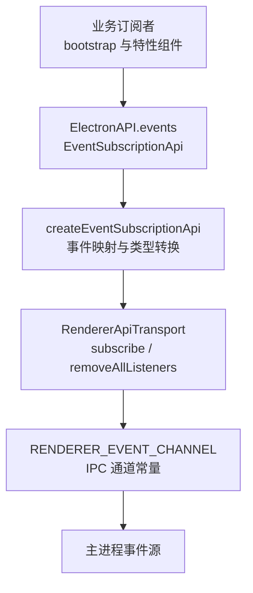
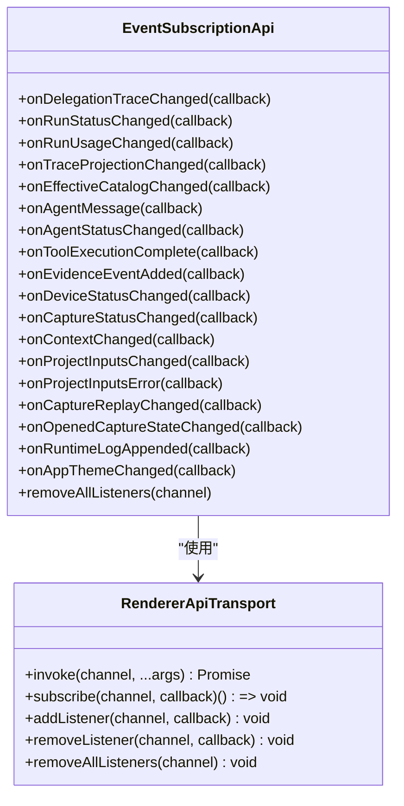
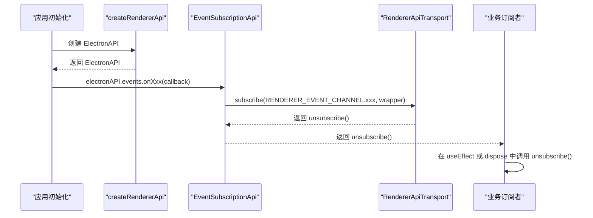
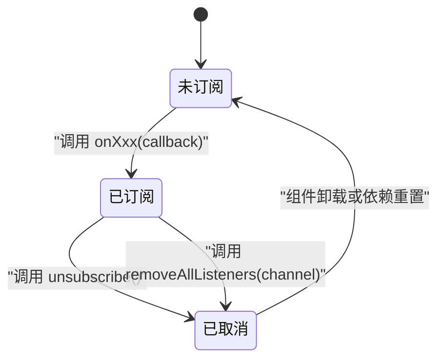
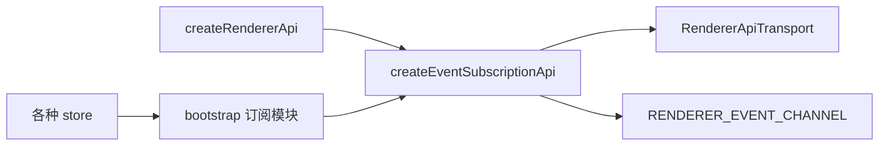

# 事件订阅系统

<cite>
**本文引用的文件**   
- [events.ts](file://src/shared/renderer-api/events.ts)
- [createRendererApi.ts](file://src/shared/renderer-api/createRendererApi.ts)
- [channels.ts](file://src/shared/renderer-api/channels.ts)
- [transport.ts](file://src/shared/renderer-api/transport.ts)
- [electron-api.ts](file://src/shared/types/electron-api.ts)
- [useAppBootstrap.ts](file://src/renderer/app/bootstrap/useAppBootstrap.ts)
- [sessionSubscriptions.ts](file://src/renderer/app/bootstrap/sessionSubscriptions.ts)
- [conversationSubscriptions.ts](file://src/renderer/app/bootstrap/conversationSubscriptions.ts)
- [captureSubscriptions.ts](file://src/renderer/app/bootstrap/captureSubscriptions.ts)
- [shellSubscriptions.ts](file://src/renderer/app/bootstrap/shellSubscriptions.ts)
- [useDelegationTrace.ts](file://src/renderer/features/transcript/useDelegationTrace.ts)
</cite>

## 目录
1. [引言](#引言)
2. [项目结构](#项目结构)
3. [核心组件](#核心组件)
4. [架构总览](#架构总览)
5. [详细组件分析](#详细组件分析)
6. [依赖关系分析](#依赖关系分析)
7. [性能考虑](#性能考虑)
8. [故障排查指南](#故障排查指南)
9. [结论](#结论)
10. [附录：事件参考表](#附录事件参考表)

## 引言
本文件系统性地说明渲染进程中的事件订阅能力，重点围绕 `EventSubscriptionApi` 暴露的二十一个事件监听方法。这些事件贯穿会话、工作流、代理、工具执行、设备与捕获、项目输入、运行时日志以及应用主题等子系统。文档将解释每个事件的触发时机、数据结构、生命周期管理方式，并总结 `removeAllListeners` 的使用场景、内存泄漏防护策略、事件去重机制，以及调试技巧、性能优化建议和错误处理策略。

## 项目结构
事件订阅系统位于共享渲染器 API 层中，由以下关键模块组成：
- 通道定义：集中声明所有 IPC 事件通道名称，并提供类型校验函数。
- 传输抽象：统一描述 `invoke`、`subscribe`、`addListener`、`removeListener`、`removeAllListeners` 等接口。
- 事件订阅实现：封装具体事件到通道的映射，并对载荷进行类型转换。
- API 组装：将事件订阅能力挂载到全局 `ElectronAPI.events` 上，同时暴露原始通道订阅能力。
- 消费方：各业务 bootstrap 模块和特性组件通过 `electronAPI.events.onXxx` 订阅事件，驱动状态更新。

图表来源
- [createRendererApi.ts:1-80](file://src/shared/renderer-api/createRendererApi.ts#L1-L80)
- [events.ts:1-88](file://src/shared/renderer-api/events.ts#L1-L88)
- [channels.ts:204-271](file://src/shared/renderer-api/channels.ts#L204-L271)
- [transport.ts:1-11](file://src/shared/renderer-api/transport.ts#L1-L11)

章节来源
- [createRendererApi.ts:1-80](file://src/shared/renderer-api/createRendererApi.ts#L1-L80)
- [channels.ts:204-271](file://src/shared/renderer-api/channels.ts#L204-L271)
- [transport.ts:1-11](file://src/shared/renderer-api/transport.ts#L1-L11)

## 核心组件
### EventSubscriptionApi
`EventSubscriptionApi` 是渲染端事件订阅的统一入口，它把语义化方法名映射到具体的 IPC 通道，并在回调前对载荷做最小类型断言。其职责包括：
- 为二十一个业务事件提供 `onXxx(callback)` 订阅方法。
- 提供 `removeAllListeners(channel)` 以按通道清理全部监听器。
- 保持与底层 `RendererApiTransport` 的解耦，便于替换真实 IPC 实现。

图表来源
- [events.ts:1-88](file://src/shared/renderer-api/events.ts#L1-L88)
- [transport.ts:1-11](file://src/shared/renderer-api/transport.ts#L1-L11)

章节来源
- [events.ts:1-88](file://src/shared/renderer-api/events.ts#L1-L88)
- [electron-api.ts:1-32](file://src/shared/types/electron-api.ts#L1-L32)

## 架构总览
渲染端事件订阅的整体流程如下：
1. 应用启动时创建 `ElectronAPI`，并将 `events: createEventSubscriptionApi(transport)` 注入其中。
2. 业务代码调用 `electronAPI.events.onXxx(...)` 注册回调。
3. 事件实现内部调用 `transport.subscribe(channel, wrapper)`，返回取消订阅函数。
4. 主进程通过对应 IPC 通道推送事件；传输层转发给渲染端回调。
5. 业务订阅者在回调中更新状态、刷新 UI 或触发副作用。

图表来源
- [createRendererApi.ts:1-80](file://src/shared/renderer-api/createRendererApi.ts#L1-L80)
- [events.ts:1-88](file://src/shared/renderer-api/events.ts#L1-L88)

## 详细组件分析

### 事件分类与语义
事件可划分为六类：
- 会话与委托追踪：`onDelegationTraceChanged`
- 工作流与追踪投影：`onRunStatusChanged`、`onRunUsageChanged`、`onTraceProjectionChanged`
- 模型与代理：`onEffectiveCatalogChanged`、`onAgentMessage`、`onAgentStatusChanged`
- 工具与证据：`onToolExecutionComplete`、`onEvidenceEventAdded`
- 工作台上下文与捕获：`onDeviceStatusChanged`、`onCaptureStatusChanged`、`onContextChanged`、`onProjectInputsChanged`、`onProjectInputsError`、`onCaptureReplayChanged`、`onOpenedCaptureStateChanged`
- 运行时与应用外壳：`onRuntimeLogAppended`、`onAppThemeChanged`

#### 会话与委托追踪
- `onDelegationTraceChanged`
  - 通道：`conversation:delegationChanged`
  - 触发时机：子会话委托链发生变更时通知。
  - 数据结构：包含会话标识、父工具调用标识与版本号，用于增量拉取委托追踪页。
  - 典型用法：追踪界面根据版本号触发重新加载，避免重复历史请求。
  - 生命周期：通常配合 React `useEffect`，在依赖变化时重新订阅，并在清理函数中取消订阅。

章节来源
- [events.ts:1-88](file://src/shared/renderer-api/events.ts#L1-L88)
- [channels.ts:204-271](file://src/shared/renderer-api/channels.ts#L204-L271)
- [useDelegationTrace.ts:1-111](file://src/renderer/features/transcript/useDelegationTrace.ts#L1-L111)

#### 工作流与追踪投影
- `onRunStatusChanged`
  - 通道：`workflow:runStatusChanged`
  - 触发时机：运行状态变更，例如完成、取消、中断。
  - 数据结构：包含运行标识、会话标识、状态及可选停止原因。
  - 行为：仅当会话处于活跃范围时更新当前运行状态；否则进入会话投影。
- `onRunUsageChanged`
  - 通道：`workflow:runUsageChanged`
  - 触发时机：运行资源用量摘要更新。
  - 数据结构：会话作用域包装的用量摘要。
  - 行为：过滤非目标会话，结合当前运行判断是否接受用量数据，再更新会话与投影。
- `onTraceProjectionChanged`
  - 通道：`trace:projectionChanged`
  - 触发时机：追踪投影发生变化。
  - 数据结构：会话作用域的追踪投影负载。
  - 行为：活跃会话直接设置展示投影，其他会话写入投影存储。

章节来源
- [sessionSubscriptions.ts:1-166](file://src/renderer/app/bootstrap/sessionSubscriptions.ts#L1-L166)
- [events.ts:1-88](file://src/shared/renderer-api/events.ts#L1-L88)
- [channels.ts:204-271](file://src/shared/renderer-api/channels.ts#L204-L271)

#### 模型与代理
- `onEffectiveCatalogChanged`
  - 通道：`llm:effectiveCatalogChanged`
  - 触发时机：有效模型目录快照变化，通常发生在提供商发现或配置变更后。
  - 行为：防抖后重载设置，确保代理模型选项与目录一致。
- `onAgentMessage`
  - 通道：`agent:message`
  - 触发时机：代理产生新消息。
  - 数据结构：最小契约包含标识、角色、内容与会话标识。
  - 行为：非活跃会话写入投影，活跃会话追加时间线条目。
- `onAgentStatusChanged`
  - 通道：`agent:statusChanged`
  - 触发时机：代理状态变化。
  - 数据结构：代理状态对象，包含代理标识、状态与会话标识。
  - 行为：仅活跃会话且满足最小契约时更新代理状态。

章节来源
- [useAppBootstrap.ts:1-200](file://src/renderer/app/bootstrap/useAppBootstrap.ts#L1-L200)
- [sessionSubscriptions.ts:1-166](file://src/renderer/app/bootstrap/sessionSubscriptions.ts#L1-L166)
- [events.ts:1-88](file://src/shared/renderer-api/events.ts#L1-L88)

#### 工具与证据
- `onToolExecutionComplete`
  - 通道：`tool:executionComplete`
  - 触发时机：工具执行完成，产出追踪条目。
  - 行为：查找关联助手消息，追加工具调用行，并按 turnId 更新助手消息内容。
  - 去重：若最后一条时间线条目已存在相同 traceId，则跳过追加。
- `onEvidenceEventAdded`
  - 通道：`evidence:eventAdded`
  - 触发时机：新增证据事件。
  - 行为：校验会话作用域，追加证据事件并映射为时间线条目，必要时修补助手消息。

章节来源
- [conversationSubscriptions.ts:1-139](file://src/renderer/app/bootstrap/conversationSubscriptions.ts#L1-L139)
- [sessionSubscriptions.ts:1-166](file://src/renderer/app/bootstrap/sessionSubscriptions.ts#L1-L166)
- [events.ts:1-88](file://src/shared/renderer-api/events.ts#L1-L88)

#### 工作台上下文与捕获
- `onDeviceStatusChanged`
  - 通道：`device:statusChanged`
  - 触发时机：设备状态变化。
  - 行为：将负载应用到设备状态存储。
- `onCaptureStatusChanged`
  - 通道：`capture:statusChanged`
  - 触发时机：捕获状态变化。
  - 行为：先校验会话作用域，再读取上下文快照，合并作用域信息后交给上层处理。
- `onContextChanged`
  - 通道：`context:changed`
  - 触发时机：上下文快照变化。
  - 数据结构：会话作用域包装的上下文快照或空值。
- `onProjectInputsChanged`
  - 通道：`project:inputsChanged`
  - 触发时机：项目输入集合变更。
  - 数据结构：项目标识与输入记录数组。
- `onProjectInputsError`
  - 通道：`project:inputsError`
  - 触发时机：项目输入同步失败。
  - 数据结构：项目标识与错误消息。
  - 行为：显示错误通知，并在当前项目中弹出提示。
- `onCaptureReplayChanged`
  - 通道：`capture:replayChanged`
  - 触发时机：捕获回放状态变化。
- `onOpenedCaptureStateChanged`
  - 通道：`capture:openedStateChanged`
  - 触发时机：已打开捕获状态变化。
  - 数据结构：会话作用域包装的打开状态或空值。

章节来源
- [captureSubscriptions.ts:1-61](file://src/renderer/app/bootstrap/captureSubscriptions.ts#L1-L61)
- [sessionSubscriptions.ts:1-166](file://src/renderer/app/bootstrap/sessionSubscriptions.ts#L1-L166)
- [events.ts:1-88](file://src/shared/renderer-api/events.ts#L1-L88)
- [channels.ts:204-271](file://src/shared/renderer-api/channels.ts#L204-L271)

#### 运行时与应用外壳
- `onRuntimeLogAppended`
  - 通道：`runtime:logAppended`
  - 触发时机：新的运行时日志行追加。
  - 行为：将日志行追加到终端存储。
- `onAppThemeChanged`
  - 通道：`app:themeChanged`
  - 触发时机：应用主题变化。
  - 行为：更新系统主题状态。

章节来源
- [shellSubscriptions.ts:1-47](file://src/renderer/app/bootstrap/shellSubscriptions.ts#L1-L47)
- [events.ts:1-88](file://src/shared/renderer-api/events.ts#L1-L88)
- [channels.ts:204-271](file://src/shared/renderer-api/channels.ts#L204-L271)

### 生命周期管理与取消订阅
事件订阅的生命周期模式为：
- 订阅：调用 `electronAPI.events.onXxx(callback)`，返回取消函数。
- 生效：在主进程推送对应通道事件时，渲染端回调被触发。
- 取消：在组件卸载或依赖变化时调用返回的取消函数，或调用 `removeAllListeners(channel)`。

典型生命周期图：

图表来源
- [events.ts:1-88](file://src/shared/renderer-api/events.ts#L1-L88)
- [transport.ts:1-11](file://src/shared/renderer-api/transport.ts#L1-L11)

### 内存泄漏防护
- 优先使用 `unsubscribe()`：每个 `onXxx` 返回取消函数，应在 React `useEffect` 的清理函数中调用。
- 批量清理：当需要移除某个通道的所有监听器时使用 `removeAllListeners(channel)`，适用于组件树整体销毁或切换会话时的清理。
- 显式关闭原始通道：对于通过 `electronAPI.on` 和 `off` 注册的原始通道监听，也应成对维护。

章节来源
- [events.ts:1-88](file://src/shared/renderer-api/events.ts#L1-L88)
- [createRendererApi.ts:1-80](file://src/shared/renderer-api/createRendererApi.ts#L1-L80)
- [shellSubscriptions.ts:1-47](file://src/renderer/app/bootstrap/shellSubscriptions.ts#L1-L47)

### 事件去重机制
- 工具执行完成去重：若最后一条时间线条目已是同一 traceId，则不重复追加。
- 委托追踪版本控制：通过 revision 字段比较最新修订号，仅在版本号增长时触发增量拉取，避免重复加载。
- 会话作用域过滤：多数事件在进入业务逻辑前会检查会话作用域，防止非活跃会话的状态污染。

章节来源
- [conversationSubscriptions.ts:1-139](file://src/renderer/app/bootstrap/conversationSubscriptions.ts#L1-L139)
- [useDelegationTrace.ts:1-111](file://src/renderer/features/transcript/useDelegationTrace.ts#L1-L111)
- [sessionSubscriptions.ts:1-166](file://src/renderer/app/bootstrap/sessionSubscriptions.ts#L1-L166)

### 错误处理策略
- 网络或 IPC 异常：在初始化与恢复阶段对 `getHistory`、`getChain`、`getProjection` 等调用进行 `.catch(() => ...)` 保护，并降级连接状态。
- 项目输入错误：收到 `onProjectInputsError` 后显示错误通知，并在当前项目中弹出提示。
- 代理消息与状态校验：对入站负载进行最小契约校验，非法数据直接丢弃，避免状态不一致。

章节来源
- [useAppBootstrap.ts:1-200](file://src/renderer/app/bootstrap/useAppBootstrap.ts#L1-L200)
- [sessionSubscriptions.ts:1-166](file://src/renderer/app/bootstrap/sessionSubscriptions.ts#L1-L166)

## 依赖关系分析
事件订阅系统的关键依赖关系如下：
- `createRendererApi` 负责装配所有 API，包括 `events`。
- `createEventSubscriptionApi` 依赖 `RendererApiTransport` 与通道常量。
- 业务订阅模块依赖 `ElectronAPI.events` 与各 store。
- 通道常量提供 IPC 通道字符串与类型安全枚举。

图表来源
- [createRendererApi.ts:1-80](file://src/shared/renderer-api/createRendererApi.ts#L1-L80)
- [events.ts:1-88](file://src/shared/renderer-api/events.ts#L1-L88)
- [channels.ts:204-271](file://src/shared/renderer-api/channels.ts#L204-L271)

章节来源
- [createRendererApi.ts:1-80](file://src/shared/renderer-api/createRendererApi.ts#L1-L80)
- [events.ts:1-88](file://src/shared/renderer-api/events.ts#L1-L88)
- [channels.ts:204-271](file://src/shared/renderer-api/channels.ts#L204-L271)

## 性能考虑
- 防抖：有效模型目录变更采用防抖策略，避免频繁设置重载。
- 批量与增量：委托追踪使用分页与 sinceRevision 增量拉取，减少冗余数据传输。
- 作用域过滤：广泛使用会话作用域检查，避免对非活跃会话进行昂贵操作。
- 去重追加：工具执行结果追加前检查最后一条时间线条目，降低 DOM 更新频率。
- 延迟初始化：捕获相关状态在首次有项目与会话时异步加载，减少启动开销。

[本节为通用性能建议，不直接分析具体文件]

## 故障排查指南
常见问题与定位步骤：
- 事件未触发
  - 检查是否正确调用 `onXxx` 并保存了取消函数。
  - 确认通道常量与实际主进程推送通道一致。
  - 查看是否存在会话作用域过滤导致事件被丢弃。
- 状态重复或错乱
  - 检查是否有多个订阅者同时更新同一状态。
  - 检查去重逻辑（如 traceId）是否失效。
- 内存泄漏
  - 确认组件卸载时调用了取消函数或 `removeAllListeners`。
  - 检查原始通道 `on/off` 是否成对维护。
- 主题与日志无响应
  - 确认 `onAppThemeChanged` 与 `onRuntimeLogAppended` 的订阅是否在正确生命周期内注册。

章节来源
- [shellSubscriptions.ts:1-47](file://src/renderer/app/bootstrap/shellSubscriptions.ts#L1-L47)
- [events.ts:1-88](file://src/shared/renderer-api/events.ts#L1-L88)
- [sessionSubscriptions.ts:1-166](file://src/renderer/app/bootstrap/sessionSubscriptions.ts#L1-L166)

## 结论
`EventSubscriptionApi` 将复杂的主进程事件流抽象为语义化的渲染端方法，并通过 `RendererApiTransport` 与通道常量实现解耦。业务订阅者遵循“订阅-作用域过滤-状态更新-取消订阅”的模式，结合防抖、增量拉取与作用域过滤，实现了可扩展且高性能的事件驱动架构。正确使用 `removeAllListeners` 与取消函数，可以有效避免内存泄漏，保证应用在长时间运行中的稳定性。

[本节为总结性内容，不直接分析具体文件]

## 附录：事件参考表

| 方法 | 通道 | 触发时机 | 主要数据结构 | 典型用途 |
|---|---|---|---|---|
| `onDelegationTraceChanged` | `conversation:delegationChanged` | 委托链变更 | 会话标识、父工具调用标识、版本号 | 增量加载委托追踪 |
| `onRunStatusChanged` | `workflow:runStatusChanged` | 运行状态变更 | 运行标识、会话标识、状态、停止原因 | 更新当前运行状态 |
| `onRunUsageChanged` | `workflow:runUsageChanged` | 运行用量摘要更新 | 会话作用域的用量摘要 | 更新会话用量与投影 |
| `onTraceProjectionChanged` | `trace:projectionChanged` | 追踪投影变化 | 会话作用域的投影 | 更新追踪展示 |
| `onEffectiveCatalogChanged` | `llm:effectiveCatalogChanged` | 有效目录快照变化 | 目录快照 | 防抖重载设置 |
| `onAgentMessage` | `agent:message` | 代理消息 | 代理消息最小契约 | 追加代理时间线 |
| `onAgentStatusChanged` | `agent:statusChanged` | 代理状态变化 | 代理状态对象 | 更新代理状态 |
| `onToolExecutionComplete` | `tool:executionComplete` | 工具执行完成 | 工具追踪条目 | 追加工具调用行 |
| `onEvidenceEventAdded` | `evidence:eventAdded` | 新增证据事件 | 证据事件 | 追加证据与时间线 |
| `onDeviceStatusChanged` | `device:statusChanged` | 设备状态变化 | 设备状态负载 | 更新设备状态 |
| `onCaptureStatusChanged` | `capture:statusChanged` | 捕获状态变化 | 会话作用域负载 | 获取上下文快照 |
| `onContextChanged` | `context:changed` | 上下文快照变化 | 会话作用域的上下文快照 | 更新捕获上下文 |
| `onProjectInputsChanged` | `project:inputsChanged` | 项目输入变更 | 项目标识与输入记录 | 更新项目输入 |
| `onProjectInputsError` | `project:inputsError` | 项目输入同步失败 | 项目标识与错误消息 | 显示错误通知 |
| `onCaptureReplayChanged` | `capture:replayChanged` | 捕获回放状态变化 | 回放状态 | 更新回放视图 |
| `onOpenedCaptureStateChanged` | `capture:openedStateChanged` | 已打开捕获状态变化 | 会话作用域的打开状态 | 更新捕获打开态 |
| `onRuntimeLogAppended` | `runtime:logAppended` | 运行时日志追加 | 运行时日志行 | 追加终端日志 |
| `onAppThemeChanged` | `app:themeChanged` | 应用主题变化 | 主题 | 更新系统主题 |

章节来源
- [events.ts:1-88](file://src/shared/renderer-api/events.ts#L1-L88)
- [channels.ts:204-271](file://src/shared/renderer-api/channels.ts#L204-L271)
- [sessionSubscriptions.ts:1-166](file://src/renderer/app/bootstrap/sessionSubscriptions.ts#L1-L166)
- [conversationSubscriptions.ts:1-139](file://src/renderer/app/bootstrap/conversationSubscriptions.ts#L1-L139)
- [captureSubscriptions.ts:1-61](file://src/renderer/app/bootstrap/captureSubscriptions.ts#L1-L61)
- [shellSubscriptions.ts:1-47](file://src/renderer/app/bootstrap/shellSubscriptions.ts#L1-L47)