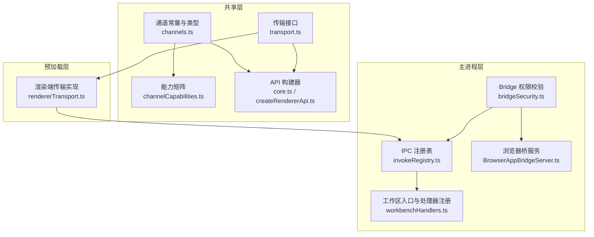
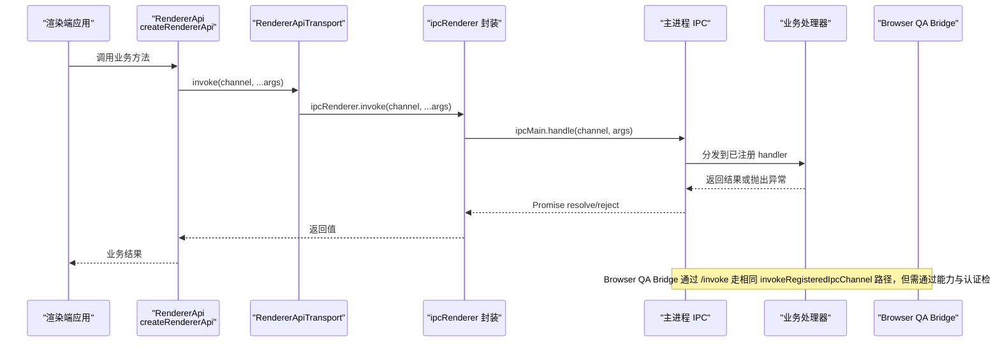
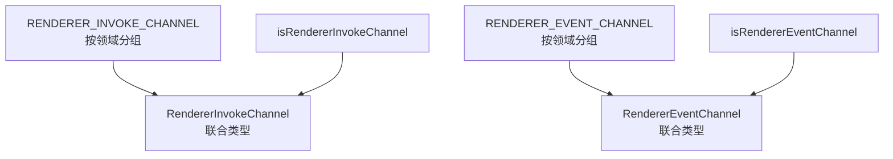
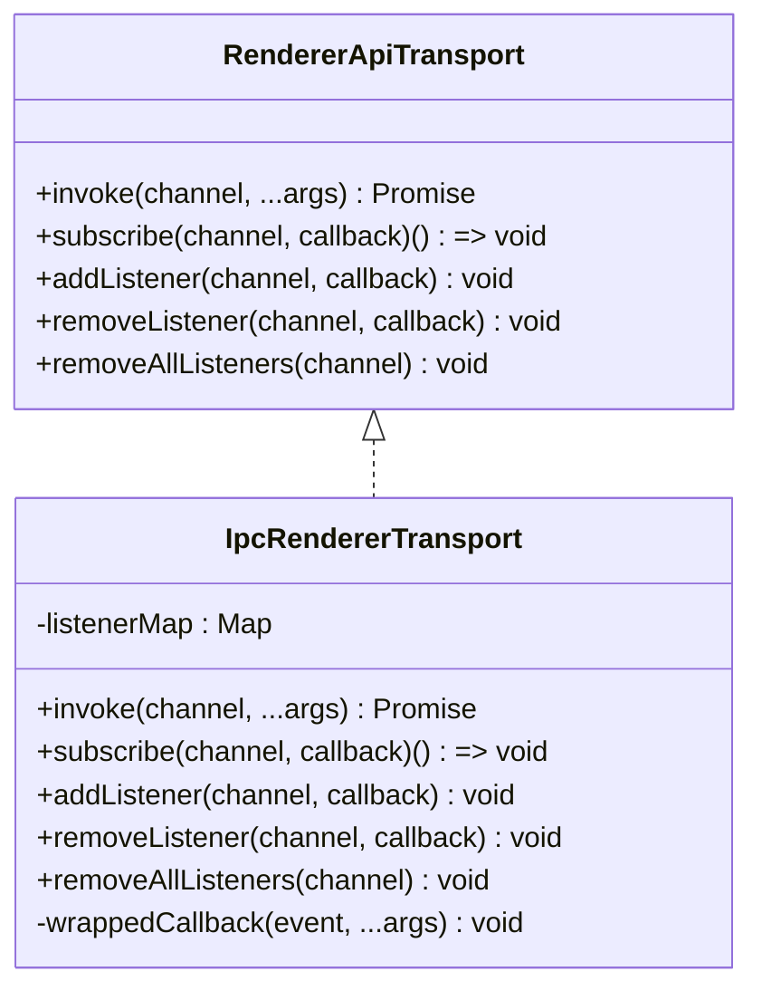
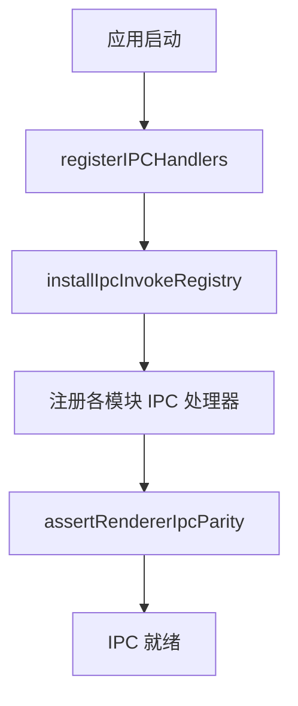
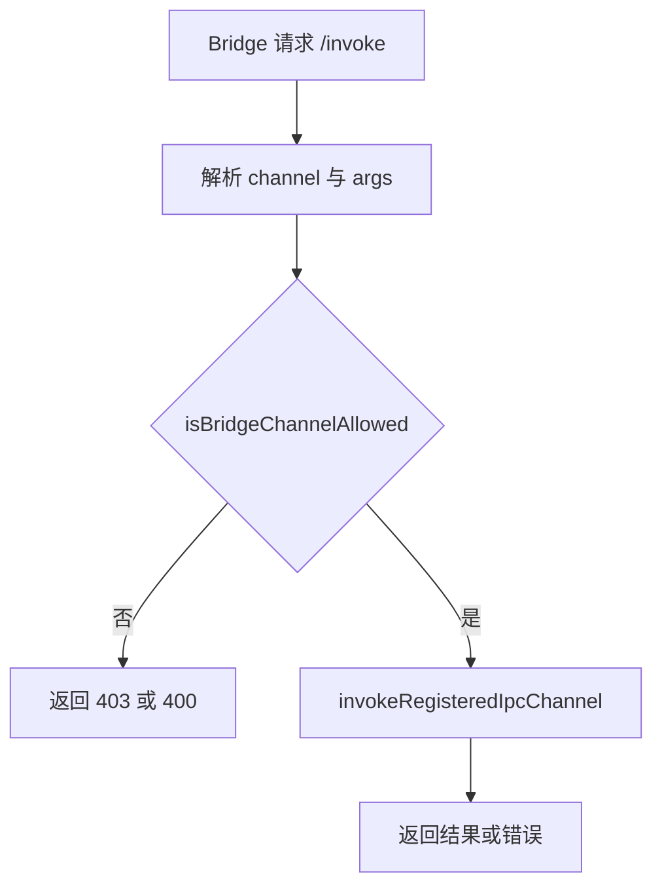
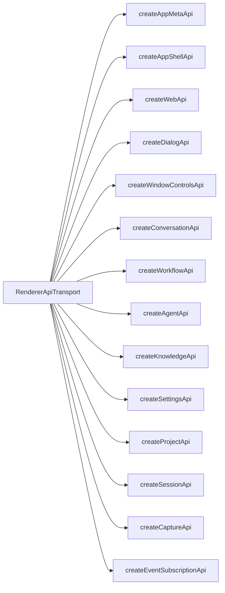
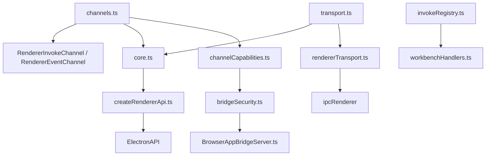

# 传输层与通道

<cite>
**本文引用的文件**   
- [channels.ts](file://src/shared/renderer-api/channels.ts)
- [channelCapabilities.ts](file://src/shared/renderer-api/channelCapabilities.ts)
- [transport.ts](file://src/shared/renderer-api/transport.ts)
- [core.ts](file://src/shared/renderer-api/core.ts)
- [createRendererApi.ts](file://src/shared/renderer-api/createRendererApi.ts)
- [rendererTransport.ts](file://src/preload/rendererTransport.ts)
- [invokeRegistry.ts](file://src/main/ipc/invokeRegistry.ts)
- [workbenchHandlers.ts](file://src/main/ipc/workbenchHandlers.ts)
- [bridgeSecurity.ts](file://src/main/browserAppBridge/bridgeSecurity.ts)
- [BrowserAppBridgeServer.ts](file://src/main/browserAppBridge/BrowserAppBridgeServer.ts)
</cite>

## 目录
1. [引言](#引言)
2. [项目结构](#项目结构)
3. [核心组件](#核心组件)
4. [架构总览](#架构总览)
5. [详细组件分析](#详细组件分析)
6. [依赖关系分析](#依赖关系分析)
7. [性能与可靠性考虑](#性能与可靠性考虑)
8. [故障排查指南](#故障排查指南)
9. [结论](#结论)
10. [附录：扩展自定义通道](#附录扩展自定义通道)

## 引言
本文聚焦渲染进程与主进程之间的传输层与通道体系，围绕以下目标展开：
- 明确 RENDERER_INVOKE_CHANNEL 与 RENDERER_EVENT_CHANNEL 的定义规范。
- 记录所有 IPC 通道的命名约定、参数传递机制、错误处理策略。
- 解释 channelCapabilities 能力矩阵的工作原理、声明格式与权限控制。
- 说明 RendererApiTransport 接口中 invoke、subscribe、addListener 等方法的实现细节。
- 描述通道注册流程、消息序列化、重试机制与超时处理现状。
- 提供自定义通道扩展指南与调试技巧。

该文档既适合深入理解 Electron IPC 与共享 API 的开发者，也适合需要安全接入 Browser QA Bridge 的集成方阅读。

## 项目结构
传输层与通道相关代码分布在三个关键位置：
- 共享层：定义通道常量、类型、能力矩阵与渲染端 API 构建器。
- 预加载层：在渲染进程暴露安全的 RendererApiTransport 实现。
- 主进程层：统一注册 invoke 处理器、校验通道能力并对外暴露 Bridge HTTP 服务。

**图示来源**
- [channels.ts:1-271](file://src/shared/renderer-api/channels.ts#L1-L271)
- [channelCapabilities.ts:1-202](file://src/shared/renderer-api/channelCapabilities.ts#L1-L202)
- [transport.ts:1-11](file://src/shared/renderer-api/transport.ts#L1-L11)
- [core.ts:1-167](file://src/shared/renderer-api/core.ts#L1-L167)
- [createRendererApi.ts:1-80](file://src/shared/renderer-api/createRendererApi.ts#L1-L80)
- [rendererTransport.ts:1-44](file://src/preload/rendererTransport.ts#L1-L44)
- [invokeRegistry.ts:1-50](file://src/main/ipc/invokeRegistry.ts#L1-L50)
- [workbenchHandlers.ts:250-293](file://src/main/ipc/workbenchHandlers.ts#L250-L293)
- [bridgeSecurity.ts:1-119](file://src/main/browserAppBridge/bridgeSecurity.ts#L1-L119)
- [BrowserAppBridgeServer.ts:320-400](file://src/main/browserAppBridge/BrowserAppBridgeServer.ts#L320-L400)

**章节来源**
- [channels.ts:1-271](file://src/shared/renderer-api/channels.ts#L1-L271)
- [channelCapabilities.ts:1-202](file://src/shared/renderer-api/channelCapabilities.ts#L1-L202)
- [transport.ts:1-11](file://src/shared/renderer-api/transport.ts#L1-L11)
- [core.ts:1-167](file://src/shared/renderer-api/core.ts#L1-L167)
- [createRendererApi.ts:1-80](file://src/shared/renderer-api/createRendererApi.ts#L1-L80)
- [rendererTransport.ts:1-44](file://src/preload/rendererTransport.ts#L1-L44)
- [invokeRegistry.ts:1-50](file://src/main/ipc/invokeRegistry.ts#L1-L50)
- [workbenchHandlers.ts:250-293](file://src/main/ipc/workbenchHandlers.ts#L250-L293)
- [bridgeSecurity.ts:1-119](file://src/main/browserAppBridge/bridgeSecurity.ts#L1-L119)
- [BrowserAppBridgeServer.ts:320-400](file://src/main/browserAppBridge/BrowserAppBridgeServer.ts#L320-L400)

## 核心组件
本节从“通道定义”“传输接口”“预加载实现”“主进程注册”“能力矩阵”五个维度总结关键职责。

- 通道定义：RENDERER_INVOKE_CHANNEL 与 RENDERER_EVENT_CHANNEL 是渲染进程可用的两类通道常量，前者用于请求响应式调用，后者用于事件推送。
- 传输接口：RendererApiTransport 抽象了 invoke、subscribe、addListener、removeListener、removeAllListeners 五种行为，屏蔽底层 Electron IPC 差异。
- 预加载实现：createIpcRendererTransport 基于 ipcRenderer.invoke 与 ipcRenderer.on/off 实现，维护回调映射以避免重复监听。
- 主进程注册：installIpcInvokeRegistry 拦截 ipcMain.handle，收集已注册的 handler；assertRendererIpcParity 确保渲染端声明的所有通道都有对应主进程处理器。
- 能力矩阵：CHANNEL_CAPABILITY 为每个渲染端可调用通道标注 read、mutation、high-impact、desktop-only 四类能力，供 Browser QA Bridge 做白名单与权限判断。

**章节来源**
- [channels.ts:1-271](file://src/shared/renderer-api/channels.ts#L1-L271)
- [transport.ts:1-11](file://src/shared/renderer-api/transport.ts#L1-L11)
- [rendererTransport.ts:1-44](file://src/preload/rendererTransport.ts#L1-L44)
- [invokeRegistry.ts:1-50](file://src/main/ipc/invokeRegistry.ts#L1-L50)
- [channelCapabilities.ts:1-202](file://src/shared/renderer-api/channelCapabilities.ts#L1-L202)

## 架构总览
渲染端通过 createRendererApi 组合出业务 API，这些 API 内部使用 transport.invoke 发送请求；事件订阅则通过 transport.addListener 或 subscribe 完成。预加载层将 Electron 的 IPC 封装成统一接口；主进程侧由 workbenchHandlers 统一安装注册表并注册各模块处理器；Browser QA Bridge 通过 bridgeSecurity 与 CHANNEL_CAPABILITY 做通道级访问控制。

**图示来源**
- [createRendererApi.ts:1-80](file://src/shared/renderer-api/createRendererApi.ts#L1-L80)
- [rendererTransport.ts:1-44](file://src/preload/rendererTransport.ts#L1-L44)
- [invokeRegistry.ts:1-50](file://src/main/ipc/invokeRegistry.ts#L1-L50)
- [workbenchHandlers.ts:250-293](file://src/main/ipc/workbenchHandlers.ts#L250-L293)
- [BrowserAppBridgeServer.ts:320-400](file://src/main/browserAppBridge/BrowserAppBridgeServer.ts#L320-L400)

## 详细组件分析

### 通道定义与命名规范
RENDERER_INVOKE_CHANNEL 按领域分组，例如 shell、conversation、workflow、agent、memory、investigation、plan、knowledge、rdcRuntime、command、tools、llm、settings、project、device、session、run、runtime、capture、context、trace 等。每个子对象中的键名是方法语义，值则是真实 IPC 通道字符串。

RENDERER_EVENT_CHANNEL 同样按领域分组，包含 shell、conversation、workflow、llm、agent、tools、workbench、runtime 等事件域。

类型系统通过 NestedValues 把嵌套对象中的所有字符串值提取为联合类型 RendererInvokeChannel 与 RendererEventChannel，并提供 isRendererInvokeChannel 与 isRendererEventChannel 进行运行时守卫。

**图示来源**
- [channels.ts:1-271](file://src/shared/renderer-api/channels.ts#L1-L271)

命名约定要点：
- 通道字符串采用 `领域:动作` 形式，如 conversation:sendMessage、dialog:selectFiles、workflow:getState。
- 渲染端只能调用 RENDERER_INVOKE_CHANNEL 中存在的通道；未知通道会被能力矩阵拒绝或在主进程报未注册处理器。
- 事件通道只用于广播，不携带返回值；调用方通过事件订阅消费。

**章节来源**
- [channels.ts:1-271](file://src/shared/renderer-api/channels.ts#L1-L271)

### RendererApiTransport 接口与实现
RendererApiTransport 定义了四个关键操作：
- invoke：发起一次带参数的远程调用，返回 Promise。
- subscribe：订阅事件通道，返回取消订阅函数。
- addListener/removeListener：细粒度事件监听管理。
- removeAllListeners：清理某个通道上的所有监听。

预加载实现 createIpcRendererTransport 的核心行为：
- invoke 直接委托给 ipcRenderer.invoke。
- addListener 对回调进行包装，避免重复绑定同一回调，同时维护 Map<RendererEventChannel, Map<callback, wrappedCallback>>。
- removeListener 查找并移除包装回调，若通道无监听则删除通道条目。
- removeAllListeners 清理本地映射并调用 ipcRenderer.removeAllListeners。

**图示来源**
- [transport.ts:1-11](file://src/shared/renderer-api/transport.ts#L1-L11)
- [rendererTransport.ts:1-44](file://src/preload/rendererTransport.ts#L1-L44)

参数传递机制：
- invoke 的参数以可变参数形式透传到主进程处理器，处理器签名通常为 (event, ...args)。
- 事件回调接收原始 payload；当前实现会去掉 Electron event 参数，仅把业务参数传给用户回调。

错误处理：
- invoke 的错误由 Electron IPC 正常传播，Promise reject 会携带主进程抛出的 Error 或错误信息。
- 事件监听不会因单个回调异常而中断其他监听；若需要隔离，应在业务回调内自行 try/catch。

重试与超时：
- 当前 RendererApiTransport 没有内置重试或超时逻辑。
- 上层业务可在调用处封装重试、超时取消、退避策略，或使用会话级状态机协调长耗时操作。

**章节来源**
- [transport.ts:1-11](file://src/shared/renderer-api/transport.ts#L1-L11)
- [rendererTransport.ts:1-44](file://src/preload/rendererTransport.ts#L1-L44)

### 通道注册流程
主进程启动时，workbenchHandlers 执行 registerIPCHandlers：
1. installIpcInvokeRegistry：拦截 ipcMain.handle，将所有注册过的 handler 收集到 invokeHandlers。
2. 依次注册 shell、web、conversation、plan、workflow、project、session、agent、memory、knowledge、investigation、command、tool evidence、settings/llm、trace、rdcRuntime 等处理器。
3. assertRendererIpcParity：对比 RENDERER_INVOKE_CHANNELS 与已注册 handler，缺失即报错。
4. 注册主题桥接与窗口相关逻辑。

**图示来源**
- [workbenchHandlers.ts:250-293](file://src/main/ipc/workbenchHandlers.ts#L250-L293)
- [invokeRegistry.ts:1-50](file://src/main/ipc/invokeRegistry.ts#L1-L50)

invokeRegisteredIpcChannel 的行为：
- 根据 channel 查找已注册 handler。
- 若不存在，抛出“未注册处理器”错误。
- 构造最小化的 IpcMainInvokeEvent，其中 sender 优先取聚焦窗口 webContents，否则取第一个未销毁窗口。

**章节来源**
- [workbenchHandlers.ts:250-293](file://src/main/ipc/workbenchHandlers.ts#L250-L293)
- [invokeRegistry.ts:1-50](file://src/main/ipc/invokeRegistry.ts#L1-L50)

### 能力矩阵与权限控制
channelCapabilities.ts 定义了 BridgeChannelCapability 四种能力：
- read：读取类通道，默认允许。
- mutation：写入类通道，默认允许。
- high-impact：高影响通道，需要 RDC_AGENT_BROWSER_QA_FULL_ACCESS=1。
- desktop-only：桌面专属通道，Browser QA Bridge 一律拒绝。

核心函数：
- hasBridgeChannelCapability：判断通道是否在能力矩阵中。
- resolveBridgeChannelCapability：解析能力，若未声明则抛出 BRIDGE_CAPABILITY_MISSING。
- listUnclassifiedInvokeChannels：列出尚未分类的渲染端通道。
- assertChannelCapabilityCoverage：断言渲染端所有通道都已分类，且能力矩阵没有多余项。

Bridge 权限控制位于 bridgeSecurity.ts：
- isBridgeChannelAllowed 要求通道必须存在于渲染端通道集合、必须有已注册处理器、必须在能力矩阵中，且不能是 desktop-only；high-impact 需要环境变量开启。
- BrowserAppBridgeServer 的 /invoke 路由会在解析 body 后再次校验通道，并转发到 invokeRegisteredIpcChannel。

**图示来源**
- [channelCapabilities.ts:1-202](file://src/shared/renderer-api/channelCapabilities.ts#L1-L202)
- [bridgeSecurity.ts:1-119](file://src/main/browserAppBridge/bridgeSecurity.ts#L1-L119)
- [BrowserAppBridgeServer.ts:320-400](file://src/main/browserAppBridge/BrowserAppBridgeServer.ts#L320-L400)

能力声明格式：
- 每个 RENDERER_INVOKE_CHANNEL 中的通道都必须在 CHANNEL_CAPABILITY 中存在映射。
- 新增通道时必须同步声明能力，否则 assertChannelCapabilityCoverage 或 resolveBridgeChannelCapability 会失败。

**章节来源**
- [channelCapabilities.ts:1-202](file://src/shared/renderer-api/channelCapabilities.ts#L1-L202)
- [bridgeSecurity.ts:1-119](file://src/main/browserAppBridge/bridgeSecurity.ts#L1-L119)
- [BrowserAppBridgeServer.ts:320-400](file://src/main/browserAppBridge/BrowserAppBridgeServer.ts#L320-L400)

### 渲染端 API 构建与事件桥接
core.ts 提供多个 createXxxApi 工厂，它们统一通过 transport.invoke 调用 RENDERER_INVOKE_CHANNEL 中的具体通道。例如 conversation API 不仅暴露 sendMessage、getHistory 等方法，还提供 onEvent/offEvent，内部通过 EVENT.conversation.event 与 transport.addListener/removeListener 订阅主进程事件。

createRendererApi 把这些 API 组装成 ElectronAPI 对象，并额外提供 platform、isMac、isWindows、isLinux、events、on/off 等通用能力。

**图示来源**
- [core.ts:1-167](file://src/shared/renderer-api/core.ts#L1-L167)
- [createRendererApi.ts:1-80](file://src/shared/renderer-api/createRendererApi.ts#L1-L80)

**章节来源**
- [core.ts:1-167](file://src/shared/renderer-api/core.ts#L1-L167)
- [createRendererApi.ts:1-80](file://src/shared/renderer-api/createRendererApi.ts#L1-L80)

### 消息序列化与传输模型
- 渲染端 invoke 调用使用 Electron 的结构化克隆语义，支持普通对象、数组、字符串、数字、布尔、null、undefined、Date、RegExp、Map、Set、ArrayBuffer、TypedArray 等常见可序列化类型。
- 事件通道使用 ipcRenderer.on 触发，回调参数由主进程处理器决定。
- Browser QA Bridge 的 /invoke 使用 JSON Body 传输 channel 与 args，并对过大请求体返回特定错误码；/events 使用 Server-Sent Events 风格连接。

注意：
- 大对象应尽量避免直接放入 JSON Body；必要时拆分为分页或流式接口。
- 二进制数据建议转换为 Base64 或 URL 引用，并在主进程侧按需反序列化。

**章节来源**
- [BrowserAppBridgeServer.ts:320-400](file://src/main/browserAppBridge/BrowserAppBridgeServer.ts#L320-L400)
- [rendererTransport.ts:1-44](file://src/preload/rendererTransport.ts#L1-L44)

## 依赖关系分析

**图示来源**
- [channels.ts:1-271](file://src/shared/renderer-api/channels.ts#L1-L271)
- [channelCapabilities.ts:1-202](file://src/shared/renderer-api/channelCapabilities.ts#L1-L202)
- [transport.ts:1-11](file://src/shared/renderer-api/transport.ts#L1-L11)
- [core.ts:1-167](file://src/shared/renderer-api/core.ts#L1-L167)
- [createRendererApi.ts:1-80](file://src/shared/renderer-api/createRendererApi.ts#L1-L80)
- [rendererTransport.ts:1-44](file://src/preload/rendererTransport.ts#L1-L44)
- [invokeRegistry.ts:1-50](file://src/main/ipc/invokeRegistry.ts#L1-L50)
- [workbenchHandlers.ts:250-293](file://src/main/ipc/workbenchHandlers.ts#L250-L293)
- [bridgeSecurity.ts:1-119](file://src/main/browserAppBridge/bridgeSecurity.ts#L1-L119)
- [BrowserAppBridgeServer.ts:320-400](file://src/main/browserAppBridge/BrowserAppBridgeServer.ts#L320-L400)

耦合与内聚：
- channels.ts 是传输层契约中心，所有模块依赖其通道常量与类型。
- core.ts 与 createRendererApi.ts 内聚较高，负责把 transport 转化为业务 API。
- rendererTransport.ts 与 Electron ipcRenderer 强耦合，但被 RendererApiTransport 抽象限制。
- invokeRegistry.ts 与 electron 主进程模块耦合，但仅承担注册与分发职责。
- bridgeSecurity.ts 与 channelCapabilities.ts 形成安全边界，与 BrowserAppBridgeServer.ts 协作实现外部访问控制。

潜在循环依赖：
- 当前结构以单向依赖为主，未发现明显循环导入；新增模块时应遵循“共享层不依赖主进程”的原则。

**章节来源**
- [channels.ts:1-271](file://src/shared/renderer-api/channels.ts#L1-L271)
- [channelCapabilities.ts:1-202](file://src/shared/renderer-api/channelCapabilities.ts#L1-L202)
- [transport.ts:1-11](file://src/shared/renderer-api/transport.ts#L1-L11)
- [core.ts:1-167](file://src/shared/renderer-api/core.ts#L1-L167)
- [createRendererApi.ts:1-80](file://src/shared/renderer-api/createRendererApi.ts#L1-L80)
- [rendererTransport.ts:1-44](file://src/preload/rendererTransport.ts#L1-L44)
- [invokeRegistry.ts:1-50](file://src/main/ipc/invokeRegistry.ts#L1-L50)
- [workbenchHandlers.ts:250-293](file://src/main/ipc/workbenchHandlers.ts#L250-L293)
- [bridgeSecurity.ts:1-119](file://src/main/browserAppBridge/bridgeSecurity.ts#L1-L119)
- [BrowserAppBridgeServer.ts:320-400](file://src/main/browserAppBridge/BrowserAppBridgeServer.ts#L320-L400)

## 性能与可靠性考虑
- 序列化开销：频繁调用大对象会增加 IPC 序列化成本。建议拆分接口、减少冗余字段，或对大附件使用临时存储加引用。
- 事件风暴：大量事件可能造成渲染端回调堆积。应合并同类事件、去抖节流，或仅在必要组件中订阅。
- 长耗时操作：对于耗时较长的 invoke，建议在主进程侧做进度事件推送，而不是阻塞单条 RPC。
- 重试与超时：当前传输层未内置重试与超时。上层可根据业务场景实现指数退避重试、超时取消、幂等重试键。
- Bridge 并发：Browser QA Bridge 的 /invoke 是异步处理，应避免在高并发下产生过多主进程任务；必要时增加限流或队列。

[本节为通用指导，不涉及具体文件分析]

## 故障排查指南
常见问题与定位步骤：
- “未注册 IPC 处理器”：
  - 现象：调用某个通道时报错，提示没有对应处理器。
  - 排查：确认是否已在 workbenchHandlers 中注册相应模块处理器，以及通道名是否与 channels.ts 一致。
  - 参考：invokeRegisteredIpcChannel 在未找到 handler 时抛出错误。
- “渲染端通道与主进程不一致”：
  - 现象：应用启动时报 parity violation。
  - 排查：运行 assertRendererIpcParity 对应的检查逻辑，确认渲染端声明的通道都有主进程实现。
- “能力未分类”：
  - 现象：能力断言失败或 resolveBridgeChannelCapability 抛出 BRIDGE_CAPABILITY_MISSING。
  - 排查：在 CHANNEL_CAPABILITY 中补充新通道的能力映射，并使用 assertChannelCapabilityCoverage 验证。
- “Browser QA 通道被拒绝”：
  - 现象：/invoke 返回 403 或 400。
  - 排查：检查通道是否在 RENDERER_INVOKE_CHANNEL、是否已注册、是否在能力矩阵中；若为 high-impact，需设置 RDC_AGENT_BROWSER_QA_FULL_ACCESS=1；若为 desktop-only，则无法通过 Bridge 调用。
- “事件监听未触发或重复触发”：
  - 现象：回调多次执行或未收到事件。
  - 排查：检查是否正确调用 addListener/removeListener，避免重复绑定；注意 subscribe 返回取消函数。
- “Body 过大或通道头不一致”：
  - 现象：Bridge /invoke 返回 413 或 INVOKE_CHANNEL_MISMATCH。
  - 排查：减小请求体大小，或确保 INVOKE_CHANNEL_HEADER 与实际 body.channel 一致。

**章节来源**
- [invokeRegistry.ts:1-50](file://src/main/ipc/invokeRegistry.ts#L1-L50)
- [channelCapabilities.ts:1-202](file://src/shared/renderer-api/channelCapabilities.ts#L1-L202)
- [bridgeSecurity.ts:1-119](file://src/main/browserAppBridge/bridgeSecurity.ts#L1-L119)
- [BrowserAppBridgeServer.ts:320-400](file://src/main/browserAppBridge/BrowserAppBridgeServer.ts#L320-L400)
- [rendererTransport.ts:1-44](file://src/preload/rendererTransport.ts#L1-L44)

## 结论
本项目的传输层与通道体系以 channels.ts 为中心契约，通过 RendererApiTransport 抽象渲染端调用，预加载层封装 Electron IPC，主进程集中注册处理器并校验通道能力。channelCapabilities 为 Browser QA Bridge 提供了严格的白名单与权限控制。当前实现强调安全性与一致性，但未内置重试与超时，需要上层业务根据场景补充可靠性策略。

## 附录：扩展自定义通道
新增通道推荐步骤：
1. 在 RENDERER_INVOKE_CHANNEL 中添加领域与方法映射，或在 RENDERER_EVENT_CHANNEL 中添加事件通道。
2. 在 channels.ts 中确认 RendererInvokeChannel 与 RendererEventChannel 类型自动更新。
3. 在 channelCapabilities.ts 的 CHANNEL_CAPABILITY 中为该通道声明能力；如果是新领域，请评估 read/mutation/high-impact/desktop-only。
4. 在主进程 workbenchHandlers 中注册对应 IPC 处理器，并确保 installIpcInvokeRegistry 能捕获到它。
5. 如需在渲染端暴露便捷 API，在 core.ts 或对应 API 文件中创建 createXxxApi 方法，并通过 createRendererApi 挂载。
6. 运行能力断言与通道一致性检查，确保没有遗漏。
7. 若是 Browser QA Bridge 可用通道，确保 bridgeSecurity.isBridgeChannelAllowed 能通过；high-impact 需要配置环境变量，desktop-only 不可通过 Bridge 调用。

调试技巧：
- 在渲染端打印调用前的 channel 与参数，确认类型与命名正确。
- 在主进程 handler 入口处打印 event.sender 与 args，确认消息来源与内容。
- 使用 Browser QA Bridge 的 /health 与 /invoke 测试非渲染端通路，观察 403/400/413 等状态码。
- 对高频事件，先在渲染端加日志统计触发次数，避免误判主进程问题。

**章节来源**
- [channels.ts:1-271](file://src/shared/renderer-api/channels.ts#L1-L271)
- [channelCapabilities.ts:1-202](file://src/shared/renderer-api/channelCapabilities.ts#L1-L202)
- [core.ts:1-167](file://src/shared/renderer-api/core.ts#L1-L167)
- [createRendererApi.ts:1-80](file://src/shared/renderer-api/createRendererApi.ts#L1-L80)
- [workbenchHandlers.ts:250-293](file://src/main/ipc/workbenchHandlers.ts#L250-L293)
- [bridgeSecurity.ts:1-119](file://src/main/browserAppBridge/bridgeSecurity.ts#L1-L119)
- [BrowserAppBridgeServer.ts:320-400](file://src/main/browserAppBridge/BrowserAppBridgeServer.ts#L320-L400)