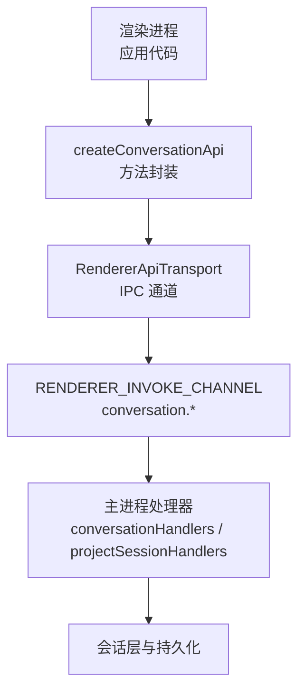
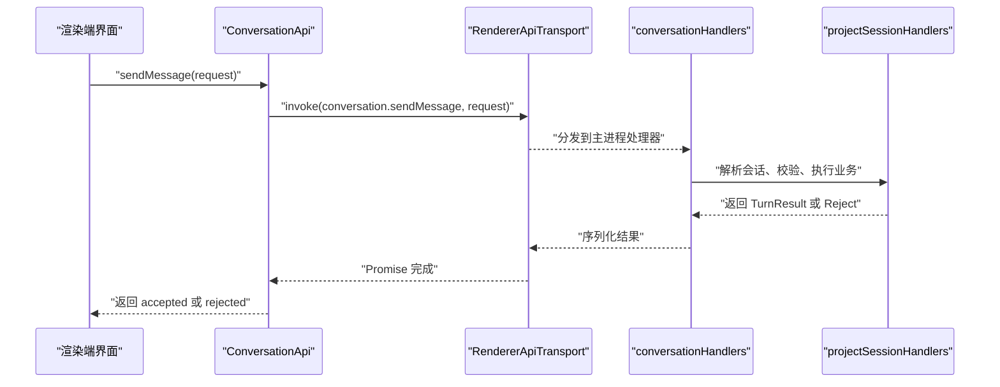
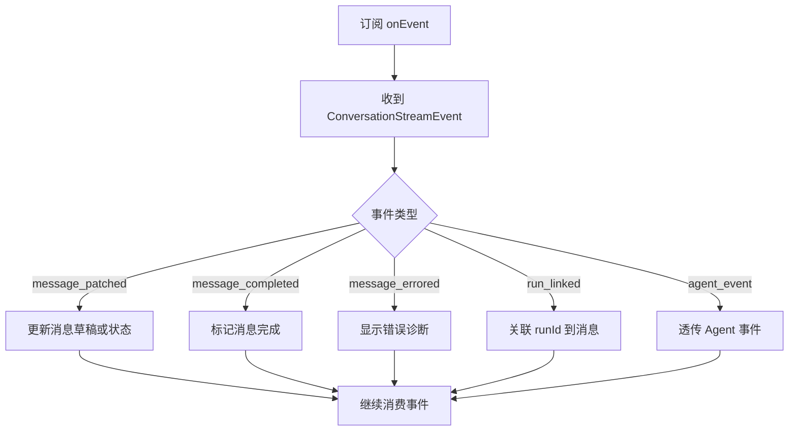
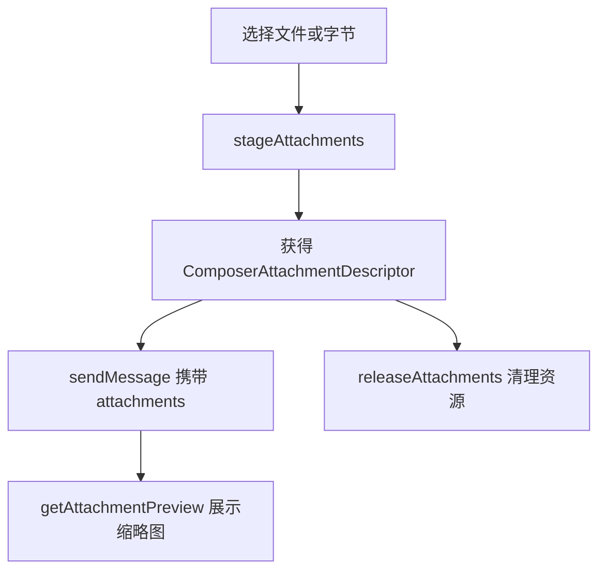

# 对话管理 API

<cite>
**本文引用的文件**   
- [createRendererApi.ts](file://src/shared/renderer-api/createRendererApi.ts)
- [core.ts](file://src/shared/renderer-api/core.ts)
- [electron-api.ts](file://src/shared/types/electron-api.ts)
- [electron/index.ts](file://src/shared/types/electron/index.ts)
- [conversation.ts（类型）](file://src/shared/types/conversation.ts)
- [electron.ts（ElectronAPI 定义）](file://src/shared/types/electron.ts)
- [channels.ts](file://src/shared/renderer-api/channels.ts)
- [transport.ts](file://src/shared/renderer-api/transport.ts)
- [projectSessionHandlers.ts](file://src/main/ipc/projectSessionHandlers.ts)
- [conversationHandlers.ts](file://src/main/ipc/conversationHandlers.ts)
- [useDelegationTrace.ts](file://src/renderer/features/transcript/useDelegationTrace.ts)
- [useDelegationContent.ts](file://src/renderer/features/transcript/useDelegationContent.ts)
</cite>

## 目录
1. [简介](#简介)
2. [项目结构与定位](#项目结构与定位)
3. [ConversationApi 总览](#conversationapi-总览)
4. [完整方法清单与类型契约](#完整方法清单与类型契约)
5. [架构与调用链路](#架构与调用链路)
6. [详细方法说明](#详细方法说明)
7. [事件订阅机制与会话状态监听](#事件订阅机制与会话状态监听)
8. [会话历史、分支与委托追踪](#会话历史分支与委托追踪)
9. [附件管理](#附件管理)
10. [典型对话流示例](#典型对话流示例)
11. [错误模型与诊断码](#错误模型与诊断码)
12. [性能与可靠性建议](#性能与可靠性建议)
13. [故障排查指南](#故障排查指南)
14. [结论](#结论)

## 简介
本文面向渲染进程和外部集成方，系统性说明 `ConversationApi` 提供的对话管理能力。它覆盖消息发送、重写上一轮、取消当前回合、回答用户输入、工具审批、计划审查、会话历史、分支切换、委托追踪以及附件暂存与预览等能力。文档同时给出 IPC 传输方式、参数校验规则、返回值结构、错误码语义和使用最佳实践。

## 项目结构与定位
`ConversationApi` 是 Electron 渲染端对外暴露的“对话域”接口：
- 渲染端通过 `createRendererApi` 装配所有子 API。
- `createConversationApi` 把每个方法映射到主进程的 IPC 通道。
- 实际业务逻辑由主进程的 `conversationHandlers` / `projectSessionHandlers` 等处理器实现。
- 所有请求/响应类型集中在共享类型文件中，保证渲染端与主进程契约一致。

**图表来源**
- [createRendererApi.ts:1-80](file://src/shared/renderer-api/createRendererApi.ts#L1-L80)
- [core.ts:52-100](file://src/shared/renderer-api/core.ts#L52-L100)
- [electron.ts:180-240](file://src/shared/types/electron.ts#L180-L240)

**章节来源**
- [createRendererApi.ts:1-80](file://src/shared/renderer-api/createRendererApi.ts#L1-L80)
- [core.ts:52-100](file://src/shared/renderer-api/core.ts#L52-L100)
- [electron-api.ts:1-32](file://src/shared/types/electron-api.ts#L1-L32)
- [electron/index.ts:1-19](file://src/shared/types/electron/index.ts#L1-L19)

## ConversationApi 总览
`ConversationApi` 提供三类能力：
1. **对话控制**：发送消息、重写消息、取消活跃回合。
2. **交互应答**：回答用户输入、工具审批、计划审查。
3. **查询与资源**：获取历史、切换分支、撤销回合、委托追踪、附件管理与预览。
4. **事件流**：订阅会话状态变化。

| 类别 | 方法 | 主要用途 |
|---|---|---|
| 对话控制 | `sendMessage` | 发起一轮新对话或续写 |
| 对话控制 | `rewriteFromMessage` | 基于已有消息重新生成一轮 |
| 对话控制 | `cancelActiveTurn` | 中断正在准备、提交或运行的回合 |
| 交互应答 | `answerUserInput` | 回答运行时 Ask User 问题 |
| 交互应答 | `answerToolApproval` | 批准或拒绝工具调用审批 |
| 交互应答 | `answerPlanReview` | 接受或拒绝计划审查结果 |
| 查询 | `getHistory` | 读取会话消息与分支状态 |
| 查询 | `switchBranch` | 切换到指定分支 |
| 查询 | `clearHistory` | 清空会话历史 |
| 查询 | `undoLastTurn` | 回滚最后一个回合 |
| 委托追踪 | `getDelegationTrace` | 分页获取委托任务链 |
| 委托追踪 | `getDelegationContent` | 分页获取委托内容快照 |
| 附件 | `stageAttachments` | 将文件或字节数据暂存为可复用附件 |
| 附件 | `releaseAttachments` | 释放已暂存的附件 |
| 附件 | `getAttachmentPreview` | 获取附件预览图片 |
| 事件 | `onEvent` / `offEvent` | 订阅或取消订阅会话事件流 |

**章节来源**
- [core.ts:52-100](file://src/shared/renderer-api/core.ts#L52-L100)
- [electron.ts:180-240](file://src/shared/types/electron.ts#L180-L240)

## 完整方法清单与类型契约
本节按方法分组列出参数、返回结构和关键约束。为避免复制具体代码，引用类型定义所在行号。

### sendMessage
- **目的**：发送用户消息，启动或继续一次对话回合。
- **参数**：`ConversationSendRequest`
  - 必须包含 `requestId`、`message`、`turnControls`。
  - 可选包括 `sessionId`、`projectId`、`currentRunId`、`agentId`、`profileId`、`attachments`、`preloadSkillIds`、`configurationCommit`。
- **返回**：`ConversationSendResult`，可能是：
  - 接受态：`{ status: "accepted", requestId, turn, preparedContext }`
  - 拒绝态：`{ status: "rejected", phase, error }`，其中 `error.code` 使用预检错误码。
- **关键行为**：
  - 支持幂等键 `requestId` 与请求指纹 `requestFingerprint`。
  - 可携带附件、技能预加载、配置提交快照。
  - 若预检失败，会直接返回拒绝态。

**类型来源**
- [conversation.ts:360-420](file://src/shared/types/conversation.ts#L360-L420)
- [conversation.ts:490-567](file://src/shared/types/conversation.ts#L490-L567)
- [electron.ts:180-210](file://src/shared/types/electron.ts#L180-L210)

### rewriteFromMessage
- **目的**：以某条已有消息为锚点重新生成一轮。
- **参数**：`ConversationRewriteFromMessageRequest`，继承 `ConversationSendRequest`，并新增 `messageId`。
- **返回**：`ConversationTurnResult`，包含本轮用户消息、助手草稿消息、分支状态、执行转换、错误视图等。

**类型来源**
- [conversation.ts:420-490](file://src/shared/types/conversation.ts#L420-L490)
- [electron.ts:180-200](file://src/shared/types/electron.ts#L180-L200)

### cancelActiveTurn
- **目的**：主动取消当前活跃回合。
- **参数**：可选的 `ConversationCancelActiveTurnRequest`，可指定 `requestId`、`sessionId`、`turnId`。
- **返回**：`ConversationCancelActiveTurnResult`，包含 `success`、当前阶段、被取消的请求或回合标识，以及可能的错误信息。

**类型来源**
- [conversation.ts:420-470](file://src/shared/types/conversation.ts#L420-L470)
- [electron.ts:180-200](file://src/shared/types/electron.ts#L180-L200)

### answerUserInput
- **目的**：回答 Agent 在运行中提出的用户输入问题。
- **参数**：`ConversationAnswerUserInputRequest`
  - 必填：`turnId`、`toolCallId`、`answers`。
  - 可选：`sessionId`。
  - `answers` 中的每项包含 `questionId`、`answer`、可选选项与响应类型。
- **返回**：`ConversationAnswerUserInputResult`，包含 `success` 与可选错误。

**类型来源**
- [conversation.ts:470-520](file://src/shared/types/conversation.ts#L470-L520)
- [electron.ts:180-200](file://src/shared/types/electron.ts#L180-L200)

### answerToolApproval
- **目的**：对工具调用的审批进行批准或拒绝。
- **参数**：`ConversationAnswerToolApprovalRequest`
  - 必填：`turnId`、`approvalId`、`approved`。
  - 可选：`sessionId`。
- **返回**：`ConversationAnswerToolApprovalResult`。

**类型来源**
- [conversation.ts:500-540](file://src/shared/types/conversation.ts#L500-L540)
- [electron.ts:180-200](file://src/shared/types/electron.ts#L180-L200)

### answerPlanReview
- **目的**：回答计划审查结果。
- **参数**：`ConversationAnswerPlanReviewRequest`，来自共享类型导出。
- **返回**：`ConversationAnswerPlanReviewResult`。

**类型来源**
- [conversation.ts:540-567](file://src/shared/types/conversation.ts#L540-L567)
- [electron.ts:180-200](file://src/shared/types/electron.ts#L180-L200)

### getHistory
- **目的**：读取某个会话的消息列表与分支状态。
- **参数**：`sessionId`。
- **返回**：`{ messages, branchState? }`。

**类型来源**
- [electron.ts:180-200](file://src/shared/types/electron.ts#L180-L200)

### switchBranch
- **目的**：在当前会话中切换到目标分支。
- **参数**：`ConversationSwitchBranchRequest`。
- **返回**：`ConversationSwitchBranchResult`。

**类型来源**
- [electron.ts:200-210](file://src/shared/types/electron.ts#L200-L210)

### clearHistory
- **目的**：清空指定会话的历史消息。
- **参数**：`sessionId`。
- **返回**：`{ success, messages, error? }`。

**类型来源**
- [electron.ts:200-220](file://src/shared/types/electron.ts#L200-L220)

### undoLastTurn
- **目的**：撤销最近一个回合，常用于用户撤回操作。
- **参数**：`sessionId`。
- **返回**：`{ success, messages, error? }`。

**类型来源**
- [electron.ts:200-220](file://src/shared/types/electron.ts#L200-L220)

### getDelegationTrace
- **目的**：分页读取委托任务链，用于调试或审计。
- **参数**：`{ sessionId, parentToolCallId, cursor, pageSize, sinceRevision? }`。
- **返回**：`DelegationTracePage`。

**类型来源**
- [electron.ts:180-200](file://src/shared/types/electron.ts#L180-L200)

### getDelegationContent
- **目的**：分页读取委托内容快照。
- **参数**：`DelegationContentRequest`。
- **返回**：`DelegationContentPage`。

**类型来源**
- [electron.ts:180-200](file://src/shared/types/electron.ts#L180-L200)

### stageAttachments
- **目的**：将文件或字节数据暂存为会话级附件，供后续消息复用。
- **参数**：`ConversationStageAttachmentsRequest`
  - `items`：路径项或字节项数组。
  - `composerScopeKey`：编辑器范围键。
- **返回**：`ConversationStageAttachmentsResult`，包含 `ComposerAttachmentDescriptor[]`。

**类型来源**
- [conversation.ts:240-340](file://src/shared/types/conversation.ts#L240-L340)
- [electron.ts:210-240](file://src/shared/types/electron.ts#L210-L240)

### releaseAttachments
- **目的**：释放已暂存的附件。
- **参数**：`ConversationReleaseAttachmentsRequest`，包含待释放的 `stagingIds`。
- **返回**：`ConversationReleaseAttachmentsResult`，包含已释放 ID 列表。

**类型来源**
- [conversation.ts:320-360](file://src/shared/types/conversation.ts#L320-L360)
- [electron.ts:210-240](file://src/shared/types/electron.ts#L210-L240)

### getAttachmentPreview
- **目的**：根据预览 ID 获取附件预览图片。
- **参数**：`ConversationGetAttachmentPreviewRequest`，包含 `previewId`，可选 `sessionId`、`composerScopeKey`。
- **返回**：`ConversationGetAttachmentPreviewResult`，包含 `dataUrl` 或错误。

**类型来源**
- [conversation.ts:340-380](file://src/shared/types/conversation.ts#L340-L380)
- [electron.ts:210-240](file://src/shared/types/electron.ts#L210-L240)

### onEvent / offEvent
- **目的**：订阅或取消订阅会话事件流。
- **参数**：回调函数，接收 `ConversationStreamEvent`。
- **返回**：无。

**类型来源**
- [conversation.ts:520-567](file://src/shared/types/conversation.ts#L520-L567)
- [electron.ts:210-240](file://src/shared/types/electron.ts#L210-L240)

## 架构与调用链路
`ConversationApi` 的方法通过渲染端传输层转发到主进程 IPC 通道，再由对应处理器执行业务逻辑。

**图表来源**
- [core.ts:52-100](file://src/shared/renderer-api/core.ts#L52-L100)
- [electron.ts:180-240](file://src/shared/types/electron.ts#L180-L240)
- [channels.ts](file://src/shared/renderer-api/channels.ts)
- [transport.ts](file://src/shared/renderer-api/transport.ts)

**章节来源**
- [core.ts:52-100](file://src/shared/renderer-api/core.ts#L52-L100)
- [electron.ts:180-240](file://src/shared/types/electron.ts#L180-L240)

## 详细方法说明

### sendMessage：发起对话回合
- **适用场景**：
  - 用户首次输入。
  - 用户继续已有会话。
  - 带附件、技能预加载或特定模型配置的消息。
- **参数校验要点**：
  - `requestId` 作为幂等键，应避免重复。
  - `message` 为空时通常会被拒绝。
  - `turnControls` 必须提供，否则无法确定轮次行为。
  - 附件超过限制、媒体类型不支持或路径不存在时，可能返回附件相关错误。
- **返回值语义**：
  - `accepted`：回合已进入处理流程，前端应等待事件推进消息状态。
  - `rejected`：预检或提交阶段失败，需根据 `error.code` 决定提示或重试策略。

**类型来源**
- [conversation.ts:360-420](file://src/shared/types/conversation.ts#L360-L420)
- [conversation.ts:490-567](file://src/shared/types/conversation.ts#L490-L567)

### rewriteFromMessage：基于历史消息重写
- **适用场景**：
  - 用户修改上一条消息后重新生成。
  - 希望保留部分上下文但调整意图。
- **关键差异**：
  - 相比 `sendMessage`，需要额外指定 `messageId`，表示从哪条消息开始重写。
- **注意事项**：
  - 如果原消息不存在或不可用，可能进入错误分支。
  - 重写后会产生新的助手草稿消息，旧消息不会自动替换。

**类型来源**
- [conversation.ts:420-490](file://src/shared/types/conversation.ts#L420-L490)

### cancelActiveTurn：取消活跃回合
- **适用场景**：
  - 用户点击停止。
  - 上层判断长时间无进展需要中断。
- **阶段语义**：
  - `preparing`：还在准备阶段。
  - `committing`：正在提交。
  - `running`：正在运行。
- **返回字段**：
  - `cancelledRequestId` / `cancelledTurnId` 可用于日志和 UI 标记。

**类型来源**
- [conversation.ts:420-470](file://src/shared/types/conversation.ts#L420-L470)

### answerUserInput：回答用户输入问题
- **适用场景**：
  - Agent 在工具调用前要求确认问题。
  - 单选或多选，也允许自由文本。
- **参数要点**：
  - `turnId` 和 `toolCallId` 必须匹配当前等待的问题。
  - `answers` 数量应与问题数量一致。
- **错误处理**：
  - 如果问题已解决、会话不存在或答案无效，返回失败。

**类型来源**
- [conversation.ts:470-520](file://src/shared/types/conversation.ts#L470-L520)

### answerToolApproval：工具审批
- **适用场景**：
  - 高风险工具调用需要人工审批。
  - 自动审批未启用或不满足条件。
- **参数要点**：
  - `approved` 为布尔值。
  - `approvalId` 必须与工具审批记录一致。
- **影响**：
  - 批准后工具继续执行；拒绝后工具可能跳过或报错。

**类型来源**
- [conversation.ts:500-540](file://src/shared/types/conversation.ts#L500-L540)

### answerPlanReview：计划审查
- **适用场景**：
  - Agent 生成计划后请求人类确认。
  - 支持后续继续执行或终止。
- **参数与返回**：
  - 类型由 `planReview` 相关类型导出。
  - 成功时继续计划，失败时可能返回错误视图。

**类型来源**
- [conversation.ts:540-567](file://src/shared/types/conversation.ts#L540-L567)

## 事件订阅机制与会话状态监听
`onEvent` 和 `offEvent` 提供轻量事件订阅，适合实时刷新消息状态、工作块状态、运行关联和 Agent 事件。

**图表来源**
- [conversation.ts:520-567](file://src/shared/types/conversation.ts#L520-L567)
- [electron.ts:210-240](file://src/shared/types/electron.ts#L210-L240)

**章节来源**
- [conversation.ts:520-567](file://src/shared/types/conversation.ts#L520-L567)
- [electron.ts:210-240](file://src/shared/types/electron.ts#L210-L240)

## 会话历史、分支与委托追踪

### getHistory
- 返回会话消息数组和可选分支状态。
- 适用于页面初始化、侧边栏历史树、回放分析。

### switchBranch
- 切换当前会话分支。
- 常用于对比不同方案、回退到更早决策点。

### clearHistory
- 清空会话消息。
- 适合“新建对话”“重置上下文”场景。

### undoLastTurn
- 撤销最后一轮。
- 适合用户误发或需要局部回滚。

### getDelegationTrace / getDelegationContent
- 用于查看 Agent 委托任务的执行链和内容快照。
- 适合调试、审计、右侧面板展示委托详情。
- 渲染端已有 Hook 封装：`useDelegationTrace`、`useDelegationContent`。

**章节来源**
- [electron.ts:180-220](file://src/shared/types/electron.ts#L180-L220)
- [useDelegationTrace.ts](file://src/renderer/features/transcript/useDelegationTrace.ts)
- [useDelegationContent.ts](file://src/renderer/features/transcript/useDelegationContent.ts)

## 附件管理

### stageAttachments
- 支持路径附件和字节附件两种条目。
- 返回 `stagingId`，可在后续 `sendMessage` 中引用。
- 常见错误包括：
  - 超出附件数量限制。
  - 可执行文件被拒绝。
  - 媒体类型不支持。
  - 文件不存在。

### releaseAttachments
- 批量释放暂存附件，避免资源泄漏。
- 适用于编辑器关闭、会话结束、用户取消选择后清理。

### getAttachmentPreview
- 根据 `previewId` 获取预览图片的 Data URL。
- 适用于附件卡片缩略图、聊天消息内图片展示。

**图表来源**
- [conversation.ts:240-380](file://src/shared/types/conversation.ts#L240-L380)
- [electron.ts:210-240](file://src/shared/types/electron.ts#L210-L240)

**章节来源**
- [conversation.ts:240-380](file://src/shared/types/conversation.ts#L240-L380)
- [electron.ts:210-240](file://src/shared/types/electron.ts#L210-L240)

## 典型对话流示例

### 示例一：正常发送消息并消费事件
1. 调用 `sendMessage`，传入唯一 `requestId`、消息内容和 `turnControls`。
2. 若返回 `accepted`，立即注册 `onEvent`。
3. 根据 `message_patched` 更新草稿状态。
4. 根据 `message_completed` 或 `message_errored` 完成或错误处理。
5. 根据 `run_linked` 绑定 `runId`，便于用量和追踪。

### 示例二：重写上一条消息
1. 保存用户修改后的消息文本。
2. 调用 `rewriteFromMessage`，传入原 `messageId`。
3. 等待新助手草稿消息出现。
4. 如需中止，调用 `cancelActiveTurn`。

### 示例三：回答用户输入与工具审批
1. 从 `message_patched` 或工作块中提取 `toolCallId`、`turnId`、审批或用户输入信息。
2. 构造 `answers` 或审批请求。
3. 调用 `answerUserInput` 或 `answerToolApproval`。
4. 观察后续事件是否恢复运行。

### 示例四：附件上传与预览
1. 调用 `stageAttachments` 获得 `stagingId`。
2. 在 `sendMessage` 中携带附件描述。
3. 使用 `getAttachmentPreview` 显示缩略图。
4. 完成后调用 `releaseAttachments` 释放资源。

**章节来源**
- [conversation.ts:240-567](file://src/shared/types/conversation.ts#L240-L567)
- [electron.ts:180-240](file://src/shared/types/electron.ts#L180-L240)

## 错误模型与诊断码

### 预检与发送错误
- `ConversationPreflightErrorCode` 描述发送前失败原因，例如：
  - 请求取消、ID 冲突、会话忙。
  - Agent 配置或模型不可用。
  - 上下文预算不足、计划冲突。
  - 附件无效、超限、媒体不支持。
  - 视觉输入不支持、Prompt Plan 不可用。
  - 提交失败或通用预检失败。

### 消息诊断码
- `ConversationMessageDiagnosticCode` 描述消息级别诊断，例如：
  - LLM 路由缺失、提供商不可用、工具不可用。
  - 请求失败、上下文压缩失败。
  - 资源配额超限、中断、流协议违规。
  - Agent 循环停滞、轮次限制超限。
  - 附件相关错误、视觉输入不支持。

### 附件拒绝码
- `AttachmentRejectCode`：
  - 建议使用项目导入、可执行文件拒绝、附件超限、附件无效、媒体不支持、附件不存在。

### 错误响应结构
- 发送拒绝：`ConversationSendResult.rejected.error` 包含 `code`、`message`、可选技术信息和重试建议。
- 其他方法：通常返回 `{ success, error? }` 或对象中包含 `error?`。

**章节来源**
- [conversation.ts:120-200](file://src/shared/types/conversation.ts#L120-L200)
- [conversation.ts:300-360](file://src/shared/types/conversation.ts#L300-L360)
- [conversation.ts:490-567](file://src/shared/types/conversation.ts#L490-L567)

## 性能与可靠性建议
- **幂等性**：始终生成稳定的 `requestId`，避免重复触发。
- **事件去重**：同一 `sessionId` + `turnId` 的消息补丁事件可能多次到达，UI 应按时间戳或版本号合并。
- **取消优先**：长耗时操作应先尝试 `cancelActiveTurn`，再释放本地状态。
- **附件批处理**：尽量一次性 `stageAttachments`，减少多次 IPC 开销。
- **预览延迟加载**：附件缩略图按需调用 `getAttachmentPreview`，避免首屏过大。
- **历史分页**：长会话应结合 `getHistory` 结果做增量渲染或虚拟滚动。
- **委托追踪分页**：`getDelegationTrace` 与 `getDelegationContent` 使用 `cursor`、`pageSize`，不要一次性拉取全部。

[本节为通用建议，不直接分析具体文件]

## 故障排查指南

### 常见问题
1. **sendMessage 返回 rejected**
   - 检查 `error.code` 是否为模型不可用、上下文预算不足、附件无效等。
   - 根据 `suggestedControls` 调整轮次控制参数。

2. **消息一直 streaming**
   - 检查是否收到 `message_completed` 或 `message_errored`。
   - 调用 `cancelActiveTurn` 中断。

3. **附件预览为空**
   - 检查 `previewId` 是否正确。
   - 确认 `stageAttachments` 成功且未被 `releaseAttachments` 释放。

4. **委托追踪为空**
   - 确认 `parentToolCallId` 是否存在。
   - 检查 `cursor` 和 `pageSize`。

5. **事件丢失**
   - 确保在发送后立即调用 `onEvent`。
   - 组件卸载时调用 `offEvent` 防止内存泄漏。

**章节来源**
- [conversation.ts:120-200](file://src/shared/types/conversation.ts#L120-L200)
- [conversation.ts:240-380](file://src/shared/types/conversation.ts#L240-L380)
- [conversation.ts:520-567](file://src/shared/types/conversation.ts#L520-L567)

## 结论
`ConversationApi` 是渲染端与主进程之间对话能力的统一入口。它通过强类型 IPC 契约，把消息发送、交互应答、历史查询、分支管理、委托追踪和附件管理串联成完整的对话生命周期。正确理解其参数校验、返回值结构和事件流，是实现稳定、可观测、高性能对话界面的关键。