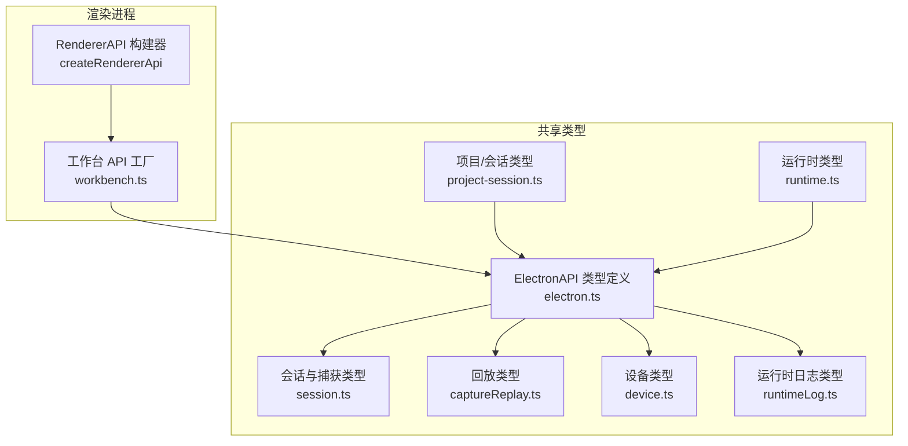
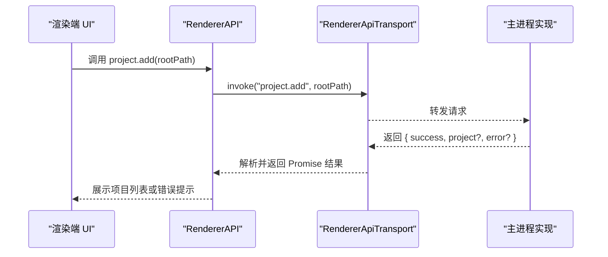
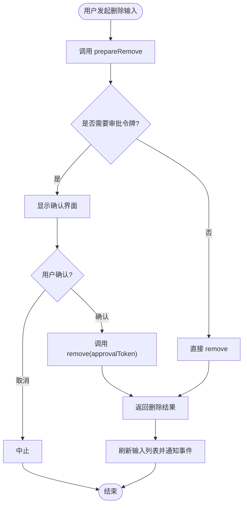
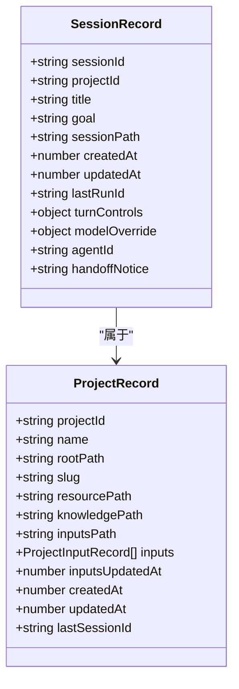
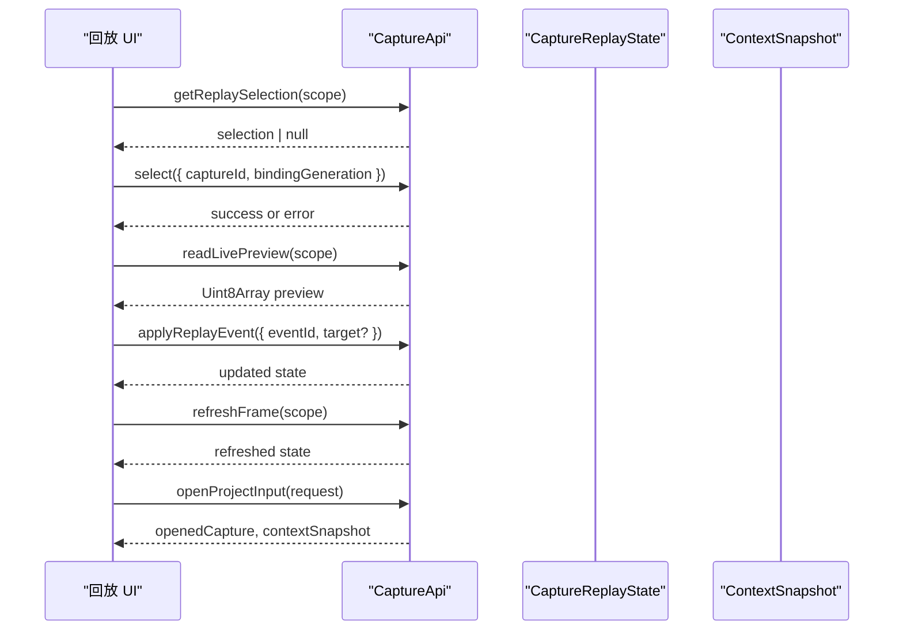
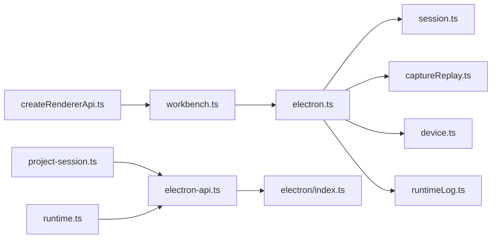

# 工作台运行时 API

<cite>
**本文引用的文件**   
- [workbench.ts](file://src/shared/renderer-api/workbench.ts)
- [createRendererApi.ts](file://src/shared/renderer-api/createRendererApi.ts)
- [electron-api.ts](file://src/shared/types/electron-api.ts)
- [electron/index.ts](file://src/shared/types/electron/index.ts)
- [project-session.ts](file://src/shared/types/electron/project-session.ts)
- [runtime.ts](file://src/shared/types/electron/runtime.ts)
- [electron.ts](file://src/shared/types/electron.ts)
- [session.ts](file://src/shared/types/session.ts)
- [captureReplay.ts](file://src/shared/types/captureReplay.ts)
- [device.ts](file://src/shared/types/device.ts)
- [runtimeLog.ts](file://src/shared/types/runtimeLog.ts)
</cite>

## 目录
1. [简介](#简介)
2. [项目结构](#项目结构)
3. [核心组件](#核心组件)
4. [架构总览](#架构总览)
5. [详细组件分析](#详细组件分析)
6. [依赖关系分析](#依赖关系分析)
7. [性能与稳定性考虑](#性能与稳定性考虑)
8. [故障排查指南](#故障排查指南)
9. [结论](#结论)
10. [附录：类型与数据模型](#附录类型与数据模型)

## 简介
本文件说明工作台的运行时 API，重点覆盖以下能力：
- 项目管理：ProjectApi 的 list、add、select、rename、remove，以及 inputs 子接口。
- 会话管理：SessionApi 的 list、create、rename、remove、select、setModelOverride、setAgentId、applyDeclaredHandoff。
- 捕获管理：CaptureApi 的回放选择、预览读取、回放状态查询与事件应用、帧刷新、列表/选择、打开项目输入、已打开状态等。
- 设备、运行、运行时日志、上下文与追踪：DeviceApi、RunApi、RuntimeLogApi、ContextApi、TraceApi。
- 工作区状态同步、捕获回放控制、设备监控机制。
- 项目结构定义、会话状态模型、捕获数据格式。
- 工作台集成示例与最佳实践。

该 API 面向渲染进程，通过统一的传输通道调用主进程能力，并在事件通道上推送状态变更。

## 项目结构
工作台的运行时 API 由渲染端工厂函数构造，并通过共享类型定义跨进程契约。

**图表来源**
- [createRendererApi.ts:1-80](file://src/shared/renderer-api/createRendererApi.ts#L1-L80)
- [workbench.ts:1-99](file://src/shared/renderer-api/workbench.ts#L1-L99)
- [electron.ts:408-584](file://src/shared/types/electron.ts#L408-L584)
- [project-session.ts:1-8](file://src/shared/types/electron/project-session.ts#L1-L8)
- [runtime.ts:1-4](file://src/shared/types/electron/runtime.ts#L1-L4)

**章节来源**
- [createRendererApi.ts:1-80](file://src/shared/renderer-api/createRendererApi.ts#L1-L80)
- [workbench.ts:1-99](file://src/shared/renderer-api/workbench.ts#L1-L99)
- [electron-api.ts:1-32](file://src/shared/types/electron-api.ts#L1-L32)
- [electron/index.ts:1-19](file://src/shared/types/electron/index.ts#L1-L19)
- [project-session.ts:1-8](file://src/shared/types/electron/project-session.ts#L1-L8)
- [runtime.ts:1-4](file://src/shared/types/electron/runtime.ts#L1-L4)

## 核心组件
工作台运行时提供以下顶层 API：
- project：项目与项目输入管理。
- device：回放设备发现与生命周期监控。
- session：会话创建、选择、重命名、删除及模型/Agent 配置。
- run：会话运行摘要列表。
- runtimeLog：运行时日志查询。
- capture：捕获列表、回放选择、回放状态与事件控制、预览、上下文关联。
- context：会话上下文快照。
- trace：代理运行、事件、投影与分支切换。
- events：跨进程事件订阅。

这些 API 在渲染进程中通过 `createRendererApi` 装配，并由 `workbench.ts` 中的工厂函数封装为具体方法；所有方法最终调用 `RendererApiTransport.invoke`，将 IPC 通道名称与方法参数传给主进程。

**章节来源**
- [createRendererApi.ts:1-80](file://src/shared/renderer-api/createRendererApi.ts#L1-L80)
- [workbench.ts:1-99](file://src/shared/renderer-api/workbench.ts#L1-L99)
- [electron.ts:408-584](file://src/shared/types/electron.ts#L408-L584)

## 架构总览
渲染进程不直接操作文件系统或运行态资源，而是通过统一的 ElectronAPI 暴露的方法访问主进程能力。每个 API 对象包含一组 Promise 方法；返回值用于表示成功结果、错误信息或当前状态。

**图表来源**
- [createRendererApi.ts:1-80](file://src/shared/renderer-api/createRendererApi.ts#L1-L80)
- [workbench.ts:1-99](file://src/shared/renderer-api/workbench.ts#L1-L99)
- [electron.ts:408-450](file://src/shared/types/electron.ts#L408-L450)

## 详细组件分析

### ProjectApi：项目管理
ProjectApi 负责工作区项目的增删改查与当前项目选择，并提供项目输入的生命周期管理。

| 方法 | 入参 | 返回值要点 | 用途 |
|---|---|---|---|
| `list` | 无 | `{ projects: ProjectRecord[] }` | 列出所有项目 |
| `add` | `rootPath` | `{ success, project?, error? }` | 添加根路径对应的项目 |
| `select` | `projectId` | `{ success, project?, currentSession?, currentRun?, error? }` | 切换到指定项目，并可能返回当前会话与运行 |
| `rename` | `projectId, newName` | `{ success, project?, error? }` | 修改项目名称 |
| `remove` | `projectId` | `{ success, error? }` | 删除项目 |

项目输入子接口：
| 方法 | 入参 | 返回值要点 | 用途 |
|---|---|---|---|
| `inputs.list` | `projectId` | `{ inputs: ProjectInputRecord[] }` | 列出项目输入 |
| `inputs.refresh` | `projectId` | `{ inputs: ProjectInputRecord[] }` | 重新扫描并更新项目输入 |
| `inputs.prepareRemove` | `projectId, inputId` | `ProjectInputRemovePreparation` | 准备删除前校验，必要时返回审批令牌 |
| `inputs.remove` | `projectId, inputId, approvalToken` | `ProjectInputRemoveResult` | 真正删除输入，可返回受影响会话与清理状态 |
| `inputs.import` | `projectId` | `{ success, inputs, error? }` | 导入项目输入 |
| `inputs.referencePath` | `projectId, filePath` | `{ success, inputs, error? }` | 添加外部文件引用 |
| `inputs.importPaths` | `projectId, filePaths` | `{ success, inputs, error? }` | 批量导入文件路径作为输入 |

注意：
- 删除输入可能影响其他会话；`prepareRemove` 会返回受影响的会话 ID 列表。
- 敏感删除需要主进程发放的 `approvalToken`。
- 外部引用使用精确身份标识，不会授权父目录。

**图表来源**
- [electron.ts:431-449](file://src/shared/types/electron.ts#L431-L449)
- [session.ts:12-40](file://src/shared/types/session.ts#L12-L40)

**章节来源**
- [workbench.ts:4-31](file://src/shared/renderer-api/workbench.ts#L4-L31)
- [electron.ts:408-449](file://src/shared/types/electron.ts#L408-L449)
- [session.ts:12-40](file://src/shared/types/session.ts#L12-L40)

### SessionApi：会话管理
SessionApi 管理某个项目下的多个会话，包括创建、选择、重命名、删除，以及会话级模型覆盖和 Agent 配置。

| 方法 | 入参 | 返回值要点 | 用途 |
|---|---|---|---|
| `list` | `projectId?` | `{ sessions: SessionRecord[] }` | 列出项目会话；可选按项目过滤 |
| `create` | `projectId, title?` | `{ success, session?, error? }` | 创建新会话 |
| `rename` | `id, title` | `{ success, session?, error? }` | 修改会话标题 |
| `remove` | `id` | `{ success, nextSession?, nextRun?, error? }` | 删除会话，可能自动选择下一个会话或运行 |
| `select` | `id` | `{ success, session?, currentRun?, error? }` | 选中会话并返回当前运行 |
| `setModelOverride` | `id, modelOverride` | `{ success, session?, error? }` | 设置会话级模型覆盖 |
| `setAgentId` | `id, agentId` | `{ success, session?, error? }` | 设置当前会话使用的 Agent |
| `applyDeclaredHandoff` | `id, agent, label` | `{ success, session?, suggestion?, error? }` | 应用声明式交接，可能返回计划审查建议 |

会话状态模型关键属性：
- `sessionId`、`projectId`、`title`、`goal`、`sessionPath`、时间戳。
- `modelOverride`：指定 provider 与 model。
- `agentId`：当前对话 Agent 标识。
- `handoffNotice`：迁移提示字段，不可写。

**图表来源**
- [session.ts:41-84](file://src/shared/types/session.ts#L41-L84)

**章节来源**
- [workbench.ts:33-55](file://src/shared/renderer-api/workbench.ts#L33-L55)
- [electron.ts:460-511](file://src/shared/types/electron.ts#L460-L511)
- [session.ts:41-84](file://src/shared/types/session.ts#L41-L84)

### CaptureApi：捕获管理与回放控制
CaptureApi 围绕“捕获”与“回放”展开，支持获取回放选择、读取实时预览、查询回放状态、应用回放事件、刷新帧、列出捕获、选择捕获、打开项目输入、查询与清理已打开状态。

| 方法 | 入参 | 返回值要点 | 用途 |
|---|---|---|---|
| `getReplaySelection` | `scope` | `CaptureReplaySelection \| null` | 查询当前回放选择 |
| `readLivePreview` | `scope` | `Uint8Array` | 读取当前捕获的实时预览帧 |
| `getReplayState` | `scope` | `CaptureReplayState` | 查询回放状态 |
| `applyReplayEvent` | `request` | `CaptureReplayState` | 应用回放事件，返回新状态 |
| `refreshFrame` | `scope` | `CaptureReplayState` | 刷新帧绑定 |
| `list` | `scope` | `{ captures: CaptureDescriptor[] }` | 列出会话范围内的捕获 |
| `select` | `scope & { captureId, bindingGeneration }` | `{ success, error? }` | 选择目标捕获 |
| `openProjectInput` | `request` | `{ success, openedCapture?, contextSnapshot?, error? }` | 打开项目输入并建立回放上下文 |
| `getOpenedState` | `scope` | `OpenedCaptureState \| null` | 查询已打开捕获状态 |
| `clearOpenedState` | `scope` | `{ success, error? }` | 清理已打开状态 |

回放状态模型关键点：
- 阶段：`closed`、`validating`、`connecting`、`transferring`、`opening`、`loading_image`、`ready`、`applying`、`closing`、`error`。
- 会话范围：`projectId`、`sessionId`。
- 设备与输入：`replayDeviceId`、`inputId`、`captureHash`。
- 事件与目标：`events`、`targets`、`target`、`requestedEventId`、`appliedEventId`、`imageEventId`。
- 图像与观察：`image`、`observation`。
- 设备呈现：`devicePresentation`。
- 交互锁与错误：`interactionLock`、`error`。

**图表来源**
- [workbench.ts:57-79](file://src/shared/renderer-api/workbench.ts#L57-L79)
- [electron.ts:523-547](file://src/shared/types/electron.ts#L523-L547)
- [captureReplay.ts:1-25](file://src/shared/types/captureReplay.ts#L1-L25)

**章节来源**
- [workbench.ts:57-79](file://src/shared/renderer-api/workbench.ts#L57-L79)
- [electron.ts:523-547](file://src/shared/types/electron.ts#L523-L547)
- [captureReplay.ts:1-25](file://src/shared/types/captureReplay.ts#L1-L25)
- [session.ts:145-168](file://src/shared/types/session.ts#L145-L168)
- [session.ts:428-455](file://src/shared/types/session.ts#L428-L455)

### DeviceApi：设备监控
DeviceApi 用于发现回放设备、刷新设备列表，以及启动、续期、停止设备监控。

| 方法 | 入参 | 返回值要点 | 用途 |
|---|---|---|---|
| `list` | 无 | `ReplayDeviceEntry[]` | 列出设备 |
| `refresh` | 无 | `ReplayDeviceEntry[]` | 刷新设备列表 |
| `watchStart` | 无 | `void` | 开始监控设备状态 |
| `watchRenew` | 无 | `void` | 续期设备监控 |
| `watchStop` | 无 | `void` | 停止设备监控 |

设备条目包含设备标识、标签、类型、状态、传输方式、序列号、详情文本、最近错误、最后可见时间、远端标识、引导元数据与激活阶段等信息。

**章节来源**
- [workbench.ts:33-44](file://src/shared/renderer-api/workbench.ts#L33-L44)
- [electron.ts:452-458](file://src/shared/types/electron.ts#L452-L458)
- [device.ts:1-50](file://src/shared/types/device.ts#L1-L50)

### RunApi：运行摘要
RunApi 提供会话维度的运行摘要列表。

| 方法 | 入参 | 返回值要点 | 用途 |
|---|---|---|---|
| `list` | `sessionId` | `{ runs: RunSummary[] }` | 列出会话的所有运行记录 |

运行摘要继承运行记录基础结构，包含运行标识、会话标识、项目标识、任务/使命、捕获列表、起止时间、状态、后端类型、报告路径与诊断信息等。

**章节来源**
- [workbench.ts:57-59](file://src/shared/renderer-api/workbench.ts#L57-L59)
- [electron.ts:513-515](file://src/shared/types/electron.ts#L513-L515)
- [session.ts:183-214](file://src/shared/types/session.ts#L183-L214)

### RuntimeLogApi：运行时日志
RuntimeLogApi 提供应用级与会话级运行时日志查询。

| 方法 | 入参 | 返回值要点 | 用途 |
|---|---|---|---|
| `list` | `{ scope, sessionId? }` | `{ entries: RuntimeLogEntry[] }` | 查询运行时日志 |

日志条目包含标识、时间戳、作用域、命名空间、严重级别、标题、摘要、详情、会话/项目/运行标识与原始内容。

**章节来源**
- [workbench.ts:61-63](file://src/shared/renderer-api/workbench.ts#L61-L63)
- [electron.ts:517-521](file://src/shared/types/electron.ts#L517-L521)
- [runtimeLog.ts:1-26](file://src/shared/types/runtimeLog.ts#L1-L26)

### ContextApi：上下文快照
ContextApi 提供会话相关上下文快照。

| 方法 | 入参 | 返回值要点 | 用途 |
|---|---|---|---|
| `get` | `scope` | `ContextSnapshot \| null` | 获取当前上下文快照 |

上下文快照包含上下文标识、会话标识、所有者会话、后端类型、远端状态、运行时所有者、捕获描述、活动捕获、设备标签与运行时上下文。

**章节来源**
- [workbench.ts:81-87](file://src/shared/renderer-api/workbench.ts#L81-L87)
- [electron.ts:549-551](file://src/shared/types/electron.ts#L549-L551)
- [session.ts:377-415](file://src/shared/types/session.ts#L377-L415)

### TraceApi：代理追踪
TraceApi 提供代理运行、事件、投影与分支切换能力。

| 方法 | 入参 | 返回值要点 | 用途 |
|---|---|---|---|
| `getRun` | `runId` | `{ run: AgentRun \| null }` | 获取运行实体 |
| `getEvents` | `runId, afterSeq?` | `{ events: TraceEvent[] }` | 分页获取事件 |
| `getProjection` | `sessionId?` | `TraceSessionResult` | 获取会话投影 |
| `exportRun` | `runId` | `{ run, events }` | 导出运行与事件 |
| `switchBranch` | `sessionId, branchId` | `TraceBranchSwitchResult` | 切换分支 |

**章节来源**
- [workbench.ts:89-99](file://src/shared/renderer-api/workbench.ts#L89-L99)
- [electron.ts:554-560](file://src/shared/types/electron.ts#L554-L560)

## 依赖关系分析
- `createRendererApi` 将平台信息与各类 API 工厂组合成完整的 `ElectronAPI`。
- `workbench.ts` 仅负责把具体业务 API 映射到 IPC 通道；所有类型约束来自 `electron.ts`。
- `project-session.ts` 与 `runtime.ts` 对 `ElectronAPI` 中部分成员进行别名导出，保持类型一致性。
- 会话、捕获、设备、日志等数据结构集中在 `session.ts`、`captureReplay.ts`、`device.ts`、`runtimeLog.ts`。

**图表来源**
- [createRendererApi.ts:1-80](file://src/shared/renderer-api/createRendererApi.ts#L1-L80)
- [workbench.ts:1-99](file://src/shared/renderer-api/workbench.ts#L1-L99)
- [electron-api.ts:1-32](file://src/shared/types/electron-api.ts#L1-L32)
- [electron/index.ts:1-19](file://src/shared/types/electron/index.ts#L1-L19)
- [project-session.ts:1-8](file://src/shared/types/electron/project-session.ts#L1-L8)
- [runtime.ts:1-4](file://src/shared/types/electron/runtime.ts#L1-L4)

**章节来源**
- [createRendererApi.ts:1-80](file://src/shared/renderer-api/createRendererApi.ts#L1-L80)
- [workbench.ts:1-99](file://src/shared/renderer-api/workbench.ts#L1-L99)
- [electron-api.ts:1-32](file://src/shared/types/electron-api.ts#L1-L32)
- [electron/index.ts:1-19](file://src/shared/types/electron/index.ts#L1-L19)

## 性能与稳定性考虑
- 异步调用：所有 API 均返回 Promise，应避免阻塞渲染线程，合理使用 `async/await`。
- 大对象传输：`readLivePreview` 返回二进制数组，适合流式或按需加载；避免一次性处理超大预览。
- 状态轮询与事件结合：优先使用事件监听减少频繁轮询，例如设备状态、运行状态、捕获状态变化。
- 输入删除安全：删除输入前应调用 `prepareRemove`，并根据 `affectedSessionIds` 评估影响面。
- 回放状态机：根据 `phase` 判断是否允许应用事件或刷新帧；在 `error` 或 `closing` 状态下应降级 UI。
- 设备监控生命周期：先 `watchStart`，再 `watchRenew`，结束时调用 `watchStop`，避免泄漏监控任务。
- 重试策略：对网络或远端设备失败可采用指数退避重试，并结合 `lastError` 与事件错误码展示用户友好提示。

[本节为通用指导，不直接分析具体代码文件]

## 故障排查指南
常见问题与定位建议：
- 项目添加失败：检查 `add` 返回的 `error` 字段与根路径有效性。
- 项目选择异常：查看 `select` 返回值中的 `currentSession` 与 `currentRun`，确认是否意外清空了当前上下文。
- 输入删除被拒绝：检查 `prepareRemove` 是否返回 `approvalToken`，若缺少则需补充审批流程。
- 会话删除后 UI 未更新：检查 `remove` 返回值中的 `nextSession` 与 `nextRun`，确保 UI 主动切换到下一个可用会话。
- 回放状态卡在 `error`：检查 `CaptureReplayState.error` 中的 `code`、`message` 与 `retry` 策略，区分打开、关闭、图像或应用阶段的错误。
- 设备状态不更新：确认已调用 `watchStart`，并在合适时机调用 `watchRenew`；监听 `onDeviceStatusChanged` 事件。
- 运行时日志缺失：检查 `runtimeLog.list` 的 `scope` 是否为 `app` 或 `session`，必要时传入 `sessionId`。
- 上下文快照为空：确认当前会话存在且捕获已成功打开；通过 `context.get` 与 `capture.openProjectInput` 的结果联合判断。

**章节来源**
- [electron.ts:408-584](file://src/shared/types/electron.ts#L408-L584)
- [captureReplay.ts:1-25](file://src/shared/types/captureReplay.ts#L1-L25)
- [device.ts:1-50](file://src/shared/types/device.ts#L1-L50)
- [runtimeLog.ts:1-26](file://src/shared/types/runtimeLog.ts#L1-L26)

## 结论
工作台运行时 API 以清晰的类型契约与统一的事件通道组织起来：
- 项目与会话管理提供稳定的工作区与对话生命周期。
- 捕获与回放 API 围绕状态机驱动，兼顾预览、事件应用与上下文关联。
- 设备监控、运行摘要、运行时日志、上下文与追踪共同构成调试与分析闭环。
- 渲染端通过 `createRendererApi` 与 `workbench.ts` 组装 API，并以事件形式接收状态变更，形成响应式工作台体验。

[本节为总结性内容，不直接分析具体代码文件]

## 附录：类型与数据模型

### 项目与输入
- `ProjectRecord`：项目标识、名称、根路径、slug、资源路径、知识路径、输入路径、输入列表、更新时间、创建时间、最后会话 ID。
- `ProjectInputRecord`：输入标识、文件名、文件路径、来源、外部引用身份、发现时间、最后修改时间、文件大小、内容哈希。
- `ProjectInputRemovePreparation`：准备删除结果，含审批令牌、输入信息与受影响会话。
- `ProjectInputRemoveResult`：删除结果，含输入列表、文件删除状态、清理待办项。

**章节来源**
- [session.ts:12-40](file://src/shared/types/session.ts#L12-L40)
- [session.ts:41-61](file://src/shared/types/session.ts#L41-L61)

### 会话与运行
- `SessionRecord`：会话标识、项目标识、标题、目标、路径、时间戳、最后运行 ID、对话控制、模型覆盖、Agent 标识。
- `SessionScope`：项目与会话范围，是所有可变 RDC 事件的基础标记。
- `RunRecordBase`：运行基础结构，包含运行标识、会话、项目、任务/使命、捕获、起止时间、状态、后端、报告路径与诊断。
- `RunSummary`：运行摘要，等价于运行记录。

**章节来源**
- [session.ts:41-84](file://src/shared/types/session.ts#L41-L84)
- [session.ts:80-86](file://src/shared/types/session.ts#L80-L86)
- [session.ts:183-214](file://src/shared/types/session.ts#L183-L214)

### 捕获与回放
- `CaptureDescriptor`：捕获标识、文件路径、后端提示、角色、状态、所有者与会话标识。
- `CaptureReplayState`：回放完整状态，含阶段、设备、输入、事件、目标、图像、观察、设备呈现、警告、交互锁与错误。
- `CaptureReplayApplyRequest`：回放事件应用请求，包含绑定生成、事件 ID 与可选目标。
- `OpenedCaptureState`：已打开捕获状态，含预览、预览错误、尝试历史与运行时上下文。
- `OpenProjectInputRequest`：打开项目输入请求，包含项目、会话、输入、文件路径与回放设备。

**章节来源**
- [session.ts:145-168](file://src/shared/types/session.ts#L145-L168)
- [captureReplay.ts:1-25](file://src/shared/types/captureReplay.ts#L1-L25)
- [session.ts:428-455](file://src/shared/types/session.ts#L428-L455)

### 设备与运行时日志
- `ReplayDeviceEntry`：设备条目，包含标识、标签、类型、状态、传输、序列号、详情、错误、最后可见时间、远端 ID、引导元数据与激活阶段。
- `RuntimeLogEntry`：运行时日志条目，包含作用域、命名空间、严重级别、标题、摘要、详情与会话/项目/运行标识。

**章节来源**
- [device.ts:1-50](file://src/shared/types/device.ts#L1-L50)
- [runtimeLog.ts:1-26](file://src/shared/types/runtimeLog.ts#L1-L26)