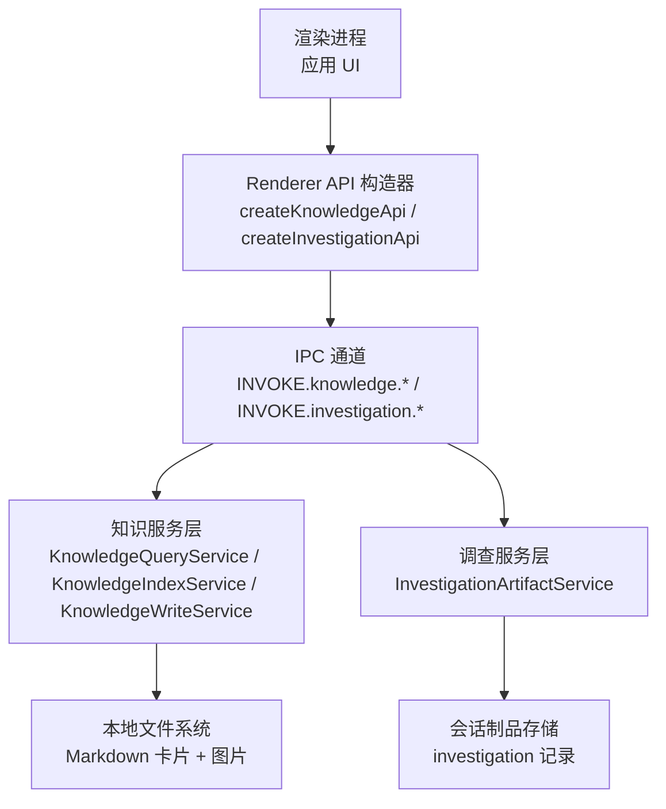
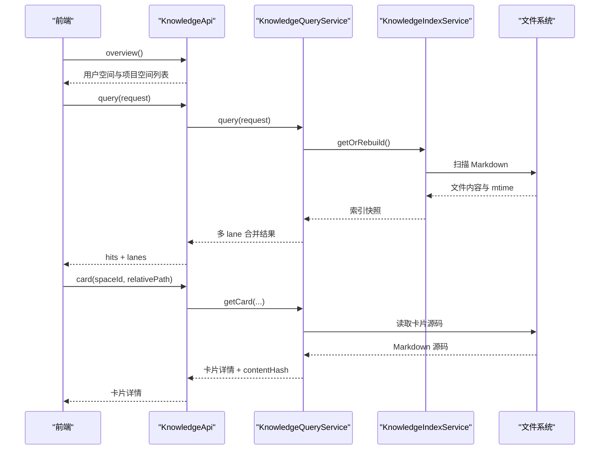
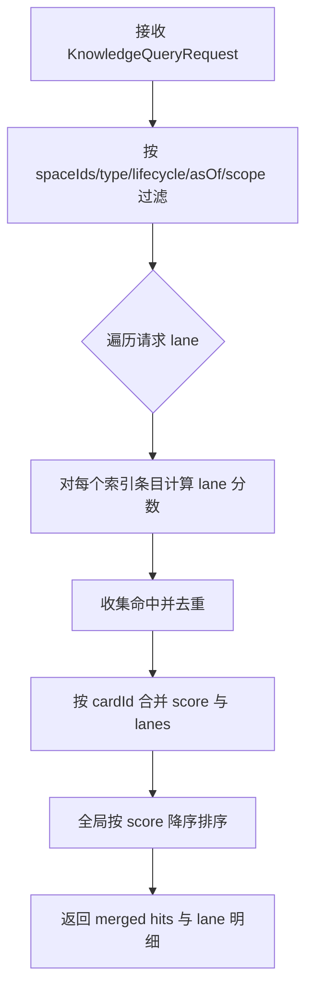
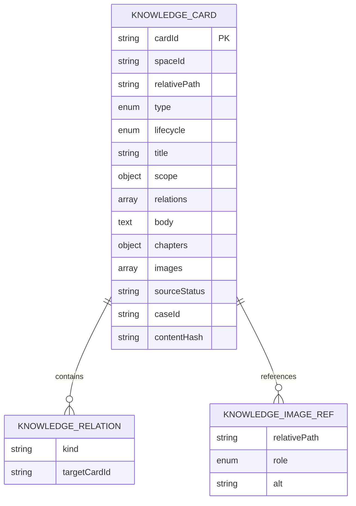
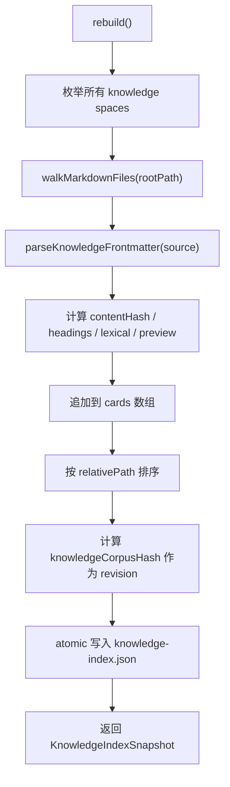
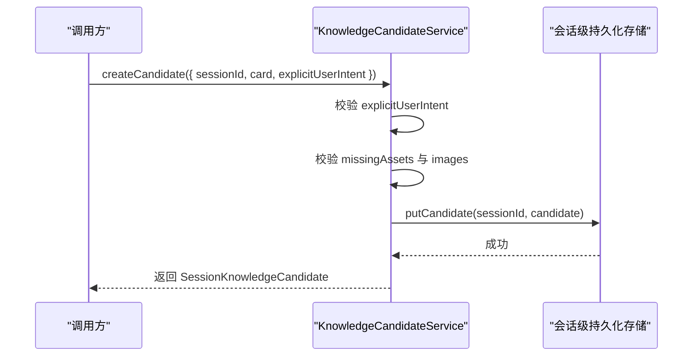
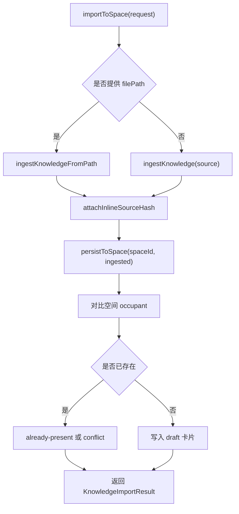
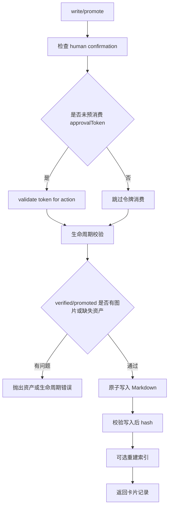
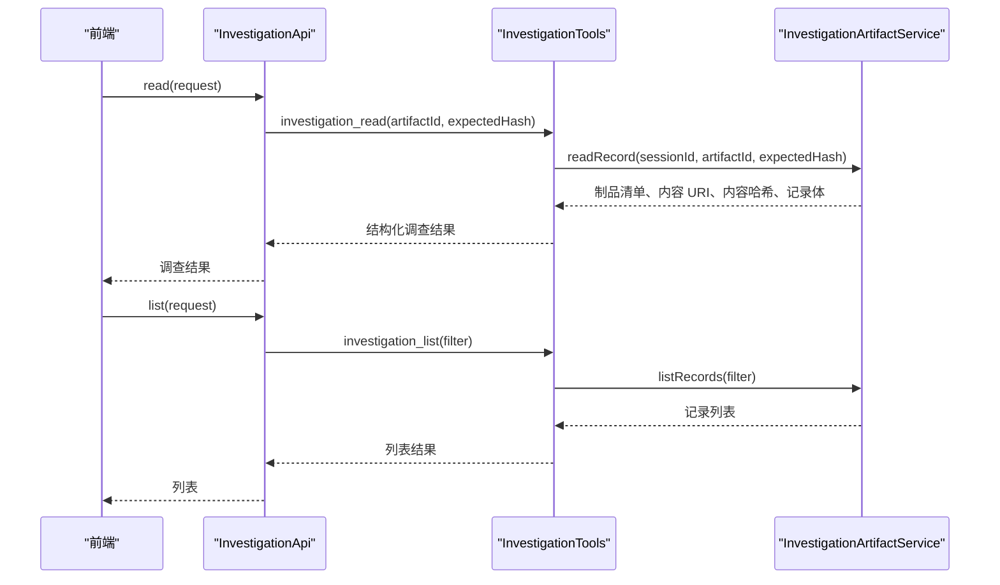
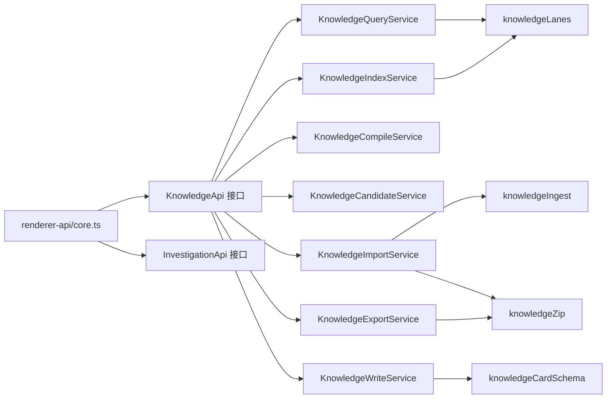

# 知识与调查 API

<cite>
**本文引用的文件**   
- [core.ts](file://src/shared/renderer-api/core.ts)
- [electron/knowledge.ts](file://src/shared/types/electron/knowledge.ts)
- [electron/investigation.ts](file://src/shared/types/electron/investigation.ts)
- [KnowledgeQueryService.ts](file://src/main/knowledge/KnowledgeQueryService.ts)
- [knowledgeLanes.ts](file://src/main/knowledge/knowledgeLanes.ts)
- [knowledgeCardSchema.ts](file://src/main/knowledge/knowledgeCardSchema.ts)
- [KnowledgeIndexService.ts](file://src/main/knowledge/KnowledgeIndexService.ts)
- [KnowledgeCompileService.ts](file://src/main/knowledge/KnowledgeCompileService.ts)
- [KnowledgeCandidateService.ts](file://src/main/knowledge/KnowledgeCandidateService.ts)
- [KnowledgeImportService.ts](file://src/main/knowledge/KnowledgeImportService.ts)
- [knowledgeIngest.ts](file://src/main/knowledge/knowledgeIngest.ts)
- [knowledgeZip.ts](file://src/main/knowledge/knowledgeZip.ts)
- [KnowledgeWriteService.ts](file://src/main/knowledge/KnowledgeWriteService.ts)
- [KnowledgeExportService.ts](file://src/main/knowledge/KnowledgeExportService.ts)
- [InvestigationTools.ts](file://src/main/investigation/InvestigationTools.ts)
- [InvestigationArtifactService.ts](file://src/main/investigation/InvestigationArtifactService.ts)
</cite>

## 目录
1. [引言](#引言)
2. [项目结构](#项目结构)
3. [核心组件](#核心组件)
4. [架构总览](#架构总览)
5. [详细组件分析](#详细组件分析)
6. [依赖关系分析](#依赖关系分析)
7. [性能与扩展性](#性能与扩展性)
8. [故障排查](#故障排查)
9. [结论](#结论)
10. [附录：API 参考与使用示例](#附录api-参考与使用示例)

## 引言
本文件面向希望理解和使用“知识库”与“调查”能力的开发者，重点说明渲染进程通过 `KnowledgeApi` 和 `InvestigationApi` 调用的后端能力。文档涵盖以下主题：

- 知识空间、六 lane 检索机制、知识卡片结构与版本生命周期。
- `KnowledgeApi` 的概览、查询、卡片读取、编译、索引重建、候选知识、导入、图片、审批令牌、写入、晋升、导出等接口。
- `InvestigationApi` 的调查读取与列表查询方法。
- 权限控制、人类确认、审批令牌、版本管理与冲突处理。
- 知识库构建、知识检索、调查分析的端到端使用流程。

## 项目结构
仓库将知识与调查能力分为三层：

| 层次 | 职责 | 关键位置 |
|---|---|---|
| 共享类型层 | 定义 `KnowledgeApi`、`InvestigationApi` 以及知识模型 | `src/shared/types/electron/knowledge.ts`、`src/shared/types/electron/investigation.ts` |
| 渲染桥接层 | 将前端调用映射为 IPC 通道调用 | `src/shared/renderer-api/core.ts` |
| 主进程服务层 | 实现知识索引、查询、写入、候选、导入、导出、调查读写 | `src/main/knowledge/*`、`src/main/investigation/*` |

**图表来源**
- [core.ts:96-130](file://src/shared/renderer-api/core.ts#L96-L130)
- [KnowledgeQueryService.ts:1-60](file://src/main/knowledge/KnowledgeQueryService.ts#L1-L60)
- [InvestigationArtifactService.ts:1-60](file://src/main/investigation/InvestigationArtifactService.ts#L1-L60)

**章节来源**
- [electron/knowledge.ts:1-3](file://src/shared/types/electron/knowledge.ts#L1-L3)
- [electron/investigation.ts:1-3](file://src/shared/types/electron/investigation.ts#L1-L3)
- [core.ts:96-130](file://src/shared/renderer-api/core.ts#L96-L130)

## 核心组件
本节按功能域梳理主要服务类及其职责。

### 知识查询与索引
- `KnowledgeQueryService`：列出知识空间、列出卡片、按路径读取卡片详情、基于索引执行多 lane 检索。
- `KnowledgeIndexService`：扫描所有知识空间 Markdown，构建持久化索引快照；支持增量比较、自动重建。
- `knowledgeLanes.ts`：定义六种检索 lane、索引条目结构和语料哈希。

### 知识编译
- `KnowledgeCompileService`：将查询结果排序、截断、合并 lane 原因，并检测“关系图 lane”中标题不一致的冲突。

### 知识候选与审查
- `KnowledgeCandidateService`：创建会话级候选知识、列举候选、提交审查队列、列举审查项。

### 知识导入与导出
- `KnowledgeImportService`：解析 YAML/ZIP 或内联内容，校验冲突、敏感信息、缺失资产，并将草稿写入目标空间。
- `knowledgeIngest.ts`：导入解析、敏感信息与绝对路径检测、图片映射、大小限制。
- `knowledgeZip.ts`：知识包 ZIP 压缩、解压、清单选择与安全校验。
- `KnowledgeExportService`：按空间或卡片引用导出 YAML 包或 Markdown，过滤不安全内容。

### 知识写入与晋升
- `KnowledgeWriteService`：受人类确认和审批令牌保护的原子写入、图片暂存落盘、生命周期校验、晋升逻辑。

### 调查服务
- `InvestigationArtifactService`：会话级调查记录的读写、版本、完整性校验、事务提交。
- `InvestigationTools`：对外暴露调查 schema、读取、写入、列表工具。

**章节来源**
- [KnowledgeQueryService.ts:1-239](file://src/main/knowledge/KnowledgeQueryService.ts#L1-L239)
- [KnowledgeIndexService.ts:1-173](file://src/main/knowledge/KnowledgeIndexService.ts#L1-L173)
- [knowledgeLanes.ts:1-56](file://src/main/knowledge/knowledgeLanes.ts#L1-L56)
- [KnowledgeCompileService.ts:1-50](file://src/main/knowledge/KnowledgeCompileService.ts#L1-L50)
- [KnowledgeCandidateService.ts:1-102](file://src/main/knowledge/KnowledgeCandidateService.ts#L1-L102)
- [KnowledgeImportService.ts:1-328](file://src/main/knowledge/KnowledgeImportService.ts#L1-L328)
- [knowledgeIngest.ts:1-200](file://src/main/knowledge/knowledgeIngest.ts#L1-L200)
- [knowledgeZip.ts:1-79](file://src/main/knowledge/knowledgeZip.ts#L1-L79)
- [KnowledgeExportService.ts:1-171](file://src/main/knowledge/KnowledgeExportService.ts#L1-L171)
- [KnowledgeWriteService.ts:1-189](file://src/main/knowledge/KnowledgeWriteService.ts#L1-L189)
- [InvestigationArtifactService.ts:1-200](file://src/main/investigation/InvestigationArtifactService.ts#L1-L200)
- [InvestigationTools.ts:1-200](file://src/main/investigation/InvestigationTools.ts#L1-L200)

## 架构总览
知识系统采用“Markdown 优先”的设计：知识以带 frontmatter 的 Markdown 文件形式存在，索引服务将其解析为结构化条目，查询服务再根据 lane 打分合并结果。写入操作必须通过人类确认和可选审批令牌，确保高价值状态变更受控。

**图表来源**
- [core.ts:110-130](file://src/shared/renderer-api/core.ts#L110-L130)
- [KnowledgeQueryService.ts:60-239](file://src/main/knowledge/KnowledgeQueryService.ts#L60-L239)
- [KnowledgeIndexService.ts:60-173](file://src/main/knowledge/KnowledgeIndexService.ts#L60-L173)

## 详细组件分析

### 知识空间与六 lane 检索机制

#### 知识空间概念
知识空间是知识文件的根命名域，当前由两类组成：

| 空间类型 | spaceId 前缀 | 含义 |
|---|---:|---|
| 用户空间 | `user` | 用户级知识根目录 |
| 项目空间 | `project:<projectId>` | 某个项目的知识根目录 |

`listSpaces` 会先返回用户空间，再枚举已存储项目，每个项目生成一个项目知识空间。空间对象包含 `spaceId`、`kind`、`label`、`rootPath`，必要时还包含 `projectId`。

#### 六 lane 检索
六种检索 lane 构成固定的“检索语义顺序”，并在工具与查询层共同约束：

| Lane | 作用 |
|---|---|
| Identity/Path | 通过 `cardId`、`relativePath` 精确匹配 |
| Scope/Metadata | 通过 `scope` 字段及 `exclusions` 匹配 |
| Lexical | 标题、正文、相对路径的小写词法匹配 |
| Structural | 标题层级与结构片段匹配 |
| Relation/Graph | 通过 `relations` 指向的目标卡片关联匹配 |
| Temporal/Version | 通过 `asOf`、`updatedAt` 时间范围筛选 |

**图表来源**
- [knowledgeLanes.ts:6-24](file://src/main/knowledge/knowledgeLanes.ts#L6-L24)
- [KnowledgeQueryService.ts:120-239](file://src/main/knowledge/KnowledgeQueryService.ts#L120-L239)

**章节来源**
- [KnowledgeQueryService.ts:15-60](file://src/main/knowledge/KnowledgeQueryService.ts#L15-L60)
- [knowledgeLanes.ts:1-56](file://src/main/knowledge/knowledgeLanes.ts#L1-L56)

### 知识卡片结构
知识卡片以 Markdown 加 frontmatter 表示，解析后得到 `KnowledgeCardRecord`。关键字段包括：

| 字段 | 含义 |
|---|---|
| `cardId` | 卡片唯一标识，可由 `spaceId:relativePath` 推导 |
| `spaceId` | 所属知识空间 |
| `relativePath` | 相对于空间根的 POSIX 风格路径 |
| `type` | 卡片类型，如事实、约束、模式、流程、案例、模型 |
| `lifecycle` | 生命周期：草稿、候选、已验证、已推广、已退休 |
| `title` | 标题，可从 frontmatter 或一级标题提取 |
| `scope` | 环境与作用域元数据，支持 `exclusions` |
| `relations` | 指向其他卡片的关联 |
| `body` | Markdown 正文 |
| `chapters` | 案例卡片的章节结构，如主张、症状、证据、根因、修复、负例、开放挑战等 |
| `images` | 关联图片引用，含相对路径、角色和可选 alt |
| `sourceStatus`、`caseId` | 来源状态与案例标识 |
| `contentHash` | 源码内容的 sha256 |

**图表来源**
- [knowledgeCardSchema.ts:1-120](file://src/main/knowledge/knowledgeCardSchema.ts#L1-L120)
- [knowledgeLanes.ts:26-56](file://src/main/knowledge/knowledgeLanes.ts#L26-L56)

**章节来源**
- [knowledgeCardSchema.ts:1-200](file://src/main/knowledge/knowledgeCardSchema.ts#L1-L200)
- [knowledgeLanes.ts:26-56](file://src/main/knowledge/knowledgeLanes.ts#L26-L56)

### 索引构建与重建流程
索引服务负责将所有空间的 Markdown 卡片解析为 `KnowledgeIndexEntry`，并按 `relativePath` 排序后生成快照。快照包含 schema 版本、修订号、构建时间和卡片数组。

**图表来源**
- [KnowledgeIndexService.ts:60-140](file://src/main/knowledge/KnowledgeIndexService.ts#L60-L140)
- [knowledgeLanes.ts:38-56](file://src/main/knowledge/knowledgeLanes.ts#L38-L56)

**章节来源**
- [KnowledgeIndexService.ts:1-173](file://src/main/knowledge/KnowledgeIndexService.ts#L1-L173)
- [knowledgeLanes.ts:38-56](file://src/main/knowledge/knowledgeLanes.ts#L38-L56)

### 知识编译
`compile` 不修改知识库，而是从查询结果生成临时知识包：

1. 按 `score` 降序、`relativePath` 升序排序。
2. 截取最多默认 12 条命中。
3. 为每条命中生成 `reasons`，格式为 `"lane:score"`。
4. 检测两个命中都来自 `Relation/Graph` lane 且标题不同，标记为 `contradicts` 冲突。
5. 用命中 `cardId` 拼接生成短 `packId`。

**章节来源**
- [KnowledgeCompileService.ts:1-50](file://src/main/knowledge/KnowledgeCompileService.ts#L1-L50)

### 候选知识与审查
候选知识用于会话内暂存尚未写入正式库的知识。它的关键约束是：

- 必须显式传入 `explicitUserIntent: true`。
- 不允许直接写入 `candidate` 以外的生命周期（`verified`、`promoted`）。
- 若声明了图片，需要校验图片资源可用性。
- 候选存储在会话级 durable store 中，而非直接落盘为 Markdown。

**图表来源**
- [KnowledgeCandidateService.ts:18-75](file://src/main/knowledge/KnowledgeCandidateService.ts#L18-L75)

**章节来源**
- [KnowledgeCandidateService.ts:1-102](file://src/main/knowledge/KnowledgeCandidateService.ts#L1-L102)

### 知识导入
导入支持三种输入方式：

| 输入方式 | 说明 |
|---|---|
| `source` | 内联 Markdown/YAML 内容 |
| `filePath` | 本地文件路径 |
| ZIP 包 | 通过 `knowledgeIngest` 解析，内部复用 ZIP 安全函数 |

导入流程包括：

1. 解析源内容或 ZIP。
2. 映射图片名称与角色。
3. 检测敏感信息与绝对路径。
4. 对比目标空间已有卡片，识别重复 `caseId`、相同 `cardId`、同 `sourceHash`。
5. 输出 `draft`、`conflict`、`already-present`、`quarantine` 等导入项。
6. 将草稿写入目标空间；导入本身不会自动创建 `Candidate`。

**图表来源**
- [KnowledgeImportService.ts:1-200](file://src/main/knowledge/KnowledgeImportService.ts#L1-L200)
- [knowledgeIngest.ts:1-200](file://src/main/knowledge/knowledgeIngest.ts#L1-L200)

**章节来源**
- [KnowledgeImportService.ts:1-328](file://src/main/knowledge/KnowledgeImportService.ts#L1-L328)
- [knowledgeIngest.ts:1-200](file://src/main/knowledge/knowledgeIngest.ts#L1-L200)

### 知识导出
导出支持两种格式：

| 格式 | 输出 |
|---|---|
| `package` | YAML 清单 ZIP，包含 `knowledge.yaml` 与图片 |
| `markdown` | 纯 Markdown 文本 |

导出时会自动排除：

- 存在 `missingAssets` 的卡片。
- 包含敏感信息的卡片。
- 包含绝对路径的卡片。
- 图片不可读、为空或超过最大字节数的卡片。

**章节来源**
- [KnowledgeExportService.ts:1-171](file://src/main/knowledge/KnowledgeExportService.ts#L1-L171)
- [knowledgeZip.ts:1-79](file://src/main/knowledge/knowledgeZip.ts#L1-L79)

### 审批令牌、权限控制与版本管理

#### 权限控制
写入与晋升操作要求：

- `permissionMode` 决定是否需要人类确认。
- 若未设置 `approvalAlreadyConsumed: true`，则消费一次审批令牌。
- `candidate` 生命周期不能通过普通写入保存，只能通过候选服务。
- `fixed` 来源状态不允许变为 `verified`。
- `case` 类型在成为 `verified` 时必须补全必要章节。
- `verified` 或 `promoted` 若声明图片，必须可访问且完整。

#### 审批令牌
`consumeApprovalToken(token, action)` 接受 `knowledge.write` 或 `knowledge.promote` 两类动作。令牌无效或缺失时抛出审批令牌错误。

#### 版本管理
- 卡片源码通过 `contentHash` 标识内容版本。
- 索引快照通过 `revision` 标识整个知识语料版本。
- 导入时可通过 `sourceHash` 判断导入项是否与现有卡片同源。
- 调查领域另有独立的 artifactId、supersedes、worldStateId 等版本语义，但本文聚焦知识领域。

**图表来源**
- [KnowledgeWriteService.ts:40-189](file://src/main/knowledge/KnowledgeWriteService.ts#L40-L189)

**章节来源**
- [KnowledgeWriteService.ts:1-189](file://src/main/knowledge/KnowledgeWriteService.ts#L1-L189)

### 调查读取与列表查询
`InvestigationApi` 目前暴露两个核心方法：

| 方法 | 参数 | 行为 |
|---|---|---|
| `read` | 调查读取请求 | 读取指定会话、指定 artifactId 的调查制品，可选校验 expectedHash |
| `list` | 调查列表请求 | 枚举会话中的调查制品 |

调查工具层还定义了 `investigation_read`、`investigation_list`、`investigation_write`、`investigation_schema` 等 AgentTool，其中读取工具会在成功读取后注册代理读取权限。

**图表来源**
- [core.ts:88-95](file://src/shared/renderer-api/core.ts#L88-L95)
- [InvestigationTools.ts:1-200](file://src/main/investigation/InvestigationTools.ts#L1-L200)
- [InvestigationArtifactService.ts:1-200](file://src/main/investigation/InvestigationArtifactService.ts#L1-L200)

**章节来源**
- [core.ts:88-95](file://src/shared/renderer-api/core.ts#L88-L95)
- [InvestigationTools.ts:1-200](file://src/main/investigation/InvestigationTools.ts#L1-L200)
- [InvestigationArtifactService.ts:1-200](file://src/main/investigation/InvestigationArtifactService.ts#L1-L200)

## 依赖关系分析

**图表来源**
- [core.ts:96-130](file://src/shared/renderer-api/core.ts#L96-L130)
- [KnowledgeQueryService.ts:1-60](file://src/main/knowledge/KnowledgeQueryService.ts#L1-L60)
- [KnowledgeImportService.ts:1-60](file://src/main/knowledge/KnowledgeImportService.ts#L1-L60)
- [KnowledgeExportService.ts:1-40](file://src/main/knowledge/KnowledgeExportService.ts#L1-L40)
- [knowledgeLanes.ts:1-24](file://src/main/knowledge/knowledgeLanes.ts#L1-L24)
- [knowledgeCardSchema.ts:1-60](file://src/main/knowledge/knowledgeCardSchema.ts#L1-L60)

**章节来源**
- [core.ts:96-130](file://src/shared/renderer-api/core.ts#L96-L130)
- [KnowledgeQueryService.ts:1-60](file://src/main/knowledge/KnowledgeQueryService.ts#L1-L60)
- [KnowledgeImportService.ts:1-60](file://src/main/knowledge/KnowledgeImportService.ts#L1-L60)
- [KnowledgeExportService.ts:1-40](file://src/main/knowledge/KnowledgeExportService.ts#L1-L40)

## 性能与扩展性
- 索引构建会扫描所有知识空间 Markdown，适合后台或启动阶段执行；查询时优先使用缓存快照，仅在修订变化时重建。
- 导入/导出均有限制：导入有字节上限，ZIP 解压缩也有上限；导出图片单张有最大字节数限制。
- 六 lane 查询会对全部索引条目评分，建议在调用侧通过 `spaceIds`、`type`、`lifecycle`、`asOf`、`scope` 缩小范围。
- 写入采用原子写入与 post-write hash 校验，保证磁盘一致性；索引重建放在写入完成后异步触发。

[本节为通用指导，不直接分析具体代码行]

## 故障排查

| 现象 | 可能原因 | 建议处理 |
|---|---|---|
| 查询结果为空 | 未重建索引、`lifecycle=retired` 被默认过滤、`asOf` 过新 | 调用 `indexRebuild`；检查生命周期与时间过滤；确认索引快照可用 |
| 导入报冲突 | `caseId` 重复或 `cardId` 冲突 | 调整 `caseId` 或目标路径；查看 `already-present` 与 `conflict` 项 |
| 导入被隔离 | 检测到敏感信息或绝对路径 | 清理 secret、password、bearer token 或 Windows/POSIX 绝对路径 |
| 写入失败 | 缺少人类确认、审批令牌无效、生命周期非法、图片缺失 | 补充 `confirmation`、获取有效 `approvalToken`、修正生命周期和图片 |
| 导出结果为空 | 所有卡片都被过滤或无选中卡片 | 检查 `missingAssets`、敏感内容、绝对路径、图片可读性 |
| 候选创建失败 | 未设置 `explicitUserIntent` | 显式传递布尔值 `true` |

**章节来源**
- [KnowledgeQueryService.ts:120-239](file://src/main/knowledge/KnowledgeQueryService.ts#L120-L239)
- [KnowledgeImportService.ts:1-200](file://src/main/knowledge/KnowledgeImportService.ts#L1-L200)
- [knowledgeIngest.ts:1-200](file://src/main/knowledge/knowledgeIngest.ts#L1-L200)
- [KnowledgeWriteService.ts:40-189](file://src/main/knowledge/KnowledgeWriteService.ts#L40-L189)
- [KnowledgeExportService.ts:1-171](file://src/main/knowledge/KnowledgeExportService.ts#L1-L171)
- [KnowledgeCandidateService.ts:18-75](file://src/main/knowledge/KnowledgeCandidateService.ts#L18-L75)

## 结论
知识库系统以 Markdown 为中心，通过六 lane 检索、索引快照、人类确认与审批令牌机制，兼顾可读性、可审计性与安全性。`KnowledgeApi` 覆盖知识的全生命周期：概览、检索、读取、编译、索引重建、候选、导入、图片、审批令牌、写入、晋升、导出；`InvestigationApi` 提供调查制品的读取与列表能力，配合调查工具链形成完整的调查分析闭环。

[本节为总结，不直接分析具体代码行]

## 附录：API 参考与使用示例

### KnowledgeApi 方法总表

| 方法 | 参数 | 返回值 | 说明 |
|---|---|---|---|
| `overview()` | 无 | 知识空间列表 | 返回用户空间与项目空间 |
| `query(request)` | `KnowledgeQueryRequest` | 查询结果 | 六 lane 检索、合并、排序 |
| `card(spaceId, relativePath)` | 空间 ID、相对路径 | 卡片详情 | 返回完整卡片结构与 `contentHash` |
| `compile(request)` | 查询请求 | 编译包 | 生成临时知识包，检测冲突 |
| `indexRebuild()` | 无 | 索引快照 | 重建知识索引 |
| `candidates(sessionId)` | 会话 ID | 候选列表 | 列出会话级候选知识 |
| `candidateCreate(request)` | 候选创建请求 | 候选对象 | 创建会话候选，需显式用户意图 |
| `import(request)` | 导入请求 | 导入结果 | 解析并写入草稿，不自动创建候选 |
| `image(request)` | 图片请求 | 图片数据 | 读取知识卡片相关图片 |
| `issueApprovalToken(request)` | 审批令牌请求 | 令牌响应 | 颁发知识写入或晋升所需令牌 |
| `write(request)` | 写入请求 | 卡片记录 | 受人类确认与审批令牌保护 |
| `promote(request)` | 晋升请求 | 卡片记录 | 改变生命周期，仍受人类确认与令牌保护 |
| `export(request)` | 导出请求 | 导出结果 | 导出 YAML 包或 Markdown |

**章节来源**
- [core.ts:110-130](file://src/shared/renderer-api/core.ts#L110-L130)

### InvestigationApi 方法总表

| 方法 | 参数 | 返回值 | 说明 |
|---|---|---|---|
| `read(request)` | 调查读取请求 | 调查制品 | 读取会话制品，可选校验内容哈希 |
| `list(request)` | 调查列表请求 | 调查列表 | 枚举会话中的调查制品 |

**章节来源**
- [core.ts:88-95](file://src/shared/renderer-api/core.ts#L88-L95)

### 实际使用示例

#### 知识库构建示例
1. 调用 `overview()` 获取 `user` 空间。
2. 调用 `import()` 将一批 Markdown 导入为草稿。
3. 如需人工审核，调用 `candidateCreate()` 创建候选知识。
4. 人类确认后，调用 `write()` 或 `promote()` 将候选晋升为已验证或已推广状态。
5. 调用 `indexRebuild()` 确保索引与磁盘一致。

#### 知识检索示例
1. 调用 `query()`，指定 `lanes`、`spaceIds`、`type`、`lifecycle`、`asOf`。
2. 对结果调用 `compile()` 生成知识包，观察 `reasons` 与 `conflicts`。
3. 对重要命中调用 `card()` 读取完整内容。

#### 调查分析示例
1. 通过 `list()` 获取会话调查制品。
2. 对关键制品调用 `read()`，并用 `expectedHash` 保障内容一致性。
3. 结合调查工具链进行证据、实验、报告等调查任务。

**章节来源**
- [KnowledgeQueryService.ts:120-239](file://src/main/knowledge/KnowledgeQueryService.ts#L120-L239)
- [KnowledgeCompileService.ts:1-50](file://src/main/knowledge/KnowledgeCompileService.ts#L1-L50)
- [KnowledgeCandidateService.ts:18-75](file://src/main/knowledge/KnowledgeCandidateService.ts#L18-L75)
- [KnowledgeWriteService.ts:40-189](file://src/main/knowledge/KnowledgeWriteService.ts#L40-L189)
- [InvestigationTools.ts:1-200](file://src/main/investigation/InvestigationTools.ts#L1-L200)