# 系统与工具 API

<cite>
**本文引用的文件**   
- [src/shared/renderer-api/core.ts](file://src/shared/renderer-api/core.ts)
- [src/shared/renderer-api/createRendererApi.ts](file://src/shared/renderer-api/createRendererApi.ts)
- [src/shared/types/electron.ts](file://src/shared/types/electron.ts)
- [src/shared/types/electron/platform.ts](file://src/shared/types/electron/platform.ts)
- [src/shared/types/electron/command.ts](file://src/shared/types/electron/command.ts)
- [src/shared/types/electron/tools.ts](file://src/shared/types/electron/tools.ts)
- [src/shared/types/electron/index.ts](file://src/shared/types/electron/index.ts)
- [src/shared/types/index.ts](file://src/shared/types/index.ts)
</cite>

## 目录
1. [引言](#引言)
2. [项目结构](#项目结构)
3. [核心组件](#核心组件)
4. [架构总览](#架构总览)
5. [详细组件分析](#详细组件分析)
6. [依赖关系分析](#依赖关系分析)
7. [性能与兼容性](#性能与兼容性)
8. [故障排查指南](#故障排查指南)
9. [结论](#结论)

## 引言
本文件面向系统级渲染器 API，重点说明以下能力：
- 应用元数据与系统外壳：AppMetaApi、AppShellApi
- Web 能力：WebApi
- 对话框与文件选择：DialogApi
- 窗口控制：WindowControlsApi
- 命令执行：CommandApi
- 工具目录与安装管理：ToolApi
- MCP 服务状态：McpApi
- 证据链查询：EvidenceApi

这些 API 统一由渲染进程通过 IPC 通道调用主进程能力，类型定义集中在共享类型模块中。文档同时覆盖系统能力检查、跨平台兼容、安全权限控制以及实际使用案例。

## 项目结构
系统级 API 的入口是渲染器 API 工厂函数，它根据当前 Node.js 平台构建出统一的 ElectronAPI 对象；具体功能模块在 core.ts 中以“createXxxApi”形式实现，并通过 transport 转发到主进程 IPC。

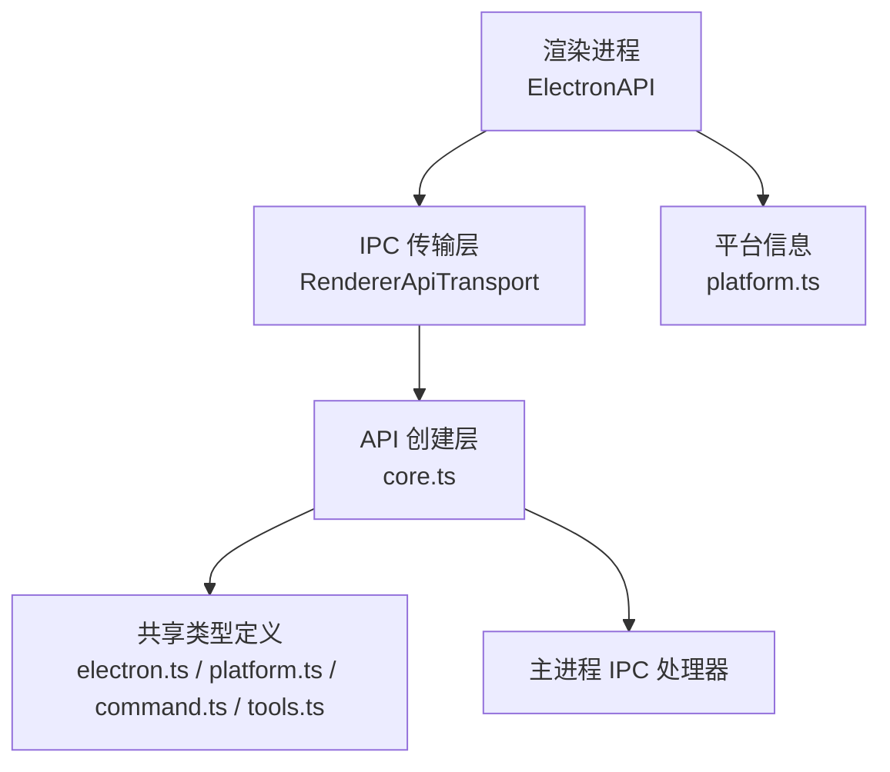

**图表来源**
- [src/shared/renderer-api/createRendererApi.ts:1-80](file://src/shared/renderer-api/createRendererApi.ts#L1-L80)
- [src/shared/renderer-api/core.ts:1-167](file://src/shared/renderer-api/core.ts#L1-L167)
- [src/shared/types/electron.ts:1-595](file://src/shared/types/electron.ts#L1-L595)
- [src/shared/types/electron/platform.ts:1-8](file://src/shared/types/electron/platform.ts#L1-L8)
- [src/shared/types/electron/command.ts:1-3](file://src/shared/types/electron/command.ts#L1-L3)
- [src/shared/types/electron/tools.ts:1-5](file://src/shared/types/electron/tools.ts#L1-L5)

**章节来源**
- [src/shared/renderer-api/createRendererApi.ts:1-80](file://src/shared/renderer-api/createRendererApi.ts#L1-L80)
- [src/shared/renderer-api/core.ts:1-167](file://src/shared/renderer-api/core.ts#L1-L167)
- [src/shared/types/electron/index.ts:1-19](file://src/shared/types/electron/index.ts#L1-L19)
- [src/shared/types/index.ts:1-200](file://src/shared/types/index.ts#L1-L200)

## 核心组件
本节按职责划分，总结每个系统级 API 的职责、关键方法与返回语义。

- AppMetaApi：获取应用版本、产品名称、系统主题、测试模式等元数据。
- AppShellApi：提供“开始引导”状态、头像选择、路径打开、剪贴板读写等系统外壳能力。
- WebApi：解析域名图标并返回 data URL。
- DialogApi：封装文件选择、RDC 文件选择、知识导入选择、目录选择和保存文件。
- WindowControlsApi：最小化、最大化切换、关闭窗口、查询最大化状态。
- CommandApi：列出命令、执行命令。
- ToolApi：检测安装、解析安装、验证安装、获取工具目录和运行时摘要。
- McpApi：获取 MCP 服务器状态摘要。
- EvidenceApi：获取证据链、按事件类型查询证据事件。

**章节来源**
- [src/shared/types/electron.ts:1-595](file://src/shared/types/electron.ts#L1-L595)
- [src/shared/renderer-api/core.ts:1-167](file://src/shared/renderer-api/core.ts#L1-L167)

## 架构总览
渲染进程不直接访问操作系统能力，而是通过 createRendererApi 聚合的 ElectronAPI 对象发起请求。每个 API 方法都通过 transport.invoke 映射到固定的 IPC 通道，例如 shell、command、tools 等。这样既保证接口稳定，又便于在主进程集中处理权限、日志、错误与安全策略。

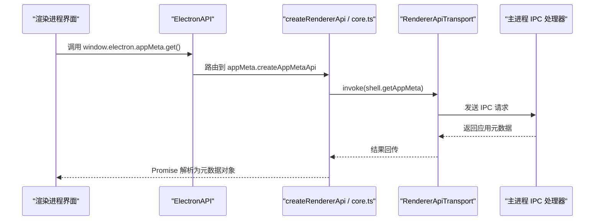

**图表来源**
- [src/shared/renderer-api/createRendererApi.ts:1-80](file://src/shared/renderer-api/createRendererApi.ts#L1-L80)
- [src/shared/renderer-api/core.ts:1-40](file://src/shared/renderer-api/core.ts#L1-L40)
- [src/shared/types/electron.ts:1-120](file://src/shared/types/electron.ts#L1-L120)

## 详细组件分析

### AppMetaApi：系统元数据
- 用途：向渲染进程暴露应用基本信息，包括版本号、产品名称、系统主题和测试模式。
- 行为特征：
  - get 返回 Promise，包含 version、productName、systemTheme、testMode。
  - 适合用于启动页显示应用标识、主题适配和测试环境提示。
- 安全性：仅读取元数据，不涉及文件系统或外部网络。
- 典型调用位置：应用初始化、设置面板、帮助页面。

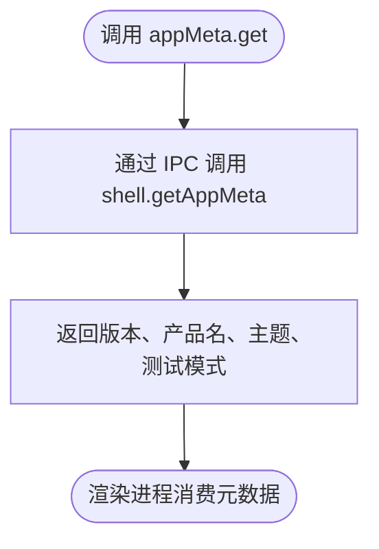

**图表来源**
- [src/shared/renderer-api/core.ts:1-20](file://src/shared/renderer-api/core.ts#L1-L20)
- [src/shared/types/electron.ts:1-120](file://src/shared/types/electron.ts#L1-L120)

**章节来源**
- [src/shared/renderer-api/core.ts:1-20](file://src/shared/renderer-api/core.ts#L1-L20)
- [src/shared/types/electron.ts:1-120](file://src/shared/types/electron.ts#L1-L120)

### AppShellApi：系统外壳与剪贴板
- 用途：提供用户交互与系统能力桥接，包括：
  - hasSeenGettingStarted、acknowledgeGettingStarted：引导流程状态。
  - selectAvatar、getAvatarDataUrl：头像选择与数据 URL 转换。
  - openPath：打开系统路径，返回 success 和可选 error。
  - copyText、readClipboardText：剪贴板写入与读取。
- 返回值约定：
  - openPath 返回 { success, error? }，便于上层判断是否成功。
  - readClipboardText 返回 { success, text }，失败时不包含敏感文本。
- 权限与安全：
  - 剪贴板属于敏感系统能力，应仅在明确用户意图后调用。
  - openPath 可能触发系统默认程序，需避免恶意路径。
- 跨平台：
  - isMac/isWindows/isLinux 可用于差异化处理，例如 macOS 与 Windows 的路径或默认程序行为不同。

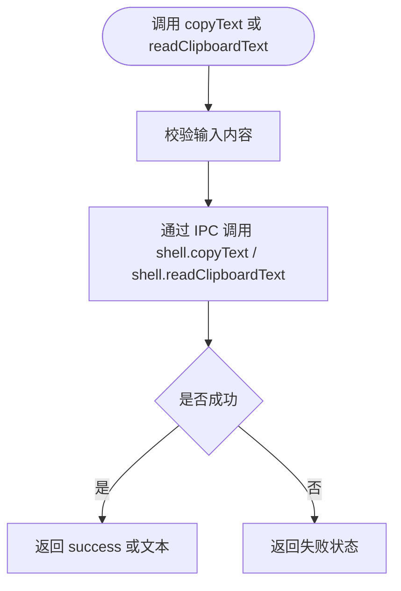

**图表来源**
- [src/shared/renderer-api/core.ts:12-33](file://src/shared/renderer-api/core.ts#L12-L33)
- [src/shared/types/electron.ts:1-120](file://src/shared/types/electron.ts#L1-L120)

**章节来源**
- [src/shared/renderer-api/core.ts:12-33](file://src/shared/renderer-api/core.ts#L12-L33)
- [src/shared/types/electron/platform.ts:1-8](file://src/shared/types/electron/platform.ts#L1-L8)
- [src/shared/types/electron.ts:1-120](file://src/shared/types/electron.ts#L1-L120)

### WebApi：Web 能力
- 用途：resolveFavicon(domain) 返回域名的 favicon data URL。
- 适用场景：会话标题、标签页、历史记录中显示站点图标。
- 限制：只接受域名参数，返回 null 表示无法解析。

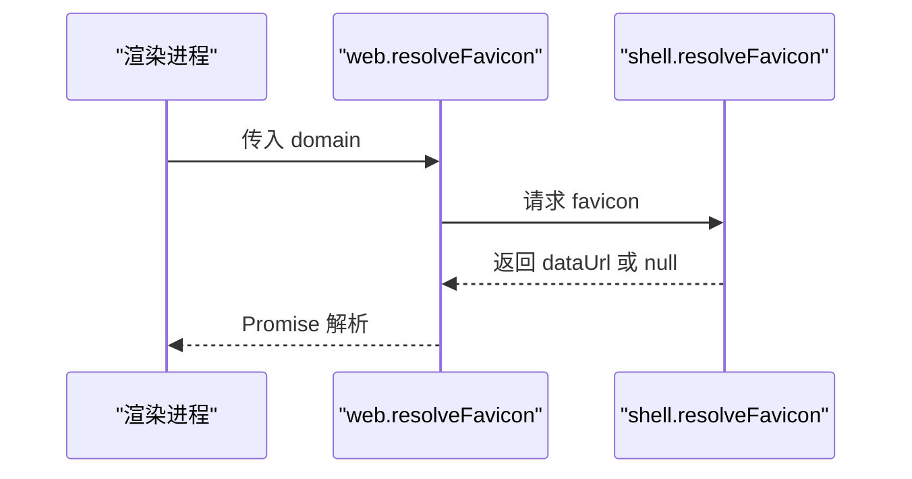

**图表来源**
- [src/shared/renderer-api/core.ts:21-25](file://src/shared/renderer-api/core.ts#L21-L25)
- [src/shared/types/electron.ts:1-120](file://src/shared/types/electron.ts#L1-L120)

**章节来源**
- [src/shared/renderer-api/core.ts:21-25](file://src/shared/renderer-api/core.ts#L21-L25)
- [src/shared/types/electron.ts:1-120](file://src/shared/types/electron.ts#L1-L120)

### DialogApi：文件对话框
- 用途：
  - selectFiles：通用文件选择。
  - selectRdcFiles：RDC 相关文件选择。
  - selectKnowledgeImport：知识导入选择。
  - selectDirectory：目录选择。
  - saveFile：保存文件，支持默认文件名与扩展名。
- 返回值：
  - 选择类方法返回字符串数组或 null。
  - saveFile 返回文件路径或 null。
- 权限建议：
  - 所有文件操作都应明确用户意图，避免静默访问磁盘。
  - 对 RDC 文件和知识导入路径应进行白名单或格式校验。

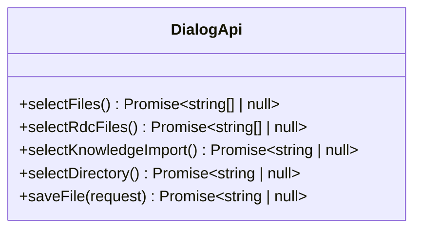

**图表来源**
- [src/shared/renderer-api/core.ts:27-36](file://src/shared/renderer-api/core.ts#L27-L36)
- [src/shared/types/electron/platform.ts:1-8](file://src/shared/types/electron/platform.ts#L1-L8)
- [src/shared/types/electron.ts:1-120](file://src/shared/types/electron.ts#L1-L120)

**章节来源**
- [src/shared/renderer-api/core.ts:27-36](file://src/shared/renderer-api/core.ts#L27-L36)
- [src/shared/types/electron/platform.ts:1-8](file://src/shared/types/electron/platform.ts#L1-L8)
- [src/shared/types/electron.ts:1-120](file://src/shared/types/electron.ts#L1-L120)

### WindowControlsApi：窗口控制
- 用途：
  - minimize：最小化窗口。
  - toggleMaximize：切换最大化。
  - close：关闭窗口。
  - isMaximized：查询当前是否最大化。
- 设计要点：
  - 关闭操作需要谨慎，避免意外退出导致未保存数据丢失。
  - 可在自定义标题栏中复用这些能力。

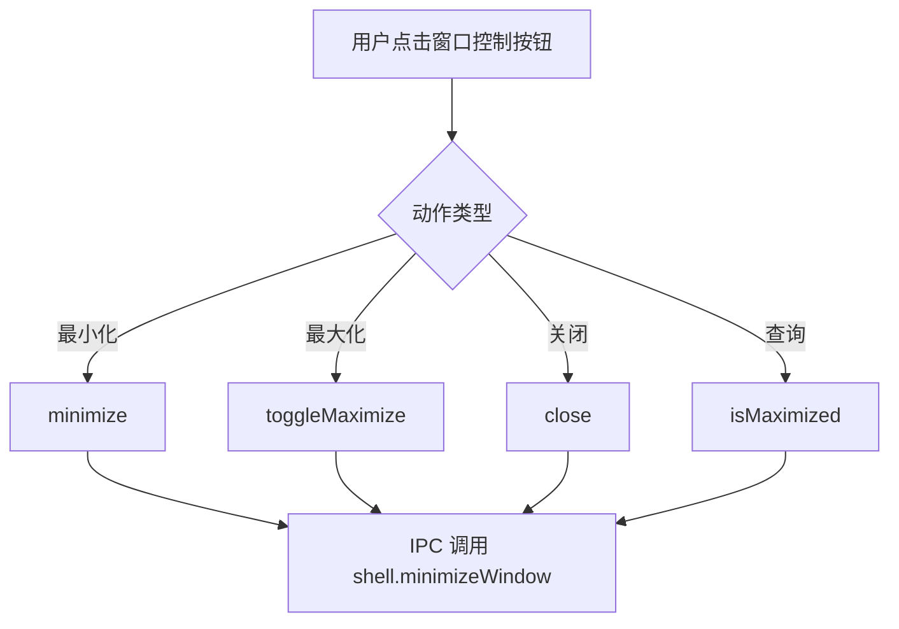

**图表来源**
- [src/shared/renderer-api/core.ts:38-45](file://src/shared/renderer-api/core.ts#L38-L45)
- [src/shared/types/electron/platform.ts:1-8](file://src/shared/types/electron/platform.ts#L1-L8)

**章节来源**
- [src/shared/renderer-api/core.ts:38-45](file://src/shared/renderer-api/core.ts#L38-L45)
- [src/shared/types/electron/platform.ts:1-8](file://src/shared/types/electron/platform.ts#L1-L8)

### CommandApi：命令执行
- 用途：
  - list(category?)：列出命令，可按类别过滤。
  - execute(request)：执行命令，返回 result 与可选 systemMessage。
- 返回语义：
  - execute 返回 { result, systemMessage? }，systemMessage 可作为对话上下文中的系统消息。
- 使用建议：
  - 列表展示用于命令面板或菜单。
  - 执行前应校验 request 的合法性，避免危险命令。

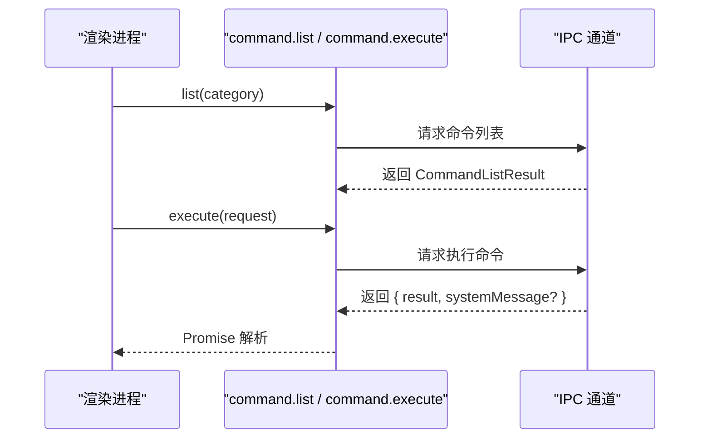

**图表来源**
- [src/shared/renderer-api/core.ts:113-119](file://src/shared/renderer-api/core.ts#L113-L119)
- [src/shared/types/electron/command.ts:1-3](file://src/shared/types/electron/command.ts#L1-L3)
- [src/shared/types/electron.ts:1-595](file://src/shared/types/electron.ts#L1-L595)

**章节来源**
- [src/shared/renderer-api/core.ts:113-119](file://src/shared/renderer-api/core.ts#L113-L119)
- [src/shared/types/electron/command.ts:1-3](file://src/shared/types/electron/command.ts#L1-L3)
- [src/shared/types/electron.ts:1-595](file://src/shared/types/electron.ts#L1-L595)

### ToolApi：工具目录管理与安装验证
- 用途：
  - getCatalog：获取工具目录快照。
  - getRuntimeSummary：获取运行时工具摘要。
  - detectInstallations：检测 RDC 安装候选。
  - resolveInstallation：根据请求解析安装设置。
  - verifyInstallation：验证安装并返回 settings 与 summary。
- 关键类型：
  - ToolCatalog、ToolRuntimeSummary、RdcInstallationCandidate、RdcCliInvokerSettings。
- 安全与权限：
  - 安装解析与验证涉及外部可执行文件或环境变量，应结合权限策略与审计日志。
  - verifyInstallation 返回的 summary 可用于能力探测与降级策略。

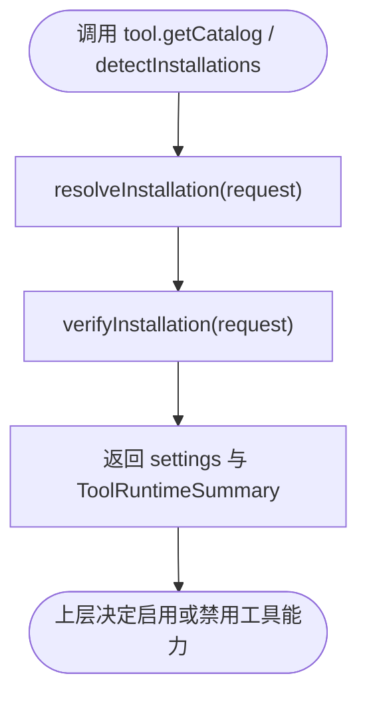

**图表来源**
- [src/shared/renderer-api/core.ts:121-131](file://src/shared/renderer-api/core.ts#L121-L131)
- [src/shared/types/electron/tools.ts:1-5](file://src/shared/types/electron/tools.ts#L1-L5)
- [src/shared/types/electron.ts:1-595](file://src/shared/types/electron.ts#L1-L595)

**章节来源**
- [src/shared/renderer-api/core.ts:121-131](file://src/shared/renderer-api/core.ts#L121-L131)
- [src/shared/types/electron/tools.ts:1-5](file://src/shared/types/electron/tools.ts#L1-L5)
- [src/shared/types/electron.ts:1-595](file://src/shared/types/electron.ts#L1-L595)

### McpApi：MCP 服务状态
- 用途：getStatusSummary 返回 MCP 服务器状态摘要数组。
- 适用场景：
  - 设置面板显示 MCP 连接状态。
  - 工具调用前检查 MCP 可用性。
- 返回值：MCPServerStatusSummary[]，用于展示连接、健康、配置等信息。

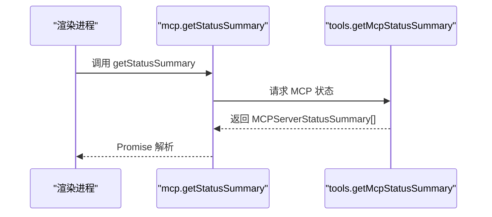

**图表来源**
- [src/shared/renderer-api/core.ts:133-135](file://src/shared/renderer-api/core.ts#L133-L135)
- [src/shared/types/electron/tools.ts:1-5](file://src/shared/types/electron/tools.ts#L1-L5)
- [src/shared/types/electron.ts:1-595](file://src/shared/types/electron.ts#L1-L595)

**章节来源**
- [src/shared/renderer-api/core.ts:133-135](file://src/shared/renderer-api/core.ts#L133-L135)
- [src/shared/types/electron/tools.ts:1-5](file://src/shared/types/electron/tools.ts#L1-L5)
- [src/shared/types/electron.ts:1-595](file://src/shared/types/electron.ts#L1-L595)

### EvidenceApi：证据链查询
- 用途：
  - getChain：获取当前会话/运行的证据链，包含 sessionId、runId、events、isValid。
  - getEvents(eventType?)：按事件类型过滤证据事件。
- 事件模型：
  - EventType、ActionEvent 用于描述证据事件的结构与分类。
- 使用建议：
  - isValid 可用于快速判定证据链完整性。
  - getEvents 常用于审计面板、回放、问题定位。

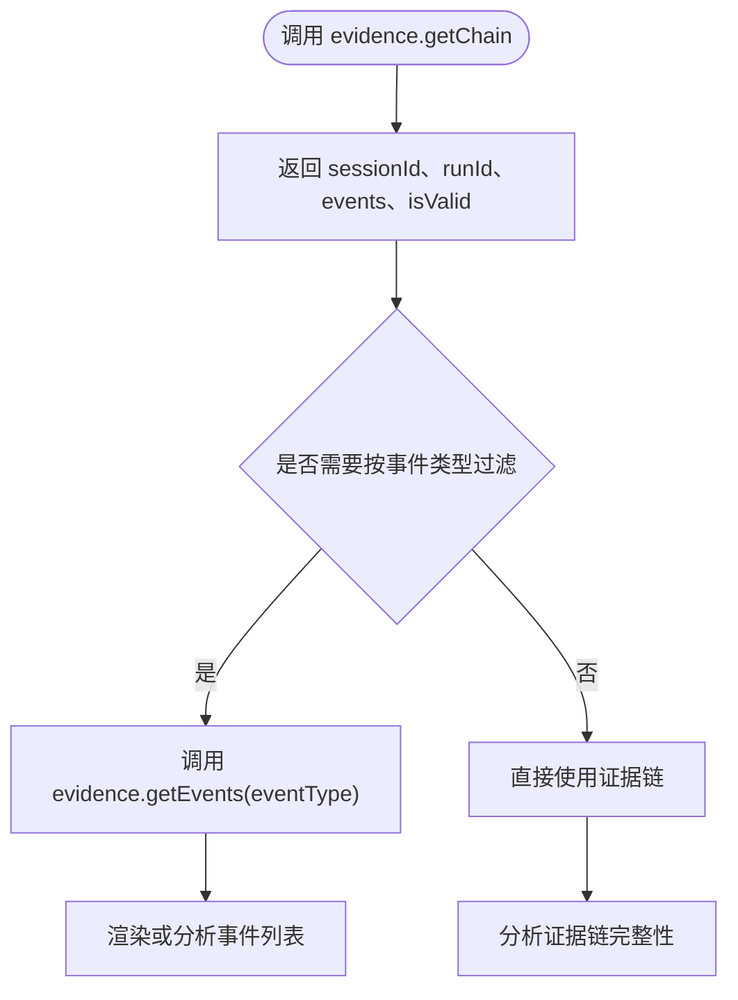

**图表来源**
- [src/shared/renderer-api/core.ts:137-143](file://src/shared/renderer-api/core.ts#L137-L143)
- [src/shared/types/electron/tools.ts:1-5](file://src/shared/types/electron/tools.ts#L1-L5)
- [src/shared/types/electron.ts:1-595](file://src/shared/types/electron.ts#L1-L595)

**章节来源**
- [src/shared/renderer-api/core.ts:137-143](file://src/shared/renderer-api/core.ts#L137-L143)
- [src/shared/types/electron/tools.ts:1-5](file://src/shared/types/electron/tools.ts#L1-L5)
- [src/shared/types/electron.ts:1-595](file://src/shared/types/electron.ts#L1-L595)

## 依赖关系分析
- createRendererApi 负责将 platform、appMeta、appShell、web、dialog、windowControls、command、tool、mcp、evidence 等子 API 聚合到 ElectronAPI。
- core.ts 中的每个 createXxxApi 都依赖 RendererApiTransport 与 IPC 通道常量。
- 类型定义集中在 electron.ts，并由 platform.ts、command.ts、tools.ts 细分导出。

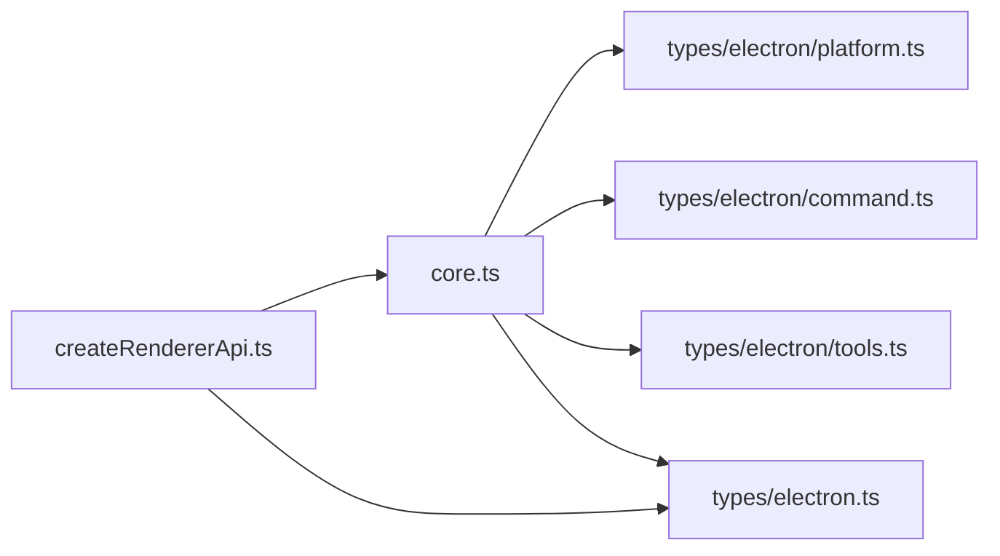

**图表来源**
- [src/shared/renderer-api/createRendererApi.ts:1-80](file://src/shared/renderer-api/createRendererApi.ts#L1-L80)
- [src/shared/renderer-api/core.ts:1-167](file://src/shared/renderer-api/core.ts#L1-L167)
- [src/shared/types/electron/platform.ts:1-8](file://src/shared/types/electron/platform.ts#L1-L8)
- [src/shared/types/electron/command.ts:1-3](file://src/shared/types/electron/command.ts#L1-L3)
- [src/shared/types/electron/tools.ts:1-5](file://src/shared/types/electron/tools.ts#L1-L5)
- [src/shared/types/electron.ts:1-595](file://src/shared/types/electron.ts#L1-L595)

**章节来源**
- [src/shared/renderer-api/createRendererApi.ts:1-80](file://src/shared/renderer-api/createRendererApi.ts#L1-L80)
- [src/shared/types/electron/index.ts:1-19](file://src/shared/types/electron/index.ts#L1-L19)
- [src/shared/types/index.ts:1-200](file://src/shared/types/index.ts#L1-L200)

## 性能与兼容性
- 性能特性：
  - 所有系统级 API 均通过异步 Promise 返回，避免阻塞渲染线程。
  - 文件选择、剪贴板、窗口控制等系统能力调用应避免频繁重复调用，可缓存结果。
- 跨平台兼容性：
  - ElectronAPI 暴露 platform、isMac、isWindows、isLinux，便于渲染层做平台分支逻辑。
  - 路径打开、默认程序、窗口行为在不同操作系统下可能有差异，应结合平台信息处理。
- 安全权限控制：
  - 剪贴板、文件读写、路径打开、命令执行都属于敏感能力，应在调用前进行权限校验与用户确认。
  - ToolApi 的安装检测与验证涉及外部资源，应结合权限策略与审计日志。

[本节为通用指导，不直接分析具体代码文件]

## 故障排查指南
- 应用元数据为空：
  - 检查 appMeta.get 的返回值是否包含 version、productName、systemTheme、testMode。
  - 若 testMode 为 true，注意某些能力在测试环境中可能被替换。
- 剪贴板失败：
  - copyText/readClipboardText 返回 success=false 时，优先检查是否有用户交互触发。
  - 避免在后台静默访问剪贴板。
- 文件对话框无响应：
  - selectFiles/selectDirectory/saveFile 返回 null 通常表示用户取消或权限不足。
  - 对 RDC 文件与知识导入路径应进行格式校验。
- 命令执行异常：
  - command.execute 返回的 result 与 systemMessage 需分别处理错误与系统提示。
  - 执行前应校验 request 的 category、action 等字段。
- 工具安装检测失败：
  - detectInstallations 返回空列表表示未发现候选安装。
  - resolveInstallation/verifyInstallation 失败时应提示用户重新安装或配置环境变量。
- MCP 状态异常：
  - mcp.getStatusSummary 返回空数组或状态为不可用时，应禁用相关工具调用。
- 证据链无效：
  - evidence.getChain 的 isValid=false 表示证据链不完整或已损坏。
  - 使用 getEvents 进一步定位缺失事件。

**章节来源**
- [src/shared/types/electron.ts:1-595](file://src/shared/types/electron.ts#L1-L595)
- [src/shared/renderer-api/core.ts:1-167](file://src/shared/renderer-api/core.ts#L1-L167)

## 结论
本文件梳理了系统级 API 的设计与用法：AppMetaApi、AppShellApi、WebApi、DialogApi、WindowControlsApi、CommandApi、ToolApi、McpApi、EvidenceApi。它们以统一的 ElectronAPI 暴露给渲染进程，通过 IPC 与主进程协作，实现系统元数据、文件对话框、窗口控制、剪贴板、命令执行、工具目录与安装、MCP 状态与证据链查询等能力。在实际集成中，应重视权限控制、跨平台差异与错误处理，并结合证据链与工具摘要进行能力探测与审计分析。

[本节为总结性内容，不直接分析具体代码文件]