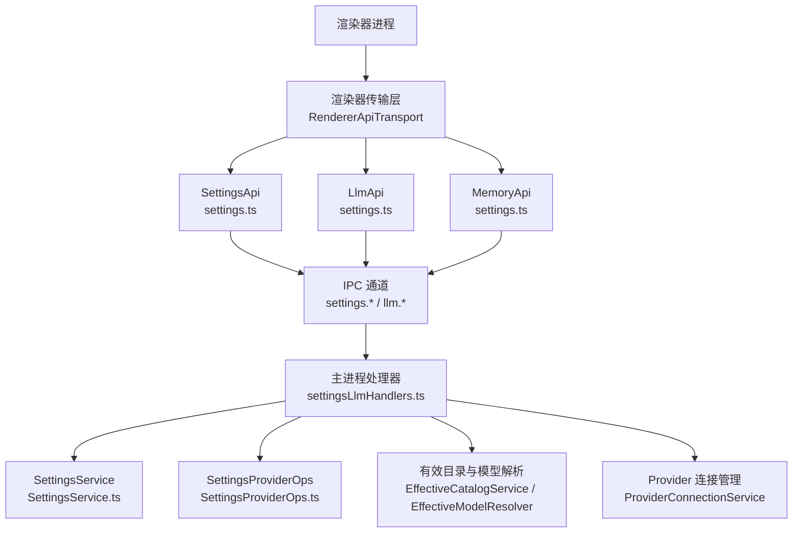
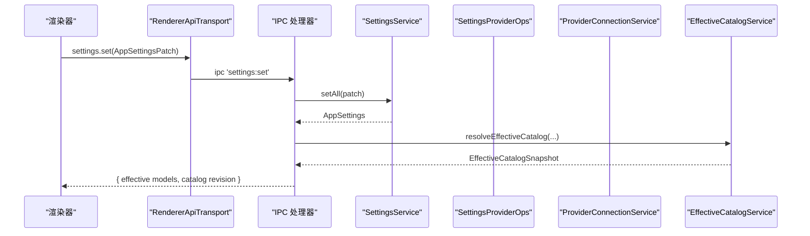
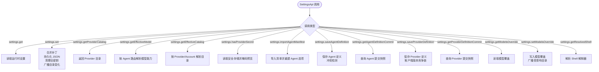
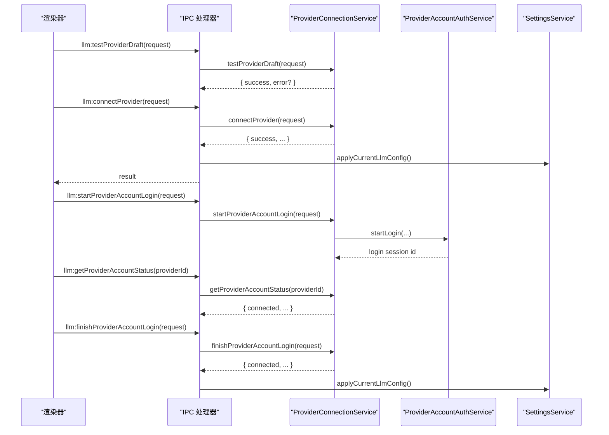
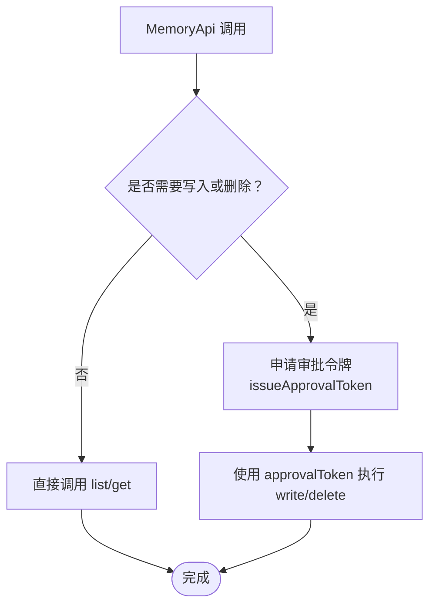
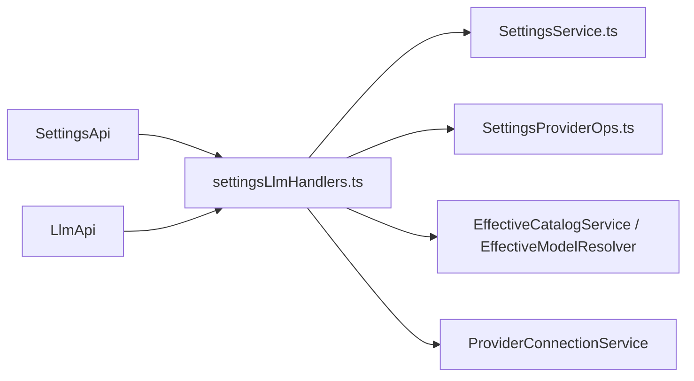

# 设置与 Provider API

<cite>
**本文引用的文件**   
- [src/shared/renderer-api/settings.ts](file://src/shared/renderer-api/settings.ts)
- [src/shared/types/electron/settings.ts](file://src/shared/types/electron/settings.ts)
- [src/shared/types/electron/memory.ts](file://src/shared/types/electron/memory.ts)
- [src/shared/types/electron-api.ts](file://src/shared/types/electron-api.ts)
- [src/shared/types/electron.ts](file://src/shared/types/electron.ts)
- [src/shared/renderer-api/createRendererApi.ts](file://src/shared/renderer-api/createRendererApi.ts)
- [src/main/ipc/settingsLlmHandlers.ts](file://src/main/ipc/settingsLlmHandlers.ts)
- [src/main/settings/SettingsService.ts](file://src/main/settings/SettingsService.ts)
- [src/main/settings/SettingsProviderOps.ts](file://src/main/settings/SettingsProviderOps.ts)
</cite>

## 目录
1. [引言](#引言)
2. [项目结构](#项目结构)
3. [核心组件](#核心组件)
4. [架构总览](#架构总览)
5. [详细组件分析](#详细组件分析)
6. [依赖关系分析](#依赖关系分析)
7. [性能考虑](#性能考虑)
8. [故障排除指南](#故障排除指南)
9. [结论](#结论)
10. [附录：配置格式、认证协议与集成示例](#附录配置格式认证协议与集成示例)

## 引言
本文档面向希望集成或扩展 Provider 与设置系统的开发者，系统说明以下能力：
- SettingsApi：应用设置读取、Provider 目录获取、有效模型与目录解析、密钥存在性检查、Agent 清单导入与定义保存、Provider 定义版本提交、模型覆盖与 Shell 解析。
- LlmApi：LLM Provider 的草稿测试、模型能力探测、连接、刷新模型、断开、账户登录流程与状态管理。
- MemoryApi：用户级与项目级记忆存储的列出、读写与删除。
同时给出 Provider 认证流程、模型覆盖机制、设置持久化策略，并提供可操作的集成示例和错误处理建议。

## 项目结构
本功能横跨渲染器 API 层、IPC 桥接层与主进程服务层：
- 渲染器侧通过 `createRendererApi` 暴露 `settings`、`llm`、`memory` 三个命名空间。
- `settings.ts` 将调用封装为 IPC 通道，转发到主进程。
- 主进程由 `settingsLlmHandlers.ts` 注册 IPC 处理器，并委托给 `SettingsService`、`SettingsProviderOps`、`ProviderConnectionService`、`EffectiveCatalogService` 等模块。

**图表来源**
- [src/shared/renderer-api/createRendererApi.ts:1-80](file://src/shared/renderer-api/createRendererApi.ts#L1-L80)
- [src/shared/renderer-api/settings.ts:1-86](file://src/shared/renderer-api/settings.ts#L1-L86)
- [src/main/ipc/settingsLlmHandlers.ts:1-395](file://src/main/ipc/settingsLlmHandlers.ts#L1-L395)

**章节来源**
- [src/shared/renderer-api/createRendererApi.ts:1-80](file://src/shared/renderer-api/createRendererApi.ts#L1-L80)
- [src/shared/renderer-api/settings.ts:1-86](file://src/shared/renderer-api/settings.ts#L1-L86)

## 核心组件
- SettingsApi：提供应用设置、Provider 元数据、有效模型与目录、密钥检测、Agent 清单与定义、Provider 定义提交、模型覆盖与 Shell 解析等操作。
- LlmApi：提供 Provider 草稿校验、模型能力探测、连接生命周期、模型刷新、断开、账户登录与登出等能力。
- MemoryApi：提供受审批令牌保护的记忆条目 CRUD。

这些接口在渲染器中统一由 `createRendererApi` 装配，并通过 IPC 调用主进程实现。

**章节来源**
- [src/shared/renderer-api/settings.ts:1-86](file://src/shared/renderer-api/settings.ts#L1-L86)
- [src/shared/types/electron/settings.ts:1-4](file://src/shared/types/electron/settings.ts#L1-L4)
- [src/shared/types/electron/memory.ts:1-3](file://src/shared/types/electron/memory.ts#L1-L3)
- [src/shared/renderer-api/createRendererApi.ts:1-80](file://src/shared/renderer-api/createRendererApi.ts#L1-L80)

## 架构总览
渲染器不直接访问磁盘或安全存储，所有敏感操作均经 IPC 进入主进程。主进程负责：
- 校验参数（schema guard）。
- 从 JSON 配置文件加载并归一化设置。
- 将密钥写入安全存储。
- 计算有效 Provider 目录与模型。
- 广播 `llm:effectiveCatalogChanged` 事件，通知渲染器更新 UI。

**图表来源**
- [src/shared/renderer-api/settings.ts:1-86](file://src/shared/renderer-api/settings.ts#L1-L86)
- [src/main/ipc/settingsLlmHandlers.ts:201-395](file://src/main/ipc/settingsLlmHandlers.ts#L201-L395)
- [src/main/settings/SettingsService.ts:201-510](file://src/main/settings/SettingsService.ts#L201-L510)

**章节来源**
- [src/main/ipc/settingsLlmHandlers.ts:1-395](file://src/main/ipc/settingsLlmHandlers.ts#L1-L395)

## 详细组件分析

### SettingsApi：配置管理与 Provider 元数据
SettingsApi 是设置管理的对外入口，封装了以下 IPC 调用：
- `get()`：读取当前运行时设置。
- `set(settings)`：合并并持久化设置补丁，触发 Provider 变更广播与产品图标更新。
- `getProviderCatalog()`：返回已注册 Provider 目录。
- `getEffectiveModel(agentId)`：根据 Agent 路由解析最终生效的模型能力。
- `getEffectiveCatalog(providerId, accountId?)`：按 Provider 与可选账户解析有效模型目录。
- `hasProviderSecret(providerId)`：检测是否存在 Provider 密钥并返回掩码预览。
- `importAgentManifest(filePath)`：导入 Agent 清单并重新计算 Agent 模型选项。
- `saveAgentDefinition(request)`：保存 Agent 定义，支持冲突检测与版本控制。
- `getAgentDefinitionCommit(query)`：查询 Agent 定义提交快照。
- `saveProviderDefinition(request)`：保存 Provider 定义，含客户端版本号与哈希校验。
- `getProviderDefinitionCommit(providerId)`：查询 Provider 定义提交快照。
- `getModelsOverride()` / `setModelsOverride(overrides)`：读取与设置模型覆盖映射，影响 Provider 目录解析。
- `getResolvedShell(executable)`：解析 Shell 解释器路径与版本信息。

**图表来源**
- [src/shared/renderer-api/settings.ts:1-86](file://src/shared/renderer-api/settings.ts#L1-L86)
- [src/main/ipc/settingsLlmHandlers.ts:201-395](file://src/main/ipc/settingsLlmHandlers.ts#L201-L395)

#### 关键行为与持久化策略
- 设置持久化为 JSON 文件，由 `SettingsService` 读取、归一化、合并后写回。
- 当补丁包含 `appearance` 时，会更新产品图标；当 `llm.providers` 变化时，会重新应用 LLM 配置并广播对应 Provider 的有效目录。
- Provider 密钥不写入 JSON，而是存储在安全存储中，JSON 仅保留引用标识。
- Shell 配置变更后，会清除 Shell 解析缓存以保证一致性。

**章节来源**
- [src/main/ipc/settingsLlmHandlers.ts:201-395](file://src/main/ipc/settingsLlmHandlers.ts#L201-L395)
- [src/main/settings/SettingsService.ts:201-510](file://src/main/settings/SettingsService.ts#L201-L510)

### LlmApi：LLM Provider 管理
LlmApi 提供 Provider 全生命周期管理能力：
- `testProviderDraft(request)`：对未连接的 Provider 草稿进行连通性测试。
- `testModelCapability(request)`：探测指定模型的运行能力。
- `connectProvider(request)`：连接 Provider，成功后应用当前 LLM 配置并广播目录。
- `refreshProviderModels(providerId)`：刷新某 Provider 的模型列表。
- `disconnectProvider(providerId)`：断开 Provider，清理账户与密钥关联。
- `startProviderAccountLogin(request)`：启动需要账户登录的 Provider 认证流程。
- `getProviderAccountStatus(providerId)`：查询账户登录状态，若已连接则应用当前 LLM 配置。
- `finishProviderAccountLogin(request)`：完成登录流程，保存凭证并刷新目录。
- `cancelProviderAccountLogin(providerId)`：取消正在进行的登录流程。
- `logoutProviderAccount(providerId)`：退出账户，清空相关会话状态并广播目录。

**图表来源**
- [src/shared/renderer-api/settings.ts:1-86](file://src/shared/renderer-api/settings.ts#L1-L86)
- [src/main/ipc/settingsLlmHandlers.ts:1-200](file://src/main/ipc/settingsLlmHandlers.ts#L1-L200)

#### 认证协议与流程要点
- Provider 支持多种认证模式：API Key、账户登录、本地或环境变量。
- API Key 模式下，密钥保存在安全存储，设置 JSON 仅保留引用标识。
- 账户登录模式通过浏览器或外部身份提供者完成授权，完成后以加密凭证包形式保存。
- 登录过程中可取消或查询状态；成功登录后自动刷新模型目录并应用配置。

**章节来源**
- [src/main/ipc/settingsLlmHandlers.ts:1-200](file://src/main/ipc/settingsLlmHandlers.ts#L1-L200)
- [src/main/settings/SettingsService.ts:1-200](file://src/main/settings/SettingsService.ts#L1-L200)
- [src/main/settings/SettingsProviderOps.ts:1-200](file://src/main/settings/SettingsProviderOps.ts#L1-L200)

### MemoryApi：记忆存储
MemoryApi 提供受限的键值记忆存储，适用于用户或项目范围：
- `issueApprovalToken(request)`：申请写入或删除的审批令牌。
- `list(scope, projectRoot?)`：列出某个作用域下的记忆摘要。
- `get(scope, name, projectRoot?)`：读取完整记忆详情。
- `write(request)`：在拥有审批令牌的前提下写入记忆。
- `delete(scope, name, approvalToken, projectRoot?)`：在拥有审批令牌的前提下删除记忆。

**图表来源**
- [src/shared/renderer-api/settings.ts:1-20](file://src/shared/renderer-api/settings.ts#L1-L20)
- [src/shared/types/electron.ts:1-260](file://src/shared/types/electron.ts#L1-L260)

**章节来源**
- [src/shared/renderer-api/settings.ts:1-20](file://src/shared/renderer-api/settings.ts#L1-L20)
- [src/shared/types/electron.ts:1-260](file://src/shared/types/electron.ts#L1-L260)

## 依赖关系分析
- SettingsApi 与 LlmApi 都依赖 IPC 通道，并在主进程中由 `settingsLlmHandlers.ts` 统一处理。
- SettingsService 负责设置持久化、Provider 连接值解析、Agent 定义与 Provider 定义的版本管理。
- SettingsProviderOps 负责 Provider 定义的原子保存、客户端版本竞争锁、密钥清理与连接值规范化。
- EffectiveCatalogService 与 EffectiveModelResolver 负责按 Provider、账户与模型覆盖计算最终可用的模型目录。
- ProviderConnectionService 负责连接、刷新、断开与账户登录流程。

**图表来源**
- [src/shared/renderer-api/settings.ts:1-86](file://src/shared/renderer-api/settings.ts#L1-L86)
- [src/main/ipc/settingsLlmHandlers.ts:1-395](file://src/main/ipc/settingsLlmHandlers.ts#L1-L395)
- [src/main/settings/SettingsService.ts:1-510](file://src/main/settings/SettingsService.ts#L1-L510)
- [src/main/settings/SettingsProviderOps.ts:1-546](file://src/main/settings/SettingsProviderOps.ts#L1-L546)

**章节来源**
- [src/main/ipc/settingsLlmHandlers.ts:1-395](file://src/main/ipc/settingsLlmHandlers.ts#L1-L395)

## 性能考虑
- IPC 参数限制：多数处理器设置了最大字节限制，避免大对象阻塞消息队列。
- Provider 定义保存采用客户端版本竞争锁与异步尾任务队列，避免并发覆盖。
- 有效目录广播仅在 Provider 配置或模型覆盖发生变化时触发，减少渲染器重绘开销。
- Shell 解析结果会缓存，仅在配置变更时清理。

[本节为通用指导，不直接分析具体代码文件]

## 故障排除指南
常见错误与排查要点：
- Provider 草稿测试失败：检查网络连接、鉴权字段是否完整、URL 是否合法。
- 模型能力探测失败：确认模型 ID 存在于有效目录，且 Provider 已连接且可用。
- 连接失败：检查 API Key 或账户凭证是否正确；必要时调用 `disconnectProvider` 后重试。
- 登录流程异常：使用 `cancelProviderAccountLogin` 清理状态，再重新发起 `startProviderAccountLogin`。
- 设置保存冲突：Provider 定义保存使用客户端版本竞争，如收到 `superseded`，需拉取最新快照后重试。
- 密钥缺失：使用 `hasProviderSecret` 检测；对于 API Key 模式，确保调用 `saveProviderDefinition` 或 `connectProvider` 后密钥已写入安全存储。
- Shell 解析失败：检查 `tooling.shell.executable` 配置与系统 PATH。

**章节来源**
- [src/main/ipc/settingsLlmHandlers.ts:1-395](file://src/main/ipc/settingsLlmHandlers.ts#L1-L395)
- [src/main/settings/SettingsProviderOps.ts:1-546](file://src/main/settings/SettingsProviderOps.ts#L1-L546)

## 结论
SettingsApi 与 LlmApi 共同构成 RDC Agent 的设置与 Provider 体系：前者负责设置与 Provider 定义的持久化与版本管理，后者负责连接、认证与模型发现。MemoryApi 提供安全的轻量记忆存储。通过 IPC 隔离与主进程集中处理，系统在安全性、一致性与可观测性方面达到工程级要求。

[本节为总结性内容，不直接分析具体代码文件]

## 附录：配置格式、认证协议与集成示例

### 配置格式定义
- 应用设置根对象包含外观、布局、工具链、代理运行时权限与上下文、LLM Providers 等。
- Provider 条目包含标识、协议、标签、启用状态、认证模式、基础地址、模型列表、连接字段、密钥引用、账户信息与状态。
- 有效目录快照包含 Provider 提供的模型列表、可用性、账户标签与计划信息等。
- 模型覆盖映射将 Provider 标识映射到自定义模型列表，用于覆盖目录解析结果。

参考类型定义位置：
- [src/shared/types/electron.ts:1-260](file://src/shared/types/electron.ts#L1-L260)
- [src/shared/types/electron/settings.ts:1-4](file://src/shared/types/electron/settings.ts#L1-L4)
- [src/shared/types/electron-api.ts:1-32](file://src/shared/types/electron-api.ts#L1-L32)

### 认证协议
- API Key：将密钥写入安全存储，JSON 仅保留引用标识；可通过 `hasProviderSecret` 检测。
- 账户登录：通过外部身份提供者完成授权，成功后保存加密凭证包，并记录账户摘要。
- 本地与环境变量：某些 Provider 无需网络凭据，可直接标记为已配置。

**章节来源**
- [src/main/settings/SettingsService.ts:1-200](file://src/main/settings/SettingsService.ts#L1-L200)
- [src/main/settings/SettingsProviderOps.ts:201-546](file://src/main/settings/SettingsProviderOps.ts#L201-L546)

### 模型覆盖机制
- 通过 `setModelsOverride` 设置 `providerId -> models[]` 映射。
- 修改后立即广播受影响 Provider 的有效目录，使渲染器刷新模型选择。
- 有效目录解析优先使用覆盖映射，再结合 Provider 实际返回与账户状态。

**章节来源**
- [src/main/ipc/settingsLlmHandlers.ts:320-395](file://src/main/ipc/settingsLlmHandlers.ts#L320-L395)

### 设置持久化策略
- 默认初始化时读取 JSON 设置并进行重建与校验。
- `setAll` 合并补丁、清洗字段、写入 JSON、清理过期密钥、返回运行时设置。
- 窗口布局提供同步与异步两种快速写入路径，避免频繁 Provider 归一化开销。

**章节来源**
- [src/main/settings/SettingsService.ts:201-510](file://src/main/settings/SettingsService.ts#L201-L510)

### Provider 集成与设置管理示例

#### 示例一：添加 API Key Provider
步骤：
1. 调用 `getProviderCatalog` 获取支持的 Provider 目录。
2. 调用 `testProviderDraft` 校验草稿配置。
3. 调用 `connectProvider` 连接 Provider。
4. 调用 `refreshProviderModels` 刷新模型列表。
5. 调用 `getEffectiveCatalog` 查看最终可用模型。
6. 如需切换账号或断开，调用 `disconnectProvider`。

参考调用路径：
- [src/shared/renderer-api/settings.ts:40-86](file://src/shared/renderer-api/settings.ts#L40-L86)
- [src/main/ipc/settingsLlmHandlers.ts:1-200](file://src/main/ipc/settingsLlmHandlers.ts#L1-L200)

#### 示例二：账户登录流程
步骤：
1. 调用 `startProviderAccountLogin` 启动登录。
2. 循环调用 `getProviderAccountStatus` 查询状态。
3. 登录完成后调用 `finishProviderAccountLogin` 保存凭证。
4. 若失败或中断，调用 `cancelProviderAccountLogin` 清理。
5. 使用 `logoutProviderAccount` 退出账户。

参考调用路径：
- [src/shared/renderer-api/settings.ts:40-86](file://src/shared/renderer-api/settings.ts#L40-L86)
- [src/main/ipc/settingsLlmHandlers.ts:120-200](file://src/main/ipc/settingsLlmHandlers.ts#L120-L200)

#### 示例三：Agent 清单与定义
步骤：
1. 调用 `importAgentManifest` 导入清单。
2. 调用 `saveAgentDefinition` 保存定义，注意客户端版本。
3. 调用 `getAgentDefinitionCommit` 查询提交快照。
4. 使用 `getEffectiveModel` 验证 Agent 最终使用的模型。

参考调用路径：
- [src/shared/renderer-api/settings.ts:40-86](file://src/shared/renderer-api/settings.ts#L40-L86)
- [src/main/ipc/settingsLlmHandlers.ts:201-320](file://src/main/ipc/settingsLlmHandlers.ts#L201-L320)

#### 示例四：Provider 定义版本提交
步骤：
1. 先调用 `getProviderDefinitionCommit` 获取当前提交快照。
2. 修改 Provider 配置，携带递增的 `clientRevision`。
3. 调用 `saveProviderDefinition`，如返回 `superseded`，重新拉取快照后重试。
4. 成功后通过 `getProviderDefinitionCommit` 确认新的 `commitHash` 与 `catalogRevision`。

参考调用路径：
- [src/main/ipc/settingsLlmHandlers.ts:280-320](file://src/main/ipc/settingsLlmHandlers.ts#L280-L320)
- [src/main/settings/SettingsProviderOps.ts:1-200](file://src/main/settings/SettingsProviderOps.ts#L1-L200)

#### 示例五：Shell 解析
步骤：
1. 调用 `getResolvedShell` 传入可执行文件名或路径。
2. 根据返回的 `ok`、`kind`、`version`、`executable`、`label` 判断是否可用。
3. 若不可用，检查 `tooling.shell.executable` 配置与系统环境。

参考调用路径：
- [src/shared/renderer-api/settings.ts:40-86](file://src/shared/renderer-api/settings.ts#L40-L86)
- [src/main/ipc/settingsLlmHandlers.ts:340-395](file://src/main/ipc/settingsLlmHandlers.ts#L340-L395)