# Agent 运行时类型

<cite>
**本文引用的文件**   
- [agentRuntime.ts](file://src/shared/types/agentRuntime.ts)
- [rdcRuntime.ts](file://src/shared/types/rdcRuntime.ts)
- [agent.ts](file://src/shared/types/agent.ts)
- [PromptPlanBuilder.ts](file://src/main/agent-runtime/prompt/PromptPlanBuilder.ts)
- [TurnCoordinator.ts](file://src/main/workflow/debugger/TurnCoordinator.ts)
- [orchestratorTypes.ts](file://src/main/workflow/debugger/orchestratorTypes.ts)
- [Agent.ts](file://src/main/agent-runtime/agent/Agent.ts)
</cite>

## 目录
1. [引言](#引言)
2. [项目结构定位](#项目结构定位)
3. [核心类型总览](#核心类型总览)
4. [架构概览](#架构概览)
5. [详细类型分析](#详细类型分析)
6. [依赖关系分析](#依赖关系分析)
7. [性能与可见性特征](#性能与可见性特征)
8. [故障排查指南](#故障排查指南)
9. [结论](#结论)
10. [附录：配置示例索引](#附录配置示例索引)

## 引言
本文聚焦 Agent 运行时的类型定义，围绕以下目标展开：
- 说明 `AgentOrchestrator` 与 `TurnCoordinator` 协作时使用的核心运行时类型。
- 记录 Agent 元数据类型：`AgentConfig`、`AgentState`、`AgentStatus`。
- 记录扩展点类型：技能描述、钩子定义、提示词片段、资源溯源等。
- 解释 RDC 运行时特有类型：`PromptPlan`、`ResourceProvenance`、`ScopedResourceCatalog`。
- 梳理 Skill 系统与工具能力矩阵：`ModelProviderCapabilityMatrix`、`ToolCallingMode`、`ReasoningVisibility`。
- 通过类图、时序图和流程图展示生命周期、技能加载和钩子执行流程。
- 提供运行时配置的完整类型使用路径，但不直接粘贴源码内容。

## 项目结构定位
Agent 运行时相关类型分布在共享类型层与工作流调试器实现层中：

| 层级 | 主要职责 | 关键文件 |
|---|---|---|
| 共享运行时契约 | IPC、事件载荷、模型能力矩阵、推理交付语义 | [agentRuntime.ts](file://src/shared/types/agentRuntime.ts) |
| RDC 运行时数据模型 | 资源作用域、技能元数据、钩子、提示计划、策略 | [rdcRuntime.ts](file://src/shared/types/rdcRuntime.ts) |
| Agent 基础元数据 | Agent ID、角色、状态、会话消息、时间线 | [agent.ts](file://src/shared/types/agent.ts) |
| 提示计划构建器 | 将 Profile、指令、技能、工具能力组装为可执行的 PromptPlan | [PromptPlanBuilder.ts](file://src/main/agent-runtime/prompt/PromptPlanBuilder.ts) |
| Turn 协调器 | 单轮预算、子代理预算、完成声明、挂起移交 | [TurnCoordinator.ts](file://src/main/workflow/debugger/TurnCoordinator.ts) |
| Orchestrator 门面类型 | 编排上下文、已准备运行时、工具执行上下文 | [orchestratorTypes.ts](file://src/main/workflow/debugger/orchestratorTypes.ts) |
| 高层 Agent 类 | Agent 状态机、消息缓冲、事件订阅、循环封装 | [Agent.ts](file://src/main/agent-runtime/agent/Agent.ts) |

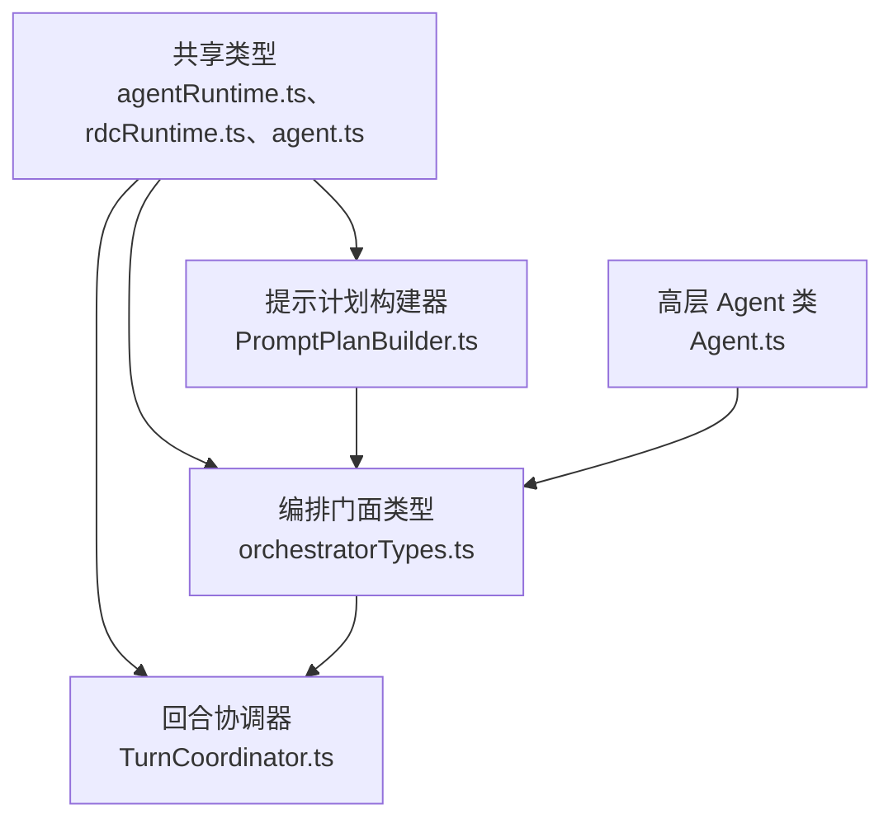

**图示来源**
- [agentRuntime.ts:1-120](file://src/shared/types/agentRuntime.ts#L1-L120)
- [rdcRuntime.ts:1-120](file://src/shared/types/rdcRuntime.ts#L1-L120)
- [agent.ts:1-40](file://src/shared/types/agent.ts#L1-L40)
- [PromptPlanBuilder.ts:1-60](file://src/main/agent-runtime/prompt/PromptPlanBuilder.ts#L1-L60)
- [TurnCoordinator.ts:1-60](file://src/main/workflow/debugger/TurnCoordinator.ts#L1-L60)
- [orchestratorTypes.ts:1-40](file://src/main/workflow/debugger/orchestratorTypes.ts#L1-L40)
- [Agent.ts:1-40](file://src/main/agent-runtime/agent/Agent.ts#L1-L40)

**章节来源**
- [agentRuntime.ts:1-120](file://src/shared/types/agentRuntime.ts#L1-L120)
- [rdcRuntime.ts:1-120](file://src/shared/types/rdcRuntime.ts#L1-L120)
- [agent.ts:1-40](file://src/shared/types/agent.ts#L1-L40)
- [PromptPlanBuilder.ts:1-60](file://src/main/agent-runtime/prompt/PromptPlanBuilder.ts#L1-L60)
- [TurnCoordinator.ts:1-60](file://src/main/workflow/debugger/TurnCoordinator.ts#L1-L60)
- [orchestratorTypes.ts:1-40](file://src/main/workflow/debugger/orchestratorTypes.ts#L1-L40)
- [Agent.ts:1-40](file://src/main/agent-runtime/agent/Agent.ts#L1-L40)

## 核心类型总览
Agent 运行时类型可按用途分为五组：

| 类型组 | 代表类型 | 作用 |
|---|---|---|
| Agent 元数据 | `AgentId`、`AgentRole`、`AgentStatus`、`AgentConfig`、`AgentState` | 描述 Agent 身份、运行态、初始配置 |
| 运行时事件 | `AgentEventType`、`AgentEventPayload`、`AgentEvent` | 定义跨进程事件契约 |
| 模型能力 | `ModelProviderCapabilityMatrix`、`AgentRouteCapability`、`ToolCallingMode`、`ReasoningVisibility` | 描述 Provider 能力、路由选择、工具调用模式 |
| RDC 运行时 | `ResourceScope`、`ResourceProvenance`、`ScopedResourceCatalog`、`SkillMetadata`、`HookDefinition`、`PromptPlan` | 描述资源、技能、钩子和提示计划 |
| 编排与回合 | `PreparedAgentRuntime`、`PreparedAgentTurnContext`、`PolicyBudgetState`、`SubagentBudgetState`、`TurnCompletionDeclaration` | 描述编排上下文、回合预算和完成结果 |

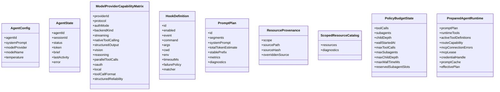

**图示来源**
- [agent.ts:8-26](file://src/shared/types/agent.ts#L8-L26)
- [agentRuntime.ts:259-290](file://src/shared/types/agentRuntime.ts#L259-L290)
- [rdcRuntime.ts:1-120](file://src/shared/types/rdcRuntime.ts#L1-L120)
- [rdcRuntime.ts:120-200](file://src/shared/types/rdcRuntime.ts#L120-L200)
- [TurnCoordinator.ts:70-130](file://src/main/workflow/debugger/TurnCoordinator.ts#L70-L130)
- [orchestratorTypes.ts:120-160](file://src/main/workflow/debugger/orchestratorTypes.ts#L120-L160)

**章节来源**
- [agent.ts:1-40](file://src/shared/types/agent.ts#L1-L40)
- [agentRuntime.ts:1-120](file://src/shared/types/agentRuntime.ts#L1-L120)
- [agentRuntime.ts:259-341](file://src/shared/types/agentRuntime.ts#L259-L341)
- [rdcRuntime.ts:1-200](file://src/shared/types/rdcRuntime.ts#L1-L200)
- [TurnCoordinator.ts:70-130](file://src/main/workflow/debugger/TurnCoordinator.ts#L70-L130)
- [orchestratorTypes.ts:120-160](file://src/main/workflow/debugger/orchestratorTypes.ts#L120-L160)

## 架构概览
Agent 运行时在单次用户输入后，由 `AgentOrchestrator` 门面类型协调 `TurnCoordinator` 的回合生命周期；提示计划由 `PromptPlanBuilder` 根据 Profile、指令、技能和工具能力生成；RDC 运行时提供资源作用域、技能、钩子和策略等基础模型。

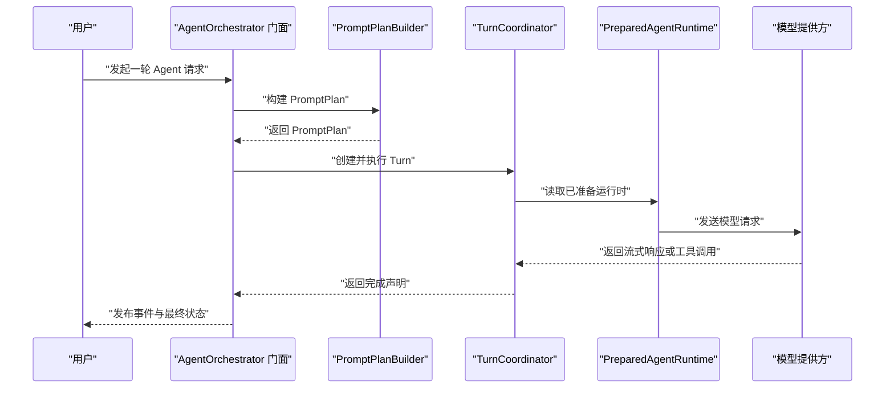

**图示来源**
- [orchestratorTypes.ts:40-120](file://src/main/workflow/debugger/orchestratorTypes.ts#L40-L120)
- [PromptPlanBuilder.ts:60-140](file://src/main/agent-runtime/prompt/PromptPlanBuilder.ts#L60-L140)
- [TurnCoordinator.ts:1-60](file://src/main/workflow/debugger/TurnCoordinator.ts#L1-L60)

**章节来源**
- [orchestratorTypes.ts:40-120](file://src/main/workflow/debugger/orchestratorTypes.ts#L40-L120)
- [PromptPlanBuilder.ts:60-140](file://src/main/agent-runtime/prompt/PromptPlanBuilder.ts#L60-L140)
- [TurnCoordinator.ts:1-60](file://src/main/workflow/debugger/TurnCoordinator.ts#L1-L60)

## 详细类型分析

### Agent 元数据类型：AgentConfig、AgentState、AgentStatus
`AgentConfig` 是 Agent 的初始配置，包含 Agent 角色、系统提示词、模型提供方标识、模型名称和温度。它面向配置层，不携带会话级状态。

`AgentState` 有两个常见含义：
- 共享类型中的 `AgentState` 表示会话级 Agent 投影，包括 `sessionId`、`status`、令牌、简要信息和错误。
- 高层 `Agent` 类中的 `AgentState` 表示运行时可变状态，包括系统提示词、模型、工具定义和消息缓冲。

`AgentStatus` 是 Agent 生命周期的基本状态枚举，包括空闲、思考、执行、等待、完成和错误。

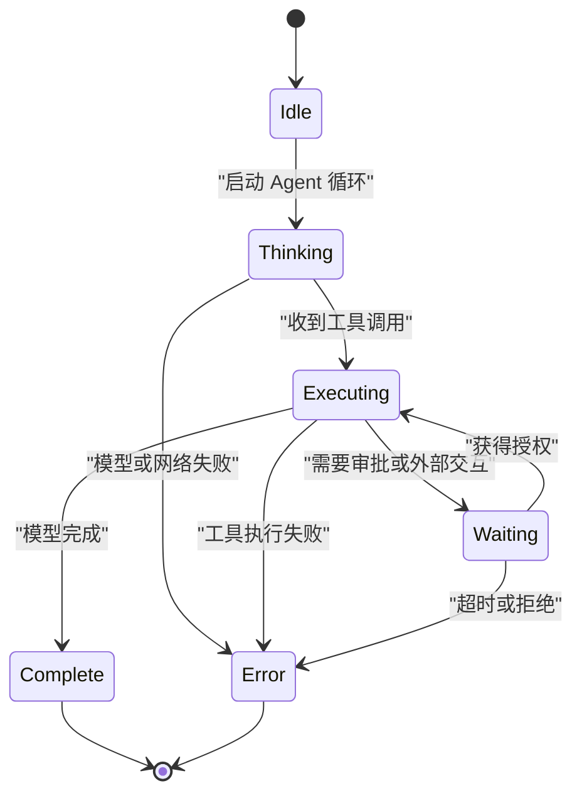

**图示来源**
- [agent.ts:6-26](file://src/shared/types/agent.ts#L6-L26)
- [Agent.ts:1-60](file://src/main/agent-runtime/agent/Agent.ts#L1-L60)

**章节来源**
- [agent.ts:6-40](file://src/shared/types/agent.ts#L6-L40)
- [Agent.ts:1-60](file://src/main/agent-runtime/agent/Agent.ts#L1-L60)

### 运行时事件与能力矩阵
`ToolCallingMode` 定义三种工具调用模式：原生结构化、纯文本、禁用。  
`ReasoningVisibility` 控制推理可见性：摘要事件、未知事件、隐藏、无。  
`ReasoningDelivery` 进一步区分协议级推理交付语义：无、仅摘要、流式全文、隐藏。

`ModelProviderCapabilityMatrix` 是 Provider 能力的静态矩阵，包括协议、认证方式、流式输出、原生工具调用、结构化输出、视觉、推理、并行工具调用、OAuth、本地模式和工具调用格式。  
`AgentRouteCapability` 则是路由执行时的具体能力快照，结合 `toolCallingEvidence`、`toolCallingUnverified`、`visionInputMode`、`structuredOutputMode` 决定本轮是否启用原生工具调用。

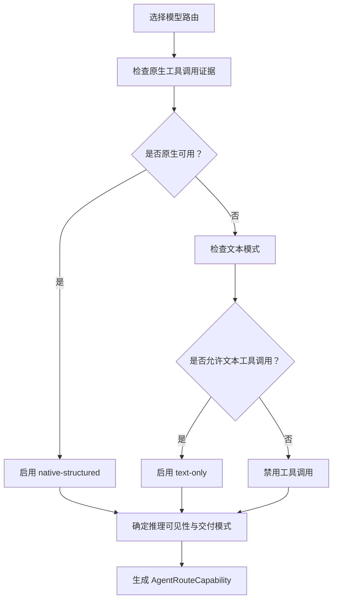

**图示来源**
- [agentRuntime.ts:1-120](file://src/shared/types/agentRuntime.ts#L1-L120)
- [agentRuntime.ts:259-341](file://src/shared/types/agentRuntime.ts#L259-L341)

**章节来源**
- [agentRuntime.ts:1-120](file://src/shared/types/agentRuntime.ts#L1-L120)
- [agentRuntime.ts:259-341](file://src/shared/types/agentRuntime.ts#L259-L341)

### RDC 运行时类型：资源、技能与钩子
RDC 运行时定义了资源作用域、资源溯源、资源目录、技能元数据和钩子定义。

| 类型 | 字段含义 | 行为约束 |
|---|---|---|
| `ResourceScope` | `builtin`、`user`、`project` | 决定资源发现优先级 |
| `ResourceProvenance` | 作用域、源路径、源哈希、被覆盖来源 | 用于审计和资源稳定性 |
| `ScopedResourceCatalog` | 已解析资源数组与诊断 | 只读目录，不是执行权限 |
| `SkillMetadata` | 技能 ID、名称、描述、允许工具、作用域、来源 | 作者元数据，非执行期许可 |
| `SkillLoadResult` | 元数据加上指令、引用、脚本、资产路径 | 实际加载后的技能产物 |
| `HookDefinition` | 钩子 ID、事件、命令、参数、工作目录、环境变量、超时、失败策略、匹配器 | 可执行外部钩子 |

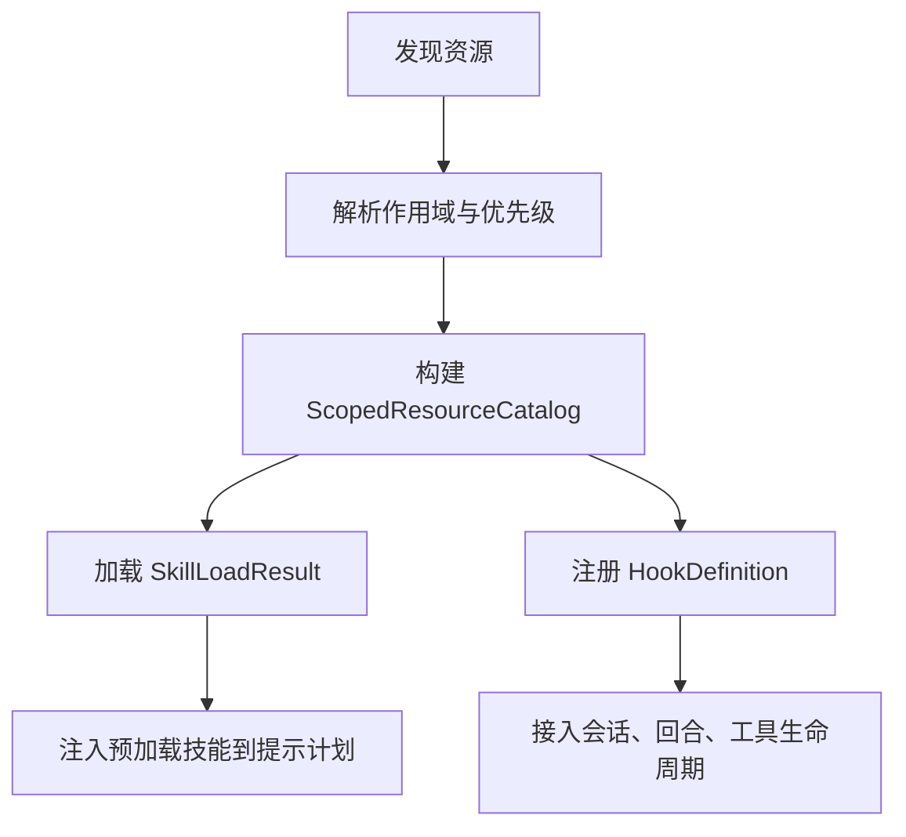

**图示来源**
- [rdcRuntime.ts:1-120](file://src/shared/types/rdcRuntime.ts#L1-L120)
- [rdcRuntime.ts:120-200](file://src/shared/types/rdcRuntime.ts#L120-L200)

**章节来源**
- [rdcRuntime.ts:1-200](file://src/shared/types/rdcRuntime.ts#L1-L200)

### 提示计划类型：PromptPlan 与 PromptSegment
`PromptPlan` 是编译后的提示计划，包含片段列表、系统提示词、预估 Token、稳定前缀、指标和诊断。  
`PromptSegment` 描述单个提示片段，包括来源、作用域、顺序、内容、稳定性估计和 Token 估算。  
`PromptPlanBuilder` 按固定顺序组装核心契约、Agent Profile、作用域指令、预加载技能、技能目录、工具能力、运行时事实、委托胶囊等片段，并生成 `PromptPlanMetrics`。

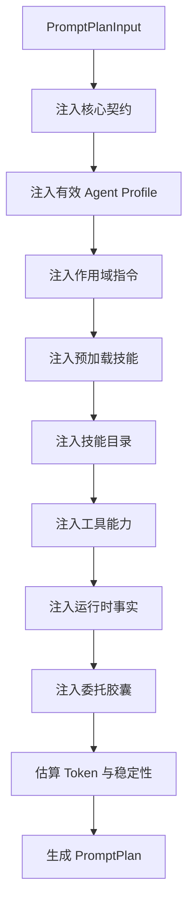

**图示来源**
- [PromptPlanBuilder.ts:60-200](file://src/main/agent-runtime/prompt/PromptPlanBuilder.ts#L60-L200)
- [rdcRuntime.ts:120-200](file://src/shared/types/rdcRuntime.ts#L120-L200)

**章节来源**
- [PromptPlanBuilder.ts:60-200](file://src/main/agent-runtime/prompt/PromptPlanBuilder.ts#L60-L200)
- [rdcRuntime.ts:120-200](file://src/shared/types/rdcRuntime.ts#L120-L200)

### 回合协调器类型：TurnCoordinator
`TurnCoordinator` 管理单次回合的生命周期，包括中止原因、事件接收器、完成声明、延迟激活、挂起移交、策略预算和子代理预算。

关键字段与函数：
- `AbortReason`：用户停止、分支切换、编辑重发、应用关闭、超时、策略撤销、父节点中止、未知。
- `TurnCompletionDeclaration`：完成处置、证据引用、结果摘要、副作用、恢复状态。
- `PolicyBudgetState`：工具调用计数、子代理计数、深度、墙钟时间、上限。
- `reserveDispatchBudget`：原子检查预算链后再累加。
- `createSubagentBudgetState`：子代理深度、活跃子代理、聚合工具调用、墙钟暂停。

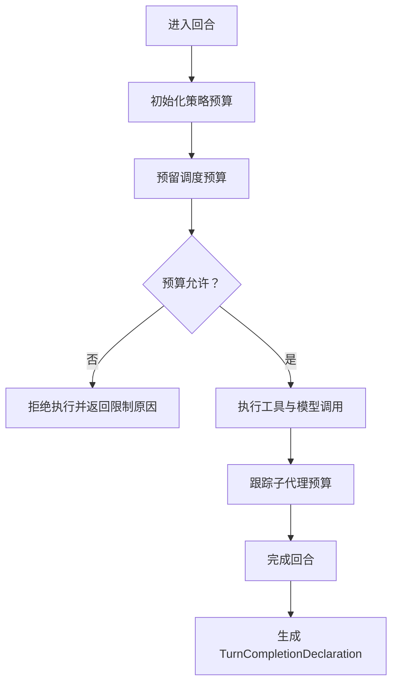

**图示来源**
- [TurnCoordinator.ts:1-200](file://src/main/workflow/debugger/TurnCoordinator.ts#L1-L200)

**章节来源**
- [TurnCoordinator.ts:1-200](file://src/main/workflow/debugger/TurnCoordinator.ts#L1-L200)

### 编排门面类型：AgentOrchestrator 相关类型
`orchestratorTypes.ts` 没有暴露名为 `AgentOrchestrator` 的类，但集中定义了编排门面与兄弟服务使用的共享类型。

重要类型：
- `AgentTurnOptions`：单轮选项，包括信号、分片回调、事件回调、推理选择、请求计划、技能预加载、策略预算、子代理预算、Provider 请求前后回调。
- `AgentProfileTurnOptions`：Profile 级别选项，包括 modelOverride、runId、systemPrompt、temperature、turnId、promptPlan、额外提示片段、冻结委托胶囊、排除 RDC 工具、有效 Profile、可见 turnId、分支 ID、预算继承、已准备上下文、终端上下文回调。
- `PreparedAgentRuntime`：已准备的运行时快照，包含 PromptPlan、工具、路由能力、MCP 连接、凭证句柄、提示缓存、有效计划。
- `PreparedAgentTurnContext`：已准备的回合上下文，包含摘要、选中模型、有效模型、工具白名单、冻结用户内容、附件清单、内联 Token 预算、初始消息、上下文诊断和运行时。
- `ToolExecutorRuntimeContext`：工具执行上下文，包含会话、run、turn、事件上下文、项目根目录、MCP 池键、项目 ID、有效计划和策略预算。

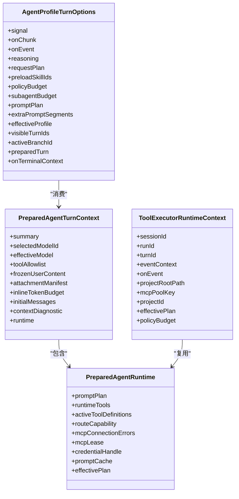

**图示来源**
- [orchestratorTypes.ts:40-175](file://src/main/workflow/debugger/orchestratorTypes.ts#L40-L175)

**章节来源**
- [orchestratorTypes.ts:40-175](file://src/main/workflow/debugger/orchestratorTypes.ts#L40-L175)

### 钩子执行时序
钩子通过 `HookDefinition` 绑定 canonical 事件，如会话开始、会话结束、回合开始、回合结束、工具调用前、工具调用后、工具错误、上下文压缩前、上下文压缩后、Agent 移交前、Agent 移交后、权限拒绝。

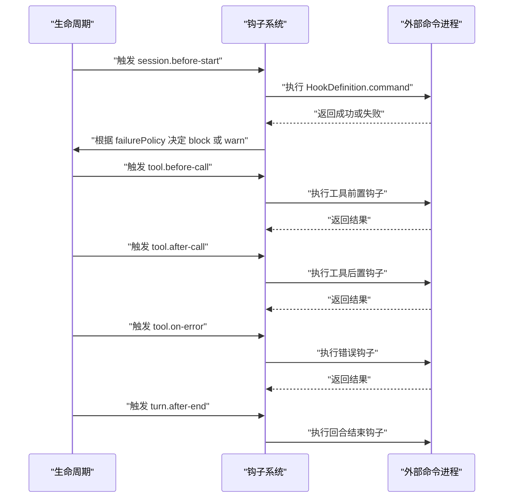

**图示来源**
- [rdcRuntime.ts:120-200](file://src/shared/types/rdcRuntime.ts#L120-L200)

**章节来源**
- [rdcRuntime.ts:120-200](file://src/shared/types/rdcRuntime.ts#L120-L200)

## 依赖关系分析
类型之间的依赖呈现分层结构：

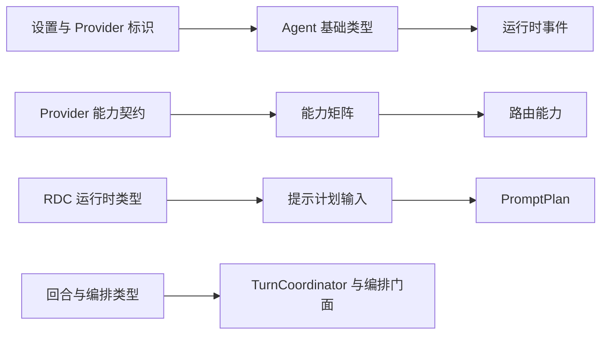

**图示来源**
- [agent.ts:1-40](file://src/shared/types/agent.ts#L1-L40)
- [agentRuntime.ts:1-120](file://src/shared/types/agentRuntime.ts#L1-L120)
- [rdcRuntime.ts:1-200](file://src/shared/types/rdcRuntime.ts#L1-L200)
- [PromptPlanBuilder.ts:60-140](file://src/main/agent-runtime/prompt/PromptPlanBuilder.ts#L60-L140)
- [TurnCoordinator.ts:1-60](file://src/main/workflow/debugger/TurnCoordinator.ts#L1-L60)
- [orchestratorTypes.ts:1-40](file://src/main/workflow/debugger/orchestratorTypes.ts#L1-L40)

**章节来源**
- [agent.ts:1-40](file://src/shared/types/agent.ts#L1-L40)
- [agentRuntime.ts:1-120](file://src/shared/types/agentRuntime.ts#L1-L120)
- [rdcRuntime.ts:1-200](file://src/shared/types/rdcRuntime.ts#L1-L200)
- [PromptPlanBuilder.ts:60-140](file://src/main/agent-runtime/prompt/PromptPlanBuilder.ts#L60-L140)
- [TurnCoordinator.ts:1-60](file://src/main/workflow/debugger/TurnCoordinator.ts#L1-L60)
- [orchestratorTypes.ts:1-40](file://src/main/workflow/debugger/orchestratorTypes.ts#L1-L40)

## 性能与可见性特征
- `ToolCallingMode` 直接影响工具调用开销：原生结构化通常更高效且更可靠；纯文本模式可能增加解析成本；禁用模式完全避免工具调用。
- `ReasoningVisibility` 影响渲染与传输成本：摘要事件比完整推理流更轻量。
- `PromptPlan.totalTokenEstimate` 与 `PromptSegment.tokenEstimate` 帮助评估系统提示长度，防止上下文窗口溢出。
- `PolicyBudgetState.maxWallTimeMs` 与 `SubagentBudgetState.wallPausedMs` 控制真实 CPU/墙钟时间，避免长时间占用。
- `SkillCatalogBudget` 与技能目录字符预算控制技能元数据体积，避免提示过大。

**章节来源**
- [agentRuntime.ts:1-120](file://src/shared/types/agentRuntime.ts#L1-L120)
- [PromptPlanBuilder.ts:140-220](file://src/main/agent-runtime/prompt/PromptPlanBuilder.ts#L140-L220)
- [TurnCoordinator.ts:100-200](file://src/main/workflow/debugger/TurnCoordinator.ts#L100-L200)

## 故障排查指南
| 现象 | 可能原因 | 排查方向 |
|---|---|---|
| 工具调用未生效 | `ToolCallingMode` 为 `disabled` 或 `text-only` | 检查 `AgentRouteCapability.toolCallingMode` |
| 结构化输出不稳定 | `structuredOutputMode` 为 `prompt-fallback` | 检查 `structuredReliability` 与路由能力 |
| 推理内容过多导致超时 | `ReasoningVisibility` 或 `ReasoningDelivery` 过于开放 | 调整为 `summary-events` 或 `hidden` |
| 回合被拒绝 | 策略预算耗尽 | 查看 `PolicyBudgetState` 的限制原因 |
| 子代理未正确计时 | 子代理启动/结束未配对 | 检查 `startSubagentBudgetChild` 与 `finishSubagentBudgetChild` |
| 提示过长 | 技能目录或指令过长 | 检查 `PromptPlan.metrics` 与技能目录截断诊断 |
| 钩子阻塞执行 | `HookDefinition.failurePolicy` 为 `block` 且命令失败 | 检查钩子命令返回值与失败策略 |

**章节来源**
- [agentRuntime.ts:1-120](file://src/shared/types/agentRuntime.ts#L1-L120)
- [rdcRuntime.ts:120-200](file://src/shared/types/rdcRuntime.ts#L120-L200)
- [TurnCoordinator.ts:100-200](file://src/main/workflow/debugger/TurnCoordinator.ts#L100-L200)
- [PromptPlanBuilder.ts:140-220](file://src/main/agent-runtime/prompt/PromptPlanBuilder.ts#L140-L220)

## 结论
Agent 运行时类型体系以共享契约为核心，向上支撑 `AgentOrchestrator` 门面与 `TurnCoordinator` 回合协调逻辑，向下承载 RDC 资源的发现、技能与钩子的可扩展机制。`ModelProviderCapabilityMatrix` 与 `ToolCallingMode`、`ReasoningVisibility` 共同决定模型调用的能力边界与可见性；`PromptPlan` 将 Profile、指令、技能和运行时事实统一为可执行提示；`PolicyBudgetState` 与 `SubagentBudgetState` 保证执行过程可度量、可中断、可审计。理解这些类型有助于准确配置 Agent、调试工具调用、控制推理输出，并安全扩展技能与钩子系统。

## 附录：配置示例索引
以下为“如何构造运行时配置”的类型使用索引。文档不直接粘贴源码，而是给出每个配置对象应填写的关键字段位置。

| 配置对象 | 关键字段 | 典型值来源 | 参考文件与行号 |
|---|---|---|---|
| `AgentConfig` | `agentId`、`systemPrompt`、`modelProvider`、`modelName`、`temperature` | Agent 基础配置 | [agent.ts:8-16](file://src/shared/types/agent.ts#L8-L16) |
| `AgentState`（共享） | `agentId`、`sessionId`、`status`、`token`、`brief`、`lastActivity`、`error` | 会话状态投影 | [agent.ts:18-26](file://src/shared/types/agent.ts#L18-L26) |
| `ModelProviderCapabilityMatrix` | `providerId`、`protocol`、`authMode`、`backendKind`、`nativeToolCalling`、`structuredOutput`、`vision`、`reasoning`、`toolCallFormat` | Provider 目录与能力清单 | [agentRuntime.ts:259-290](file://src/shared/types/agentRuntime.ts#L259-L290) |
| `AgentRouteCapability` | `toolCallingMode`、`reasoningVisibility`、`reasoningDelivery`、`toolCallingEvidence`、`visionInputMode`、`structuredOutputMode` | 路由选择结果 | [agentRuntime.ts:20-60](file://src/shared/types/agentRuntime.ts#L20-L60) |
| `HookDefinition` | `id`、`event`、`command`、`args`、`cwd`、`env`、`timeoutMs`、`failurePolicy`、`matcher` | 钩子定义文件 | [rdcRuntime.ts:160-200](file://src/shared/types/rdcRuntime.ts#L160-L200) |
| `PromptPlanInput` | `profile`、`scopedInstructions`、`preloadedSkills`、`skillCatalog`、`tools`、`routeCapability`、`permissionSettings`、`currentDate`、`timeZone` | 提示计划构建输入 | [PromptPlanBuilder.ts:40-100](file://src/main/agent-runtime/prompt/PromptPlanBuilder.ts#L40-L100) |
| `PromptPlan` | `id`、`segments`、`systemPrompt`、`totalTokenEstimate`、`metrics`、`diagnostics` | 编译后提示计划 | [rdcRuntime.ts:160-200](file://src/shared/types/rdcRuntime.ts#L160-L200) |
| `PolicyBudgetState` | `maxToolCalls`、`maxSubagents`、`maxChildDepth`、`maxWallTimeMs` | 策略预算 | [TurnCoordinator.ts:100-160](file://src/main/workflow/debugger/TurnCoordinator.ts#L100-L160) |
| `AgentProfileTurnOptions` | `promptPlan`、`preloadSkillIds`、`policyBudget`、`subagentBudget`、`effectiveProfile` | 编排门面调用参数 | [orchestratorTypes.ts:80-140](file://src/main/workflow/debugger/orchestratorTypes.ts#L80-L140) |
| `PreparedAgentRuntime` | `promptPlan`、`activeToolDefinitions`、`routeCapability`、`promptCache`、`effectivePlan` | 已准备运行时 | [orchestratorTypes.ts:120-160](file://src/main/workflow/debugger/orchestratorTypes.ts#L120-L160) |

**章节来源**
- [agent.ts:8-26](file://src/shared/types/agent.ts#L8-L26)
- [agentRuntime.ts:20-100](file://src/shared/types/agentRuntime.ts#L20-L100)
- [agentRuntime.ts:259-341](file://src/shared/types/agentRuntime.ts#L259-L341)
- [rdcRuntime.ts:120-200](file://src/shared/types/rdcRuntime.ts#L120-L200)
- [PromptPlanBuilder.ts:40-100](file://src/main/agent-runtime/prompt/PromptPlanBuilder.ts#L40-L100)
- [TurnCoordinator.ts:100-160](file://src/main/workflow/debugger/TurnCoordinator.ts#L100-L160)
- [orchestratorTypes.ts:80-160](file://src/main/workflow/debugger/orchestratorTypes.ts#L80-L160)