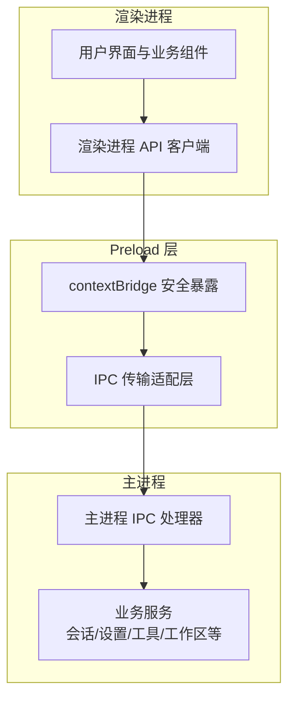
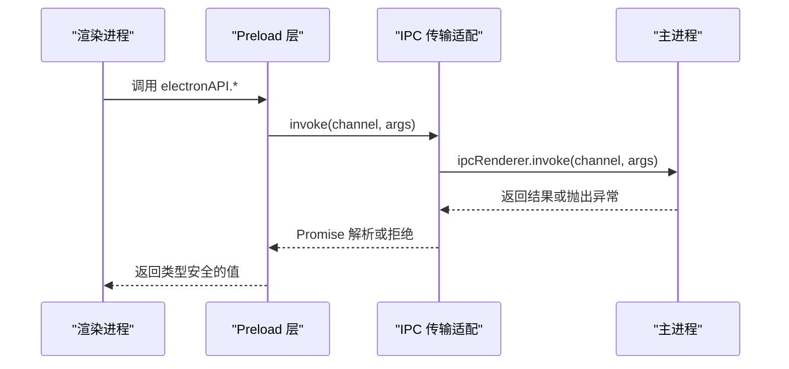
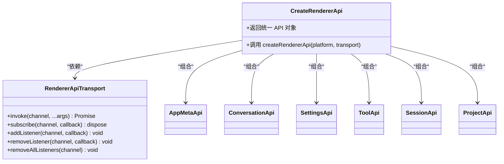
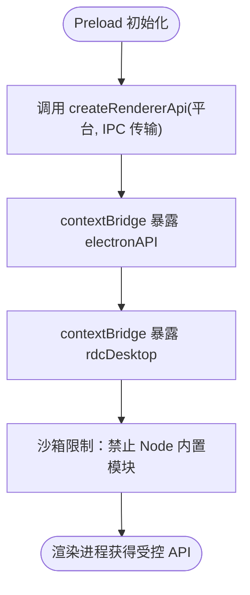
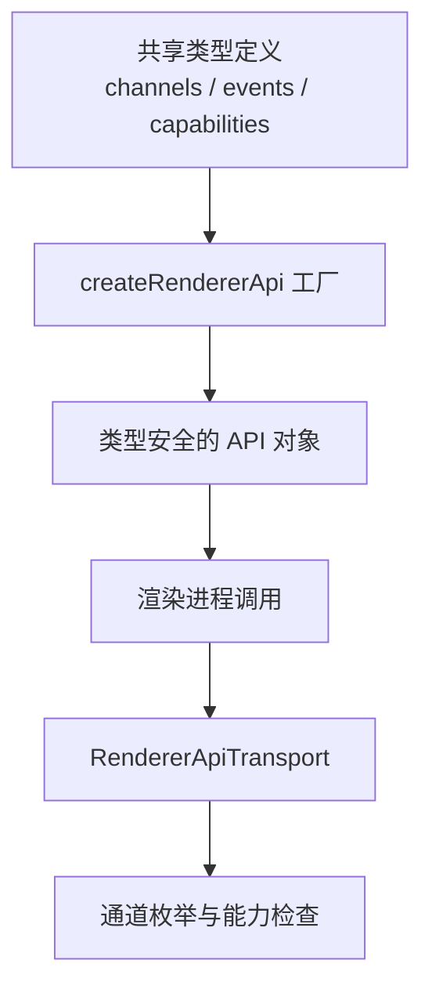
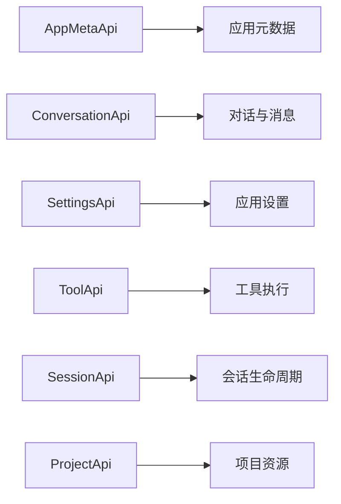
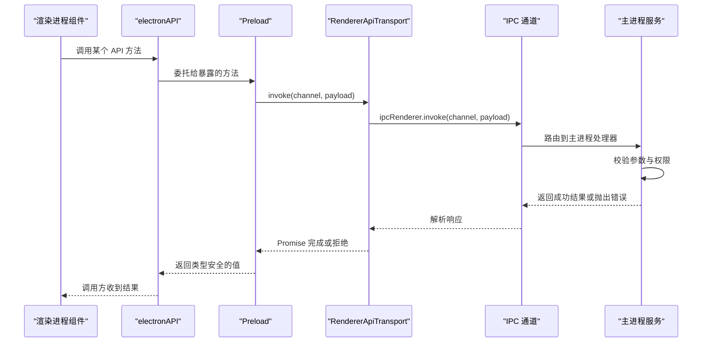
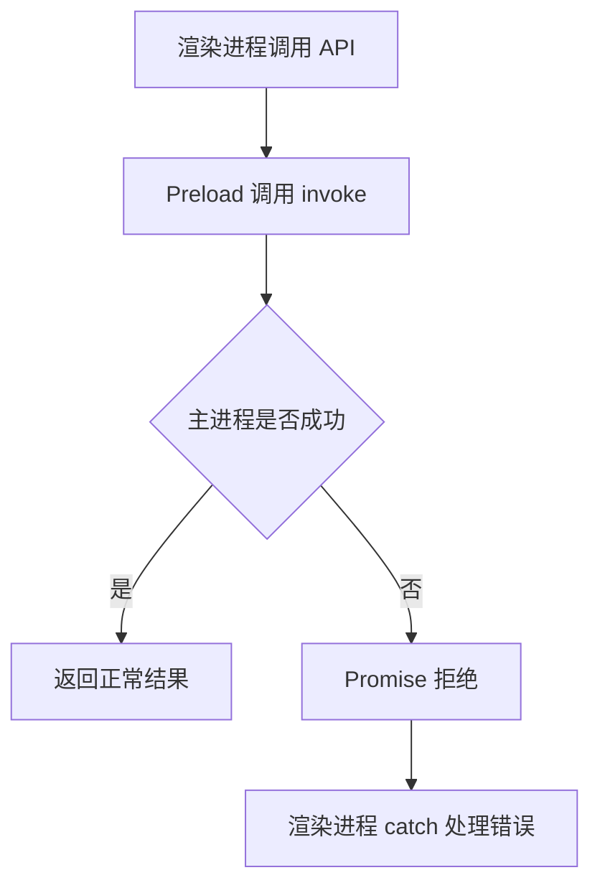
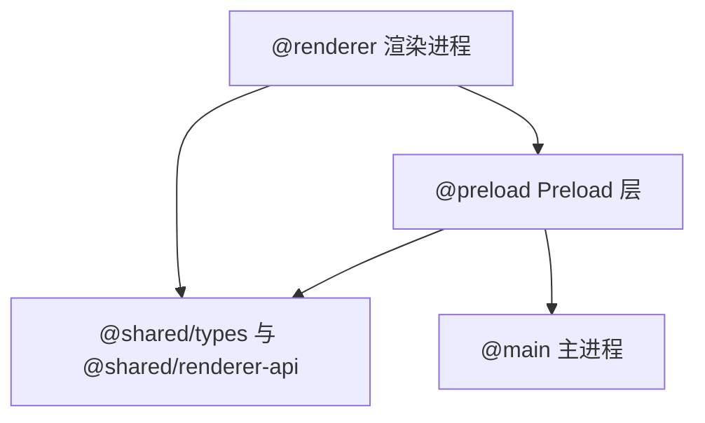

# Electron API 概览与桥接机制

<cite>
**本文引用的文件**
- [preload/index.ts](file://src/preload/index.ts)
- [preload/rendererTransport.ts](file://src/preload/rendererTransport.ts)
- [shared/renderer-api/createRendererApi.ts](file://src/shared/renderer-api/createRendererApi.ts)
- [shared/renderer-api/transport.ts](file://src/shared/renderer-api/transport.ts)
- [shared/renderer-api/channels.ts](file://src/shared/renderer-api/channels.ts)
- [shared/renderer-api/events.ts](file://src/shared/renderer-api/events.ts)
- [shared/renderer-api/channelCapabilities.ts](file://src/shared/renderer-api/channelCapabilities.ts)
- [shared/renderer-api/core.ts](file://src/shared/renderer-api/core.ts)
- [shared/renderer-api/settings.ts](file://src/shared/renderer-api/settings.ts)
- [shared/renderer-api/workbench.ts](file://src/shared/renderer-api/workbench.ts)
</cite>

## 目录
1. [引言](#引言)
2. [项目结构与职责边界](#项目结构与职责边界)
3. [整体架构与 IPC 通信模型](#整体架构与-ipc-通信模型)
4. [渲染进程 API 层设计](#渲染进程-api-层设计)
5. [Preload 安全暴露层](#preload-安全暴露层)
6. [类型契约与编译期约束](#类型契约与编译期约束)
7. [API 分组与职责说明](#api-分组与职责说明)
8. [典型调用流程](#典型调用流程)
9. [错误处理模式](#错误处理模式)
10. [依赖关系分析](#依赖关系分析)
11. [性能与扩展建议](#性能与扩展建议)
12. [故障排查指南](#故障排查指南)
13. [结论](#结论)

## 引言
本文面向 Electron 主进程、Preload 层和渲染进程的协作场景，系统化说明本仓库中 Renderer API 的桥接机制。重点包括：
- 主进程与渲染进程之间的 IPC 通道如何被统一抽象。
- Preload 层如何通过 `contextBridge` 安全暴露最小接口。
- `createRendererApi` 如何将平台信息和 IPC 传输能力组合为类型安全的 API 对象。
- `AppMetaApi`、`ConversationApi`、`SettingsApi`、`ToolApi`、`SessionApi`、`ProjectApi` 等 API 分组的职责边界。
- 类型定义如何在编译期约束调用方，避免渲染进程直接访问未授权能力。

## 项目结构与职责边界
Electron 侧代码按进程职责划分：
- **主进程**：持有系统能力、业务服务、持久化存储、工具执行、会话状态、设置管理等核心逻辑。
- **Preload 层**：沙箱隔离下的可信桥接层，仅通过 `contextBridge` 暴露受控方法。
- **渲染进程**：只使用全局 `electronAPI` 和 `rdcDesktop`，不应直接调用原生 Node 或 Electron 危险 API。
- **共享类型与 API 定义**：放在 `src/shared`，供渲染进程和构建期校验共同消费。

**图表来源**
- [preload/index.ts:1-25](file://src/preload/index.ts#L1-L25)
- [preload/rendererTransport.ts:1-44](file://src/preload/rendererTransport.ts#L1-L44)

**章节来源**
- [preload/index.ts:1-25](file://src/preload/index.ts#L1-L25)
- [preload/rendererTransport.ts:1-44](file://src/preload/rendererTransport.ts#L1-L44)

## 整体架构与 IPC 通信模型
该项目的 IPC 通信遵循“接口抽象 + 通道枚举 + 能力裁剪”的模式：
1. **传输抽象**：`RendererApiTransport` 定义 `invoke`、`subscribe`、`addListener`、`removeListener`、`removeAllListeners` 等能力。
2. **Preload 实现**：`createIpcRendererTransport` 基于 `ipcRenderer.invoke` 和 `ipcRenderer.on` 实现具体传输。
3. **API 构造**：`createRendererApi` 接收平台标识和传输对象，生成统一的 API 命名空间。
4. **通道约束**：`channels.ts`、`events.ts`、`channelCapabilities.ts` 集中声明可用通道、事件类型和能力开关。
5. **渲染进程消费**：渲染进程只看到 `window.electronAPI`，不感知底层 `ipcRenderer` 细节。

**图表来源**
- [preload/rendererTransport.ts:1-44](file://src/preload/rendererTransport.ts#L1-L44)
- [shared/renderer-api/transport.ts](file://src/shared/renderer-api/transport.ts)
- [shared/renderer-api/createRendererApi.ts](file://src/shared/renderer-api/createRendererApi.ts)

## 渲染进程 API 层设计
`createRendererApi` 是渲染进程 API 的核心工厂。它把以下要素组合成稳定对外接口：
- **平台信息**：例如 `process.platform`，用于区分桌面平台差异。
- **IPC 传输**：由 Preload 注入的 `RendererApiTransport`。
- **API 分组**：按业务领域拆分出 `AppMetaApi`、`ConversationApi`、`SettingsApi`、`ToolApi`、`SessionApi`、`ProjectApi` 等。
- **类型约束**：所有方法签名、参数、返回值都由共享类型锁定，防止渲染进程越界调用。

典型职责划分如下：
| API 分组 | 主要职责 | 典型能力方向 |
|---|---|---|
| AppMetaApi | 应用元数据、生命周期相关的基础信息 | 获取应用运行环境、版本、平台信息 |
| ConversationApi | 对话与会话上下文交互 | 创建、查询、更新对话；发送消息；管理上下文 |
| SettingsApi | 应用设置与偏好 | 读取、写入、订阅设置变更 |
| ToolApi | 工具能力与工具执行 | 列出工具、触发工具、获取工具结果 |
| SessionApi | 会话管理与状态 | 启动、暂停、恢复、关闭会话 |
| ProjectApi | 项目与工作区资源 | 打开项目、管理文件、同步资源 |

**图表来源**
- [shared/renderer-api/createRendererApi.ts](file://src/shared/renderer-api/createRendererApi.ts)
- [shared/renderer-api/transport.ts](file://src/shared/renderer-api/transport.ts)

**章节来源**
- [shared/renderer-api/createRendererApi.ts](file://src/shared/renderer-api/createRendererApi.ts)
- [shared/renderer-api/transport.ts](file://src/shared/renderer-api/transport.ts)

## Preload 安全暴露层
Preload 层是本工程的安全边界。其关键约束如下：
- 注释明确强调沙箱兼容：只能使用 `contextBridge`、`ipcRenderer` 和 `process.platform`，禁止引入 `fs`、`path`、`child_process` 等 Node 内置模块。
- 通过 `createRendererApi` 构造 `electronAPI`，再经 `contextBridge.exposeInMainWorld('electronAPI', ...)` 暴露给渲染进程。
- 额外暴露 `rdcDesktop.getPathForFile`，封装 `webUtils.getPathForFile`，并对异常进行降级处理，返回 `null` 而非抛错。

**图表来源**
- [preload/index.ts:1-25](file://src/preload/index.ts#L1-L25)

**章节来源**
- [preload/index.ts:1-25](file://src/preload/index.ts#L1-L25)

## 类型契约与编译期约束
类型契约在本项目中承担“跨进程接口契约”的角色：
- `RendererApiTransport` 在共享层定义，Preload 提供实现，渲染进程消费抽象，避免渲染进程直接依赖 `ipcRenderer` 的具体实现。
- `channels.ts`、`events.ts`、`channelCapabilities.ts` 集中声明通道名、事件类型和能力开关，确保 IPC 名称不会散落各处。
- `createRendererApi` 的输出类型由共享类型决定，渲染进程中的调用必须在编译期匹配方法签名。
- 如果主进程新增能力，应先扩展共享类型和通道定义，再实现对应 IPC 处理器，最后暴露到 `electronAPI`。

**图表来源**
- [shared/renderer-api/channels.ts](file://src/shared/renderer-api/channels.ts)
- [shared/renderer-api/events.ts](file://src/shared/renderer-api/events.ts)
- [shared/renderer-api/channelCapabilities.ts](file://src/shared/renderer-api/channelCapabilities.ts)
- [shared/renderer-api/createRendererApi.ts](file://src/shared/renderer-api/createRendererApi.ts)
- [shared/renderer-api/transport.ts](file://src/shared/renderer-api/transport.ts)

**章节来源**
- [shared/renderer-api/channels.ts](file://src/shared/renderer-api/channels.ts)
- [shared/renderer-api/events.ts](file://src/shared/renderer-api/events.ts)
- [shared/renderer-api/channelCapabilities.ts](file://src/shared/renderer-api/channelCapabilities.ts)
- [shared/renderer-api/createRendererApi.ts](file://src/shared/renderer-api/createRendererApi.ts)
- [shared/renderer-api/transport.ts](file://src/shared/renderer-api/transport.ts)

## API 分组与职责说明
本节按业务领域梳理 API 分组。由于各分组的具体实现分布在多个文件中，这里以职责边界为主，不展开内部实现细节。

### AppMetaApi
- 负责应用基础信息与运行环境相关的只读或轻量查询。
- 适合暴露应用版本、平台、构建信息等不需要复杂权限的能力。
- 通常不涉及长连接或大量副作用操作。

### ConversationApi
- 负责对话生命周期与消息交互。
- 可能涉及创建对话、追加消息、查询历史、清理上下文等操作。
- 对渲染进程而言，应表现为稳定的异步方法，并配合事件通道推送增量更新。

### SettingsApi
- 负责用户设置与应用配置。
- 典型操作包括读取默认值、写入新值、监听设置变更。
- 写入操作应具备输入校验与权限控制，避免渲染进程随意覆盖关键配置。

### ToolApi
- 负责工具发现与工具执行。
- 工具可能涉及文件系统、网络、浏览器或其他系统能力，因此必须通过主进程统一调度。
- 渲染进程不应直接执行工具，而应通过 `ToolApi` 发起请求并订阅结果。

### SessionApi
- 负责会话控制，如启动、停止、暂停、恢复、销毁。
- 会话通常承载对话、工具执行、Agent 运行时等状态。
- 调用顺序需要严格约束，避免重复启动或非法状态切换。

### ProjectApi
- 负责项目级资源与工作区管理。
- 典型操作包括打开项目、列举文件、读取内容、保存更改。
- 应避免让渲染进程直接访问磁盘路径，而是通过主进程代理。

**图表来源**
- [shared/renderer-api/core.ts](file://src/shared/renderer-api/core.ts)
- [shared/renderer-api/settings.ts](file://src/shared/renderer-api/settings.ts)
- [shared/renderer-api/workbench.ts](file://src/shared/renderer-api/workbench.ts)

**章节来源**
- [shared/renderer-api/core.ts](file://src/shared/renderer-api/core.ts)
- [shared/renderer-api/settings.ts](file://src/shared/renderer-api/settings.ts)
- [shared/renderer-api/workbench.ts](file://src/shared/renderer-api/workbench.ts)

## 典型调用流程
下面以“渲染进程调用主进程服务”为例，给出一个通用调用流程。该流程适用于大多数 API 分组，如 ConversationApi、SettingsApi、ToolApi、SessionApi、ProjectApi。

**图表来源**
- [preload/rendererTransport.ts:1-44](file://src/preload/rendererTransport.ts#L1-L44)
- [shared/renderer-api/createRendererApi.ts](file://src/shared/renderer-api/createRendererApi.ts)

**章节来源**
- [preload/rendererTransport.ts:1-44](file://src/preload/rendererTransport.ts#L1-L44)
- [shared/renderer-api/createRendererApi.ts](file://src/shared/renderer-api/createRendererApi.ts)

## 错误处理模式
当前可见的错误处理模式包括两类：

1. **Preload 包装方法的防御性返回**  
   `rdcDesktop.getPathForFile` 捕获异常并返回 `null`，避免将未处理的错误直接暴露给渲染进程。这种模式适合“可选能力失败时应降级”的场景。

2. **IPC 调用的 Promise 拒绝**  
   `createIpcRendererTransport` 的 `invoke` 直接转发 `ipcRenderer.invoke` 的结果。若主进程处理器抛出错误或返回异常，Promise 会在渲染进程中拒绝。调用方应使用 `try/catch` 或 `.catch` 处理。

**图表来源**
- [preload/index.ts:1-25](file://src/preload/index.ts#L1-L25)
- [preload/rendererTransport.ts:1-44](file://src/preload/rendererTransport.ts#L1-L44)

**章节来源**
- [preload/index.ts:1-25](file://src/preload/index.ts#L1-L25)
- [preload/rendererTransport.ts:1-44](file://src/preload/rendererTransport.ts#L1-L44)

## 依赖关系分析
从依赖方向看：
- 渲染进程依赖 `@shared/renderer-api` 提供的 API 抽象。
- Preload 同时依赖 Electron 原生能力和共享类型。
- 共享层不依赖渲染进程或 Preload 实现，保持双向解耦。

**图表来源**
- [preload/index.ts:1-25](file://src/preload/index.ts#L1-L25)
- [preload/rendererTransport.ts:1-44](file://src/preload/rendererTransport.ts#L1-L44)
- [shared/renderer-api/createRendererApi.ts](file://src/shared/renderer-api/createRendererApi.ts)

**章节来源**
- [preload/index.ts:1-25](file://src/preload/index.ts#L1-L25)
- [preload/rendererTransport.ts:1-44](file://src/preload/rendererTransport.ts#L1-L44)
- [shared/renderer-api/createRendererApi.ts](file://src/shared/renderer-api/createRendererApi.ts)

## 性能与扩展建议
- **批量与流式能力**：对于频繁更新的 UI 状态，优先使用 `subscribe` 或事件通道，而不是每次渲染都主动轮询。
- **通道命名规范**：将通道名集中在 `channels.ts`，避免硬编码字符串散落在业务代码中。
- **能力开关**：通过 `channelCapabilities.ts` 控制不同平台或版本可用的 API，避免渲染进程调用未启用能力。
- **最小暴露原则**：Preload 层只暴露必要方法，不要把整个 Electron 对象透传出去。
- **错误可观测性**：对主进程关键 IPC 增加日志与监控，便于定位渲染进程无法感知的后端问题。

## 故障排查指南
常见问题与排查思路：
- **渲染进程无法访问 `electronAPI`**  
  检查 Preload 是否正确加载，以及 `contextBridge.exposeInMainWorld` 是否成功挂载。
- **调用 `invoke` 无响应**  
  检查通道名是否与主进程注册一致，确认 `channels.ts` 中的通道定义与实际 IPC 处理器匹配。
- **类型报错但运行正常**  
  通常是共享类型与实现不一致，优先修正 `createRendererApi` 输出类型或 API 分组定义。
- **文件路径获取失败**  
  `rdcDesktop.getPathForFile` 会返回 `null`，应判断空值并提示用户，不要假定一定存在本地路径。
- **事件监听泄漏**  
  使用 `subscribe` 返回的清理函数移除监听器；避免在组件卸载后仍保留 `ipcRenderer.on` 监听。

**章节来源**
- [preload/index.ts:1-25](file://src/preload/index.ts#L1-L25)
- [preload/rendererTransport.ts:1-44](file://src/preload/rendererTransport.ts#L1-L44)

## 结论
本项目通过 Preload 层与共享类型，构建了清晰的 Electron IPC 桥接边界：
- 渲染进程只接触 `electronAPI`，不直接依赖 Electron 内部 API。
- `createRendererApi` 将平台、传输与 API 分组组合成类型安全的契约。
- `RendererApiTransport` 抽象了 `invoke` 与事件订阅，使 IPC 实现可替换且可测试。
- 按业务划分的 API 分组明确了职责边界，有助于长期维护和扩展。

在实际开发中，新增能力应遵循“先类型、再通道、再 Preload 暴露、最后主进程实现”的顺序，以保证类型安全、调用契约和进程边界的一致性。