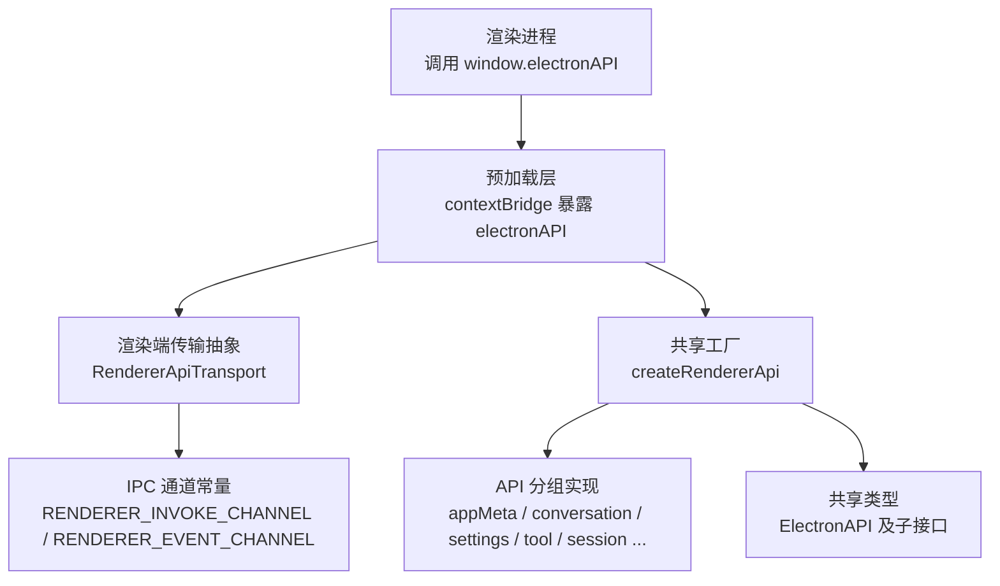
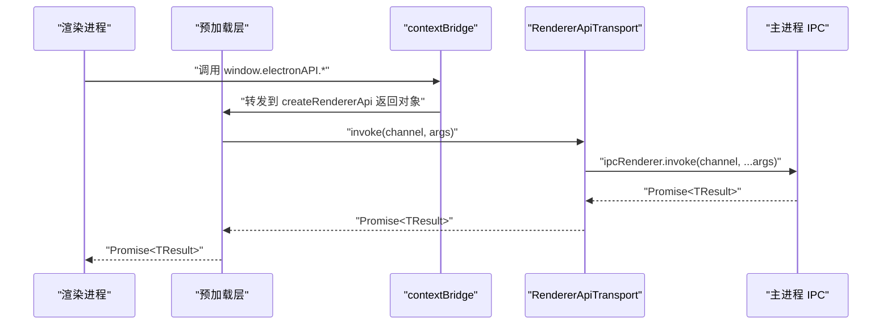
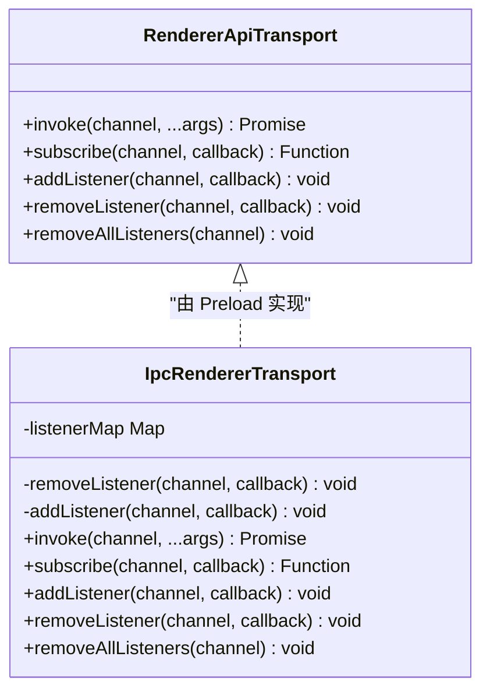
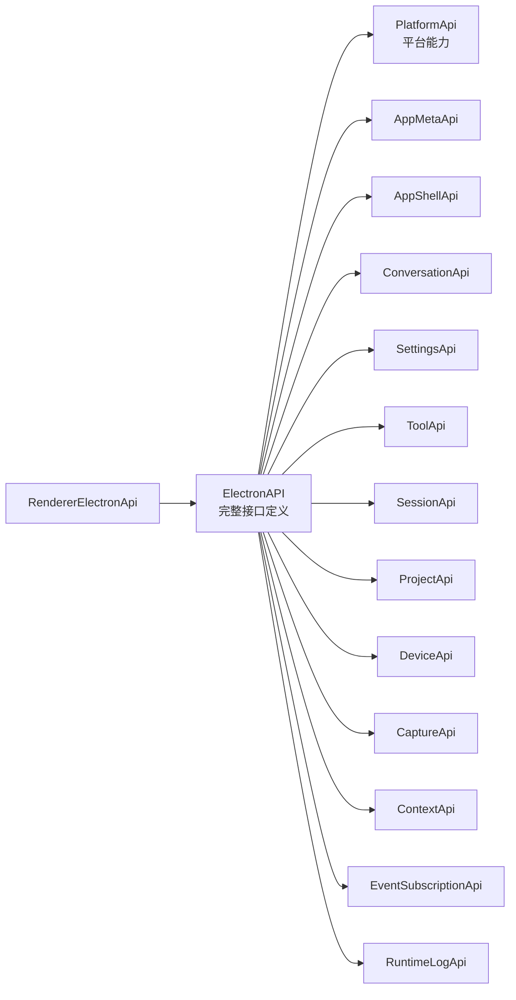
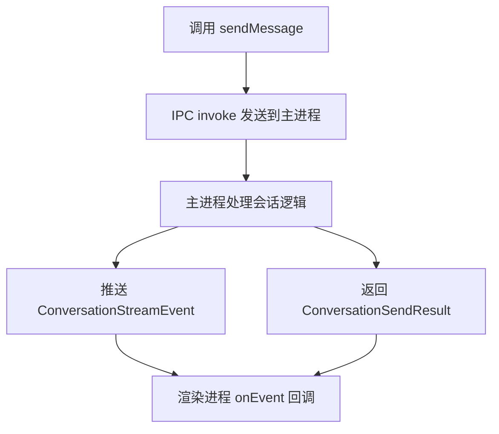
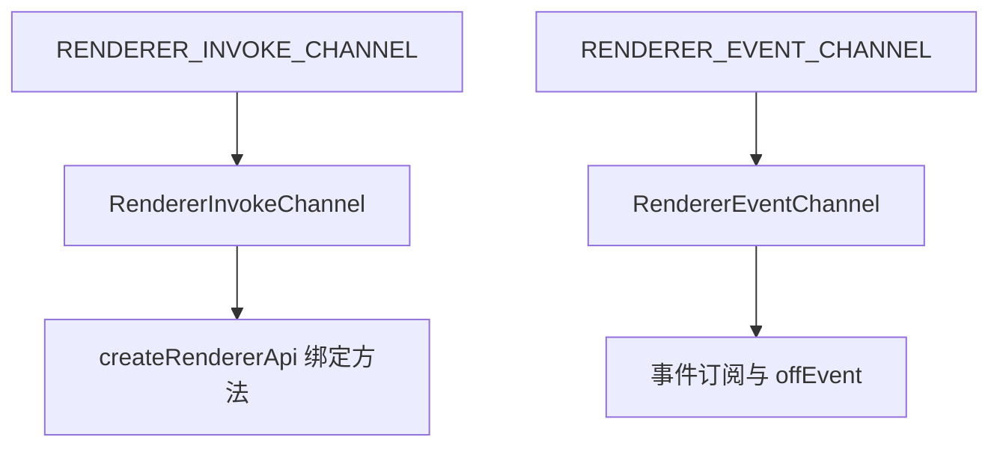
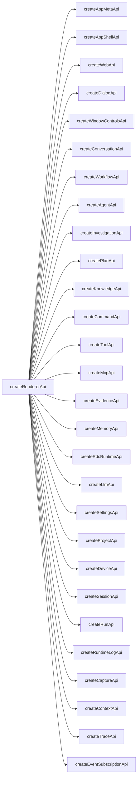
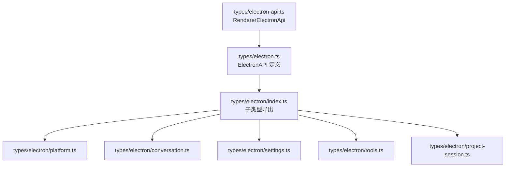

# Electron API 类型定义

<cite>
**本文引用的文件**   
- [preload/index.ts](file://src/preload/index.ts)
- [preload/rendererTransport.ts](file://src/preload/rendererTransport.ts)
- [shared/renderer-api/index.ts](file://src/shared/renderer-api/index.ts)
- [shared/renderer-api/createRendererApi.ts](file://src/shared/renderer-api/createRendererApi.ts)
- [shared/renderer-api/transport.ts](file://src/shared/renderer-api/transport.ts)
- [shared/renderer-api/channels.ts](file://src/shared/renderer-api/channels.ts)
- [shared/renderer-api/core.ts](file://src/shared/renderer-api/core.ts)
- [shared/renderer-api/settings.ts](file://src/shared/renderer-api/settings.ts)
- [shared/renderer-api/workbench.ts](file://src/shared/renderer-api/workbench.ts)
- [shared/types/electron-api.ts](file://src/shared/types/electron-api.ts)
- [shared/types/electron/index.ts](file://src/shared/types/electron/index.ts)
- [shared/types/electron/platform.ts](file://src/shared/types/electron/platform.ts)
- [shared/types/electron/conversation.ts](file://src/shared/types/electron/conversation.ts)
- [shared/types/electron/settings.ts](file://src/shared/types/electron/settings.ts)
- [shared/types/electron/tools.ts](file://src/shared/types/electron/tools.ts)
- [shared/types/electron/project-session.ts](file://src/shared/types/electron/project-session.ts)
- [shared/types/electron.ts](file://src/shared/types/electron.ts)
</cite>

## 目录

1. [简介](#简介)
2. [项目结构](#项目结构)
3. [核心组件](#核心组件)
4. [架构总览](#架构总览)
5. [详细组件分析](#详细组件分析)
6. [依赖关系分析](#依赖关系分析)
7. [性能与行为特性](#性能与行为特性)
8. [故障排查指南](#故障排查指南)
9. [结论](#结论)
10. [附录：调用约定与最佳实践](#附录调用约定与最佳实践)

## 简介

本文档面向使用 Electron 主进程、Preload 层和渲染进程的开发者，系统化说明本仓库中暴露给渲染进程的 `electronAPI` 类型契约。重点包括：

- 渲染进程通过 Preload 暴露的 `electronAPI` 对象及其所有 API 分组。
- 主进程与渲染进程之间的 IPC 通道名称、参数类型、返回值类型和错误处理约定。
- Preload 层的桥接机制、事件订阅模型和类型安全保证。
- `AppMetaApi`、`ConversationApi`、`SettingsApi`、`ToolApi`、`SessionApi` 等接口的方法边界、生命周期约束和使用模式。
- 异步调用、流式事件、资源申请与释放的最佳实践。

本项目的 Electron API 采用“共享类型 + Preload 桥接 + 渲染端工厂构造”的分层设计：真实类型定义集中在共享代码中，Preload 只负责将受控方法暴露到渲染进程上下文；渲染进程通过统一的 `RendererApiTransport` 抽象访问 IPC，而不直接依赖 `electron.ipcRenderer`。

## 项目结构

Electron API 相关代码主要分布在以下三个区域：

| 区域 | 职责 | 关键文件 |
|---|---|---|
| 预加载层 | 将受控 API 暴露到全局 `window.electronAPI` | `src/preload/index.ts`、`src/preload/rendererTransport.ts` |
| 共享渲染 API 实现 | 构造 `createRendererApi`，绑定通道、封装各 API 分组 | `src/shared/renderer-api/*` |
| 共享类型定义 | 定义 `ElectronAPI` 及各子接口类型 | `src/shared/types/electron*`、`src/shared/types/electron-api.ts` |

**图表来源**   
- [preload/index.ts:1-25](file://src/preload/index.ts#L1-L25)
- [shared/renderer-api/createRendererApi.ts:1-80](file://src/shared/renderer-api/createRendererApi.ts#L1-L80)
- [shared/renderer-api/channels.ts:1-271](file://src/shared/renderer-api/channels.ts#L1-L271)
- [shared/types/electron-api.ts:1-32](file://src/shared/types/electron-api.ts#L1-L32)

**章节来源**   
- [preload/index.ts:1-25](file://src/preload/index.ts#L1-L25)
- [shared/renderer-api/index.ts:1-17](file://src/shared/renderer-api/index.ts#L1-L17)
- [shared/types/electron-api.ts:1-32](file://src/shared/types/electron-api.ts#L1-L32)

## 核心组件

### 顶层对象：`electronAPI`

渲染进程可访问的全局对象是 `electronAPI`，其类型别名是 `RendererElectronApi`，最终等价于 `ElectronAPI`。它包含平台信息、多个功能模块、全局对话框快捷方法和原始事件订阅能力。

| 字段或分组 | 类型含义 | 主要用途 |
|---|---|---|
| `platform` | Node.js 平台标识 | 判断运行平台 |
| `isMac` | 布尔值 | Mac 平台判定 |
| `isWindows` | 布尔值 | Windows 平台判定 |
| `isLinux` | 布尔值 | Linux 平台判定 |
| `appMeta` | `AppMetaApi` | 应用元数据读取 |
| `appShell` | `AppShellApi` | 系统外壳交互 |
| `web` | Web 能力扩展 | 如解析 favicon |
| `conversation` | `ConversationApi` | 会话消息、分支、工具审批、附件 |
| `workflow` | `WorkflowApi` | 工作流状态、运行控制、用量查询 |
| `agent` | `AgentApi` | Agent 发送消息、状态管理 |
| `memory` | `MemoryApi` | 记忆读写与授权令牌 |
| `investigation` | `InvestigationApi` | 调查内容读取与列表 |
| `plan` | `PlanApi` | 计划读取、保存、导出、审批 |
| `knowledge` | `KnowledgeApi` | 知识库概览、查询、索引、导入导出 |
| `rdcRuntime` | RDC 运行时能力 | 资源校验、信任 Hook/MCP、快照 |
| `tool` | `ToolApi` | 工具目录、安装检测、运行时摘要 |
| `mcp` | `McpApi` | MCP 状态摘要 |
| `evidence` | `EvidenceApi` | 证据链与事件 |
| `llm` | `LlmApi` | LLM Provider 配置、连接、登录流程 |
| `settings` | `SettingsApi` | 设置、Provider Catalog、模型覆盖、Shell |
| `project` | `ProjectApi` | 项目增删改查与输入项管理 |
| `device` | `DeviceApi` | 设备列表、刷新、监听生命周期 |
| `session` | `SessionApi` | 会话创建、选择、重命名、删除、Agent 配置 |
| `run` | `RunApi` | 运行记录查询 |
| `runtimeLog` | `RuntimeLogApi` | 运行时日志查询 |
| `capture` | `CaptureApi` | 录制回放、帧刷新、事件注入 |
| `context` | `ContextApi` | 上下文读取 |
| `trace` | Trace 能力 | 运行、事件、投影、导出、分支切换 |
| `events` | `EventSubscriptionApi` | 事件订阅封装 |
| `windowControls` | `WindowControlsApi` | 窗口最小化、最大化、关闭 |
| `on` / `off` | 原始通道订阅 | 基于白名单的事件订阅 |
| 全局对话框方法 | `DialogApi` 片段 | `selectFiles`、`selectDirectory`、`saveFile` 等 |

**章节来源**   
- [shared/renderer-api/createRendererApi.ts:1-80](file://src/shared/renderer-api/createRendererApi.ts#L1-L80)
- [shared/types/electron-api.ts:1-32](file://src/shared/types/electron-api.ts#L1-L32)
- [shared/types/electron/index.ts:1-19](file://src/shared/types/electron/index.ts#L1-L19)

## 架构总览

Electron API 的整体调用路径如下：

**图表来源**   
- [preload/index.ts:1-25](file://src/preload/index.ts#L1-L25)
- [preload/rendererTransport.ts:1-44](file://src/preload/rendererTransport.ts#L1-L44)
- [shared/renderer-api/createRendererApi.ts:1-80](file://src/shared/renderer-api/createRendererApi.ts#L1-L80)
- [shared/renderer-api/transport.ts:1-11](file://src/shared/renderer-api/transport.ts#L1-L11)

### 预加载层职责

预加载脚本的职责非常克制：

1. 从共享模块构造 `electronAPI`。
2. 通过 `contextBridge.exposeInMainWorld('electronAPI', electronAPI)` 暴露到渲染进程。
3. 额外暴露 `rdcDesktop.getPathForFile(file)`，用于从 `File` 对象获取底层路径。
4. 不直接引入 Node 文件系统、路径或子进程模块。

这意味着渲染进程只能调用显式暴露的属性，而不是任意 Electron API。

**章节来源**   
- [preload/index.ts:1-25](file://src/preload/index.ts#L1-L25)

### 传输抽象与类型安全

`RendererApiTransport` 是渲染进程与 IPC 之间的唯一抽象：

| 方法 | 参数 | 返回值 | 语义 |
|---|---|---|---|
| `invoke` | 频道、可变参数 | `Promise<TResult>` | 请求-响应 IPC |
| `subscribe` | 频道、回调 | 取消函数 | 订阅并返回清理函数 |
| `addListener` | 频道、回调 | `void` | 添加事件监听 |
| `removeListener` | 频道、回调 | `void` | 移除指定监听 |
| `removeAllListeners` | 频道 | `void` | 清空频道监听 |

Preload 中的 `createIpcRendererTransport` 把该抽象适配为 `electron.ipcRenderer` 的具体实现，同时维护一个监听器映射表，避免重复注册和内存泄漏。

**图表来源**   
- [shared/renderer-api/transport.ts:1-11](file://src/shared/renderer-api/transport.ts#L1-L11)
- [preload/rendererTransport.ts:1-44](file://src/preload/rendererTransport.ts#L1-L44)

**章节来源**   
- [shared/renderer-api/transport.ts:1-11](file://src/shared/renderer-api/transport.ts#L1-L11)
- [preload/rendererTransport.ts:1-44](file://src/preload/rendererTransport.ts#L1-L44)

## 详细组件分析

### 类型继承与暴露关系

本项目没有传统面向对象继承，而是以“共享类型引用 + 工厂实现 + 统一入口”的方式组织类型契约：

**图表来源**   
- [shared/types/electron.ts:149-260](file://src/shared/types/electron.ts#L149-L260)
- [shared/types/electron-api.ts:1-32](file://src/shared/types/electron-api.ts#L1-L32)
- [shared/types/electron/platform.ts:1-8](file://src/shared/types/electron/platform.ts#L1-L8)
- [shared/types/electron/conversation.ts:1-3](file://src/shared/types/electron/conversation.ts#L1-L3)
- [shared/types/electron/settings.ts:1-4](file://src/shared/types/electron/settings.ts#L1-L4)
- [shared/types/electron/tools.ts:1-5](file://src/shared/types/electron/tools.ts#L1-L5)
- [shared/types/electron/project-session.ts:1-8](file://src/shared/types/electron/project-session.ts#L1-L8)

`RendererElectronApi` 就是 `ElectronAPI` 的类型别名，因此渲染进程拿到的 `electronAPI` 可直接按 `ElectronAPI` 类型使用。

**章节来源**   
- [shared/types/electron-api.ts:1-32](file://src/shared/types/electron-api.ts#L1-L32)
- [shared/types/electron/index.ts:1-19](file://src/shared/types/electron/index.ts#L1-L19)

### AppMetaApi

`AppMetaApi` 提供应用元数据读取能力，对应 `ElectronAPI['appMeta']`。

| 方法 | 参数 | 返回值 | 说明 |
|---|---|---|---|
| `get` | 无 | `Promise<{ version; productName; systemTheme; testMode }>` | 获取应用版本、产品名称、系统主题、测试模式等元数据 |

实现通过 `INVOKE.shell.getAppMeta` 通道调用主进程。

**章节来源**   
- [shared/types/electron/platform.ts:1-8](file://src/shared/types/electron/platform.ts#L1-L8)
- [shared/renderer-api/core.ts:1-40](file://src/shared/renderer-api/core.ts#L1-L40)
- [shared/types/electron.ts:149-178](file://src/shared/types/electron.ts#L149-L178)

### AppShellApi

`AppShellApi` 封装系统外壳能力，包括引导提示、头像、路径打开、剪贴板、Web 能力等。

| 方法 | 参数 | 返回值 | 说明 |
|---|---|---|---|
| `hasSeenGettingStarted` | 无 | `Promise<boolean>` | 是否已看过引导 |
| `acknowledgeGettingStarted` | 无 | `Promise<void>` | 标记已看过引导 |
| `selectAvatar` | 无 | `Promise<string \| null>` | 选择头像 |
| `getAvatarDataUrl` | `avatarPath: string` | `Promise<string \| null>` | 根据头像路径生成 Data URL |
| `openPath` | `targetPath: string` | `Promise<{ success; error? }>` | 打开系统路径 |
| `copyText` | `text: string` | `Promise<{ success }>` | 复制文本到剪贴板 |
| `readClipboardText` | 无 | `Promise<{ success; text }>` | 读取剪贴板文本 |

`AppShellApi` 的 `openPath`、`copyText`、`readClipboardText` 等方法返回结构化结果，成功与否通过 `success` 字段表达，失败信息可选放在 `error` 字段。

**章节来源**   
- [shared/types/electron/platform.ts:1-8](file://src/shared/types/electron/platform.ts#L1-L8)
- [shared/renderer-api/core.ts:1-40](file://src/shared/renderer-api/core.ts#L1-L40)
- [shared/types/electron.ts:178-212](file://src/shared/types/electron.ts#L178-L212)

### Web 能力

`web.resolveFavicon(domain)` 用于解析域名对应的 favicon。

| 方法 | 参数 | 返回值 | 说明 |
|---|---|---|---|
| `resolveFavicon` | `domain: string` | `Promise<{ dataUrl: string \| null }>` | 解析 favicon Data URL |

**章节来源**   
- [shared/renderer-api/core.ts:1-40](file://src/shared/renderer-api/core.ts#L1-L40)
- [shared/types/electron.ts:212-220](file://src/shared/types/electron.ts#L212-L220)

### DialogApi 与全局对话框方法

`DialogApi` 是 `ElectronAPI` 上部分对话框方法的类型切片，同时 `createRendererApi` 也把这些方法直接挂载到根级对象上，方便渲染进程直接调用。

| 方法 | 参数 | 返回值 | 说明 |
|---|---|---|---|
| `selectFiles` | 无 | `Promise<string[] \| null>` | 选择文件 |
| `selectRdcFiles` | 无 | `Promise<string[] \| null>` | 选择 RDC 文件 |
| `selectKnowledgeImport` | 无 | `Promise<string \| null>` | 选择知识库导入路径 |
| `selectDirectory` | 无 | `Promise<string \| null>` | 选择目录 |
| `saveFile` | `{ defaultFileName; extension }` | `Promise<string \| null>` | 保存文件 |

这些方法对应 `INVOKE.shell.selectFiles`、`INVOKE.shell.saveFile` 等通道。

**章节来源**   
- [shared/types/electron/platform.ts:1-8](file://src/shared/types/electron/platform.ts#L1-L8)
- [shared/renderer-api/core.ts:1-40](file://src/shared/renderer-api/core.ts#L1-L40)
- [shared/renderer-api/createRendererApi.ts:1-80](file://src/shared/renderer-api/createRendererApi.ts#L1-L80)
- [shared/types/electron.ts:220-230](file://src/shared/types/electron.ts#L220-L230)

### WindowControlsApi

| 方法 | 参数 | 返回值 | 说明 |
|---|---|---|---|
| `minimize` | 无 | `Promise<void>` | 最小化窗口 |
| `toggleMaximize` | 无 | `Promise<void>` | 切换最大化 |
| `close` | 无 | `Promise<void>` | 关闭窗口 |
| `isMaximized` | 无 | `Promise<boolean>` | 是否处于最大化状态 |

**章节来源**   
- [shared/types/electron/platform.ts:1-8](file://src/shared/types/electron/platform.ts#L1-L8)
- [shared/renderer-api/core.ts:1-40](file://src/shared/renderer-api/core.ts#L1-L40)
- [shared/types/electron.ts:230-245](file://src/shared/types/electron.ts#L230-L245)

### ConversationApi

`ConversationApi` 是会话能力的核心接口，负责消息发送、改写、中断、用户输入回答、工具审批、计划审查、历史记录、分支切换、附件暂存、预览以及事件流。

| 方法 | 参数 | 返回值 | 说明 |
|---|---|---|---|
| `sendMessage` | `ConversationSendRequest` | `Promise<ConversationSendResult>` | 发送消息 |
| `rewriteFromMessage` | `ConversationRewriteFromMessageRequest` | `Promise<ConversationTurnResult>` | 基于历史消息改写 |
| `cancelActiveTurn` | `ConversationCancelActiveTurnRequest?` | `Promise<ConversationCancelActiveTurnResult>` | 取消当前回合 |
| `answerUserInput` | `ConversationAnswerUserInputRequest` | `Promise<ConversationAnswerUserInputResult>` | 回答用户输入问题 |
| `answerToolApproval` | `ConversationAnswerToolApprovalRequest` | `Promise<ConversationAnswerToolApprovalResult>` | 回复工具审批 |
| `answerPlanReview` | `ConversationAnswerPlanReviewRequest` | `Promise<ConversationAnswerPlanReviewResult>` | 回复计划审查 |
| `getHistory` | `sessionId: string` | `Promise<{ messages; branchState? }>` | 获取会话历史 |
| `getDelegationTrace` | 委托追踪请求 | `Promise<DelegationTracePage>` | 获取工具委托追踪分页 |
| `getDelegationContent` | 委托内容请求 | `Promise<DelegationContentPage>` | 获取委托内容分页 |
| `switchBranch` | `ConversationSwitchBranchRequest` | `Promise<ConversationSwitchBranchResult>` | 切换分支 |
| `clearHistory` | `sessionId: string` | `Promise<{ success; messages; error? }>` | 清空历史 |
| `undoLastTurn` | `sessionId: string` | `Promise<{ success; messages; error? }>` | 撤销最后回合 |
| `getToolImagePreview` | `{ sessionId; previewId }` | `Promise<{ dataUrl; error? }>` | 获取工具图片预览 |
| `stageAttachments` | `ConversationStageAttachmentsRequest` | `ConversationStageAttachmentsResult` | 暂存附件 |
| `releaseAttachments` | `ConversationReleaseAttachmentsRequest` | `ConversationReleaseAttachmentsResult` | 释放附件 |
| `getAttachmentPreview` | `ConversationGetAttachmentPreviewRequest` | `ConversationGetAttachmentPreviewResult` | 获取附件预览 |
| `onEvent` | `(event) => void` | `void` | 订阅会话事件流 |
| `offEvent` | `(event) => void` | `void` | 取消订阅 |

#### 异步操作模式

`ConversationApi` 同时支持两种异步模式：

1. **请求-响应**：例如 `sendMessage`、`getHistory`、`switchBranch` 等返回 `Promise`。
2. **事件流**：通过 `onEvent` 订阅 `ConversationStreamEvent`，用于接收消息流式更新、诊断、任务、工具执行等实时状态。

**图表来源**   
- [shared/renderer-api/core.ts:40-100](file://src/shared/renderer-api/core.ts#L40-L100)
- [shared/types/electron.ts:220-260](file://src/shared/types/electron.ts#L220-L260)

#### 错误处理

对话 API 的错误通常出现在两类地方：

- 结构化结果中的可选 `error` 字段，例如 `clearHistory`、`undoLastTurn`、`getToolImagePreview`。
- Promise 异常，例如主进程抛出未捕获错误或 IPC 序列化失败。

调用方应优先检查结构化返回体中的 `success` 和 `error`，再对 Promise 做 try/catch。

**章节来源**   
- [shared/types/electron/conversation.ts:1-3](file://src/shared/types/electron/conversation.ts#L1-L3)
- [shared/renderer-api/core.ts:40-100](file://src/shared/renderer-api/core.ts#L40-L100)
- [shared/types/electron.ts:220-260](file://src/shared/types/electron.ts#L220-L260)

### SettingsApi

`SettingsApi` 负责应用设置、Provider Catalog、有效模型、模型覆盖、Shell 解析和设置持久化。

| 方法 | 参数 | 返回值 | 说明 |
|---|---|---|---|
| `get` | 无 | `Promise<...>` | 读取基础设置 |
| `getProviderCatalog` | 无 | `Promise<...>` | 读取 Provider 目录 |
| `getEffectiveModel` | `agentId` | `Promise<...>` | 获取 Agent 的有效模型 |
| `getEffectiveCatalog` | `providerId`, `accountId?` | `Promise<...>` | 获取有效 Provider Catalog |
| `hasProviderSecret` | `providerId` | `Promise<boolean>` | 判断 Provider 是否有密钥 |
| `importAgentManifest` | `filePath` | `Promise<...>` | 导入 Agent 清单 |
| `saveAgentDefinition` | `request` | `Promise<...>` | 保存 Agent 定义 |
| `getAgentDefinitionCommit` | `query` | `Promise<...>` | 查询 Agent 定义提交 |
| `saveProviderDefinition` | `request` | `Promise<...>` | 保存 Provider 定义 |
| `getProviderDefinitionCommit` | `providerId` | `Promise<...>` | 查询 Provider 定义提交 |
| `getModelsOverride` | 无 | `Promise<...>` | 读取模型覆盖 |
| `setModelsOverride` | `overrides` | `Promise<...>` | 写入模型覆盖 |
| `getResolvedShell` | `executable` | `Promise<...>` | 解析 Shell 可执行路径 |
| `set` | `settings` | `Promise<...>` | 写入设置 |

其中 `getEffectiveCatalog` 在传入空字符串或不传 accountId 时走单参数通道，否则走双参数通道。这是渲染端为了兼容不同主进程签名而做的条件分发。

**章节来源**   
- [shared/types/electron/settings.ts:1-4](file://src/shared/types/electron/settings.ts#L1-L4)
- [shared/renderer-api/settings.ts:1-86](file://src/shared/renderer-api/settings.ts#L1-L86)
- [shared/types/electron.ts:245-300](file://src/shared/types/electron.ts#L245-L300)

### ToolApi、McpApi、EvidenceApi

| API | 方法 | 参数 | 返回值 | 说明 |
|---|---|---|---|---|
| `ToolApi` | `getCatalog` | 无 | `Promise<...>` | 获取工具目录 |
| `ToolApi` | `getRuntimeSummary` | 无 | `Promise<...>` | 获取工具运行时摘要 |
| `ToolApi` | `detectInstallations` | 无 | `Promise<...>` | 检测本地安装 |
| `ToolApi` | `resolveInstallation` | `request` | `Promise<...>` | 解析安装路径 |
| `ToolApi` | `verifyInstallation` | `request` | `Promise<...>` | 验证安装 |
| `McpApi` | `getStatusSummary` | 无 | `Promise<...>` | 获取 MCP 状态摘要 |
| `EvidenceApi` | `getChain` | 无 | `Promise<...>` | 获取证据链 |
| `EvidenceApi` | `getEvents` | `eventType` | `Promise<...>` | 获取证据事件 |

**章节来源**   
- [shared/types/electron/tools.ts:1-5](file://src/shared/types/electron/tools.ts#L1-L5)
- [shared/renderer-api/core.ts:100-167](file://src/shared/renderer-api/core.ts#L100-L167)
- [shared/types/electron.ts:300-360](file://src/shared/types/electron.ts#L300-L360)

### SessionApi

`SessionApi` 管理项目下的会话集合，包括列表、创建、重命名、删除、选择、模型覆盖、Agent ID 设置和声明式交接。

| 方法 | 参数 | 返回值 | 说明 |
|---|---|---|---|
| `list` | `projectId` | `Promise<...>` | 列出项目会话 |
| `create` | `projectId; title` | `Promise<...>` | 创建会话 |
| `rename` | `id; title` | `Promise<...>` | 重命名会话 |
| `remove` | `id` | `Promise<...>` | 删除会话 |
| `select` | `id` | `Promise<...>` | 选中会话 |
| `setModelOverride` | `id; modelOverride` | `Promise<...>` | 设置会话模型覆盖 |
| `setAgentId` | `id; agentId` | `Promise<...>` | 设置会话 Agent |
| `applyDeclaredHandoff` | `id; agent; label` | `Promise<...>` | 应用声明式交接 |

**章节来源**   
- [shared/types/electron/project-session.ts:1-8](file://src/shared/types/electron/project-session.ts#L1-L8)
- [shared/renderer-api/workbench.ts:1-99](file://src/shared/renderer-api/workbench.ts#L1-L99)
- [shared/types/electron.ts:360-430](file://src/shared/types/electron.ts#L360-L430)

### 其他工作区 API

| API | 主要职责 | 典型方法 |
|---|---|---|
| `ProjectApi` | 项目与项目输入项管理 | `list`、`add`、`select`、`rename`、`remove`、`inputs.*` |
| `DeviceApi` | 设备枚举与监听 | `list`、`refresh`、`watchStart`、`watchRenew`、`watchStop` |
| `RunApi` | 运行记录查询 | `list(sessionId)` |
| `RuntimeLogApi` | 运行时日志查询 | `list(request)` |
| `CaptureApi` | 录制回放与帧刷新 | `getReplaySelection`、`readLivePreview`、`getReplayState`、`applyReplayEvent`、`refreshFrame`、`list`、`select`、`openProjectInput`、`getOpenedState`、`clearOpenedState` |
| `ContextApi` | 上下文读取 | `get(scope)` |
| `Trace` | 运行追踪、事件、投影、导出、分支切换 | `getRun`、`getEvents`、`getProjection`、`exportRun`、`switchBranch` |

**章节来源**   
- [shared/renderer-api/workbench.ts:1-99](file://src/shared/renderer-api/workbench.ts#L1-L99)
- [shared/types/electron/project-session.ts:1-8](file://src/shared/types/electron/project-session.ts#L1-L8)
- [shared/types/electron.ts:430-520](file://src/shared/types/electron.ts#L430-L520)

## 依赖关系分析

### IPC 通道分类

IPC 通道分为两类：

| 类别 | 类型 | 用途 | 示例 |
|---|---|---|---|
| 调用通道 | `RendererInvokeChannel` | 请求-响应 | `app:getMeta`、`conversation:sendMessage`、`settings:get` |
| 事件通道 | `RendererEventChannel` | 主进程向渲染进程推送事件 | `conversation:event`、`agent:message`、`workflow:runStatusChanged` |

通道常量集中定义在 `channels.ts`，并通过 `as const` 保证类型安全。`isRendererInvokeChannel` 和 `isRendererEventChannel` 可用于运行时白名单校验。

**图表来源**   
- [shared/renderer-api/channels.ts:1-271](file://src/shared/renderer-api/channels.ts#L1-L271)

**章节来源**   
- [shared/renderer-api/channels.ts:1-271](file://src/shared/renderer-api/channels.ts#L1-L271)

### 工厂装配关系

`createRendererApi` 是所有 API 分组的装配中心：

**图表来源**   
- [shared/renderer-api/createRendererApi.ts:1-80](file://src/shared/renderer-api/createRendererApi.ts#L1-L80)
- [shared/renderer-api/core.ts:1-167](file://src/shared/renderer-api/core.ts#L1-L167)
- [shared/renderer-api/settings.ts:1-86](file://src/shared/renderer-api/settings.ts#L1-L86)
- [shared/renderer-api/workbench.ts:1-99](file://src/shared/renderer-api/workbench.ts#L1-L99)

### 类型依赖链

**图表来源**   
- [shared/types/electron-api.ts:1-32](file://src/shared/types/electron-api.ts#L1-L32)
- [shared/types/electron/index.ts:1-19](file://src/shared/types/electron/index.ts#L1-L19)
- [shared/types/electron.ts:149-260](file://src/shared/types/electron.ts#L149-L260)

**章节来源**   
- [shared/renderer-api/createRendererApi.ts:1-80](file://src/shared/renderer-api/createRendererApi.ts#L1-L80)
- [shared/types/electron-api.ts:1-32](file://src/shared/types/electron-api.ts#L1-L32)
- [shared/types/electron/index.ts:1-19](file://src/shared/types/electron/index.ts#L1-L19)

## 性能与行为特性

### 异步调用模型

所有 IPC 调用都通过 `ipcRenderer.invoke` 返回 Promise。渲染端应避免在高频 UI 路径中进行阻塞式同步等待，而应使用 async/await 或 `.then/.catch` 处理完成态和异常态。

### 事件订阅模型

事件订阅通过 `RendererApiTransport.subscribe` 或 `transport.addListener/removeListener` 管理。Preload 内部维护监听器映射表，`removeAllListeners` 会同时清理映射表和 IPC 监听器。

推荐做法：

- 使用 `subscribe` 返回的取消函数进行清理。
- 对于复杂组件，在卸载生命周期中调用 `offEvent` 或 `removeListener`。
- 避免重复订阅同一频道，除非业务需要多实例监听。

### 通道白名单

`createRendererApi` 暴露的 `on` 和 `off` 方法会对频道进行 `isRendererEventChannel` 白名单校验。如果传入非法频道，不会注册监听器，从而防止渲染进程随意订阅未知事件。

### 可选参数与条件分发

某些 API 会根据可选参数调整 IPC 调用方式。例如 `rdcRuntime.getOverview` 在没有 `projectRoot` 时不传递该参数；`settings.getEffectiveCatalog` 根据 `accountId` 是否为空字符串决定调用单参数还是双参数通道。这类实现细节应在调用方保持类型正确，不要依赖隐式默认值绕过主进程签名。

**章节来源**   
- [preload/rendererTransport.ts:1-44](file://src/preload/rendererTransport.ts#L1-L44)
- [shared/renderer-api/channels.ts:201-271](file://src/shared/renderer-api/channels.ts#L201-L271)
- [shared/renderer-api/settings.ts:1-86](file://src/shared/renderer-api/settings.ts#L1-L86)
- [shared/renderer-api/workbench.ts:1-99](file://src/shared/renderer-api/workbench.ts#L1-L99)

## 故障排查指南

### 渲染进程无法访问 `window.electronAPI`

可能原因：

- Preload 脚本未正确加载。
- `contextBridge.exposeInMainWorld` 被替换或未执行。
- 渲染进程启用了严格沙箱且未正确配置 preload。

定位建议：

- 检查 `preload/index.ts` 是否导出并暴露 `electronAPI`。
- 确认渲染进程 HTML 或启动配置中 preload 路径指向正确的打包产物。

**章节来源**   
- [preload/index.ts:1-25](file://src/preload/index.ts#L1-L25)

### 调用返回 `undefined` 或 Promise 未 resolve

可能原因：

- 主进程未注册对应 IPC handler。
- 通道名称不一致。
- 参数顺序或类型不匹配导致序列化失败。
- 主进程 Promise 未返回或抛出异常。

定位建议：

- 对照 `channels.ts` 中的 `RENDERER_INVOKE_CHANNEL`。
- 对照 `createRendererApi` 中每个方法使用的通道。
- 检查主进程 IPC 处理器是否返回 Promise。

**章节来源**   
- [shared/renderer-api/channels.ts:1-200](file://src/shared/renderer-api/channels.ts#L1-L200)
- [shared/renderer-api/createRendererApi.ts:1-80](file://src/shared/renderer-api/createRendererApi.ts#L1-L80)

### 事件不触发或重复触发

可能原因：

- 未正确调用 `offEvent` 或 `removeListener`。
- 多次订阅同一频道。
- 传入非法频道被 `on`/`off` 白名单过滤。

定位建议：

- 使用 `RENDERER_EVENT_CHANNEL` 中的合法频道。
- 使用 `isRendererEventChannel` 校验频道。
- 使用 `subscribe` 返回的取消函数或在组件卸载时清理。

**章节来源**   
- [preload/rendererTransport.ts:1-44](file://src/preload/rendererTransport.ts#L1-L44)
- [shared/renderer-api/channels.ts:201-271](file://src/shared/renderer-api/channels.ts#L201-L271)

### 结构化返回体显示失败

许多 API 返回结构中包含 `success` 和可选 `error`。即使 Promise 未 reject，业务仍可能失败。

常见场景：

- `openPath` 打开路径失败。
- `clearHistory` 清空历史失败。
- `undoLastTurn` 撤销失败。
- `getToolImagePreview` 获取预览失败。

处理建议：

- 先检查 `success`。
- 若存在 `error`，展示用户可读错误。
- 对 Promise 外层做 try/catch，处理网络、IPC、主进程异常。

**章节来源**   
- [shared/types/electron.ts:178-260](file://src/shared/types/electron.ts#L178-L260)

## 结论

本项目的 Electron API 类型定义以共享类型为中心，通过 Preload 层暴露最小权限接口，并通过 `createRendererApi` 将所有功能分组装配成统一的 `electronAPI`。类型契约集中在 `types/electron.ts` 和相关子文件中，调用实现集中在 `shared/renderer-api/*`，通道常量集中在 `channels.ts`。

这种设计的主要优势是：

- 类型定义与实现解耦，便于跨进程保持一致。
- 渲染进程只能通过受控 API 访问主进程能力。
- 事件通道和调用通道都有集中定义和白名单校验。
- 异步调用、事件订阅、结构化错误共同构成清晰的通信契约。

在使用时，应优先遵循类型定义、检查结构化返回体中的错误字段，并在组件生命周期内正确清理事件监听器。

## 附录：调用约定与最佳实践

### 基本调用示例（描述性）

- 获取应用元数据：调用 `electronAPI.appMeta.get()`，得到包含版本、产品名称、系统主题和测试模式的对象。
- 打开系统路径：调用 `electronAPI.appShell.openPath(path)`，检查返回对象的 `success` 和可选 `error`。
- 发送会话消息：调用 `electronAPI.conversation.sendMessage(request)`，并根据返回结果处理下一步 UI。
- 订阅会话事件：调用 `electronAPI.conversation.onEvent(callback)`，在组件卸载时调用 `offEvent` 清理。
- 设置模型覆盖：调用 `electronAPI.settings.setModelsOverride(overrides)`，并在保存成功后刷新界面。
- 选择文件：调用根级 `electronAPI.selectFiles()`，根据返回的文件路径数组更新编辑器或附件面板。

### 异步操作模式

| 模式 | 适用场景 | 推荐处理方式 |
|---|---|---|
| Promise 调用 | 单次 IPC 请求 | async/await + try/catch |
| 结构化结果 | 可能成功但业务失败 | 检查 `success` 和 `error` |
| 事件流 | 长生命周期的状态推送 | `onEvent` + `offEvent` 或 `subscribe` 返回取消函数 |
| 条件参数 | 可选参数影响通道签名 | 按类型传入，不要省略必要参数 |

### 生命周期管理建议

- 应用初始化时获取平台信息和应用元数据。
- 页面或组件挂载后订阅所需事件。
- 页面或组件卸载前清理所有事件监听。
- 涉及文件或会话的操作完成后，释放附件或恢复 UI 状态。
- 对敏感设置修改操作增加二次确认和错误提示。

**章节来源**   
- [shared/renderer-api/createRendererApi.ts:1-80](file://src/shared/renderer-api/createRendererApi.ts#L1-L80)
- [shared/renderer-api/core.ts:1-167](file://src/shared/renderer-api/core.ts#L1-L167)
- [shared/renderer-api/settings.ts:1-86](file://src/shared/renderer-api/settings.ts#L1-L86)
- [shared/renderer-api/workbench.ts:1-99](file://src/shared/renderer-api/workbench.ts#L1-L99)
- [shared/types/electron.ts:149-520](file://src/shared/types/electron.ts#L149-L520)