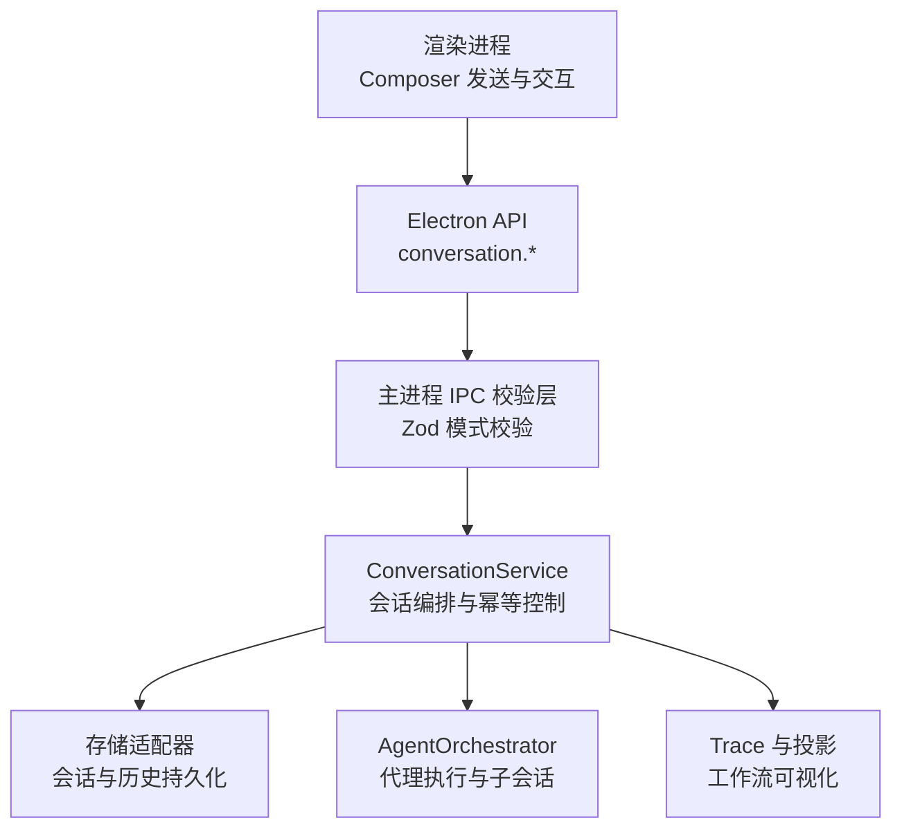
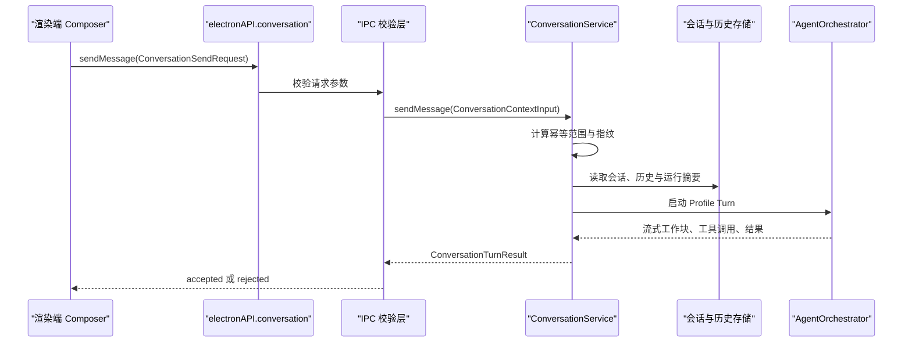
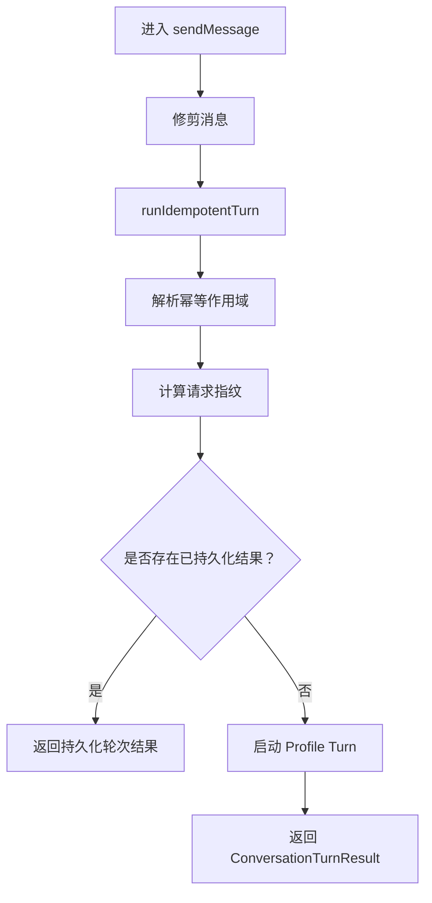
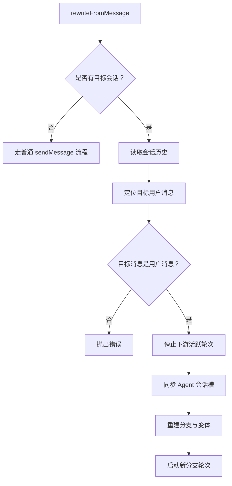
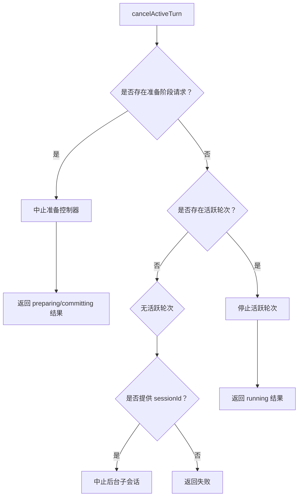
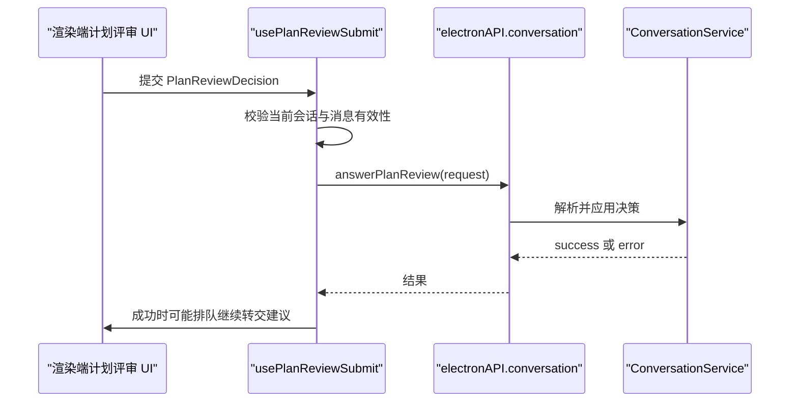
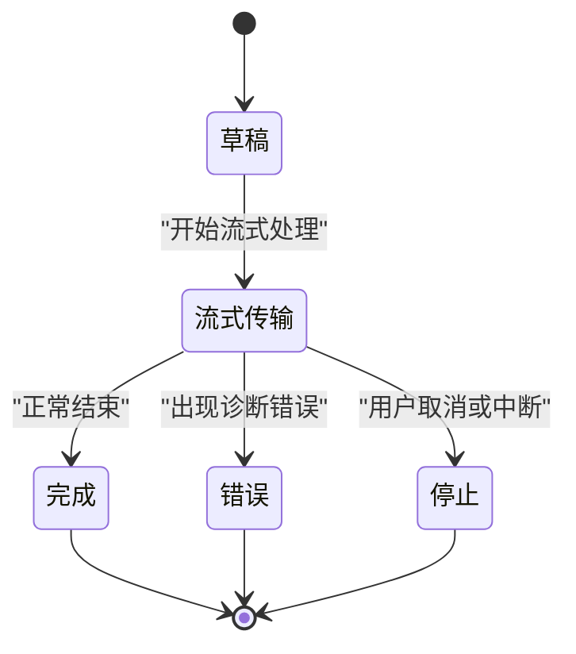
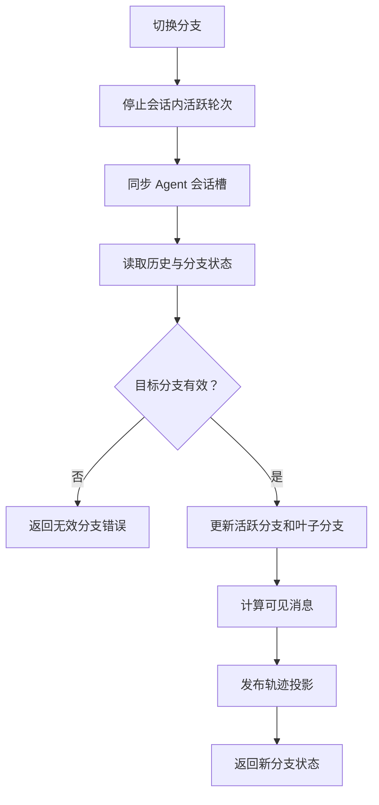
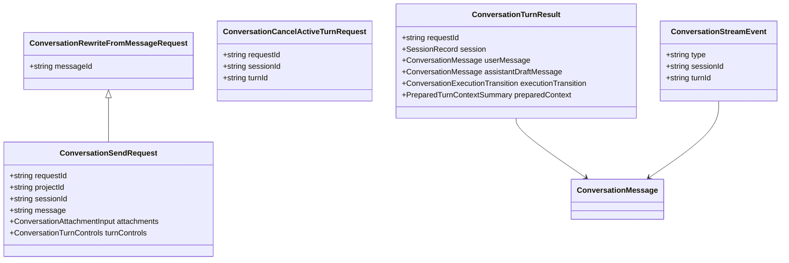

# 对话 API 类型定义

<cite>
**本文引用的文件**   
- [conversation.ts](file://src/shared/types/conversation.ts)
- [planReview.ts](file://src/shared/types/planReview.ts)
- [conversationSchemas.ts](file://src/main/ipc/validation/conversationSchemas.ts)
- [ConversationService.ts](file://src/main/conversation/ConversationService.ts)
- [projectSessionHandlers.ts](file://src/main/ipc/projectSessionHandlers.ts)
- [composerSendFlow.ts](file://src/renderer/features/composer/composerSendFlow.ts)
- [useUserInputRequestSubmit.ts](file://src/renderer/features/composer/useUserInputRequestSubmit.ts)
- [usePlanReviewSubmit.ts](file://src/renderer/features/composer/usePlanReviewSubmit.ts)
</cite>

## 目录

1. [引言](#引言)
2. [项目结构定位](#项目结构定位)
3. [核心接口与数据模型](#核心接口与数据模型)
4. [架构总览](#架构总览)
5. [方法契约详解](#方法契约详解)
6. [会话生命周期与流式事件](#会话生命周期与流式事件)
7. [分支切换机制](#分支切换机制)
8. [依赖关系分析](#依赖关系分析)
9. [性能与健壮性特征](#性能与健壮性特征)
10. [故障排查指南](#故障排查指南)
11. [结论](#结论)

## 引言

本文面向需要在渲染进程或外部集成方使用对话能力的开发者，系统梳理 `ConversationApi` 的类型契约。重点包括：

- `sendMessage`、`rewriteFromMessage`、`cancelActiveTurn`、`answerUserInput`、`answerToolApproval`、`answerPlanReview` 等方法的方法签名、参数约束和返回值语义。
- `ConversationSendRequest`、`ConversationRewriteFromMessageRequest`、`ConversationCancelActiveTurnRequest`、`ConversationTurnResult`、`ConversationStreamEvent` 等关键数据结构的字段含义。
- 消息状态、工作块、工具调用、委托追踪、计划评审和用户输入交互的生命周期。
- 会话历史管理、附件暂存、请求幂等、分支创建与分支切换的使用流程。

该文档不直接粘贴源代码内容，而是通过类型定义文件和实现文件的引用路径说明行为来源。

## 项目结构定位

对话 API 的类型定义集中在共享类型模块中；IPC 层校验逻辑在 main 进程的 IPC 校验文件中；实际业务编排由 `ConversationService` 完成；渲染端通过 Electron API 调用并消费流式事件。

**图表来源**
- [ConversationService.ts:1-120](file://src/main/conversation/ConversationService.ts#L1-L120)
- [conversationSchemas.ts:1-199](file://src/main/ipc/validation/conversationSchemas.ts#L1-L199)
- [composerSendFlow.ts:1-120](file://src/renderer/features/composer/composerSendFlow.ts#L1-L120)

**章节来源**
- [ConversationService.ts:1-120](file://src/main/conversation/ConversationService.ts#L1-L120)
- [conversationSchemas.ts:1-199](file://src/main/ipc/validation/conversationSchemas.ts#L1-L199)
- [composerSendFlow.ts:1-120](file://src/renderer/features/composer/composerSendFlow.ts#L1-L120)

## 核心接口与数据模型

### 发送请求模型

`ConversationSendRequest` 是发起一轮对话的核心入参对象，包含会话上下文、用户消息、附件、技能预加载、轮次控制和配置快照。

| 字段 | 类型 | 必填 | 约束与语义 |
|---|---|---:|---|
| `requestId` | `string` | 是 | 客户端生成的请求唯一标识，用于幂等去重和取消定位。 |
| `projectId` | `string \| null \| undefined` | 否 | 所属项目标识；未显式传入时可能回退到当前项目。 |
| `sessionId` | `string \| null \| undefined` | 否 | 所属会话标识；为空时可能创建新会话。 |
| `currentRunId` | `string \| null \| undefined` | 否 | 当前运行摘要标识，用于关联最新轮次。 |
| `replayDeviceId` | `string \| null \| undefined` | 否 | 回放设备标识，影响运行时上下文解析。 |
| `agentId` | `string \| null \| undefined` | 否 | 所选 Agent 标识。 |
| `profileId` | `string \| null \| undefined` | 否 | 所选 Profile 标识，通常与 `agentId` 共同决定路由。 |
| `message` | `string` | 是 | 用户文本消息，服务端会修剪首尾空白。 |
| `attachments` | `ConversationAttachmentInput[]` | 否 | 最多 32 个附件输入；每个附件受 IPC 模式长度限制。 |
| `preloadSkillIds` | `string[]` | 否 | Composer 预加载的 skill 标识列表。 |
| `turnControls` | `ConversationTurnControls` | 是 | 推理级别、最大上下文模式、快速模型等轮次控制开关。 |
| `configurationCommit` | 配置对象 | 否 | 渲染端在发送前观察到的精确配置快照，用于重启后幂等匹配。 |

`ConversationAttachmentInput` 支持三种形式的附件描述：

- 带材料上下文的附件。
- 基于源路径的附件。
- 基于 Base64 字节流的附件（通过 IPC 校验模式限定最大长度）。

IPC 校验还限制附件数量最多为 32，且单个附件元信息有明确字符串长度上限。

**章节来源**
- [conversation.ts:330-440](file://src/shared/types/conversation.ts#L330-L440)
- [conversationSchemas.ts:12-110](file://src/main/ipc/validation/conversationSchemas.ts#L12-L110)

### 改写请求模型

`ConversationRewriteFromMessageRequest` 继承自 `ConversationSendRequest`，并增加 `messageId` 字段，表示“从某条已有用户消息重新发起”。

| 字段 | 类型 | 必填 | 语义 |
|---|---|---:|---|
| `messageId` | `string` | 是 | 要编辑并重新发送的用户消息标识。 |
| 其他字段 | 同 `ConversationSendRequest` | 按继承规则 | 决定新分支的目标会话、Agent、Profile、消息内容和附件。 |

当目标会话不存在时，改写逻辑会退化为普通发送；当存在时，它会终止下游活跃轮次，创建新的分支变体，并把旧分支作为父分支锚点。

**章节来源**
- [conversation.ts:420-460](file://src/shared/types/conversation.ts#L420-L460)
- [ConversationService.ts:520-700](file://src/main/conversation/ConversationService.ts#L520-L700)

### 取消请求模型

`ConversationCancelActiveTurnRequest` 允许按请求、会话或轮次粒度取消。

| 字段 | 类型 | 必填 | 语义 |
|---|---|---:|---|
| `requestId` | `string \| undefined` | 否 | 取消特定准备阶段或发送请求。 |
| `sessionId` | `string \| undefined` | 否 | 取消指定会话范围内的活动轮次。 |
| `turnId` | `string \| undefined` | 否 | 精确取消某个轮次。 |

返回结果包含是否成功、所处阶段、被取消的请求 ID 或轮次 ID，以及可选错误信息。

**章节来源**
- [conversation.ts:460-520](file://src/shared/types/conversation.ts#L460-L520)
- [ConversationService.ts:140-220](file://src/main/conversation/ConversationService.ts#L140-L220)

### 用户输入回答模型

`ConversationAnswerUserInputRequest` 用于回答 Agent 在轮次内提出的用户问题。

| 字段 | 类型 | 必填 | 语义 |
|---|---|---:|---|
| `sessionId` | `string \| null \| undefined` | 否 | 所属会话，可为空。 |
| `turnId` | `string` | 是 | 目标轮次标识。 |
| `toolCallId` | `string` | 是 | 触发用户输入的 Tool Call 标识。 |
| `answers` | `ConversationAskUserAnswer[]` | 是 | 最多 32 个回答项，每项对应一个问题。 |

`ConversationAskUserAnswer` 支持自由文本、选项选择以及响应分类，例如已回答、未知或跳过。

**章节来源**
- [conversation.ts:500-560](file://src/shared/types/conversation.ts#L500-L560)
- [useUserInputRequestSubmit.ts:1-25](file://src/renderer/features/composer/useUserInputRequestSubmit.ts#L1-L25)

### 工具审批回答模型

`ConversationAnswerToolApprovalRequest` 用于对工具调用的审批提示给出批准或拒绝。

| 字段 | 类型 | 必填 | 语义 |
|---|---|---:|---|
| `sessionId` | `string \| null \| undefined` | 否 | 所属会话，可为空。 |
| `turnId` | `string` | 是 | 目标轮次标识。 |
| `approvalId` | `string` | 是 | 工具审批记录标识。 |
| `approved` | `boolean` | 是 | 是否批准该工具调用。 |

**章节来源**
- [conversation.ts:520-560](file://src/shared/types/conversation.ts#L520-L560)
- [conversationSchemas.ts:160-199](file://src/main/ipc/validation/conversationSchemas.ts#L160-L199)

### 计划评审回答模型

`ConversationAnswerPlanReviewRequest` 携带一个判别式联合类型的决策：

- 批准：必须包含转交建议，包括标签和 Agent。
- 拒绝：必须包含反馈文本。

| 字段 | 类型 | 必填 | 语义 |
|---|---|---:|---|
| `sessionId` | `string \| null \| undefined` | 否 | 所属会话，可为空。 |
| `turnId` | `string` | 是 | 目标轮次标识。 |
| `toolCallId` | `string` | 是 | 触发计划评审的工具调用标识。 |
| `decision` | `PlanReviewDecision` | 是 | 批准或拒绝的判别式联合。 |

IPC 层对批准和拒绝分别施加了字段长度限制，确保反馈不会过大。

**章节来源**
- [planReview.ts:15-105](file://src/shared/types/planReview.ts#L15-L105)
- [conversationSchemas.ts:150-190](file://src/main/ipc/validation/conversationSchemas.ts#L150-L190)
- [usePlanReviewSubmit.ts:1-42](file://src/renderer/features/composer/usePlanReviewSubmit.ts#L1-L42)

### 轮次结果模型

`ConversationTurnResult` 是 `sendMessage` 和 `rewriteFromMessage` 的最终返回值。

| 字段 | 类型 | 必填 | 语义 |
|---|---|---:|---|
| `requestId` | `string` | 是 | 本次幂等请求标识。 |
| `session` | `SessionRecord \| null` | 否 | 最终落盘的会话记录。 |
| `mode` | `ConversationMode` | 是 | 当前对话模式，目前为 `talk`。 |
| `userMessage` | `ConversationMessage` | 是 | 用户侧消息快照。 |
| `assistantDraftMessage` | `ConversationMessage` | 是 | 助手草稿消息快照。 |
| `messages` | `ConversationMessage[]` | 否 | 完整可见消息序列。 |
| `branchState` | `ConversationBranchState \| null` | 否 | 分支状态，用于多分支导航。 |
| `executionTransition` | `ConversationExecutionTransition` | 是 | 执行状态迁移，例如是否启动 Run。 |
| `runUpdate` | `RunSummary \| null` | 否 | 运行摘要更新。 |
| `tracePresentation` | `AgentRunPresentation \| null` | 否 | 可展示的工作流轨迹。 |
| `uiHints` | `ConversationUiHints` | 否 | UI 提示，例如高亮设置入口。 |
| `errorViewModel` | `ConversationErrorViewModel \| null` | 否 | 结构化错误视图。 |
| `preparedContext` | `PreparedTurnContextSummary` | 是 | 冻结后的上下文摘要，用于幂等和审计。 |

**章节来源**
- [conversation.ts:560-640](file://src/shared/types/conversation.ts#L560-L640)

### 流式事件模型

`ConversationStreamEvent` 是订阅流中的联合事件类型，包含消息补丁、消息完成、消息错误、Run 关联和 Agent 事件。

| 事件类型 | 主要字段 | 用途 |
|---|---|---|
| `message_patched` | `sessionId`、`turnId`、`message` | 消息内容、状态或工作块增量更新。 |
| `message_completed` | `sessionId`、`turnId`、`message` | 消息结束时的权威快照。 |
| `message_errored` | `sessionId`、`turnId`、`message` | 消息进入错误态。 |
| `run_linked` | `sessionId`、`turnId`、`runId` | 消息与后台 Run 建立关联。 |
| `agent_event` | `sessionId`、`turnId`、`event` | 底层 Agent 运行时事件透传。 |

**章节来源**
- [conversation.ts:620-640](file://src/shared/types/conversation.ts#L620-L640)
- [conversation.ts:545-567](file://src/shared/types/conversation.ts#L545-L567)

## 架构总览

**图表来源**
- [composerSendFlow.ts:1-120](file://src/renderer/features/composer/composerSendFlow.ts#L1-L120)
- [conversationSchemas.ts:100-150](file://src/main/ipc/validation/conversationSchemas.ts#L100-L150)
- [ConversationService.ts:420-560](file://src/main/conversation/ConversationService.ts#L420-L560)

## 方法契约详解

### sendMessage

**职责**  
提交一条新消息，创建或续写会话，进入预检、准备、提交和执行阶段，并最终返回幂等的轮次结果。

**输入**  
`ConversationContextInput`，内部扩展 `ConversationSendRequest`，额外支持 `fallbackProjectId`、`fallbackSessionId`、`fallbackRunId` 等回退上下文。

**输出**  
`Promise<ConversationTurnResult>`。

**关键行为**

- 修剪用户消息首尾空白。
- 通过 `runIdempotentTurn` 进行幂等处理。
- 检查会话是否已有活跃轮次，避免同一会话并发冲突。
- 调用 `startProfileTurn` 启动代理轮次。

**图表来源**
- [ConversationService.ts:560-600](file://src/main/conversation/ConversationService.ts#L560-L600)
- [ConversationService.ts:420-560](file://src/main/conversation/ConversationService.ts#L420-L560)

**章节来源**
- [ConversationService.ts:560-600](file://src/main/conversation/ConversationService.ts#L560-L600)

### rewriteFromMessage

**职责**  
以某条已有用户消息为起点重新发起对话；若没有会话则降级为普通发送，若有会话则创建新分支变体。

**输入**  
`ConversationRewriteContextInput`，扩展 `ConversationRewriteFromMessageRequest`，并补充 `requestId`、`attachments` 等运行时字段。

**输出**  
`Promise<ConversationTurnResult>`。

**关键行为**

- 如果目标会话不存在，直接走普通发送流程。
- 查找目标用户消息，要求必须是 `role === 'user'`。
- 收集目标消息之后的所有下游轮次 ID。
- 停止这些下游活跃轮次。
- 同步并中止 Agent 会话槽。
- 重建分支状态，生成新分支 ID、变体索引和父分支关系。
- 调用 `startProfileTurn` 并传入分支上下文。

**图表来源**
- [ConversationService.ts:600-760](file://src/main/conversation/ConversationService.ts#L600-L760)

**章节来源**
- [ConversationService.ts:600-760](file://src/main/conversation/ConversationService.ts#L600-L760)

### cancelActiveTurn

**职责**  
取消处于准备阶段、提交阶段或运行阶段的对话轮次。

**输入**  
`ConversationCancelActiveTurnRequest`，可按请求、会话或轮次过滤。

**输出**  
`Promise<ConversationCancelActiveTurnResult>`。

**关键行为**

- 优先查找准备阶段的请求，并中止其 `AbortController`。
- 如果正在提交阶段，标记 `cancelAfterCommit`，以便提交完成后清理。
- 否则查找活跃轮次，按开始时间倒序选择最晚轮次。
- 若无目标但提供了 `sessionId`，尝试中止该会话的后台子代理。
- 停止目标轮次并等待其退出。
- 返回成功、阶段、被取消的请求 ID 或轮次 ID。

**图表来源**
- [ConversationService.ts:140-220](file://src/main/conversation/ConversationService.ts#L140-L220)

**章节来源**
- [ConversationService.ts:140-220](file://src/main/conversation/ConversationService.ts#L140-L220)

### answerUserInput

**职责**  
向仍在运行的轮次提交用户问题的答案。

**输入**  
`ConversationAnswerUserInputRequest`。

**输出**  
`ConversationAnswerUserInputResult`，包含 `success` 和可选 `error`。

**调用方式**

- 渲染端通过 `electronAPI.conversation.answerUserInput` 调用。
- 如果结果为失败，应抛出错误或转换为 UI 提示。
- 调用前应避免提交空答案数组。

**章节来源**
- [conversation.ts:500-560](file://src/shared/types/conversation.ts#L500-L560)
- [useUserInputRequestSubmit.ts:1-25](file://src/renderer/features/composer/useUserInputRequestSubmit.ts#L1-L25)

### answerToolApproval

**职责**  
对工具审批提示做出批准或拒绝决策。

**输入**  
`ConversationAnswerToolApprovalRequest`。

**输出**  
`ConversationAnswerToolApprovalResult`，包含 `success` 和可选 `error`。

**约束**

- `turnId` 和 `approvalId` 必填。
- `approved` 是布尔值，表示是否允许工具执行。

**章节来源**
- [conversation.ts:520-560](file://src/shared/types/conversation.ts#L520-L560)
- [conversationSchemas.ts:160-199](file://src/main/ipc/validation/conversationSchemas.ts#L160-L199)

### answerPlanReview

**职责**  
对计划评审做出批准或拒绝决策；批准时可附带后续 Agent 转交建议。

**输入**  
`ConversationAnswerPlanReviewRequest`。

**输出**  
`ConversationAnswerPlanReviewResult`，包含 `success` 和可选 `error`。

**关键行为**

- 批准时必须提供转交建议的标签和 Agent。
- 拒绝时必须提供反馈文本。
- 渲染端在批准后若仍属于当前会话，可以排队显示继续操作建议。

**图表来源**
- [usePlanReviewSubmit.ts:1-42](file://src/renderer/features/composer/usePlanReviewSubmit.ts#L1-L42)
- [conversationSchemas.ts:150-190](file://src/main/ipc/validation/conversationSchemas.ts#L150-L190)

**章节来源**
- [planReview.ts:15-105](file://src/shared/types/planReview.ts#L15-L105)
- [conversationSchemas.ts:150-190](file://src/main/ipc/validation/conversationSchemas.ts#L150-L190)
- [usePlanReviewSubmit.ts:1-42](file://src/renderer/features/composer/usePlanReviewSubmit.ts#L1-L42)

## 会话生命周期与流式事件

### 消息生命周期

消息状态包括草稿、流式传输、完成、错误和停止。每条消息都绑定到一个 `turnId`，并可携带工作块、诊断信息和附件。

典型生命周期如下：

1. 渲染端创建乐观用户消息和助手草稿消息。
2. 调用 `sendMessage` 后，后端返回权威结果。
3. 流式事件逐步更新消息状态、工作块、工具调用和诊断信息。
4. 消息最终进入完成、错误或被停止状态。

**图表来源**
- [conversation.ts:10-60](file://src/shared/types/conversation.ts#L10-L60)
- [conversation.ts:240-340](file://src/shared/types/conversation.ts#L240-L340)

**章节来源**
- [conversation.ts:10-60](file://src/shared/types/conversation.ts#L10-L60)
- [conversation.ts:240-340](file://src/shared/types/conversation.ts#L240-L340)

### 工作块与工具调用

`ConversationWorkBlock` 表示一轮对话中的细分工作单元，包括推理、LLM 轮次、审批、用户输入、计划评审、压缩、交接、诊断、输出、命令和任务快照等。

`ConversationToolCall` 表示一次工具调用，包含：

- 工具名称和状态。
- 可选的 Provider 输出引用。
- 用户问题集合。
- 计划评审数据。
- 资源引用和缩略图引用。
- 工具审批记录。
- 开始时间和完成时间。

**章节来源**
- [conversation.ts:160-240](file://src/shared/types/conversation.ts#L160-L240)
- [conversation.ts:200-320](file://src/shared/types/conversation.ts#L200-L320)

### 流式事件处理

渲染端通过 `ConversationStreamEvent` 订阅增量更新。事件包括：

- 消息补丁事件：适合增量渲染。
- 消息完成事件：适合最终一致性校验。
- 消息错误事件：适合展示诊断信息。
- Run 关联事件：适合联动运行面板。
- Agent 事件：适合调试和跟踪。

**章节来源**
- [conversation.ts:545-567](file://src/shared/types/conversation.ts#L545-L567)

## 分支切换机制

### 分支创建

改写消息时，系统会根据目标用户消息的 `branchId`、`forkId` 和 `variantIndex` 判断是否需要新建分支。如果没有对应分支，则创建新的 fork 和 branch；如果已有分支但没有该锚点用户消息，则追加新变体。

### 分支切换

`switchConversationBranch` 允许用户在同一个会话中切换到另一个分支。切换时会：

- 停止该会话的所有活跃轮次。
- 同步并中止 Agent 会话槽。
- 修复并写入分支状态。
- 计算可见消息。
- 发布工作流投影和对话轨迹。

**图表来源**
- [ConversationService.ts:700-760](file://src/main/conversation/ConversationService.ts#L700-L760)

**章节来源**
- [ConversationService.ts:700-760](file://src/main/conversation/ConversationService.ts#L700-L760)

## 依赖关系分析

**图表来源**
- [conversation.ts:330-640](file://src/shared/types/conversation.ts#L330-L640)

**章节来源**
- [conversation.ts:330-640](file://src/shared/types/conversation.ts#L330-L640)

## 性能与健壮性特征

### 幂等保护

`ConversationService` 通过 `runIdempotentTurn` 维护以下能力：

- 按会话或项目维度划分幂等作用域。
- 缓存待执行的发送请求 Promise，避免重复计算。
- 计算请求指纹，包含消息、附件哈希、Agent、Profile、轮次控制、预加载技能和配置快照。
- 如果发现相同 `requestId` 但不同指纹，抛出冲突错误。
- 如果已持久化结果，直接返回历史记录而非重新执行。

这使应用在网络重试、页面刷新和主进程恢复后具备安全重试能力。

### 并发控制

- 同一会话不能同时准备多个轮次。
- `sendMessage` 会在发现同一会话已有活跃轮次时抛出繁忙错误。
- 改写消息会主动停止下游活跃轮次，避免分支冲突。

### 资源管理

- 附件指纹计算时使用临时目录，并在异常时清理。
- 准备阶段结束后释放 Provider 凭证租约。
- RDC 会话准备锁和交互锁在准备和活跃期间加锁，在结束时释放。

**章节来源**
- [ConversationService.ts:220-560](file://src/main/conversation/ConversationService.ts#L220-L560)

## 故障排查指南

### 常见错误码

| 错误场景 | 典型错误信息 | 排查建议 |
|---|---|---|
| 缺少请求 ID | `PREFLIGHT_FAILED: requestId is required.` | 确保渲染端每次发送都生成唯一 `requestId`。 |
| 作用域冲突 | `REQUEST_ID_CONFLICT` | 检查是否复用 `requestId` 但消息、附件或配置发生变化。 |
| 会话忙 | `CONVERSATION_BUSY` | 避免同一会话并发发送；先取消或等待现有轮次结束。 |
| 附件缺失路径 | `attachment sourcePath is required.` | 检查附件输入是否包含有效源路径。 |
| 改写非用户消息 | `Can only edit and resend an existing user message.` | 确认 `messageId` 指向的角色是 `user`。 |
| 分支无效 | `Invalid conversation branch selection.` | 检查 `forkId` 和 `branchId` 是否匹配持久化分支状态。 |
| 服务关闭 | `SHUTTING_DOWN: conversation service is no longer accepting turns.` | 应用退出时不应再发起新轮次。 |

**章节来源**
- [ConversationService.ts:220-760](file://src/main/conversation/ConversationService.ts#L220-L760)

### 渲染端发送流程常见问题

- 如果收到 `rejected` 结果，应先清理乐观消息和会话上下文状态。
- 如果附件已暂存但发送失败，仍需调用 `releaseAttachments` 释放暂存资源。
- 如果请求被取消，应避免再次恢复 Composer 草稿。
- 成功后应更新真实轮次 ID，并同步端到端会话状态。

**章节来源**
- [composerSendFlow.ts:120-285](file://src/renderer/features/composer/composerSendFlow.ts#L120-L285)

## 结论

对话 API 的类型体系围绕“请求幂等、会话隔离、分支可控、流式可观测”四个核心原则构建：

- `ConversationSendRequest` 和 `ConversationRewriteFromMessageRequest` 定义了统一的消息发起入口。
- `ConversationTurnResult` 统一了成功、失败、分支状态、运行摘要和轨迹展示的返回值。
- `ConversationStreamEvent` 将消息状态、工具调用、诊断信息和 Agent 事件抽象为统一流。
- `ConversationService` 通过作用域、指纹、历史查询和分支管理，保证重试安全和多分支一致性。
- 渲染端通过 Composer 发送流和交互钩子，把类型契约落地为实际的 UI 行为。

对于集成方而言，最安全的做法是：

1. 始终生成唯一 `requestId`。
2. 保留 `configurationCommit` 快照。
3. 正确处理 `accepted` 与 `rejected` 两种结果。
4. 订阅流式事件，而不是仅依赖最终结果。
5. 在改写消息时尊重分支语义，而不是简单覆盖历史。
6. 对用户输入、工具审批和计划评审使用专用回答接口，不绕过类型校验。