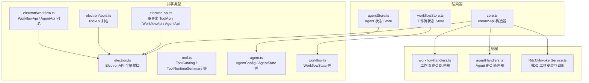
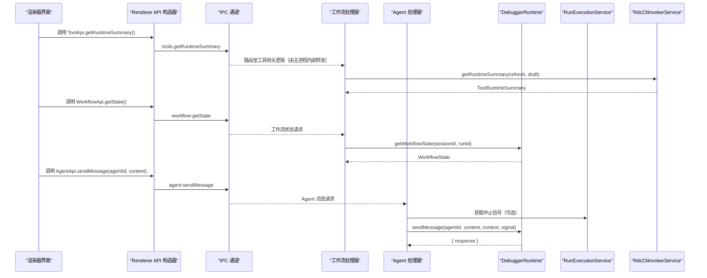
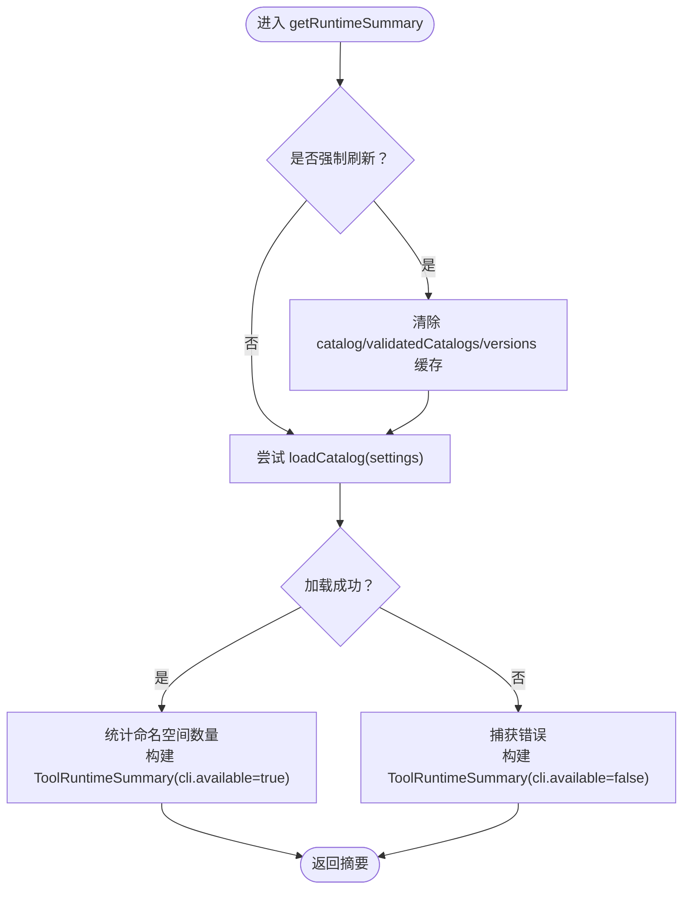
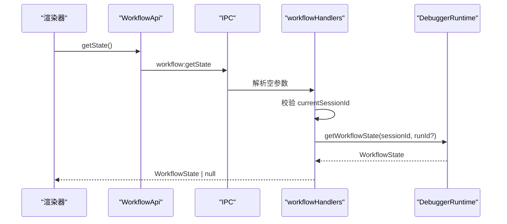
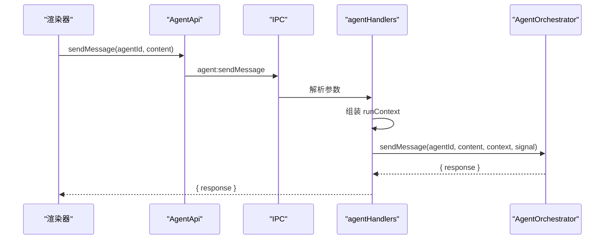
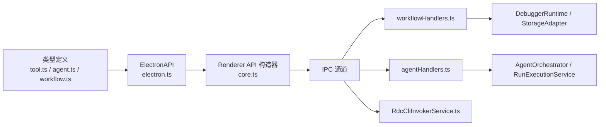

# 工具与工作流 API 类型定义

<cite>
**本文引用的文件**   
- [electron-api.ts](file://src/shared/types/electron-api.ts)
- [tools.ts](file://src/shared/types/electron/tools.ts)
- [workflow.ts](file://src/shared/types/electron/workflow.ts)
- [electron.ts](file://src/shared/types/electron.ts)
- [core.ts](file://src/shared/renderer-api/core.ts)
- [tool.ts](file://src/shared/types/tool.ts)
- [agent.ts](file://src/shared/types/agent.ts)
- [workflow.ts](file://src/shared/types/workflow.ts)
- [workflowHandlers.ts](file://src/main/ipc/workflowHandlers.ts)
- [agentHandlers.ts](file://src/main/ipc/agentHandlers.ts)
- [RdcCliInvokerService.ts](file://src/main/tools/RdcCliInvokerService.ts)
- [workflowStore.ts](file://src/renderer/stores/workflowStore.ts)
- [agentStore.ts](file://src/renderer/stores/agentStore.ts)
</cite>

## 目录
1. [引言](#引言)
2. [项目结构](#项目结构)
3. [核心组件](#核心组件)
4. [架构总览](#架构总览)
5. [详细组件分析](#详细组件分析)
6. [依赖关系分析](#依赖关系分析)
7. [性能与错误处理](#性能与错误处理)
8. [故障排查指南](#故障排查指南)
9. [结论](#结论)

## 引言
本文面向需要理解 RDC Agent 运行时中“工具、工作流、Agent”三类能力的开发者，系统性说明以下契约：
- API 组类型契约：ToolApi、WorkflowApi、AgentApi。
- 核心数据模型：ToolCatalog、ToolRuntimeSummary、WorkflowState、AgentState、AgentConfig。
- RDC 工具安装检测、目录扫描与运行时摘要的工作流编排机制。
- Agent 角色管理、状态查询、配置修改和任务调用的接口规范。
- 工具发现、工作流执行与 Agent 协调的调用示例及错误处理模式。

文档以共享类型定义为核心锚点，并结合主进程 IPC 处理器、渲染器 API 构造器和相关 Store，给出端到端视图。

## 项目结构
本主题涉及的文件分布在三层：
- 共享类型层：Electron API 接口、工具与工作流/Agent 领域类型。
- 主进程实现层：IPC 处理器、RDC CLI 调用器服务。
- 渲染器使用层：Renderer API 构造器与 Zustand Store。

**图示来源**
- [electron-api.ts:1-32](file://src/shared/types/electron-api.ts#L1-L32)
- [tools.ts:1-5](file://src/shared/types/electron/tools.ts#L1-L5)
- [workflow.ts:1-4](file://src/shared/types/electron/workflow.ts#L1-L4)
- [electron.ts:201-567](file://src/shared/types/electron.ts#L201-L567)
- [core.ts:1-167](file://src/shared/renderer-api/core.ts#L1-L167)
- [workflowHandlers.ts:1-105](file://src/main/ipc/workflowHandlers.ts#L1-L105)
- [agentHandlers.ts:1-88](file://src/main/ipc/agentHandlers.ts#L1-L88)
- [RdcCliInvokerService.ts:1-369](file://src/main/tools/RdcCliInvokerService.ts#L1-L369)
- [workflowStore.ts:1-43](file://src/renderer/stores/workflowStore.ts#L1-L43)
- [agentStore.ts:1-49](file://src/renderer/stores/agentStore.ts#L1-L49)

**章节来源**
- [electron-api.ts:1-32](file://src/shared/types/electron-api.ts#L1-L32)
- [tools.ts:1-5](file://src/shared/types/electron/tools.ts#L1-L5)
- [workflow.ts:1-4](file://src/shared/types/electron/workflow.ts#L1-L4)
- [electron.ts:201-567](file://src/shared/types/electron.ts#L201-L567)
- [core.ts:1-167](file://src/shared/renderer-api/core.ts#L1-L167)
- [workflowHandlers.ts:1-105](file://src/main/ipc/workflowHandlers.ts#L1-L105)
- [agentHandlers.ts:1-88](file://src/main/ipc/agentHandlers.ts#L1-L88)
- [RdcCliInvokerService.ts:1-369](file://src/main/tools/RdcCliInvokerService.ts#L1-L369)
- [workflowStore.ts:1-43](file://src/renderer/stores/workflowStore.ts#L1-L43)
- [agentStore.ts:1-49](file://src/renderer/stores/agentStore.ts#L1-L49)

## 核心组件
本节聚焦三类 API 及其核心类型。

### ToolApi：工具能力
ToolApi 暴露 RDC 工具的安装检测、目录解析、校验与目录/运行时摘要能力：
- detectInstallations：列出候选 RDC 工具安装位置。
- resolveInstallation：根据候选安装生成 RDC CLI 调用器设置。
- verifyInstallation：验证安装并返回 settings 与 ToolRuntimeSummary。
- getCatalog：加载已验证的 ToolCatalog。
- getRuntimeSummary：获取运行时摘要（包含 CLI 可用性、命名空间统计）。

这些方法在 ElectronAPI.tool 上定义，并通过渲染器的 createToolApi 映射到 IPC 通道。

**章节来源**
- [electron.ts:357-361](file://src/shared/types/electron.ts#L357-L361)
- [core.ts:120-167](file://src/shared/renderer-api/core.ts#L120-L167)

### WorkflowApi：工作流编排
WorkflowApi 提供工作流生命周期与运行上下文读取能力：
- getState：读取当前会话/运行的工作流状态。
- resume：恢复指定会话的运行。
- stop：停止指定运行。
- getRunUsage：读取运行上下文用量快照。
- listRuns：列出某会话的所有运行。
- listActiveRuns：列出当前活跃运行。

渲染器通过 createWorkflowApi 绑定到 workflow.* IPC 通道。

**章节来源**
- [electron.ts:240-260](file://src/shared/types/electron.ts#L240-L260)
- [core.ts:88-118](file://src/shared/renderer-api/core.ts#L88-L118)

### AgentApi：Agent 角色与任务
AgentApi 负责 Agent 消息发送、状态查询与配置修改：
- sendMessage：向指定 agentId 发送消息并接收响应。
- getState：按 sessionId + agentId 查询 Agent 状态。
- getAllStates：获取所有 Agent 的最新状态。
- configure：对某个 agentId 进行部分配置更新。

渲染器通过 createAgentApi 绑定到 agent.* IPC 通道。

**章节来源**
- [electron.ts:262-275](file://src/shared/types/electron.ts#L262-L275)
- [core.ts:118-120](file://src/shared/renderer-api/core.ts#L118-L120)

### 核心类型
- ToolCatalog：描述 RDC 工具目录的结构化快照，包含 schema_version、fingerprint、tools、namespaces、runtime 等字段。
- ToolRuntimeMetadata：描述 RDC CLI 运行时元信息，如 source、command、workingDirectory、intermediateRoot、version、catalog。
- ToolRuntimeSummary：高层运行时摘要，包括 runtime、cli.available/unavailableReason、namespaces 列表。
- WorkflowState：工作流状态，包含 caseId/runId/sessionId、backend/orchestrationMode/coordinationMode、blockers、reasoningSummaries、recoveryState、lastUpdated。
- AgentConfig：Agent 配置，包含 agentId、systemPrompt、modelProvider、modelName、temperature。
- AgentState：Agent 运行时状态投影，包含 agentId、sessionId、status、token、brief、lastActivity、error。

**章节来源**
- [tool.ts:1-200](file://src/shared/types/tool.ts#L1-L200)
- [workflow.ts:1-54](file://src/shared/types/workflow.ts#L1-L54)
- [agent.ts:1-102](file://src/shared/types/agent.ts#L1-L102)

## 架构总览
下图展示从渲染器到主进程的完整调用路径：渲染器通过 Renderer API 构造器发起调用，主进程由对应 IPC 处理器执行业务逻辑，最终访问工作流调试运行时或 RDC CLI。

**图示来源**
- [core.ts:88-167](file://src/shared/renderer-api/core.ts#L88-L167)
- [workflowHandlers.ts:1-105](file://src/main/ipc/workflowHandlers.ts#L1-L105)
- [agentHandlers.ts:1-88](file://src/main/ipc/agentHandlers.ts#L1-L88)
- [RdcCliInvokerService.ts:1-369](file://src/main/tools/RdcCliInvokerService.ts#L1-L369)

## 详细组件分析

### ToolApi 与 RDC 工具安装检测、目录扫描、运行时摘要
#### 类型契约
- ToolApi.detectInstallations：无参，返回 RdcInstallationCandidate[]。
- ToolApi.resolveInstallation：传入 RdcInstallationRequest，返回 RdcCliInvokerSettings。
- ToolApi.verifyInstallation：传入 RdcInstallationRequest，返回 { settings, summary: ToolRuntimeSummary }。
- ToolApi.getCatalog：返回 ToolCatalog。
- ToolApi.getRuntimeSummary：返回 ToolRuntimeSummary。

#### 工作流程
RdcCliInvokerService 是 RDC 工具能力的核心实现类：
- 安装可用性检查：getAvailabilityFailure 会判断是否启用、命令是否存在、Python/CLI 是否在相同安装根目录下。
- 运行时元信息：getRuntimeMetadata 基于 Settings 与已验证 Catalog 构建 ToolRuntimeMetadata。
- 目录加载：loadCatalog 调用 RDC CLI 的 version 与 tools list，校验 schema_version，验证工具定义与应用操作，构建 ToolCatalog 并缓存。
- 运行时摘要：getRuntimeSummary 尝试加载 Catalog，若失败则返回 cli.available=false 与 unavailableReason，同时仍返回 runtime 元信息。
- 工具调用：call 将 ToolCallRequest 转换为 CLI call 参数，封装错误为 ToolCallResult，支持 trace 事件。

**图示来源**
- [RdcCliInvokerService.ts:1-369](file://src/main/tools/RdcCliInvokerService.ts#L1-L369)

#### 关键数据结构
- ToolCatalog：schema_version、fingerprint、tools、namespaces、runtime。
- ToolRuntimeMetadata：source、command、workingDirectory、intermediateRoot、version、catalog.path/exists/schemaVersion/generatedAt/toolCount。
- ToolRuntimeSummary：runtime、cli.available/unavailableReason、namespaces[namespace/toolCount/available]。

**章节来源**
- [tool.ts:1-200](file://src/shared/types/tool.ts#L1-L200)
- [RdcCliInvokerService.ts:1-369](file://src/main/tools/RdcCliInvokerService.ts#L1-L369)

### WorkflowApi 与工作流编排
#### 类型契约
- WorkflowApi.getState：返回 WorkflowState。
- WorkflowApi.resume：接受 sessionId，返回 success/error。
- WorkflowApi.stop：接受 runId，返回 success/error。
- WorkflowApi.getRunUsage：传入 RunContextUsageRequest，返回 RunContextUsageReadResult。
- WorkflowApi.listRuns：返回 runs: RunSummary[]。
- WorkflowApi.listActiveRuns：返回活跃运行列表。

#### 主进程处理流程
workflowsHandlers 注册 workflow.* IPC：
- workflow:getState：若无当前 sessionId，返回 null；否则调用 debuggerRuntime.getWorkflowState。
- workflow:resume：解析并校验 sessionId，更新 state.currentSessionId 与 currentRunId，持久化当前会话。
- workflow:stop：解析 runId，调用 debuggerRuntime.stopRun，触发捕获上下文与 TraceProjection 刷新广播。
- workflow:listRuns/listActiveRuns：分别通过 storageAdapter 与 runExecutionService 返回列表。

**图示来源**
- [workflowHandlers.ts:1-105](file://src/main/ipc/workflowHandlers.ts#L1-L105)

#### 渲染器状态存储
useWorkflowStore 持有 workflowState 与 tracePresentation，并提供 setWorkflowState/reset 等方法，配合 sameTracePresentation 减少不必要的渲染更新。

**章节来源**
- [electron.ts:240-260](file://src/shared/types/electron.ts#L240-L260)
- [workflowHandlers.ts:1-105](file://src/main/ipc/workflowHandlers.ts#L1-L105)
- [workflowStore.ts:1-43](file://src/renderer/stores/workflowStore.ts#L1-L43)

### AgentApi 与 Agent 角色管理
#### 类型契约
- AgentApi.sendMessage：参数 (agentId, content)，返回 { response?, error? }。
- AgentApi.getState：参数 (agentId, sessionId?)，返回 AgentState | null。
- AgentApi.getAllStates：返回 AgentState[]。
- AgentApi.configure：参数 (agentId, config: Partial<AgentConfig>)，返回 { success, error? }。

#### 主进程处理流程
agentHandlers 注册 agent.* IPC：
- agent:sendMessage：解析 agentId/content，构造 runContext（caseId/runId/sessionId/projectId/projectRootPath），注入 AbortSignal，调用 agentOrchestrator.sendMessage。
- agent:getState/getAllStates：直接转发至 orchestrator。
- agent:configure：校验并应用配置更新。

**图示来源**
- [agentHandlers.ts:1-88](file://src/main/ipc/agentHandlers.ts#L1-L88)

#### 渲染器状态存储
useAgentStore 以 sessionId::agentId 作为键维护各 Agent 最新状态，忽略临时子 Agent 状态，并提供 clearScope/reset 清理能力。

**章节来源**
- [electron.ts:262-275](file://src/shared/types/electron.ts#L262-L275)
- [agentHandlers.ts:1-88](file://src/main/ipc/agentHandlers.ts#L1-L88)
- [agentStore.ts:1-49](file://src/renderer/stores/agentStore.ts#L1-L49)

## 依赖关系分析
- 类型层依赖：
  - electron-api.ts 重导出 ToolApi、WorkflowApi、AgentApi 等，供渲染器消费。
  - electron/tools.ts 与 electron/workflow.ts 分别定义 ToolApi、WorkflowApi、AgentApi 的类型别名。
  - tool.ts、agent.ts、workflow.ts 定义领域类型，被 ElectronAPI 与主进程实现引用。
- 运行时层依赖：
  - core.ts 通过 RendererApiTransport 将 API 方法映射到 IPC 通道。
  - workflowHandlers.ts 依赖 DebuggerRuntime、RunExecutionService、StorageAdapter。
  - agentHandlers.ts 依赖 AgentOrchestrator、RunExecutionService、StorageAdapter。
  - RdcCliInvokerService 依赖 ShellInvocationService、SettingsService 与 RDC 原生协议解析。

**图示来源**
- [electron-api.ts:1-32](file://src/shared/types/electron-api.ts#L1-L32)
- [electron.ts:201-567](file://src/shared/types/electron.ts#L201-L567)
- [core.ts:1-167](file://src/shared/renderer-api/core.ts#L1-L167)
- [workflowHandlers.ts:1-105](file://src/main/ipc/workflowHandlers.ts#L1-L105)
- [agentHandlers.ts:1-88](file://src/main/ipc/agentHandlers.ts#L1-L88)
- [RdcCliInvokerService.ts:1-369](file://src/main/tools/RdcCliInvokerService.ts#L1-L369)

**章节来源**
- [electron-api.ts:1-32](file://src/shared/types/electron-api.ts#L1-L32)
- [electron.ts:201-567](file://src/shared/types/electron.ts#L201-L567)
- [core.ts:1-167](file://src/shared/renderer-api/core.ts#L1-L167)
- [workflowHandlers.ts:1-105](file://src/main/ipc/workflowHandlers.ts#L1-L105)
- [agentHandlers.ts:1-88](file://src/main/ipc/agentHandlers.ts#L1-L88)
- [RdcCliInvokerService.ts:1-369](file://src/main/tools/RdcCliInvokerService.ts#L1-L369)

## 性能与错误处理
### 性能特性
- 目录与版本缓存：RdcCliInvokerService 使用 Map 缓存 catalog、validatedCatalogs 与 versions，避免重复 CLI 调用。
- 最小化渲染更新：useWorkflowStore 使用比较函数避免重复设置 tracePresentation。
- 批量调用与超时控制：RdcCliInvokerService.executeCLI 支持 timeoutMs、runId/contextId/abortSignal，限制输出缓冲大小。

### 错误处理模式
- 工具调用：ToolCallResult.ok 区分成功与失败，error.code/message/category/details 结构化错误；异常时返回 EXECUTION_ERROR。
- 工作流停止：workflow:stop 捕获异常并返回 { success:false, error }，同时广播捕获上下文变更与 TraceProjection 刷新。
- Agent 配置：agent:configure 捕获异常并返回 { success:false, error }。
- 安装检测：getAvailabilityFailure 返回不可用原因字符串，getRuntimeSummary 将其包装为 cli.unavailableReason。

**章节来源**
- [RdcCliInvokerService.ts:1-369](file://src/main/tools/RdcCliInvokerService.ts#L1-L369)
- [workflowHandlers.ts:1-105](file://src/main/ipc/workflowHandlers.ts#L1-L105)
- [agentHandlers.ts:1-88](file://src/main/ipc/agentHandlers.ts#L1-L88)
- [workflowStore.ts:1-43](file://src/renderer/stores/workflowStore.ts#L1-L43)

## 故障排查指南
- RDC 工具未安装或未配置：
  - 现象：ToolRuntimeSummary.cli.available=false，unavailableReason 提示“未启用/未配置命令/命令不存在/绑定无效”。
  - 处理：检查 Settings 中 rdcCli.enabled/command/workingDirectory/argsPrefix，确保 Python 与 CLI 位于同一安装根目录。
- 目录加载失败：
  - 现象：loadCatalog 抛出升级要求或不受支持的目录 schema。
  - 处理：确认 RDC-Tool CLI 版本满足契约要求，重新执行 getRuntimeSummary(refresh=true)。
- 工作流停止失败：
  - 现象：workflow:stop 返回 success=false 且带错误信息。
  - 处理：确认当前存在 active run，检查 debuggerRuntime.stopRun 返回值与广播事件。
- Agent 配置更新失败：
  - 现象：agent:configure 返回 success=false。
  - 处理：校验传入的 Partial<AgentConfig> 是否符合预期 provider/model 约束。

**章节来源**
- [RdcCliInvokerService.ts:1-369](file://src/main/tools/RdcCliInvokerService.ts#L1-L369)
- [workflowHandlers.ts:1-105](file://src/main/ipc/workflowHandlers.ts#L1-L105)
- [agentHandlers.ts:1-88](file://src/main/ipc/agentHandlers.ts#L1-L88)

## 结论
本文梳理了 ToolApi、WorkflowApi、AgentApi 三类 API 的类型契约与主进程实现，明确了 ToolCatalog、ToolRuntimeSummary、WorkflowState、AgentState、AgentConfig 等核心类型的结构与用途。结合 RdcCliInvokerService 的安装检测与目录扫描机制，以及 workFlow/Agent IPC 处理器，形成了从渲染器到主进程的完整工具与工作流调用链路。在实际使用中，应优先关注：
- 安装与运行时摘要的可观测性（ToolRuntimeSummary）。
- 工作流状态的获取与运行生命周期控制（getState/resume/stop）。
- Agent 的角色配置与状态跟踪（AgentConfig/AgentState）。
- 错误信息的结构化表达与可诊断性（ToolCallResult.error、handler 返回体）。