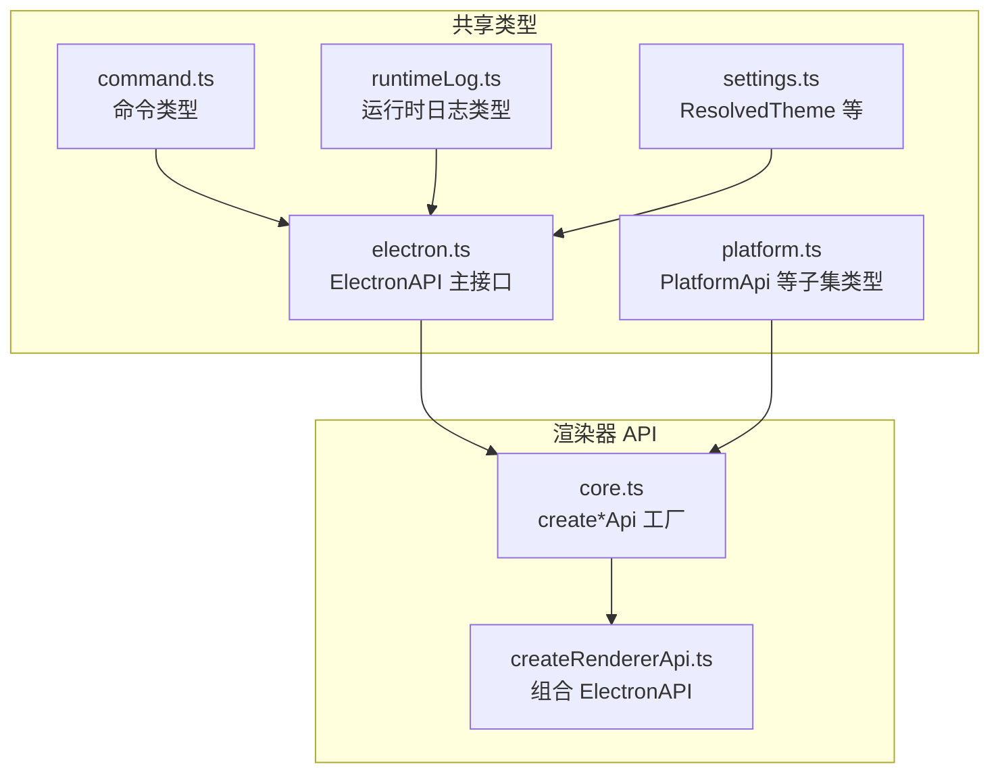
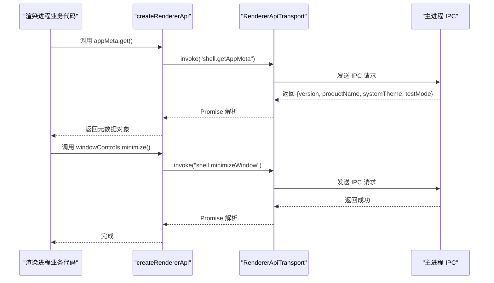
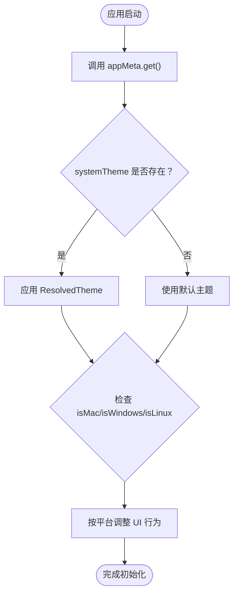
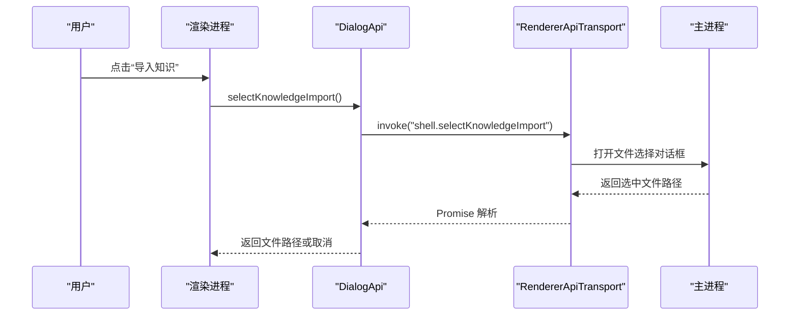
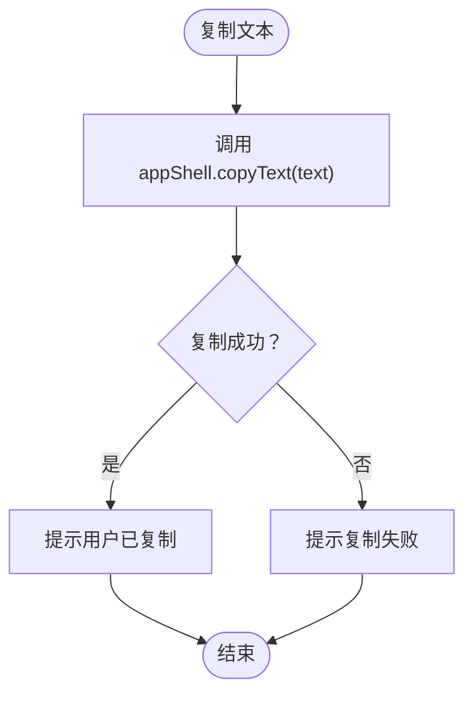
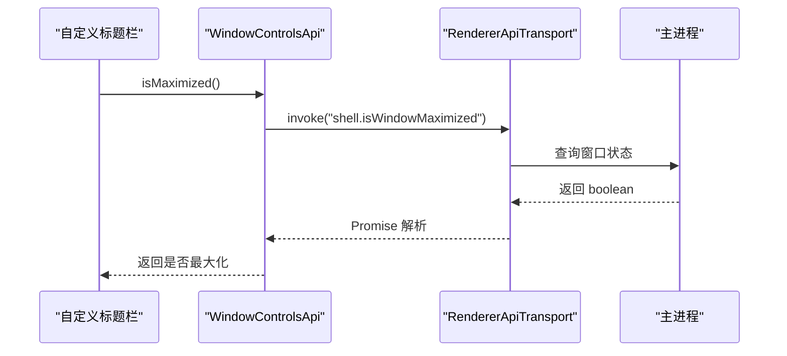
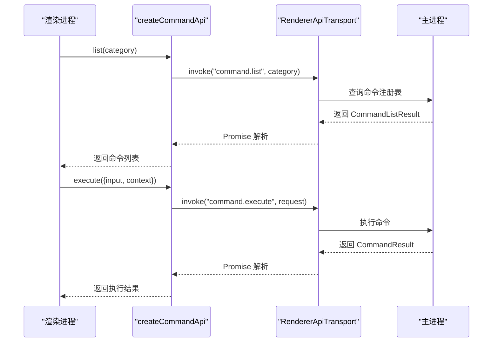
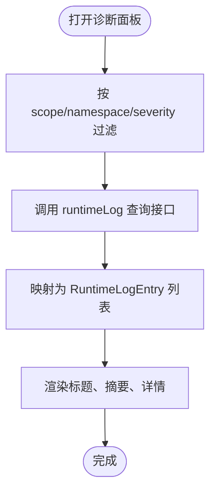
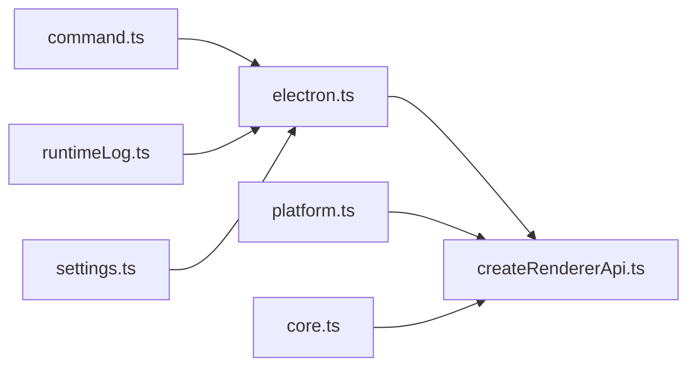

# 平台与系统 API 类型定义

<cite>
**本文引用的文件**   
- [src/shared/renderer-api/core.ts](file://src/shared/renderer-api/core.ts)
- [src/shared/renderer-api/createRendererApi.ts](file://src/shared/renderer-api/createRendererApi.ts)
- [src/shared/types/electron-api.ts](file://src/shared/types/electron-api.ts)
- [src/shared/types/electron/platform.ts](file://src/shared/types/electron/platform.ts)
- [src/shared/types/electron.ts](file://src/shared/types/electron.ts)
- [src/shared/types/command.ts](file://src/shared/types/command.ts)
- [src/shared/types/runtimeLog.ts](file://src/shared/types/runtimeLog.ts)
- [src/shared/types/settings.ts](file://src/shared/types/settings.ts)
</cite>

## 目录
1. [引言](#引言)
2. [项目结构](#项目结构)
3. [核心组件](#核心组件)
4. [架构总览](#架构总览)
5. [详细组件分析](#详细组件分析)
6. [依赖关系分析](#依赖关系分析)
7. [性能考虑](#性能考虑)
8. [故障排查指南](#故障排查指南)
9. [结论](#结论)

## 引言
本文面向 RDC-Agent 渲染进程暴露给业务代码的底层系统与平台能力接口，聚焦以下目标：
- 明确 AppMetaApi、AppShellApi、DialogApi、PlatformApi、WindowControlsApi 等系统接口的类型契约。
- 记录 ResolvedTheme、CommandListResult、RuntimeLogEntry 等系统级数据模型的结构。
- 解释跨平台兼容性处理、用户交互对话框和系统集成（剪贴板、窗口控制、命令执行）的类型设计模式。
- 提供平台信息获取、文件选择、剪贴板操作、窗口控制、命令执行与日志查询的实际使用示例路径。

## 项目结构
这些接口主要分布在共享类型与渲染器 API 构建层中：
- 共享类型定义集中在 `src/shared/types`，包括 ElectronAPI 主入口、运行时日志、命令系统、主题设置等。
- 渲染器 API 构造在 `src/shared/renderer-api`，负责把 IPC transport 包装为上层可用的 API 对象。
- PlatformApi 等“轻量子集类型”通过 Pick 从 ElectronAPI 抽取，避免重复声明。

**图表来源**
- [src/shared/types/electron.ts:1-200](file://src/shared/types/electron.ts#L1-L200)
- [src/shared/types/electron/platform.ts:1-8](file://src/shared/types/electron/platform.ts#L1-L8)
- [src/shared/types/command.ts:1-89](file://src/shared/types/command.ts#L1-L89)
- [src/shared/types/runtimeLog.ts:1-26](file://src/shared/types/runtimeLog.ts#L1-L26)
- [src/shared/types/settings.ts:1-60](file://src/shared/types/settings.ts#L1-L60)
- [src/shared/renderer-api/core.ts:1-167](file://src/shared/renderer-api/core.ts#L1-L167)
- [src/shared/renderer-api/createRendererApi.ts:1-80](file://src/shared/renderer-api/createRendererApi.ts#L1-L80)

**章节来源**
- [src/shared/renderer-api/core.ts:1-167](file://src/shared/renderer-api/core.ts#L1-L167)
- [src/shared/renderer-api/createRendererApi.ts:1-80](file://src/shared/renderer-api/createRendererApi.ts#L1-L80)
- [src/shared/types/electron-api.ts:1-32](file://src/shared/types/electron-api.ts#L1-L32)

## 核心组件
本节按能力域梳理关键接口与类型契约。

### 平台检测与基础信息：PlatformApi 与 ElectronAPI 平台字段
- ElectronAPI 暴露 platform 以及 isMac/isWindows/isLinux 布尔标志，供渲染进程判断当前运行平台。
- PlatformApi 是 ElectronAPI 的子集类型，仅包含 platform、isMac、isWindows、isLinux，适合需要最小化平台能力的场景。

典型用途：
- 根据 isMac/isWindows/isLinux 调整快捷键或菜单文案。
- 根据 platform 区分本地路径分隔符或默认行为。

**章节来源**
- [src/shared/types/electron.ts:1-120](file://src/shared/types/electron.ts#L1-L120)
- [src/shared/types/electron/platform.ts:1-8](file://src/shared/types/electron/platform.ts#L1-L8)
- [src/shared/renderer-api/createRendererApi.ts:12-22](file://src/shared/renderer-api/createRendererApi.ts#L12-L22)

### 应用元数据：AppMetaApi
AppMetaApi 用于读取应用元信息，返回结构包含：
- version：应用版本字符串。
- productName：产品名称。
- systemTheme：系统级主题，类型为 ResolvedTheme。
- testMode：是否处于测试模式。

类型契约由 ElectronAPI.appMeta.get 定义，实际调用通过 createAppMetaApi 封装后使用。

典型用途：
- 启动时根据 testMode 切换调试 UI。
- 根据 productName/version 显示关于页面信息。
- 根据 systemTheme 初始化主题策略。

**章节来源**
- [src/shared/types/electron.ts:80-110](file://src/shared/types/electron.ts#L80-L110)
- [src/shared/renderer-api/core.ts:11-17](file://src/shared/renderer-api/core.ts#L11-L17)
- [src/shared/types/settings.ts:1-12](file://src/shared/types/settings.ts#L1-L12)

### 应用外壳：AppShellApi
AppShellApi 提供桌面端常用外壳能力：
- hasSeenGettingStarted/acknowledgeGettingStarted：引导流程状态。
- selectAvatar/getAvatarDataUrl：头像选择与数据 URL 转换。
- openPath：打开文件或目录，返回 success 与可选 error。
- copyText/readClipboardText：剪贴板写入与读取，readClipboardText 返回 text。

类型契约由 ElectronAPI.appShell 定义；具体方法通过 createAppShellApi 转发到 IPC transport。

典型用途：
- 首次使用时展示引导并记录已读。
- 用户点击链接时调用 openPath 打开系统资源管理器或浏览器。
- 复制命令输出或错误提示到剪贴板。

**章节来源**
- [src/shared/types/electron.ts:110-150](file://src/shared/types/electron.ts#L110-L150)
- [src/shared/renderer-api/core.ts:19-31](file://src/shared/renderer-api/core.ts#L19-L31)

### 对话框与文件操作：DialogApi
DialogApi 封装文件与目录选择、保存等交互：
- selectFiles/selectRdcFiles/selectKnowledgeImport：不同业务语义的文件选择。
- selectDirectory：目录选择。
- saveFile：带请求体的保存文件。

ElectronAPI 还直接暴露 selectFiles/selectRdcFiles/selectKnowledgeImport/selectDirectory/saveFile，createRendererApi 将这些方法与 DialogApi 合并，使上层既可通过 dialog.* 也可通过顶层 selectXxx 调用。

典型用途：
- 导入知识文档前弹出选择框。
- 导出会话或截图时触发保存对话框。

**章节来源**
- [src/shared/renderer-api/core.ts:33-41](file://src/shared/renderer-api/core.ts#L33-L41)
- [src/shared/renderer-api/createRendererApi.ts:14-24](file://src/shared/renderer-api/createRendererApi.ts#L14-L24)
- [src/shared/types/electron/platform.ts:1-8](file://src/shared/types/electron/platform.ts#L1-L8)

### 窗口控制：WindowControlsApi
WindowControlsApi 提供最小化、最大化切换、关闭与最大化的查询：
- minimize：最小化窗口。
- toggleMaximize：切换最大化。
- close：关闭窗口。
- isMaximized：查询当前是否最大化。

类型契约由 ElectronAPI.windowControls 定义，实现由 createWindowControlsApi 转发。

典型用途：
- 自定义标题栏按钮实现原生窗口行为。
- 根据 isMaximized 调整布局或按钮文案。

**章节来源**
- [src/shared/types/electron.ts:1-200](file://src/shared/types/electron.ts#L1-L200)
- [src/shared/renderer-api/core.ts:43-51](file://src/shared/renderer-api/core.ts#L43-L51)

### 命令系统：CommandListResult 与相关类型
命令系统的共享类型集中在 command.ts：
- CommandContext：命令执行上下文，含 sessionId/projectId/workspaceRoot/agentId/currentMode/currentModelId/currentTheme 等。
- CommandResult：命令执行结果，含 success/message/data/systemMessage/uiAction/invalidateStores。
- CommandUiAction：结构化 UI 动作，如打开设置、切换模式/模型/主题、恢复/导出/撤销/清空会话、运行技能等。
- CommandDefinition：斜杠命令定义，含 id/name/description/aliases/category/execute。
- CommandExecuteRequest：IPC 执行请求，含 input/context。
- CommandListResult：命令列表响应，包含 commands 数组，每项有 id/name/description/aliases/category。

ElectronAPI.command.list/execute 通过 createCommandApi 暴露。

典型用途：
- 渲染侧下拉面板列出可用命令，用户输入后调用 execute。
- 命令执行后根据 uiAction 打开对应设置页或切换工作区模式。

**章节来源**
- [src/shared/types/command.ts:1-89](file://src/shared/types/command.ts#L1-L89)
- [src/shared/renderer-api/core.ts:133-140](file://src/shared/renderer-api/core.ts#L133-L140)

### 运行时日志：RuntimeLogEntry 及相关类型
运行时日志类型定义在 runtimeLog.ts：
- RuntimeLogScope：'app' | 'session'。
- RuntimeLogNamespace：'system' | 'agent' | 'tool' | 'device' | 'capture' | 'context' | 'llm'。
- RuntimeLogSeverity：'info' | 'success' | 'warning' | 'error'。
- RuntimeLogDetailLevel：'summary' | 'verbose' | 'raw'。
- RuntimeLogEntry：每条日志条目，包含 id/timestamp/scope/namespace/severity/title/summary/detail/sessionId/projectId/runId/raw。

ElectronAPI.runtimeLog 由 createRendererApi 注入，上层可据此查询、过滤和展示日志。

典型用途：
- 终端抽屉或诊断面板按 namespace/severity 筛选日志。
- 将 raw 字段序列化后上报或导出。

**章节来源**
- [src/shared/types/runtimeLog.ts:1-26](file://src/shared/types/runtimeLog.ts#L1-L26)
- [src/shared/renderer-api/createRendererApi.ts:36-47](file://src/shared/renderer-api/createRendererApi.ts#L36-L47)

### 主题模型：ResolvedTheme
ResolvedTheme 表示最终解析出的主题值：
- 类型：'dark' | 'light'。
- 来源于系统主题与用户偏好的解析，并通过 AppMetaApi.get 返回 systemTheme。

典型用途：
- 初始化主题引擎。
- 对比 systemTheme 与当前主题，提示用户切换。

**章节来源**
- [src/shared/types/settings.ts:1-12](file://src/shared/types/settings.ts#L1-L12)
- [src/shared/types/electron.ts:80-110](file://src/shared/types/electron.ts#L80-L110)

## 架构总览
渲染器 API 通过 createRendererApi 聚合各子系统 API，并把 NodeJS.Platform 作为 platform 传入，从而构造出统一的 ElectronAPI 视图。所有系统级能力（平台、应用元数据、应用外壳、对话框、窗口控制、对话、命令、工具、MCP、证据、工作流、会话、运行期日志等）都通过 transport.invoke 或事件通道与主进程通信。

**图表来源**
- [src/shared/renderer-api/createRendererApi.ts:1-80](file://src/shared/renderer-api/createRendererApi.ts#L1-L80)
- [src/shared/renderer-api/core.ts:11-51](file://src/shared/renderer-api/core.ts#L11-L51)

## 详细组件分析

### 平台检测与主题联动
平台检测与主题解析共同决定应用初始外观与行为。ElectronAPI.platform 提供操作系统标识，isMac/isWindows/isLinux 提供布尔快捷判断；AppMetaApi.get.systemTheme 提供最终解析后的 ResolvedTheme。

**图表来源**
- [src/shared/types/electron.ts:80-150](file://src/shared/types/electron.ts#L80-L150)
- [src/shared/types/settings.ts:1-12](file://src/shared/types/settings.ts#L1-L12)
- [src/shared/renderer-api/core.ts:11-31](file://src/shared/renderer-api/core.ts#L11-L31)

**章节来源**
- [src/shared/types/electron.ts:80-150](file://src/shared/types/electron.ts#L80-L150)
- [src/shared/types/settings.ts:1-12](file://src/shared/types/settings.ts#L1-L12)
- [src/shared/renderer-api/core.ts:11-31](file://src/shared/renderer-api/core.ts#L11-L31)

### 文件选择与保存流程
DialogApi 将不同业务场景的文件选择统一抽象为 selectFiles/selectRdcFiles/selectKnowledgeImport/selectDirectory/saveFile。ElectronAPI 同时暴露同名的顶层方法，便于在不同层级调用。

**图表来源**
- [src/shared/renderer-api/core.ts:33-41](file://src/shared/renderer-api/core.ts#L33-L41)
- [src/shared/renderer-api/createRendererApi.ts:14-24](file://src/shared/renderer-api/createRendererApi.ts#L14-L24)

**章节来源**
- [src/shared/renderer-api/core.ts:33-41](file://src/shared/renderer-api/core.ts#L33-L41)
- [src/shared/renderer-api/createRendererApi.ts:14-24](file://src/shared/renderer-api/createRendererApi.ts#L14-L24)

### 剪贴板操作
AppShellApi.copyText/readClipboardText 提供剪贴板读写能力。copyText 返回 success，readClipboardText 返回 success 与 text。

**图表来源**
- [src/shared/types/electron.ts:130-150](file://src/shared/types/electron.ts#L130-L150)
- [src/shared/renderer-api/core.ts:19-31](file://src/shared/renderer-api/core.ts#L19-L31)

**章节来源**
- [src/shared/types/electron.ts:130-150](file://src/shared/types/electron.ts#L130-L150)
- [src/shared/renderer-api/core.ts:19-31](file://src/shared/renderer-api/core.ts#L19-L31)

### 窗口控制
WindowControlsApi 的最小化、最大化切换、关闭与查询方法映射到 shell 对应的 IPC 通道。isMaximized 常用于自定义标题栏状态同步。

**图表来源**
- [src/shared/renderer-api/core.ts:43-51](file://src/shared/renderer-api/core.ts#L43-L51)

**章节来源**
- [src/shared/renderer-api/core.ts:43-51](file://src/shared/renderer-api/core.ts#L43-L51)

### 命令执行与列表
命令系统通过 command.list 获取命令清单，再通过 command.execute 执行命令。CommandListResult.commands 提供 id/name/description/aliases/category，CommandResult.uiAction 驱动后续 UI 跳转。

**图表来源**
- [src/shared/types/command.ts:1-89](file://src/shared/types/command.ts#L1-L89)
- [src/shared/renderer-api/core.ts:133-140](file://src/shared/renderer-api/core.ts#L133-L140)

**章节来源**
- [src/shared/types/command.ts:1-89](file://src/shared/types/command.ts#L1-L89)
- [src/shared/renderer-api/core.ts:133-140](file://src/shared/renderer-api/core.ts#L133-L140)

### 运行时日志查询
RuntimeLogEntry 以结构化方式描述日志条目，结合 scope/namespace/severity 可实现多维度筛选。上层通常通过 ElectronAPI.runtimeLog 提供的查询接口进行分页或过滤。

**图表来源**
- [src/shared/types/runtimeLog.ts:1-26](file://src/shared/types/runtimeLog.ts#L1-L26)
- [src/shared/renderer-api/createRendererApi.ts:36-47](file://src/shared/renderer-api/createRendererApi.ts#L36-L47)

**章节来源**
- [src/shared/types/runtimeLog.ts:1-26](file://src/shared/types/runtimeLog.ts#L1-L26)
- [src/shared/renderer-api/createRendererApi.ts:36-47](file://src/shared/renderer-api/createRendererApi.ts#L36-L47)

## 依赖关系分析
- createRendererApi 依赖 create*Api 工厂函数，集中组装 ElectronAPI。
- PlatformApi 等子集类型通过 Pick 复用 ElectronAPI，降低重复维护成本。
- ElectronAPI 作为唯一对外契约，汇聚平台、主题、命令、会话、工具、MCP、证据、工作流、运行时日志等能力。
- AppMetaApi/AppShellApi/DialogApi/WindowControlsApi 均通过 RendererApiTransport.invoke 与主进程通信，保证类型安全与调用一致性。

**图表来源**
- [src/shared/types/electron.ts:1-200](file://src/shared/types/electron.ts#L1-L200)
- [src/shared/types/electron/platform.ts:1-8](file://src/shared/types/electron/platform.ts#L1-L8)
- [src/shared/types/command.ts:1-89](file://src/shared/types/command.ts#L1-L89)
- [src/shared/types/runtimeLog.ts:1-26](file://src/shared/types/runtimeLog.ts#L1-L26)
- [src/shared/types/settings.ts:1-60](file://src/shared/types/settings.ts#L1-L60)
- [src/shared/renderer-api/core.ts:1-167](file://src/shared/renderer-api/core.ts#L1-L167)
- [src/shared/renderer-api/createRendererApi.ts:1-80](file://src/shared/renderer-api/createRendererApi.ts#L1-L80)

**章节来源**
- [src/shared/renderer-api/createRendererApi.ts:1-80](file://src/shared/renderer-api/createRendererApi.ts#L1-L80)
- [src/shared/types/electron-api.ts:1-32](file://src/shared/types/electron-api.ts#L1-L32)

## 性能考虑
- 文件选择与保存属于阻塞式用户交互，应避免在主线程频繁触发，必要时做防抖或批量导出。
- 剪贴板读写应限制频率，避免频繁复制大量文本造成系统剪贴板抖动。
- 命令执行可能触发复杂逻辑，UI 应在执行期间禁用重复提交，并根据 CommandResult.invalidateStores 刷新必要状态。
- 日志查询应支持分页与过滤，避免一次性加载全部日志导致渲染卡顿。

[本节为通用建议，不直接分析具体文件]

## 故障排查指南
- 平台检测异常：确认 createRendererApi 传入的 platform 是否为 NodeJS.Platform，并检查 isMac/isWindows/isLinux 是否与 platform 一致。
- 主题未生效：检查 appMeta.get 返回的 systemTheme 是否为 ResolvedTheme，并确保上层已根据该值应用主题。
- 文件选择无响应：核对 DialogApi 调用的 IPC 通道名称是否与主进程实现匹配，并检查返回值是否被正确处理。
- 剪贴板失败：copyText/readClipboardText 返回 success=false 时，应降级到用户手动复制提示。
- 窗口控制无效：确认当前窗口存在且未被销毁，isMaximized 与 toggleMaximize 的状态需保持同步。
- 命令列表为空：检查 command.list 的 category 参数是否正确，以及主进程命令注册表是否已加载。
- 日志无法筛选：检查 RuntimeLogEntry.scope/namespace/severity 是否符合预期枚举值。

**章节来源**
- [src/shared/renderer-api/createRendererApi.ts:12-22](file://src/shared/renderer-api/createRendererApi.ts#L12-L22)
- [src/shared/types/electron/platform.ts:1-8](file://src/shared/types/electron/platform.ts#L1-L8)
- [src/shared/types/command.ts:1-89](file://src/shared/types/command.ts#L1-L89)
- [src/shared/types/runtimeLog.ts:1-26](file://src/shared/types/runtimeLog.ts#L1-L26)

## 结论
本仓库通过 ElectronAPI 统一承载平台、应用外壳、对话框、窗口控制、命令、运行时日志等底层系统能力；PlatformApi、AppMetaApi、AppShellApi、DialogApi、WindowControlsApi 等类型契约分别对应清晰的能力边界。ResolvedTheme、CommandListResult、RuntimeLogEntry 等系统级数据模型为跨模块协作提供了稳定结构。渲染器 API 工厂将 IPC transport 透明转换为高层 API，既保证类型安全，又简化了跨平台兼容性与系统集成复杂度。