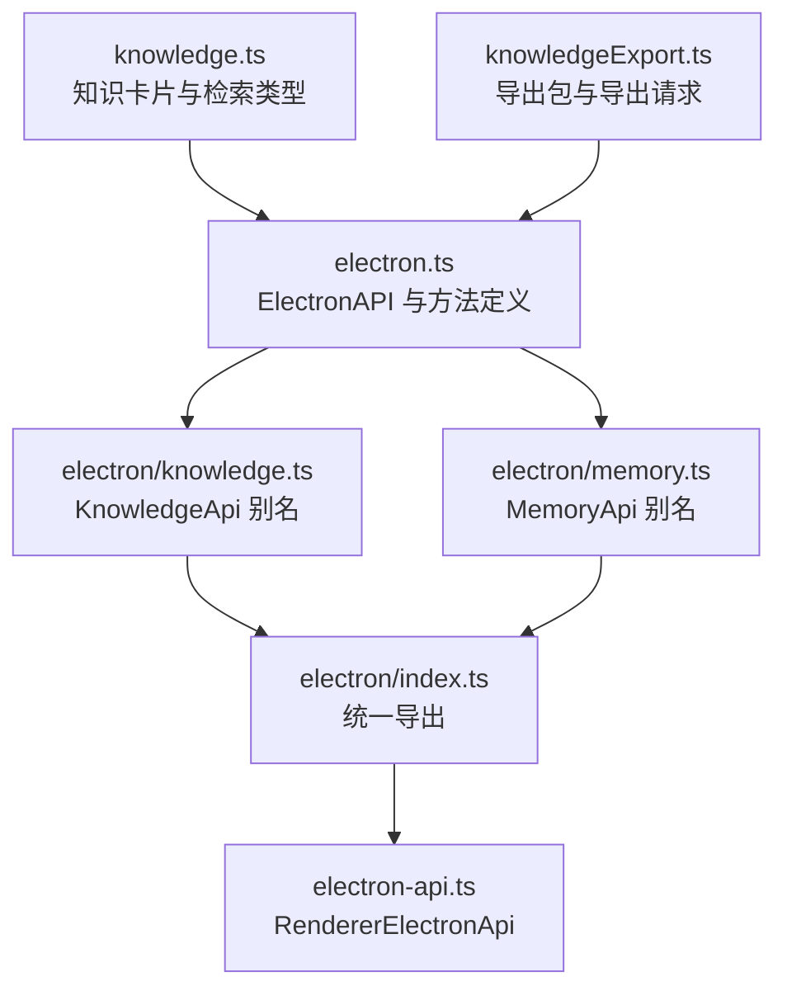
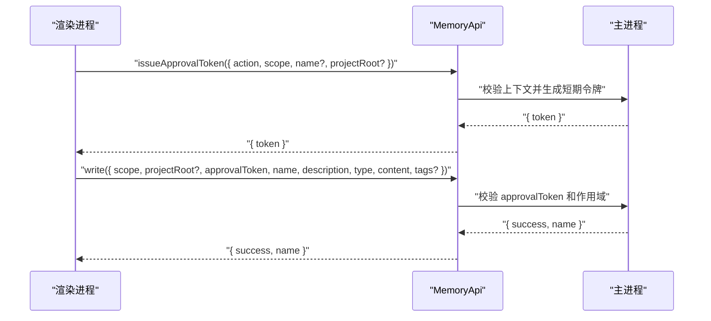
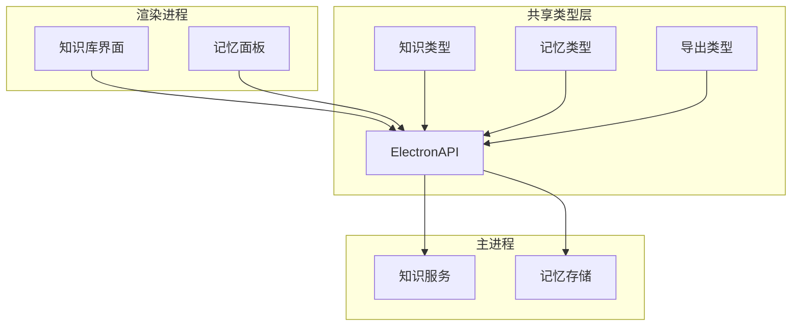
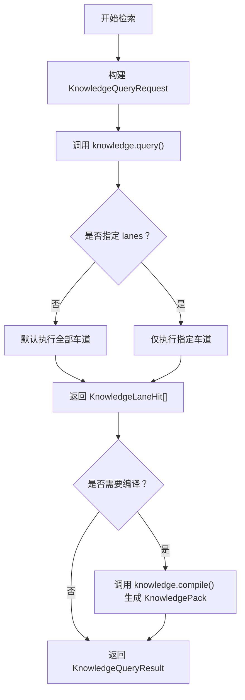
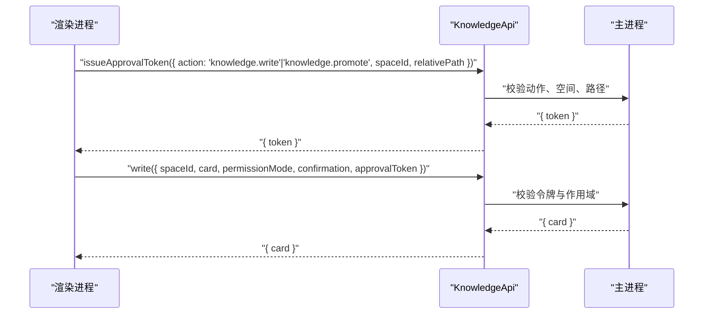
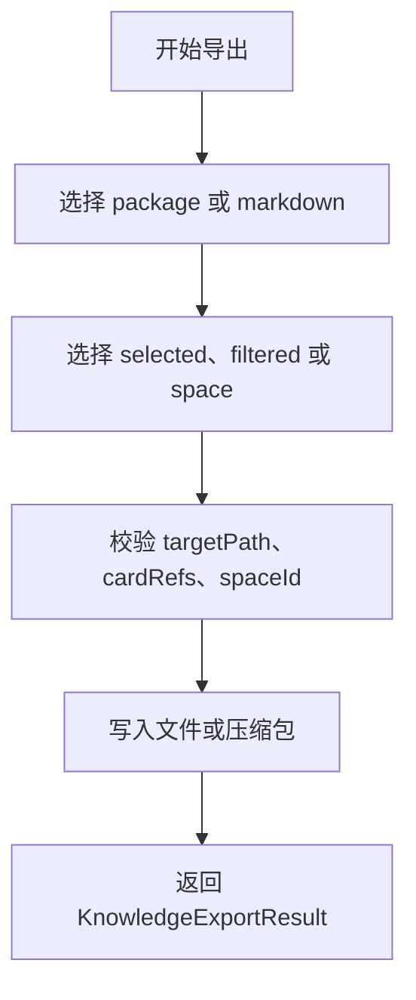
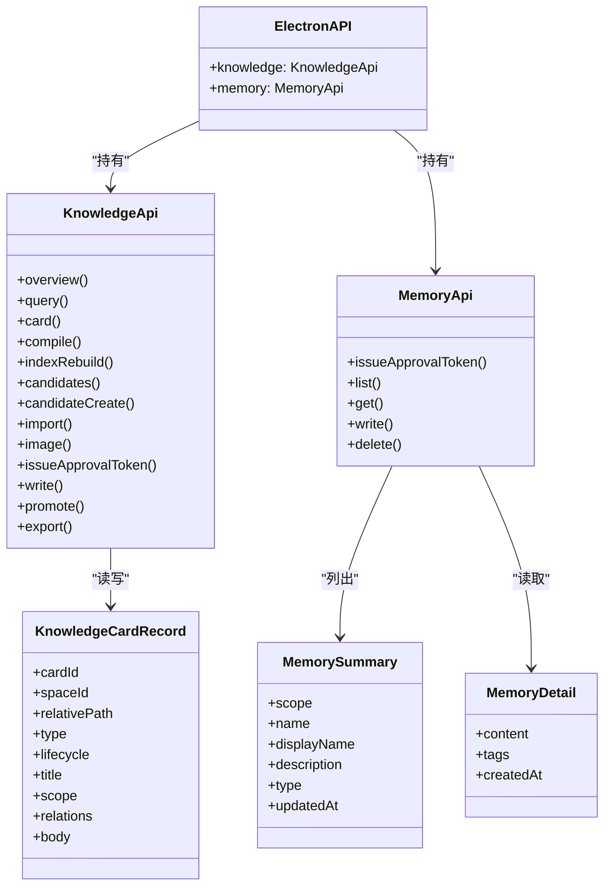

# 知识与记忆 API 类型定义

<cite>
**本文引用的文件**   
- [src/shared/types/electron.ts](file://src/shared/types/electron.ts)
- [src/shared/types/electron-api.ts](file://src/shared/types/electron-api.ts)
- [src/shared/types/electron/knowledge.ts](file://src/shared/types/electron/knowledge.ts)
- [src/shared/types/electron/memory.ts](file://src/shared/types/electron/memory.ts)
- [src/shared/types/electron/index.ts](file://src/shared/types/electron/index.ts)
- [src/shared/types/knowledge.ts](file://src/shared/types/knowledge.ts)
- [src/shared/types/knowledgeExport.ts](file://src/shared/types/knowledgeExport.ts)
</cite>

## 目录

1. [引言](#引言)
2. [项目结构](#项目结构)
3. [核心组件](#核心组件)
4. [架构总览](#架构总览)
5. [详细组件分析](#详细组件分析)
6. [依赖关系分析](#依赖关系分析)
7. [性能与一致性特征](#性能与一致性特征)
8. [故障排查指南](#故障排查指南)
9. [结论](#结论)

## 引言

本文面向实现者、调用方和维护者，系统化说明仓库中的“知识”和“记忆”能力类型契约。重点包括：

- `KnowledgeApi` 和 `MemoryApi` 的完整 IPC 接口。
- `KnowledgeCardRecord`、`KnowledgeOverviewResult`、`MemorySummary`、`MemoryDetail` 等核心数据模型。
- 知识卡片的查询、索引重建、候选知识、导入导出、审批令牌机制。
- 记忆的 `user/project` 作用域管理、`approvalToken` 安全模式、标签分类系统。
- 知识检索、卡片编辑、记忆写入和权限控制的典型使用流程。

这些类型主要位于共享类型层，通过 Electron 渲染进程与主进程之间的 IPC 暴露给前端界面和工具链。

## 项目结构

知识与记忆相关类型分布在以下位置：

| 路径 | 职责 |
|---|---|
| `src/shared/types/electron.ts` | 定义 `ElectronAPI`，集中声明 `knowledge`、`memory` 等 IPC 方法，以及 `MemorySummary`、`MemoryDetail`、`MemoryWriteRequest`、`MemoryApprovalTokenRequest`。 |
| `src/shared/types/electron/knowledge.ts` | 将 `KnowledgeApi` 定义为 `ElectronAPI['knowledge']`，作为类型别名入口。 |
| `src/shared/types/electron/memory.ts` | 将 `MemoryApi` 定义为 `ElectronAPI['memory']`，作为类型别名入口。 |
| `src/shared/types/electron/index.ts` | 统一重新导出 `KnowledgeApi`、`MemoryApi`，供上层按模块引用。 |
| `src/shared/types/electron-api.ts` | 向渲染侧暴露 `RendererElectronApi`，并重新导出 `KnowledgeApi`、`MemoryApi`。 |
| `src/shared/types/knowledge.ts` | 定义知识卡片、空间、索引、检索、编译包、候选项、导入结果等类型。 |
| `src/shared/types/knowledgeExport.ts` | 定义知识导出格式、包结构、导出请求和导出结果。 |

**图表来源**
- [src/shared/types/electron.ts:201-320](file://src/shared/types/electron.ts#L201-L320)
- [src/shared/types/knowledge.ts:1-302](file://src/shared/types/knowledge.ts#L1-L302)
- [src/shared/types/knowledgeExport.ts:1-61](file://src/shared/types/knowledgeExport.ts#L1-L61)
- [src/shared/types/electron/knowledge.ts:1-3](file://src/shared/types/electron/knowledge.ts#L1-L3)
- [src/shared/types/electron/memory.ts:1-3](file://src/shared/types/electron/memory.ts#L1-L3)
- [src/shared/types/electron/index.ts:1-19](file://src/shared/types/electron/index.ts#L1-L19)
- [src/shared/types/electron-api.ts:1-32](file://src/shared/types/electron-api.ts#L1-L32)

**章节来源**
- [src/shared/types/electron.ts:201-320](file://src/shared/types/electron.ts#L201-L320)
- [src/shared/types/electron/knowledge.ts:1-3](file://src/shared/types/electron/knowledge.ts#L1-L3)
- [src/shared/types/electron/memory.ts:1-3](file://src/shared/types/electron/memory.ts#L1-L3)
- [src/shared/types/electron/index.ts:1-19](file://src/shared/types/electron/index.ts#L1-L19)
- [src/shared/types/electron-api.ts:1-32](file://src/shared/types/electron-api.ts#L1-L32)
- [src/shared/types/knowledge.ts:1-302](file://src/shared/types/knowledge.ts#L1-L302)
- [src/shared/types/knowledgeExport.ts:1-61](file://src/shared/types/knowledgeExport.ts#L1-L61)

## 核心组件

### KnowledgeApi

`KnowledgeApi` 是渲染进程访问主进程知识能力的 IPC 类型入口。它本身不直接包含字段，而是复用 `ElectronAPI['knowledge']`。其关键方法如下：

| 方法 | 入参要点 | 返回要点 | 语义 |
|---|---|---|---|
| `overview()` | 无 | `KnowledgeOverviewResult` | 获取知识空间和索引概览。 |
| `query(request)` | `KnowledgeQueryRequest` | `KnowledgeQueryResult` | 按多车道检索知识卡片。 |
| `card(spaceId, relativePath)` | 空间 ID、相对路径 | `{ card }` | 读取单张卡片详情。 |
| `compile(request)` | 查询参数 + 可选 `limit` | `KnowledgePack` | 将检索命中编译为可分析的包。 |
| `indexRebuild()` | 无 | 修订号、构建时间、卡片数 | 重建知识索引。 |
| `candidates(sessionId)` | 会话 ID | `KnowledgeCandidatesResult` | 列出当前会话的知识候选项。 |
| `candidateCreate(request)` | 会话 ID、卡片记录、显式用户意图标记 | `SessionKnowledgeCandidate` | 根据显式用户意图创建候选知识。 |
| `import(request)` | 空间 ID、可选会话 ID、源标识或文件路径 | `KnowledgeImportResult` | 批量导入知识。 |
| `image(request)` | 空间 ID、图片相对路径 | `{ dataUrl, error }` | 读取知识关联图片。 |
| `issueApprovalToken(request)` | 动作、空间 ID、相对路径 | `{ token, error }` | 申请写或晋升审批令牌。 |
| `write(request)` | 空间 ID、卡片记录、权限模式、人类确认、审批令牌 | `{ card }` | 写入知识卡片。 |
| `promote(request)` | 空间 ID、卡片记录、目标生命周期、权限模式、人类确认、审批令牌 | `{ card }` | 晋升或归档知识卡片。 |
| `export(request)` | `KnowledgeExportRequest` | `KnowledgeExportResult` | 导出知识包或 Markdown。 |

**章节来源**
- [src/shared/types/electron.ts:201-320](file://src/shared/types/electron.ts#L201-L320)
- [src/shared/types/electron/knowledge.ts:1-3](file://src/shared/types/electron/knowledge.ts#L1-L3)

### MemoryApi

`MemoryApi` 是渲染进程访问主进程记忆能力的 IPC 类型入口，对应 `ElectronAPI['memory']`。其关键方法如下：

| 方法 | 入参要点 | 返回要点 | 语义 |
|---|---|---|---|
| `issueApprovalToken(request)` | 动作、作用域、名称、项目根路径 | `{ token, error }` | 申请记忆写入或删除令牌。 |
| `list(scope, projectRoot?)` | `user` 或 `project`、可选项目根路径 | `{ memories }` | 列出记忆摘要。 |
| `get(scope, name, projectRoot?)` | 作用域、名称、可选项目根路径 | `{ memory }` | 读取记忆详情。 |
| `write(request)` | `MemoryWriteRequest` | `{ success, name, error }` | 写入记忆。 |
| `delete(scope, name, approvalToken, projectRoot?)` | 作用域、名称、审批令牌、可选项目根路径 | `{ success, error }` | 删除记忆。 |

**章节来源**
- [src/shared/types/electron.ts:201-260](file://src/shared/types/electron.ts#L201-L260)
- [src/shared/types/electron/memory.ts:1-3](file://src/shared/types/electron/memory.ts#L1-L3)

### 核心数据模型

#### 知识卡片基础枚举

| 类型 | 取值 | 用途 |
|---|---|---|
| `KnowledgeCardType` | `fact`、`constraint`、`pattern`、`procedure`、`case`、`model` | 知识卡片类型。 |
| `KnowledgeLifecycle` | `draft`、`candidate`、`verified`、`promoted`、`retired` | 知识生命周期。 |
| `KnowledgeRelationKind` | `supports`、`contradicts`、`specializes`、`generalizes`、`derived_from`、`validated_by`、`invalidated_by`、`applies_to`、`excludes`、`supersedes`、`related_to`、`recommended_for`、`failed_in` | 卡片间关系种类。 |
| `KnowledgeCaseChapter` | `claim`、`scopeExclusions`、`symptoms`、`evidence`、`rootCause`、`experimentVerification`、`fix`、`negative`、`openChallenges`、`derived` | 案例型卡片的章节字段。 |
| `KnowledgeScopeAxis` | `project`、`engine`、`engineVersion`、`api`、`platform`、`gpuVendor`、`gpuArch`、`device`、`driver`、`capture`、`pipelineStage`、`pass`、`shaderFamily`、`materialFamily`、`quality`、`resolution`、`featureConfiguration` | 知识作用域维度。 |
| `KnowledgeRetrievalLane` | `Identity/Path`、`Scope/Metadata`、`Lexical`、`Structural`、`Relation/Graph`、`Temporal/Version` | 知识检索车道。 |
| `KnowledgeImageRole` | `observed`、`reference`、`illustration` | 知识图片角色。 |
| `KnowledgeSpaceKind` | `user`、`project` | 知识空间类型。 |
| `KnowledgeExportFormat` | `package`、`markdown` | 导出格式。 |
| `KnowledgeExportScope` | `selected`、`filtered`、`space` | 导出范围。 |
| `KnowledgeImportStatus` | `draft`、`quarantine`、`conflict` | 导入条目状态。 |

**章节来源**
- [src/shared/types/knowledge.ts:1-120](file://src/shared/types/knowledge.ts#L1-L120)
- [src/shared/types/knowledge.ts:201-302](file://src/shared/types/knowledge.ts#L201-L302)
- [src/shared/types/knowledgeExport.ts:1-61](file://src/shared/types/knowledgeExport.ts#L1-L61)

#### KnowledgeCardRecord

`KnowledgeCardRecord` 是知识卡片的核心持久化投影，表示一个知识空间的卡片记录：

| 字段 | 类型 | 含义 |
|---|---|---|
| `cardId` | `string` | 卡片唯一标识。 |
| `spaceId` | `string` | 所属知识空间标识。 |
| `relativePath` | `string` | 卡片在空间下的相对路径。 |
| `type` | `KnowledgeCardType` | 卡片类型。 |
| `lifecycle` | `KnowledgeLifecycle` | 卡片生命周期。 |
| `title` | `string` | 卡片标题。 |
| `scope` | `KnowledgeScope` | 多维作用域映射，包含可选排除项。 |
| `relations` | `KnowledgeRelation[]` | 与其他卡片的声明关系。 |
| `body` | `string` | 卡片正文。 |
| `preview?` | `string` | 列表预览文本。 |
| `updatedAt?` | `number` | 更新时间戳。 |
| `sourceStatus?` | `string` | 原始 YAML 元数据状态；`fixed` 不被视为已验证。 |
| `caseId?` | `string` | 案例卡片关联的示例 ID。 |
| `chapters?` | `KnowledgeCaseChapters` | 案例章节内容。 |
| `images?` | `KnowledgeImageRef[]` | 关联图片引用。 |
| `missingAssets?` | `string[]` | 导入时缺失附件的脱敏 ID。 |
| `sourceHash?` | `string` | 导入来源哈希，从不输出绝对路径或原始文件名。 |
| `sourceMtimeMs?` | `number` | 导入来源修改时间。 |
| `sourceSize?` | `number` | 导入来源大小。 |

该记录同时作为导入、查询、编译、候选和写回的基础载体。

**章节来源**
- [src/shared/types/knowledge.ts:120-200](file://src/shared/types/knowledge.ts#L120-L200)

#### KnowledgeOverviewResult

`KnowledgeOverviewResult` 描述知识系统的顶层概览：

| 字段 | 类型 | 含义 |
|---|---|---|
| `spaces` | `KnowledgeSpace[]` | 所有知识空间。 |
| `index` | `KnowledgeIndexOverview \| null` | 当前索引概览；可能为空，表示尚未构建或不可用。 |

其中 `KnowledgeSpace` 包含 `spaceId`、`kind`、`label`、`rootPath`、可选 `projectId`；`KnowledgeIndexOverview` 包含 `revision`、`builtAt`、`cardCount`、`cardsBySpace`。

**章节来源**
- [src/shared/types/knowledge.ts:180-200](file://src/shared/types/knowledge.ts#L180-L200)
- [src/shared/types/knowledge.ts:240-250](file://src/shared/types/knowledge.ts#L240-L250)

#### MemorySummary 与 MemoryDetail

`MemorySummary` 是记忆面板的列表视图：

| 字段 | 类型 | 含义 |
|---|---|---|
| `scope` | `'user' \| 'project'` | 记忆作用域。 |
| `name` | `string` | 规范存储键，不应直接作为展示文本。 |
| `displayName` | `string` | 面向用户的显示名称。 |
| `description` | `string` | 记忆描述。 |
| `type` | `'user' \| 'feedback' \| 'project' \| 'reference'` | 记忆类型。 |
| `updatedAt` | `number` | 更新时间戳。 |

`MemoryDetail` 扩展了完整正文和元数据：

| 字段 | 类型 | 含义 |
|---|---|---|
| `content` | `string` | 记忆正文。 |
| `tags?` | `string[]` | 可选标签数组。 |
| `createdAt` | `number` | 创建时间戳。 |

**章节来源**
- [src/shared/types/electron.ts:201-240](file://src/shared/types/electron.ts#L201-L240)

### 记忆安全与权限模型

记忆写入和删除必须通过主进程发放的 `approvalToken`：

| 类型 | 字段 | 语义 |
|---|---|---|
| `MemoryWriteRequest` | `scope` | `user` 或 `project`。 |
| `MemoryWriteRequest` | `projectRoot?` | 当作用域为 `project` 时可指定项目根路径。 |
| `MemoryWriteRequest` | `approvalToken` | 必须由 `issueApprovalToken` 获取，不能由渲染端自行构造。 |
| `MemoryWriteRequest` | `name` | 记忆名称。 |
| `MemoryWriteRequest` | `description` | 记忆描述。 |
| `MemoryWriteRequest` | `type` | 记忆类型。 |
| `MemoryWriteRequest` | `content` | 记忆正文。 |
| `MemoryWriteRequest` | `tags?` | 记忆标签。 |
| `MemoryApprovalTokenRequest` | `action` | `memory.write` 或 `memory.delete`。 |
| `MemoryApprovalTokenRequest` | `scope` | `user` 或 `project`。 |
| `MemoryApprovalTokenRequest` | `name?` | 待操作记忆名称。 |
| `MemoryApprovalTokenRequest` | `projectRoot?` | 项目作用域下的项目根路径。 |

**图表来源**
- [src/shared/types/electron.ts:201-260](file://src/shared/types/electron.ts#L201-L260)

**章节来源**
- [src/shared/types/electron.ts:201-260](file://src/shared/types/electron.ts#L201-L260)

## 架构总览

知识系统围绕“空间—卡片—索引—检索—候选—导入—导出—审批”组织。记忆系统则围绕“作用域—令牌—写入—删除—标签—类型”组织。

**图表来源**
- [src/shared/types/electron.ts:201-320](file://src/shared/types/electron.ts#L201-L320)
- [src/shared/types/knowledge.ts:1-302](file://src/shared/types/knowledge.ts#L1-L302)
- [src/shared/types/knowledgeExport.ts:1-61](file://src/shared/types/knowledgeExport.ts#L1-L61)

## 详细组件分析

### 知识检索与索引

`KnowledgeApi.query` 接收 `KnowledgeQueryRequest`，支持按空间、文本、卡片 ID、相对路径、类型、生命周期、作用域、关系目标、时间点、检索车道进行筛选。返回 `KnowledgeQueryResult`，包含每个车道的命中结果。

`KnowledgeApi.indexRebuild` 触发索引重建，返回 `KnowledgeIndexOverview` 的子集：修订号、构建时间和卡片数量。

`KnowledgeApi.compile` 把查询结果编译为 `KnowledgePack`，用于冲突分析和结构化消费。

**图表来源**
- [src/shared/types/knowledge.ts:201-250](file://src/shared/types/knowledge.ts#L201-L250)
- [src/shared/types/electron.ts:201-280](file://src/shared/types/electron.ts#L201-L280)

**章节来源**
- [src/shared/types/knowledge.ts:201-250](file://src/shared/types/knowledge.ts#L201-L250)
- [src/shared/types/electron.ts:201-280](file://src/shared/types/electron.ts#L201-L280)

### 知识卡片 CRUD

知识卡片的“读”主要通过 `card` 和 `query` 完成，“写”和“晋升”通过 `write` 与 `promote` 完成。所有写操作都需要：

- `spaceId`：目标知识空间。
- `card`：`KnowledgeCardRecord`。
- `permissionMode`：代理权限模式。
- `confirmation`：显式人类确认标记。
- `approvalToken`：从 `issueApprovalToken` 获取的审批令牌。

**图表来源**
- [src/shared/types/electron.ts:280-320](file://src/shared/types/electron.ts#L280-L320)
- [src/shared/types/knowledge.ts:120-200](file://src/shared/types/knowledge.ts#L120-L200)

**章节来源**
- [src/shared/types/electron.ts:280-320](file://src/shared/types/electron.ts#L280-L320)
- [src/shared/types/knowledge.ts:120-200](file://src/shared/types/knowledge.ts#L120-L200)

### 候选知识管理

候选知识用于将一次交互中生成的知识建议与具体会话绑定：

| 类型 | 字段 | 含义 |
|---|---|---|
| `SessionKnowledgeCandidate` | `candidateId` | 候选 ID。 |
| `SessionKnowledgeCandidate` | `sessionId` | 所属会话。 |
| `SessionKnowledgeCandidate` | `card` | 卡片记录。 |
| `SessionKnowledgeCandidate` | `createdAt` | 创建时间。 |
| `SessionKnowledgeCandidate` | `source` | 固定为 `explicit-user-intent`。 |
| `KnowledgeCandidatesResult` | `candidates` | 候选集合。 |

`candidateCreate` 要求显式用户意图，防止自动推断误写入知识系统。

**章节来源**
- [src/shared/types/knowledge.ts:250-270](file://src/shared/types/knowledge.ts#L250-L270)
- [src/shared/types/electron.ts:280-300](file://src/shared/types/electron.ts#L280-L300)

### 批量导入与导出

导入通过 `import` 返回 `KnowledgeImportResult`，其中 `items` 是 `KnowledgeImportItem` 列表，每项包含导入状态、生命周期、缺失资产、原因、已有案例或卡片 ID 等。

导出通过 `export` 支持两种格式：

| 格式 | 特点 |
|---|---|
| `package` | 机器可读、可再导入，携带 `rdc.knowledge-package/1` schema。 |
| `markdown` | 便于阅读，但不可再导入。 |

导出包 `KnowledgePackage` 只携带机器本地可剥离的字段，如绝对路径和某些来源信息，避免泄露导出机器的内部路径。

**图表来源**
- [src/shared/types/knowledgeExport.ts:1-61](file://src/shared/types/knowledgeExport.ts#L1-L61)
- [src/shared/types/electron.ts:300-320](file://src/shared/types/electron.ts#L300-L320)

**章节来源**
- [src/shared/types/knowledgeExport.ts:1-61](file://src/shared/types/knowledgeExport.ts#L1-L61)
- [src/shared/types/electron.ts:300-320](file://src/shared/types/electron.ts#L300-L320)

### 记忆的作用域、标签与分类

记忆的作用域分为 `user` 和 `project`：

- `user`：属于用户级记忆。
- `project`：属于项目级记忆，通常配合 `projectRoot` 限定项目上下文。

记忆的分类由 `type` 表达：

| 类型 | 适用场景 |
|---|---|
| `user` | 用户个人笔记或偏好。 |
| `feedback` | 反馈类记忆。 |
| `project` | 项目级知识或配置。 |
| `reference` | 参考类记忆。 |

标签系统通过 `tags?: string[]` 提供轻量分类能力，适合前端快速筛选，但不承担强约束语义。

**章节来源**
- [src/shared/types/electron.ts:201-260](file://src/shared/types/electron.ts#L201-L260)

## 依赖关系分析

**图表来源**
- [src/shared/types/electron.ts:201-320](file://src/shared/types/electron.ts#L201-L320)
- [src/shared/types/knowledge.ts:120-200](file://src/shared/types/knowledge.ts#L120-L200)
- [src/shared/types/electron/memory.ts:1-3](file://src/shared/types/electron/memory.ts#L1-L3)

**章节来源**
- [src/shared/types/electron.ts:201-320](file://src/shared/types/electron.ts#L201-L320)
- [src/shared/types/knowledge.ts:120-200](file://src/shared/types/knowledge.ts#L120-L200)

## 性能与一致性特征

- 知识检索支持多车道过滤，减少无关搜索路径，提高响应选择性。
- 索引结果以 `KnowledgeIndexOverview` 形式暴露修订号和构建时间，便于缓存失效判断。
- `KnowledgeOverviewResult.index` 可为空，表示索引尚未就绪，前端应避免假设索引始终存在。
- 知识导出区分 `package` 与 `markdown`，避免错误地把不可再导入的 Markdown 当作可迁移包。
- 导入结果使用 `KnowledgeImportItem` 列表，允许部分成功或部分隔离，而不是简单整体失败。
- 记忆写入和删除强制使用 `approvalToken`，降低渲染进程直接写入敏感资源的攻击面。

[本节为通用性能与一致性说明，不直接分析具体代码片段]

## 故障排查指南

| 现象 | 可能原因 | 处理建议 |
|---|---|---|
| `knowledge.overview().index` 为 `null` | 索引未构建或不可用 | 调用 `indexRebuild()` 后重试。 |
| `knowledge.write` 或 `knowledge.promote` 报错 | `approvalToken` 过期、作用域不匹配或缺少人类确认 | 重新调用 `issueApprovalToken`，并确保传入正确的 `spaceId`、`relativePath`、`permissionMode` 和显式确认。 |
| 记忆写入失败 | 缺少 `approvalToken` 或作用域不一致 | 先调用 `memory.issueApprovalToken`，再使用相同 `scope`、`projectRoot`、`name` 发起写入。 |
| 记忆列表为空 | 作用域或项目根路径不正确 | 检查 `scope` 是否为 `user` 或 `project`，并在项目模式下传入正确 `projectRoot`。 |
| 导入结果出现 `quarantine` 或 `conflict` | 导入内容缺失附件或与现有内容冲突 | 查看 `KnowledgeImportItem.reason` 和 `missingAssets`，修正后重新导入。 |
| 导出结果为 `excludedCount > 0` | 部分卡片携带机密或绝对路径被丢弃 | 检查导出前的卡片内容，移除敏感信息后再导出。 |

**章节来源**
- [src/shared/types/electron.ts:201-320](file://src/shared/types/electron.ts#L201-L320)
- [src/shared/types/knowledge.ts:250-302](file://src/shared/types/knowledge.ts#L250-L302)
- [src/shared/types/knowledgeExport.ts:1-61](file://src/shared/types/knowledgeExport.ts#L1-L61)

## 结论

`KnowledgeApi` 和 `MemoryApi` 构成了本仓库中知识与记忆能力的稳定类型边界。知识能力围绕卡片、空间、索引、检索、候选、导入导出和审批令牌展开；记忆能力围绕作用域、令牌、类型和标签展开。对于调用方而言，最重要的契约是：

- 不要绕过 `ElectronAPI` 直接访问文件系统。
- 所有写操作都必须先申请 `approvalToken`。
- 知识卡片必须通过 `spaceId` 和 `relativePath` 定位。
- 记忆作用域必须与 `projectRoot` 保持一致。
- 导入和导出应优先使用 `package` 格式以保证可迁移性。

这些类型定义保证了渲染进程、主进程、工具和测试之间对知识、记忆数据结构的共识，也为后续扩展提供了清晰的演进点。