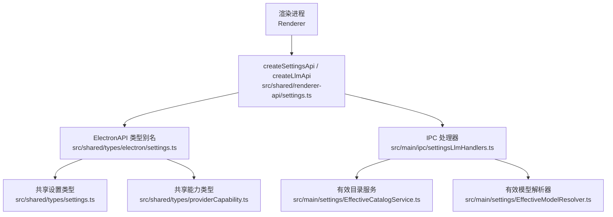
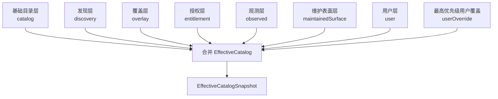
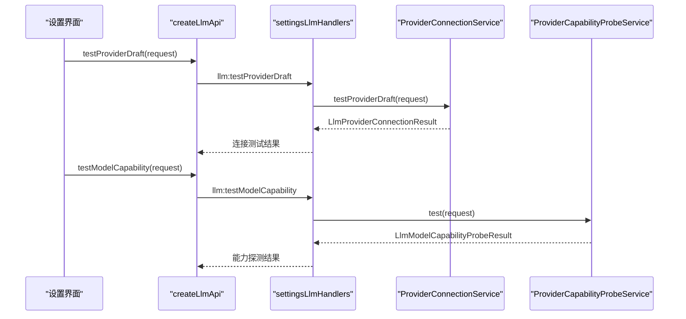
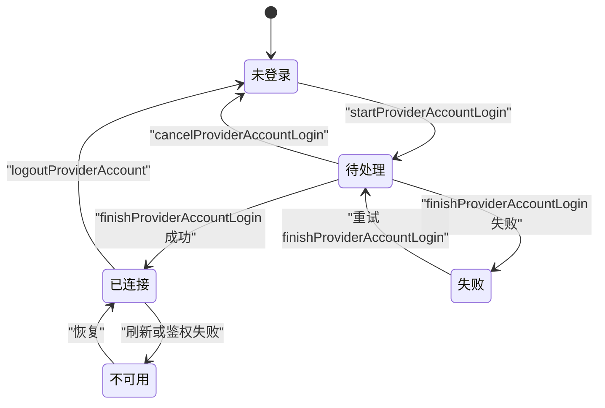
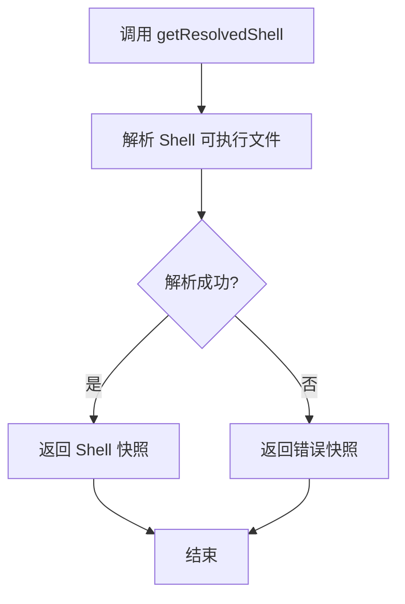
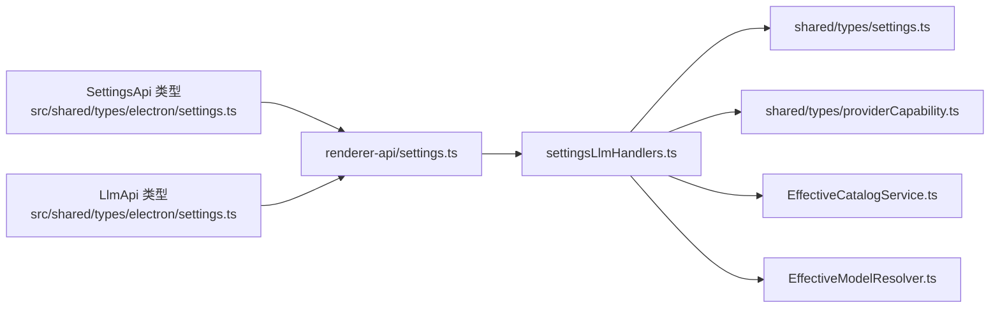

# 设置与 LLM API 类型定义

<cite>
**本文引用的文件**   
- [src/shared/renderer-api/settings.ts](file://src/shared/renderer-api/settings.ts)
- [src/shared/types/electron/settings.ts](file://src/shared/types/electron/settings.ts)
- [src/shared/types/electron-api.ts](file://src/shared/types/electron-api.ts)
- [src/shared/types/settings.ts](file://src/shared/types/settings.ts)
- [src/shared/types/providerCapability.ts](file://src/shared/types/providerCapability.ts)
- [src/main/ipc/settingsLlmHandlers.ts](file://src/main/ipc/settingsLlmHandlers.ts)
- [src/main/ipc/validation/ipcSchemas.ts](file://src/main/ipc/validation/ipcSchemas.ts)
- [src/main/ipc/validation/settingsLlmSchemas.ts](file://src/main/ipc/validation/settingsLlmSchemas.ts)
- [src/main/settings/EffectiveCatalogService.ts](file://src/main/settings/EffectiveCatalogService.ts)
- [src/main/settings/effectiveCatalogTypes.ts](file://src/main/settings/effectiveCatalogTypes.ts)
- [src/main/settings/EffectiveModelResolver.ts](file://src/main/settings/EffectiveModelResolver.ts)
</cite>

## 目录
1. [引言](#引言)
2. [项目结构定位](#项目结构定位)
3. [核心类型契约总览](#核心类型契约总览)
4. [SettingsApi 接口规范](#settingsapi-接口规范)
5. [LlmApi 接口规范](#llmapi-接口规范)
6. [应用配置模型 AppSettings 与 AppSettingsPatch](#应用配置模型-appsettings-与-appsettingspatch)
7. [有效模型与有效目录 EffectiveModel 与 EffectiveCatalogSnapshot](#有效模型与有效目录-effectivemodel-与-effectivecatalogsnapshot)
8. [Provider 认证流程与账户登录状态管理](#provider-认证流程与账户登录状态管理)
9. [Agent 清单导入、Provider 定义保存与 Shell 环境解析](#agent-清单导入provider-定义保存与-shell-环境解析)
10. [依赖关系分析](#依赖关系分析)
11. [性能与一致性特征](#性能与一致性特征)
12. [故障排查指南](#故障排查指南)
13. [结论](#结论)

## 引言
本文面向需要在渲染进程或扩展模块中调用后端设置与 LLM 能力的开发者，系统化说明 `SettingsApi` 和 `LlmApi` 的类型契约。重点包括：

- 渲染进程通过 Electron IPC 暴露的 Settings 与 LLM 能力接口。
- `AppSettings`、`AppSettingsPatch` 等全局配置的字段语义与校验边界。
- `EffectiveModel`、`EffectiveCatalogSnapshot` 作为运行时冻结的能力快照。
- Provider 连接测试、模型能力探测、账户登录、模型刷新等复杂交互。
- Agent 清单导入、Provider 定义持久化、Shell 解析、模型覆盖等高级配置。
- 结合仓库中的 IPC 处理器、服务类和类型定义给出可追溯的实现路径。

## 项目结构定位
设置与 LLM 类型定义分布在共享类型、渲染端 API 适配器和主进程 IPC 处理器三个层次：

**图表来源**
- [src/shared/renderer-api/settings.ts:1-86](file://src/shared/renderer-api/settings.ts#L1-L86)
- [src/shared/types/electron/settings.ts:1-4](file://src/shared/types/electron/settings.ts#L1-L4)
- [src/shared/types/settings.ts:1-683](file://src/shared/types/settings.ts#L1-L683)
- [src/shared/types/providerCapability.ts:1-396](file://src/shared/types/providerCapability.ts#L1-L396)
- [src/main/ipc/settingsLlmHandlers.ts:1-395](file://src/main/ipc/settingsLlmHandlers.ts#L1-L395)
- [src/main/settings/EffectiveCatalogService.ts:1-200](file://src/main/settings/EffectiveCatalogService.ts#L1-L200)
- [src/main/settings/EffectiveModelResolver.ts:1-200](file://src/main/settings/EffectiveModelResolver.ts#L1-L200)

**章节来源**
- [src/shared/renderer-api/settings.ts:1-86](file://src/shared/renderer-api/settings.ts#L1-L86)
- [src/shared/types/electron/settings.ts:1-4](file://src/shared/types/electron/settings.ts#L1-L4)
- [src/shared/types/electron-api.ts:1-32](file://src/shared/types/electron-api.ts#L1-L32)

## 核心类型契约总览
本项目的类型契约按职责分为四层：

| 层次 | 主要职责 | 关键类型 |
|---|---|---|
| 渲染端 API 适配层 | 将前端方法映射为 Electron IPC 调用 | `createSettingsApi`、`createLlmApi` |
| Electron 类型桥接层 | 把 `ElectronAPI['settings']`、`ElectronAPI['llm']` 暴露为稳定别名 | `SettingsApi`、`LlmApi` |
| 共享业务类型层 | 描述应用配置、Provider、模型、能力、请求计划等 | `AppSettings`、`AppSettingsPatch`、`EffectiveModel`、`EffectiveCatalogSnapshot`、`RequestPlan` |
| 主进程实现层 | 校验参数、持久化配置、计算有效目录、广播变更 | `settingsLlmHandlers`、`EffectiveCatalogService`、`EffectiveModelResolver` |

其中，`SettingsApi` 负责全局设置、Provider 目录、有效模型、Agent 清单、Provider 定义、Shell 解析；`LlmApi` 负责 Provider 连接、模型能力探测、账户登录生命周期。

**章节来源**
- [src/shared/renderer-api/settings.ts:1-86](file://src/shared/renderer-api/settings.ts#L1-L86)
- [src/shared/types/electron/settings.ts:1-4](file://src/shared/types/electron/settings.ts#L1-L4)
- [src/shared/types/settings.ts:1-683](file://src/shared/types/settings.ts#L1-L683)
- [src/shared/types/providerCapability.ts:1-396](file://src/shared/types/providerCapability.ts#L1-L396)

## SettingsApi 接口规范
`SettingsApi` 在渲染端由 `createSettingsApi` 构造，所有方法均通过统一通道转发到主进程 IPC 处理函数。

| 方法 | 输入语义 | 返回语义 | 典型用途 |
|---|---|---|---|
| `get()` | 无参数 | 当前 `AppSettings` | 初始化界面、读取用户偏好、工具链、LLM 配置 |
| `getProviderCatalog()` | 无参数 | Provider 目录元信息 | 列出内置 Provider、协议、分类 |
| `getEffectiveModel(agentId)` | Agent 角色标识 | `EffectiveModel` 或空值 | Composer 或 Agent 运行时根据路由选择模型 |
| `getEffectiveCatalog(providerId, accountId?)` | Provider 标识与可选账户标识 | `EffectiveCatalogSnapshot` | 获取 Provider 下可用模型及能力证据 |
| `hasProviderSecret(providerId)` | Provider 标识 | 布尔值 | UI 显示是否已存储密钥 |
| `importAgentManifest(filePath)` | 本地 Agent 清单路径 | 更新后的 `AppSettings` | 导入 `.agent.md` 或清单并重建 Agent 选项 |
| `saveAgentDefinition(request)` | Agent 定义保存请求 | Agent 定义提交结果 | 保存 Agent 清单并提交版本 |
| `getAgentDefinitionCommit(query)` | 查询条件 | 历史提交快照 | 查看 Agent 清单变更记录 |
| `saveProviderDefinition(request)` | Provider 定义保存请求 | Provider 保存结果 | 保存自定义 Provider 配置 |
| `getProviderDefinitionCommit(providerId)` | Provider 标识 | Provider 定义提交快照 | 查看 Provider 定义版本 |
| `getModelsOverride()` | 无参数 | 模型覆盖配置 | 读取 models.json 类覆盖 |
| `setModelsOverride(overrides)` | 模型覆盖配置 | 已保存覆盖 | 写入模型覆盖并广播受影响目录 |
| `getResolvedShell(executable)` | Shell 可执行标识 | Shell 解析快照 | 解析 pwsh、zsh、bash 等环境 |
| `set(settings)` | `AppSettingsPatch` | 更新后的 `AppSettings` | 批量修改应用设置并同步 Provider 目录 |

### 关键约束
- `getEffectiveCatalog` 支持可选的 `accountId`：非空字符串时按账户作用域查询，否则使用默认作用域。
- `getEffectiveModel` 会先解析 Agent 编译路由，再加载 Provider 表面并解析 `EffectiveModel`。
- `set` 会对 `appearance` 触发产品图标更新，并对变化的 Provider 重新广播有效目录。
- `getResolvedShell` 返回成功或失败两种形态，错误时不包含异常堆栈，而是结构化 `ok: false`。

**章节来源**
- [src/shared/renderer-api/settings.ts:1-86](file://src/shared/renderer-api/settings.ts#L1-L86)
- [src/main/ipc/settingsLlmHandlers.ts:200-395](file://src/main/ipc/settingsLlmHandlers.ts#L200-L395)
- [src/main/ipc/validation/ipcSchemas.ts:65-75](file://src/main/ipc/validation/ipcSchemas.ts#L65-L75)

## LlmApi 接口规范
`LlmApi` 提供与 LLM Provider 交互的能力，包括测试草稿、连接、刷新模型、断开、账户登录、能力探测等。

| 方法 | 输入语义 | 返回语义 | 行为说明 |
|---|---|---|---|
| `testProviderDraft(request)` | `LlmProviderDraftRequest` | `LlmProviderConnectionResult` | 不提交持久配置，仅验证连接与模型发现 |
| `testModelCapability(request)` | `LlmModelCapabilityProbeRequest` | `LlmModelCapabilityProbeResult` | 对指定模型发起能力探测并记录证据 |
| `connectProvider(request)` | `LlmProviderDraftRequest` | `LlmProviderConnectionResult` | 创建或更新 Provider 连接并刷新目录 |
| `refreshProviderModels(providerId)` | Provider 标识 | `LlmProviderConnectionResult` | 刷新该 Provider 的模型列表 |
| `disconnectProvider(providerId)` | Provider 标识 | 连接操作结果 | 断开 Provider 并清理状态 |
| `startProviderAccountLogin(request)` | 账户登录开始请求 | 账户登录状态 | 启动浏览器或设备码流程 |
| `getProviderAccountStatus(providerId)` | Provider 标识 | `LlmProviderAccountStatus` | 查询登录阶段、令牌、模型等信息 |
| `finishProviderAccountLogin(request)` | 账户登录完成请求 | 账户登录状态 | 完成授权回调或设备码交换 |
| `cancelProviderAccountLogin(providerId)` | Provider 标识 | 无返回值 | 取消进行中的账户登录 |
| `logoutProviderAccount(providerId)` | Provider 标识 | 登出结果 | 撤销账户会话并刷新配置 |

### 认证模式与协议分离
- `LlmProviderAuthMode` 表示认证方式：`none`、`api-key`、`local`、`account`、`environment`。
- `LlmProviderProtocol` 表示实际网络协议：OpenAI、Anthropic、Azure、Google、Bedrock、Ollama 等。
- 两者正交：同一 Provider 可能同时支持多种认证模式和协议路由。

**章节来源**
- [src/shared/renderer-api/settings.ts:1-86](file://src/shared/renderer-api/settings.ts#L1-L86)
- [src/shared/types/settings.ts:1-683](file://src/shared/types/settings.ts#L1-L683)
- [src/main/ipc/settingsLlmHandlers.ts:1-200](file://src/main/ipc/settingsLlmHandlers.ts#L1-L200)

## 应用配置模型 AppSettings 与 AppSettingsPatch
`AppSettings` 是完整的应用配置快照，`AppSettingsPatch` 是可增量提交的补丁。

### AppSettings 字段概览
| 字段 | 类型 | 含义 |
|---|---|---|
| `appearance` | `UiPreferences` | 主题、语言、字体缩放、编辑器 Markdown、光标样式、Chrome 主题 |
| `layout` | `LayoutPreferences` | 左侧栏、右侧面板、终端、窗口布局 |
| `profile` | `ProfileSettings` | 昵称、头像路径 |
| `tooling` | `ToolingSettings` | RDC CLI、代码解释器、Agent Shell |
| `agentRuntime` | `AgentRuntimeSettings` | Agent 权限模式、上下文压缩阈值 |
| `llm` | `LlmSettings` | Provider 列表、Agent 路由 |
| `agents` | `AgentManifestSettings` | Agent 清单、全局指令、模型选项 |
| `resourceCatalog` | `RuntimeResourceCatalog` | 可用技能、MCP 服务器、诊断 |
| `paths` | `AppRuntimePaths` | 用户根目录、设置路径、日志路径、项目路径等 |

### AppSettingsPatch 字段概览
`AppSettingsPatch` 是嵌套的部分类型，允许只修改需要变更的子树：

| 补丁子树 | 可修改内容 |
|---|---|
| `appearance` | 主题、语言、字体缩放、Markdown 开关、光标、Chrome 主题 |
| `layout` | 侧边栏宽度、终端高度、窗口几何 |
| `profile` | 昵称、头像路径 |
| `tooling` | RDC CLI、代码解释器、Shell 可执行路径 |
| `agentRuntime` | 权限模式、可读/可写根、命令前缀、上下文压缩百分比 |
| `llm.providers` | Provider 列表 |
| `agents.globalInstructions` | Agent 全局指令 |

### 验证规则
- `set` 接收 `AppSettingsPatch`，主进程通过 IPC 参数校验后合并到现有设置。
- 修改 `appearance` 会触发产品图标更新。
- 修改 `llm.providers` 会重新应用当前 LLM 配置，并对发生变化的 Provider 广播有效目录。
- 修改 Shell 相关字段会影响 Agent 运行时的命令执行环境。

**章节来源**
- [src/shared/types/settings.ts:200-683](file://src/shared/types/settings.ts#L200-L683)
- [src/main/ipc/settingsLlmHandlers.ts:330-395](file://src/main/ipc/settingsLlmHandlers.ts#L330-L395)

## 有效模型与有效目录 EffectiveModel 与 EffectiveCatalogSnapshot
`EffectiveModel` 不是简单配置项，而是 Provider、Catalog、用户覆盖、能力探测、配额与绑定共同计算出的运行时真值。`EffectiveCatalogSnapshot` 是某个 Provider 下全部 `EffectiveModel` 的冻结快照。

### EffectiveModel 关键字段
| 字段类别 | 字段 | 语义 |
|---|---|---|
| 标识 | `providerId`、`vendorId`、`modelId` | 所属 Provider、厂商、模型 |
| 展示 | `label`、`aliases`、`enabled` | 标签、别名、用户启用开关 |
| 路由 | `route`、`routeOptions`、`preferredRouteOptionId` | 协议、Base URL、Header、合同、首选路由选项 |
| 可用性 | `availability`、`unavailableReason` | 可用、不可用、未知及原因 |
| 存在策略 | `presencePolicy` | 模型存在性来源策略 |
| 上下文 | `contextTiers`、`defaultBudgetTokens` | 上下文层级、预算、成本 |
| 控制项 | `controls.fast`、`controls.maxContext`、`controls.reasoning` | Fast、Max Context、推理模式 |
| 能力 | `toolCalling`、`visionInput`、`structuredOutput` | 工具调用、视觉输入、结构化输出能力 |
| 执行 | `executionBindings`、`bindingResolutions` | 执行绑定及其解析结果 |
| 观测 | `provenance` | 能力证据来源、时间戳、修订号 |
| 其他 | `fixedTemperature`、`cost`、`quota` | 固定温度、成本、配额 |

### EffectiveCatalogSnapshot 关键字段
| 字段 | 语义 |
|---|---|
| `providerId` | 所属 Provider |
| `accountId` | 账户作用域 |
| `protocol` | 可选协议过滤 |
| `catalogRevision` | 目录修订号 |
| `models` | 该 Provider 下的 `EffectiveModel` 数组 |
| `generatedAt` | 生成时间 |
| `stale` | 是否过期 |
| `refreshing` | 是否正在刷新 |
| `lastRefreshError` | 最近一次刷新错误 |

### 计算来源
有效目录由多个图层合并而成：

**图表来源**
- [src/main/settings/effectiveCatalogTypes.ts:1-140](file://src/main/settings/effectiveCatalogTypes.ts#L1-L140)
- [src/main/settings/EffectiveCatalogService.ts:1-200](file://src/main/settings/EffectiveCatalogService.ts#L1-L200)

### 复杂度与稳定性
- `EffectiveCatalogService` 缓存 discovery、entitlement、observed 状态，并按 provider + account + protocol 键区分。
- 目录快照支持 TTL、退避刷新、监听广播。
- `EffectiveModelResolver` 在解析具体模型时，还会应用 Provider 路由投影、Agent 路由、模型覆盖和保守基线。

**章节来源**
- [src/shared/types/providerCapability.ts:1-396](file://src/shared/types/providerCapability.ts#L1-L396)
- [src/main/settings/effectiveCatalogTypes.ts:1-140](file://src/main/settings/effectiveCatalogTypes.ts#L1-L140)
- [src/main/settings/EffectiveCatalogService.ts:1-200](file://src/main/settings/EffectiveCatalogService.ts#L1-L200)
- [src/main/settings/EffectiveModelResolver.ts:1-200](file://src/main/settings/EffectiveModelResolver.ts#L1-L200)

## Provider 认证流程与账户登录状态管理
Provider 认证涉及三类概念：

1. **连接测试**：使用临时草稿配置测试连接与模型发现。
2. **持久连接**：保存 Provider 定义后进入正式连接。
3. **账户登录**：OAuth、设备码、浏览器跳转等账户级认证。

### 连接测试与模型能力探测

**图表来源**
- [src/shared/renderer-api/settings.ts:1-86](file://src/shared/renderer-api/settings.ts#L1-L86)
- [src/main/ipc/settingsLlmHandlers.ts:1-200](file://src/main/ipc/settingsLlmHandlers.ts#L1-L200)

### 账户登录状态机
账户登录状态包括 `signed-out`、`pending`、`connected`、`failed`、`unavailable`，并携带诊断信息、授权 URL、设备码、令牌刷新能力等。

**图表来源**
- [src/shared/types/settings.ts:560-683](file://src/shared/types/settings.ts#L560-L683)
- [src/main/ipc/settingsLlmHandlers.ts:150-200](file://src/main/ipc/settingsLlmHandlers.ts#L150-L200)

### 账户状态查询与配置同步
- `getProviderAccountStatus` 返回账户状态、消息、错误、授权模式、模型列表等。
- 当账户变为已连接时，主进程会调用 `applyCurrentLlmConfig` 并广播有效目录，使 Composer 和 Agent 能重新计算模型选项。

**章节来源**
- [src/shared/types/settings.ts:560-683](file://src/shared/types/settings.ts#L560-L683)
- [src/main/ipc/settingsLlmHandlers.ts:100-200](file://src/main/ipc/settingsLlmHandlers.ts#L100-L200)

## Agent 清单导入、Provider 定义保存与 Shell 环境解析
### Agent 清单导入
`importAgentManifest` 接收本地文件路径，由 `agentManifestService.importFile` 解析并写入 Agent 清单，然后返回注入有效模型选项后的 `AppSettings`。

- 输入：本地清单路径。
- 副作用：更新 Agent 清单、重建 Agent 模型选项。
- 输出：更新后的设置。

### Provider 定义保存
`saveProviderDefinition` 接收 `ProviderDefinitionSaveRequest`，包含目标 Provider 定义和客户端修订号。

- 成功后会：
  - 应用当前 LLM 配置。
  - 加载 Provider 表面。
  - 解析有效目录。
  - 持久化 catalog 修订号。
  - 广播 `llm:effectiveCatalogChanged`。
- 返回结果包含提交状态、哈希、最新成功快照和目录修订。

### Shell 环境解析
`getResolvedShell` 调用 `shellResolver.resolve`，返回解析后的 Shell 类型、版本、可执行路径和人类可读标签。

- 成功：`{ ok: true, kind, version, versionMajor, executable, label }`
- 失败：`{ ok: false, error }`

**图表来源**
- [src/main/ipc/settingsLlmHandlers.ts:360-395](file://src/main/ipc/settingsLlmHandlers.ts#L360-L395)

**章节来源**
- [src/main/ipc/settingsLlmHandlers.ts:230-395](file://src/main/ipc/settingsLlmHandlers.ts#L230-L395)

## 依赖关系分析

**图表来源**
- [src/shared/types/electron/settings.ts:1-4](file://src/shared/types/electron/settings.ts#L1-L4)
- [src/shared/renderer-api/settings.ts:1-86](file://src/shared/renderer-api/settings.ts#L1-L86)
- [src/main/ipc/settingsLlmHandlers.ts:1-395](file://src/main/ipc/settingsLlmHandlers.ts#L1-L395)

### 耦合关系说明
- `SettingsApi` 与 `LlmApi` 是纯类型别名，实际行为由 `createSettingsApi` 和 `createLlmApi` 实现。
- IPC 处理器是设置与 LLM 能力的主要调度中心，负责参数校验、服务调用、目录广播和配置同步。
- `EffectiveCatalogService` 负责目录缓存、TTL、观察层清理和广播。
- `EffectiveModelResolver` 负责将 Provider、Catalog、用户覆盖、Agent 路由合并为 `EffectiveModel`。

**章节来源**
- [src/shared/types/electron/settings.ts:1-4](file://src/shared/types/electron/settings.ts#L1-L4)
- [src/shared/renderer-api/settings.ts:1-86](file://src/shared/renderer-api/settings.ts#L1-L86)
- [src/main/ipc/settingsLlmHandlers.ts:1-395](file://src/main/ipc/settingsLlmHandlers.ts#L1-L395)
- [src/main/settings/EffectiveCatalogService.ts:1-200](file://src/main/settings/EffectiveCatalogService.ts#L1-L200)
- [src/main/settings/EffectiveModelResolver.ts:1-200](file://src/main/settings/EffectiveModelResolver.ts#L1-L200)

## 性能与一致性特征
- **缓存与去抖**：`EffectiveCatalogService` 使用 provider + account + protocol 键缓存 discovery、entitlement 和 observed 数据，避免重复网络请求。
- **退避刷新**：刷新失败时采用指数退避，防止频繁重试导致雪崩。
- **TTL 过期**：发现数据具有过期时间，过期后标记快照 stale，下次请求触发刷新。
- **广播机制**：Provider 连接、账户登录、Provider 定义保存、模型覆盖变更后，都会广播有效目录，保证渲染进程与主进程一致。
- **IPC 载荷限制**：多数 IPC 调用带有最大字节限制，例如 Provider 草稿、Agent 定义、模型覆盖等，防止超大负载阻塞事件循环。

[本节为通用性能分析，不直接分析特定代码片段]

## 故障排查指南
### EffectiveModel 能力解析失败
- 现象：`getEffectiveModel` 抛出错误或返回空值。
- 常见原因：
  - Agent 路由未匹配到 providerId 或 modelId。
  - Provider 表面未加载。
  - 能力探测或目录解析失败。
- 排查建议：
  - 检查 Agent 路由是否正确。
  - 确认 Provider 已连接且有效目录已广播。
  - 查看主进程日志中的能力解析失败记录。

**章节来源**
- [src/main/ipc/settingsLlmHandlers.ts:210-250](file://src/main/ipc/settingsLlmHandlers.ts#L210-L250)

### Provider 定义保存冲突
- 现象：保存结果为 `superseded` 或 `failed`。
- 常见原因：
  - 客户端修订号落后于服务端。
  - 并发编辑导致版本冲突。
- 排查建议：
  - 使用最新的 `clientRevision`。
  - 查看 `lastSuccessful` 快照恢复最后一次成功提交。
  - 检查返回的 `error` 字段。

**章节来源**
- [src/shared/types/settings.ts:430-520](file://src/shared/types/settings.ts#L430-L520)
- [src/main/ipc/settingsLlmHandlers.ts:300-360](file://src/main/ipc/settingsLlmHandlers.ts#L300-L360)

### Shell 解析失败
- 现象：`getResolvedShell` 返回 `ok: false`。
- 常见原因：
  - 可执行文件不存在。
  - 权限不足。
  - 命令行无法识别。
- 排查建议：
  - 检查 `executable` 是否为绝对路径。
  - 在系统终端中手动执行该命令。
  - 查看返回的 `error` 字符串。

**章节来源**
- [src/main/ipc/settingsLlmHandlers.ts:360-395](file://src/main/ipc/settingsLlmHandlers.ts#L360-L395)

## 结论
`SettingsApi` 与 `LlmApi` 构成了 RDC-Agent 设置与 LLM 能力的统一入口。其类型契约以共享类型为核心，通过渲染端适配器与主进程 IPC 处理器协作，形成从用户配置到运行时能力计算的完整链路。

理解这些类型的最佳方式是分层阅读：

1. 先看 `SettingsApi` 和 `LlmApi` 的方法签名，明确前端能调用什么。
2. 再看 `AppSettings`、`AppSettingsPatch`、`LlmProviderEntry`、`EffectiveModel`、`EffectiveCatalogSnapshot` 等核心模型，理解数据语义。
3. 最后结合 `settingsLlmHandlers`、`EffectiveCatalogService`、`EffectiveModelResolver`，理解数据如何被校验、合并、缓存和广播。

在实际使用中，推荐优先通过 `SettingsApi.getEffectiveCatalog` 和 `SettingsApi.getEffectiveModel` 获取运行时真值，而不是直接依赖用户配置；对于 Provider 配置，应通过 `saveProviderDefinition` 和 `connectProvider` 走完整生命周期，确保目录、路由、能力和凭证保持一致。