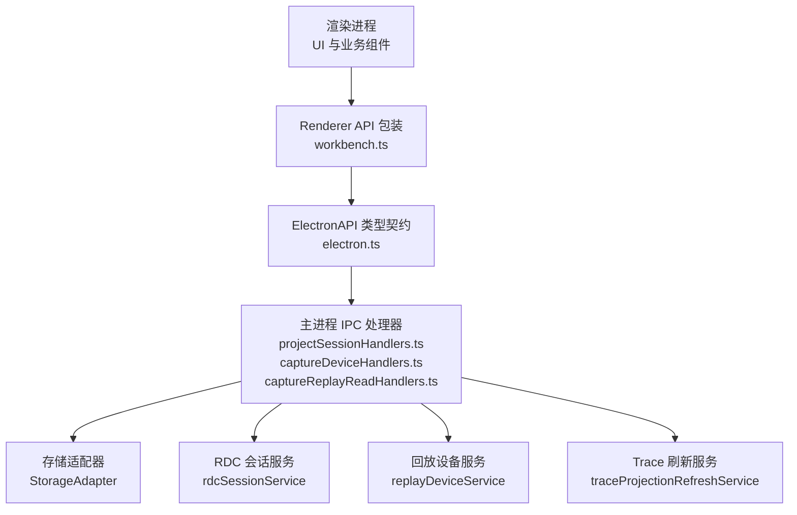
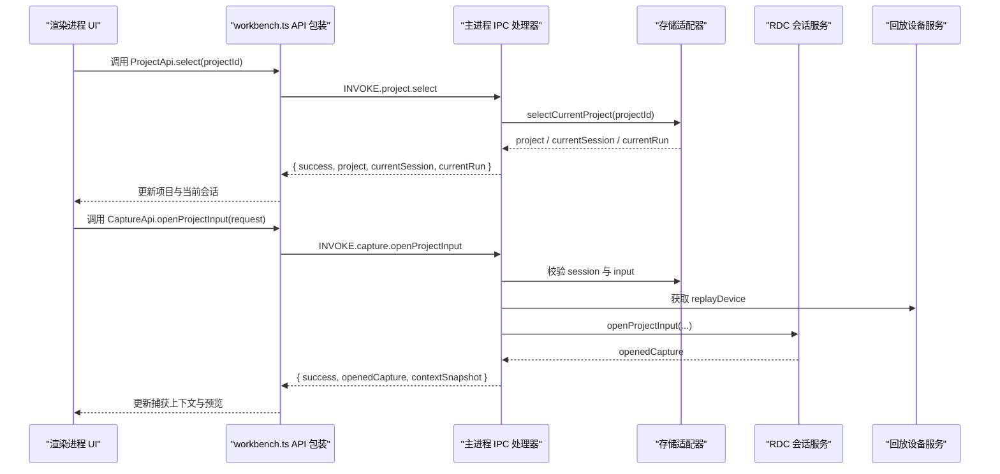
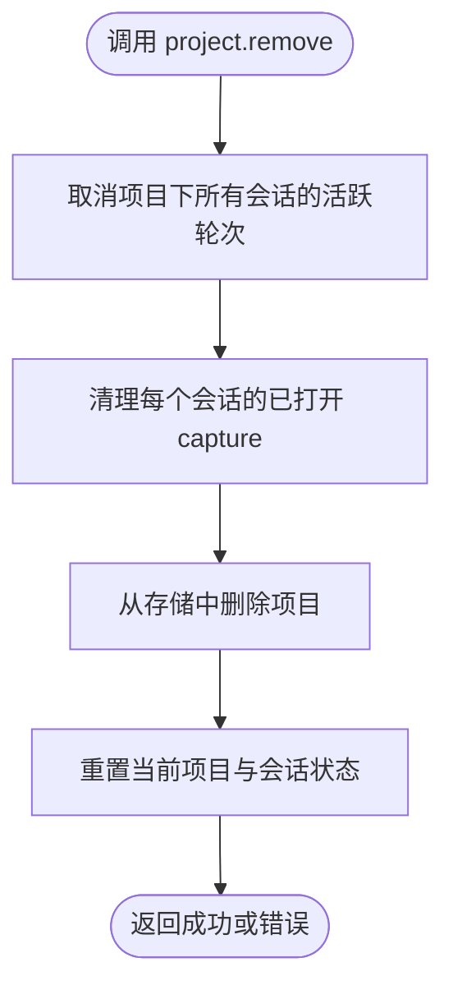
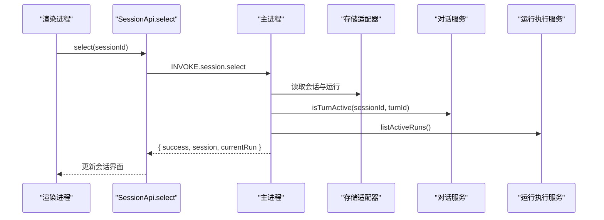
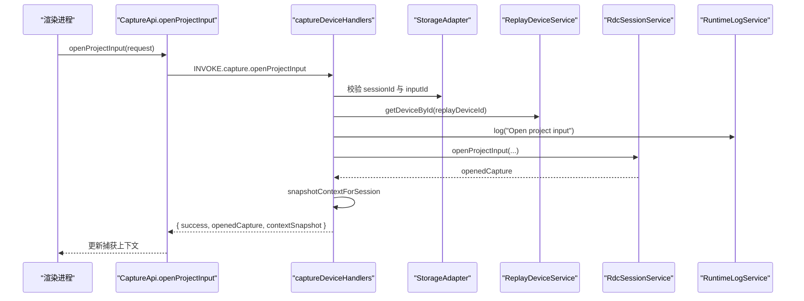
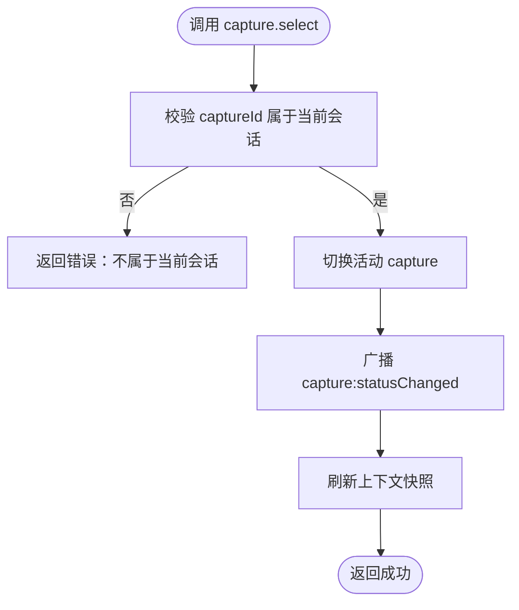
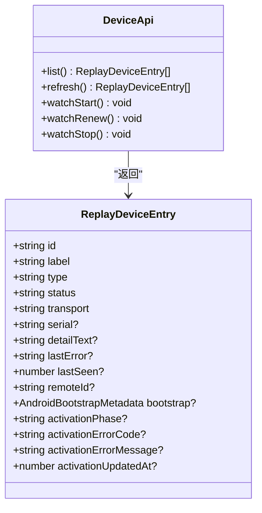
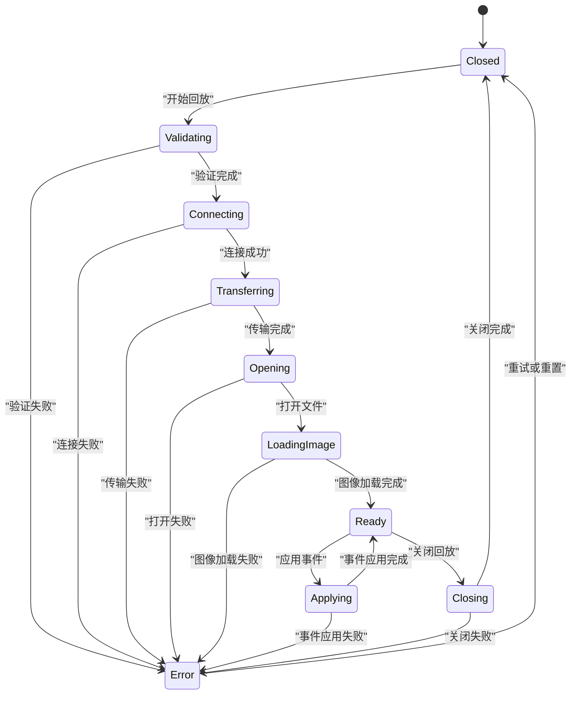
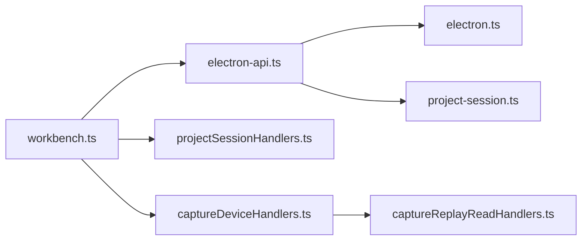

# 项目与会话 API 类型定义

<cite>
**本文引用的文件**   
- [workbench.ts](file://src/shared/renderer-api/workbench.ts)
- [electron-api.ts](file://src/shared/types/electron-api.ts)
- [project-session.ts](file://src/shared/types/electron/project-session.ts)
- [electron.ts](file://src/shared/types/electron.ts)
- [session.ts](file://src/shared/types/session.ts)
- [captureReplay.ts](file://src/shared/types/captureReplay.ts)
- [device.ts](file://src/shared/types/device.ts)
- [projectSessionHandlers.ts](file://src/main/ipc/projectSessionHandlers.ts)
- [captureDeviceHandlers.ts](file://src/main/ipc/captureDeviceHandlers.ts)
- [captureReplayReadHandlers.ts](file://src/main/ipc/captureReplayReadHandlers.ts)
</cite>

## 目录
1. [引言](#引言)
2. [项目结构](#项目结构)
3. [核心 API 组契约](#核心-api-组契约)
4. [架构总览](#架构总览)
5. [关键实体与数据结构](#关键实体与数据结构)
6. [详细组件分析](#详细组件分析)
7. [依赖关系分析](#依赖关系分析)
8. [性能与可靠性特征](#性能与可靠性特征)
9. [故障排查指南](#故障排查指南)
10. [结论](#结论)

## 引言
本文面向需要理解“项目、会话、Capture、上下文、设备”相关接口和类型定义的开发者与测试人员。文档重点说明：
- ProjectApi、SessionApi、CaptureApi、ContextApi、DeviceApi 的调用契约。
- ProjectRecord、SessionRecord、CaptureDescriptor、ContextSnapshot、ReplayDeviceEntry 等核心实体的字段含义。
- 项目管理、会话切换、RDC capture 打开与选择、replay 控制流程以及设备监控的端到端行为。
- SessionScope 作用域机制如何贯穿渲染进程到主进程的 IPC 调用。
- 捕获回放的状态机、事件应用流程和上下文快照的生命周期。

## 项目结构
本项目采用“共享类型 + 渲染进程 API 包装 + 主进程 IPC 处理器”的分层结构：
- 共享类型集中在 `src/shared/types`，定义所有跨进程通信的数据模型。
- 渲染进程通过 `src/shared/renderer-api/workbench.ts` 暴露 `createProjectApi`、`createSessionApi`、`createCaptureApi`、`createContextApi`、`createDeviceApi` 等方法。
- 主进程在 `src/main/ipc` 中注册对应 IPC handler，执行业务逻辑并广播状态变更。

**图表来源**
- [workbench.ts:1-99](file://src/shared/renderer-api/workbench.ts#L1-L99)
- [electron.ts:200-563](file://src/shared/types/electron.ts#L200-L563)
- [projectSessionHandlers.ts:1-200](file://src/main/ipc/projectSessionHandlers.ts#L1-L200)
- [captureDeviceHandlers.ts:1-200](file://src/main/ipc/captureDeviceHandlers.ts#L1-L200)
- [captureReplayReadHandlers.ts:1-24](file://src/main/ipc/captureReplayReadHandlers.ts#L1-L24)

**章节来源**
- [workbench.ts:1-99](file://src/shared/renderer-api/workbench.ts#L1-L99)
- [electron.ts:200-563](file://src/shared/types/electron.ts#L200-L563)

## 核心 API 组契约
本节以渲染进程可调用方法为主视角，描述每个 API 组的职责、参数、返回值语义及典型错误返回形态。

### ProjectApi：项目管理
- 职责：列出项目、添加项目、选择当前项目、重命名、删除项目；管理项目输入文件（RenderDoc capture 文件）的引用、导入、刷新、准备删除、确认删除。
- 关键方法：
  - `list()`：返回项目列表。
  - `add(rootPath)`：新增项目，通常伴随选中该项目的副作用。
  - `select(projectId)`：切换当前项目，同时返回当前会话和运行摘要。
  - `rename(projectId, newName)`：修改项目名称。
  - `remove(projectId)`：删除项目；主进程会取消该项目的活跃会话轮次并清理已打开的捕获上下文。
  - `inputs.list/refresh/import/importPaths/referencePath/prepareRemove/remove`：管理项目输入文件，包括外部参考文件的身份信息和内容校验哈希。
- 典型错误：
  - 删除失败时返回 `{ success: false, error }`。
  - 输入文件不存在或权限不足时返回相应错误信息。

**章节来源**
- [workbench.ts:6-33](file://src/shared/renderer-api/workbench.ts#L6-L33)
- [electron.ts:438-487](file://src/shared/types/electron.ts#L438-L487)
- [projectSessionHandlers.ts:53-170](file://src/main/ipc/projectSessionHandlers.ts#L53-L170)

### SessionApi：会话管理
- 职责：按项目列出会话、创建会话、重命名、删除、选择当前会话、设置模型覆盖、设置 Agent id、声明式交接。
- 关键方法：
  - `list(projectId)`：返回指定项目的会话列表。
  - `create(projectId, title?)`：创建新会话。
  - `rename(id, title)`：修改会话标题。
  - `remove(id)`：删除会话，可能返回下一个推荐会话或运行记录。
  - `select(id)`：选择会话，返回会话记录和当前运行摘要。
  - `setModelOverride(id, modelOverride)`：为会话设置模型覆盖。
  - `setAgentId(id, agentId)`：设置会话当前的 Agent。
  - `applyDeclaredHandoff(id, agent, label)`：执行声明式交接。
- 典型错误：
  - 会话不存在、权限不匹配或底层存储失败时返回 `{ success: false, error }`。

**章节来源**
- [workbench.ts:35-53](file://src/shared/renderer-api/workbench.ts#L35-L53)
- [electron.ts:489-537](file://src/shared/types/electron.ts#L489-L537)
- [projectSessionHandlers.ts:172-200](file://src/main/ipc/projectSessionHandlers.ts#L172-L200)

### CaptureApi：Capture 与回放
- 职责：查询回放选择、读取实时预览、获取回放状态、应用回放事件、刷新帧、列举会话拥有的 capture、选择活动 capture、打开项目输入 capture、查询和清除已打开 capture 状态。
- 关键方法：
  - `getReplaySelection(scope)`：读取回放历史选择。
  - `readLivePreview(scope)`：读取回放实时预览二进制数据。
  - `getReplayState(scope)`：获取回放状态快照。
  - `applyReplayEvent(request)`：应用回放事件，用于交互回放。
  - `refreshFrame(scope)`：刷新当前回放帧。
  - `list(scope)`：列出会话关联的 capture 描述符。
  - `select(request)`：选择某个 capture 作为活动项。
  - `openProjectInput(request)`：打开项目中的 capture 输入文件，绑定回放设备并创建上下文。
  - `getOpenedState(scope)`：查询某会话是否拥有已打开的 capture。
  - `clearOpenedState(scope)`：清除会话拥有的 capture 上下文。
- 典型错误：
  - 非会话拥有的 capture 被选择时报错。
  - 打开项目输入失败时返回 `{ success: false, error }`。
  - 未拥有 RDC 上下文时清除操作返回失败。

**章节来源**
- [workbench.ts:55-74](file://src/shared/renderer-api/workbench.ts#L55-L74)
- [electron.ts:539-563](file://src/shared/types/electron.ts#L539-L563)
- [captureDeviceHandlers.ts:22-180](file://src/main/ipc/captureDeviceHandlers.ts#L22-L180)

### ContextApi：上下文快照
- 职责：根据 `SessionScope` 获取 RDC 上下文快照，包含所属会话、后端类型、设备标签、active capture、运行时上下文等。
- 关键方法：
  - `get(scope)`：返回 `ContextSnapshot | null`。
- 使用场景：
  - UI 展示当前 capture 的设备、状态、预览来源。
  - 回放状态变化后刷新右侧面板投影。

**章节来源**
- [workbench.ts:76-80](file://src/shared/renderer-api/workbench.ts#L76-L80)
- [captureDeviceHandlers.ts:70-77](file://src/main/ipc/captureDeviceHandlers.ts#L70-L77)
- [session.ts:300-340](file://src/shared/types/session.ts#L300-L340)

### DeviceApi：回放设备监控
- 职责：列出回放设备、刷新设备列表、启动/续期/停止设备监控。
- 关键方法：
  - `list()`：返回 `ReplayDeviceEntry[]`。
  - `refresh()`：重新扫描设备。
  - `watchStart/watchRenew/watchStop()`：控制设备监控生命周期。
- 设备状态：
  - `offline/loading/connected/online`。
  - 支持本地设备与 Android ADB 设备。

**章节来源**
- [workbench.ts:35-47](file://src/shared/renderer-api/workbench.ts#L35-L47)
- [electron.ts:487-492](file://src/shared/types/electron.ts#L487-L492)
- [captureDeviceHandlers.ts:182-200](file://src/main/ipc/captureDeviceHandlers.ts#L182-L200)
- [device.ts:1-50](file://src/shared/types/device.ts#L1-L50)

## 架构总览
渲染进程通过统一的 `RendererApiTransport.invoke` 调用 ElectronAPI 通道，主进程根据通道名分发到具体 IPC handler。所有涉及会话的操作都要求携带 `SessionScope`，主进程据此校验会话归属，避免跨项目访问。

**图表来源**
- [workbench.ts:6-80](file://src/shared/renderer-api/workbench.ts#L6-L80)
- [projectSessionHandlers.ts:75-110](file://src/main/ipc/projectSessionHandlers.ts#L75-L110)
- [captureDeviceHandlers.ts:90-160](file://src/main/ipc/captureDeviceHandlers.ts#L90-L160)

## 关键实体与数据结构

### ProjectRecord：项目记录
- 关键字段：
  - `projectId`：项目唯一标识。
  - `name/rootPath/slug/resourcePath/knowledgePath/inputsPath`：项目路径与资源目录。
  - `inputs`：项目输入文件列表，类型为 `ProjectInputRecord[]`。
  - `inputsUpdatedAt`：输入文件更新时间。
  - `createdAt/updatedAt`：项目创建与更新时间。
  - `lastSessionId`：最近使用的会话 ID。
  - `replayCleanupPending`：回放清理待处理信息。
- 设计要点：
  - 项目是会话与输入文件的容器。
  - 删除项目时会清理活跃会话轮次与已打开 capture。

**章节来源**
- [session.ts:23-56](file://src/shared/types/session.ts#L23-L56)
- [projectSessionHandlers.ts:112-150](file://src/main/ipc/projectSessionHandlers.ts#L112-L150)

### SessionRecord：会话记录
- 关键字段：
  - `sessionId/projectId/title/goal/sessionPath`：会话基本元数据。
  - `createdAt/updatedAt`：时间戳。
  - `lastRunId`：最近一次运行 ID。
  - `turnControls`：对话轮次控制能力。
  - `modelOverride`：模型覆盖配置。
  - `agentId`：当前会话 Agent id，缺失时表示 Composer pill 使用通用模式。
- 设计要点：
  - 会话属于项目，且可与 run、conversation、capture 关联。
  - 会话选择会驱动 UI 切换到对应会话上下文。

**章节来源**
- [session.ts:58-78](file://src/shared/types/session.ts#L58-L78)
- [electron.ts:489-537](file://src/shared/types/electron.ts#L489-L537)

### CaptureDescriptor：Capture 描述符
- 关键字段：
  - `id/filePath/captureFileId`：capture 文件标识与路径。
  - `role`：primary/baseline/reference/fix。
  - `backendHint`：local/remote。
  - `status`：pending/opening/open/error/closed。
  - `ownerSessionId/sessionId/replaySessionId/contextId`：会话与回放上下文关联。
- 设计要点：
  - 描述一个 capture 在会话中的角色与生命周期阶段。
  - 与 `ContextSnapshot.activeCapture` 配合确定当前活动 capture。

**章节来源**
- [session.ts:132-150](file://src/shared/types/session.ts#L132-L150)
- [captureDeviceHandlers.ts:140-170](file://src/main/ipc/captureDeviceHandlers.ts#L140-L170)

### ContextSnapshot：上下文快照
- 关键字段：
  - `contextId/sessionId/ownerSessionId/backend`：上下文归属与后端类型。
  - `runtimeOwner/ownerLeaseId`：运行时所有者与租约。
  - `captureDescriptors`：会话拥有的 capture 列表。
  - `activeCapture`：当前活动 capture id。
  - `deviceLabel`：设备显示名称。
  - `runtimeContext`：可选的 RDC 运行时上下文。
- 设计要点：
  - 上下文快照是 UI 展示 capture、设备、运行时状态的权威视图。
  - 每次打开/关闭 capture、应用回放事件后都会更新。

**章节来源**
- [session.ts:300-340](file://src/shared/types/session.ts#L300-L340)
- [captureDeviceHandlers.ts:70-90](file://src/main/ipc/captureDeviceHandlers.ts#L70-L90)

### ReplayDeviceEntry：回放设备条目
- 关键字段：
  - `id/label/type/status/transport`：设备基本信息与连接状态。
  - `serial/detailText/lastError/lastSeen/remoteId`：平台与远程信息。
  - `bootstrap`：Android 启动元数据。
  - `activationPhase/activationErrorCode/activationErrorMessage/activationUpdatedAt`：激活阶段与错误信息。
- 设计要点：
  - 设备可以是本地设备或 Android ADB 设备。
  - 设备状态变化会通过 `ReplayDeviceStatusChangedPayload` 通知上层。

**章节来源**
- [device.ts:1-50](file://src/shared/types/device.ts#L1-L50)

### SessionScope 与作用域机制
- 定义：
  - `SessionScope` 包含 `projectId` 与 `sessionId`。
  - `SessionScopedPayload<T>` 将任意 payload 包裹在作用域中。
- 约束：
  - 所有涉及回放、上下文、capture 的操作必须携带 `SessionScope`。
  - 主进程校验 `storageAdapter.readSession(sessionId).projectId === projectId`，否则拒绝。
- 价值：
  - 防止渲染进程误用其他项目的会话资源。
  - 统一事件广播与投影刷新时的作用域标记。

**章节来源**
- [session.ts:80-90](file://src/shared/types/session.ts#L80-L90)
- [captureDeviceHandlers.ts:22-40](file://src/main/ipc/captureDeviceHandlers.ts#L22-L40)
- [captureReplayReadHandlers.ts:1-24](file://src/main/ipc/captureReplayReadHandlers.ts#L1-L24)

## 详细组件分析

### 项目管理与输入文件生命周期
项目管理入口由 `project:add/select/rename/remove` 提供，输入文件管理由 `project.inputs.*` 提供。主进程 handler 对参数进行 schema 校验，并委托 `StorageAdapter` 持久化。删除项目时会：
- 遍历该项目下所有会话，取消活跃轮次。
- 清理每个会话的已打开 capture。
- 清空当前项目、会话、运行的状态。

**图表来源**
- [projectSessionHandlers.ts:112-150](file://src/main/ipc/projectSessionHandlers.ts#L112-L150)

**章节来源**
- [projectSessionHandlers.ts:53-170](file://src/main/ipc/projectSessionHandlers.ts#L53-L170)

### 会话切换与运行恢复
会话选择会返回当前会话与当前运行摘要。如果存在处于“planning/queued/running/stopping”等可恢复状态的 run，主进程会在重启后将其标记为中断并重新加载最新 run。

**图表来源**
- [projectSessionHandlers.ts:75-110](file://src/main/ipc/projectSessionHandlers.ts#L75-L110)

**章节来源**
- [projectSessionHandlers.ts:25-70](file://src/main/ipc/projectSessionHandlers.ts#L25-L70)
- [electron.ts:489-512](file://src/shared/types/electron.ts#L489-L512)

### Capture 打开与上下文快照
打开项目输入 capture 的典型流程：
1. 渲染进程调用 `CaptureApi.openProjectInput`。
2. 主进程校验会话归属与 input 文件是否存在。
3. 查找回放设备并记录运行时日志。
4. 调用 `rdcSessionService.openProjectInput` 打开 capture。
5. 广播 `capture:openedStateChanged` 与 `context:changed`。
6. 返回 `openedCapture` 与 `contextSnapshot`。

**图表来源**
- [captureDeviceHandlers.ts:90-160](file://src/main/ipc/captureDeviceHandlers.ts#L90-L160)
- [workbench.ts:66-74](file://src/shared/renderer-api/workbench.ts#L66-L74)

**章节来源**
- [captureDeviceHandlers.ts:90-160](file://src/main/ipc/captureDeviceHandlers.ts#L90-L160)
- [session.ts:340-455](file://src/shared/types/session.ts#L340-L455)

### Capture 选择与活动 Capture 切换
选择 capture 时必须确保该 capture 属于当前会话，否则会拒绝。成功后广播 `capture:statusChanged` 并刷新上下文快照。

**图表来源**
- [captureDeviceHandlers.ts:140-170](file://src/main/ipc/captureDeviceHandlers.ts#L140-L170)

**章节来源**
- [captureDeviceHandlers.ts:140-170](file://src/main/ipc/captureDeviceHandlers.ts#L140-L170)

### 设备监控与状态广播
设备 API 通过 `replayDeviceService` 提供设备列表与刷新能力，并通过 `watchStart/watchRenew/watchStop` 控制监控生命周期。设备状态变化可通过 `ReplayDeviceStatusChangedPayload` 推送到 UI。

**图表来源**
- [electron.ts:487-492](file://src/shared/types/electron.ts#L487-L492)
- [device.ts:1-50](file://src/shared/types/device.ts#L1-L50)

**章节来源**
- [captureDeviceHandlers.ts:182-200](file://src/main/ipc/captureDeviceHandlers.ts#L182-L200)
- [device.ts:1-50](file://src/shared/types/device.ts#L1-L50)

### Capture Replay 控制流程
回放状态由 `CaptureReplayState` 描述，包含 phase、generation、revision、operationId、replayDeviceId、inputId、captureHash、contextId、requestedEventId、appliedEventId、imageEventId、events、targets、target、isFinalOutput、image、observation、devicePresentation、warning、interactionLock、error 等字段。

回放阶段包括 closed、validating、connecting、transferring、opening、loading_image、ready、applying、closing、error。渲染进程可通过 `getReplayState`、`applyReplayEvent`、`refreshFrame`、`readLivePreview`、`getReplaySelection` 协同控制回放。

**图表来源**
- [captureReplay.ts:1-25](file://src/shared/types/captureReplay.ts#L1-L25)
- [captureDeviceHandlers.ts:22-60](file://src/main/ipc/captureDeviceHandlers.ts#L22-L60)

**章节来源**
- [captureReplay.ts:1-25](file://src/shared/types/captureReplay.ts#L1-L25)
- [captureDeviceHandlers.ts:22-60](file://src/main/ipc/captureDeviceHandlers.ts#L22-L60)

### 实际调用示例（概念性）
以下示例仅描述调用顺序与参数语义，不包含具体代码内容。

- 项目管理示例：
  1. 调用 `ProjectApi.add(rootPath)` 创建项目。
  2. 调用 `ProjectApi.select(projectId)` 切换项目。
  3. 调用 `ProjectApi.inputs.import(projectId)` 导入 RenderDoc capture。
  4. 调用 `ProjectApi.inputs.refresh(projectId)` 刷新输入列表。
  5. 如需删除，先调用 `ProjectApi.inputs.prepareRemove(projectId, inputId)`，再调用 `ProjectApi.inputs.remove(projectId, inputId, approvalToken)`。

- 会话切换示例：
  1. 调用 `SessionApi.list(projectId)` 获取会话列表。
  2. 调用 `SessionApi.create(projectId, title)` 创建会话。
  3. 调用 `SessionApi.select(sessionId)` 切换会话。
  4. 如需修改模型或 Agent，调用 `SessionApi.setModelOverride` 或 `SessionApi.setAgentId`。

- Capture 操作示例：
  1. 调用 `CaptureApi.getReplaySelection({ projectId, sessionId })` 获取回放选择。
  2. 调用 `CaptureApi.list({ projectId, sessionId })` 列出 capture。
  3. 调用 `CaptureApi.openProjectInput({ projectId, sessionId, inputId, filePath, replayDeviceId, bindingGeneration })` 打开 capture。
  4. 调用 `CaptureApi.select({ projectId, sessionId, captureId, bindingGeneration })` 选择活动 capture。
  5. 调用 `CaptureApi.getReplayState({ projectId, sessionId })` 查看回放状态。
  6. 调用 `CaptureApi.applyReplayEvent({ eventId, target?, ... })` 应用回放事件。
  7. 调用 `CaptureApi.clearOpenedState({ projectId, sessionId, bindingGeneration })` 清除上下文。

- 设备监控示例：
  1. 调用 `DeviceApi.list()` 获取设备列表。
  2. 调用 `DeviceApi.refresh()` 刷新设备。
  3. 调用 `DeviceApi.watchStart()` 启动监控。
  4. 在设备变化时订阅 `ReplayDeviceStatusChangedPayload`。
  5. 调用 `DeviceApi.watchStop()` 停止监控。

[本节为概念性示例，不直接分析具体源文件]

## 依赖关系分析
- `workbench.ts` 依赖 `electron-api.ts` 导出的 API 类型，并将调用映射到 `RENDERER_INVOKE_CHANNEL`。
- `electron-api.ts` 只是类型别名导出，真实契约定义在 `electron.ts` 的 `ElectronAPI` 接口中。
- `project-session.ts` 将 `ProjectApi`、`SessionApi`、`CaptureApi`、`ContextApi`、`DeviceApi` 等映射到 `ElectronAPI` 的子接口。
- 主进程 `projectSessionHandlers.ts` 负责项目与会话的 IPC 处理，`captureDeviceHandlers.ts` 负责 capture、上下文、设备 IPC 处理，`captureReplayReadHandlers.ts` 负责回放选择与实时预览读取。
- `rdcSessionService`、`replayDeviceService`、`storageAdapter`、`traceProjectionRefreshService`、`runtimeLogService` 是主进程内部协作组件。

**图表来源**
- [workbench.ts:1-10](file://src/shared/renderer-api/workbench.ts#L1-L10)
- [electron-api.ts:1-32](file://src/shared/types/electron-api.ts#L1-L32)
- [project-session.ts:1-8](file://src/shared/types/electron/project-session.ts#L1-L8)
- [projectSessionHandlers.ts:1-20](file://src/main/ipc/projectSessionHandlers.ts#L1-L20)
- [captureDeviceHandlers.ts:1-20](file://src/main/ipc/captureDeviceHandlers.ts#L1-L20)
- [captureReplayReadHandlers.ts:1-24](file://src/main/ipc/captureReplayReadHandlers.ts#L1-L24)

**章节来源**
- [electron-api.ts:1-32](file://src/shared/types/electron-api.ts#L1-L32)
- [project-session.ts:1-8](file://src/shared/types/electron/project-session.ts#L1-L8)
- [electron.ts:200-563](file://src/shared/types/electron.ts#L200-L563)

## 性能与可靠性特征
- 参数校验：所有 IPC 入参通过 `parseIpcArgs` 与对应 schema 校验，限制最大字节数，防止恶意或异常负载。
- 作用域校验：回放与上下文操作通过 `authorizeReplayScope` 或 `authorize` 校验会话归属，避免越权访问。
- 状态广播：回放状态变化会广播 `capture:replayChanged`，并在 terminal 阶段或 identity 变化时调度 `traceProjectionRefreshService.schedule`，减少不必要的 UI 刷新。
- 运行时日志：打开 capture、清除上下文等操作记录 `runtimeLogService.log`，便于问题定位。
- 幂等性与生成号：部分操作携带 `bindingGeneration`，用于防止旧请求覆盖新状态。

**章节来源**
- [captureDeviceHandlers.ts:22-40](file://src/main/ipc/captureDeviceHandlers.ts#L22-L40)
- [captureDeviceHandlers.ts:90-160](file://src/main/ipc/captureDeviceHandlers.ts#L90-L160)
- [captureReplayReadHandlers.ts:1-24](file://src/main/ipc/captureReplayReadHandlers.ts#L1-L24)

## 故障排查指南
- 回放范围拒绝：
  - 现象：调用 `capture:getReplayState`、`capture:applyReplayEvent`、`capture:refreshFrame` 时报错。
  - 原因：`projectId` 与 `sessionId` 不匹配或会话不存在。
  - 排查：检查传入的 `SessionScope` 是否正确，确认会话属于目标项目。

- Capture 不属于当前会话：
  - 现象：调用 `capture.select` 失败。
  - 原因：选择的 capture 不在当前会话的 `captureDescriptors` 中。
  - 排查：先调用 `capture.list` 获取会话拥有的 capture，再选择正确的 `captureId`。

- 打开项目输入失败：
  - 现象：`capture.openProjectInput` 返回 `{ success: false, error }`。
  - 原因：会话不属于项目、input 不存在、回放设备不存在、RDC 上下文打开失败。
  - 排查：检查 `runtimeLogService` 中的“Open project input failed”日志，确认 inputId、filePath、replayDeviceId 正确。

- 未拥有 RDC 上下文：
  - 现象：`capture.clearOpenedState` 返回失败。
  - 原因：当前会话没有 owned RDC 上下文。
  - 排查：调用 `capture.getOpenedState` 确认是否已有 opened capture。

- 设备监控异常：
  - 现象：设备列表为空或设备状态长时间为 `loading`。
  - 原因：设备不可用、ADB 连接失败、设备未安装或未启动。
  - 排查：调用 `DeviceApi.refresh()`，检查设备状态与 `lastError`，必要时重启设备监控。

**章节来源**
- [captureDeviceHandlers.ts:22-40](file://src/main/ipc/captureDeviceHandlers.ts#L22-L40)
- [captureDeviceHandlers.ts:90-160](file://src/main/ipc/captureDeviceHandlers.ts#L90-L160)
- [captureDeviceHandlers.ts:182-200](file://src/main/ipc/captureDeviceHandlers.ts#L182-L200)

## 结论
本文系统梳理了项目与会话 API 的类型契约与实现边界：
- ProjectApi 与 SessionApi 管理项目与会话的生命周期，并与运行摘要、对话服务、存储适配器紧密协作。
- CaptureApi 与 ContextApi 围绕 RDC capture 的打开、选择、回放与上下文快照展开，强调 `SessionScope` 的作用域安全。
- DeviceApi 提供回放设备的发现、刷新与监控能力，支持本地与 Android 设备。
- 核心实体如 `ProjectRecord`、`SessionRecord`、`CaptureDescriptor`、`ContextSnapshot`、`ReplayDeviceEntry` 构成了跨进程通信的稳定数据契约。
- 回放控制流程通过 `CaptureReplayState` 的阶段化状态机表达，配合事件应用与帧刷新实现完整的交互回放体验。