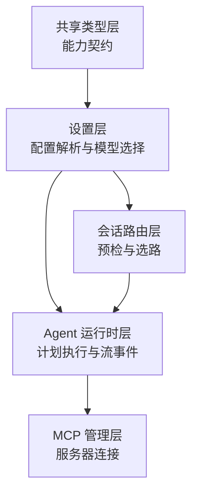
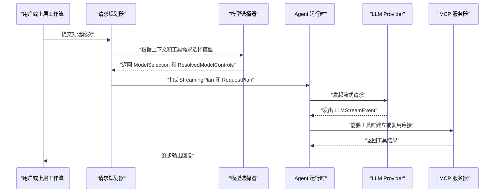
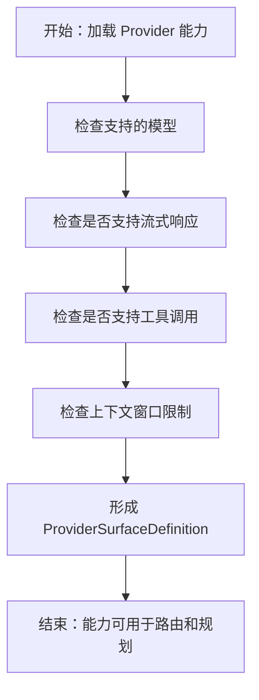
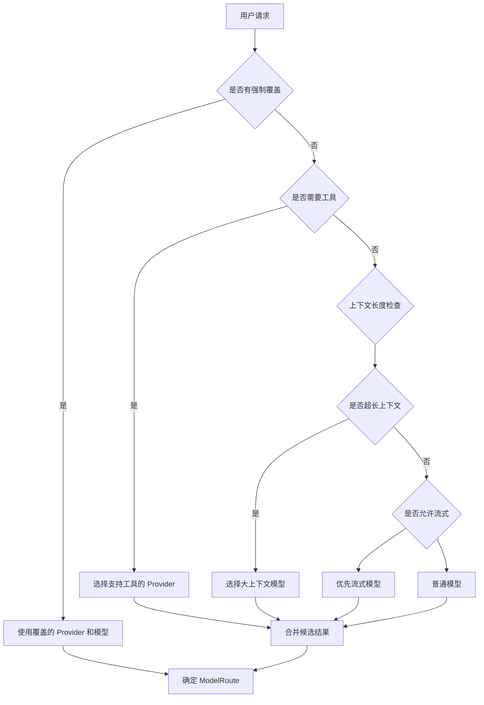
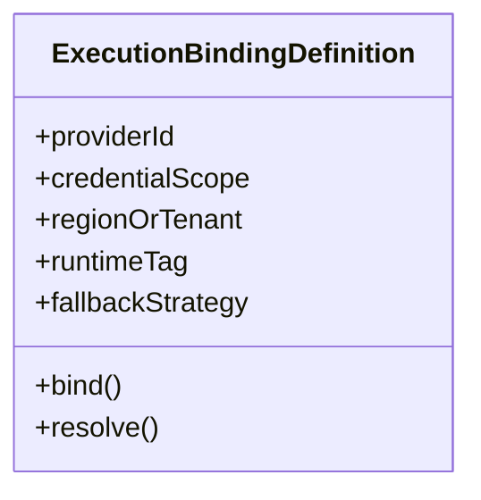
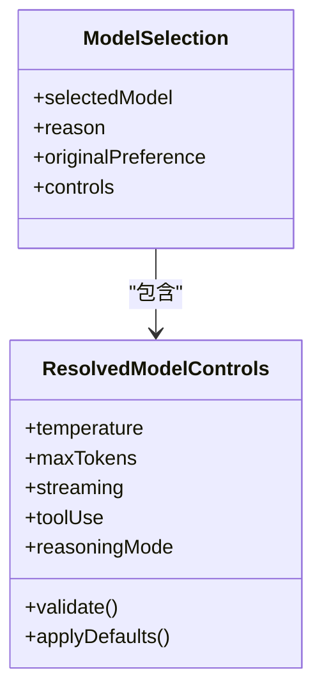
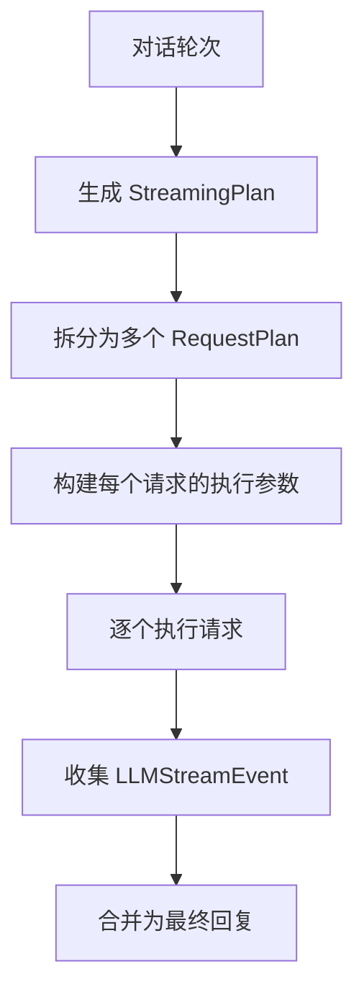
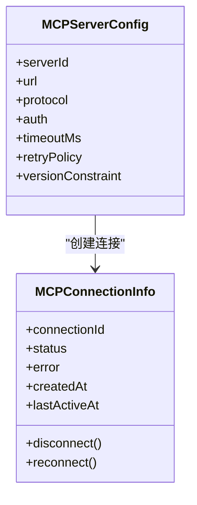
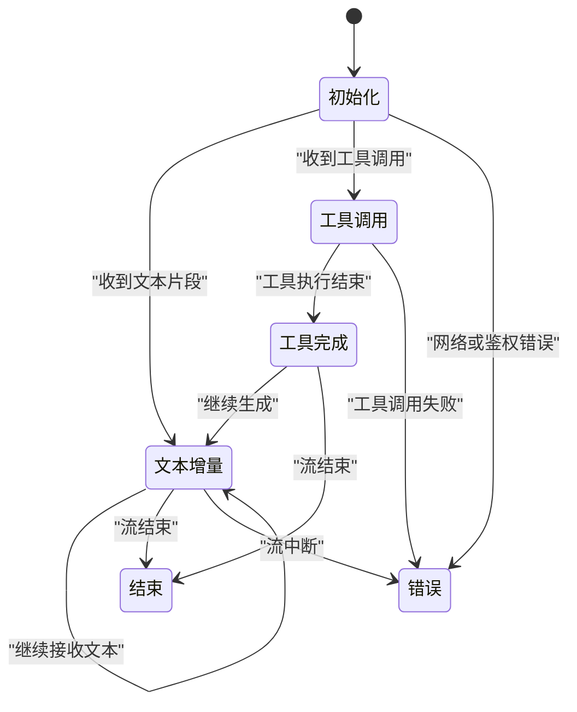
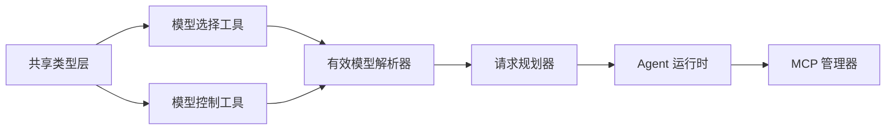

# Provider 能力类型

<cite>
**本文引用的文件**   
- [providerCapability.ts](file://src/shared/src/shared/types/providerCapability.ts)
- [llm.ts](file://src/shared/src/shared/types/llm.ts)
- [mcp.ts](file://src/shared/src/shared/types/mcp.ts)
- [agentRuntime.ts](file://src/shared/src/shared/types/agentRuntime.ts)
- [effectiveModelPicker.ts](file://src/shared/src/shared/utils/effectiveModelPicker.ts)
- [modelControls.ts](file://src/shared/src/shared/utils/modelControls.ts)
- [EffectiveModelResolver.ts](file://src/main/settings/EffectiveModelResolver.ts)
- [RequestPlanner.ts](file://src/main/settings/RequestPlanner.ts)
- [ProviderConnectionService.ts](file://src/main/settings/ProviderConnectionService.ts)
- [MCPManager.ts](file://src/main/agent-runtime/agent/MCPManager.ts)
- [PromptPlanBuilder.ts](file://src/main/agent-runtime/prompt/PromptPlanBuilder.ts)
- [ConversationRoutePreflight.ts](file://src/main/conversation/ConversationRoutePreflight.ts)
</cite>

## 目录
1. [引言](#引言)
2. [项目结构中的 Provider 类型位置](#项目结构中的-provider-类型位置)
3. [核心能力类型总览](#核心能力类型总览)
4. [架构总览：发现、路由与执行](#架构总览发现路由与执行)
5. [详细类型分析](#详细类型分析)
6. [依赖关系分析](#依赖关系分析)
7. [性能与扩展性考虑](#性能与扩展性考虑)
8. [故障排查指南](#故障排查指南)
9. [结论](#结论)
10. [附录：完整类型使用示例](#附录完整类型使用示例)

## 引言
本文聚焦于仓库中与 LLM Provider 能力相关的类型定义和运行时协作，目标是帮助读者理解以下内容：
- Provider 如何被发现、声明和认证。
- 模型选择算法使用的关键类型。
- 流式请求规划中从高层 `StreamingPlan` 到具体 `RequestPlan` 的演进。
- MCP 服务器配置及连接信息。
- LLM 流事件在运行时中的角色。

这些内容主要分布在共享类型层、设置层、会话路由层以及 Agent 运行时层中。

## 项目结构中的 Provider 类型位置
Provider 能力相关类型不是单一文件，而是按职责拆分到多个模块：
- 共享类型层负责对外暴露稳定的能力契约。
- 设置层负责解析、合并、校验 Provider 配置，并驱动模型选择和路由决策。
- 会话与 Agent 运行时负责将计划落地为实际调用、流事件和 MCP 连接。

**图示来源**  
- [EffectiveModelResolver.ts:1-120](file://src/main/settings/EffectiveModelResolver.ts#L1-L120)
- [RequestPlanner.ts:1-150](file://src/main/settings/RequestPlanner.ts#L1-L150)
- [PromptPlanBuilder.ts:1-120](file://src/main/agent-runtime/prompt/PromptPlanBuilder.ts#L1-L120)
- [ConversationRoutePreflight.ts:1-120](file://src/main/conversation/ConversationRoutePreflight.ts#L1-L120)
- [MCPManager.ts:1-120](file://src/main/agent-runtime/agent/MCPManager.ts#L1-L120)

**章节来源**
- [EffectiveModelResolver.ts:1-120](file://src/main/settings/EffectiveModelResolver.ts#L1-L120)
- [RequestPlanner.ts:1-150](file://src/main/settings/RequestPlanner.ts#L1-L150)

## 核心能力类型总览
以下类型是 Provider 能力体系的核心抽象：

| 类型 | 所属领域 | 作用说明 |
|---|---|---|
| `ProviderSurfaceDefinition` | Provider 能力声明 | 描述某个 Provider 暴露的能力面，例如支持的模型族、上下文窗口、工具调用、流式响应等。 |
| `ModelRoute` | 模型路由 | 把用户意图、上下文约束与 Provider 能力匹配起来，决定最终由哪个 Provider 处理请求。 |
| `ExecutionBindingDefinition` | 执行绑定 | 把逻辑上的模型或能力绑定到具体 Provider 实例、密钥范围、计费账户、区域等运行时环境。 |
| `ModelSelection` | 模型选择 | 表达一次模型选择结果，包括候选模型、选择原因、控制参数。 |
| `ResolvedModelControls` | 已解析模型控制 | 对温度、最大令牌数、推理模式等参数的规范化结果，供下游执行器使用。 |
| `StreamingPlan` | 流式规划 | 高层流式请求计划，表示一次对话轮次可能产生的多个子请求、中断点和恢复点。 |
| `RequestPlan` | 请求计划 | 具体可执行的单次请求描述，包含模型、上下文、工具、缓存键、重试策略等。 |
| `MCPServerConfig` | MCP 服务器配置 | 描述一个 MCP 服务器的地址、协议、认证方式、超时、重试等配置。 |
| `MCPConnectionInfo` | MCP 连接信息 | 描述当前已建立或正在建立的 MCP 连接状态、标识、错误和生命周期。 |
| `LLMStreamEvent` | LLM 流事件 | 描述 LLM 流式返回过程中的增量片段、思考内容、工具调用、结束标记等事件。 |

**章节来源**
- [providerCapability.ts:1-200](file://src/shared/src/shared/types/providerCapability.ts#L1-L200)
- [llm.ts:1-200](file://src/shared/src/shared/types/llm.ts#L1-L200)
- [mcp.ts:1-200](file://src/shared/src/shared/types/mcp.ts#L1-L200)
- [agentRuntime.ts:1-200](file://src/shared/src/shared/types/agentRuntime.ts#L1-L200)

## 架构总览：发现、路由与执行
Provider 能力体系可以理解为三个阶段的协作：
1. **发现阶段**：扫描可用 Provider，读取其能力声明，形成能力目录。
2. **路由阶段**：根据用户输入、工具需求、上下文大小、成本策略，选择合适 Provider 和模型。
3. **执行阶段**：构建请求计划，启动流式调用，产生 LLM 流事件，必要时通过 MCP 调用外部服务。

**图示来源**
- [RequestPlanner.ts:1-150](file://src/main/settings/RequestPlanner.ts#L1-L150)
- [EffectiveModelResolver.ts:1-120](file://src/main/settings/EffectiveModelResolver.ts#L1-L120)
- [PromptPlanBuilder.ts:1-120](file://src/main/agent-runtime/prompt/PromptPlanBuilder.ts#L1-L120)
- [ConversationRoutePreflight.ts:1-120](file://src/main/conversation/ConversationRoutePreflight.ts#L1-L120)
- [MCPManager.ts:1-120](file://src/main/agent-runtime/agent/MCPManager.ts#L1-L120)

**章节来源**
- [RequestPlanner.ts:1-150](file://src/main/settings/RequestPlanner.ts#L1-L150)
- [EffectiveModelResolver.ts:1-120](file://src/main/settings/EffectiveModelResolver.ts#L1-L120)
- [ConversationRoutePreflight.ts:1-120](file://src/main/conversation/ConversationRoutePreflight.ts#L1-L120)

## 详细类型分析

### ProviderSurfaceDefinition：Provider 能力声明
`ProviderSurfaceDefinition` 用于描述一个 Provider 能做什么，而不是怎么做。它通常包括：
- 支持的模型名称或模型族。
- 是否支持流式响应。
- 是否支持工具调用。
- 是否支持多模态输入。
- 上下文窗口大小上限。
- 是否支持系统提示、历史消息压缩、缓存键等高级特性。

这类定义让上层组件不需要直接耦合具体 Provider SDK，只需根据能力面做决策。

**图示来源**
- [providerCapability.ts:1-200](file://src/shared/src/shared/types/providerCapability.ts#L1-L200)

**章节来源**
- [providerCapability.ts:1-200](file://src/shared/src/shared/types/providerCapability.ts#L1-L200)

### ModelRoute：模型路由决策
`ModelRoute` 表达“某类请求应该走哪条 Provider 路径”。它通常包含：
- 触发条件，例如是否需要工具、是否需要长上下文。
- 目标 Provider 标识。
- 目标模型标识。
- 可选的覆盖规则，例如成本优先、延迟优先、合规要求。

模型路由决策树可以简化为：
1. 是否存在强制的 Provider 或模型覆盖？
2. 是否需要工具调用？
3. 上下文是否超过短上下文窗口？
4. 是否允许流式响应？
5. 是否存在多个候选 Provider，需要按成本、延迟或可用性排序？

**图示来源**
- [EffectiveModelResolver.ts:1-120](file://src/main/settings/EffectiveModelResolver.ts#L1-L120)
- [conversationRoutePreflight.ts:1-120](file://src/main/conversation/ConversationRoutePreflight.ts#L1-L120)

**章节来源**
- [EffectiveModelResolver.ts:1-120](file://src/main/settings/EffectiveModelResolver.ts#L1-L120)
- [ConversationRoutePreflight.ts:1-120](file://src/main/conversation/ConversationRoutePreflight.ts#L1-L120)

### ExecutionBindingDefinition：执行绑定
`ExecutionBindingDefinition` 解决的是“逻辑模型”到“真实运行环境”的映射问题。它通常包括：
- Provider 实例标识。
- 密钥或凭据范围。
- 区域、租户、订阅或计费账户。
- 运行时标签，例如本地 Ollama、云端 OpenAI、企业代理等。
- 可选的降级策略，例如主 Provider 失败时切换到备用 Provider。

这个类型让模型选择结果具备可部署性：同一逻辑模型可以在不同环境中绑定到不同实现。

**图示来源**
- [providerCapability.ts:1-200](file://src/shared/src/shared/types/providerCapability.ts#L1-L200)

**章节来源**
- [providerCapability.ts:1-200](file://src/shared/src/shared/types/providerCapability.ts#L1-L200)

### ModelSelection 与 ResolvedModelControls：模型选择与控制参数
`ModelSelection` 表示一次模型选择的语义结果，例如：
- 被选中的模型标识。
- 选择原因，例如“最短延迟”“最低成本”“满足工具需求”。
- 原始输入中的模型偏好。
- 关联的 `ResolvedModelControls`。

`ResolvedModelControls` 则是把用户或上层的模糊控制参数规范化后的结果，例如：
- 温度值范围校验。
- 最大生成长度。
- 是否启用推理或思考过程。
- 是否启用工具调用。
- 是否启用流式响应。

**图示来源**
- [effectiveModelPicker.ts:1-150](file://src/shared/src/shared/utils/effectiveModelPicker.ts#L1-L150)
- [modelControls.ts:1-150](file://src/shared/src/shared/utils/modelControls.ts#L1-L150)
- [EffectiveModelResolver.ts:1-120](file://src/main/settings/EffectiveModelResolver.ts#L1-L120)

**章节来源**
- [effectiveModelPicker.ts:1-150](file://src/shared/src/shared/utils/effectiveModelPicker.ts#L1-L150)
- [modelControls.ts:1-150](file://src/shared/src/shared/utils/modelControls.ts#L1-L150)
- [EffectiveModelResolver.ts:1-120](file://src/main/settings/EffectiveModelResolver.ts#L1-L120)

### StreamingPlan 与 RequestPlan：流式请求规划
`StreamingPlan` 是高层计划，表示一次对话轮次可能拆分为多个请求，例如：
- 首轮生成摘要。
- 中间插入工具调用。
- 后续根据工具结果继续生成。
- 失败后重试或降级。

`RequestPlan` 是底层可执行单元，描述单个请求的全部必要信息，例如：
- 模型、上下文、系统提示。
- 工具列表和工具参数。
- 流式开关。
- 缓存键、重试次数、超时。
- 与 Provider 绑定的执行信息。

**图示来源**
- [RequestPlanner.ts:1-150](file://src/main/settings/RequestPlanner.ts#L1-L150)
- [PromptPlanBuilder.ts:1-120](file://src/main/agent-runtime/prompt/PromptPlanBuilder.ts#L1-L120)
- [agentRuntime.ts:1-200](file://src/shared/src/shared/types/agentRuntime.ts#L1-L200)

**章节来源**
- [RequestPlanner.ts:1-150](file://src/main/settings/RequestPlanner.ts#L1-L150)
- [PromptPlanBuilder.ts:1-120](file://src/main/agent-runtime/prompt/PromptPlanBuilder.ts#L1-L120)
- [agentRuntime.ts:1-200](file://src/shared/src/shared/types/agentRuntime.ts#L1-L200)

### MCPServerConfig 与 MCPConnectionInfo：MCP 服务器配置与连接
MCP 是外部工具或服务能力的接入方式。`MCPServerConfig` 描述如何找到并连接一个 MCP 服务器，`MCPConnectionInfo` 描述当前连接的状态。

典型字段包括：
- `MCPServerConfig`：服务器地址、协议、认证头、超时、重试、版本约束。
- `MCPConnectionInfo`：连接标识、状态、错误信息、创建时间、最后一次活跃时间。

**图示来源**
- [mcp.ts:1-200](file://src/shared/src/shared/types/mcp.ts#L1-L200)
- [MCPManager.ts:1-120](file://src/main/agent-runtime/agent/MCPManager.ts#L1-L120)
- [ProviderConnectionService.ts:1-150](file://src/main/settings/ProviderConnectionService.ts#L1-L150)

**章节来源**
- [mcp.ts:1-200](file://src/shared/src/shared/types/mcp.ts#L1-L200)
- [MCPManager.ts:1-120](file://src/main/agent-runtime/agent/MCPManager.ts#L1-L120)
- [ProviderConnectionService.ts:1-150](file://src/main/settings/ProviderConnectionService.ts#L1-L150)

### LLMStreamEvent：LLM 流事件
`LLMStreamEvent` 用于描述 LLM 流式返回过程中的细粒度事件，例如：
- 文本增量。
- 思考或推理片段。
- 工具调用开始、参数更新、完成。
- 流结束、错误、取消。

这些事件使上层 UI 和 Agent 流程能够逐步渲染、中断、重试或记录审计日志。

**图示来源**
- [llm.ts:1-200](file://src/shared/src/shared/types/llm.ts#L1-L200)
- [agentRuntime.ts:1-200](file://src/shared/src/shared/types/agentRuntime.ts#L1-L200)

**章节来源**
- [llm.ts:1-200](file://src/shared/src/shared/types/llm.ts#L1-L200)
- [agentRuntime.ts:1-200](file://src/shared/src/shared/types/agentRuntime.ts#L1-L200)

## 依赖关系分析
Provider 能力类型的依赖关系大致如下：

**图示来源**
- [effectiveModelPicker.ts:1-150](file://src/shared/src/shared/utils/effectiveModelPicker.ts#L1-L150)
- [modelControls.ts:1-150](file://src/shared/src/shared/utils/modelControls.ts#L1-L150)
- [EffectiveModelResolver.ts:1-120](file://src/main/settings/EffectiveModelResolver.ts#L1-L120)
- [RequestPlanner.ts:1-150](file://src/main/settings/RequestPlanner.ts#L1-L150)
- [MCPManager.ts:1-120](file://src/main/agent-runtime/agent/MCPManager.ts#L1-L120)

**章节来源**
- [effectiveModelPicker.ts:1-150](file://src/shared/src/shared/utils/effectiveModelPicker.ts#L1-L150)
- [modelControls.ts:1-150](file://src/shared/src/shared/utils/modelControls.ts#L1-L150)
- [EffectiveModelResolver.ts:1-120](file://src/main/settings/EffectiveModelResolver.ts#L1-L120)
- [RequestPlanner.ts:1-150](file://src/main/settings/RequestPlanner.ts#L1-L150)

## 性能与扩展性考虑
- **能力声明优先**：通过 `ProviderSurfaceDefinition` 统一能力边界，避免在路由层硬编码具体 Provider SDK。
- **控制参数规范化**：`ResolvedModelControls` 应在早期完成校验和默认值填充，减少下游重复逻辑。
- **分层规划**：`StreamingPlan` 只负责宏观拆分，`RequestPlan` 负责微观执行，降低单次请求复杂度。
- **连接复用**：MCP 连接应尽可能复用，避免频繁重连造成延迟和错误。
- **可扩展 Provider**：新增 Provider 时，优先补充能力声明和绑定定义，而不是修改核心路由逻辑。

[本节为通用指导，不直接分析具体文件]

## 故障排查指南
常见问题和对应类型线索：

| 现象 | 可能原因 | 关注类型 |
|---|---|---|
| 模型选择失败 | 没有匹配的 `ModelRoute`，或控制参数无效 | `ModelSelection`、`ResolvedModelControls` |
| 流式响应不完整 | `StreamingPlan` 拆分不当或 `LLMStreamEvent` 未正确合并 | `StreamingPlan`、`LLMStreamEvent` |
| 工具调用失败 | MCP 连接未建立或认证失败 | `MCPServerConfig`、`MCPConnectionInfo` |
| Provider 不可用 | 能力声明与实际实现不一致 | `ProviderSurfaceDefinition`、`ExecutionBindingDefinition` |
| 请求反复重试 | `RequestPlan` 的重试策略或缓存键配置不当 | `RequestPlan` |

建议排查顺序：
1. 检查 `ProviderSurfaceDefinition` 是否包含所需能力。
2. 检查 `ModelRoute` 是否能匹配当前请求。
3. 检查 `ResolvedModelControls` 是否通过校验。
4. 检查 `StreamingPlan` 和 `RequestPlan` 是否合理拆分。
5. 检查 `MCPConnectionInfo` 状态和错误信息。
6. 检查 `LLMStreamEvent` 序列是否包含预期事件。

**章节来源**
- [providerCapability.ts:1-200](file://src/shared/src/shared/types/providerCapability.ts#L1-L200)
- [llm.ts:1-200](file://src/shared/src/shared/types/llm.ts#L1-L200)
- [mcp.ts:1-200](file://src/shared/src/shared/types/mcp.ts#L1-L200)
- [agentRuntime.ts:1-200](file://src/shared/src/shared/types/agentRuntime.ts#L1-L200)

## 结论
Provider 能力类型体系以声明为中心：先声明能力，再选择模型，再规划请求，最后执行流式调用。`ProviderSurfaceDefinition`、`ModelRoute`、`ExecutionBindingDefinition` 构成能力契约基础；`ModelSelection` 与 `ResolvedModelControls` 表达模型选择语义；`StreamingPlan` 与 `RequestPlan` 把高层意图拆解为可执行单元；`MCPServerConfig` 与 `MCPConnectionInfo` 管理外部工具连接；`LLMStreamEvent` 则贯穿流式响应的全过程。理解这些类型及其协作关系，有助于稳定扩展新的 Provider、优化模型选择策略，并提升流式体验的可观测性。

[本节为总结性内容，不直接分析具体文件]

## 附录：完整类型使用示例
以下示例以“如何使用这些类型”为主，不展示具体代码内容，仅给出结构化的使用步骤。

### Provider 配置与能力声明示例
1. 定义 `MCPServerConfig`，填入服务器地址、协议、认证信息和超时。
2. 在 Provider 能力目录中注册 `ProviderSurfaceDefinition`，声明模型、流式、工具和多模态能力。
3. 使用 `ExecutionBindingDefinition` 将逻辑模型绑定到具体 Provider 实例和凭据范围。
4. 通过 `MCPConnectionInfo` 观察连接状态，并在连接失败时触发重连或告警。

参考类型位置：
- [mcp.ts:1-200](file://src/shared/src/shared/types/mcp.ts#L1-L200)
- [providerCapability.ts:1-200](file://src/shared/src/shared/types/providerCapability.ts#L1-L200)
- [ProviderConnectionService.ts:1-150](file://src/main/settings/ProviderConnectionService.ts#L1-L150)
- [MCPManager.ts:1-120](file://src/main/agent-runtime/agent/MCPManager.ts#L1-L120)

### 模型选择与控制参数示例
1. 从用户输入提取模型偏好和工具需求。
2. 调用模型选择工具，得到 `ModelSelection`。
3. 将用户控制参数传入 `ResolvedModelControls`，进行校验和默认值填充。
4. 将选择结果传递给请求规划器。

参考类型位置：
- [effectiveModelPicker.ts:1-150](file://src/shared/src/shared/utils/effectiveModelPicker.ts#L1-L150)
- [modelControls.ts:1-150](file://src/shared/src/shared/utils/modelControls.ts#L1-L150)
- [EffectiveModelResolver.ts:1-120](file://src/main/settings/EffectiveModelResolver.ts#L1-L120)

### 流式请求规划示例
1. 根据对话轮次生成 `StreamingPlan`，确定是否需要工具调用、是否分段生成。
2. 将 `StreamingPlan` 拆分为多个 `RequestPlan`。
3. 执行每个 `RequestPlan`，收集 `LLMStreamEvent`。
4. 合并流事件，输出最终回复。

参考类型位置：
- [RequestPlanner.ts:1-150](file://src/main/settings/RequestPlanner.ts#L1-L150)
- [PromptPlanBuilder.ts:1-120](file://src/main/agent-runtime/prompt/PromptPlanBuilder.ts#L1-L120)
- [agentRuntime.ts:1-200](file://src/shared/src/shared/types/agentRuntime.ts#L1-L200)
- [llm.ts:1-200](file://src/shared/src/shared/types/llm.ts#L1-L200)