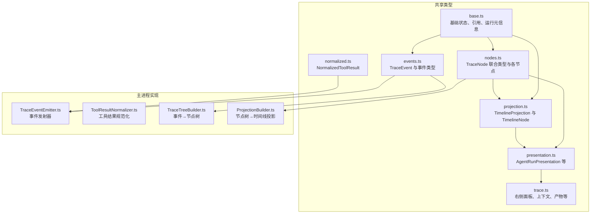
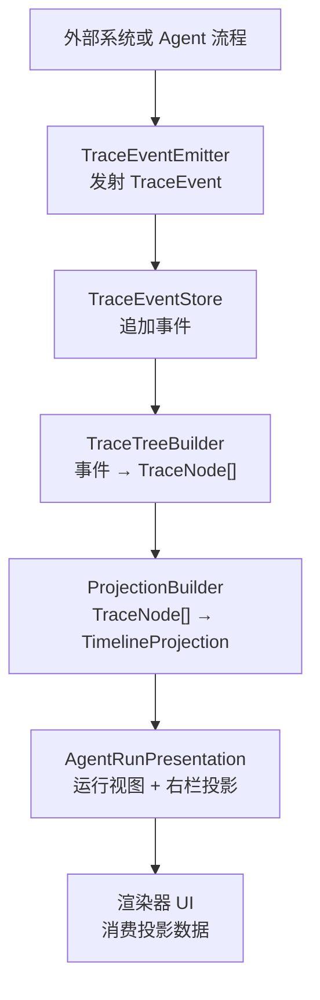
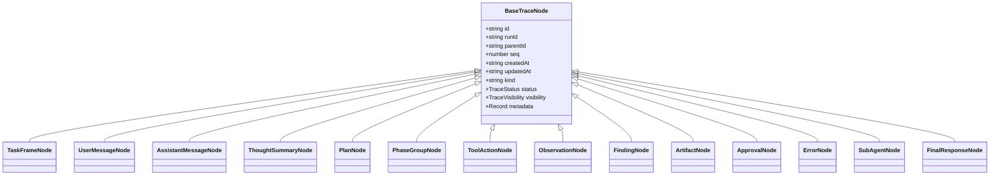
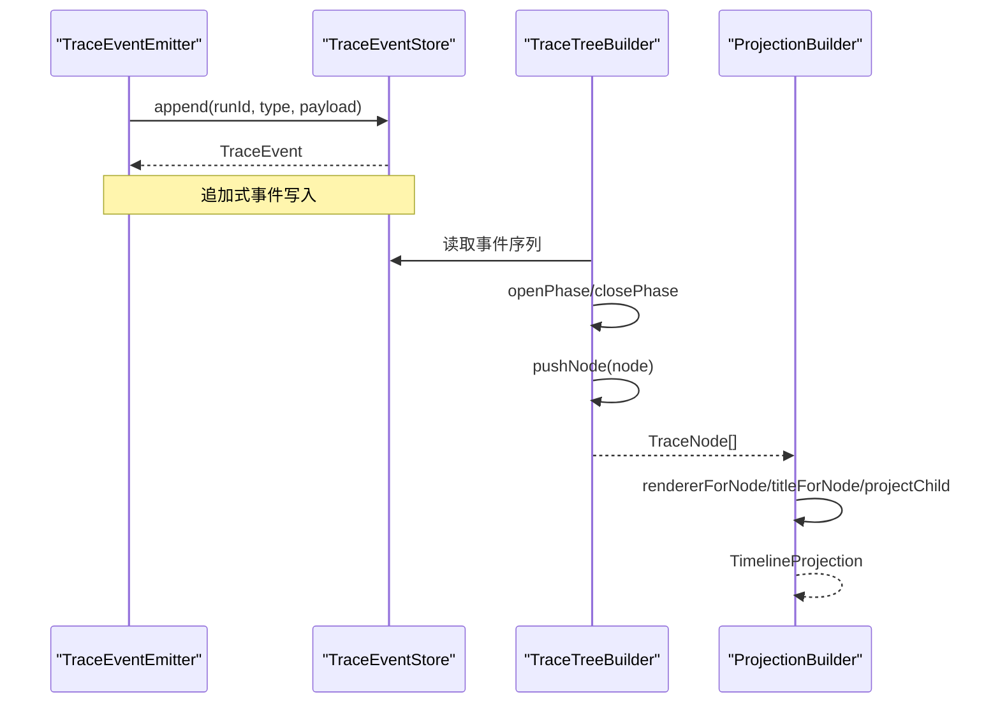
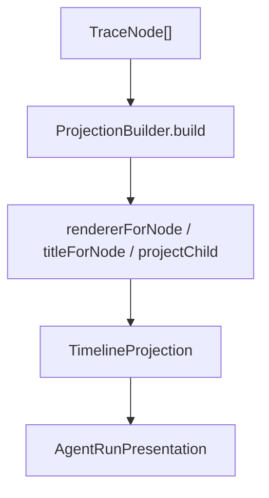
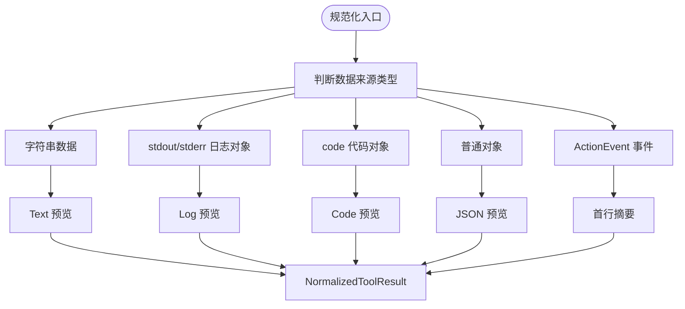
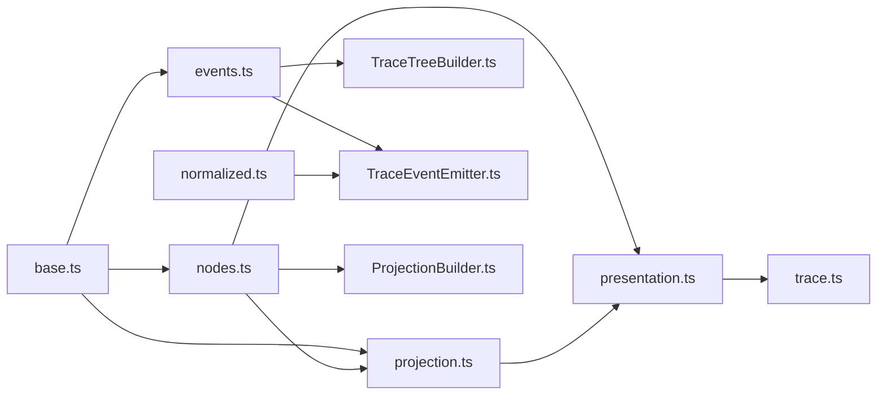

# 可追踪性类型

<cite>
**本文引用的文件**   
- [agentic-trace-protocol.md](file://docs/architecture/agentic-trace-protocol.md)
- [base.ts](file://src/shared/types/agenticTrace/base.ts)
- [nodes.ts](file://src/shared/types/agenticTrace/nodes.ts)
- [events.ts](file://src/shared/types/agenticTrace/events.ts)
- [projection.ts](file://src/shared/types/agenticTrace/projection.ts)
- [presentation.ts](file://src/shared/types/agenticTrace/presentation.ts)
- [normalized.ts](file://src/shared/types/agenticTrace/normalized.ts)
- [trace.ts](file://src/shared/types/trace.ts)
- [ToolResultNormalizer.ts](file://src/main/agent-trace/ToolResultNormalizer.ts)
- [TraceTreeBuilder.ts](file://src/main/agent-trace/TraceTreeBuilder.ts)
- [ProjectionBuilder.ts](file://src/main/agent-trace/ProjectionBuilder.ts)
- [TraceEventEmitter.ts](file://src/main/agent-trace/TraceEventEmitter.ts)
</cite>

## 目录
1. [引言](#引言)
2. [项目结构](#项目结构)
3. [核心类型总览](#核心类型总览)
4. [架构总览](#架构总览)
5. [节点类型详解](#节点类型详解)
6. [事件序列与审计轨迹](#事件序列与审计轨迹)
7. [时间线投影与可视化呈现](#时间线投影与可视化呈现)
8. [工具结果规范化](#工具结果规范化)
9. [依赖关系分析](#依赖关系分析)
10. [性能与复杂度](#性能与复杂度)
11. [故障排查指南](#故障排查指南)
12. [结论](#结论)

## 引言
本文件聚焦 Agent 执行的可追踪性类型定义，系统性说明 `TraceNode`、`TraceEvent`、`TimelineProjection`、`AgentRunPresentation`、`NormalizedToolResult` 等核心类型，并解释节点类型（如 `ToolActionNode`、`ThoughtSummaryNode`、`FindingNode`）、事件流转模式、时间线投影、可视化呈现以及数据规范化过程。文档面向希望理解 Agent 运行轨迹、构建回放界面或进行审计分析的开发者，既提供高层架构图，也给出代码级类型关系图。

## 项目结构
可追踪性相关类型主要位于共享类型模块中，运行时处理逻辑位于主进程的 agent-trace 目录：

**图表来源**
- [base.ts:1-91](file://src/shared/types/agenticTrace/base.ts#L1-L91)
- [nodes.ts:1-220](file://src/shared/types/agenticTrace/nodes.ts#L1-L220)
- [events.ts:1-41](file://src/shared/types/agenticTrace/events.ts#L1-L41)
- [projection.ts:1-23](file://src/shared/types/agenticTrace/projection.ts#L1-L23)
- [presentation.ts:1-40](file://src/shared/types/agenticTrace/presentation.ts#L1-L40)
- [normalized.ts:1-12](file://src/shared/types/agenticTrace/normalized.ts#L1-L12)
- [trace.ts:1-200](file://src/shared/types/trace.ts#L1-L200)
- [TraceEventEmitter.ts:1-175](file://src/main/agent-trace/TraceEventEmitter.ts#L1-L175)
- [ToolResultNormalizer.ts:1-70](file://src/main/agent-trace/ToolResultNormalizer.ts#L1-L70)
- [TraceTreeBuilder.ts:1-139](file://src/main/agent-trace/TraceTreeBuilder.ts#L1-L139)
- [ProjectionBuilder.ts:1-109](file://src/main/agent-trace/ProjectionBuilder.ts#L1-L109)

**章节来源**
- [agentic-trace-protocol.md:1-73](file://docs/architecture/agentic-trace-protocol.md#L1-L73)

## 核心类型总览
本节概述可追踪性体系中的关键类型及其职责边界。

| 类别 | 类型名称 | 职责说明 |
|---|---|---|
| 基础类型 | `TraceStatus` | 表示运行与节点状态，包括 pending、running、succeeded、failed、cancelled、skipped、waiting_approval。 |
| 基础类型 | `TraceVisibility` | 控制可见性：user、debug、internal。 |
| 基础类型 | `BaseTraceNode` | 所有 TraceNode 的公共字段，包含 id、runId、parentId、seq、createdAt、updatedAt、kind、status、visibility、metadata。 |
| 引用类型 | `AttachmentRef` | 附件引用，支持 file、image、audio、video、url、text、binary。 |
| 引用类型 | `EvidenceRef` | 证据引用，支持 trace_node、tool_call、artifact、file_range、url、log、domain_object。 |
| 引用类型 | `ArtifactRef` | 产物引用，支持 file、code、diff、image、table、chart、json、log、link、binary、domain_object。 |
| 运行元信息 | `AgentRun` | 一次 Agent 运行的顶层元数据，包括 runId、agentType、title、userRequest、status、时间戳、context、profileVersion。 |
| 事件类型 | `TraceEvent` | 追加式审计事件，包含 eventId、runId、seq、timestamp、type、payload、visibility。 |
| 节点联合类型 | `TraceNode` | 聚合任务帧、用户消息、助手消息、思考摘要、计划、阶段分组、工具动作、观察、发现、产物、审批、错误、子 Agent、最终响应等节点。 |
| 时间线投影 | `TimelineProjection` | 可视化的时间线投影，包含 runId、title、status、nodes。 |
| 时间线节点 | `TimelineNode` | 渲染器消费的时间线节点，包含 nodeId、sourceNodeIds、renderer、title、subtitle、status、collapsedByDefault、importance、children、payload。 |
| 可视化呈现 | `AgentRunPresentation` | 右栏与运行视图的组合，包含 projectId、sessionId、activeBranchId、profileId、updatedAt、runs、rightPanel、branchNavigator、rawAuditRefs。 |
| 工具结果规范化 | `NormalizedToolResult` | 将不同来源的工具输出统一为 summary、preview、observations、findings、artifacts、raw。 |

这些类型共同构成“原始事件 → 节点树 → 时间线投影 → 可视化呈现”的数据管道。

**章节来源**
- [base.ts:1-91](file://src/shared/types/agenticTrace/base.ts#L1-L91)
- [events.ts:1-41](file://src/shared/types/agenticTrace/events.ts#L1-L41)
- [nodes.ts:1-220](file://src/shared/types/agenticTrace/nodes.ts#L1-L220)
- [projection.ts:1-23](file://src/shared/types/agenticTrace/projection.ts#L1-L23)
- [presentation.ts:1-40](file://src/shared/types/agenticTrace/presentation.ts#L1-L40)
- [normalized.ts:1-12](file://src/shared/types/agenticTrace/normalized.ts#L1-L12)

## 架构总览
Agentic Trace 是 RDC-Agent 当前消息流与运行投影契约。运行时跟踪事件以追加式 JSONL 记录存储；会话级右栏状态通过 `TraceStateStore` 和共享类型进行投影；渲染层消费 `AgentRunPresentation` 等投影数据，而不直接重建原始存储或执行 RDC 工具。

**图表来源**
- [TraceEventEmitter.ts:1-175](file://src/main/agent-trace/TraceEventEmitter.ts#L1-L175)
- [TraceTreeBuilder.ts:1-139](file://src/main/agent-trace/TraceTreeBuilder.ts#L1-L139)
- [ProjectionBuilder.ts:1-109](file://src/main/agent-trace/ProjectionBuilder.ts#L1-L109)
- [agentic-trace-protocol.md:1-73](file://docs/architecture/agentic-trace-protocol.md#L1-L73)

**章节来源**
- [agentic-trace-protocol.md:1-73](file://docs/architecture/agentic-trace-protocol.md#L1-L73)

## 节点类型详解
`TraceNode` 是一个联合类型，用于表达 Agent 运行过程中的结构化片段。它由多个具体节点类型组成，每种节点都有明确的语义、字段和关系约束。

### 节点分类与职责

| 节点类型 | kind 值 | 主要字段 | 用途 |
|---|---|---|---|
| `TaskFrameNode` | task_frame | title、userRequest、contextSummary、constraints、expectedOutput | 表示一次任务框架，承载用户请求和上下文摘要。 |
| `UserMessageNode` | user_message | content、attachments | 用户输入消息及附件引用。 |
| `AssistantMessageNode` | assistant_message | content、format | 助手回复消息，支持 markdown/plain。 |
| `ThoughtSummaryNode` | thought_summary | title、mode、intent、rationale、hypothesis、evidenceNeed、nextAction、confidence | 推理思考摘要，携带推理模式和置信度。 |
| `PlanNode` | plan | title、steps | 执行计划，包含若干 PlanStep。 |
| `PhaseGroupNode` | phase_group | title、description、phase、children、status | 阶段分组容器，内部包含子节点列表。 |
| `ToolActionNode` | tool_action | toolCallId、toolName、displayName、category、purpose、inputPreview、outputPreview、rawInput、rawOutput、durationMs、status、artifacts、evidenceRefs、preview | 工具调用节点，携带输入输出预览、产物和证据引用。 |
| `ObservationNode` | observation | title、facts、summary、supportedHypotheses、excludedHypotheses | 观察结果，包含事实、假设支持和排除信息。 |
| `FindingNode` | finding | severity、title、diagnosis、evidenceRefs、recommendation、confidence | 诊断性发现，包含严重等级、证据和推荐。 |
| `ArtifactNode` | artifact | artifactId、artifactKind、title、uri、preview、metadata | 产物节点，表示可展示或导出的产出物。 |
| `ApprovalNode` | approval | approvalId、title、description、riskLevel、proposedActions、status | 审批节点，支持 low/medium/high 风险级别和多种操作。 |
| `ErrorNode` | error | title、message、code、recoverable、retryAction、debug | 错误节点，支持恢复提示和调试信息。 |
| `SubAgentNode` | sub_agent | subRunId、agentName、title、inputSummary、outputSummary、children、status | 子 Agent 运行节点，可嵌套子节点。 |
| `FinalResponseNode` | final_response | content、format、referencedFindings、referencedArtifacts、changedFiles | 最终回答，可引用发现、产物和变更文件。 |

### 节点关系图

**图表来源**
- [base.ts:1-91](file://src/shared/types/agenticTrace/base.ts#L1-L91)
- [nodes.ts:1-220](file://src/shared/types/agenticTrace/nodes.ts#L1-L220)

### 重要节点深入说明

#### ToolActionNode
- 标识工具调用的唯一性与显示名，并记录工具类别、目的、输入输出预览。
- 使用 `durationMs` 衡量耗时，`status` 反映成功、失败或运行状态。
- 可通过 `artifacts` 关联产物，通过 `evidenceRefs` 关联证据。
- 通过 `preview` 提供结构化预览，便于 UI 渲染。

#### ThoughtSummaryNode
- 携带推理意图、依据、假设、下一步行动和置信度。
- 支持推理模式，便于在 UI 中以不同方式展示思考过程。

#### FindingNode
- 具有严重等级 info/warning/error/critical。
- 包含诊断描述、证据引用、建议和置信度，适合生成审计报告。

#### PhaseGroupNode
- 作为阶段容器，包含 children 数组，并在时间线投影中被展开或折叠。
- 其 status 由阶段开始/完成事件驱动。

**章节来源**
- [nodes.ts:1-220](file://src/shared/types/agenticTrace/nodes.ts#L1-L220)

## 事件序列与审计轨迹
`TraceEvent` 是追加式审计记录，用于表达 Agent 运行过程中的状态变化和节点创建/更新。

### 事件类型

| 事件类型 | 含义 |
|---|---|
| node.created | 新增一个 TraceNode。 |
| node.updated | 更新已有 TraceNode。 |
| tool.started | 工具调用开始。 |
| tool.completed | 工具调用成功完成。 |
| tool.failed | 工具调用失败。 |
| phase.started | 阶段开始。 |
| phase.completed | 阶段完成。 |
| run.completed | 运行成功结束。 |
| run.failed | 运行失败结束。 |
| run.cancelled | 运行被取消。 |

### 事件到节点的转换流程

**图表来源**
- [TraceEventEmitter.ts:1-175](file://src/main/agent-trace/TraceEventEmitter.ts#L1-L175)
- [TraceTreeBuilder.ts:1-139](file://src/main/agent-trace/TraceTreeBuilder.ts#L1-L139)
- [ProjectionBuilder.ts:1-109](file://src/main/agent-trace/ProjectionBuilder.ts#L1-L109)

### 典型事件序列示例
以下示例描述一次带阶段、工具调用和最终回答的运行轨迹：

1. 阶段开始：`phase.started`
2. 任务帧创建：`node.created`（TaskFrameNode）
3. 思考摘要：`node.created`（ThoughtSummaryNode）
4. 工具开始：`tool.started`（ToolActionNode）
5. 工具完成：`tool.completed`（ToolActionNode）
6. 观察结果：`node.created`（ObservationNode）
7. 发现项：`node.created`（FindingNode）
8. 阶段完成：`phase.completed`
9. 运行完成：`run.completed`（FinalResponseNode）

该序列由 `TraceEventEmitter` 构造事件，`TraceTreeBuilder` 将其转换为节点树，再由 `ProjectionBuilder` 生成时间线投影，最终形成 `AgentRunPresentation` 供渲染层消费。

**章节来源**
- [events.ts:1-41](file://src/shared/types/agenticTrace/events.ts#L1-L41)
- [TraceEventEmitter.ts:1-175](file://src/main/agent-trace/TraceEventEmitter.ts#L1-L175)
- [TraceTreeBuilder.ts:1-139](file://src/main/agent-trace/TraceTreeBuilder.ts#L1-L139)

## 时间线投影与可视化呈现
时间线投影是将结构化节点转换为渲染友好的层次结构的关键步骤。

### TimelineProjection 与 TimelineNode
- `TimelineProjection` 包含 runId、title、status、nodes。
- `TimelineNode` 包含 nodeId、sourceNodeIds、renderer、title、subtitle、status、collapsedByDefault、importance、children、payload。
- `TimelineImportance` 分为 low、normal、high，用于突出任务帧和最终回答。

### Renderer 映射
`ProjectionBuilder.rendererForNode` 根据节点 kind 选择渲染器键：
- task_frame → task_frame
- thought_summary → thought_summary
- plan → plan
- phase_group → phase_group
- tool_action → 从工具清单获取 renderer.key，否则回退到 tool.{category}
- observation → observation
- finding → finding
- artifact → artifact.{artifactKind}
- approval → approval
- error → error
- sub_agent → sub_agent
- final_response → final_response

### 标题与折叠策略
- 标题由 `titleForNode` 决定，例如 ThoughtSummaryNode 取 intent 的前缀。
- 默认折叠：
  - tool_action：根据工具清单的 defaultCollapsed。
  - thought_summary：当运行已完成或失败时默认折叠。
  - phase_group：受 profile 的阶段配置影响。

### AgentRunPresentation
- 组合多个 `AgentRunViewModel`，每个 ViewModel 包含 run、timeline、inspectorSelection。
- rightPanel 来自右侧面板视图模型。
- rawAuditRefs 保留原始审计引用，便于审计追溯。

**图表来源**
- [ProjectionBuilder.ts:1-109](file://src/main/agent-trace/ProjectionBuilder.ts#L1-L109)
- [presentation.ts:1-40](file://src/shared/types/agenticTrace/presentation.ts#L1-L40)
- [projection.ts:1-23](file://src/shared/types/agenticTrace/projection.ts#L1-L23)

**章节来源**
- [projection.ts:1-23](file://src/shared/types/agenticTrace/projection.ts#L1-L23)
- [ProjectionBuilder.ts:1-109](file://src/main/agent-trace/ProjectionBuilder.ts#L1-L109)
- [presentation.ts:1-40](file://src/shared/types/agenticTrace/presentation.ts#L1-L40)

## 工具结果规范化
`NormalizedToolResult` 将不同来源的工具输出统一为一致的展示结构，同时保留原始数据以便回溯。

### 规范化目标
- summary：人类可读的第一行摘要。
- preview：结构化预览，支持 text、log、code、json 等。
- observations：可选的观察节点数组。
- findings：可选的发现节点数组。
- artifacts：可选的产物引用数组。
- raw：原始工具结果，便于审计和调试。

### 两种规范化入口
- `fromToolCallResult`：基于 `ToolCallResult`，判断 data 是否为字符串、日志对象、代码对象或普通对象。
- `fromActionEvent`：基于 `ActionEvent`，优先使用 payload.summary/result/error/data。

**图表来源**
- [normalized.ts:1-12](file://src/shared/types/agenticTrace/normalized.ts#L1-L12)
- [ToolResultNormalizer.ts:1-70](file://src/main/agent-trace/ToolResultNormalizer.ts#L1-L70)

### 与事件发射器的集成
`TraceEventEmitter.emitToolFromActionEvent` 在构造 `ToolActionNode` 时使用 `toolResultNormalizer.fromActionEvent`，并将 observations 逐个追加为节点。

**章节来源**
- [normalized.ts:1-12](file://src/shared/types/agenticTrace/normalized.ts#L1-L12)
- [ToolResultNormalizer.ts:1-70](file://src/main/agent-trace/ToolResultNormalizer.ts#L1-L70)
- [TraceEventEmitter.ts:1-175](file://src/main/agent-trace/TraceEventEmitter.ts#L1-L175)

## 依赖关系分析
可追踪性模块之间的依赖如下：

**图表来源**
- [base.ts:1-91](file://src/shared/types/agenticTrace/base.ts#L1-L91)
- [nodes.ts:1-220](file://src/shared/types/agenticTrace/nodes.ts#L1-L220)
- [events.ts:1-41](file://src/shared/types/agenticTrace/events.ts#L1-L41)
- [projection.ts:1-23](file://src/shared/types/agenticTrace/projection.ts#L1-L23)
- [presentation.ts:1-40](file://src/shared/types/agenticTrace/presentation.ts#L1-L40)
- [trace.ts:1-200](file://src/shared/types/trace.ts#L1-L200)
- [TraceTreeBuilder.ts:1-139](file://src/main/agent-trace/TraceTreeBuilder.ts#L1-L139)
- [ProjectionBuilder.ts:1-109](file://src/main/agent-trace/ProjectionBuilder.ts#L1-L109)
- [TraceEventEmitter.ts:1-175](file://src/main/agent-trace/TraceEventEmitter.ts#L1-L175)
- [ToolResultNormalizer.ts:1-70](file://src/main/agent-trace/ToolResultNormalizer.ts#L1-L70)

**章节来源**
- [agentic-trace-protocol.md:1-73](file://docs/architecture/agentic-trace-protocol.md#L1-L73)

## 性能与复杂度
- 事件追加写入采用追加式 JSONL 设计，适合大规模审计轨迹记录，避免随机写开销。
- `TraceTreeBuilder.build` 对事件序列进行一次线性扫描，并根据阶段和节点类型维护当前阶段容器，整体时间复杂度接近 O(n)。
- `TraceTreeBuilder.flatten` 对节点树进行深度优先遍历，时间复杂度为 O(N)，其中 N 为节点总数。
- `ProjectionBuilder.build` 过滤掉空的 phase_group，并为每个节点计算渲染器和标题，时间复杂度为 O(M)，M 为节点数量。
- 工具结果规范化根据数据类型分支处理，时间复杂度为 O(1) 至 O(k)，k 为数据结构大小。

优化建议：
- 对于超大运行，可对事件流进行分页或增量投影，避免一次性构建完整节点树。
- 对频繁访问的 `toolManifestRegistry` 查询应确保缓存命中。
- 对 `TimelineNode.payload` 的大对象应避免不必要的序列化拷贝。

[本节为通用性能讨论，不直接分析具体代码文件]

## 故障排查指南
常见问题与定位方法：

| 问题 | 可能原因 | 排查建议 |
|---|---|---|
| 时间线未显示阶段 | 阶段事件缺失或 visibility 为 internal | 检查 phase.started/phase.completed 事件是否存在且非 internal。 |
| 工具节点未折叠 | 工具清单缺少 defaultCollapsed 配置 | 检查工具清单渲染器配置。 |
| 思考摘要未出现 | thinking.visibility 为 hidden 或文本为空 | 检查 ThinkingArtifact 的 visibility 和文本内容。 |
| 工具结果预览为空 | 数据不是字符串、日志、代码或对象 | 检查 ToolCallResult.data 或 ActionEvent.payload.data 的结构。 |
| 最终回答未出现 | run.completed 事件未携带 FinalResponseNode | 检查运行完成事件是否包含最终响应节点。 |
| 右侧面板无进度 | 任务注册表未更新或未正确映射 | 检查 TaskRegistry 的 task_create/task_update 事件与进度投影映射。 |

**章节来源**
- [TraceEventEmitter.ts:1-175](file://src/main/agent-trace/TraceEventEmitter.ts#L1-L175)
- [ToolResultNormalizer.ts:1-70](file://src/main/agent-trace/ToolResultNormalizer.ts#L1-L70)
- [agentic-trace-protocol.md:1-73](file://docs/architecture/agentic-trace-protocol.md#L1-L73)

## 结论
本文件系统化梳理了 Agent 可追踪性类型的定义与使用方式，涵盖基础类型、节点类型、事件类型、时间线投影、可视化呈现和工具结果规范化。通过 `TraceEventEmitter`、`TraceTreeBuilder`、`ProjectionBuilder` 和 `ToolResultNormalizer` 的协作，系统将原始事件转化为结构化的节点树和时间线投影，并最终形成 `AgentRunPresentation` 供渲染层消费。该体系为 Agent 执行的审计、回放、调试和用户界面提供了坚实的类型基础和数据处理路径。

[本节为总结性内容，不直接分析具体代码文件]