# 对话与会话类型

<cite>
**本文引用的文件**   
- [conversation.ts](file://src/shared/types/conversation.ts)
- [session.ts](file://src/shared/types/session.ts)
- [conversationBranch.ts](file://src/shared/types/conversationBranch.ts)
- [session-projection.md](file://docs/contracts/session-projection.md)
- [conversationSchemas.ts](file://src/main/ipc/validation/conversationSchemas.ts)
- [storageSchema.ts](file://src/main/sessions/storageSchema.ts)
- [ConversationTurnStarter.ts](file://src/main/conversation/ConversationTurnStarter.ts)
</cite>

## 目录
1. [引言](#引言)
2. [项目结构](#项目结构)
3. [核心业务模型](#核心业务模型)
4. [架构总览](#架构总览)
5. [详细组件分析](#详细组件分析)
6. [依赖关系分析](#依赖关系分析)
7. [性能与复杂度](#性能与复杂度)
8. [序列化、版本兼容与数据迁移](#序列化版本兼容与数据迁移)
9. [故障排查指南](#故障排查指南)
10. [结论](#结论)

## 引言
本文件围绕对话与会话相关的类型定义，系统说明 ConversationMessage、ConversationTurnResult、SessionRecord 等核心业务模型，并解释消息结构、流式事件、会话状态机、分支管理、Turn 协调器相关请求类型、计划审查流程类型，以及消息序列化格式、版本兼容策略和数据迁移规则。文档同时提供会话生命周期图、消息流转图和状态转换表，帮助不同技术背景的读者理解“用户输入 → Turn 启动 → 工具调用/交互 → 结果投影 → 持久化”的完整链路。

## 项目结构
对话与会话类型分布在共享类型模块、IPC 校验层、主进程存储与 Turn 启动逻辑中：

- 共享类型：
  - src/shared/types/conversation.ts：对话消息、工作块、流事件、发送/回答请求、Turn 结果等。
  - src/shared/types/session.ts：会话记录、运行记录、上下文使用摘要、附件记录等。
  - src/shared/types/conversationBranch.ts：分支、分叉、分支切换请求/结果、历史结果。
- IPC 契约与校验：
  - src/main/ipc/validation/conversationSchemas.ts：基于 Zod 的请求参数校验。
- 运行时与协调：
  - src/main/conversation/ConversationTurnStarter.ts：Turn 启动、预检、路由、附件规划、分支与草稿工作轨迹。
- 存储与迁移：
  - src/main/sessions/storageSchema.ts：存储文档读取、schemaVersion 解析、迁移管道。
- 活跃会话契约：
  - docs/contracts/session-projection.md：Active Session 门控、多会话隔离、Stop/Rewrite 语义、计划审批边界。

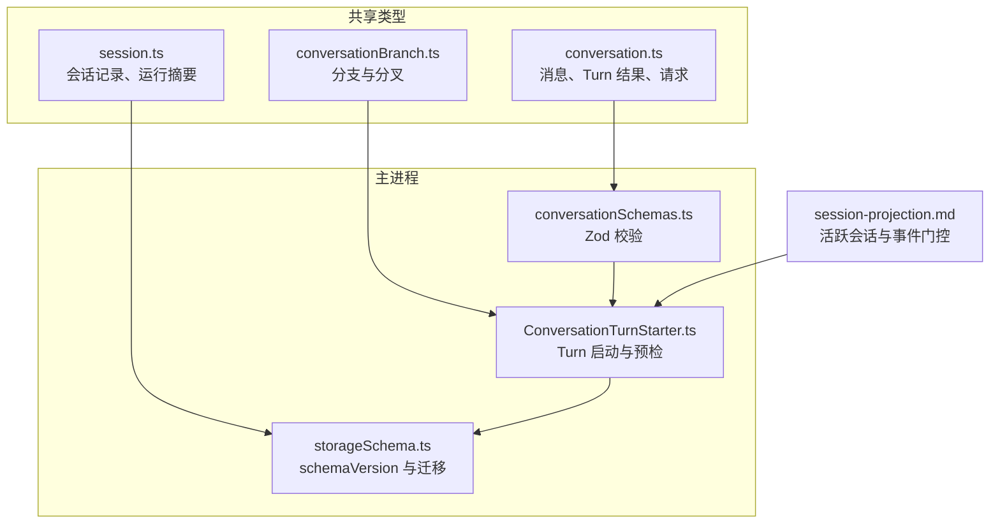

**图表来源**
- [conversation.ts:1-567](file://src/shared/types/conversation.ts#L1-L567)
- [session.ts:1-455](file://src/shared/types/session.ts#L1-L455)
- [conversationBranch.ts:1-43](file://src/shared/types/conversationBranch.ts#L1-L43)
- [conversationSchemas.ts:1-199](file://src/main/ipc/validation/conversationSchemas.ts#L1-L199)
- [storageSchema.ts:1-260](file://src/main/sessions/storageSchema.ts#L1-L260)
- [session-projection.md:1-131](file://docs/contracts/session-projection.md#L1-L131)

**章节来源**
- [conversation.ts:1-567](file://src/shared/types/conversation.ts#L1-L567)
- [session.ts:1-455](file://src/shared/types/session.ts#L1-L455)
- [conversationBranch.ts:1-43](file://src/shared/types/conversationBranch.ts#L1-L43)
- [conversationSchemas.ts:1-199](file://src/main/ipc/validation/conversationSchemas.ts#L1-L199)
- [storageSchema.ts:1-260](file://src/main/sessions/storageSchema.ts#L1-L260)
- [session-projection.md:1-131](file://docs/contracts/session-projection.md#L1-L131)

## 核心业务模型

### ConversationMessage：对话消息
ConversationMessage 是持久化与渲染的最小单位，承载用户或助手文本、工作轨迹、诊断信息、附件、分支归属和请求指纹。

关键字段说明：
- id：消息标识。
- requestId：幂等键，对应创建该消息的用户请求。
- requestFingerprint：冻结后的请求指纹，用于重启安全幂等。
- turnId、sessionId、projectId、runId：消息所属会话、回合与运行上下文。
- role：user / assistant / system。
- content：正文文本。
- status：draft / streaming / complete / error / stopped。
- workTrace：本轮工作块集合与整体状态。
- diagnostic：诊断信息（如 LLM 路由失败、上下文压缩失败等）。
- attachments：会话级附件记录。
- branchId / forkId / variantIndex：分支与分叉位置。
- preparedContext：冻结的预检摘要，保证重试可审计。
- handoffSuggestions：回合结束时的交接建议。

典型用途：
- 渲染气泡：role + content + status。
- 工具调用面板：workTrace.toolCalls 中的 toolName/status/error/approval/userInputQuestions/planReview。
- 分支 UI：branchId/forkId/variantIndex 显示变体顺序。
- 诊断提示：diagnostic.code/severity/userMessage/recommendations。

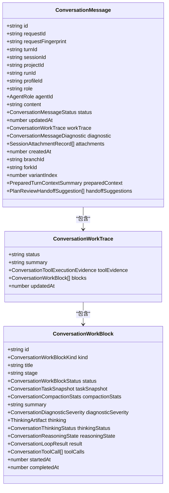

**图表来源**
- [conversation.ts:1-567](file://src/shared/types/conversation.ts#L1-L567)

**章节来源**
- [conversation.ts:1-567](file://src/shared/types/conversation.ts#L1-L567)

### ConversationTurnResult：Turn 协调结果
ConversationTurnResult 描述一次 Turn 执行完成后向渲染器投影的结果，包括会话快照、用户消息、助手草稿消息、可选消息集合、分支状态、运行更新、追踪呈现、UI 提示、错误视图和冻结的上下文摘要。

关键字段说明：
- requestId：本次请求 ID。
- session：当前会话记录（可能为空，例如新建会话场景）。
- mode：对话模式（talk）。
- userMessage：本轮用户消息。
- assistantDraftMessage：助手草稿消息。
- messages：批量消息更新。
- branchState：分支状态快照。
- executionTransition：执行动作（none/started_run）及 runId/sessionId。
- runUpdate：RunSummary。
- tracePresentation：AgentRunPresentation。
- uiHints：UI 引导。
- errorViewModel：错误视图。
- preparedContext：冻结的上下文摘要。

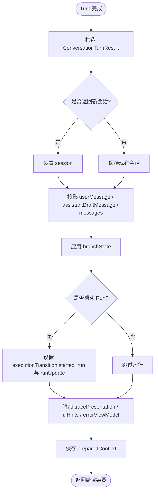

**图表来源**
- [conversation.ts:1-567](file://src/shared/types/conversation.ts#L1-L567)

**章节来源**
- [conversation.ts:1-567](file://src/shared/types/conversation.ts#L1-L567)

### SessionRecord：会话记录
SessionRecord 表示一个持久化的对话会话元数据，由主进程生成并携带迁移通知字段。

关键字段说明：
- handoffNotice：主进程生成的迁移提示（不可写会话字段）。
- sessionId、projectId：会话和项目标识。
- title、goal：会话标题和目标。
- sessionPath：会话路径。
- createdAt、updatedAt：时间戳。
- lastRunId：最近运行 ID。
- turnControls：回合控制能力（reasoningLevel/maxContextMode/fastModel）。
- modelOverride：会话级模型覆盖。
- agentId：当前会话 Agent 标识；缺失时 Composer pill 回退到通用。

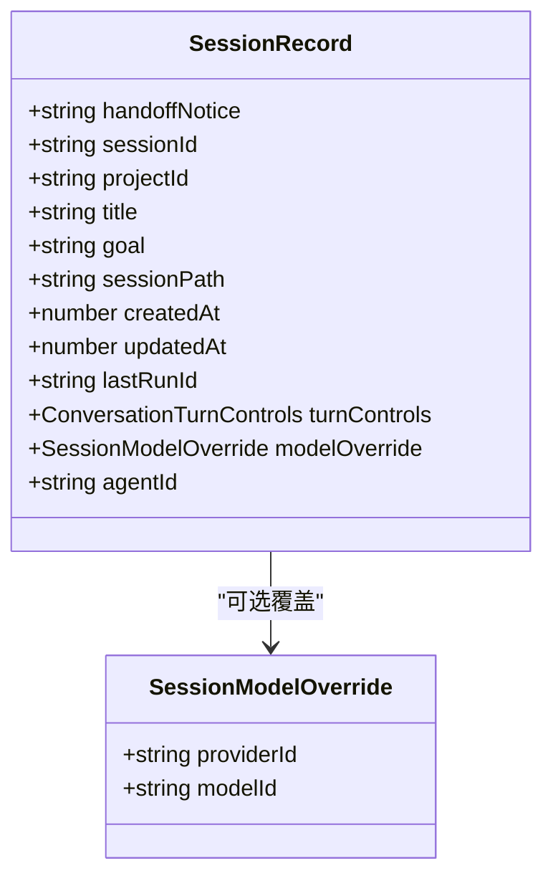

**图表来源**
- [session.ts:1-200](file://src/shared/types/session.ts#L1-L200)

**章节来源**
- [session.ts:1-200](file://src/shared/types/session.ts#L1-L200)

### 分支管理机制
分支类型位于 conversationBranch.ts，支持分叉点、活跃叶子分支、分支切换请求与结果，以及与历史消息类型的联合引用。

关键类型：
- ROOT_BRANCH_ID：根分支常量。
- ConversationBranch：分支节点，含父分支、变体索引、锚点用户消息 ID 和根回合 ID。
- ConversationFork：分叉容器，含分叉 ID、锚点消息 ID、活跃分支 ID 与分支列表。
- ConversationBranchState：会话级分支状态，含根分支 ID、活跃叶子分支 ID、分叉集合。
- ConversationSwitchBranchRequest：切换分支请求。
- ConversationSwitchBranchResult：切换结果，包含成功标志、消息集合、分支状态、追踪呈现与错误。
- ConversationHistoryResult：历史结果，包含消息集合与分支状态。

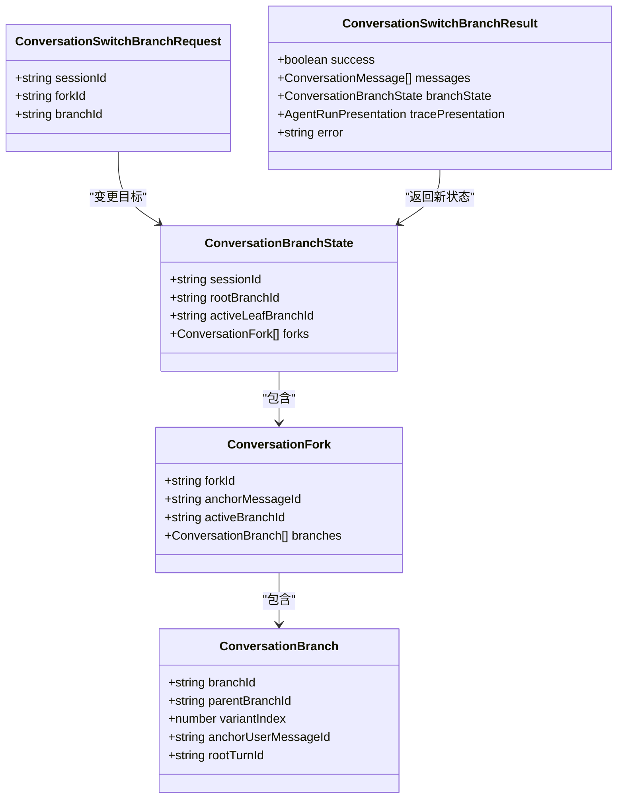

**图表来源**
- [conversationBranch.ts:1-43](file://src/shared/types/conversationBranch.ts#L1-L43)
- [conversation.ts:1-567](file://src/shared/types/conversation.ts#L1-L567)

**章节来源**
- [conversationBranch.ts:1-43](file://src/shared/types/conversationBranch.ts#L1-L43)

## 架构总览
对话与 Turn 的整体架构由渲染器发起请求、主进程校验与启动 Turn、运行时执行工具与交互、最终将消息与追踪投影回渲染器组成。活跃会话契约确保只有当前 active session 能直接写入 UI store，其他会话事件进入后台缓存并按会话隔离。

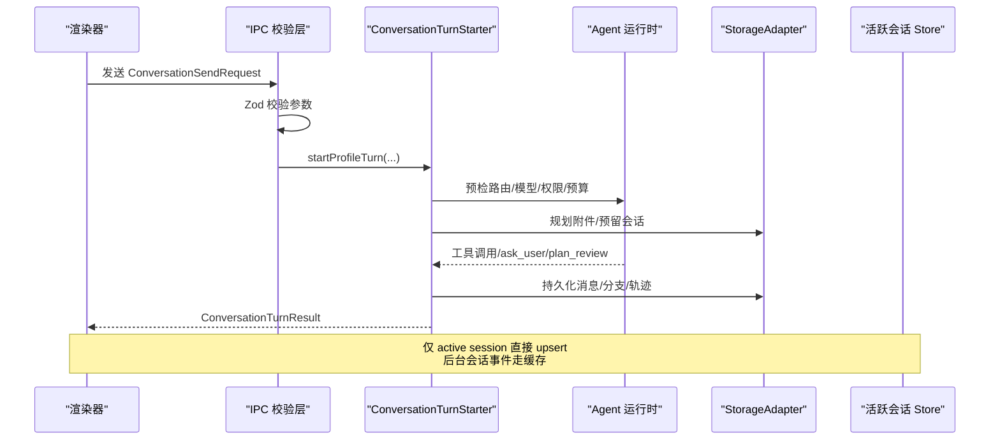

**图表来源**
- [conversationSchemas.ts:1-199](file://src/main/ipc/validation/conversationSchemas.ts#L1-L199)
- [ConversationTurnStarter.ts:1-250](file://src/main/conversation/ConversationTurnStarter.ts#L1-L250)
- [session-projection.md:1-131](file://docs/contracts/session-projection.md#L1-L131)

**章节来源**
- [conversationSchemas.ts:1-199](file://src/main/ipc/validation/conversationSchemas.ts#L1-L199)
- [ConversationTurnStarter.ts:1-250](file://src/main/conversation/ConversationTurnStarter.ts#L1-L250)
- [session-projection.md:1-131](file://docs/contracts/session-projection.md#L1-L131)

## 详细组件分析

### 消息结构与流式事件
ConversationMessage.status 表达消息阶段：
- draft：草稿。
- streaming：流式中。
- complete：完成。
- error：错误。
- stopped：已停止。

流式事件通过 ConversationStreamEvent 聚合：
- message_patched：消息补丁。
- message_completed：消息完成。
- message_errored：消息错误。
- run_linked：关联运行。
- agent_event：代理事件。

这些事件在活跃会话门控下被渲染器合并到当前会话，避免跨会话串台。

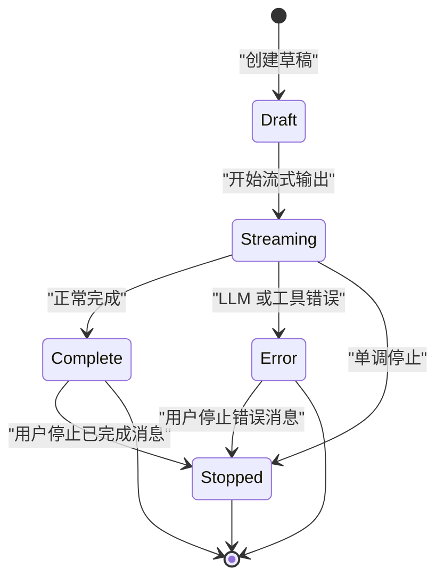

**图表来源**
- [conversation.ts:1-567](file://src/shared/types/conversation.ts#L1-L567)

**章节来源**
- [conversation.ts:1-567](file://src/shared/types/conversation.ts#L1-L567)
- [session-projection.md:1-131](file://docs/contracts/session-projection.md#L1-L131)

### 工具调用与交互
ConversationToolCall 表达单个工具调用的运行时证据：
- id、toolName、status：调用身份与状态。
- argsPreview/resultPreview：预览文本（不复制敏感载荷）。
- userInputQuestions：结构化 ask_user 问题。
- planReview：计划审查对象。
- resourceRefs：非敏感资源证明。
- imagePreviews：会话级缩略图引用。
- approval：工具审批状态。
- hookDiagnostics：Hook 诊断事件。
- delegation/delegatedRequest：委派子任务。

交互请求类型：
- ConversationAnswerUserInputRequest：回答 ask_user 问题。
- ConversationAnswerToolApprovalRequest：回答工具审批。
- 计划审查答案类型从 planReview 类型导出（ConversationAnswerPlanReviewRequest/Result、ConversationPlanReview、PlanReviewDecision、PlanReviewHandoffSuggestion）。

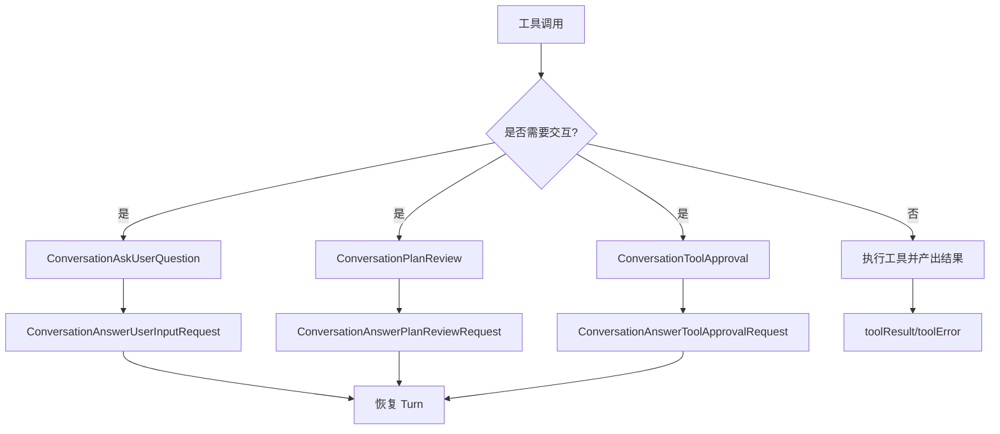

**图表来源**
- [conversation.ts:1-567](file://src/shared/types/conversation.ts#L1-L567)

**章节来源**
- [conversation.ts:1-567](file://src/shared/types/conversation.ts#L1-L567)

### 会话生命周期
会话生命周期由 SessionRecord 与 RunRecordBase/RunSummary 共同表达：
- SessionRecord：会话元数据。
- RunRecordBase：运行基础记录，含 schemaVersion/runId/turnId/projectId/sessionId/caseId/profileId/goal/captures/startedAt/finishedAt/stoppedAt/status/stopReason/backend/reportPaths/diagnostics。
- RunStatus：queued/planning/awaiting_input/awaiting_approval/running/stopping/completed/failed/cancelled/interrupted。
- RunContextUsageSummary：上下文用量与成本摘要。

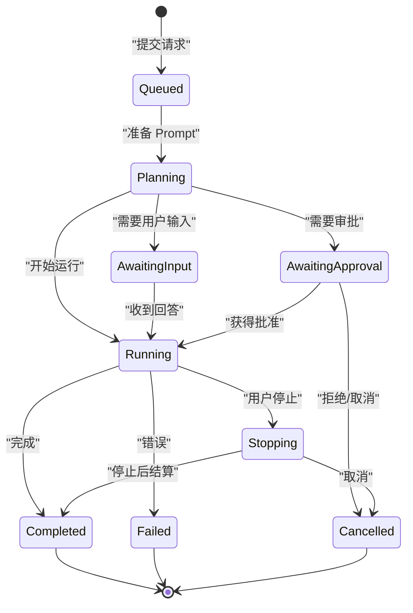

**图表来源**
- [session.ts:1-200](file://src/shared/types/session.ts#L1-L200)

**章节来源**
- [session.ts:1-200](file://src/shared/types/session.ts#L1-L200)

### 计划审查流程类型
计划审查类型从 planReview 类型导出，并在工具执行与 IPC 校验中使用：
- ConversationPlanReview：计划内容、状态、标题、摘要、章节、交接选项。
- PlanReviewDecision：批准/拒绝决定。
- ConversationAnswerPlanReviewRequest/Result：计划审查回答请求与结果。
- PlanReviewHandoffSuggestion：交接建议。

计划审查与工具审批互斥投影，且不能伪造 reject decision；修改意见通过 reject + feedback 恢复同一冻结请求。

**章节来源**
- [conversation.ts:1-567](file://src/shared/types/conversation.ts#L1-L567)
- [conversationSchemas.ts:1-199](file://src/main/ipc/validation/conversationSchemas.ts#L1-L199)

### Turn 协调器使用的类型
Turn 启动入口 startProfileTurn 接收 ResolvedConversationContext、requestedProfileId、requestedAgentId、rawMessage、pendingAttachments、preloadSkillIds、branchContext、requestTurnControls、requestId、preparationController、configurationCommit、requestFingerprint、excludeTurnId、policyBudget，并返回 ConversationTurnResult。

ConversationSendRequest 是渲染器侧发送请求的类型，包含 requestId、projectId、sessionId、currentRunId、replayDeviceId、agentId、profileId、message、attachments、preloadSkillIds、turnControls、configurationCommit。

ConversationRewriteFromMessageRequest 扩展 SendRequest，增加 messageId。

ConversationCancelActiveTurnRequest/Result 表达单调停止请求与结果。

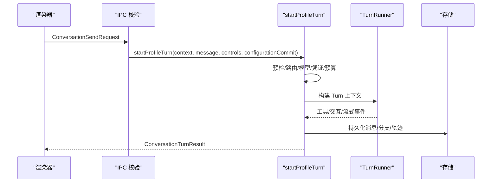

**图表来源**
- [conversation.ts:1-567](file://src/shared/types/conversation.ts#L1-L567)
- [ConversationTurnStarter.ts:1-250](file://src/main/conversation/ConversationTurnStarter.ts#L1-L250)

**章节来源**
- [conversation.ts:1-567](file://src/shared/types/conversation.ts#L1-L567)
- [ConversationTurnStarter.ts:1-250](file://src/main/conversation/ConversationTurnStarter.ts#L1-L250)

## 依赖关系分析
类型之间的主要依赖如下：
- conversation.ts 依赖：
  - agent 角色类型。
  - modelCapability.ConversationTurnControls。
  - agentRuntime.AgentEvent。
  - conversationBranch.ConversationBranchState。
  - reasoning.ProviderOutputRef/ThinkingArtifact。
  - session.SessionRecord/SessionAttachmentLayer/SessionAttachmentRecord/PreparedTurnContextSummary/RunSummary。
  - planReview.ConversationPlanReview/PlanReviewHandoffSuggestion。
- session.ts 依赖：
  - modelCapability.ConversationTurnControls。
  - device.ReplayDeviceEntry。
- conversationBranch.ts 依赖：
  - conversation.ConversationMessage。
  - agenticTrace.AgentRunPresentation。

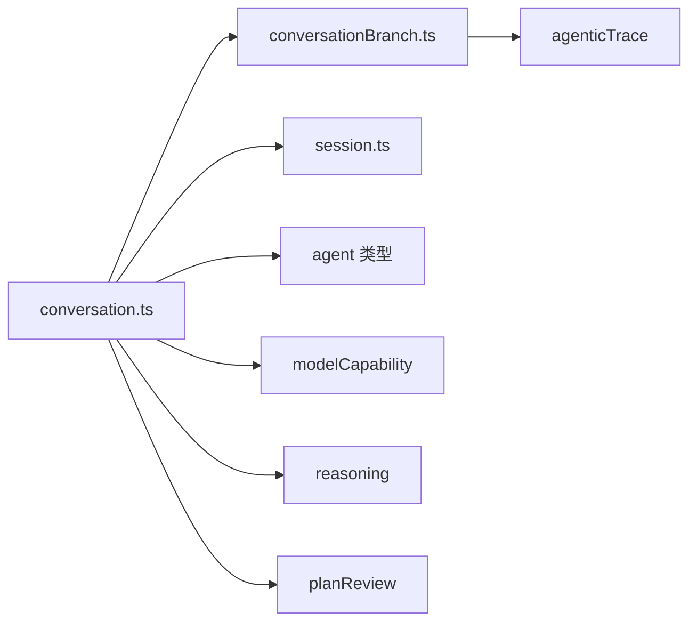

**图表来源**
- [conversation.ts:1-567](file://src/shared/types/conversation.ts#L1-L567)
- [conversationBranch.ts:1-43](file://src/shared/types/conversationBranch.ts#L1-L43)
- [session.ts:1-455](file://src/shared/types/session.ts#L1-L455)

**章节来源**
- [conversation.ts:1-567](file://src/shared/types/conversation.ts#L1-L567)
- [conversationBranch.ts:1-43](file://src/shared/types/conversationBranch.ts#L1-L43)
- [session.ts:1-455](file://src/shared/types/session.ts#L1-L455)

## 性能与复杂度
- 消息集合：消息按 turnId/branchId/forkId/variantIndex 组织，渲染器按可见分支投影，避免全量扫描推断 Agent 或请求。
- 工作块：每轮维护 ConversationWorkBlock 快照，status 与 order 以主进程投影为准，渲染器只做展示。
- 流式事件：按 sessionId/turnId/messageId 过滤与 upsert，减少跨会话污染。
- 附件：会话级 SessionAttachmentRecord 带 layer/kind/mimeType/size，便于分页与预览。
- 上下文摘要：PreparedTurnContextSummary 固化 route/provider/model/budget/cache/compaction 等信息，降低重复计算。

[本节为通用指导，不直接分析具体文件]

## 序列化、版本兼容与数据迁移

### 会话运行记录版本
RunRecordBase 固定 schemaVersion 为 '3'，表示会话运行记录的当前存储版本。

**章节来源**
- [session.ts:180-200](file://src/shared/types/session.ts#L180-L200)

### 存储 Schema 与迁移管道
storageSchema.ts 提供统一读取与迁移机制：
- readCurrentStoredJson：读取 JSON 并校验 schemaVersion 与 Zod schema。
- parseStoredDocument：按 migrations 链从旧版本迁移到最新版本，再做运行时校验。
- CURRENT_STORE_SCHEMA_VERSION：当前存储 Schema 版本。
- assertNoUnsupportedSchemaVersion：拒绝高于当前支持的 schemaVersion。

迁移管道示例：
- PROJECT_REGISTRY_MIGRATIONS：项目注册表迁移。
- CONVERSATION_TURN_COMMIT_MIGRATIONS：对话回合提交日志迁移。
- CONVERSATION_TERMINAL_COMMIT_MIGRATIONS：对话终端提交日志迁移，支持 V1/V2 两种协议。

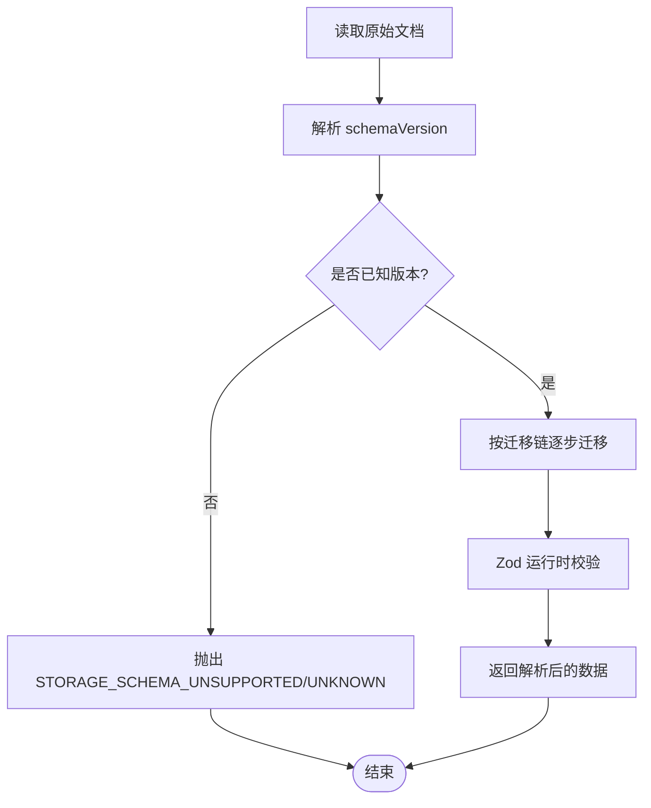

**图表来源**
- [storageSchema.ts:1-260](file://src/main/sessions/storageSchema.ts#L1-L260)

**章节来源**
- [storageSchema.ts:1-260](file://src/main/sessions/storageSchema.ts#L1-L260)

### IPC 请求校验
conversationSchemas.ts 使用 Zod 对 IPC 参数进行严格校验：
- ConversationSendRequestSchema：限制 requestId/message/attachments/turnControls/configurationCommit。
- ConversationRewriteFromMessageArgsSchema：扩展 messageId。
- ConversationAnswerUserInputArgsSchema：限制 questionId/answer/selectedOptionId/responseKind 数量。
- ConversationAnswerPlanReviewArgsSchema：区分 approve/reject，限制 label/agent/feedback。
- ConversationAnswerToolApprovalArgsSchema：approvalId/approved。

校验策略：
- 非空字符串长度上限。
- 枚举值限定。
- 数组最大长度。
- optional/null 显式声明。
- strict() 禁止多余字段。

**章节来源**
- [conversationSchemas.ts:1-199](file://src/main/ipc/validation/conversationSchemas.ts#L1-L199)

### 活跃会话与事件门控
session-projection.md 明确：
- renderer 唯一 active session 由 projectStore.currentSession.sessionId 决定。
- 所有带 sessionId 的流式/投影事件在进入 active UI store 前必须经 isActiveSessionEvent(sessionId)。
- background session 事件写入 sidelined cache，切回时 hydrate。
- Stop/Rewrite 遵循 monotonic stop，按 requestId 为主、turnId 为辅。
- 计划审批与工具审批互斥投影，ownerTurnId 必需且受核对。

**章节来源**
- [session-projection.md:1-131](file://docs/contracts/session-projection.md#L1-L131)

## 故障排查指南

### 常见错误码与定位
- 预检失败：
  - REQUEST_CANCELLED：请求准备被取消。
  - AGENT_COMMIT_NOT_FOUND：提交的 Agent 定义与选择不一致。
  - PROVIDER_UNAVAILABLE/MODEL_UNAVAILABLE：Provider/模型不可用或路由失败。
  - ATTACHMENT_*：附件无效、超限、媒体不支持、未找到。
  - CONTEXT_CANNOT_FIT/PROMPT_OVERHEAD_EXCEEDS_BUDGET：上下文无法放入或开销超预算。
  - TURN_COMMIT_FAILED/PREFLIGHT_FAILED：Turn 提交或预检失败。
- 消息诊断：
  - LLM 路由缺失/Provider 不可用/Tools 不可用/请求失败。
  - 上下文压缩失败、制品配额超限、中断、Provider 流协议违规。
  - Agent 循环停滞、Turn 限制超出、任务完成被拒、Mission 完成被拒。
  - 配置覆盖无效、模型续传丢弃、附件限制/不支持/未找到/无效、视觉输入不支持。

排查步骤：
1. 检查 ConversationPreflightErrorCode 与 ConversationMessageDiagnostic.code。
2. 确认 configurationCommit 是否与有效路由一致。
3. 查看 PreparedTurnContextSummary 的 route/provider/model/cache/compaction 字段。
4. 核对 Attachment 层、mimeType、size、sourcePath。
5. 验证会话与分支归属：sessionId/branchId/forkId/variantIndex。
6. 使用 check:session-projection 静态门禁验证活跃会话事件门控。

**章节来源**
- [conversation.ts:1-567](file://src/shared/types/conversation.ts#L1-L567)
- [session-projection.md:1-131](file://docs/contracts/session-projection.md#L1-L131)

## 结论
对话与会话类型体系以 ConversationMessage、ConversationTurnResult、SessionRecord 为核心，配合分支类型、IPC 校验、活跃会话门控与存储迁移机制，形成从渲染器发送到主进程 Turn 协调、工具执行、交互审批、结果投影再到持久化的完整闭环。类型设计强调冻结上下文、幂等请求、分支可见性、会话隔离与版本兼容，使系统在复杂工具调用与多会话并行环境下仍具备强一致性与可审计性。