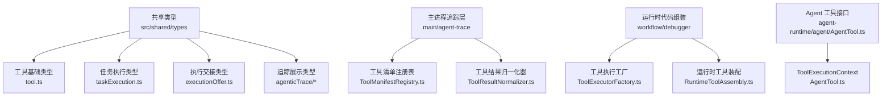
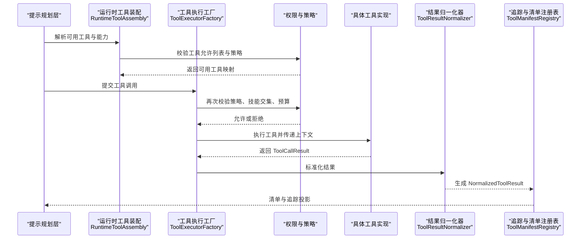
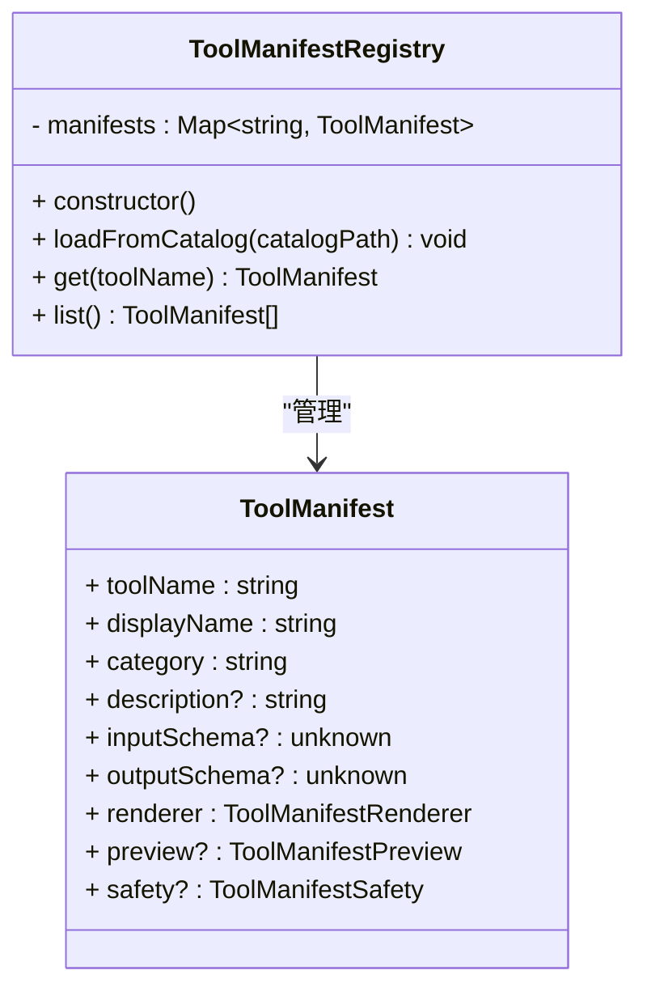
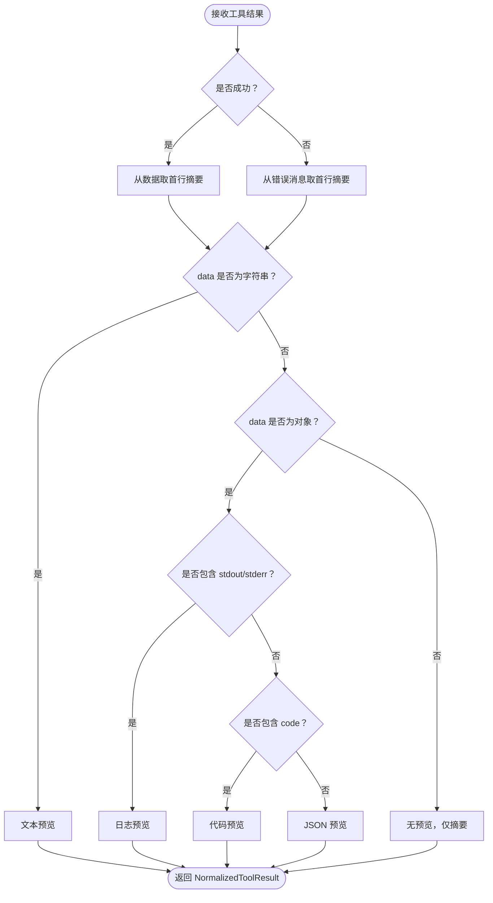
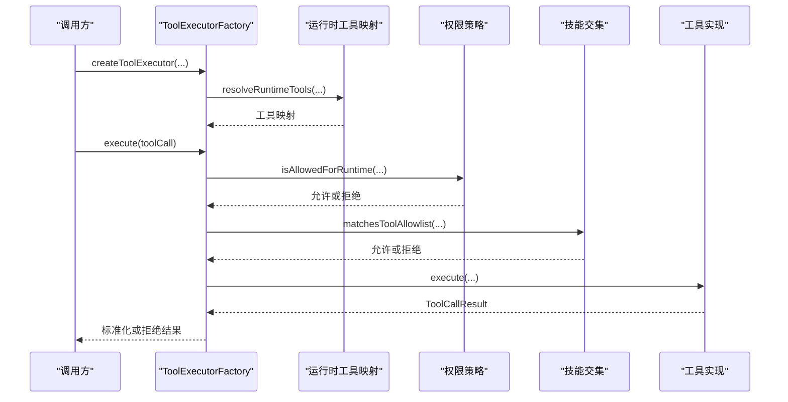
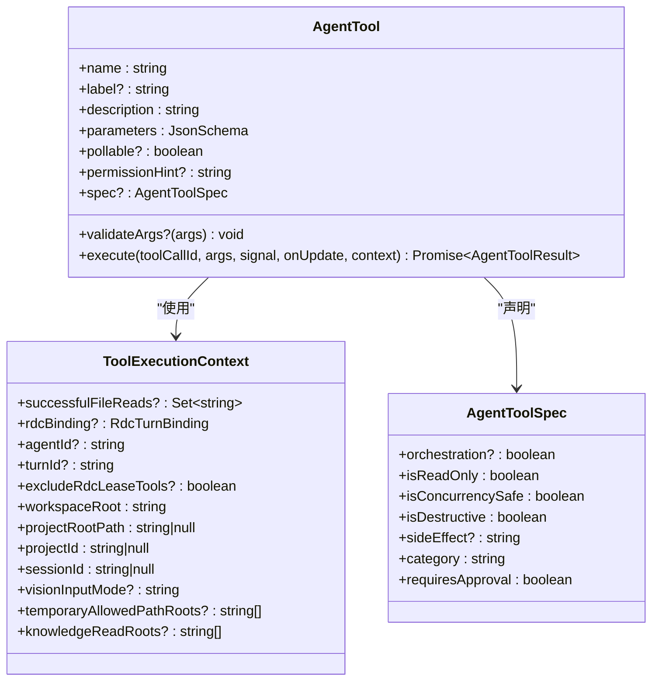
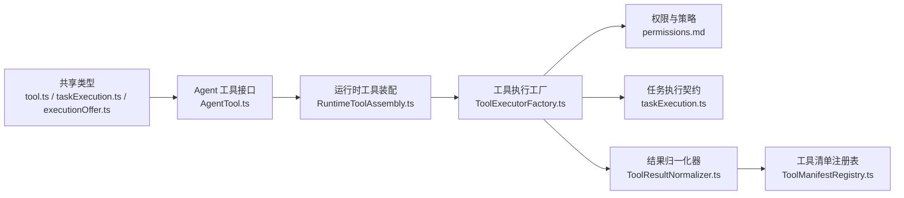

# 工具系统类型

<cite>
**本文引用的文件**   
- [executionOffer.ts](file://src/shared/types/executionOffer.ts)
- [taskExecution.ts](file://src/shared/types/taskExecution.ts)
- [tool.ts](file://src/shared/types/tool.ts)
- [manifest.ts](file://src/shared/types/agenticTrace/manifest.ts)
- [normalized.ts](file://src/shared/types/agenticTrace/normalized.ts)
- [ToolResultNormalizer.ts](file://src/main/agent-trace/ToolResultNormalizer.ts)
- [ToolManifestRegistry.ts](file://src/main/agent-trace/manifests/ToolManifestRegistry.ts)
- [AgentTool.ts](file://src/main/agent-runtime/agent/AgentTool.ts)
- [ToolExecutorFactory.ts](file://src/main/workflow/debugger/ToolExecutorFactory.ts)
- [RuntimeToolAssembly.ts](file://src/main/workflow/debugger/RuntimeToolAssembly.ts)
- [permissions.md](file://docs/contracts/permissions.md)
- [runtime-kernel.md](file://docs/contracts/runtime-kernel.md)
- [check-tool-system.mjs](file://scripts/check-tool-system.mjs)
</cite>

## 目录
1. [引言](#引言)
2. [项目结构](#项目结构)
3. [核心类型总览](#核心类型总览)
4. [架构总览](#架构总览)
5. [关键组件详解](#关键组件详解)
6. [依赖关系分析](#依赖关系分析)
7. [性能与执行特性](#性能与执行特性)
8. [故障排查指南](#故障排查指南)
9. [结论](#结论)
10. [附录：自定义工具开发示例](#附录自定义工具开发示例)

## 引言
本文面向“工具系统”的类型契约，围绕以下目标展开：
- 解释 `ToolManifest`、`ToolInvocation`（对应实现中的调用请求）、`NormalizedToolResult` 等核心类型。
- 说明任务执行类型 `TaskExecutionRequirements`、`PlanTaskRequirement`、`PlanTaskRevision` 以及 `ExecutionOffer`。
- 梳理工具注册机制、权限验证流程、参数校验规则和错误传播路径。
- 提供工具能力声明、结果标准化、调用时序和结果聚合的可视化说明。
- 给出自定义工具开发的完整类型实现指引。

## 项目结构
工具系统类型分布在共享类型、追踪产物、运行时工具和编排层四个层面：

图表来源
- [tool.ts:1-208](file://src/shared/types/tool.ts#L1-L208)
- [taskExecution.ts:1-104](file://src/shared/types/taskExecution.ts#L1-L104)
- [executionOffer.ts:1-22](file://src/shared/types/executionOffer.ts#L1-L22)
- [manifest.ts:1-74](file://src/shared/types/agenticTrace/manifest.ts#L1-L74)
- [normalized.ts:1-12](file://src/shared/types/agenticTrace/normalized.ts#L1-L12)
- [ToolManifestRegistry.ts:1-100](file://src/main/agent-trace/manifests/ToolManifestRegistry.ts#L1-L100)
- [ToolResultNormalizer.ts:1-70](file://src/main/agent-trace/ToolResultNormalizer.ts#L1-L70)
- [ToolExecutorFactory.ts:1-200](file://src/main/workflow/debugger/ToolExecutorFactory.ts#L1-L200)
- [RuntimeToolAssembly.ts:1-200](file://src/main/workflow/debugger/RuntimeToolAssembly.ts#L1-L200)
- [AgentTool.ts:1-87](file://src/main/agent-runtime/agent/AgentTool.ts#L1-L87)

章节来源
- [tool.ts:1-208](file://src/shared/types/tool.ts#L1-L208)
- [taskExecution.ts:1-104](file://src/shared/types/taskExecution.ts#L1-L104)
- [executionOffer.ts:1-22](file://src/shared/types/executionOffer.ts#L1-L22)
- [manifest.ts:1-74](file://src/shared/types/agenticTrace/manifest.ts#L1-L74)
- [normalized.ts:1-12](file://src/shared/types/agenticTrace/normalized.ts#L1-L12)
- [ToolManifestRegistry.ts:1-100](file://src/main/agent-trace/manifests/ToolManifestRegistry.ts#L1-L100)
- [ToolResultNormalizer.ts:1-70](file://src/main/agent-trace/ToolResultNormalizer.ts#L1-L70)
- [ToolExecutorFactory.ts:1-200](file://src/main/workflow/debugger/ToolExecutorFactory.ts#L1-L200)
- [RuntimeToolAssembly.ts:1-200](file://src/main/workflow/debugger/RuntimeToolAssembly.ts#L1-L200)
- [AgentTool.ts:1-87](file://src/main/agent-runtime/agent/AgentTool.ts#L1-L87)

## 核心类型总览
本节按职责划分核心类型，不粘贴源码，而是说明字段含义、约束和使用场景。

### 工具基础类型（`tool.ts`）
- `ToolDefinition`：描述一个工具的名称、命名空间、分组、说明、参数列表、返回值、能力标签、前置条件和是否可轮询。
- `ToolParameter`：参数名、类型、必填性、说明、默认值、枚举值。
- `ToolReturn`：返回类型、说明和可选 JSON Schema。
- `ToolCallRequest`：调用方发起的工具调用，包含工具名、参数、会话轮次、上下文标识、所有者租约、捕获引用、取消信号等。
- `ToolCallResult`：统一返回结构，包含成功标志、结构化数据、错误对象、制品、耗时和追踪标识。
- `ToolArtifact`：工具产出的二进制或外部制品元信息，含哈希、大小、路径、存储后端和元数据。
- `ToolCatalog`、`RdcOperationDefinition`、`ToolRuntimeMetadata`、`CLIResult`、`MCPToolCall`、`MCPResponse`：描述工具目录、原生 RDC 操作、运行时元信息、命令执行结果和 MCP 协议封装。
- 分层工具相关类型：`ToolLayer`、`SystemToolName`、`LayeredToolDefinition`、`ToolRegistryEntry`、`ToolTraceEntry`。

用途
- 作为工具定义、目录、调用和结果的跨模块契约。
- 为上游提示词模型生成工具描述，也为下游执行器和 UI 展示提供稳定类型。

章节来源
- [tool.ts:1-208](file://src/shared/types/tool.ts#L1-L208)

### 任务执行类型（`taskExecution.ts`）
- `TaskExecutionRequirementsSchema`：声明调用方期望的执行模式（直连或子代理）、所需技能标识、与其他任务的独立性约束；包含严格校验和自定义规则。
- `TaskExecutionPreparation`：主进程侧记录的实际执行准备事实，包括会话、轮次、运行时指纹、已加载技能、输入制品、选择轮数、胶囊哈希、域能力开关等。
- `TaskIndependentSource`：独立子任务溯源信息，包含源任务 ID、执行 ID、版本号和任务修订号。
- `PlanTaskRequirement`：计划中的任务需求，包含任务 ID、修订号、主题、描述、阻塞依赖、完成条件、执行要求和替换修订。
- `PlanTaskRevision`：计划修订快照，用于增量更新任务契约。
- `PlanTaskRequirementsSchema`：多任务集合校验，要求任务 ID 唯一、修订连续、前后修订与哈希配对。
- `renderPlanTaskRequirements` / `parsePlanTaskRequirements`：将计划任务序列化为 Markdown 片段，或从固定标题和代码块中解析任务契约。

复杂度与不变量
- 使用 Zod 进行严格校验，避免宽松对象扩展。
- 任务 ID 长度、哈希格式、数组上限、非负整数等边界在 schema 层处理。
- 自定义规则保证“独立工作必须使用子代理”“修订必须精确递增”。

章节来源
- [taskExecution.ts:1-104](file://src/shared/types/taskExecution.ts#L1-L104)

### 执行交接类型（`executionOffer.ts`）
- `EXECUTION_OFFER_SCHEMA`：执行交接协议常量。
- `ExecutionOfferPlanRef`：计划 URI 与内容哈希。
- `ExecutionOffer`：执行交接对象，包含方案版本、来源 Agent、目标 Agent、计划引用、所需技能、标签、提示文本和批准时间戳。
- `CompletionArtifactRef`：完成制品引用，用于关联产物与哈希。

用途
- 表达 Agent 之间或 Agent 与用户之间的执行交接约定。
- 通过哈希和批准时间戳绑定计划不可变性和审批时效。

章节来源
- [executionOffer.ts:1-22](file://src/shared/types/executionOffer.ts#L1-L22)

### 工具清单类型（`agenticTrace/manifest.ts`）
- `ToolManifestRenderer`：UI 渲染键、图标、默认折叠状态、预览支持、原始 JSON 支持、制品支持和差异显示支持。
- `ToolManifestPreview`：构建输入预览和输出预览字符串钩子。
- `ToolManifestSafety`：是否需要审批、风险等级、脱敏字段、最大输出字符限制。
- `ToolManifest`：工具清单，包含工具名、显示名、分类、描述、输入输出 Schema、渲染配置、预览和安全策略。
- `AgentProfile*`：Agent 阶段、制品渲染器、词汇表和 UI 偏好，用于工具能力在 Agent 层面的声明。

用途
- 把工具的能力、展示方式和安全属性抽象为可序列化清单。
- 支撑 UI 渲染、权限提示、审计日志和诊断视图。

章节来源
- [manifest.ts:1-74](file://src/shared/types/agenticTrace/manifest.ts#L1-L74)

### 工具结果类型（`agenticTrace/normalized.ts`）
- `NormalizedToolResult`：标准化后的工具结果，包含摘要、可选预览、观察节点、发现节点、制品引用和原始结果。

用途
- 屏蔽不同工具返回结构的差异，统一提供给追踪、投影和 UI。

章节来源
- [normalized.ts:1-12](file://src/shared/types/agenticTrace/normalized.ts#L1-L12)

## 架构总览
工具系统的关键交互包括：工具定义、清单注册、运行时装配、权限校验、参数校验、执行、结果归一化和追踪投影。

图表来源
- [RuntimeToolAssembly.ts:1-200](file://src/main/workflow/debugger/RuntimeToolAssembly.ts#L1-L200)
- [ToolExecutorFactory.ts:1-200](file://src/main/workflow/debugger/ToolExecutorFactory.ts#L1-L200)
- [ToolResultNormalizer.ts:1-70](file://src/main/agent-trace/ToolResultNormalizer.ts#L1-L70)
- [ToolManifestRegistry.ts:1-100](file://src/main/agent-trace/manifests/ToolManifestRegistry.ts#L1-L100)

## 关键组件详解

### 工具清单注册表（`ToolManifestRegistry`）
职责
- 内置原生工具清单。
- 从目录文件动态加载外部工具清单。
- 根据工具名推导分类和显示名称。
- 提供查询、遍历和默认兜底清单。

关键点
- 内置清单包含文件读取、Shell、代码搜索、文件搜索等工具。
- Shell 工具标记需要审批、中等风险和敏感字段脱敏。
- 以 `rd.` 前缀命名的工具归类为领域工具。
- 未注册工具会返回最小化兜底清单，避免 UI 崩溃。

图表来源
- [ToolManifestRegistry.ts:1-100](file://src/main/agent-trace/manifests/ToolManifestRegistry.ts#L1-L100)
- [manifest.ts:1-74](file://src/shared/types/agenticTrace/manifest.ts#L1-L74)

章节来源
- [ToolManifestRegistry.ts:1-100](file://src/main/agent-trace/manifests/ToolManifestRegistry.ts#L1-L100)
- [manifest.ts:1-74](file://src/shared/types/agenticTrace/manifest.ts#L1-L74)

### 工具结果归一化器（`ToolResultNormalizer`）
职责
- 将 `ToolCallResult` 或事件对象转换为 `NormalizedToolResult`。
- 提取首行摘要。
- 识别文本、日志、代码、JSON 等预览形态。
- 保留原始结果供调试。

关键路径
- 文本结果直接转为文本预览。
- 包含 `stdout`/`stderr` 的对象转为日志预览。
- 包含 `code` 的对象转为代码预览。
- 其他对象转为 JSON 预览。
- 失败时优先使用错误消息或错误对象作为摘要。

图表来源
- [ToolResultNormalizer.ts:1-70](file://src/main/agent-trace/ToolResultNormalizer.ts#L1-L70)
- [normalized.ts:1-12](file://src/shared/types/agenticTrace/normalized.ts#L1-L12)

章节来源
- [ToolResultNormalizer.ts:1-70](file://src/main/agent-trace/ToolResultNormalizer.ts#L1-L70)
- [normalized.ts:1-12](file://src/shared/types/agenticTrace/normalized.ts#L1-L12)

### 工具执行工厂（`ToolExecutorFactory`）
职责
- 创建工具执行器。
- 激活延迟工具。
- 校验并发安全性。
- 预留调度预算。
- 执行工具调用并处理权限、策略和技能限制。

关键流程
- 从运行时上下文或冻结计划获取有效工具允许列表。
- 解析运行时工具映射。
- 对技能声明进行交集收窄。
- 检查 RDC 租赁工具排除、子代理排除、运行时允许列表、工具映射存在性。
- 若被策略或技能拒绝，返回策略拒绝的结果。
- 执行后产出统一结果。

图表来源
- [ToolExecutorFactory.ts:1-200](file://src/main/workflow/debugger/ToolExecutorFactory.ts#L1-L200)

章节来源
- [ToolExecutorFactory.ts:1-200](file://src/main/workflow/debugger/ToolExecutorFactory.ts#L1-L200)

### 运行时工具装配（`RuntimeToolAssembly`）
职责
- 计算工具签名。
- 匹配工具允许列表，支持通配和规范化。
- 判断运行时是否允许某个工具。
- 装配任务工具、回合完成工具、RDC 上下文工具、用户询问工具等。

关键点
- 工具名规范化后匹配，支持星号前缀和后缀。
- 回合完成工具强制 disposition 枚举和证据引用结构。
- RDC 上下文工具校验租约所有权和运行时控制。
- 工具定义与 Agent 工具接口解耦，由上层适配。

章节来源
- [RuntimeToolAssembly.ts:1-200](file://src/main/workflow/debugger/RuntimeToolAssembly.ts#L1-L200)

### Agent 工具接口与执行上下文（`AgentTool.ts`）
职责
- 定义 Agent 工具的统一接口。
- 声明工具执行上下文。
- 暴露工具规格、参数校验钩子和执行方法。

关键字段
- `ToolExecutionContext`：包含工作区根、项目根、项目 ID、会话 ID、视觉输入模式、临时路径根、知识读取根、RDC 绑定等。
- `AgentToolSpec`：只读、并发安全、破坏性、副作用范围、分类、是否需要审批。
- `AgentTool`：工具名称、标签、描述、参数 Schema、轮询能力、权限提示、规格、参数校验、执行函数。
- `AgentToolResult`：内容、错误标志、详情。

图表来源
- [AgentTool.ts:1-87](file://src/main/agent-runtime/agent/AgentTool.ts#L1-L87)

章节来源
- [AgentTool.ts:1-87](file://src/main/agent-runtime/agent/AgentTool.ts#L1-L87)

## 依赖关系分析
工具系统依赖多个子系统：

图表来源
- [tool.ts:1-208](file://src/shared/types/tool.ts#L1-L208)
- [taskExecution.ts:1-104](file://src/shared/types/taskExecution.ts#L1-L104)
- [executionOffer.ts:1-22](file://src/shared/types/executionOffer.ts#L1-L22)
- [AgentTool.ts:1-87](file://src/main/agent-runtime/agent/AgentTool.ts#L1-L87)
- [RuntimeToolAssembly.ts:1-200](file://src/main/workflow/debugger/RuntimeToolAssembly.ts#L1-L200)
- [ToolExecutorFactory.ts:1-200](file://src/main/workflow/debugger/ToolExecutorFactory.ts#L1-L200)
- [ToolResultNormalizer.ts:1-70](file://src/main/agent-trace/ToolResultNormalizer.ts#L1-L70)
- [ToolManifestRegistry.ts:1-100](file://src/main/agent-trace/manifests/ToolManifestRegistry.ts#L1-L100)
- [permissions.md:1-132](file://docs/contracts/permissions.md#L1-L132)

章节来源
- [tool.ts:1-208](file://src/shared/types/tool.ts#L1-L208)
- [taskExecution.ts:1-104](file://src/shared/types/taskExecution.ts#L1-L104)
- [executionOffer.ts:1-22](file://src/shared/types/executionOffer.ts#L1-L22)
- [AgentTool.ts:1-87](file://src/main/agent-runtime/agent/AgentTool.ts#L1-L87)
- [RuntimeToolAssembly.ts:1-200](file://src/main/workflow/debugger/RuntimeToolAssembly.ts#L1-L200)
- [ToolExecutorFactory.ts:1-200](file://src/main/workflow/debugger/ToolExecutorFactory.ts#L1-L200)
- [ToolResultNormalizer.ts:1-70](file://src/main/agent-trace/ToolResultNormalizer.ts#L1-L70)
- [ToolManifestRegistry.ts:1-100](file://src/main/agent-trace/manifests/ToolManifestRegistry.ts#L1-L100)
- [permissions.md:1-132](file://docs/contracts/permissions.md#L1-L132)

## 性能与执行特性
- 工具调用并发安全：`AgentToolSpec.isConcurrencySafe` 与工具执行工厂的并发安全检查共同决定是否可以并行调度。
- 调度预算：工厂预留工具调用数和子代理数的预算，避免超出策略限额。
- 延迟工具激活：按需激活工具，减少初始工具集规模。
- 结果预览：归一化器快速生成文本、日志、代码或 JSON 预览，避免完整大对象进入展示层。
- 工具循环保护：运行时内核文档强调工具回灌必须经过进度保护，防止模型反复调用相同工具且不产生进展。

章节来源
- [ToolExecutorFactory.ts:1-200](file://src/main/workflow/debugger/ToolExecutorFactory.ts#L1-L200)
- [ToolResultNormalizer.ts:1-70](file://src/main/agent-trace/ToolResultNormalizer.ts#L1-L70)
- [runtime-kernel.md:1-133](file://docs/contracts/runtime-kernel.md#L1-L133)

## 故障排查指南

### 工具被拒绝
常见原因
- 不在运行时允许列表中。
- 被策略编译为拒绝。
- 不在当前活跃技能的允许工具交集中。
- 被排除的 RDC 租赁工具或子代理工具。

排查建议
- 检查 `ToolExecutorFactory` 的允许列表和策略判断。
- 确认技能交集是否意外收窄了工具。
- 查看权限文档中的权限模式、命令白名单和危险命令规则。

章节来源
- [ToolExecutorFactory.ts:1-200](file://src/main/workflow/debugger/ToolExecutorFactory.ts#L1-L200)
- [permissions.md:1-132](file://docs/contracts/permissions.md#L1-L132)

### 参数校验失败
常见原因
- 工具 `validateArgs` 抛出语义无效参数错误。
- 计划任务执行要求不符合 schema（例如独立工作未使用子代理）。
- 回合完成工具的 disposition 或 outputs 类型非法。

排查建议
- 优先定位 `validateArgs` 抛出的错误。
- 使用 Zod schema 打印输入并对照 `taskExecution.ts` 的约束。
- 检查 `turn_complete` 的参数结构和枚举值。

章节来源
- [AgentTool.ts:1-87](file://src/main/agent-runtime/agent/AgentTool.ts#L1-L87)
- [taskExecution.ts:1-104](file://src/shared/types/taskExecution.ts#L1-L104)
- [RuntimeToolAssembly.ts:1-200](file://src/main/workflow/debugger/RuntimeToolAssembly.ts#L1-L200)

### 结果无法正确预览
常见原因
- 工具返回结构不符合文本、日志、代码或 JSON 分支。
- 原始结果包含异常字段或未序列化对象。
- 事件载荷缺少摘要、结果、错误或 data。

排查建议
- 查看 `ToolResultNormalizer` 的分支逻辑。
- 检查 `ToolCallResult.data` 的结构。
- 对于事件流，确认 payload 字段名称一致。

章节来源
- [ToolResultNormalizer.ts:1-70](file://src/main/agent-trace/ToolResultNormalizer.ts#L1-L70)

### 工具清单缺失或显示异常
常见原因
- 工具未在内置清单中注册。
- 外部目录文件不存在或结构非法。
- 工具名不符合命名空间分类规则。

排查建议
- 检查 `ToolManifestRegistry.loadFromCatalog` 的目录路径。
- 确认工具名是否能被推导出合理分类。
- 使用 `get` 兜底清单确认不会崩溃。

章节来源
- [ToolManifestRegistry.ts:1-100](file://src/main/agent-trace/manifests/ToolManifestRegistry.ts#L1-L100)

## 结论
工具系统的类型设计围绕“声明—装配—校验—执行—标准化—追踪”这条主线展开：
- 共享类型提供稳定的工具定义、调用、结果、任务和交接契约。
- Agent 工具接口统一了工具实现形式和执行上下文。
- 运行时工具装配负责工具发现、能力和策略匹配。
- 工具执行工厂承担权限、技能、预算和并发安全的多重校验。
- 结果归一化器屏蔽实现差异，输出统一的追踪产物。
- 清单注册表为 UI 和审计提供工具元数据。
- 权限文档明确了沙箱、IPC、策略、RDC 租赁、Shell 等安全边界。

这些类型共同保证了工具调用的可观测性、可审计性和可扩展性。

## 附录：自定义工具开发示例

### 开发步骤
1. 定义工具参数和返回类型。
2. 实现 `AgentTool`，提供 `parameters`、`description`、`spec`、可选的 `validateArgs` 和 `execute`。
3. 在 `ToolExecutionContext` 中传递项目根、会话、项目和临时路径等信息。
4. 在运行时装配层注册工具。
5. 如需展示，补充 `ToolManifest` 或让清单注册表推断。
6. 通过 `ToolResultNormalizer` 的输出结构确保追踪可读。

### 类型实现要点
- 使用 `JsonSchema` 描述参数，并在 `validateArgs` 中进行业务校验。
- 在 `spec` 中标注只读、并发安全、破坏性和副作用范围。
- 返回 `AgentToolResult`，将人类可读内容和可选详情分离。
- 若涉及文件、Shell、网络或会话状态，注意权限和策略限制。
- 若需要外部制品，使用 `ToolArtifact` 元数据而非直接透传大对象。

### 典型错误路径
- 参数语义无效 → 在 `validateArgs` 中提前拒绝。
- 权限不足 → 由策略层返回拒绝结果，不执行工具。
- 结果结构异常 → 归一化器降级为文本或 JSON 预览，并保留原始结果。
- 清单缺失 → 使用兜底清单，避免 UI 崩溃。

章节来源
- [AgentTool.ts:1-87](file://src/main/agent-runtime/agent/AgentTool.ts#L1-L87)
- [tool.ts:1-208](file://src/shared/types/tool.ts#L1-L208)
- [ToolResultNormalizer.ts:1-70](file://src/main/agent-trace/ToolResultNormalizer.ts#L1-L70)
- [ToolManifestRegistry.ts:1-100](file://src/main/agent-trace/manifests/ToolManifestRegistry.ts#L1-L100)
- [permissions.md:1-132](file://docs/contracts/permissions.md#L1-L132)