# 类型定义参考

<cite>
**本文引用的文件**   
- [src/shared/index.ts](file://src/shared/index.ts)
- [src/shared/types/electron-api.ts](file://src/shared/types/electron-api.ts)
- [src/shared/types/electron/index.ts](file://src/shared/types/electron/index.ts)
- [src/shared/types/electron/conversation.ts](file://src/shared/types/electron/conversation.ts)
- [src/shared/types/electron/tools.ts](file://src/shared/types/evidence.ts)
- [src/shared/types/conversationBranch.ts](file://src/shared/types/conversationBranch.ts)
- [src/shared/provider-catalog/implementationRegistry.ts](file://src/shared/provider-catalog/implementationRegistry.ts)
- [src/shared/provider-catalog/providerContracts.ts](file://src/shared/provider-catalog/providerContracts.ts)
- [src/shared/types/providerCapability.ts](file://src/shared/types/providerCapability.ts)
- [src/shared/types/modelCapability.ts](file://src/shared/types/modelCapability.ts)
- [src/shared/types/settings.ts](file://src/shared/types/settings.ts)
- [src/shared/types/agentManifest.ts](file://src/shared/types/agentManifest.ts)
- [src/shared/types/workflow.ts](file://src/shared/types/workflow.ts)
- [src/shared/types/agenticTrace/base.ts](file://src/shared/types/agenticTrace/base.ts)
- [src/shared/types/agenticTrace/events.ts](file://src/shared/types/agenticTrace/events.ts)
- [src/shared/types/executionOffer.ts](file://src/shared/types/executionOffer.ts)
</cite>

## 目录
1. [引言](#引言)
2. [项目结构](#项目结构)
3. [核心类型系统总览](#核心类型系统总览)
4. [架构概览](#架构概览)
5. [详细类型分析](#详细类型分析)
6. [依赖关系分析](#依赖关系分析)
7. [性能与兼容性考量](#性能与兼容性考量)
8. [故障排查指南](#故障排查指南)
9. [结论](#结论)
10. [附录：字段定义与迁移要点](#附录字段定义与迁移要点)

## 引言
本文件是共享类型系统的完整参考文档。它围绕以下目标展开：
- 说明 Electron API 类型、Renderer API 接口类型的导出方式。
- 梳理业务领域模型，包括会话分支、Provider 能力、Agent 清单、工作流、可执行计划等。
- 解释枚举值、联合类型、泛型约束和版本化对象的使用模式。
- 提供类型继承关系图、字段说明表、可选性说明、常见错误及迁移建议。

该文档不复制源码，而是通过“文件路径 + 行号”引用实现细节，使读者既能理解整体结构，又能定位具体定义。

## 项目结构
共享类型主要位于 `src/shared` 下，按职责划分为：
- `types`：跨进程共享的类型定义。
- `provider-catalog`：Provider 协议、契约、适配器注册表。
- `renderer-api`：渲染层对外暴露的通道能力。
- `conversation`：会话分支解析逻辑（含测试）。
- `constants`、`utils`、`theme`：常量、工具、主题类型。

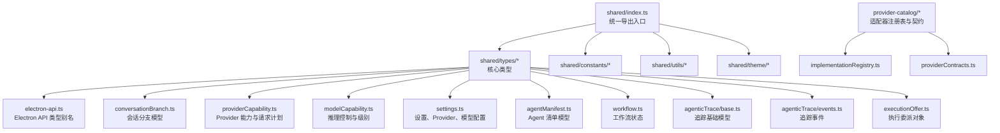

**图表来源**
- [src/shared/index.ts:1-4](file://src/shared/index.ts#L1-L4)
- [src/shared/types/electron-api.ts:1-32](file://src/shared/types/electron-api.ts#L1-L32)
- [src/shared/types/conversationBranch.ts:1-43](file://src/shared/types/conversationBranch.ts#L1-L43)
- [src/shared/types/providerCapability.ts:1-396](file://src/shared/types/providerCapability.ts#L1-L396)
- [src/shared/types/modelCapability.ts:1-200](file://src/shared/types/modelCapability.ts#L1-L200)
- [src/shared/types/settings.ts:1-200](file://src/shared/types/settings.ts#L1-L200)
- [src/shared/types/agentManifest.ts:1-178](file://src/shared/types/agentManifest.ts#L1-L178)
- [src/shared/types/workflow.ts:1-54](file://src/shared/types/workflow.ts#L1-L54)
- [src/shared/types/agenticTrace/base.ts:1-91](file://src/shared/types/agenticTrace/base.ts#L1-L91)
- [src/shared/types/agenticTrace/events.ts:1-41](file://src/shared/types/agenticTrace/events.ts#L1-L41)
- [src/shared/types/executionOffer.ts:1-22](file://src/shared/types/executionOffer.ts#L1-L22)
- [src/shared/provider-catalog/implementationRegistry.ts:1-177](file://src/shared/provider-catalog/implementationRegistry.ts#L1-L177)
- [src/shared/provider-catalog/providerContracts.ts:1-71](file://src/shared/provider-catalog/providerContracts.ts#L1-L71)

**章节来源**
- [src/shared/index.ts:1-4](file://src/shared/index.ts#L1-L4)

## 核心类型系统总览
共享类型系统分为五层：
1. **传输与 API 边界**：Electron API 类型、Renderer API 通道能力。
2. **领域模型**：会话、分支、Agent 清单、工作流、证据与附件。
3. **Provider 与模型能力**：协议、认证模式、能力探测、请求计划、上下文切换策略。
4. **运行时追踪**：Agentic Trace 节点、事件、呈现与投影（此处重点为 base 与 events）。
5. **配置与设置**：应用设置、Provider 配置、Agent 运行时权限、Shell 环境等。

关键设计原则：
- 使用字符串字面量联合类型表达枚举，保证编译期穷尽检查。
- 使用具名联合类型区分成功与失败结果。
- 使用 `as const` 与 `satisfies` 固化常量集合与映射。
- 将 Provider 协议、认证模式、分类、端点类别解耦，避免从 UI 分组推断运行行为。

**章节来源**
- [src/shared/types/electron-api.ts:1-32](file://src/shared/types/electron-api.ts#L1-L32)
- [src/shared/types/providerCapability.ts:1-396](file://src/shared/types/providerCapability.ts#L1-L396)
- [src/shared/types/settings.ts:1-200](file://src/shared/types/settings.ts#L1-L200)

## 架构概览
共享类型在系统中承担“跨进程契约”的角色：
- Main 进程负责 Provider 适配、Agent 运行、工具执行、会话持久化。
- Renderer 进程通过预加载桥接调用 Electron API。
- Shared 类型同时被 Main 与 Renderer 导入，用于校验 IPC 消息、UI 展示、配置存储。

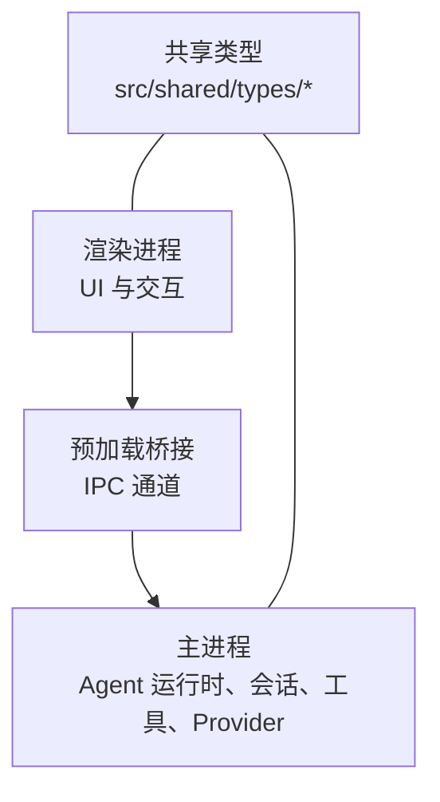

该图中未直接绑定具体文件；但实际代码中，`src/shared/types/electron-api.ts` 与 `src/shared/types/electron/*.ts` 定义了渲染层可见的 Electron API 类型，而 `src/shared/types/providerCapability.ts`、`src/shared/types/settings.ts`、`src/shared/types/agentManifest.ts` 等被主进程与渲染进程共同消费。

## 详细类型分析

### Electron API 与 Renderer API 类型
Electron API 类型集中在 `src/shared/types/electron` 子目录，并通过 `electron-api.ts` 集中重新导出。渲染层只需引入这些类型即可获得完整的 IPC 接口类型提示。

关键点：
- `RendererElectronApi` 是 `ElectronAPI` 的别名，供渲染层统一获取类型。
- 各模块如 `ConversationApi`、`ToolApi`、`EvidenceApi`、`McpApi` 都是对 `ElectronAPI` 上对应属性的类型抽取。
- 所有 API 类型都保持“只读接口”，防止渲染层误写主进程数据。

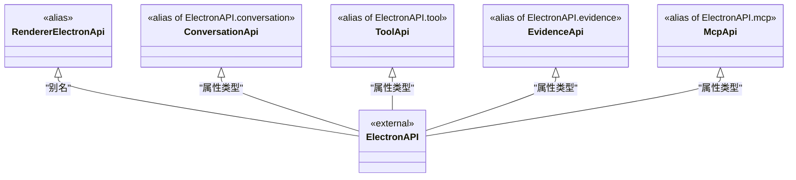

**图表来源**
- [src/shared/types/electron-api.ts:1-32](file://src/shared/types/electron-api.ts#L1-L32)
- [src/shared/types/electron/index.ts:1-19](file://src/shared/types/electron/index.ts#L1-L19)
- [src/shared/types/electron/conversation.ts:1-3](file://src/shared/types/electron/conversation.ts#L1-L3)
- [src/shared/types/electron/tools.ts:1-5](file://src/shared/types/evidence.ts#L1-L5)

**章节来源**
- [src/shared/types/electron-api.ts:1-32](file://src/shared/types/electron-api.ts#L1-L32)
- [src/shared/types/electron/index.ts:1-19](file://src/shared/types/electron/index.ts#L1-L19)
- [src/shared/types/electron/conversation.ts:1-3](file://src/shared/types/electron/conversation.ts#L1-L3)
- [src/shared/types/electron/tools.ts:1-5](file://src/shared/types/evidence.ts#L1-L5)

### 会话与分支类型
会话相关类型聚焦于分支、分叉、切换请求与历史结果。

核心类型：
- `ConversationBranch`：表示一个会话分支，包含父分支、变体索引、锚点用户消息、根轮次。
- `ConversationFork`：表示一次分叉，包含锚点消息、当前活动分支和分支列表。
- `ConversationBranchState`：会话级分支状态，包含根分支、活动叶子分支和分叉列表。
- `ConversationSwitchBranchRequest` / `ConversationSwitchBranchResult`：切换分支的请求与结果。
- `ConversationHistoryResult`：会话历史消息与分支状态。

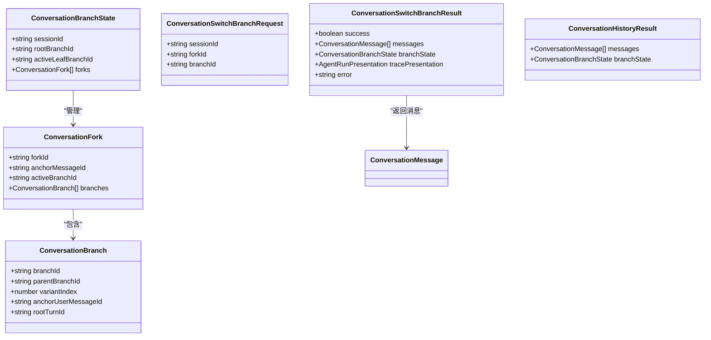

**图表来源**
- [src/shared/types/conversationBranch.ts:1-43](file://src/shared/types/conversationBranch.ts#L1-L43)

**章节来源**
- [src/shared/types/conversationBranch.ts:1-43](file://src/shared/types/conversationBranch.ts#L1-L43)

### Provider 能力与请求计划类型
Provider 能力系统由三个层次组成：
1. **协议与适配器注册表**：声明支持的 LLM 协议、适配器 ID、传输方式。
2. **Provider 契约**：描述 reasoning、state、cache、toolLoop、streaming、semanticContext 的能力与兼容性。
3. **能力计算与请求计划**：根据模型、路由、账户、预算、上下文模式生成最终执行计划。

#### 适配器注册表
`ProviderAdapterImplementation` 是闭集适配器元信息；`PROVIDER_ADAPTER_IMPLEMENTATIONS` 用 `as const satisfies Record` 确保 JSON manifest 名称与 TypeScript 实现一一对应。

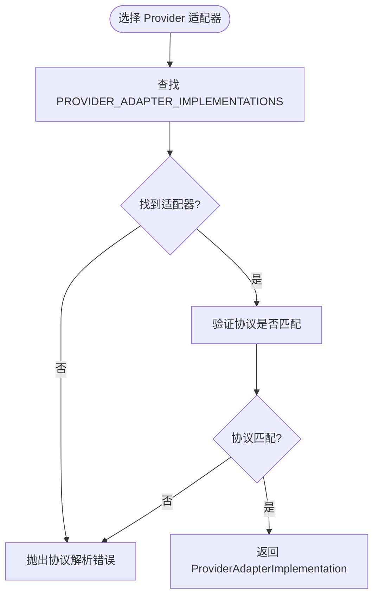

**图表来源**
- [src/shared/provider-catalog/implementationRegistry.ts:1-177](file://src/shared/provider-catalog/implementationRegistry.ts#L1-L177)

#### Provider 契约
`createFailClosedProviderContracts` 生成“默认失败关闭”的契约对象，用于未知或未声明能力的 Provider。

关键字段语义：
- `protocolDialect` / `protocolVersion` / `compatibilityGroup`：协议族与兼容性分组。
- `reasoning`：推理能力、载体、格式、延续策略。
- `state`：状态模式、保留策略、跨模型策略。
- `cache`：缓存模式、键载体、断点载体、TTL。
- `toolLoop`：工具循环产物策略、作用域、顺序、模型切换策略。
- `streaming`：流式传输、输出标识、用量、错误处理。
- `semanticContext`：语义上下文版本、历史模式、工具对策略、附件溢出策略。

#### 请求计划
`RequestPlan` 是最终执行计划的核心类型，聚合：
- 模型选择、路由、契约、执行身份。
- 状态计划、缓存计划、工具循环计划、流式计划、上下文过渡计划。
- 上下文预算、上下文窗口、最大输出、压缩阈值、活跃层级、快速模式、推理线控、温度等。

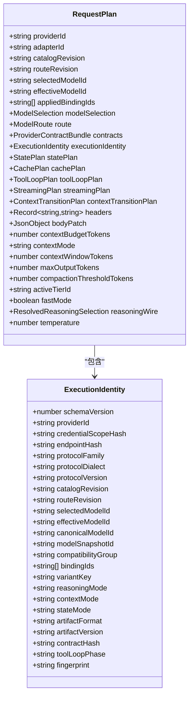

**图表来源**
- [src/shared/types/providerCapability.ts:1-396](file://src/shared/types/providerCapability.ts#L1-L396)

**章节来源**
- [src/shared/provider-catalog/implementationRegistry.ts:1-177](file://src/shared/provider-catalog/implementationRegistry.ts#L1-L177)
- [src/shared/provider-catalog/providerContracts.ts:1-71](file://src/shared/provider-catalog/providerContracts.ts#L1-L71)
- [src/shared/types/providerCapability.ts:1-396](file://src/shared/types/providerCapability.ts#L1-L396)

### Agent 运行时与清单类型
Agent 清单模型描述 Agent 的可执行能力、工具、技能、MCP、子 Agent、交接、模型、指令与来源。

核心类型：
- `AgentManifestDefinition`：已发布的 Agent 清单。
- `AgentManifestDraft`：编辑器草稿，移除持久化字段并增加写入范围。
- `AgentHandoffDefinition`：Agent 交接定义。
- `AgentModelOption`：模型选项，包含提供者、标签、状态、成本、自定义标记。
- `AgentManifestSettings`：目录、定义、模型选项、全局指令、诊断。
- `AgentDefinitionSaveRequest` / `AgentDefinitionSaveResult`：保存请求与结果。
- `AgentDefinitionCommitSnapshot`：提交快照，包含定义与路由。

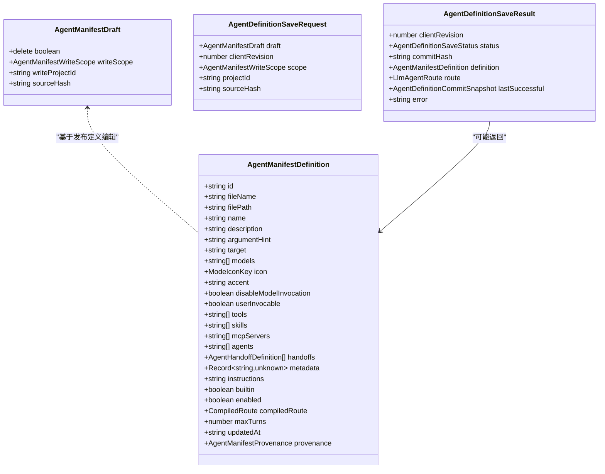

**图表来源**
- [src/shared/types/agentManifest.ts:1-178](file://src/shared/types/agentManifest.ts#L1-L178)

**章节来源**
- [src/shared/types/agentManifest.ts:1-178](file://src/shared/types/agentManifest.ts#L1-L178)

### 工作流与执行委派类型
工作流类型描述用例运行状态、阻塞项、推理摘要、恢复状态与报告。

- `WorkflowState`：用例 ID、运行 ID、会话 ID、后端、编排模式、协调模式、阻塞项、推理摘要、恢复状态、更新时间。
- `Blocker`：阻塞码、原因、引用、检测时间、解决时间。
- `ReasoningSummary`：摘要 ID、Agent 角色、摘要文本、证据、下一步、置信度、创建时间。
- `Report`：标题、摘要、根因、修复描述、证据摘要、建议、置信度、生成时间、策展 Agent。
- `ExecutionOffer`：执行委派对象，包含来源 Agent、目标 Agent、计划引用、所需技能、标签、提示、批准时间。

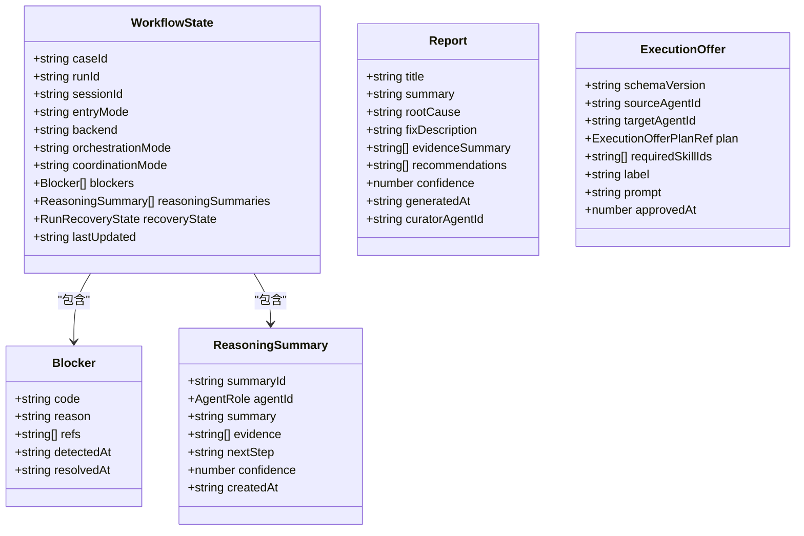

**图表来源**
- [src/shared/types/workflow.ts:1-54](file://src/shared/types/workflow.ts#L1-L54)
- [src/shared/types/executionOffer.ts:1-22](file://src/shared/types/executionOffer.ts#L1-L22)

**章节来源**
- [src/shared/types/workflow.ts:1-54](file://src/shared/types/workflow.ts#L1-L54)
- [src/shared/types/executionOffer.ts:1-22](file://src/shared/types/executionOffer.ts#L1-L22)

### 追踪类型
Agentic Trace 类型用于记录 Agent 运行过程中的节点、事件、附件、证据与制品。

- `BaseTraceNode`：追踪节点基础结构。
- `AttachmentRef` / `ArtifactRef` / `EvidenceRef`：附件、制品、证据引用。
- `AgentRun`：Agent 运行记录，包含运行 ID、Agent 类型、标题、用户请求、状态、时间戳、上下文、Profile 版本。
- `TraceEvent`：追踪事件，包含事件 ID、运行 ID、序列号、时间戳、类型、负载、可见性。
- `TraceEventType`：事件类型枚举，包括节点创建/更新、工具开始/完成/失败、阶段开始/完成、运行完成/失败/取消。

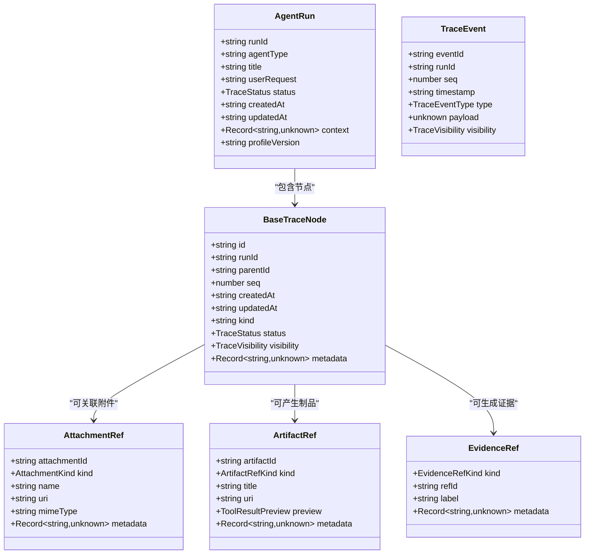

**图表来源**
- [src/shared/types/agenticTrace/base.ts:1-91](file://src/shared/types/agenticTrace/base.ts#L1-L91)
- [src/shared/types/agenticTrace/events.ts:1-41](file://src/shared/types/agenticTrace/events.ts#L1-L41)

**章节来源**
- [src/shared/types/agenticTrace/base.ts:1-91](file://src/shared/types/agenticTrace/base.ts#L1-L91)
- [src/shared/types/agenticTrace/events.ts:1-41](file://src/shared/types/agenticTrace/events.ts#L1-L41)

### 推理控制与模型能力类型
推理控制类型将用户可见的推理级别与不同 Provider 的 wire 模式对齐。

关键类型：
- `NamedReasoningLevel`：标准推理级别。
- `ReasoningSelection`：用户选择的推理模式。
- `ReasoningControlKind`：推理控制种类。
- `ReasoningWireProfile`：不同 Provider 的 wire 映射，如 OpenAI Responses、OpenAI Compatible、Anthropic、Gemini Thinking Level/Budget、Moonshot Thinking。
- `ReasoningControl`：推理控制元数据，包括支持开关、可用级别、默认选择、锁定选择、wire 映射。
- `ConversationTurnControls`：对话轮次控制，包括推理级别、最大上下文模式、快速模型。
- `ResolvedReasoningSelection`：解析后的推理选择与控制。

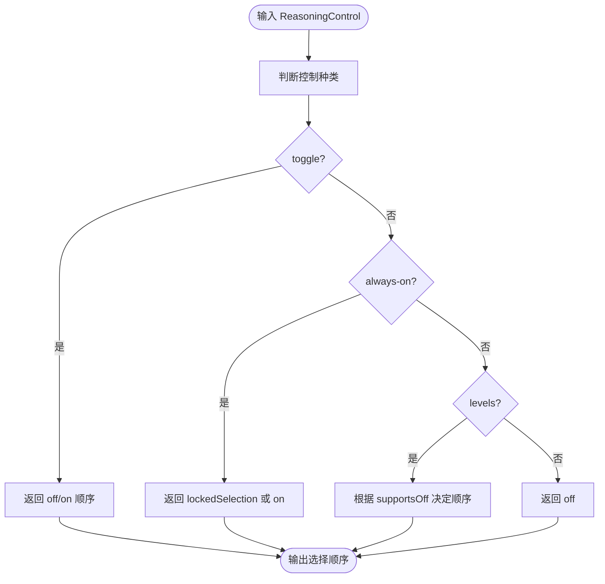

**图表来源**
- [src/shared/types/modelCapability.ts:1-200](file://src/shared/types/modelCapability.ts#L1-L200)

**章节来源**
- [src/shared/types/modelCapability.ts:1-200](file://src/shared/types/modelCapability.ts#L1-L200)

### 设置与 Provider 配置类型
设置类型涵盖外观、布局、Profile、工具链、Agent 运行时权限、LLM Provider、Agent 清单、资源目录、路径等。

重要类型：
- `LlmProviderProtocol`：实际 API 请求的协议类型。
- `LlmProviderAuthMode`：认证模式，与协议正交。
- `LlmProviderCategory`：产品类别，不得用于推断运行协议。
- `LlmProviderEndpointClass`：端点类别，明确提供方性质。
- `LlmProviderEntry`：Provider 配置条目，包含协议、认证、生命周期、可用性、分类、服务运营方、端点类别、目录所有权、目录来源、标签、启用状态、密钥、连接字段、模型、推荐模型、文档链接、状态、错误信息等。
- `LlmProviderCatalogResponse`：目录响应，包含分类、协议、Provider 列表。
- `LlmSettings`：LLM 设置，包含 Provider 列表与 Agent 路由。
- `AppSettings`：应用设置根类型。

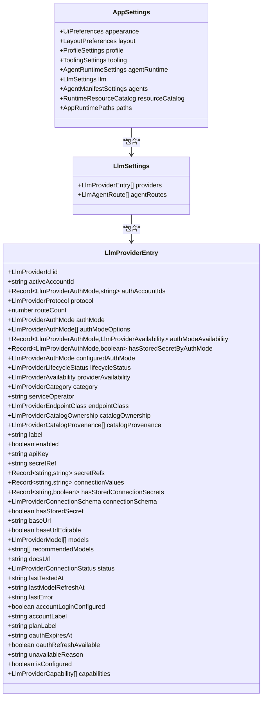

**图表来源**
- [src/shared/types/settings.ts:1-200](file://src/shared/types/settings.ts#L1-L200)
- [src/shared/types/settings.ts:201-683](file://src/shared/types/settings.ts#L201-L683)

**章节来源**
- [src/shared/types/settings.ts:1-200](file://src/shared/types/settings.ts#L1-L200)
- [src/shared/types/settings.ts:201-683](file://src/shared/types/settings.ts#L201-L683)

## 依赖关系分析
共享类型之间的依赖呈现“领域模型依赖基础类型，基础类型不反向依赖领域模型”的特征：
- `settings.ts` 依赖 `modelCapability.ts` 中的推理选择。
- `providerCapability.ts` 依赖 `modelCapability.ts`、`settings.ts`、`provider-catalog/modelManifestSchema.ts`、`provider-catalog/implementationRegistry.ts`。
- `agentManifest.ts` 依赖 `settings.ts` 中的 Agent 角色与 Provider ID。
- `conversationBranch.ts` 依赖 `conversation` 与 `agenticTrace` 中的消息与呈现类型。
- `electron-api.ts` 仅做类型别名转发，耦合最低。

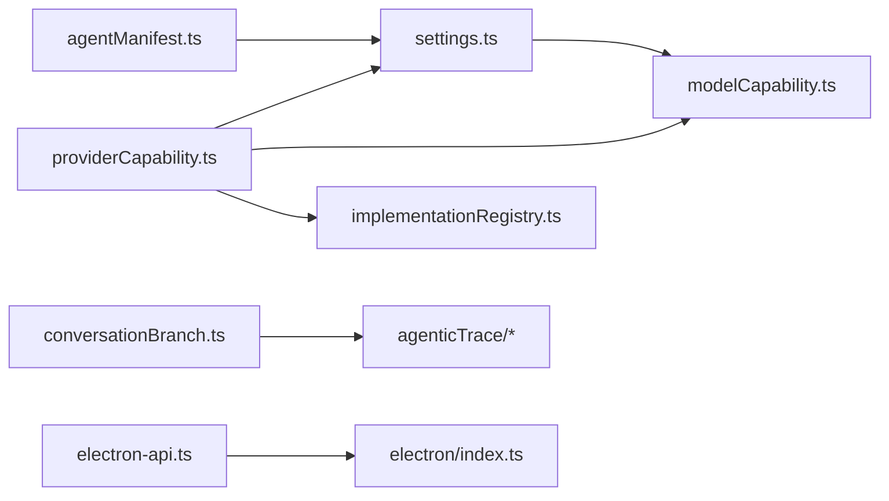

**图表来源**
- [src/shared/types/settings.ts:1-200](file://src/shared/types/settings.ts#L1-L200)
- [src/shared/types/modelCapability.ts:1-200](file://src/shared/types/modelCapability.ts#L1-L200)
- [src/shared/types/providerCapability.ts:1-396](file://src/shared/types/providerCapability.ts#L1-L396)
- [src/shared/provider-catalog/implementationRegistry.ts:1-177](file://src/shared/provider-catalog/implementationRegistry.ts#L1-L177)
- [src/shared/types/agentManifest.ts:1-178](file://src/shared/types/agentManifest.ts#L1-L178)
- [src/shared/types/conversationBranch.ts:1-43](file://src/shared/types/conversationBranch.ts#L1-L43)
- [src/shared/types/electron-api.ts:1-32](file://src/shared/types/electron-api.ts#L1-L32)

**章节来源**
- [src/shared/types/providerCapability.ts:1-396](file://src/shared/types/providerCapability.ts#L1-L396)
- [src/shared/types/settings.ts:1-200](file://src/shared/types/settings.ts#L1-L200)
- [src/shared/types/agentManifest.ts:1-178](file://src/shared/types/agentManifest.ts#L1-L178)
- [src/shared/types/conversationBranch.ts:1-43](file://src/shared/types/conversationBranch.ts#L1-L43)
- [src/shared/types/electron-api.ts:1-32](file://src/shared/types/electron-api.ts#L1-L32)

## 性能与兼容性考量
- **枚举与联合类型**：使用字符串字面量联合类型，配合 `as const` 与 `satisfies`，可减少运行时分支判断开销，并在编译期发现缺失分支。
- **Provider 适配器注册表**：通过闭集映射与唯一协议解析函数，避免多协议歧义；若协议无法唯一解析，会立即抛出错误，便于早期发现配置问题。
- **请求计划**：`RequestPlan` 聚合大量上下文信息，应在渲染层避免重复构造，优先复用主进程生成的计划对象。
- **兼容性分组**：Provider 契约中的 `compatibilityGroup`、`artifactVersion`、`contractHash` 等字段用于识别兼容组与契约变更，建议在升级 Provider 时保留旧值以支持回放与降级。
- **向后兼容策略**：
  - 新增字段应为可选，或使用默认值。
  - 废弃字段应保留一段时间并提供迁移警告。
  - 协议版本与契约版本应显式维护，避免隐式推断。
  - 对于 Provider 能力，优先使用 `CapabilityState` 与 `EffectiveAvailability`，不要假设某个能力始终存在。

[本节为通用指导，不直接分析具体文件]

## 故障排查指南
常见问题与类型层面解决方案：

1. **无法切换会话分支**
   - 检查 `ConversationSwitchBranchRequest` 的 `sessionId`、`forkId`、`branchId` 是否为有效字符串。
   - 检查 `ConversationSwitchBranchResult.error` 是否存在；若存在，需回退到上一次成功的分支状态。

2. **Provider 协议解析失败**
   - 确认传入的 `LlmProviderProtocol` 是否在 `PROVIDER_ADAPTER_IMPLEMENTATIONS` 中有唯一匹配。
   - 若出现“协议必须解析为唯一运行时适配器”的错误，检查 JSON manifest 中的适配器 ID 是否与 TypeScript 注册表一致。

3. **请求计划失败**
   - 查看 `RequestPlanningResult` 的 `ok` 字段；若为 false，读取 `code` 与 `message`。
   - 常见错误码包括 `MODEL_UNAVAILABLE`、`NO_USABLE_CONTEXT_TIER`、`PLAN_CONFLICT`、`CONSTRAINT_REJECTED`。
   - 根据 `recommendations` 调整模型或路由。

4. **推理控制不可用**
   - 检查 `ReasoningControl.kind` 是否为 `unknown` 或 `none`。
   - 若为 `levels`，确认 `defaultSelection` 与 `levels` 是否一致；若为 `always-on`，注意 `lockedSelection` 可能覆盖用户选择。

5. **Agent 清单保存失败**
   - 检查 `AgentDefinitionSaveResult.status` 是否为 `committed`。
   - 若为 `superseded`，说明客户端修订号落后，需要刷新后重试。
   - 若为 `failed`，检查 `error` 与 `lastSuccessful` 中的定义快照。

**章节来源**
- [src/shared/types/conversationBranch.ts:1-43](file://src/shared/types/conversationBranch.ts#L1-L43)
- [src/shared/provider-catalog/implementationRegistry.ts:1-177](file://src/shared/provider-catalog/implementationRegistry.ts#L1-L177)
- [src/shared/types/providerCapability.ts:1-396](file://src/shared/types/providerCapability.ts#L1-L396)
- [src/shared/types/modelCapability.ts:1-200](file://src/shared/types/modelCapability.ts#L1-L200)
- [src/shared/types/agentManifest.ts:1-178](file://src/shared/types/agentManifest.ts#L1-L178)

## 结论
共享类型系统以“协议与能力分离、配置与执行分离、领域模型与传输类型分离”为核心原则。通过字符串枚举、具名联合、版本化对象与闭集注册表，系统在保持灵活性的同时提供了强类型保障。未来扩展应遵循：
- 新增能力使用联合类型与证据来源标注。
- 新增字段优先可选，并提供默认值。
- 新增 Provider 协议需在适配器注册表中登记。
- 新增请求计划字段需同步更新契约与兼容性分组。

[本节为总结，不直接分析具体文件]

## 附录：字段定义与迁移要点

### 会话分支字段表
| 类型 | 字段 | 含义 | 可选性 |
|---|---|---|---|
| `ConversationBranch` | `branchId` | 分支 ID | 必填 |
| `ConversationBranch` | `parentBranchId` | 父分支 ID | 可为 null |
| `ConversationBranch` | `variantIndex` | 变体索引 | 必填 |
| `ConversationBranch` | `anchorUserMessageId` | 锚点用户消息 ID | 必填 |
| `ConversationBranch` | `rootTurnId` | 根轮次 ID | 必填 |
| `ConversationFork` | `forkId` | 分叉 ID | 必填 |
| `ConversationFork` | `anchorMessageId` | 锚点消息 ID | 必填 |
| `ConversationFork` | `activeBranchId` | 活动分支 ID | 必填 |
| `ConversationFork` | `branches` | 分支列表 | 必填数组 |
| `ConversationBranchState` | `sessionId` | 会话 ID | 必填 |
| `ConversationBranchState` | `rootBranchId` | 根分支 ID | 必填 |
| `ConversationBranchState` | `activeLeafBranchId` | 活动叶子分支 ID | 必填 |
| `ConversationBranchState` | `forks` | 分叉列表 | 必填数组 |
| `ConversationSwitchBranchRequest` | `sessionId` | 会话 ID | 必填 |
| `ConversationSwitchBranchRequest` | `forkId` | 分叉 ID | 必填 |
| `ConversationSwitchBranchRequest` | `branchId` | 目标分支 ID | 必填 |
| `ConversationSwitchBranchResult` | `success` | 是否成功 | 必填布尔 |
| `ConversationSwitchBranchResult` | `messages` | 返回消息 | 必填数组 |
| `ConversationSwitchBranchResult` | `branchState` | 分支状态 | 可为 null |
| `ConversationSwitchBranchResult` | `tracePresentation` | 追踪呈现 | 可为 null |
| `ConversationSwitchBranchResult` | `error` | 错误信息 | 可选字符串 |
| `ConversationHistoryResult` | `messages` | 历史消息 | 必填数组 |
| `ConversationHistoryResult` | `branchState` | 分支状态 | 可为 null |

**章节来源**
- [src/shared/types/conversationBranch.ts:1-43](file://src/shared/types/conversationBranch.ts#L1-L43)

### Provider 能力与请求计划关键字段
| 类型 | 字段 | 含义 | 可选性 |
|---|---|---|---|
| `EffectiveModel` | `enabled` | 用户启用状态 | 必填布尔 |
| `EffectiveModel` | `route` | 模型路由 | 必填 |
| `EffectiveModel` | `availability` | 可用性 | 必填 |
| `EffectiveModel` | `presencePolicy` | 存在策略 | 必填 |
| `EffectiveModel` | `contextTiers` | 上下文层级 | 必填数组 |
| `EffectiveModel` | `resolvedControls` | 解析后的控制 | 可选 |
| `EffectiveModel` | `toolCalling` | 工具调用能力 | 必填 |
| `EffectiveModel` | `visionInput` | 视觉输入能力 | 必填 |
| `EffectiveModel` | `structuredOutput` | 结构化输出能力 | 必填 |
| `RequestPlan` | `contracts` | Provider 契约 | 必填 |
| `RequestPlan` | `executionIdentity` | 执行身份 | 必填 |
| `RequestPlan` | `contextBudgetTokens` | 上下文预算 | 必填 |
| `RequestPlan` | `maxOutputTokens` | 最大输出 | 必填数字 |
| `RequestPlan` | `compactionThresholdTokens` | 压缩阈值 | 必填数字 |
| `RequestPlan` | `fastMode` | 快速模式 | 必填布尔 |
| `RequestPlan` | `reasoningWire` | 推理线控 | 必填 |

**章节来源**
- [src/shared/types/providerCapability.ts:1-396](file://src/shared/types/providerCapability.ts#L1-L396)

### Agent 清单关键字段
| 类型 | 字段 | 含义 | 可选性 |
|---|---|---|---|
| `AgentManifestDefinition` | `id` | Agent ID | 必填 |
| `AgentManifestDefinition` | `name` | 名称 | 必填 |
| `AgentManifestDefinition` | `models` | 模型列表 | 必填数组 |
| `AgentManifestDefinition` | `tools` | 工具列表 | 必填数组 |
| `AgentManifestDefinition` | `skills` | 技能列表 | 必填数组 |
| `AgentManifestDefinition` | `agents` | 子 Agent 列表 | 必填数组 |
| `AgentManifestDefinition` | `handoffs` | 交接定义 | 必填数组 |
| `AgentManifestDefinition` | `instructions` | 指令 | 必填 |
| `AgentManifestDefinition` | `builtin` | 是否内置 | 必填布尔 |
| `AgentManifestDefinition` | `enabled` | 是否启用 | 必填布尔 |
| `AgentManifestDefinition` | `maxTurns` | 最大轮数 | 可选数字 |
| `AgentManifestDraft` | `writeScope` | 写入范围 | 必填 |
| `AgentDefinitionSaveResult` | `status` | 保存状态 | 必填 |
| `AgentDefinitionSaveResult` | `definition` | 定义快照 | 可为 null |
| `AgentDefinitionSaveResult` | `route` | Agent 路由 | 可为 null |

**章节来源**
- [src/shared/types/agentManifest.ts:1-178](file://src/shared/types/agentManifest.ts#L1-L178)

### 迁移指南
- 当新增 Provider 协议时，需在 `LlmProviderProtocol` 中添加字面量，并在 `implementationRegistry.ts` 中登记适配器。
- 当新增 Model 能力时，优先使用 `CapabilityState` 表达支持、不支持与未知状态，不要直接假设字段存在。
- 当修改 `RequestPlan` 字段时，应同步更新 `ExecutionIdentity` 或契约哈希，以避免旧计划与新执行环境不兼容。
- 当修改会话分支结构时，应保留旧字段一段时间，并在渲染层提供降级显示逻辑。
- 当修改 Agent 清单结构时，应区分发布定义与草稿定义，避免将运行时字段写入用户可编辑草稿。

[本节为通用指导，不直接分析具体文件]