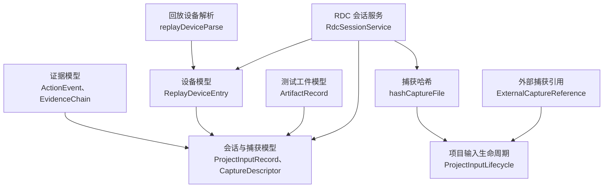
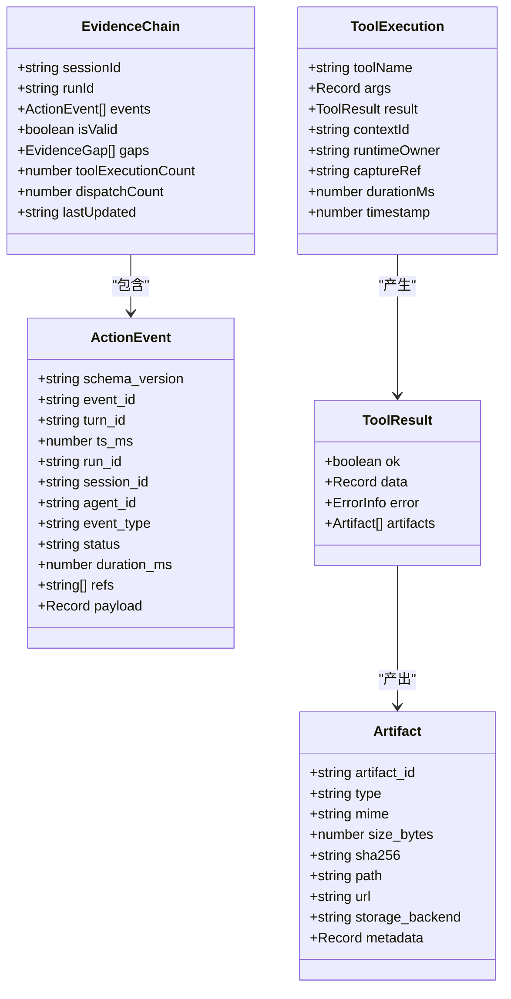
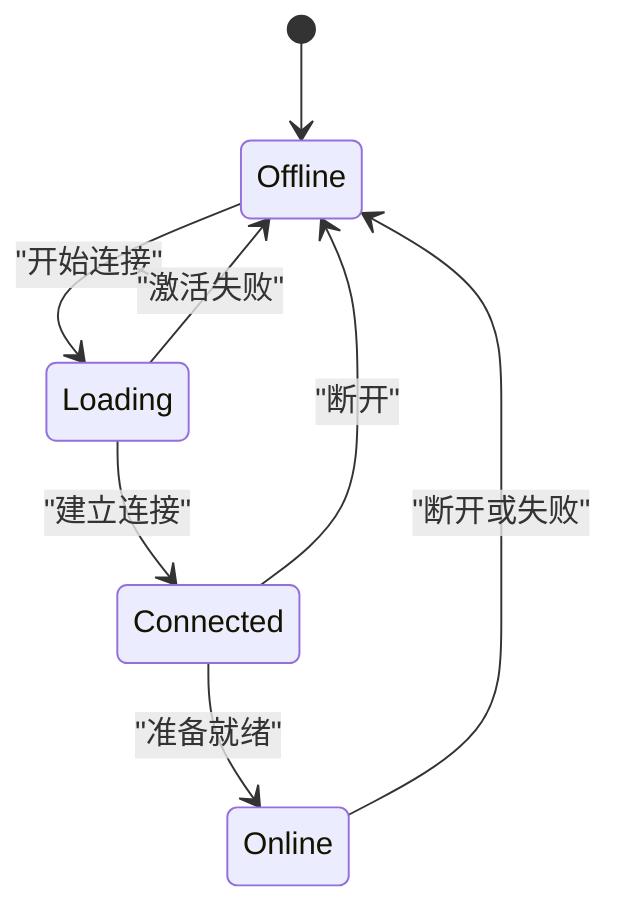
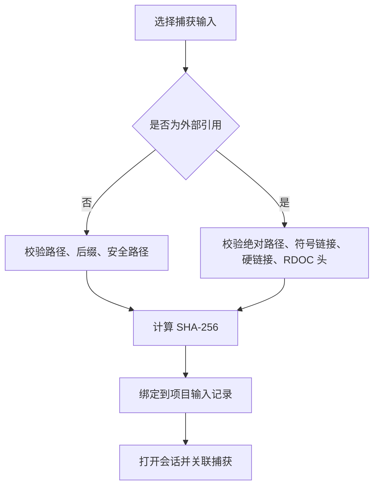
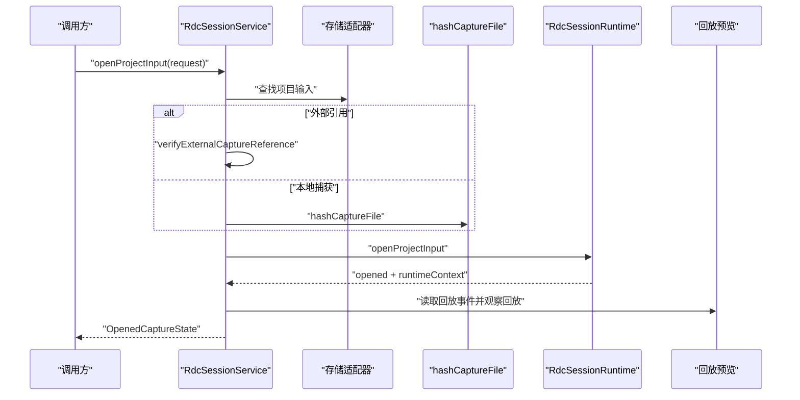
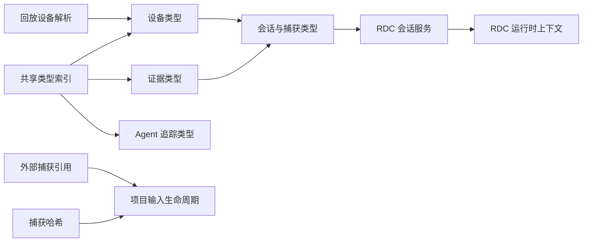
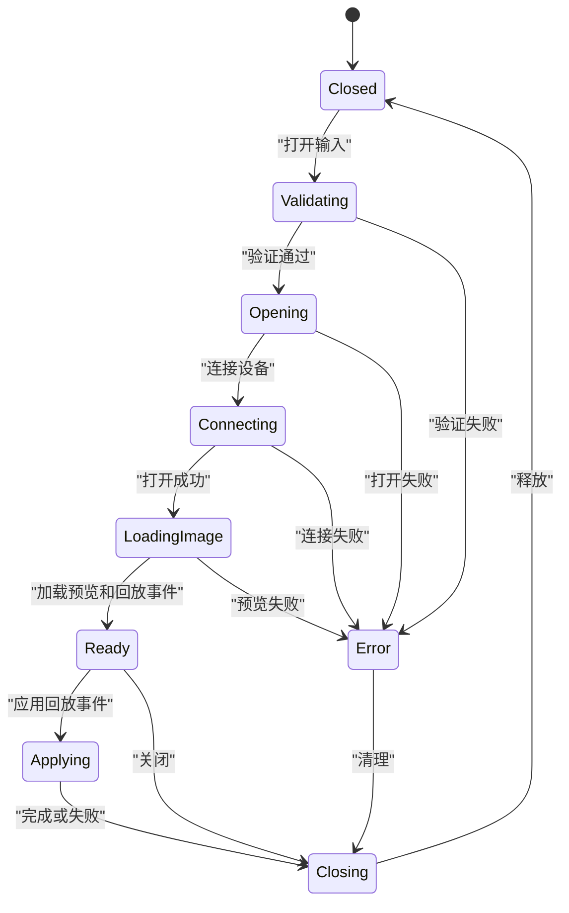
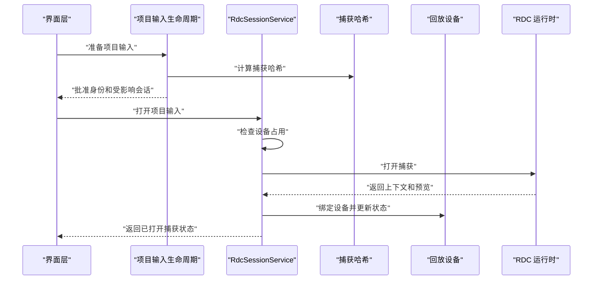
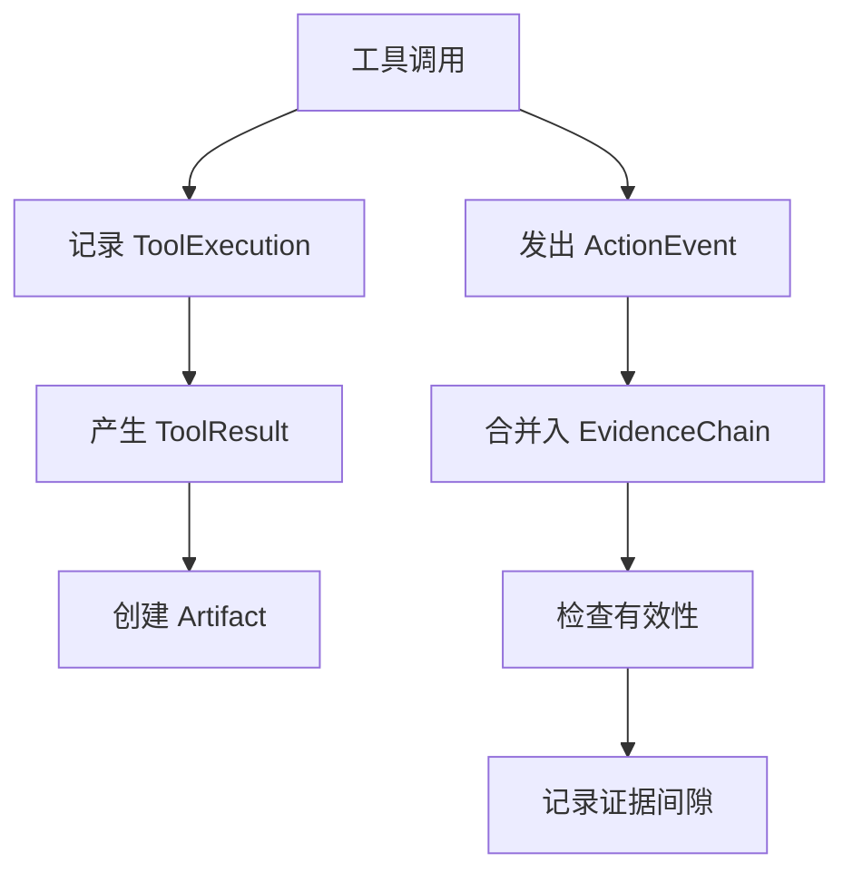

# 领域模型类型

<cite>
**本文引用的文件**   
- [证据类型定义 evidence.ts](file://src/shared/types/evidence.ts)
- [设备管理类型 device.ts](file://src/shared/types/device.ts)
- [会话与捕获类型 session.ts](file://src/shared/types/session.ts)
- [共享类型索引 index.ts](file://src/shared/types/index.ts)
- [测试工件类型 harness.ts](file://src/shared/types/harness.ts)
- [外部捕获引用 ExternalCaptureReference.ts](file://src/main/captures/ExternalCaptureReference.ts)
- [项目输入生命周期 ProjectInputLifecycle.ts](file://src/main/captures/ProjectInputLifecycle.ts)
- [捕获内容哈希 captureContentHash.ts](file://src/main/captures/replay/captureContentHash.ts)
- [回放设备解析 replayDeviceParse.ts](file://src/main/captures/replayDeviceParse.ts)
- [RDC 会话服务 RdcSessionService.ts](file://src/main/sessions/RdcSessionService.ts)
</cite>

## 目录

1. [引言](#引言)
2. [项目结构定位](#项目结构定位)
3. [核心领域模型总览](#核心领域模型总览)
4. [证据系统模型](#证据系统模型)
5. [捕获与回放设备模型](#捕获与回放设备模型)
6. [会话、RDC 集成与调查工作流](#会话rdc-集成与调查工作流)
7. [测试编排与界面布局模型现状](#测试编排与界面布局模型现状)
8. [依赖关系图](#依赖关系图)
9. [数据验证规则与状态约束](#数据验证规则与状态约束)
10. [交互流程](#交互流程)
11. [性能与可靠性特征](#性能与可靠性特征)
12. [故障排查指南](#故障排查指南)
13. [结论](#结论)

## 引言

本文件聚焦于当前仓库中与 **捕获、回放、证据、设备、会话、测试工件和界面布局** 相关的领域模型类型。目标包括：

- 明确 `EvidenceRef`、`ActionEvent`、`ReplayDeviceEntry`、`ProjectInputRecord`、`CaptureDescriptor`、`ArtifactRecord` 等类型的职责。
- 解释这些类型如何支撑 **RDC / RenderDoc 回放、Android 设备连接、项目输入校验、会话运行和调查追踪**。
- 记录字段级约束、错误码、状态机行为和跨模块依赖。
- 补充说明仓库中尚未定义的 `CaptureFile`、`LayoutDefinition`、`PanelLayout`、`HarnessArtifact`、`HarnessTestResult`、`DeviceProfile` 的现状，并给出基于现有模型的扩展建议。

需要特别说明的是：**“捕获文件”在本仓库中并不是一个名为 `CaptureFile` 的独立类型**；它由 `ProjectInputRecord`、`CaptureDescriptor`、`OpenedCaptureState`、`hashCaptureFile` 的返回值以及外部捕获引用共同表达。**“测试编排类型”**以 `ArtifactRecord` 为核心，但未见 `HarnessArtifact`、`HarnessTestResult`。**“界面布局类型”**在已扫描的类型文件中未找到 `LayoutDefinition` 或 `PanelLayout`。

## 项目结构定位

这些领域模型主要分布在以下位置：

| 领域 | 主要文件 | 作用 |
|---|---|---|
| 证据系统 | `src/shared/types/evidence.ts` | 定义事件、证据链、工具执行、工具和产物记录 |
| 设备管理 | `src/shared/types/device.ts` | 定义回放设备条目、传输方式、Android 启动元数据 |
| 会话与捕获 | `src/shared/types/session.ts` | 定义项目输入、捕获描述符、运行时上下文、打开的捕获状态 |
| 共享导出 | `src/shared/types/index.ts` | 集中导出证据、设备、追踪节点、证据引用等共享类型 |
| 测试工件 | `src/shared/types/harness.ts` | 定义测试产物记录及产物种类 |
| 捕获校验 | `src/main/captures/ExternalCaptureReference.ts`、`captureContentHash.ts`、`ProjectInputLifecycle.ts` | 校验 `.rdc` 捕获文件、计算哈希、处理删除与重建绑定的生命周期 |
| 设备解析 | `src/main/captures/replayDeviceParse.ts` | 解析 ADB 输出、Android 启动元数据和设备激活失败状态 |
| RDC 集成 | `src/main/sessions/RdcSessionService.ts` | 将项目输入、捕获哈希、设备、会话生命周期组合成完整的回放操作 |

**图表来源**   
- [证据类型定义 evidence.ts:1-103](file://src/shared/types/evidence.ts#L1-L103)
- [设备管理类型 device.ts:1-50](file://src/shared/types/device.ts#L1-L50)
- [会话与捕获类型 session.ts:1-200](file://src/shared/types/session.ts#L1-L200)
- [会话与捕获类型 session.ts:200-455](file://src/shared/types/session.ts#L200-L455)
- [测试工件类型 harness.ts:1-26](file://src/shared/types/harness.ts#L1-L26)
- [捕获内容哈希 captureContentHash.ts:1-24](file://src/main/captures/replay/captureContentHash.ts#L1-L24)
- [外部捕获引用 ExternalCaptureReference.ts:1-54](file://src/main/captures/ExternalCaptureReference.ts#L1-L54)
- [项目输入生命周期 ProjectInputLifecycle.ts:1-95](file://src/main/captures/ProjectInputLifecycle.ts#L1-L95)
- [回放设备解析 replayDeviceParse.ts:1-284](file://src/main/captures/replayDeviceParse.ts#L1-L284)
- [RDC 会话服务 RdcSessionService.ts:1-220](file://src/main/sessions/RdcSessionService.ts#L1-L220)

**章节来源**   
- [共享类型索引 index.ts:1-32](file://src/shared/types/index.ts#L1-L32)
- [共享类型索引 index.ts:33-200](file://src/shared/types/index.ts#L33-L200)

## 核心领域模型总览

### 证据系统模型

| 类型 | 关键字段 | 业务含义 |
|---|---|---|
| `EventType` | 字符串 | 事件的通用分类名称 |
| `EventStatus` | 枚举值集合 | 表示事件结果，如成功、失败、阻塞、超时、完成等 |
| `ActionEvent` | `event_id`、`run_id`、`session_id`、`agent_id`、`event_type`、`status`、`duration_ms`、`refs`、`payload` | 一次 Agent 或工具行为的结构化事件 |
| `EvidenceGap` | `expectedEventType`、`afterEventId`、`description` | 证据链中缺失或异常的事件间隙 |
| `EvidenceChain` | `sessionId`、`runId`、`events`、`isValid`、`gaps`、`toolExecutionCount`、`dispatchCount`、`lastUpdated` | 一段可审计的证据序列及其完整性判断 |
| `ToolExecution` | `toolName`、`args`、`result`、`contextId`、`captureRef`、`durationMs`、`timestamp` | 工具调用及其执行环境 |
| `ToolResult` | `ok`、`data`、`error`、`artifacts` | 工具返回结果 |
| `Artifact` | `artifact_id`、`type`、`mime`、`size_bytes`、`sha256`、`path`、`storage_backend`、`metadata` | 工具产物的统一抽象 |

**章节来源**   
- [证据类型定义 evidence.ts:1-103](file://src/shared/types/evidence.ts#L1-L103)

### 设备管理模型

| 类型 | 关键字段 | 业务含义 |
|---|---|---|
| `ReplayDeviceStatus` | `offline`、`loading`、`connected`、`online` | 设备连接生命周期状态 |
| `ReplayDeviceTransport` | `local`、`adb_android` | 设备接入方式 |
| `AndroidBootstrapMetadata` | `packageName`、`activityName`、`apkPath`、`host`、`port`、`installMode`、`installReason` 等 | Android 设备上 RenderDoc 启动和 APK 安装元数据 |
| `ReplayDeviceEntry` | `id`、`label`、`type`、`status`、`transport`、`serial`、`bootstrap`、`activationPhase` 等 | 回放设备的主记录 |
| `ReplayDeviceStatusChangedPayload` | `device`、`devices` | 设备状态变更通知载荷 |

**章节来源**   
- [设备管理类型 device.ts:1-50](file://src/shared/types/device.ts#L1-L50)

### 会话与捕获模型

| 类型 | 关键字段 | 业务含义 |
|---|---|---|
| `ProjectInputRecord` | `inputId`、`fileName`、`filePath`、`source`、`contentSha256`、`referenceIdentity` | 项目中的捕获输入，可以是本地资源或外部引用 |
| `CaptureDescriptor` | `id`、`filePath`、`role`、`backendHint`、`status` | 打开给 RDC 回放的捕获描述 |
| `OpenedCaptureState` | `projectId`、`inputId`、`captureId`、`contextId`、`deviceId`、`status`、`preview` | 已打开捕获的完整运行时视图 |
| `RdcRuntimeContext` | `contextId`、`runtimeOwner`、`captureFileId`、`backend`、`remoteId` | RDC 运行时上下文摘要 |
| `ContextSnapshot` | `contextId`、`sessionId`、`captureDescriptors`、`activeCapture`、`runtimeContext` | 会话视角下的捕获快照 |

**章节来源**   
- [会话与捕获类型 session.ts:1-200](file://src/shared/types/session.ts#L1-L200)
- [会话与捕获类型 session.ts:200-455](file://src/shared/types/session.ts#L200-L455)

### 测试工件模型

| 类型 | 关键字段 | 业务含义 |
|---|---|---|
| `ArtifactKind` | `capture`、`screenshot`、`shader`、`trace`、`report`、`log`、`data`、`note` | 测试产物的语义类别 |
| `ArtifactRecord` | `artifactId`、`runId`、`sessionId`、`kind`、`title`、`filePath`、`mimeType`、`sha256`、`evidenceIds`、`metadata` | 测试运行产生的持久化产物 |

**章节来源**   
- [测试工件类型 harness.ts:1-26](file://src/shared/types/harness.ts#L1-L26)

## 证据系统模型

### `ActionEvent`

`ActionEvent` 是调查系统中对一次行为的可审计记录。它包含：

- **标识维度**：`schema_version`、`event_id`、`turn_id`、`run_id`、`session_id`、`agent_id`。
- **语义维度**：`event_type`、`status`、`duration_ms`。
- **关联维度**：`refs` 指向证据引用数组。
- **数据维度**：`payload` 承载具体业务负载。

该类型强调 **多租户、多轮次、多 Agent、多运行实例** 的追踪能力，因此所有关键标识都显式出现，而不是隐式从上下文推断。

**图表来源**   
- [证据类型定义 evidence.ts:1-103](file://src/shared/types/evidence.ts#L1-L103)

### `EvidenceRef`

`EvidenceRef` 并未在 `evidence.ts` 中直接定义，而是通过共享导出暴露：

- 它在 `shared/types/agenticTrace/base.ts` 中定义。
- 通过 `shared/types/agenticTrace/index.ts` 重新导出。
- 再通过 `shared/types/index.ts` 向渲染器和其他模块暴露。

这说明 `EvidenceRef` 是 **Agent 追踪体系与证据体系之间的桥接类型**：证据链本身使用 `ActionEvent`，而 UI 和 Agent 可视化层使用 `EvidenceRef` 来显示证据节点。

**章节来源**   
- [共享类型索引 index.ts:33-200](file://src/shared/types/index.ts#L33-L200)
- [agenticTrace 索引 index.ts:1-91](file://src/shared/types/agenticTrace/index.ts#L1-L91)

## 捕获与回放设备模型

### `ReplayDeviceEntry`

`ReplayDeviceEntry` 是设备管理的核心对象，用于表达：

1. **设备身份**：`id`、`label`、`serial`、`remoteId`。
2. **设备类型**：`local` 或 `android`。
3. **传输方式**：`local` 或 `adb_android`。
4. **连接状态**：`offline`、`loading`、`connected`、`online`。
5. **用户可见信息**：`detailText`、`lastError`、`lastSeen`。
6. **Android 启动状态**：`bootstrap`、`activationPhase`、`activationErrorCode`、`activationErrorMessage`、`activationUpdatedAt`。

该类型同时承担两类职责：

- **静态描述**：设备是谁、来自哪里、属于哪种平台。
- **动态状态**：是否离线、正在连接、已经就绪、上次失败原因是什么。

**图表来源**   
- [设备管理类型 device.ts:1-50](file://src/shared/types/device.ts#L1-L50)
- [回放设备解析 replayDeviceParse.ts:1-284](file://src/main/captures/replayDeviceParse.ts#L1-L284)

### Android 启动元数据

`AndroidBootstrapMetadata` 描述了 Android 设备上 RenderDoc 相关的环境信息，包括：

- **应用包信息**：`packageName`、`activityName`、`abi`、`apkPath`。
- **网络与服务信息**：`host`、`port`、`remotePort`、`forwardSpec`、`configRemotePath`。
- **安装与替换策略**：`installMode`、`installReason`、`installedApk`、`uninstalledExisting`。
- **执行阶段标记**：`startedActivity`、`createdForward`、`pushedConfig`。

`parseAndroidBootstrapMetadata` 和 `parsePersistedAndroidBootstrapMetadata` 分别处理不同来源的字段命名风格，体现 **远程 API 与持久化存储之间的字段兼容**。

**章节来源**   
- [设备管理类型 device.ts:1-50](file://src/shared/types/device.ts#L1-L50)
- [回放设备解析 replayDeviceParse.ts:1-200](file://src/main/captures/replayDeviceParse.ts#L1-L200)
- [回放设备解析 replayDeviceParse.ts:200-284](file://src/main/captures/replayDeviceParse.ts#L200-L284)

## 会话、RDC 集成与调查工作流

### `ProjectInputRecord` 与捕获身份

`ProjectInputRecord` 是捕获文件的领域入口。它区分两种来源：

| 来源 | 行为 |
|---|---|
| `project_resource` | 作为项目资源存在，路径受项目目录保护 |
| `external_reference` | 仅注册外部 `.rdc` 文件，不拥有父目录，也不授予写权限 |

对于外部引用，`referenceIdentity` 必须保存设备的 `device`、inode 和 `birthtimeNs`，以便后续重新校验时确认同一物理文件未被替换。

**图表来源**   
- [会话与捕获类型 session.ts:1-200](file://src/shared/types/session.ts#L1-L200)
- [外部捕获引用 ExternalCaptureReference.ts:1-54](file://src/main/captures/ExternalCaptureReference.ts#L1-L54)
- [项目输入生命周期 ProjectInputLifecycle.ts:1-95](file://src/main/captures/ProjectInputLifecycle.ts#L1-L95)
- [捕获内容哈希 captureContentHash.ts:1-24](file://src/main/captures/replay/captureContentHash.ts#L1-L24)

### `CaptureDescriptor` 与 RDC 打开流程

`CaptureDescriptor` 不是持久化的捕获记录，而是 **打开 RDC 回放时的请求描述**，包含：

- 捕获标识和文件路径。
- 角色：主捕获、基线、参考或修复。
- 后端提示：本地或远端。
- 状态：待打开、打开中、已打开、错误、已关闭。
- 所属会话和回放会话标识。

`RdcSessionService.openProjectInput` 将该描述与 `ProjectInputRecord`、设备、会话上下文组合起来，形成完整的回放操作。

**图表来源**   
- [会话与捕获类型 session.ts:1-200](file://src/shared/types/session.ts#L1-L200)
- [RDC 会话服务 RdcSessionService.ts:1-220](file://src/main/sessions/RdcSessionService.ts#L1-L220)
- [外部捕获引用 ExternalCaptureReference.ts:1-54](file://src/main/captures/ExternalCaptureReference.ts#L1-L54)
- [捕获内容哈希 captureContentHash.ts:1-24](file://src/main/captures/replay/captureContentHash.ts#L1-L24)

### 调查工作流中的作用

这些类型在调查工作流中的分工如下：

| 模型 | 工作流阶段 | 作用 |
|---|---|---|
| `ProjectInputRecord` | 项目扫描、导入、移除 | 定义捕获输入的身份、来源和哈希 |
| `CaptureDescriptor` | 打开回放 | 描述要打开的捕获、角色和后端 |
| `OpenedCaptureState` | 回放运行期 | 表达已打开捕获的状态、预览和设备绑定 |
| `RdcRuntimeContext` | RDC 集成 | 保留上下文 ID、后端、设备标签和远端标识 |
| `ActionEvent` / `EvidenceChain` | 调查审计 | 记录工具调用、事件状态和证据链完整性 |
| `ArtifactRecord` | 测试报告 | 将截图、日志、捕获等产物与运行和证据关联 |

**章节来源**   
- [会话与捕获类型 session.ts:1-200](file://src/shared/types/session.ts#L1-L200)
- [会话与捕获类型 session.ts:200-455](file://src/shared/types/session.ts#L200-L455)
- [RDC 会话服务 RdcSessionService.ts:1-220](file://src/main/sessions/RdcSessionService.ts#L1-L220)
- [证据类型定义 evidence.ts:1-103](file://src/shared/types/evidence.ts#L1-L103)
- [测试工件类型 harness.ts:1-26](file://src/shared/types/harness.ts#L1-L26)

## 测试编排与界面布局模型现状

### 测试编排类型

仓库中存在明确的测试工件类型：

- `ArtifactKind`：限定产物种类为捕获、截图、着色器、轨迹、报告、日志、数据和笔记。
- `ArtifactRecord`：将产物与 `runId`、`sessionId`、`evidenceIds`、文件路径、MIME 类型、SHA-256 和元数据关联。

但 **没有发现 `HarnessArtifact` 或 `HarnessTestResult`**。若需要扩展，可以基于 `ArtifactRecord` 增加测试用例维度，例如：

| 新增字段 | 用途 |
|---|---|
| `testSuiteId` | 分组测试套件 |
| `testCaseId` | 单个测试用例 |
| `assertionCount` | 断言数量 |
| `passCount` / `failCount` | 测试结果统计 |
| `harnessVersion` | 测试框架版本 |

不过，这些属于建议性扩展，并非当前仓库已有实现。

**章节来源**   
- [测试工件类型 harness.ts:1-26](file://src/shared/types/harness.ts#L1-L26)

### 界面布局类型

在当前扫描范围内，**未发现 `LayoutDefinition` 或 `PanelLayout` 的类型定义**。现有界面相关类型主要集中在：

- 会话预览状态：`OpenedCapturePreview`、`OpenedCapturePreviewAttempt`、`OpenedCapturePreviewError`、`OpenedCaptureState`。
- 设备展示状态：`RdcSessionService` 内部使用的 `devicePresentation` 字段。
- 共享导出中的 UI 相关类型：如 `ConversationMessage`、`ConversationAskUserQuestion`、`ModelSelection` 等。

如果未来引入界面布局模型，合理的方向是：

| 概念 | 建议字段 |
|---|---|
| `LayoutDefinition` | 布局 ID、面板列表、分屏比例、主题、用户偏好 |
| `PanelLayout` | 面板 ID、可见性、尺寸、顺序、绑定数据源 |

这属于架构建议，不代表当前代码已实现。

**章节来源**   
- [会话与捕获类型 session.ts:200-455](file://src/shared/types/session.ts#L200-L455)
- [RDC 会话服务 RdcSessionService.ts:1-220](file://src/main/sessions/RdcSessionService.ts#L1-L220)

## 依赖关系图

**图表来源**   
- [共享类型索引 index.ts:1-200](file://src/shared/types/index.ts#L1-L200)
- [证据类型定义 evidence.ts:1-103](file://src/shared/types/evidence.ts#L1-L103)
- [设备管理类型 device.ts:1-50](file://src/shared/types/device.ts#L1-L50)
- [会话与捕获类型 session.ts:1-455](file://src/shared/types/session.ts#L1-L455)
- [项目输入生命周期 ProjectInputLifecycle.ts:1-95](file://src/main/captures/ProjectInputLifecycle.ts#L1-L95)
- [外部捕获引用 ExternalCaptureReference.ts:1-54](file://src/main/captures/ExternalCaptureReference.ts#L1-L54)
- [捕获内容哈希 captureContentHash.ts:1-24](file://src/main/captures/replay/captureContentHash.ts#L1-L24)
- [回放设备解析 replayDeviceParse.ts:1-284](file://src/main/captures/replayDeviceParse.ts#L1-L284)
- [RDC 会话服务 RdcSessionService.ts:1-220](file://src/main/sessions/RdcSessionService.ts#L1-L220)

## 数据验证规则与状态约束

### 捕获文件验证

| 规则 | 实现位置 | 错误码或行为 |
|---|---|---|
| 只接受 `.rdc` 文件 | `ProjectInputLifecycle.prepare`、`createExternalCaptureReference` | `PROJECT_INPUT_PATH_ESCAPE`、`CAPTURE_REFERENCE_INVALID_PATH` |
| 禁止符号链接 | `hashCaptureFile`、`createExternalCaptureReference` | `CAPTURE_UNSAFE_FILE` |
| 外部引用禁止硬链接 | `createExternalCaptureReference` | `CAPTURE_UNSAFE_FILE` |
| 检查 RDOC 文件头 | `createExternalCaptureReference` | `CAPTURE_REFERENCE_INVALID_RDC` |
| 哈希期间文件被替换 | `hashCaptureFile`、`createExternalCaptureReference` | `CAPTURE_CHANGED_DURING_HASH` |
| 打开过程中文件变化 | `RdcSessionService.openProjectInput` | `CAPTURE_CHANGED_DURING_OPEN` |
| 外部引用记录不完整 | `verifyExternalCaptureReference`、`ProjectInputLifecycle.prepare` | `CAPTURE_REFERENCE_INVALID_RECORD` |
| 删除前需批准且内容未变 | `ProjectInputLifecycle.remove` | `PROJECT_INPUT_CHANGED_AFTER_APPROVAL` |

**章节来源**   
- [捕获内容哈希 captureContentHash.ts:1-24](file://src/main/captures/replay/captureContentHash.ts#L1-L24)
- [外部捕获引用 ExternalCaptureReference.ts:1-54](file://src/main/captures/ExternalCaptureReference.ts#L1-L54)
- [项目输入生命周期 ProjectInputLifecycle.ts:1-95](file://src/main/captures/ProjectInputLifecycle.ts#L1-L95)
- [RDC 会话服务 RdcSessionService.ts:1-220](file://src/main/sessions/RdcSessionService.ts#L1-L220)

### 设备状态约束

| 状态 | 允许转换 | 典型触发条件 |
|---|---|---|
| `offline` | → `loading`、保持 | 初始状态、ADB 离线、授权失败、激活失败 |
| `loading` | → `connected`、→ `offline` | 连接中、连接失败 |
| `connected` | → `online`、→ `offline` | 建立连接后准备就绪 |
| `online` | → `offline` | 断开、远端不可用 |

设备解析函数还会根据 ADB 状态生成 `detailText` 和 `lastError`，并将未知状态归类为带诊断文本的离线状态。

**章节来源**   
- [设备管理类型 device.ts:1-50](file://src/shared/types/device.ts#L1-L50)
- [回放设备解析 replayDeviceParse.ts:200-284](file://src/main/captures/replayDeviceParse.ts#L200-L284)

### 捕获回放状态约束

`RdcSessionService` 维护每会话的回放状态，关键约束包括：

- 必须有有效的 `projectId` 和 `sessionId`。
- 设备不能同时被另一个会话占用。
- 回放必须在可用状态下才能执行交互操作。
- 当 RDC 上下文被隔离时，回放状态会被强制转为错误。
- 操作通过 `serial` 方法串行化，避免同一会话并发修改。

**图表来源**   
- [RDC 会话服务 RdcSessionService.ts:1-220](file://src/main/sessions/RdcSessionService.ts#L1-L220)

**章节来源**   
- [RDC 会话服务 RdcSessionService.ts:1-220](file://src/main/sessions/RdcSessionService.ts#L1-L220)

## 交互流程

### 打开捕获并连接回放设备

**图表来源**   
- [项目输入生命周期 ProjectInputLifecycle.ts:1-95](file://src/main/captures/ProjectInputLifecycle.ts#L1-L95)
- [RDC 会话服务 RdcSessionService.ts:1-220](file://src/main/sessions/RdcSessionService.ts#L1-L220)
- [捕获内容哈希 captureContentHash.ts:1-24](file://src/main/captures/replay/captureContentHash.ts#L1-L24)
- [设备管理类型 device.ts:1-50](file://src/shared/types/device.ts#L1-L50)

### 证据链与工具执行的关联

**图表来源**   
- [证据类型定义 evidence.ts:1-103](file://src/shared/types/evidence.ts#L1-L103)

**章节来源**   
- [证据类型定义 evidence.ts:1-103](file://src/shared/types/evidence.ts#L1-L103)

## 性能与可靠性特征

### 捕获哈希

`hashCaptureFile` 使用流式读取，避免一次性将整个 `.rdc` 文件载入内存。其可靠性特征包括：

- 使用 `lstat` 和 `handle.stat` 比较设备号、inode、大小、mtime 和 ctime。
- 防止符号链接和文件名被替换。
- 返回 `sha256`、文件大小和毫秒级修改时间，便于后续去重和恢复。

### 外部引用安全

`createExternalCaptureReference` 不仅检查路径，还检查：

- 文件必须是普通文件。
- 不允许符号链接。
- 不允许硬链接数大于 1。
- 打开前后 inode 和创建时间不变。
- 文件头必须是 `RDOC`。

### 会话生命周期串行化

`RdcSessionService` 通过 `serial` 方法保证每个会话的生命周期操作串行执行，并通过 `getRdcInteractionLock` 防止 Agent 运行、原生进程退出未确认等场景下发生危险交互。

### 设备状态缓存

`parseResumeCacheRecord` 支持设备恢复缓存，减少重复解析成本，但要求至少包含 `deviceId`、`serial`、`label`、`transport` 和 `lastValidatedAt`。

**章节来源**   
- [捕获内容哈希 captureContentHash.ts:1-24](file://src/main/captures/replay/captureContentHash.ts#L1-L24)
- [外部捕获引用 ExternalCaptureReference.ts:1-54](file://src/main/captures/ExternalCaptureReference.ts#L1-L54)
- [RDC 会话服务 RdcSessionService.ts:1-220](file://src/main/sessions/RdcSessionService.ts#L1-L220)
- [回放设备解析 replayDeviceParse.ts:1-200](file://src/main/captures/replayDeviceParse.ts#L1-L200)

## 故障排查指南

| 现象 | 可能原因 | 建议处理 |
|---|---|---|
| 打开捕获时报 `CAPTURE_CHANGED_DURING_OPEN` | 源文件在打开过程中被替换 | 重新选择捕获文件并再次打开 |
| 外部引用报 `CAPTURE_REFERENCE_CHANGED` | 物理文件被替换或挂载点变化 | 重新注册外部引用 |
| 无法删除捕获报 `PROJECT_INPUT_CHANGED_AFTER_APPROVAL` | 批准后的项目输入发生变化 | 重新获取批准身份后再删除 |
| 设备显示离线 | ADB 离线或未授权 | 检查设备连接和授权状态 |
| 设备激活失败 | Android RenderDoc 启动失败 | 查看 `activationErrorCode` 和 `activationErrorMessage` |
| 回放交互被锁定 | Agent 运行中、原生进程未确认或上下文被隔离 | 等待 Agent 完成或停止相关会话 |
| 预览失败 | 帧缓冲或缩略图加载失败 | 查看 `previewError` 和尝试次数 |

**章节来源**   
- [RDC 会话服务 RdcSessionService.ts:1-220](file://src/main/sessions/RdcSessionService.ts#L1-L220)
- [项目输入生命周期 ProjectInputLifecycle.ts:1-95](file://src/main/captures/ProjectInputLifecycle.ts#L1-L95)
- [回放设备解析 replayDeviceParse.ts:200-284](file://src/main/captures/replayDeviceParse.ts#L200-L284)

## 结论

本仓库的领域模型围绕 **捕获文件真实性、回放设备状态、会话生命周期、证据链审计和测试产物关联** 构建。其中：

- `EvidenceRef` 和 `ActionEvent` 提供调查可审计性。
- `ReplayDeviceEntry` 和 `AndroidBootstrapMetadata` 表达设备和 Android 启动状态。
- `ProjectInputRecord`、`CaptureDescriptor` 和 `OpenedCaptureState` 表达捕获在项目和会话中的生命周期。
- `ArtifactRecord` 表达测试产物的统一抽象。
- `CaptureFile`、`LayoutDefinition`、`PanelLayout`、`HarnessArtifact`、`HarnessTestResult`、`DeviceProfile` **在当前扫描范围中不存在**，应视为待扩展领域。

若希望进一步完善领域模型，建议优先补齐：

1. 明确 `CaptureFile` 与 `ProjectInputRecord` 的关系，避免双重身份。
2. 定义 `LayoutDefinition` 和 `PanelLayout` 以统一管理调查界面布局。
3. 在 `ArtifactRecord` 基础上扩展测试编排类型，使 `HarnessArtifact` 和 `HarnessTestResult` 具备用例维度。
4. 将 `DeviceProfile` 设计为设备模板或配置集，与 `ReplayDeviceEntry` 的动态状态分离。