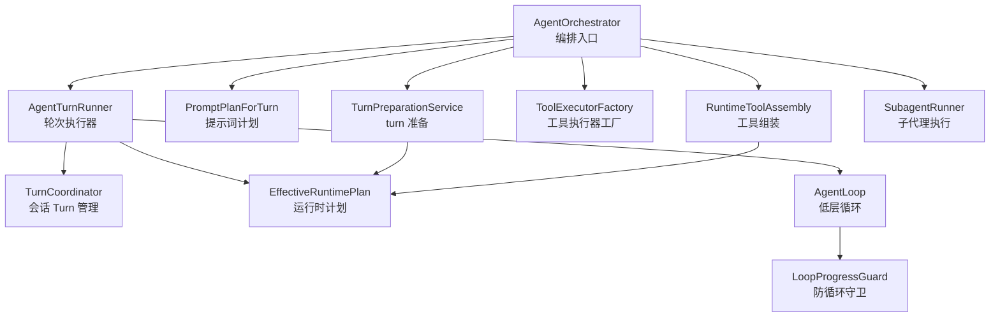
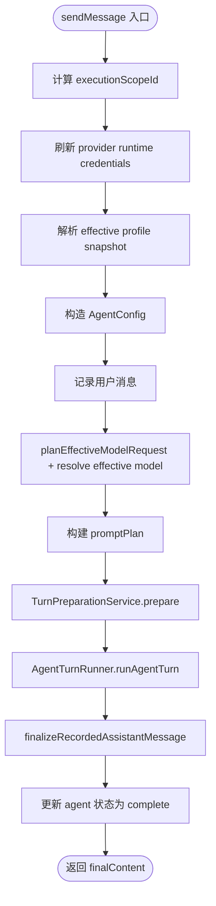
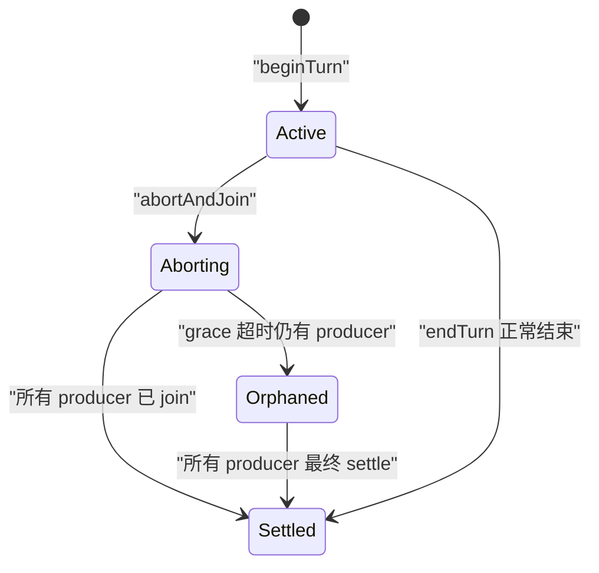
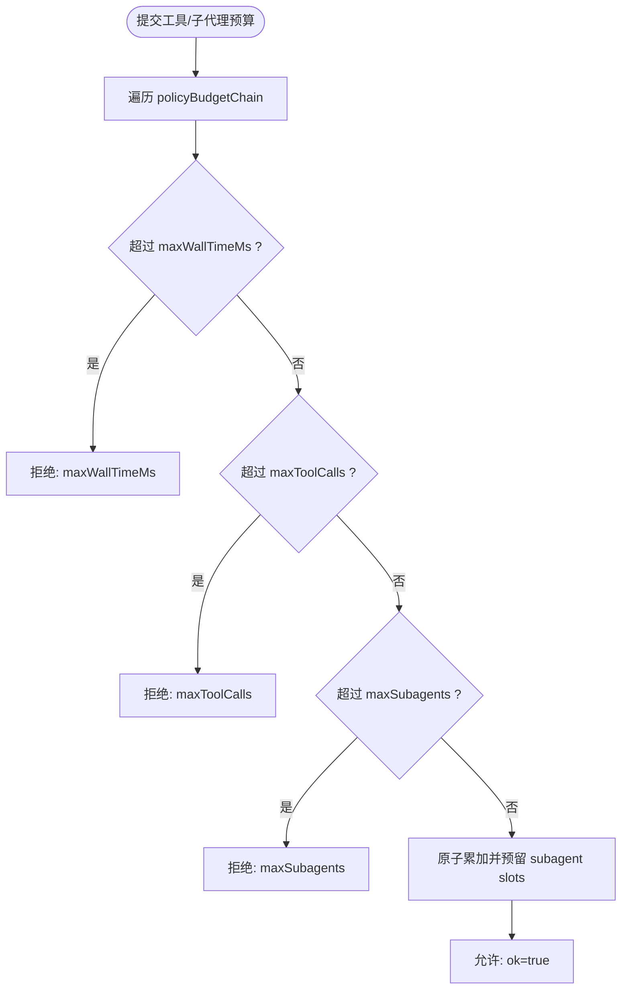
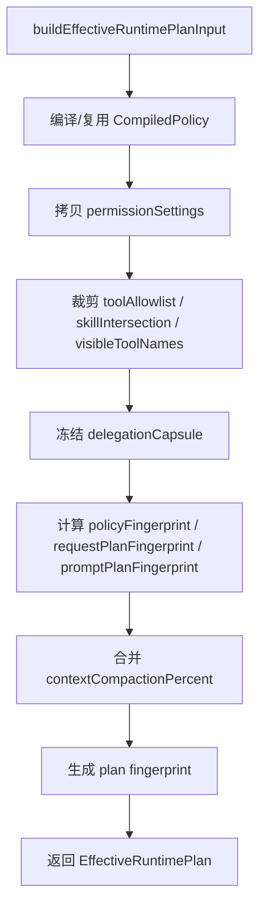
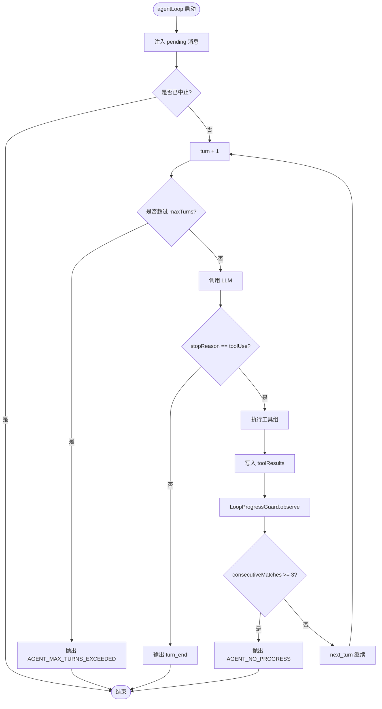
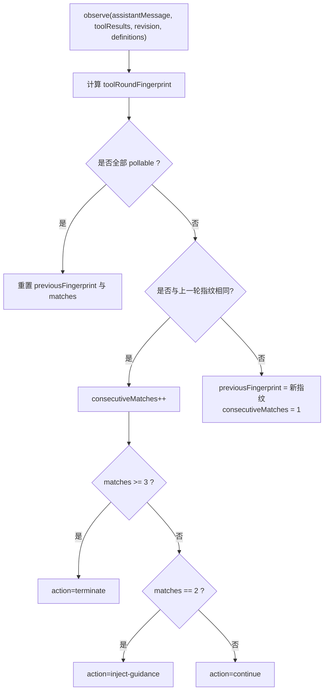
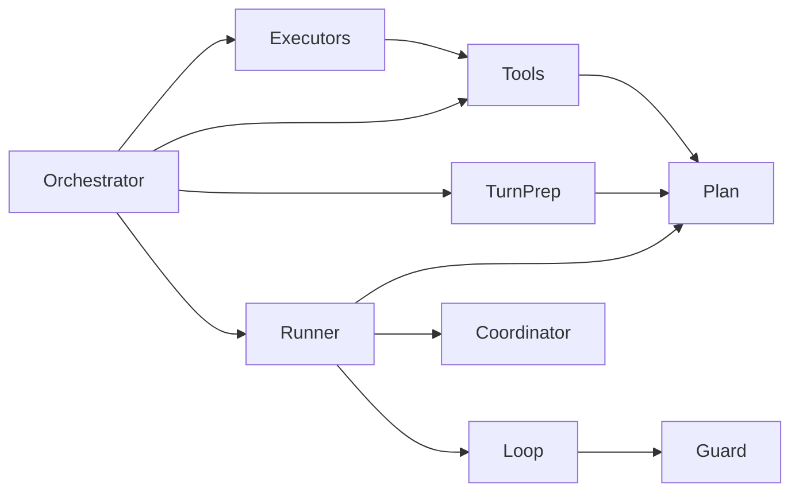

# Agent 运行时

<cite>
**本文引用的文件**   
- [AgentOrchestrator.ts](file://src/main/workflow/debugger/AgentOrchestrator.ts)
- [TurnCoordinator.ts](file://src/main/workflow/debugger/TurnCoordinator.ts)
- [EffectiveRuntimePlan.ts](file://src/main/agent-runtime/EffectiveRuntimePlan.ts)
- [LoopProgressGuard.ts](file://src/main/agent-runtime/agent/LoopProgressGuard.ts)
- [AgentLoop.ts](file://src/main/agent-runtime/agent/AgentLoop.ts)
</cite>

## 目录
1. [引言](#引言)
2. [项目结构](#项目结构)
3. [核心组件](#核心组件)
4. [架构总览](#架构总览)
5. [关键组件详解](#关键组件详解)
6. [依赖关系分析](#依赖关系分析)
7. [性能与资源约束](#性能与资源约束)
8. [故障排查指南](#故障排查指南)
9. [结论](#结论)

## 引言
本文件面向 Agent 运行时的内部实现，聚焦以下目标：
- 解释 `AgentOrchestrator` 编排器如何协调 turn 准备、工具组装、LLM 调用、工具执行和结果回灌。
- 说明 `TurnCoordinator` 的会话级 Turn 生命周期（Active → Aborting → Orphaned → Settled）、预算链控制以及子代理预算分配。
- 解释 `EffectiveRuntimePlan` 的冻结机制、工具发现与组装、Provider 适配层的关键契约。
- 给出 Agent loop 完整执行流程：解析 profile / model route / policy / tools → 调用 LLM → 执行已批准工具 → 回灌结果 → 产出 final answer。
- 说明 `LoopProgressGuard` 防循环机制、Turn 取消与回收、错误分类处理，并提供实际调用流程图。

## 项目结构
本次文档关注的代码位于主进程 Agent 运行时与调试工作流目录中：
- 编排入口：`src/main/workflow/debugger/AgentOrchestrator.ts`
- 会话 Turn 管理：`src/main/workflow/debugger/TurnCoordinator.ts`
- 运行时计划冻结：`src/main/agent-runtime/EffectiveRuntimePlan.ts`
- Agent 低层循环：`src/main/agent-runtime/agent/AgentLoop.ts`
- 循环进度保护：`src/main/agent-runtime/agent/LoopProgressGuard.ts`



**图表来源**
- [AgentOrchestrator.ts:1-120](file://src/main/workflow/debugger/AgentOrchestrator.ts#L1-L120)
- [TurnCoordinator.ts:1-120](file://src/main/workflow/debugger/TurnCoordinator.ts#L1-L120)
- [EffectiveRuntimePlan.ts:1-120](file://src/main/agent-runtime/EffectiveRuntimePlan.ts#L1-L120)
- [AgentLoop.ts:1-120](file://src/main/agent-runtime/agent/AgentLoop.ts#L1-L120)
- [LoopProgressGuard.ts:1-60](file://src/main/agent-runtime/agent/LoopProgressGuard.ts#L1-L60)

**章节来源**
- [AgentOrchestrator.ts:1-120](file://src/main/workflow/debugger/AgentOrchestrator.ts#L1-L120)
- [TurnCoordinator.ts:1-120](file://src/main/workflow/debugger/TurnCoordinator.ts#L1-L120)
- [EffectiveRuntimePlan.ts:1-120](file://src/main/agent-runtime/EffectiveRuntimePlan.ts#L1-L120)
- [AgentLoop.ts:1-120](file://src/main/agent-runtime/agent/AgentLoop.ts#L1-L120)
- [LoopProgressGuard.ts:1-60](file://src/main/agent-runtime/agent/LoopProgressGuard.ts#L1-L60)

## 核心组件
- **AgentOrchestrator**：对外暴露 `sendMessage` / `sendProfileMessage` / `prepareTurnContext` / `getAgentState` 等能力；内部组合 turn 准备、工具装配、LLM 轮次执行、子代理与后台子代理。
- **TurnCoordinator**：按 session key 维护 active 与 orphaned TurnHandle；提供 begin/end/abort/abortAll；内置 wall time 超时、producer 回收、generation 令牌。
- **EffectiveRuntimePlan**：在 turn 开始时冻结 profile、policy、tool allowlist、skill intersection、visible tool names、deferred tools、MCP hash、compaction percent、route capability 等；生成 planId 与 fingerprint。
- **AgentLoop**：显式状态机式主循环；负责注入 pending、调 LLM、执行工具、检测无进展、终止并输出消息集合。
- **LoopProgressGuard**：基于工具调用 + 工具结果语义指纹判断连续相同 round，触发 continue/inject-guidance/terminate。

**章节来源**
- [AgentOrchestrator.ts:1-120](file://src/main/workflow/debugger/AgentOrchestrator.ts#L1-L120)
- [TurnCoordinator.ts:1-120](file://src/main/workflow/debugger/TurnCoordinator.ts#L1-L120)
- [EffectiveRuntimePlan.ts:1-120](file://src/main/agent-runtime/EffectiveRuntimePlan.ts#L1-L120)
- [AgentLoop.ts:1-120](file://src/main/agent-runtime/agent/AgentLoop.ts#L1-L120)
- [LoopProgressGuard.ts:1-60](file://src/main/agent-runtime/agent/LoopProgressGuard.ts#L1-L60)

## 架构总览
Agent 运行时的调用主线可以概括为：
1. 上层通过 `AgentOrchestrator.sendMessage` 或 `sendProfileMessage` 发起一次 Agent 交互。
2. 编排器解析 provider credential、profile、model route、policy 与 tool allowlist。
3. 通过 `PromptPlanForTurn` 构建 system prompt 与上下文计划。
4. 通过 `TurnPreparationService` 与 `ProfileTurnPreparation` 准备 initial messages、runtime、compaction threshold。
5. 将 prepared runtime 交给 `AgentTurnRunner`，由其在 `AgentLoop` 中反复调用 LLM、执行工具。
6. `TurnCoordinator` 维护 TurnHandle，承载 eventSink、policy budget、subagent budget、abort scope、producers。
7. 最终由 `AgentOrchestrator.finalizeRecordedAssistantMessage` 落盘 assistant message 并更新 agent state。

```mermaid
sequenceDiagram
    participant Caller as "调用方"
    participant Orchestrator as "AgentOrchestrator"
    participant Prep as "TurnPreparationService"
    participant Runner as "AgentTurnRunner"
    participant Loop as "AgentLoop"
    participant Coordinator as "TurnCoordinator"
    participant Provider as "LLM Provider"
    participant Tools as "ToolExecutorFactory / RuntimeToolAssembly"

    Caller->>Orchestrator: "sendMessage(agentId, content, context)"
    Orchestrator->>Orchestrator: "resolve profile/model/route/policy"
    Orchestrator->>Prep: "prepare(profile, promptPlan, allowlist, credentials)"
    Prep-->>Orchestrator: "preparedBundle(initialMessages, runtime, summary)"
    Orchestrator->>Runner: "runAgentTurn(prepared, effectiveModel, options)"
    Runner->>Coordinator: "beginTurn(sessionKey, eventSink, budgets)"
    Coordinator-->>Runner: "TurnHandle(signal, policyBudget, subagentBudget)"
    Runner->>Loop: "agentLoop(messages, tools, config)"
    Loop->>Provider: "streamAssistantResponse"
    Provider-->>Loop: "assistantMessage(stopReason=toolUse|stop)"
    alt "需要工具"
        Loop->>Tools: "execute(toolCalls)"
        Tools-->>Loop: "toolResults"
        Loop->>Loop: "LoopProgressGuard.observe"
        Loop->>Provider: "继续下一轮(允许工具)"
    else "不需要工具"
        Loop-->>Runner: "final assistantMessage"
    end
    Runner-->>Orchestrator: "responseText"
    Orchestrator->>Orchestrator: "finalize & update status"
    Orchestrator-->>Caller: "finalContent"
```

**图表来源**
- [AgentOrchestrator.ts:200-420](file://src/main/workflow/debugger/AgentOrchestrator.ts#L200-L420)
- [AgentLoop.ts:200-420](file://src/main/agent-runtime/agent/AgentLoop.ts#L200-L420)
- [TurnCoordinator.ts:480-641](file://src/main/workflow/debugger/TurnCoordinator.ts#L480-L641)

**章节来源**
- [AgentOrchestrator.ts:200-420](file://src/main/workflow/debugger/AgentOrchestrator.ts#L200-L420)
- [AgentLoop.ts:200-420](file://src/main/agent-runtime/agent/AgentLoop.ts#L200-L420)
- [TurnCoordinator.ts:480-641](file://src/main/workflow/debugger/TurnCoordinator.ts#L480-L641)

## 关键组件详解

### AgentOrchestrator 编排器
`AgentOrchestrator` 是高层门面，负责：
- 初始化 slot registry、MCP coordinator、deferred activation tracker、tokenizer、prompt plan、tools、executors、turn preparation、profile preparation、turn runner、subagent runner、background subagent service。
- 将 `turnCoordinator.getActive` 作为回调注入 subagents、tools、executors、turn runner，使每个 Turn 能获取当前活跃 handle。
- `sendMessage` 中完成：
  - 计算 execution scope id。
  - 刷新 provider runtime credentials。
  - 解析 effective profile snapshot。
  - 构造 `AgentConfig`。
  - 记录用户消息。
  - 规划 model request 与 context window。
  - 构建 prompt plan。
  - 调用 `ProfileTurnPreparation.prepare` 得到 prepared bundle。
  - 调用 `AgentTurnRunner.runAgentTurn`。
  - 最终化 assistant message 并更新 agent state。
- `sendProfileMessage` 支持传入 `preparedTurn`、`requestPlan`、`effectiveProfile`、`systemPrompt`、`temperature`、`routeAgentId`、`modelOverride` 等，用于更灵活的 profile 级路由与委托场景。



**图表来源**
- [AgentOrchestrator.ts:200-420](file://src/main/workflow/debugger/AgentOrchestrator.ts#L200-L420)

**章节来源**
- [AgentOrchestrator.ts:1-120](file://src/main/workflow/debugger/AgentOrchestrator.ts#L1-L120)
- [AgentOrchestrator.ts:200-420](file://src/main/workflow/debugger/AgentOrchestrator.ts#L200-L420)
- [AgentOrchestrator.ts:420-797](file://src/main/workflow/debugger/AgentOrchestrator.ts#L420-L797)

### TurnCoordinator 会话生命周期与预算链
`TurnCoordinator` 的核心职责是“消除 turn 全局可变状态”，把每个 session 的 turn 生命周期封装在 `TurnHandle` 中。

#### TurnHandle 生命周期
- **Active**：`beginTurn` 创建 handle，放入 `activeBySession`。
- **Aborting**：调用 `abortAndJoin` 时设置 aborted、abortReason，调用 abortController.abort，并向所有 producers 发送 abort。
- **Orphaned**：如果 graceMs 内仍有 producer 未 settle，进入 orphaned 分支，保留 handle 直到所有 producer join 完成。
- **Settled**：当 closed 且 producers 为空，`isSettled` 为 true；`whenSettled` 可等待完全回收。



**图表来源**
- [TurnCoordinator.ts:240-480](file://src/main/workflow/debugger/TurnCoordinator.ts#L240-L480)

#### 预算链与子代理预算
- `PolicyBudgetState` 跟踪 toolCalls、subagents、childDepth、wallStartedAt、maxWallTimeMs 等。
- `createPolicyBudgetState` 支持 shared 模式，避免重复校验 wall time。
- `reserveDispatchBudget` 先检查 chain 中每个 budget 的上限，再原子累加，并预留 subagent slots。
- `consumeReservedSubagentSlot` 供并发调度消费预留槽位。
- `SubagentBudgetState` 跟踪 depth、childrenSpawned、aggregateToolCalls、wallPausedAt、activeChildren 等，配合 `startSubagentBudgetChild`、`finishSubagentBudgetChild`、`subagentActiveWallMs`、`assertSubagentBudgetAllowsChild`。



**图表来源**
- [TurnCoordinator.ts:60-160](file://src/main/workflow/debugger/TurnCoordinator.ts#L60-L160)

**章节来源**
- [TurnCoordinator.ts:1-120](file://src/main/workflow/debugger/TurnCoordinator.ts#L1-L120)
- [TurnCoordinator.ts:200-480](file://src/main/workflow/debugger/TurnCoordinator.ts#L200-L480)
- [TurnCoordinator.ts:480-641](file://src/main/workflow/debugger/TurnCoordinator.ts#L480-L641)

### EffectiveRuntimePlan 冻结机制与工具可见性
`EffectiveRuntimePlan` 在 turn 开始阶段冻结一组不可变运行时配置，供 prompt 构建与 executor 共享同一份 planId/fingerprint。

关键冻结字段包括：
- `schemaVersion`、`planId`、`fingerprint`
- `projectRootPath`、`projectId`、`profileProvenance`
- `agentId`、`profileSkills`、`profileMaxTurns`
- `profileHandoffs`、`enabledProfileIds`、`profileDelegates`
- `toolAllowlist`、`skillIntersection`、`visibleToolNames`
- `activatedDeferredTools`、`mcpDescriptorHash`
- `permissionSettings`、`knowledgeReadRoots`
- `policy`、`policyFingerprint`、`contextCompactionPercent`
- `routeCapability`、`requestPlanFingerprint`、`promptPlanFingerprint`
- `excludeRdcLeaseTools`、`excludeSubagent`、`delegationCapsule`

冻结过程还做如下裁剪：
- 若 `excludeRdcLeaseTools` 为真，从 allowlist 中剥离 RDC lease 工具。
- 若 `excludeSubagent` 为真，过滤掉 subagent 相关工具。
- 对 mission profile，使用 mission-plan-only allowlist 过滤。
- 合并 user compaction percent 与 policy.compactionPercent 取最小值。
- 对 delegation capsule 进行结构化克隆与冻结。



**图表来源**
- [EffectiveRuntimePlan.ts:120-307](file://src/main/agent-runtime/EffectiveRuntimePlan.ts#L120-L307)

工具可见性判定函数 `activeToolNamesForPlan`：
- 以 `toolAllowlist` 为白名单（空表示不限制）。
- 若 `excludeRdcLeaseTools` 为真，排除 RDC lease 工具名。
- 若 `excludeSubagent` 为真，排除 subagent。
- 仅返回定义名匹配 allowlist 的工具。

**章节来源**
- [EffectiveRuntimePlan.ts:1-120](file://src/main/agent-runtime/EffectiveRuntimePlan.ts#L1-L120)
- [EffectiveRuntimePlan.ts:120-307](file://src/main/agent-runtime/EffectiveRuntimePlan.ts#L120-L307)

### AgentLoop 与 LoopProgressGuard 执行流程
`AgentLoop` 是低层调度器，不负责高层队列与订阅，而是用显式 `LoopState` 表达 init/next_turn/terminal 路径。

#### 执行流程
1. 注入 pending 消息到 `context.messages` 与事件流。
2. 检查外部 abort signal。
3. 增加 turn 计数，超过 `maxTurns` 抛出 `AgentLoopTerminationError.AGENT_MAX_TURNS_EXCEEDED`。
4. 调用 LLM：
   - 注入 `runtime_no_progress_instruction` 与 `runtime_turn_budget_instruction`。
   - 使用 `streamAssistantResponseWithRecovery` 处理 length/retry/compact/switch_model/abort。
5. 若 stopReason 不是 toolUse，直接终止。
6. 执行工具组：
   - 通过 `executeConcurrentToolGroups` 执行。
   - 将 toolResult 写回 `context.messages`。
7. 调用 `LoopProgressGuard.observe`：
   - 连续 3 次相同 round → terminate。
   - 连续 2 次相同 round → inject guidance。
8. 进入 next_turn，继续循环。



**图表来源**
- [AgentLoop.ts:200-420](file://src/main/agent-runtime/agent/AgentLoop.ts#L200-L420)

#### 防循环机制
`LoopProgressGuard` 通过 `createToolRoundFingerprint` 对 assistantMessage 中的 toolCall、toolResult outcome/result、runtimeRevision 进行规范化哈希，忽略 callId/timestamp/duration 等易变键。

行为规则：
- 全部 pollable 工具：重置 previousFingerprint 与 consecutiveMatches。
- 指纹与前一轮相同：consecutiveMatches 递增。
- 不同指纹：重置为 1。
- consecutiveMatches ≥ 3：terminate。
- consecutiveMatches === 2：inject-guidance。
- 其他：continue。



**图表来源**
- [LoopProgressGuard.ts:1-176](file://src/main/agent-runtime/agent/LoopProgressGuard.ts#L1-L176)

**章节来源**
- [AgentLoop.ts:200-420](file://src/main/agent-runtime/agent/AgentLoop.ts#L200-L420)
- [AgentLoop.ts:420-878](file://src/main/agent-runtime/agent/AgentLoop.ts#L420-L878)
- [LoopProgressGuard.ts:1-176](file://src/main/agent-runtime/agent/LoopProgressGuard.ts#L1-L176)

## 依赖关系分析
Agent 运行时各组件之间的耦合关系如下：
- `AgentOrchestrator` 高内聚地组合 turn preparation、tool assembly、executor、runner、subagent 与 memory UI。
- `AgentTurnRunner`（由 orchestrator 构造）依赖 `ToolExecutorFactory`、`RuntimeToolAssembly`、`TokenizerService`、`AgentSlotRegistry`、`McpConnectionCoordinator`。
- `TurnCoordinator` 被 orchestrator/runner 用作 turn 句柄注册、abort 与 event sink 分发。
- `EffectiveRuntimePlan` 被 preparation 与 executor 共同引用，保证 prompt 与工具权限在同一快照下。
- `AgentLoop` 只依赖低层接口：ProviderStrategy、ToolExecutor、EventStream、ErrorRecovery、ContextManager。
- `LoopProgressGuard` 独立于高层编排，仅依赖工具定义与消息结构。



**图表来源**
- [AgentOrchestrator.ts:1-120](file://src/main/workflow/debugger/AgentOrchestrator.ts#L1-L120)
- [AgentLoop.ts:1-120](file://src/main/agent-runtime/agent/AgentLoop.ts#L1-L120)
- [TurnCoordinator.ts:1-120](file://src/main/workflow/debugger/TurnCoordinator.ts#L1-L120)
- [EffectiveRuntimePlan.ts:1-120](file://src/main/agent-runtime/EffectiveRuntimePlan.ts#L1-L120)
- [LoopProgressGuard.ts:1-60](file://src/main/agent-runtime/agent/LoopProgressGuard.ts#L1-L60)

**章节来源**
- [AgentOrchestrator.ts:1-120](file://src/main/workflow/debugger/AgentOrchestrator.ts#L1-L120)
- [AgentLoop.ts:1-120](file://src/main/agent-runtime/agent/AgentLoop.ts#L1-L120)
- [TurnCoordinator.ts:1-120](file://src/main/workflow/debugger/TurnCoordinator.ts#L1-L120)
- [EffectiveRuntimePlan.ts:1-120](file://src/main/agent-runtime/EffectiveRuntimePlan.ts#L1-L120)
- [LoopProgressGuard.ts:1-60](file://src/main/agent-runtime/agent/LoopProgressGuard.ts#L1-L60)

## 性能与资源约束
- **最大轮数**：`AgentLoop` 默认 `maxTurns=100`，超过则抛终止错误；靠近最后两轮会注入 budget instruction 提醒模型停止工具调用并产出最终答案。
- **工具并发**：`AgentLoopConfig.maxToolConcurrency` 控制工具分组并行执行。
- **上下文压缩**：`transformContext` 可在 LLM 请求前压缩上下文；`ErrorRecovery` 对 length 截断采取 reactive_compact、continue_prompt、switch_model、retry、abort。
- **wall time 限制**：`TurnHandle` 根据 `policyBudget.maxWallTimeMs` 设置超时定时器；`policyBudgetChain` 在 reserve 时逐项检查 wall time。
- **子代理预算**：`SubagentBudgetState` 仅在存在 active child 时累计 wall time，并通过 `startSubagentBudgetChild` / `finishSubagentBudgetChild` 暂停/恢复计时。
- **防循环**：`LoopProgressGuard` 在连续相同 tool round 后注入指导或直接终止，防止无效重试。

[本节为通用性能讨论，不直接分析具体代码片段]

## 故障排查指南
常见错误类型与定位建议：

| 错误类别 | 典型表现 | 可能原因 | 排查建议 |
|---|---|---|---|
| AGENT_MAX_TURNS_EXCEEDED | Agent 持续工具循环后终止 | 模型始终返回 toolUse，未收敛到 final answer | 检查 prompt、tool 设计、budget instruction、是否有必要减少工具数量 |
| AGENT_NO_PROGRESS | 连续相同 tool round 被终止 | 工具结果语义不变，loop 无法推进 | 检查工具返回值是否包含稳定 evidence；确认 pollable 工具是否正确标记 |
| POLICY_MAX_WALL_TIME_ZERO | 创建 policy budget 时报错 | 策略要求可执行 turn 但 wall time 为 0 | 检查 compiled policy 的 maxWallTimeMs |
| SUBAGENT_BUDGET_* | 子代理深度/数量/聚合工具调用/聚合时间超限 | 子代理树过深或过多 | 检查 DEFAULT_SUBAGENT_BUDGET 与父级预算传递 |
| TURN_ORPHANED | 新 turn 无法覆盖旧 turn | 上一个 turn 的 producer 尚未 settle | 检查长时间工具执行、网络超时、UI 阻塞 |
| MODEL_UNAVAILABLE / PROMPT_PLAN_UNAVAILABLE | 启动即失败 | model route 或 prompt plan 构建失败 | 检查 settings、provider catalog、agent manifest |
| CONTEXT_CANNOT_FIT | 动态 maxTokens 返回 null 或 ≤0 | 剩余上下文窗口无法容纳任何输出 | 检查 context compression、maxTokens 策略 |

**章节来源**
- [AgentLoop.ts:200-420](file://src/main/agent-runtime/agent/AgentLoop.ts#L200-L420)
- [LoopProgressGuard.ts:1-176](file://src/main/agent-runtime/agent/LoopProgressGuard.ts#L1-L176)
- [TurnCoordinator.ts:60-160](file://src/main/workflow/debugger/TurnCoordinator.ts#L60-L160)
- [TurnCoordinator.ts:240-480](file://src/main/workflow/debugger/TurnCoordinator.ts#L240-L480)
- [EffectiveRuntimePlan.ts:120-307](file://src/main/agent-runtime/EffectiveRuntimePlan.ts#L120-L307)

## 结论
Agent 运行时的核心思想是“冻结计划、分层编排、显式循环、严格预算”：
- `AgentOrchestrator` 负责高层编排与资源生命周期。
- `TurnCoordinator` 将会话 Turn 生命周期抽象为 handle，确保 cancel、orphan、settle 有确定语义。
- `EffectiveRuntimePlan` 在 turn 起点冻结权限、工具、policy 与 MCP 环境，保证 prompt 与 executor 一致性。
- `AgentLoop` 用显式状态机驱动 LLM 与工具循环，并通过 `LoopProgressGuard` 防止无效重试。
- 预算链与子代理预算形成多层防护，防止无限扩展、超时和资源泄漏。

这套设计适合复杂 Agent 任务：既支持多轮工具调用与子代理委派，又能通过冻结计划与严格预算保障稳定性与可观测性。

[本节为总结性内容，不直接分析具体代码片段]