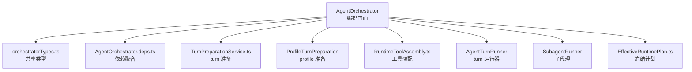
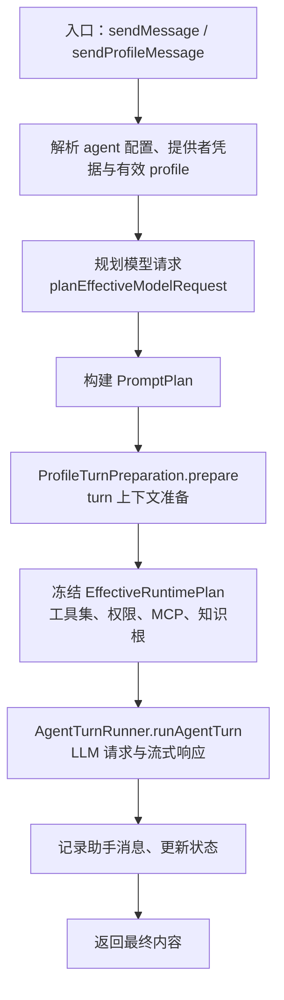
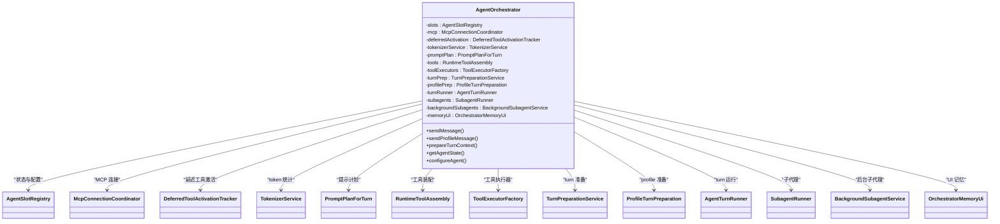
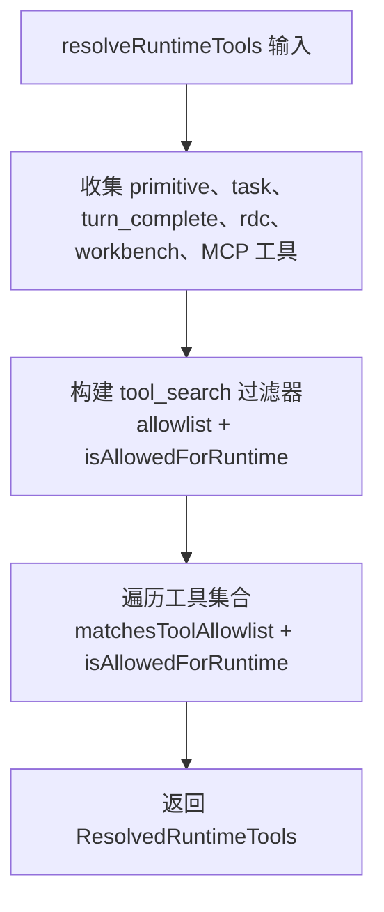
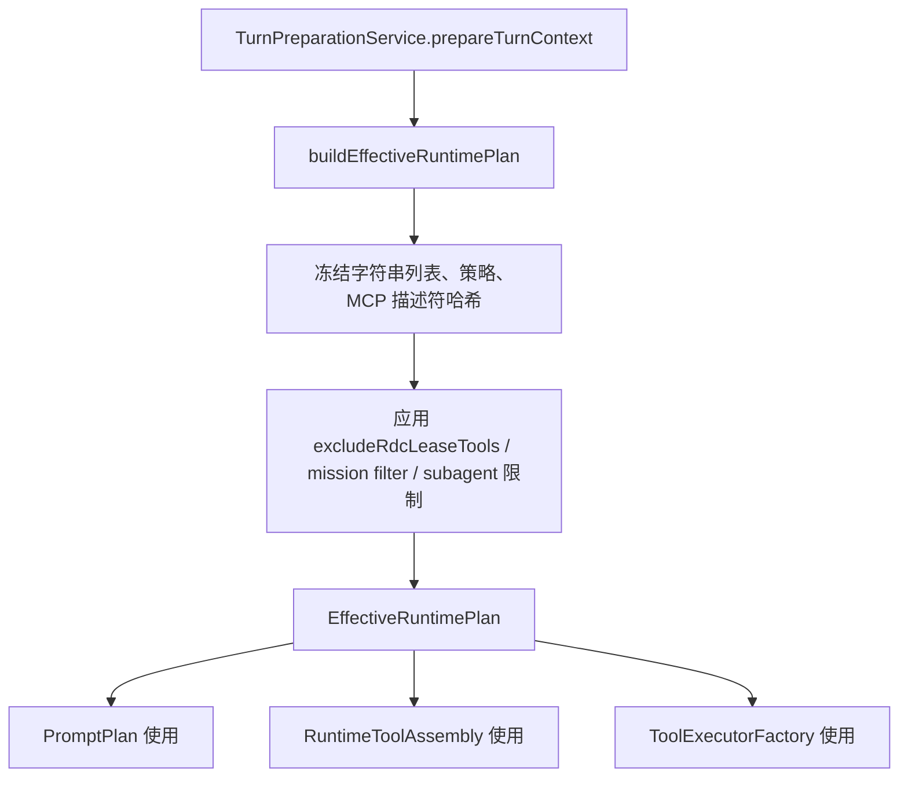
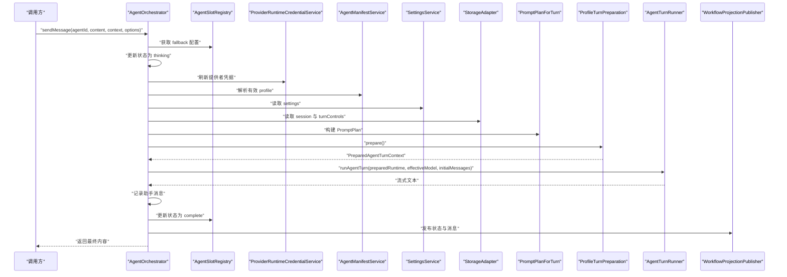

# AgentOrchestrator 编排器

<cite>
**本文引用的文件**   
- [AgentOrchestrator.ts](file://src/main/workflow/debugger/AgentOrchestrator.ts)
- [orchestratorTypes.ts](file://src/main/workflow/debugger/orchestratorTypes.ts)
- [AgentOrchestrator.deps.ts](file://src/main/workflow/debugger/AgentOrchestrator.deps.ts)
- [RuntimeToolAssembly.ts](file://src/main/workflow/debugger/RuntimeToolAssembly.ts)
- [TurnPreparationService.ts](file://src/main/workflow/debugger/TurnPreparationService.ts)
- [EffectiveRuntimePlan.ts](file://src/main/agent-runtime/EffectiveRuntimePlan.ts)
</cite>

## 目录
1. [引言](#引言)
2. [项目结构定位](#项目结构定位)
3. [核心组件与门面职责](#核心组件与门面职责)
4. [架构总览](#架构总览)
5. [公共契约与边界](#公共契约与边界)
6. [内部组件初始化与协作关系](#内部组件初始化与协作关系)
7. [工具发现与权限校验](#工具发现与权限校验)
8. [EffectiveRuntimePlan 冻结机制](#effectiveruntimeplan-冻结机制)
9. [完整调用流程：从用户消息到 LLM 调用](#完整调用流程从用户消息到-llm-调用)
10. [性能与可靠性特征](#性能与可靠性特征)
11. [故障排查指南](#故障排查指南)
12. [结论](#结论)

## 引言
AgentOrchestrator 是调试器工作流中的 Agent 编排门面。它不直接实现 LLM 流式推理、工具执行细节或策略判断，而是把 turn preparation、tool assembly、executor、turn runner、subagent runner 和 prompt-plan helpers 协调起来，形成一条可审计、可冻结、可中断的“从用户消息到模型请求”的编排路径。其设计重点在于：
- 在 turn 开始前冻结上下文、工具、计划与凭证；
- 通过 EffectiveRuntimePlan 保证 Prompt 构建与工具执行使用同一份运行时快照；
- 通过 RuntimeToolAssembly 统一暴露工具定义并做 allowlist 与运行时权限双重过滤；
- 通过 TurnPreparationService 负责压缩阈值、缓存编译、RDC 绑定、MCP 描述符哈希等准备阶段工作；
- 通过 AgentTurnRunner 承担实际 Provider 请求、流式响应与完成声明处理。

## 项目结构定位
AgentOrchestrator 位于 `src/main/workflow/debugger`，属于主进程调试工作流层，而不是渲染器 UI 或通用会话服务。它依赖同目录下的类型、协作类和上游 agent-runtime 能力。

**图表来源**
- [AgentOrchestrator.ts:24-188](file://src/main/workflow/debugger/AgentOrchestrator.ts#L24-L188)
- [orchestratorTypes.ts:1-175](file://src/main/workflow/debugger/orchestratorTypes.ts#L1-L175)
- [AgentOrchestrator.deps.ts:1-63](file://src/main/workflow/debugger/AgentOrchestrator.deps.ts#L1-L63)
- [RuntimeToolAssembly.ts:1-681](file://src/main/workflow/debugger/RuntimeToolAssembly.ts#L1-L681)
- [TurnPreparationService.ts:1-200](file://src/main/workflow/debugger/TurnPreparationService.ts#L1-L200)
- [EffectiveRuntimePlan.ts:1-200](file://src/main/agent-runtime/EffectiveRuntimePlan.ts#L1-L200)

**章节来源**
- [AgentOrchestrator.ts:1-23](file://src/main/workflow/debugger/AgentOrchestrator.ts#L1-L23)
- [AgentOrchestrator.deps.ts:1-63](file://src/main/workflow/debugger/AgentOrchestrator.deps.ts#L1-L63)

## 核心组件与门面职责
AgentOrchestrator 维护以下关键内部状态：
- `slots`：AgentSlotRegistry，管理 agent 配置与状态。
- `mcp`：McpConnectionCoordinator，协调 MCP 连接、工具发现与生命周期。
- `deferredActivation`：DeferredToolActivationTracker，跟踪延迟激活的工具，避免跨 turn 泄漏。
- `tokenizerService`：TokenizerService，参与 token 统计与上下文窗口计算。
- `promptPlan`：PromptPlanForTurn，构建系统提示、技能注入与 prompt 片段。
- `tools`：RuntimeToolAssembly，组装工具定义、工具映射与工具权限。
- `toolExecutors`：ToolExecutorFactory，根据允许列表创建具体工具执行器。
- `turnPrep`：TurnPreparationService，负责 prepareTurnContext。
- `profilePrep`：ProfileTurnPreparation，封装普通 turn 的 profile 准备。
- `turnRunner`：AgentTurnRunner，驱动 LLM 请求、流式输出与完成声明。
- `subagents` / `backgroundSubagents`：SubagentRunner 与 BackgroundSubagentService，处理子代理与后台任务。
- `memoryUi`：OrchestratorMemoryUi，面向 UI 的记忆读写门面。

这些组件在构造函数中集中装配，并通过闭包回调（如 `getActiveTurn`、`getMemoryStore`）互相耦合，同时保持对外只暴露有限方法。

**章节来源**
- [AgentOrchestrator.ts:48-188](file://src/main/workflow/debugger/AgentOrchestrator.ts#L48-L188)

## 架构总览
下图展示 AgentOrchestrator 作为门面如何组织 turn 的主要阶段：

**图表来源**
- [AgentOrchestrator.ts:200-550](file://src/main/workflow/debugger/AgentOrchestrator.ts#L200-L550)
- [AgentOrchestrator.ts:550-797](file://src/main/workflow/debugger/AgentOrchestrator.ts#L550-L797)
- [TurnPreparationService.ts:1-200](file://src/main/workflow/debugger/TurnPreparationService.ts#L1-L200)
- [EffectiveRuntimePlan.ts:1-200](file://src/main/agent-runtime/EffectiveRuntimePlan.ts#L1-L200)

## 公共契约与边界
AgentOrchestrator 的公开契约集中在五个方法上：

| 方法 | 职责 | 边界说明 |
|---|---|---|
| `sendMessage` | 接收用户消息，完成 provider 凭证刷新、profile 解析、prompt 计划、turn 准备、LLM 调用、助手消息落盘与状态更新。 | 面向普通 agent turn；异常时更新为 error；finally 释放临时状态与 MCP 租约。 |
| `sendProfileMessage` | 面向 profile turn 或子代理 child turn，支持传入已冻结的 requestPlan、promptPlan、effectiveProfile、delegationCapsule 等。 | 更强调“复用已准备结果”，并可透传 onTerminalContext 回调。 |
| `prepareTurnContext` | 委托给 TurnPreparationService，返回 PreparedAgentTurnContext。 | 用于外部异步准备或测试场景，不直接触发 LLM 调用。 |
| `getAgentState` | 查询指定 session/scope 与 agentId 的状态。 | 仅读取 AgentSlotRegistry。 |
| `configureAgent` | 设置 agent 配置。 | 仅写入 AgentSlotRegistry。 |

此外还提供 `getToolsForRole`、`isToolAllowedForRole`、`syncSessionSlots`、`releaseSessionToolState`、`getMcpServerStatusSummary`、`disconnectAllMcpServers`、记忆 UI 方法与 abort/join 控制。

**章节来源**
- [AgentOrchestrator.ts:149-200](file://src/main/workflow/debugger/AgentOrchestrator.ts#L149-L200)
- [AgentOrchestrator.ts:200-550](file://src/main/workflow/debugger/AgentOrchestrator.ts#L200-L550)
- [AgentOrchestrator.ts:550-797](file://src/main/workflow/debugger/AgentOrchestrator.ts#L550-L797)

## 内部组件初始化与协作关系
### 构造期装配
构造函数完成以下动作：
1. 初始化 `AgentSlotRegistry` 默认值。
2. 创建 `OrchestratorMemoryUi`，并以闭包方式访问按 user/project 维度选择的 MemoryStore。
3. 构造 `SubagentRunner`，注入 `sendProfileMessage`、`systemPromptForAgent` 与 `getActiveTurn`，使其能反向调用父编排器。
4. 用 `createBackgroundSubagentService` 包装 subagent runner，再设回 background starter。
5. 构造 `RuntimeToolAssembly`，注入 MCP 协调器、活跃 turn、MemoryStore、子代理工具工厂、背景工具工厂与 MCP 状态查询。
6. 构造 `ToolExecutorFactory`，注入 slots、deferredActivation、活跃 turn、以及 tools 的 `resolveRuntimeTools`、`isAllowedForRuntime`、`matchesToolAllowlist`。
7. 构造 `TurnPreparationService`，注入 MCP、deferredActivation、runtime tools 解析与签名能力。
8. 构造 `ProfileTurnPreparation`，包装 turnPrep。
9. 构造 `AgentTurnRunner`，注入验证函数、slots、MCP、deferredActivation、tokenizer、session key 生成、runtime tools、tool signature、tool executor 工厂。

**图表来源**
- [AgentOrchestrator.ts:48-188](file://src/main/workflow/debugger/AgentOrchestrator.ts#L48-L188)

**章节来源**
- [AgentOrchestrator.ts:48-188](file://src/main/workflow/debugger/AgentOrchestrator.ts#L48-L188)
- [AgentOrchestrator.deps.ts:1-63](file://src/main/workflow/debugger/AgentOrchestrator.deps.ts#L1-L63)

## 工具发现与权限校验
### RuntimeToolAssembly 的职责
RuntimeToolAssembly 是工具发现的中心。它会：
- 合并基础 primitive tools；
- 注入 task runtime tools；
- 注入 turn_complete；
- 可选注入 rdc_context 与 rdc_probe；
- 注入 workbench tools（ask_user、memory_*、plan_artifact、skills、skill_read、mcp、knowledge、investigation、subagent、background）；
- 注入 MCP server 暴露的工具；
- 注入 tool_search，且 tool_search 只能看到经过 allowlist 与 isAllowedForRuntime 过滤后的工具集合。

最终返回 `ResolvedRuntimeTools`，包含供模型看到的 ToolDefinition 列表与可供执行器查找的 AgentTool 映射。

### matchesToolAllowlist
该方法对工具名进行标准化后，与 allowlist 逐项匹配，支持：
- 精确匹配；
- 通配符前缀或后缀；
- 规范令牌展开。

### isAllowedForRuntime
该方法先检查是否排除 RDC lease 工具，然后调用 `isToolAllowedByFrozenAllowlist`，以 agentId 与 frozenToolAllowlist 为基础做运行时权限判断。

### resolveRuntimeTools
该方法根据 excludeRdcLeaseTools、excludeSubagent、sessionId、turnHandle、projectRootPath、mcpPoolKey 与 options 组装可用工具，并在最后再次过滤 definitions 与 toolMap，确保模型可见集合与实际执行集合一致。

**图表来源**
- [RuntimeToolAssembly.ts:495-681](file://src/main/workflow/debugger/RuntimeToolAssembly.ts#L495-L681)
- [RuntimeToolAssembly.ts:1-200](file://src/main/workflow/debugger/RuntimeToolAssembly.ts#L1-L200)

**章节来源**
- [RuntimeToolAssembly.ts:1-200](file://src/main/workflow/debugger/RuntimeToolAssembly.ts#L1-L200)
- [RuntimeToolAssembly.ts:495-681](file://src/main/workflow/debugger/RuntimeToolAssembly.ts#L495-L681)

## EffectiveRuntimePlan 冻结机制
EffectiveRuntimePlan 是 turn 内一致性的核心数据结构。它在 prepareTurnContext 阶段被构建一次，然后被：
- PromptPlan 用于构建系统提示与上下文预算；
- RuntimeToolAssembly 用于确认 visibleToolNames、activatedDeferredTools、excludeRdcLeaseTools、excludeSubagent 等；
- ToolExecutorFactory 与工具执行器用于核对 planId 与 fingerprint；
- 后续审计、日志、缓存与重试逻辑用于比对本轮计划是否变化。

冻结内容包括：
- schemaVersion、planId、fingerprint；
- projectRootPath、projectId；
- profileProvenance、agentId、profileSkills、profileMaxTurns；
- profileHandoffs、enabledProfileIds、profileDelegates；
- toolAllowlist、skillIntersection、visibleToolNames；
- activatedDeferredTools、mcpDescriptorHash；
- permissionSettings、policy、policyFingerprint；
- knowledgeReadRoots、contextCompactionPercent；
- routeCapability、requestPlanFingerprint、promptPlanFingerprint；
- attachmentManifestFingerprint；
- excludeRdcLeaseTools、excludeSubagent；
- delegationCapsule、createdAt 等。

该结构大量使用数组拷贝与 `Object.freeze`，使“准备阶段”与“执行阶段”不会因外部 settings、MCP 列表或 deferred 工具状态突变而产生不一致。

**图表来源**
- [EffectiveRuntimePlan.ts:1-200](file://src/main/agent-runtime/EffectiveRuntimePlan.ts#L1-L200)
- [TurnPreparationService.ts:1-200](file://src/main/workflow/debugger/TurnPreparationService.ts#L1-L200)

**章节来源**
- [EffectiveRuntimePlan.ts:1-200](file://src/main/agent-runtime/EffectiveRuntimePlan.ts#L1-L200)
- [TurnPreparationService.ts:1-200](file://src/main/workflow/debugger/TurnPreparationService.ts#L1-L200)

## 完整调用流程：从用户消息到 LLM 调用
### sendMessage 序列图

**图表来源**
- [AgentOrchestrator.ts:200-550](file://src/main/workflow/debugger/AgentOrchestrator.ts#L200-L550)

### sendProfileMessage 差异点
sendProfileMessage 更强调“复用已有准备结果”。它可以接受：
- preparedTurn；
- frozenRequestPlan；
- effectiveProfile；
- extraPromptSegments；
- frozenDelegationCapsule；
- visibleTurnIds；
- activeBranchId；
- excludeRdcLeaseTools；
- onTerminalContext。

当未提供 preparedTurn 时，它同样会走 profilePrep.prepare，但会隔离 subagent sessionId 与 RDC lease 工具，并最终把 terminalContext 映射到 runAgentTurn 的终端回调。

**章节来源**
- [AgentOrchestrator.ts:200-550](file://src/main/workflow/debugger/AgentOrchestrator.ts#L200-L550)
- [AgentOrchestrator.ts:550-797](file://src/main/workflow/debugger/AgentOrchestrator.ts#L550-L797)

## 性能与可靠性特征
### 性能相关
- TokenizerService 由 orchestrator 持有，避免每个 turn 重复创建。
- TurnPreparationService 可以配合 worker pool 进行上下文材料化与压缩计算（依赖文件中引入 worker pool）。
- MCP 描述符哈希与 policy fingerprint 减少不必要的重连或重建。
- tool_search 只暴露过滤后的工具，降低模型幻觉与无效调用概率。

### 可靠性相关
- 所有长流程都在 try/catch 中更新 agent 状态为 error。
- finally 块中释放 transient agent state、MCP lease 与 provider credentials。
- syncSessionSlots 同步 slot 并同时清理 deferred activation。
- releaseSessionToolState 释放 session 级工具状态。
- abortAndJoin 通过 turnCoordinator 安全中止并 join。

**章节来源**
- [AgentOrchestrator.ts:200-550](file://src/main/workflow/debugger/AgentOrchestrator.ts#L200-L550)
- [AgentOrchestrator.ts:550-797](file://src/main/workflow/debugger/AgentOrchestrator.ts#L550-L797)
- [TurnPreparationService.ts:1-200](file://src/main/workflow/debugger/TurnPreparationService.ts#L1-L200)

## 故障排查指南
常见错误信号与定位建议：

| 现象 | 可能原因 | 排查方向 |
|---|---|---|
| `AGENT_PROFILE_UNAVAILABLE` | 有效 profile 为空或未启用。 | 检查 agent manifest、enabled 状态、projectRootPath。 |
| `MODEL_UNAVAILABLE` | 模型能力解析失败。 | 检查 settings、provider、modelId、route capability。 |
| `PROMPT_PLAN_UNAVAILABLE` | prompt 计划构建失败。 | 检查 systemPrompt、toolAllowlist、contextWindowTokens。 |
| `SKILL_UNAVAILABLE` / `SKILL_SOURCE_CHANGED` | skill 缺失或 sourceHash 不匹配。 | 检查 skill 配置与预加载快照。 |
| `REQUEST_CANCELLED` | 准备阶段 signal 已取消。 | 检查 AbortSignal 与异步准备取消逻辑。 |
| `CREDENTIAL_HANDLE_REQUIRED` | profile 准备需要凭据租约但未提供。 | 检查 sendProfileMessage 是否在非测试模式刷新了凭据。 |
| `DELEGATION_REASONING_UNSUPPORTED` | 子代理 reasoning 级别与路由不支持。 | 检查 frozenDelegationCapsule.reasoningLevel 与 selected route。 |
| `TASK_COMPLETION_DENIED` | 未完成 direct task 就调用 turn_complete。 | 检查 Task 状态与 completion requirements。 |

日志方面，AgentOrchestrator 会在状态变更、消息记录、profile turn 结束时调用 runtimeLogService 与 workflowProjectionPublisher，便于从应用日志与工作流投影定位问题。

**章节来源**
- [AgentOrchestrator.ts:200-550](file://src/main/workflow/debugger/AgentOrchestrator.ts#L200-L550)
- [AgentOrchestrator.ts:550-797](file://src/main/workflow/debugger/AgentOrchestrator.ts#L550-L797)
- [RuntimeToolAssembly.ts:495-681](file://src/main/workflow/debugger/RuntimeToolAssembly.ts#L495-L681)
- [TurnPreparationService.ts:1-200](file://src/main/workflow/debugger/TurnPreparationService.ts#L1-L200)

## 结论
AgentOrchestrator 的核心价值不是实现 LLM 调用细节，而是在 turn 的生命周期起点建立一份一致的运行时快照，并把用户消息、agent profile、prompt plan、工具装配、权限校验、MCP 连接、子代理、记忆 UI 与 turn runner 串成一条可观测、可冻结、可恢复的流水线。对于扩展者而言：
- 新增工具应优先通过 RuntimeToolAssembly 暴露；
- 新增权限规则应通过 allowlist 与 isAllowedForRuntime 通道生效；
- 新增上下文准备逻辑应考虑 EffectiveRuntimePlan 冻结语义；
- 新增用户入口应遵循 sendMessage / sendProfileMessage / prepareTurnContext 的职责边界。