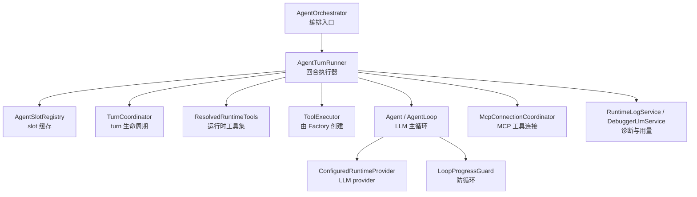
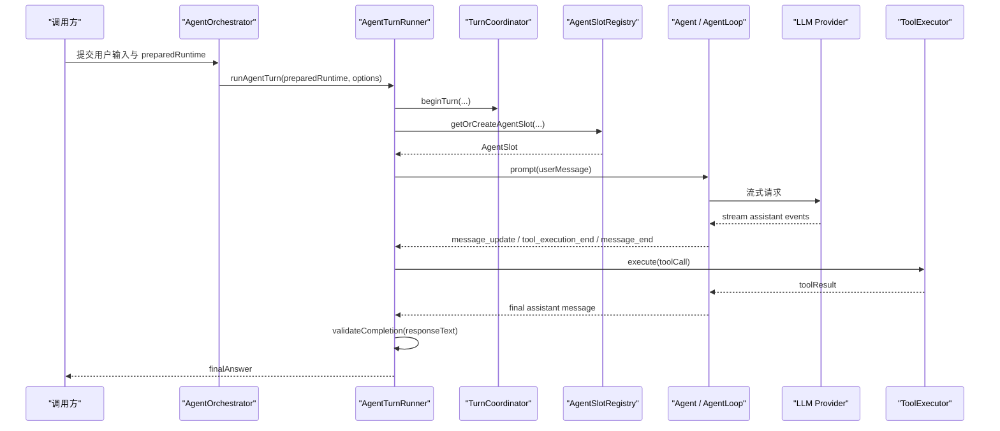
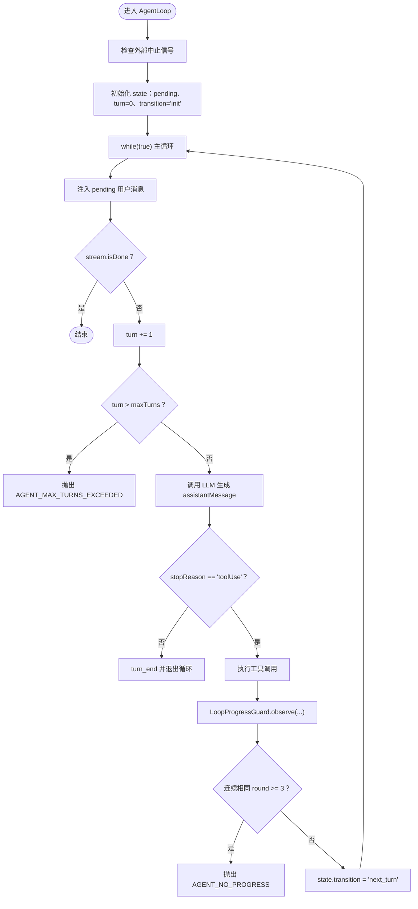
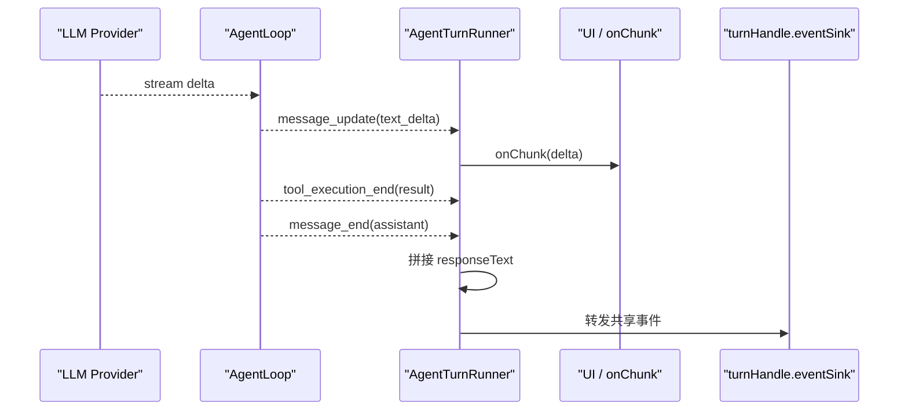
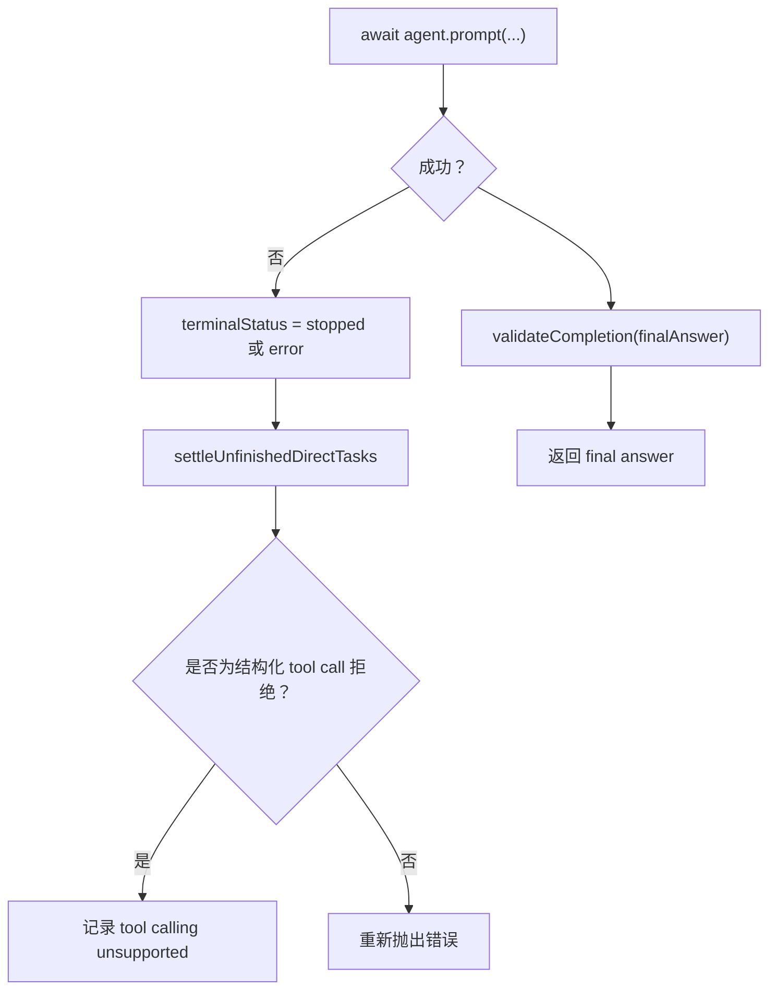
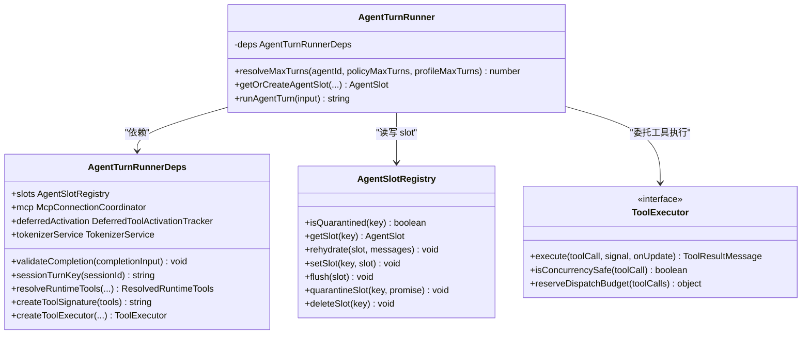

# AgentTurnRunner 回合执行器

<cite>
**本文引用的文件**   
- [AgentTurnRunner.ts](file://src/main/workflow/debugger/AgentTurnRunner.ts)
- [LoopProgressGuard.ts](file://src/main/agent-runtime/agent/LoopProgressGuard.ts)
- [AgentLoop.ts](file://src/main/agent-runtime/agent/AgentLoop.ts)
- [AgentOrchestrator.ts](file://src/main/workflow/debugger/AgentOrchestrator.ts)
- [AgentOrchestrator.deps.ts](file://src/main/workflow/debugger/AgentOrchestrator.deps.ts)
</cite>

## 目录
1. [引言](#引言)
2. [项目结构中的位置](#项目结构中的位置)
3. [核心职责总览](#核心职责总览)
4. [架构总览](#架构总览)
5. [回合执行流水线](#回合执行流水线)
6. [LoopProgressGuard 防循环机制](#loopprogressguard-防循环机制)
7. [流式响应与部分结果累积](#流式响应与部分结果累积)
8. [错误分类与终止语义](#错误分类与终止语义)
9. [依赖关系分析](#依赖关系分析)
10. [性能与可观测性](#性能与可观测性)
11. [故障排查指南](#故障排查指南)
12. [结论](#结论)

## 引言
AgentTurnRunner 是 AgentOrchestrator 在“回合”层面的执行中枢。它不负责单个 LLM provider 的 HTTP 细节，也不负责具体工具的业务实现；它的职责是把“已准备好的策略、模型路由、上下文、工具集合”组合成一次完整的 agent turn：启动轮次、创建或复用 Agent slot、触发 LLM 调用、订阅消息事件、收集并过滤结构化 tool call、委托 ToolExecutorFactory 执行工具、回灌结果、最终产出 final answer。

同时，AgentTurnRunner 与 AgentLoop 和 LoopProgressGuard 共同构成防无限循环的防线：前者负责高层资源、会话、策略预算与生命周期；后者负责低层主循环、最大迭代次数、进度指纹与无进展终止。

## 项目结构中的位置
AgentTurnRunner 位于主进程 workflow/debugger 模块中，作为 AgentOrchestrator 的协作组件之一。其关键依赖包括：
- Agent 与 AgentLoop：封装 LLM 主循环、事件流、工具调度、上下文压缩与错误恢复。
- TurnCoordinator：管理 turn 生命周期、子代理预算、策略预算、中止与孤儿检测。
- AgentSlotRegistry：缓存可复用的 agent runtime slot。
- DeferredToolActivationTracker 与 MCP 连接协调器：延迟激活工具、MCP 工具连接与租约释放。
- TokenizerService、PromptCacheCompiler、RuntimeLogService、DebuggerLlmService：token 计数、提示词缓存、诊断日志与用量统计。
- RouteCapabilityResolver：解析 provider/model 的结构化工具调用能力。

**图表来源**
- [AgentTurnRunner.ts:1-891](file://src/main/workflow/debugger/AgentTurnRunner.ts#L1-L891)
- [AgentLoop.ts:1-878](file://src/main/agent-runtime/agent/AgentLoop.ts#L1-L878)
- [LoopProgressGuard.ts:1-176](file://src/main/agent-runtime/agent/LoopProgressGuard.ts#L1-L176)

**章节来源**
- [AgentTurnRunner.ts:1-120](file://src/main/workflow/debugger/AgentTurnRunner.ts#L1-L120)
- [AgentOrchestrator.ts](file://src/main/workflow/debugger/AgentOrchestrator.ts)

## 核心职责总览
AgentTurnRunner 的核心职责可以归纳为六类：

| 职责 | 说明 |
|---|---|
| 回合启动 | 校验 provider/model、requestPlan、preparedRuntime；注册 turn.before-start 钩子；开始 TurnCoordinator turn。 |
| 工具解析与冻结 | 从 effectivePlan.toolAllowlist 构建 frozenToolAllowlist，再 resolveRuntimeTools 得到 live runtime tools；根据 routeCapability.toolCallingMode 决定 native-structured 注入还是 deferred 模式。 |
| Agent slot 管理 | getOrCreateAgentSlot 判断是否复用已有 slot；若复用则 rehydrate history 并同步 tools；否则新建 Agent、ExecutionContextManager、ErrorRecovery、prompt cache。 |
| 流式事件桥接 | 订阅 Agent 事件，将 text_delta 推送给 onChunk，将 message_end 组装 responseText，将 shared event 转交给 turnHandle.eventSink。 |
| 工具执行委托 | 使用 createToolExecutor 创建 ToolExecutor；executor allowlist 在 native-structured 模式下使用 effectivePlan.toolAllowlist，其他模式使用 activeToolDefinitions。 |
| 完成验证与清理 | validateCompletion 检查 structured completion 证据；finally 中取消订阅、中止 agent、flush slot、quarantine orphaned slot、释放 MCP lease、endTurn、after-end 钩子。 |

**章节来源**
- [AgentTurnRunner.ts:120-200](file://src/main/workflow/debugger/AgentTurnRunner.ts#L120-L200)
- [AgentTurnRunner.ts:200-500](file://src/main/workflow/debugger/AgentTurnRunner.ts#L200-L500)
- [AgentTurnRunner.ts:500-891](file://src/main/workflow/debugger/AgentTurnRunner.ts#L500-L891)

## 架构总览
AgentTurnRunner 并不直接发起 LLM HTTP 请求；它通过 Agent.getOrCreateAgentSlot 创建的 Agent 实例，再由 AgentLoop 驱动主循环。AgentTurnRunner 更像“回合控制器”，而 AgentLoop 才是“LLM 调度器”。

**图表来源**
- [AgentTurnRunner.ts:300-500](file://src/main/workflow/debugger/AgentTurnRunner.ts#L300-L500)
- [AgentLoop.ts:180-350](file://src/main/agent-runtime/agent/AgentLoop.ts#L180-L350)

## 回合执行流水线
### 1. 前置校验与钩子
runAgentTurn 首先校验：
- providerId 与 modelId 必须存在。
- requestPlan 必须存在。
- preparedRuntime 必须存在；否则抛出 TURN_NOT_PREPARED。

随后通过 dispatchRuntimeHooks 触发 turn.before-start；若返回 false，则立即释放 MCP lease 并抛出 HOOK_DENIED。

**章节来源**
- [AgentTurnRunner.ts:300-360](file://src/main/workflow/debugger/AgentTurnRunner.ts#L300-L360)

### 2. Turn 生命周期登记
beginTurn 接收 sessionKey、turnId、parentSignal、subagentBudget 与 policyBudget。失败时同样释放 MCP lease 并向上抛出。

turnHandle.taskPreparation 记录当前 turn 的 runtime fingerprint、skills、inputArtifacts、selectedTurnCount、capsuleHash 等诊断信息；onTaskPreparation 回调允许上层消费该阶段状态。

**章节来源**
- [AgentTurnRunner.ts:360-440](file://src/main/workflow/debugger/AgentTurnRunner.ts#L360-L440)

### 3. 工具解析与 allowlist 冻结
effectivePlan.toolAllowlist 被复制为 frozenToolAllowlist，然后传给 deps.resolveRuntimeTools，得到 liveRuntimeTools。

native-structured 模式下：
- activeToolDefinitions 使用 injectedToolDefinitions。
- executorAllowlist 使用 effectivePlan.toolAllowlist。
- 工具 schema 直接注入到 provider 请求。

非 native-structured 模式下：
- activeToolDefinitions 为空。
- executorAllowlist 使用 activeToolDefinitions。
- 工具以 deferred 方式激活，不在首次 provider 请求中暴露全部 schema。

**章节来源**
- [AgentTurnRunner.ts:440-500](file://src/main/workflow/debugger/AgentTurnRunner.ts#L440-L500)

### 4. Agent slot 创建或复用
getOrCreateAgentSlot 负责：
- 校验 PromptPlan。
- 校验 slot 未被 quarantine。
- 计算 contextTokenLimit = requestCompactionThreshold - fixedPromptTokens。
- 若 slot 已存在且 providerId、modelId、systemPrompt、toolSignature、turnSignature、contextTokenLimit 一致，则复用。
- 复用场景下会 activatedDeferredTools 并 rehydrate initialMessages。
- 新建场景下构造 AgentModel、RouteCapability、ExecutionContextManager、ErrorRecovery、Agent。

**章节来源**
- [AgentTurnRunner.ts:120-250](file://src/main/workflow/debugger/AgentTurnRunner.ts#L120-L250)

### 5. 用户消息注入与流式订阅
userMessage 由 input.content 或 input.options.userContent 生成，并通过 activeSlot.agent.prompt 注入。

Agent.subscribe 中：
- text_delta 通过 onChunk 输出 partial result。
- toolcall_end 与 tool_execution_end 用于记录结构化 tool calling evidence。
- message_end 聚合 assistant content 中的 text blocks 为 responseText。
- 所有共享事件通过 translateCoreToSharedAgentEvent 转交给 turnHandle.eventSink。

**章节来源**
- [AgentTurnRunner.ts:500-750](file://src/main/workflow/debugger/AgentTurnRunner.ts#L500-L750)

### 6. 中止信号桥接
如果 input.options.signal 已中止，直接抛出 AbortError；否则注册 once abort 监听，调用 turnHandle.abortAndJoin({ reason: 'user_stop' })。

abort 监听还会映射到 activeSlot.agent.abort()，并在 finally 中调用 abortAndJoin。

**章节来源**
- [AgentTurnRunner.ts:720-780](file://src/main/workflow/debugger/AgentTurnRunner.ts#L720-L780)

### 7. 完成验证与 final answer
prompt 完成后，先 settleUnfinishedDirectTasks；若 turnHandle.completionDeclaration.disposition 为 cancelled 但并未实际中止，则抛出 TURN_COMPLETION_INVALID。

随后构造 completionInput 并调用 deps.validateCompletion；验证通过后返回 responseText 作为 final answer。

**章节来源**
- [AgentTurnRunner.ts:780-830](file://src/main/workflow/debugger/AgentTurnRunner.ts#L780-L830)

## LoopProgressGuard 防循环机制
LoopProgressGuard 不是 AgentTurnRunner 的直接字段，而是由 AgentLoop 在低层主循环中使用。AgentTurnRunner 负责把 maxTurns 传入 Agent/AgentLoop，并把最终 responseText 交给上层；真正的“轮数限制 + 无进展检测”发生在 AgentLoop 内部。

### 最大迭代次数
AgentLoop 默认 maxTurns 为 100，可通过 config.maxTurns 覆盖。每进入一次 next_turn，turn 自增，若超过 maxTurns，抛出 AGENT_MAX_TURNS_EXCEEDED。

此外，当 remainingTurns <= 5 时，会在 ephemeralInstruction 中注入剩余轮次提示，促使模型收敛到 final answer。

**图表来源**
- [AgentLoop.ts:180-350](file://src/main/agent-runtime/agent/AgentLoop.ts#L180-L350)
- [AgentLoop.ts:350-500](file://src/main/agent-runtime/agent/AgentLoop.ts#L350-L500)

### progress 检测逻辑
LoopProgressGuard.observe 对每个 tool round 计算 fingerprint，比较上一轮 fingerprint：
- 完全相同：consecutiveMatches 递增。
- 不同：previousFingerprint 更新，consecutiveMatches 重置为 1。

动作规则：
- consecutiveMatches >= 3：terminate。
- consecutiveMatches === 2：inject-guidance。
- 其他：continue。

### 全 pollable 工具豁免
如果本轮所有 toolCall 的工具定义都标记 pollable === true，则视为轮询型工具，不累计 no-progress，并重置 previousFingerprint 与 consecutiveMatches。

### 异常分支处理
- 第一轮：continue。
- 第二轮：inject-guidance，向模型注入 RUNTIME_NO_PROGRESS_INSTRUCTION。
- 第三轮：AGENT_NO_PROGRESS。
- runtimeRevision 变化：视为工具集或 deferred activation 发生变化，重置匹配状态。

**章节来源**
- [LoopProgressGuard.ts:1-176](file://src/main/agent-runtime/agent/LoopProgressGuard.ts#L1-L176)
- [AgentLoop.ts:250-500](file://src/main/agent-runtime/agent/AgentLoop.ts#L250-L500)

## 流式响应与部分结果累积
AgentTurnRunner 的 streaming 行为分为三层：

| 层级 | 数据形式 | 处理方式 |
|---|---|---|
| Provider → AgentLoop | EventStream<AgentEvent> | AgentLoop 将 message_start、message_update、tool_execution_end、message_end、error 等事件推入流。 |
| Agent → AgentTurnRunner | Agent.subscribe 回调 | 收到 text_delta 时调用 onChunk；收到 message_end 时拼接 responseText。 |
| AgentTurnRunner → 上层 | turnHandle.eventSink.onEvent | 通过 translateCoreToSharedAgentEvent 输出统一事件。 |

partial results 主要体现为：
- onChunk：文本增量。
- tool_execution_end：工具执行结果。
- message_end：完整 assistant message，包含 usage 与 content blocks。

tool call gating 的关键点是：
- 结构化 tool call 证据通过 claimStructuredToolCallingEvidence 记录。
- 若 provider 返回空 assistant message 且没有结构化 tool call，则发出 empty_response_without_tool_call 警告。
- 若 responseText 包含 textual tool call 但没有结构化 tool call，则发出 textual_tool_call_not_executed 警告。

**图表来源**
- [AgentTurnRunner.ts:520-750](file://src/main/workflow/debugger/AgentTurnRunner.ts#L520-L750)

**章节来源**
- [AgentTurnRunner.ts:500-750](file://src/main/workflow/debugger/AgentTurnRunner.ts#L500-L750)

## 错误分类与终止语义
AgentTurnRunner 的错误分类可分为三类：

| 类别 | 典型来源 | 表现 |
|---|---|---|
| LLM 错误 | provider 网络、鉴权、限流、结构化 tool call 不支持 | ErrorRecovery 可能 retry、reactive_compact、switch_model、continue_prompt 或 abort；AgentTurnRunner 在捕获结构化 tool call 拒绝时记录 unsupported。 |
| 工具执行错误 | ToolExecutor.execute 返回 isError 结果 | 工具结果仍会被写入上下文；LoopProgressGuard 会将 error outcome 纳入 fingerprint，防止因错误重复而被误判为正常 progress。 |
| 策略拒绝 | turn.before-start 钩子返回 false、completionDeclaration 为 cancelled 但未中止 | 抛出 HOOK_DENIED 或 TURN_COMPLETION_INVALID。 |

终止状态 terminalStatus 的判定：
- 若 input.options.signal.aborted 或 turnHandle.isAborted，则为 stopped。
- 否则为 error。
- 非 stopped 情况下，会 settleUnfinishedDirectTasks。
- finally 中无论成功失败都会 flush slot、取消订阅、释放 MCP lease、endTurn、dispatch after-end。

**图表来源**
- [AgentTurnRunner.ts:780-891](file://src/main/workflow/debugger/AgentTurnRunner.ts#L780-L891)

**章节来源**
- [AgentTurnRunner.ts:780-891](file://src/main/workflow/debugger/AgentTurnRunner.ts#L780-L891)

## 依赖关系分析
AgentTurnRunner 的依赖呈现“高内聚、低耦合”的编排特征：

**图表来源**
- [AgentTurnRunner.ts:1-120](file://src/main/workflow/debugger/AgentTurnRunner.ts#L1-L120)
- [AgentTurnRunner.ts:120-250](file://src/main/workflow/debugger/AgentTurnRunner.ts#L120-L250)

**章节来源**
- [AgentTurnRunner.ts:1-200](file://src/main/workflow/debugger/AgentTurnRunner.ts#L1-L200)

## 性能与可观测性
AgentTurnRunner 在性能方面做了以下设计：

- **slot 复用**：避免重复创建 Agent、provider 配置与 context window manager。
- **contextTokenLimit 动态计算**：固定 system prompt、tool schemas、promptPlan 后，剩余空间用于 conversation。
- **transformContext**：AgentLoop 可在每次请求前压缩历史消息，减少 token 占用。
- **prompt cache**：通过 promptCacheCompiler 编译 promptPlan、requestPlan、tools，降低重复请求成本。
- **token 用量统计**：debuggerLlmService.recordAgentTurnUsage 记录 inputTokens、outputTokens、cacheRead/Write/Hit/Miss、reasoningTokens、cost。
- **工具定义分类统计**：按 system_tools、mcp_tools、mcp_tools_deferred、builtin_tools_deferred、subagent_definitions、summarized_conversation、conversation 分类记录。

可观测性方面：
- requestEnvelopeBuilder + requestSnapshotStore 记录 provider 请求快照。
- describeRouteCapabilityDiagnostic 输出模型路由能力诊断。
- runtimeLogService 输出 runtime-log 级别诊断。
- buildDiagnosticAgentEvent 输出结构化诊断事件。

**章节来源**
- [AgentTurnRunner.ts:200-300](file://src/main/workflow/debugger/AgentTurnRunner.ts#L200-L300)
- [AgentTurnRunner.ts:500-750](file://src/main/workflow/debugger/AgentTurnRunner.ts#L500-L750)

## 故障排查指南

### 无法启动 turn
**现象**：抛出 HOOK_DENIED 或 TURN_NOT_PREPARED。  
**原因**：
- turn.before-start 钩子拒绝。
- 未传入 preparedRuntime。
- requestPlan 缺失。
- providerId 或 modelId 缺失。

**排查建议**：
- 确认 orchestrator 已调用 prepareTurnContext 或 prepareProfileTurn。
- 检查 turn.before-start 钩子返回值。
- 打印 requestPlan 与 preparedRuntime.effectivePlan。

**章节来源**
- [AgentTurnRunner.ts:300-360](file://src/main/workflow/debugger/AgentTurnRunner.ts#L300-L360)

### slot 被 quarantine 或 busy
**现象**：
- AGENT_SLOT_QUARANTINED。
- AGENT_SLOT_BUSY。

**原因**：
- 上一个 turn 未完成或被判定为 orphand。
- 同一 executionScopeId + agentId 的 slot 仍在运行。

**排查建议**：
- 检查 parent turn 是否已 endTurn。
- 检查 slots.quarantineSlot 是否被触发。
- 确保不会在同一会话中对同一 agent 并发启动多个 turn。

**章节来源**
- [AgentTurnRunner.ts:140-180](file://src/main/workflow/debugger/AgentTurnRunner.ts#L140-L180)

### 模型路由能力不足
**现象**：
- mcp_connection_failed 警告。
- Model route capability 诊断。
- empty_response_without_tool_call 或 textual_tool_call_not_executed。

**原因**：
- MCP 服务器连接失败。
- provider/model 不支持结构化 tool calling。
- 模型返回了文本形式的 tool call 但没有结构化 tool call。

**排查建议**：
- 检查 routeCapability.toolCallingMode。
- 检查 claimStructuredToolCallingEvidence 是否记录到 observed support。
- 检查 isExplicitStructuredToolCallingRejection 是否被触发。

**章节来源**
- [AgentTurnRunner.ts:500-700](file://src/main/workflow/debugger/AgentTurnRunner.ts#L500-L700)

### 无限循环或长时间无进展
**现象**：
- AGENT_MAX_TURNS_EXCEEDED。
- AGENT_NO_PROGRESS。

**原因**：
- 工具调用反复相同。
- 工具参数、结果、outcome 语义不变。
- 模型未收敛到 final answer。

**排查建议**：
- 检查 LoopProgressGuard.consecutiveMatches。
- 检查是否所有工具均为 pollable。
- 检查 runtimeRevision 是否频繁变化导致 guard 重置。
- 检查 turnPolicy.maxTurns、maxChildDepth、maxSubagents、maxToolCalls、maxWallTimeMs。

**章节来源**
- [AgentLoop.ts:250-500](file://src/main/agent-runtime/agent/AgentLoop.ts#L250-L500)
- [LoopProgressGuard.ts:1-176](file://src/main/agent-runtime/agent/LoopProgressGuard.ts#L1-L176)

### 取消处理异常
**现象**：
- user_stop 后仍有残留任务。
- slot 未被正确 flush。
- MCP lease 未释放。

**原因**：
- abort 监听未触发。
- setup 阶段失败导致 early throw。
- orphand turn 未 quarantine。

**排查建议**：
- 检查 input.options.signal 是否已 aborted。
- 检查 turnHandle.isAborted 与 turnHandle.isOrphaned。
- 确认 finally 分支是否正确执行。

**章节来源**
- [AgentTurnRunner.ts:720-891](file://src/main/workflow/debugger/AgentTurnRunner.ts#L720-L891)

## 结论
AgentTurnRunner 是 AgentOrchestrator 的回合执行核心：它将“已准备的策略、模型路由、上下文与工具”包装成一次可观察、可取消、可回收的 agent turn。它不负责 LLM 的具体传输协议，也不负责工具的业务逻辑，而是负责把这些组件安全地串联起来。

其关键价值在于：
- 明确区分 preparedRuntime 与 runAgentTurn，使策略解析与执行解耦。
- 通过 AgentSlotRegistry 复用 agent runtime，减少重复初始化成本。
- 通过 EventStream 与 subscribe 桥接流式响应、部分结果与 UI。
- 通过 TurnCoordinator 管理 turn 生命周期、预算、中止与孤儿检测。
- 通过 AgentLoop 与 LoopProgressGuard 提供最大迭代次数、无进展检测与工具轮指纹保护。

对于使用者而言，最需要注意的不是“如何调用 LLM”，而是：
- 必须提供有效的 preparedRuntime。
- 必须正确处理 onChunk、onEvent、terminalContext。
- 必须理解结构化 tool call 与 textual tool call 的差异。
- 必须关注 turn 取消、orphaned slot 与 MCP lease 的生命周期。
- 必须结合 LoopProgressGuard 的诊断解释为什么模型陷入重复工具调用。