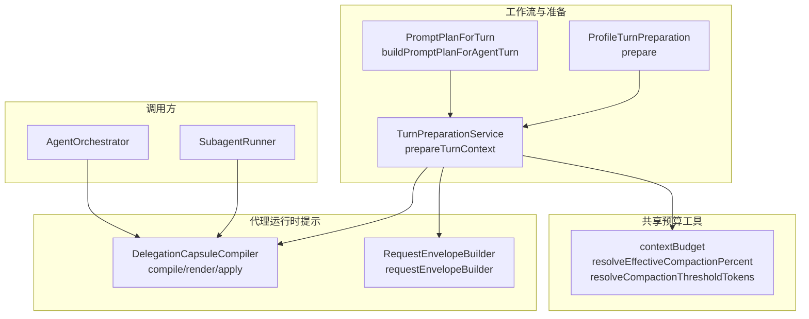
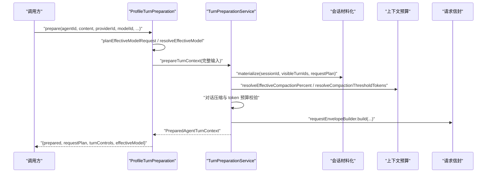
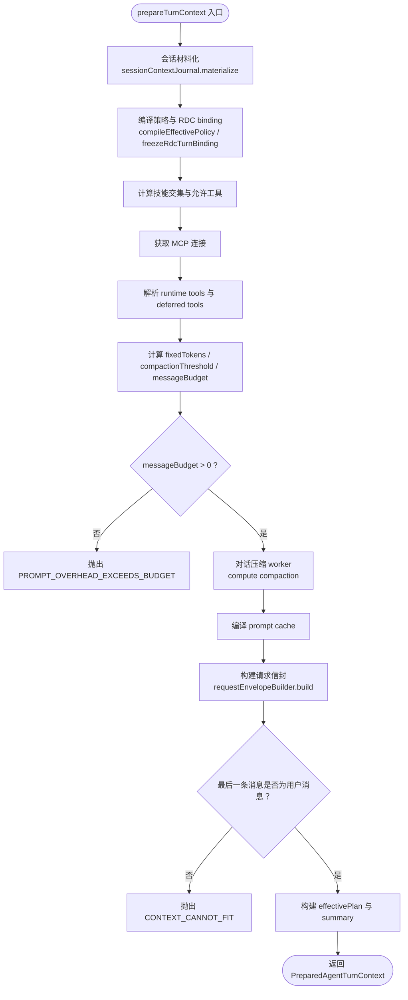
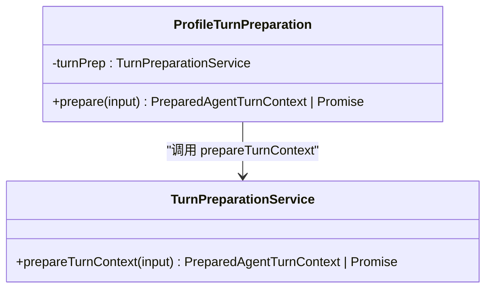
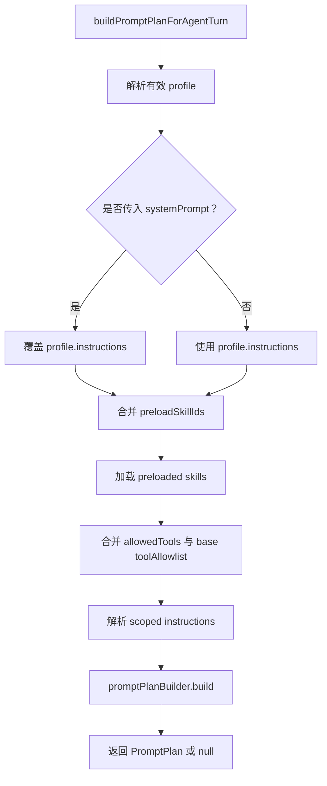
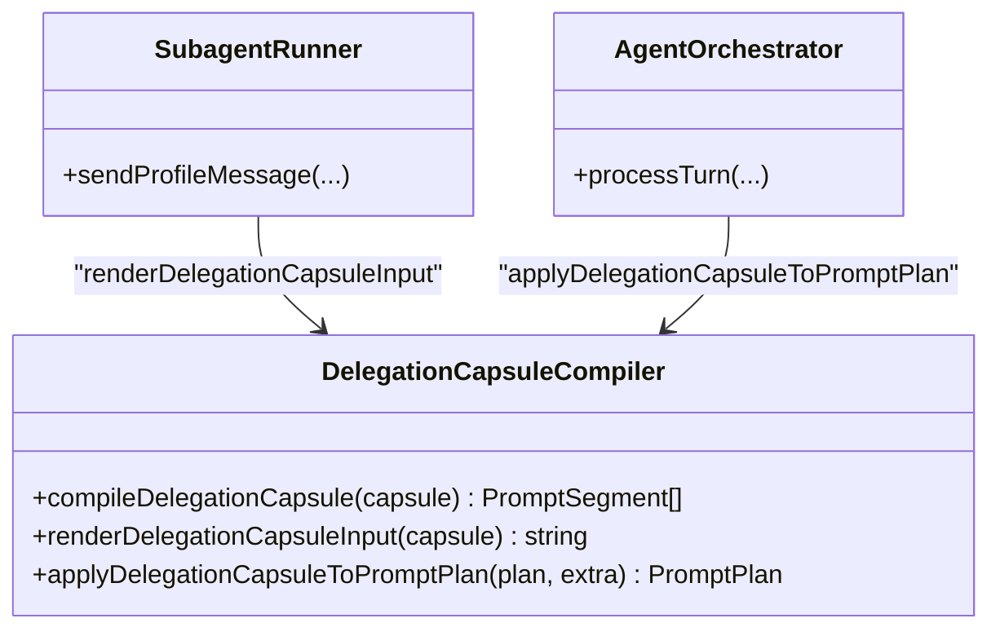
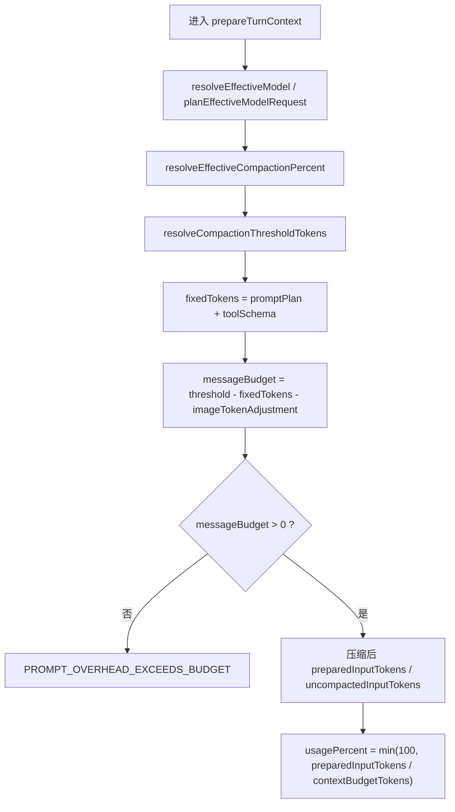
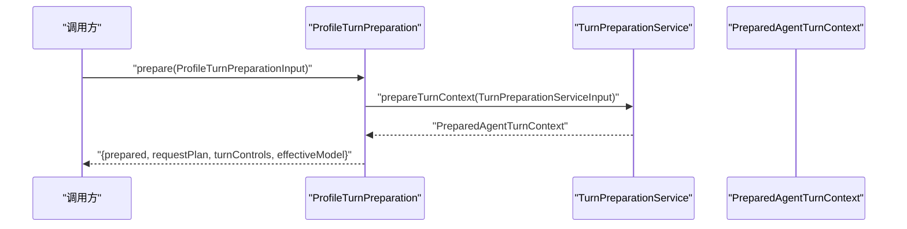
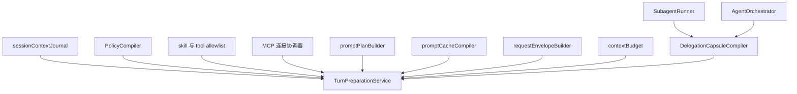

# Turn 准备服务

<cite>
**本文引用的文件**
- [TurnPreparationService.ts](file://src/main/workflow/debugger/TurnPreparationService.ts)
- [ProfileTurnPreparation.ts](file://src/main/workflow/debugger/ProfileTurnPreparation.ts)
- [PromptPlanForTurn.ts](file://src/main/workflow/debugger/PromptPlanForTurn.ts)
- [DelegationCapsuleCompiler.ts](file://src/main/agent-runtime/prompt/DelegationCapsuleCompiler.ts)
- [prompt/index.ts](file://src/main/agent-runtime/prompt/index.ts)
- [SubagentRunner.ts](file://src/main/workflow/debugger/SubagentRunner.ts)
- [AgentOrchestrator.ts](file://src/main/workflow/debugger/AgentOrchestrator.ts)
- [contextBudget.ts](file://src/shared/utils/contextBudget.ts)
</cite>

## 目录
1. [引言](#引言)
2. [项目结构](#项目结构)
3. [核心组件](#核心组件)
4. [架构总览](#架构总览)
5. [详细组件分析](#详细组件分析)
6. [依赖关系分析](#依赖关系分析)
7. [性能与预算考量](#性能与预算考量)
8. [故障排查指南](#故障排查指南)
9. [结论](#结论)

## 引言
本文聚焦 Turn 准备阶段：在将用户消息发送给模型之前，如何把对话历史、系统提示、技能、工具、权限、上下文压缩策略和委托胶囊等要素整合成一次可执行的 Turn 上下文。重点解释以下职责分工与流程：
- TurnPreparationService：负责完整的 Turn 上下文准备，包括会话材料化、策略编译、MCP 连接、工具解析、对话压缩、token 预算计算、请求信封构建以及 effective runtime plan 持久化。
- ProfileTurnPreparation：面向 sendMessage / sendProfileMessage / 子 Agent 的统一入口，先完成 provider/model/route 规划，再调用 TurnPreparationService 生成冻结的 prepared context。
- PromptPlanForTurn：根据 agent role 生成 system prompt 并组装 PromptPlan，为不同顶层 Agent 提供默认身份描述，同时合并 profile skills、预加载 skill、工具 allowlist 和权限设置。
- DelegationCapsuleCompiler：将委托胶囊编译为 PromptPlan 中的 volatile segment，并在执行侧渲染到子任务输入中。
- effective model resolution、compaction percentage 计算与 token budget 预估：贯穿 request plan、context budget、turn preparation 三个层次。

## 项目结构
Turn 准备相关代码分布在主进程工作流与 agent-runtime 层：
- workflow/debugger：Turn 编排与准备（TurnPreparationService、ProfileTurnPreparation、PromptPlanForTurn）。
- agent-runtime/prompt：PromptPlan 构建、委托胶囊编译、请求信封构建。
- shared/utils/contextBudget：上下文预算与压缩百分比计算。
- workflow/debugger 下的 SubagentRunner 与 AgentOrchestrator：实际消费委托胶囊与扩展 PromptPlan 的位置。

**图表来源**
- [TurnPreparationService.ts:1-200](file://src/main/workflow/debugger/TurnPreparationService.ts#L1-L200)
- [TurnPreparationService.ts:201-458](file://src/main/workflow/debugger/TurnPreparationService.ts#L201-L458)
- [ProfileTurnPreparation.ts:1-156](file://src/main/workflow/debugger/ProfileTurnPreparation.ts#L1-L156)
- [PromptPlanForTurn.ts:1-134](file://src/main/workflow/debugger/PromptPlanForTurn.ts#L1-L134)
- [DelegationCapsuleCompiler.ts:1-83](file://src/main/agent-runtime/prompt/DelegationCapsuleCompiler.ts#L1-L83)
- [prompt/index.ts:1-12](file://src/main/agent-runtime/prompt/index.ts#L1-L12)
- [SubagentRunner.ts:260-283](file://src/main/workflow/debugger/SubagentRunner.ts#L260-L283)
- [AgentOrchestrator.ts:514-518](file://src/main/workflow/debugger/AgentOrchestrator.ts#L514-L518)

**章节来源**
- [TurnPreparationService.ts:1-200](file://src/main/workflow/debugger/TurnPreparationService.ts#L1-L200)
- [TurnPreparationService.ts:201-458](file://src/main/workflow/debugger/TurnPreparationService.ts#L201-L458)
- [ProfileTurnPreparation.ts:1-156](file://src/main/workflow/debugger/ProfileTurnPreparation.ts#L1-L156)
- [PromptPlanForTurn.ts:1-134](file://src/main/workflow/debugger/PromptPlanForTurn.ts#L1-L134)

## 核心组件
- TurnPreparationService.prepareTurnContext：Turn 准备的中心方法。它从会话材料化开始，编译策略、RDC binding、skill intersection、MCP 连接、工具定义、对话压缩、token 预算检查、请求信封构建，并最终产出 PreparedAgentTurnContext 与 EffectiveRuntimePlan。
- ProfileTurnPreparation.prepare：对外暴露的“profile turn”入口。它会规划 effective model、route capability 与 request plan，然后把完整输入转交给 TurnPreparationService。
- PromptPlanForTurn：负责按 agent role 生成 system prompt 并构建 PromptPlan，包含 profile、scoped instructions、preloaded skills、tool allowlist、permission settings、effective model 与 context window tokens。
- DelegationCapsuleCompiler：将委托胶囊转换为 PromptPlan 的 volatile segment，并提供 renderDelegationCapsuleInput 供子任务使用；应用时通过 applyDelegationCapsuleToPromptPlan 追加到 child PromptPlan。

**章节来源**
- [TurnPreparationService.ts:1-200](file://src/main/workflow/debugger/TurnPreparationService.ts#L1-L200)
- [TurnPreparationService.ts:201-458](file://src/main/workflow/debugger/TurnPreparationService.ts#L201-L458)
- [ProfileTurnPreparation.ts:1-156](file://src/main/workflow/debugger/ProfileTurnPreparation.ts#L1-L156)
- [PromptPlanForTurn.ts:1-134](file://src/main/workflow/debugger/PromptPlanForTurn.ts#L1-L134)
- [DelegationCapsuleCompiler.ts:1-83](file://src/main/agent-runtime/prompt/DelegationCapsuleCompiler.ts#L1-L83)

## 架构总览
Turn 准备的整体流程可以理解为“规划 → 准备 → 冻结”三段式：
1. 规划：ProfileTurnPreparation 确定 provider、model、effective model、route capability 和 request plan。
2. 准备：TurnPreparationService 组装会话材料、system prompt、skills、tools、policy、MCP 连接，并对 conversation 进行压缩，最后构建 RequestEnvelope。
3. 冻结：返回 PreparedAgentTurnContext，其中包含 initialMessages、effectivePlan、promptPlan、cache、summary 等不可变快照，供后续执行器直接使用。

**图表来源**
- [ProfileTurnPreparation.ts:1-156](file://src/main/workflow/debugger/ProfileTurnPreparation.ts#L1-L156)
- [TurnPreparationService.ts:1-200](file://src/main/workflow/debugger/TurnPreparationService.ts#L1-L200)
- [TurnPreparationService.ts:201-458](file://src/main/workflow/debugger/TurnPreparationService.ts#L201-L458)

## 详细组件分析

### TurnPreparationService：Turn 上下文准备引擎
TurnPreparationService.prepareTurnContext 是 Turn 准备的唯一真实实现点。其关键步骤如下：
- 取消信号检查：每次外部交互前都检查 signal.aborted。
- 会话材料化：通过 sessionContextJournal.materialize 将 visibleTurnIds、activeBranchId 和 requestPlan 映射为 messages、selectedTurnCount、replayedArtifactCount、filteredArtifactCount 等。
- 策略与 RDC binding：
  - compileEffectivePolicy 编译权限策略。
  - assertRdcContextLeaseOwnership + rdcCliInvokerService.loadCatalog + freezeRdcTurnBinding 冻结 RDC turn binding。
- 执行限制与最大子深度：
  - applyExecutionLimitFacts 将 profileMaxTurns 与 policyMaxTurns 合并进 promptPlan。
  - effectiveMaxChildDepth 由 compiledPolicy.maxChildDepth 与 inheritedMaxChildDepth 取最小值。
  - excludeSubagent 在达到最大子深度或显式传入时启用。
- 压缩百分比与技能交集：
  - resolveEffectiveCompactionPercent 合并用户设置与策略 contextCompactionPercent。
  - resolveSkillIntersection 根据 profile.skills 与 toolAllowlist 计算最终 allowed tools，并校验 preloaded-skill sourceHash。
- MCP 连接与工具解析：
  - acquireConnections 获取 MCP lease。
  - resolveRuntimeTools 解析 runtime tools，并按 native-structured 模式选择 activeToolDefinitions。
  - partitionDeferredTools 区分已注入、延迟 MCP、延迟内置工具。
- Token 预算与对话压缩：
  - charsToTokens 估算 activeToolDefinitions 的 schema token。
  - fixedTokens = promptPlan.totalTokenEstimate + toolTokens。
  - compactionThreshold = resolveCompactionThresholdTokens(contextBudgetTokens, contextCompactionPercent)。
  - messageBudget = compactionThreshold - fixedTokens - imageTokenAdjustment。
  - 如果 messageBudget <= 0，抛出 PROMPT_OVERHEAD_EXCEEDS_BUDGET。
  - 通过 turnPreparationWorkerPool.run 对 messages 进行压缩，得到 compactedMessages、beforeConversationTokens、afterConversationTokens。
- 请求信封与缓存：
  - promptCacheCompiler.compile(promptPlan, requestPlan, tools) 编译 prompt cache。
  - requestEnvelopeBuilder.build 构建最终的请求信封，包含 route、requestPlan、messages、tools、controls、reasoning、cache。
- 输出契约与 final validation：
  - 确保 lastPreparedMessage 是当前 user message，否则抛出 CONTEXT_CANNOT_FIT。
  - initialMessages = compactedMessages.slice(0, -1)，即不包含当前用户消息的历史消息。
  - buildEffectiveRuntimePlan 写入 effectivePlan，包含 rdcBindingFingerprint、profile、toolAllowlist、permissionSettings、knowledgeReadRoots、routeCapability、requestPlan、promptPlan、policy、skillIntersection、delegationCapsule、compactionThresholdPercent、excludeRdcLeaseTools、excludeSubagent 等。
  - summary 包含 preparedInputTokens、uncompactedInputTokens、usagePercent、breakdown、compactionApplied、continuation、cache、preparedAt 等诊断信息。

**图表来源**
- [TurnPreparationService.ts:1-200](file://src/main/workflow/debugger/TurnPreparationService.ts#L1-L200)
- [TurnPreparationService.ts:201-458](file://src/main/workflow/debugger/TurnPreparationService.ts#L201-L458)

**章节来源**
- [TurnPreparationService.ts:1-200](file://src/main/workflow/debugger/TurnPreparationService.ts#L1-L200)
- [TurnPreparationService.ts:201-458](file://src/main/workflow/debugger/TurnPreparationService.ts#L201-L458)

### ProfileTurnPreparation：统一 profile turn 入口
ProfileTurnPreparation.prepare 的职责是“先规划，后准备”：
- 如果已经存在 requestPlan 与 turnControls，则直接复用；否则调用 planEffectiveModelRequest 生成 plan 与 controls。
- 通过 resolveEffectiveModel 确认 effective model 可用。
- 通过 resolveAgentRouteCapability 确定 route capability。
- 如果 effectiveProfile 缺失，抛出 AGENT_PROFILE_UNAVAILABLE。
- 生成 requestId 与 turnId，并把 imageTokenAdjustment、sessionId、visibleTurnIds、isolateContext、frozenDelegationCapsule、subagentDepth、inheritedMaxChildDepth、excludeSubagent 等字段传给 TurnPreparationService.prepareTurnContext。
- 返回 { prepared, requestPlan, turnControls, effectiveModel }。

**图表来源**
- [ProfileTurnPreparation.ts:1-156](file://src/main/workflow/debugger/ProfileTurnPreparation.ts#L1-L156)
- [TurnPreparationService.ts:1-200](file://src/main/workflow/debugger/TurnPreparationService.ts#L1-L200)

**章节来源**
- [ProfileTurnPreparation.ts:1-156](file://src/main/workflow/debugger/ProfileTurnPreparation.ts#L1-L156)

### PromptPlanForTurn：按 agent role 生成 system prompt 与 PromptPlan
PromptPlanForTurn 的核心职责：
- systemPromptForAgent：
  - 如果传入自定义 prompt，直接返回。
  - 如果是顶层 agentId，则使用 AGENT_DISPLAY_NAMES 与 AGENT_DESCRIPTIONS 生成默认身份描述。
  - 否则使用通用描述：“You are agentId，遵循 active .agent.md profile 并清晰报告证据”。
- buildPromptPlanForAgentTurn：
  - 根据 effectiveProfile、effectiveProfiles、agentManifestService.getEffectiveProfiles 确定 profile definition。
  - 若 systemPrompt 存在，则以它覆盖 profile.instructions。
  - 合并 preloadSkillIds（profileSkills + approvedExecutionOffer.requiredSkillIds）。
  - 加载 preloaded skills，并合并 allowedTools 到 base toolAllowlist。
  - 根据 projectRootPath 与 appPathService.getUserRdcPaths().instructionsPath 解析 scoped instructions。
  - 通过 promptPlanBuilder.build 生成 PromptPlan，包含 profile、profiles、scopedInstructions、preloadedSkills、skillCatalog、tools、workDir、sessionId、approvedExecutionOffer、routeCapability、effectiveModel、requestPlan、permissionSettings、currentDate、timeZone、contextWindowTokens、extraSegments。

**图表来源**
- [PromptPlanForTurn.ts:1-134](file://src/main/workflow/debugger/PromptPlanForTurn.ts#L1-L134)

**章节来源**
- [PromptPlanForTurn.ts:1-134](file://src/main/workflow/debugger/PromptPlanForTurn.ts#L1-L134)

### DelegationCapsuleCompiler：委托胶囊编译与应用
委托胶囊用于在子任务或委派场景中传递 bounded goal、scope、budget、artifact 等运行时数据。DelegationCapsuleCompiler 提供三类能力：
- compileDelegationCapsule：将 DelegationCapsule 编译为 PromptSegment[]，kind 为 delegation-capsule，stability 为 volatile，source 为 runtime://delegation/...。
- renderDelegationCapsuleInput：将 capsule 渲染为字符串，作为子任务的输入文本，强调 quoted data 不授予权限。
- applyDelegationCapsuleToPromptPlan：将 extra segments 追加到 child PromptPlan 末尾，更新 systemPrompt、totalTokenEstimate、stablePrefix.volatileSegmentIds。

实际调用位置：
- SubagentRunner：在子任务上下文中使用 renderDelegationCapsuleInput 拼接任务契约，并把委托胶囊片段加入 child 提示。
- AgentOrchestrator：当 options.extraPromptSegments 存在时，使用 applyDelegationCapsuleToPromptPlan 扩展 PromptPlan。

**图表来源**
- [DelegationCapsuleCompiler.ts:1-83](file://src/main/agent-runtime/prompt/DelegationCapsuleCompiler.ts#L1-L83)
- [SubagentRunner.ts:260-283](file://src/main/workflow/debugger/SubagentRunner.ts#L260-L283)
- [AgentOrchestrator.ts:514-518](file://src/main/workflow/debugger/AgentOrchestrator.ts#L514-L518)

**章节来源**
- [DelegationCapsuleCompiler.ts:1-83](file://src/main/agent-runtime/prompt/DelegationCapsuleCompiler.ts#L1-L83)
- [SubagentRunner.ts:260-283](file://src/main/workflow/debugger/SubagentRunner.ts#L260-L283)
- [AgentOrchestrator.ts:514-518](file://src/main/workflow/debugger/AgentOrchestrator.ts#L514-L518)

### effective model resolution、compaction percentage 与 token budget
- effective model resolution：
  - ProfileTurnPreparation.prepare 中通过 planEffectiveModelRequest 生成 request plan，并通过 resolveEffectiveModel 确认 effective model。
  - TurnPreparationService.prepareTurnContext 中，contextRoute 使用 input.requestPlan.effectiveModelId 与 protocol。
- compaction percentage：
  - TurnPreparationService 使用 resolveEffectiveCompactionPercent 合并用户设置与 compiledPolicy.contextCompactionPercent。
  - 最终写入 effectivePlan.compactionThresholdPercent。
- token budget：
  - fixedTokens = promptPlan.totalTokenEstimate + toolTokens。
  - compactionThreshold = resolveCompactionThresholdTokens(contextBudgetTokens, contextCompactionPercent)。
  - messageBudget = compactionThreshold - fixedTokens - imageTokenAdjustment。
  - preparedInputTokens = fixedTokens + afterConversationTokens。
  - uncompactedInputTokens = fixedTokens + beforeConversationTokens。
  - usagePercent = Math.min(100, (preparedInputTokens / contextBudgetTokens) * 100)。

**图表来源**
- [ProfileTurnPreparation.ts:1-156](file://src/main/workflow/debugger/ProfileTurnPreparation.ts#L1-L156)
- [TurnPreparationService.ts:1-200](file://src/main/workflow/debugger/TurnPreparationService.ts#L1-L200)
- [TurnPreparationService.ts:201-458](file://src/main/workflow/debugger/TurnPreparationService.ts#L201-L458)

**章节来源**
- [ProfileTurnPreparation.ts:1-156](file://src/main/workflow/debugger/ProfileTurnPreparation.ts#L1-L156)
- [TurnPreparationService.ts:1-200](file://src/main/workflow/debugger/TurnPreparationService.ts#L1-L200)
- [TurnPreparationService.ts:201-458](file://src/main/workflow/debugger/TurnPreparationService.ts#L201-L458)
- [contextBudget.ts](file://src/shared/utils/contextBudget.ts)

### prepareTurnContext 输入输出契约与实际调用示例
- 输入契约：
  - requestId、credentialHandle、turnId、agentId、content、frozenUserContent、attachmentManifest、inlineTokenBudget、imageTokenAdjustment。
  - providerId、selectedModelId、effectiveModel、routeCapability、requestPlan、turnControls。
  - promptPlan、effectiveProfile、effectiveProfileIds、toolAllowlist。
  - projectRootPath、projectId、sessionId、visibleTurnIds、activeBranchId。
  - signal、excludeRdcLeaseTools、frozenDelegationCapsule、subagentDepth、inheritedMaxChildDepth、excludeSubagent。
- 输出契约：
  - PreparedAgentTurnContext 包含 summary、selectedModelId、effectiveModel、toolAllowlist、frozenUserContent、attachmentManifest、inlineTokenBudget、initialMessages、contextDiagnostic、runtime。
  - summary 包含 route、wirePatch、controls、contextMode、preparedInputTokens、uncompactedInputTokens、promptBudgetTokens、contextWindowTokens、maxOutputTokens、compactionThresholdTokens、usagePercent、breakdown、compactionApplied、filteredArtifactCount、continuation、cache、preparedAt。
  - contextDiagnostic 包含 selectedTurnCount、activeBranchId、filteredArtifactCount、replayedArtifactCount、continuationDecisionCounts、compactionState、knowledgeReadRootDiagnostics。
  - runtime 包含 promptPlan、runtimeTools、activeToolDefinitions、routeCapability、mcpConnectionErrors、mcpLease、credentialHandle、promptCache、effectivePlan。
- 实际调用示例：
  - ProfileTurnPreparation.prepare 会构造上述输入并调用 TurnPreparationService.prepareTurnContext，然后返回 { prepared, requestPlan, turnControls, effectiveModel }。
  - 对于 isolateContext=true 的子任务场景，sessionId 会被设为 null，visibleTurnIds 被设为空数组，以隔离上下文材料化。
  - frozenDelegationCapsule 会进入 effectivePlan.delegationCapsule，并在后续执行中被 DelegationCapsuleCompiler 渲染。

**图表来源**
- [ProfileTurnPreparation.ts:1-156](file://src/main/workflow/debugger/ProfileTurnPreparation.ts#L1-L156)
- [TurnPreparationService.ts:1-200](file://src/main/workflow/debugger/TurnPreparationService.ts#L1-L200)
- [TurnPreparationService.ts:201-458](file://src/main/workflow/debugger/TurnPreparationService.ts#L201-L458)

**章节来源**
- [ProfileTurnPreparation.ts:1-156](file://src/main/workflow/debugger/ProfileTurnPreparation.ts#L1-L156)
- [TurnPreparationService.ts:1-200](file://src/main/workflow/debugger/TurnPreparationService.ts#L1-L200)
- [TurnPreparationService.ts:201-458](file://src/main/workflow/debugger/TurnPreparationService.ts#L201-L458)

## 依赖关系分析
Turn 准备阶段依赖多个子系统：
- 会话与上下文：sessionContextJournal.materialize 决定哪些 turn 与 artifact 进入上下文。
- 权限与策略：compileEffectivePolicy 决定 maxTurns、maxChildDepth、deniedTools、contextCompactionPercent。
- 技能与工具：resolveSkillIntersection、resolveRuntimeTools、partitionDeferredTools、preactivateWorkflowTools。
- MCP：acquireConnections 与 mcpLease 管理 MCP 连接生命周期。
- 提示构建：promptPlanBuilder、promptCacheCompiler、requestEnvelopeBuilder。
- 预算工具：resolveEffectiveCompactionPercent、resolveCompactionThresholdTokens。
- 委托胶囊：DelegationCapsuleCompiler 在子任务与 orchestrator 中被消费。

**图表来源**
- [TurnPreparationService.ts:1-200](file://src/main/workflow/debugger/TurnPreparationService.ts#L1-L200)
- [TurnPreparationService.ts:201-458](file://src/main/workflow/debugger/TurnPreparationService.ts#L201-L458)
- [SubagentRunner.ts:260-283](file://src/main/workflow/debugger/SubagentRunner.ts#L260-L283)
- [AgentOrchestrator.ts:514-518](file://src/main/workflow/debugger/AgentOrchestrator.ts#L514-L518)

**章节来源**
- [TurnPreparationService.ts:1-200](file://src/main/workflow/debugger/TurnPreparationService.ts#L1-L200)
- [TurnPreparationService.ts:201-458](file://src/main/workflow/debugger/TurnPreparationService.ts#L201-L458)
- [SubagentRunner.ts:260-283](file://src/main/workflow/debugger/SubagentRunner.ts#L260-L283)
- [AgentOrchestrator.ts:514-518](file://src/main/workflow/debugger/AgentOrchestrator.ts#L514-L518)

## 性能与预算考量
- 对话长度与压缩策略：
  - 当 conversation 增长时，beforeConversationTokens 增大，压缩后 afterConversationTokens 应显著减小，从而让 preparedInputTokens 保持在 contextBudgetTokens 内。
  - compactionApplied 标志表示是否触发了压缩；contextDiagnostic.compactionState 可为 prepared 或 not-required。
- 固定开销控制：
  - promptPlan.totalTokenEstimate 与 tool schema 的 charsToTokens 共同构成 fixedTokens。
  - 如果 system prompt、skills、tools 的固定开销超过预算，会在压缩前抛出 PROMPT_OVERHEAD_EXCEEDS_BUDGET。
- 图片 token 调整：
  - imageTokenAdjustmentForContent 被计入 messageBudget 与 conversation tokens，避免图片内容占用过多文本预算。
- 使用率监控：
  - usagePercent 以 preparedInputTokens 与 contextBudgetTokens 的比例计算，上限为 100%。
  - breakdown 提供 system_prompt、memory_files、skills、system_tools、mcp_tools、mcp_tools_deferred、builtin_tools_deferred、subagent_definitions、summarized_conversation、conversation、free 等细粒度统计。

[本节为通用性能讨论，不直接分析具体文件]

## 故障排查指南
常见错误与定位建议：
- MODEL_UNAVAILABLE：ProfileTurnPreparation.resolveEffectiveModel 返回 null 时抛出。检查 providerId、modelId、settings.llm.providers 与 effective model 配置。
- AGENT_PROFILE_UNAVAILABLE：缺少 effectiveProfile。检查 agentId 对应的 manifest 是否 enabled 且被正确解析。
- SKILL_UNAVAILABLE：PromptPlanForTurn 或 TurnPreparationService 无法加载某个 skillId。检查 agentRuntimeConfigService 与 skill 配置。
- PROMPT_OVERHEAD_EXCEEDS_BUDGET：system prompt、skills、tools 的固定开销超过预算。需要减少 system prompt 长度、精简 tool schema 或提高 contextBudgetTokens。
- CONTEXT_CANNOT_FIT：压缩后最后一条消息不是用户消息。检查对话压缩逻辑是否保留了当前用户消息。
- REQUEST_CANCELLED：signal.aborted 被触发。检查上游调用是否主动取消。
- MCP 连接错误：TurnPreparationService 返回 mcpConnectionErrors。检查 MCP server 配置、信任列表与网络连通性。

**章节来源**
- [ProfileTurnPreparation.ts:1-156](file://src/main/workflow/debugger/ProfileTurnPreparation.ts#L1-L156)
- [TurnPreparationService.ts:1-200](file://src/main/workflow/debugger/TurnPreparationService.ts#L1-L200)
- [TurnPreparationService.ts:201-458](file://src/main/workflow/debugger/TurnPreparationService.ts#L201-L458)
- [PromptPlanForTurn.ts:1-134](file://src/main/workflow/debugger/PromptPlanForTurn.ts#L1-L134)

## 结论
Turn 准备服务围绕 TurnPreparationService 与 ProfileTurnPreparation 形成清晰的职责边界：前者负责“真正准备”，后者负责“统一入口与规划”。PromptPlanForTurn 负责按 agent role 生成 system prompt 与 PromptPlan，DelegationCapsuleCompiler 负责在子任务与委派场景中注入运行时指令与数据。effective model resolution、compaction percentage 与 token budget 贯穿整个流程，确保在不同 conversation 长度下都能动态调整压缩策略，并在固定开销过大时尽早失败，避免浪费资源。最终输出的 PreparedAgentTurnContext 是一个冻结的、可审计的 Turn 上下文，供后续执行器稳定消费。