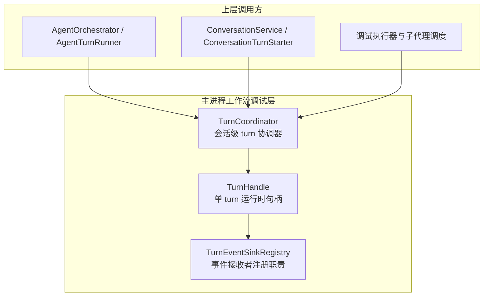
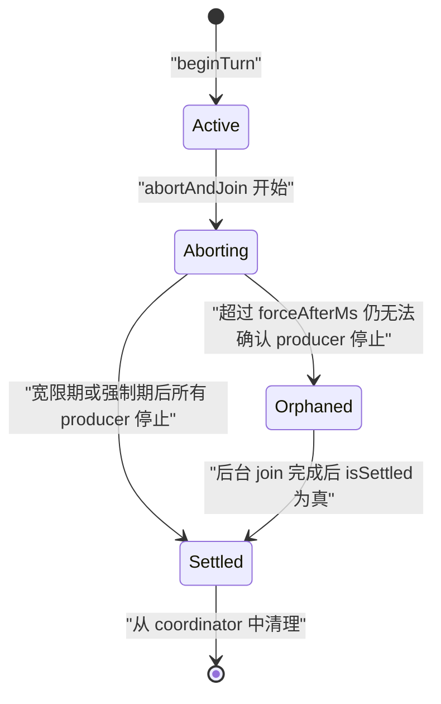
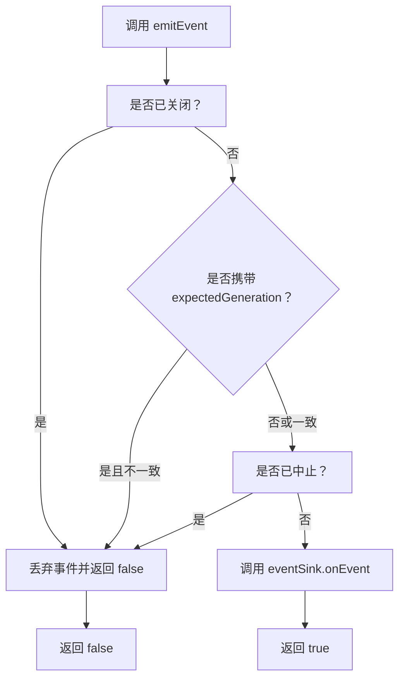
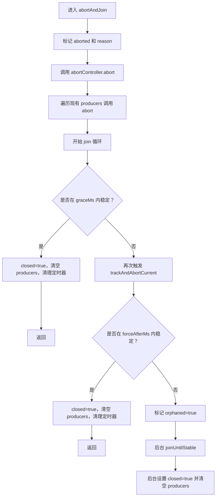
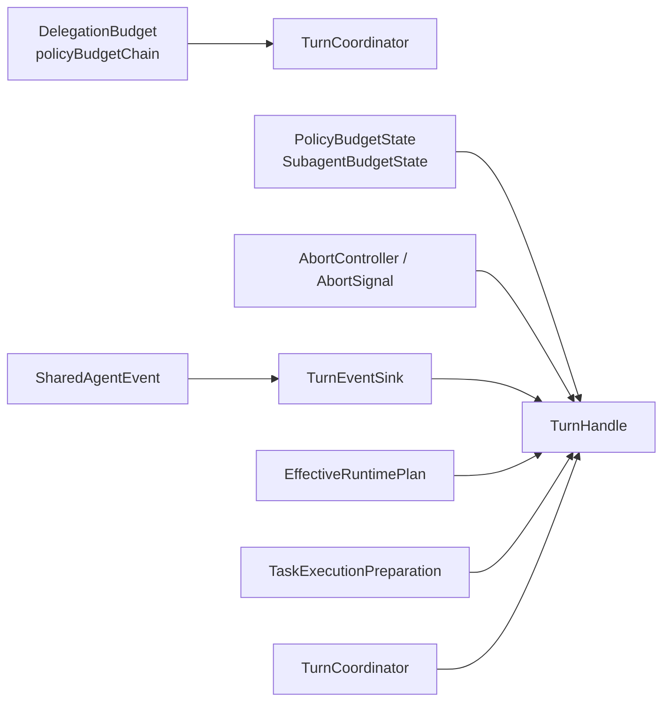

# TurnCoordinator 会话协调器

<cite>
**本文引用的文件**   
- [TurnCoordinator.ts](file://src/main/workflow/debugger/TurnCoordinator.ts)
- [TurnCoordinator.test.ts](file://src/main/workflow/debugger/TurnCoordinator.test.ts)
</cite>

## 目录
1. [引言](#引言)
2. [项目结构定位](#项目结构定位)
3. [核心职责](#核心职责)
4. [架构总览](#架构总览)
5. [关键类型与字段语义](#关键类型与字段语义)
6. [Turn 生命周期状态机](#turn-生命周期状态机)
7. [TurnHandle 详细分析](#turnhandle-详细分析)
8. [TurnCoordinator 行为分析](#turncoordinator-行为分析)
9. [AbortReason 使用场景](#abortreason-使用场景)
10. [TurnCompletionDeclaration 语义](#turncompletiondeclaration-语义)
11. [实际工作流示例](#实际工作流示例)
12. [依赖关系分析](#依赖关系分析)
13. [性能与资源特性](#性能与资源特性)
14. [故障排查指南](#故障排查指南)
15. [结论](#结论)

## 引言
TurnCoordinator 是工作流调试层中按会话管理 turn handle 的核心协调器。它的两个关键职责是：

1. **per-session turn 管理者**：为每个 sessionKey 维护当前活跃 turn，并在替换、结束或取消时处理旧 turn 的终止、孤儿保留和回收。
2. **TurnEventSinkRegistry（第四阶段）**：eventSink 直接挂载到 TurnHandle 上，从而避免在 Orchestrator 侧再维护 activeTurnBySession 这类“双轨”全局可变状态。

通过把 event sink、计划审批、代理槽位键、取消作用域、生成令牌、生产者集合等全部收敛到 TurnHandle，TurnCoordinator 消除了 turn-global mutable state，让 turn 的生命周期由 handle 本身和 coordinator 的 per-session map 共同控制。

**章节来源**
- [TurnCoordinator.ts:1-20](file://src/main/workflow/debugger/TurnCoordinator.ts#L1-L20)

## 项目结构定位
TurnCoordinator 位于主进程工作流调试模块中，属于 agent-turn 运行编排基础设施的一部分。它不直接实现工具调用、模型调用或 UI 渲染，而是提供 turn 生命周期、事件投递门控、取消传播、预算继承和孤儿回收等运行时契约。



**图表来源**
- [TurnCoordinator.ts:1-20](file://src/main/workflow/debugger/TurnCoordinator.ts#L1-L20)
- [TurnCoordinator.ts:520-641](file://src/main/workflow/debugger/TurnCoordinator.ts#L520-L641)

**章节来源**
- [TurnCoordinator.ts:1-20](file://src/main/workflow/debugger/TurnCoordinator.ts#L1-L20)

## 核心职责
TurnCoordinator 的核心职责可以归纳为以下五个方面：

| 职责 | 说明 |
|---|---|
| 会话隔离 | 每个 sessionKey 最多一个活跃 TurnHandle；新 beginTurn 会替换旧活跃 turn。 |
| 事件注册 | 将 TurnEventSink 挂到 TurnHandle，由 handle 决定是否投递事件。 |
| 取消传播 | 支持父 AbortSignal、超时、用户停止、分支切换、策略撤销等取消原因。 |
| 孤儿回收 | 当 abortAndJoin 无法在宽限期内确认所有 producer 停止时，进入 Orphaned 状态并延迟清理。 |
| 生成令牌守卫 | 通过 generation 阻止已中止或已被替换的 turn 继续写入事件。 |

**章节来源**
- [TurnCoordinator.ts:520-641](file://src/main/workflow/debugger/TurnCoordinator.ts#L520-L641)
- [TurnCoordinator.ts:283-519](file://src/main/workflow/debugger/TurnCoordinator.ts#L283-L519)

## 架构总览
TurnCoordinator 与 TurnHandle 的关系是一个“协调器 + 句柄”的结构：

- TurnCoordinator 持有 per-session 的活跃表 orphanedBySession 和 orphanded 表。
- TurnHandle 持有单个 turn 的全部可变运行时状态，包括事件 sink、计划审批、代理槽位键、生产者集合、取消控制器、预算状态和完成声明。
- 事件不会绕过 TurnHandle 直接写回上层；上层必须通过 TurnHandle.emitEvent 或 TurnEventSink.onEvent 访问。

```mermaid
classDiagram
    class TurnCoordinator {
        -activeBySession : Map~string, TurnHandle~
        -orphanedBySession : Map~string, TurnHandle~
        -generationSeq : number
        +getActive(sessionKey) TurnHandle | null
        +getOrphaned(sessionKey) TurnHandle | null
        +beginTurn(input) Promise~TurnHandle~
        +endTurn(handle) void
        +abortSession(sessionKey, reason) Promise~void~
        +abortAll(reason) Promise~void~
        -retainOrphan(handle) void
    }

    class TurnHandle {
        +sessionKey : string
        +turnId : string
        +runId : string | null
        +generation : number
        +startedAt : number
        +abortController : AbortController
        +subagentBudget : SubagentBudgetState
        +policyBudget : PolicyBudgetState
        +runtimePlan : EffectiveRuntimePlan | null
        +taskPreparation : TaskExecutionPreparation | null
        +completionDeclaration : TurnCompletionDeclaration | null
        +eventSink : TurnEventSink | null
        +deferredActivation : TurnDeferredActivation | null
        +pendingHandoff : PendingHandoff | null
        +approvedPlan : PlanApproval | null
        +agentSlotKey : string | null
        +signal : AbortSignal
        +isAborted : boolean
        +reason : AbortReason | null
        +isOrphaned : boolean
        +isSettled : boolean
        +whenSettled() Promise~void~
        +emitEvent(event, expectedGeneration) boolean
        +registerProducer(producer) () => void
        +abortAndJoin(options) Promise~void~
        +close() void
    }

    class TurnEventSink {
        <<interface>>
        +onEvent(event) void
        +sessionId : string | null
        +requestId : string | null
        +projectRootPath : string | null
        +projectId : string | null
        +agentId : AgentRole
    }

    class TurnCompletionDeclaration {
        <<interface>>
        +disposition : completed | partial | blocked | cancelled | budget_paused
        +evidenceRefs : { uri, hash }[]
        +result : ResultObject | undefined
    }

    TurnCoordinator --> TurnHandle : "创建、替换、保留、回收"
    TurnHandle --> TurnEventSink : "事件投递"
    TurnHandle --> TurnCompletionDeclaration : "结构化完成声明"
```

**图表来源**
- [TurnCoordinator.ts:283-519](file://src/main/workflow/debugger/TurnCoordinator.ts#L283-L519)
- [TurnCoordinator.ts:520-641](file://src/main/workflow/debugger/TurnCoordinator.ts#L520-L641)

## 关键类型与字段语义

### AbortReason
AbortReason 表示 turn 被中止的原因，不同原因对应不同上层语义：

| 原因 | 含义 | 典型触发点 |
|---|---|---|
| `user_stop` | 用户主动停止 turn | 用户点击停止按钮 |
| `branch_switch` | 对话分支切换导致旧 turn 失效 | 切换到新分支 |
| `edit_resend` | 编辑并重发导致旧 turn 被替换 | beginTurn 替换旧 turn |
| `app_shutdown` | 应用关闭 | 退出或重启流程 |
| `timeout` | turn 墙钟时间耗尽 | policyBudget 超时计时器 |
| `policy_revoke` | 策略撤销导致 turn 不可继续 | 权限或策略变更 |
| `parent_abort` | 父取消信号触发 | parentSignal 中止 |
| `unknown` | 未明确指定原因 | 兜底原因 |

**章节来源**
- [TurnCoordinator.ts:17-23](file://src/main/workflow/debugger/TurnCoordinator.ts#L17-L23)
- [TurnCoordinator.ts:300-350](file://src/main/workflow/debugger/TurnCoordinator.ts#L300-L350)
- [TurnCoordinator.ts:560-641](file://src/main/workflow/debugger/TurnCoordinator.ts#L560-L641)

### TurnEventSink
TurnEventSink 是 turn 的事件接收者接口，包含可选的 onEvent 回调和上下文标识：

| 字段 | 语义 |
|---|---|
| `onEvent` | 接收 SharedAgentEvent |
| `sessionId` | 关联会话标识 |
| `requestId` | 关联请求标识 |
| `projectRootPath` | 项目根路径 |
| `projectId` | 项目标识 |
| `agentId` | 当前 agent 角色 |

eventSink 挂在 TurnHandle 上后，只有 TurnHandle.isLive 检查通过才会投递事件，从而实现 per-turn 的事件门控。

**章节来源**
- [TurnCoordinator.ts:25-36](file://src/main/workflow/debugger/TurnCoordinator.ts#L25-L36)
- [TurnCoordinator.ts:387-400](file://src/main/workflow/debugger/TurnCoordinator.ts#L387-L400)

### TurnHandle 关键字段
TurnHandle 是单个 turn 的运行时载体，关键字段如下：

| 字段 | 类型 | 作用 |
|---|---|---|
| `eventSink` | TurnEventSink \| null | 事件输出目标 |
| `deferredActivation` | TurnDeferredActivation \| null | 延迟激活信息，包含 slotKey 和全部 tool 定义 |
| `pendingHandoff` | PendingHandoff \| null | 待处理的 plan handoff 元数据 |
| `approvedPlan` | PlanApproval \| null | 同 turn 计划门控，要求 Mission execute 匹配 hash 和目标 |
| `agentSlotKey` | string \| null | agent 槽位键，用于代理调度与槽位分配 |
| `abortController.signal` | AbortSignal | 取消信号，供工具、子代理等消费 |
| `generation` | number | 会话轮次生成令牌，用于丢弃晚到事件 |
| `producers` | Map~string, TurnProducer~ | 本 turn 注册的异步生产者 |
| `subagentBudget` | SubagentBudgetState | 子代理预算状态 |
| `policyBudget` | PolicyBudgetState | 策略预算状态，包含 wall time、toolCalls、subagents 等 |
| `completionDeclaration` | TurnCompletionDeclaration \| null | 结构化完成声明，仅在 turn_complete 时填充 |

**章节来源**
- [TurnCoordinator.ts:38-100](file://src/main/workflow/debugger/TurnCoordinator.ts#L38-L100)
- [TurnCoordinator.ts:283-386](file://src/main/workflow/debugger/TurnCoordinator.ts#L283-L386)

## Turn 生命周期状态机
Turn 的生命周期不是简单线性状态机，而是由 TurnHandle 的布尔属性与 TurnCoordinator 的 per-session 映射共同描述。其核心语义如下：



### 转换条件

| 状态 | 进入条件 | 离开条件 |
|---|---|---|
| Active | beginTurn 成功创建 TurnHandle，并放入 activeBySession | 被 endTurn、abortAndJoin、或被新 turn 替换 |
| Aborting | abortAndJoin 设置 aborted=true，调用 abortController.abort，并遍历 producers 调用 abort | 所有已知 producer.join 稳定结束 |
| Orphaned | abortAndJoin 超过 graceMs 和 forceAfterMs，仍未确认所有 producer 停止 | whenSettled 后台 joinUntilStable 完成，closed=true |
| Settled | closed=true 且 producers.size===0 | 从 activeBySession 或 orphanedBySession 清理 |

注意：

- `isAborted` 表示 turn 已被中止，但可能仍处于 Aborting 或 Orphaned。
- `isOrphaned` 表示曾尝试优雅停止但未能确认所有 producer 停止。
- `isSettled` 表示 handle 已完成 join 清理，可安全从 coordinator 移除。
- `isLive(generation)` 同时检查 closed、generation 和 aborted，用于防止旧 turn 投递事件。

**图表来源**
- [TurnCoordinator.ts:300-519](file://src/main/workflow/debugger/TurnCoordinator.ts#L300-L519)
- [TurnCoordinator.ts:520-641](file://src/main/workflow/debugger/TurnCoordinator.ts#L520-L641)

**章节来源**
- [TurnCoordinator.ts:300-519](file://src/main/workflow/debugger/TurnCoordinator.ts#L300-L519)
- [TurnCoordinator.ts:520-641](file://src/main/workflow/debugger/TurnCoordinator.ts#L520-L641)

## TurnHandle 详细分析

### 构造与初始化
TurnHandle 构造函数负责：

1. 初始化 sessionKey、turnId、runId、generation、startedAt。
2. 创建 AbortController 作为取消作用域。
3. 初始化 subagentBudget 和 policyBudget。
4. 根据 policyBudget.maxWallTimeMs 启动墙钟超时定时器，超时后以 `timeout` 原因调用 abortAndJoin。
5. 若传入 parentSignal 已中止，则立即标记为 parent_abort；否则监听一次 abort 事件。

这意味着 turn 的取消来源可以是：

- 父取消信号
- 策略墙钟超时
- 用户或上层主动 abortAndJoin
- 被新 turn 替换时由 coordinator 触发 edit_resend

**章节来源**
- [TurnCoordinator.ts:300-386](file://src/main/workflow/debugger/TurnCoordinator.ts#L300-L386)

### 事件投递门控
emitEvent 是 turn 事件写入的关键入口：



**图表来源**
- [TurnCoordinator.ts:387-400](file://src/main/workflow/debugger/TurnCoordinator.ts#L387-L400)

这个设计确保：

- 已关闭 turn 不投递事件。
- 被替换的旧 generation 不投递事件。
- 已中止 turn 不投递事件。
- 晚到事件可通过 expectedGeneration 显式拒绝。

**章节来源**
- [TurnCoordinator.ts:387-400](file://src/main/workflow/debugger/TurnCoordinator.ts#L387-L400)

### 生产者管理与孤儿恢复
registerProducer 允许工具、子代理或其他异步任务向 turn 注册自身：

- 如果 handle 已关闭，producer 会被立即 abort 并 join，但不影响 settle 判断。
- 如果 handle 已中止或未加入，新 producer 也会收到 abort。
- 正常情况下 producer 被记录在 producers Map 中。
- 返回注销函数，用于从 Map 删除 producer。

abortAndJoin 的执行流程如下：



**图表来源**
- [TurnCoordinator.ts:401-519](file://src/main/workflow/debugger/TurnCoordinator.ts#L401-L519)

关键保障：

- graceMs 默认 1500ms，forceAfterMs 默认 5000ms。
- 即使进入 Orphaned，handle 仍保留 ownership，直到后台 join 完成。
- whenSettled 会等待孤儿 producer 最终停止。
- test 用例验证了 late-registered producer 也能被接入 abort 和 join。

**章节来源**
- [TurnCoordinator.ts:401-519](file://src/main/workflow/debugger/TurnCoordinator.ts#L401-L519)
- [TurnCoordinator.test.ts:34-118](file://src/main/workflow/debugger/TurnCoordinator.test.ts#L34-L118)

## TurnCoordinator 行为分析

### beginTurn
beginTurn 是 turn 创建的入口，主要行为：

1. 检查该 session 是否存在尚未 settled 的 orphaned turn；存在则抛出 TURN_ORPHANED。
2. 若 orphaned 已 settled，则清理 orphanedBySession。
3. 若存在 previous active turn，则调用 abortAndJoin(reason=edit_resend)。
4. 如果 previous 变为 orphaned 且未 settled，则 retainOrphan 并抛出 TURN_ORPHANED。
5. 递增 generationSeq。
6. 创建 TurnHandle，注入 eventSink、parentSignal、budgets。
7. 放入 activeBySession。

这保证了同一 session 不会出现并发活跃 turn，也保证旧 turn 有明确的替换原因。

**章节来源**
- [TurnCoordinator.ts:520-599](file://src/main/workflow/debugger/TurnCoordinator.ts#L520-L599)
- [TurnCoordinator.test.ts:21-33](file://src/main/workflow/debugger/TurnCoordinator.test.ts#L21-L33)

### endTurn
endTurn 用于正常结束 turn：

- 如果 handle 是 Orphaned 且未 Settled，则调用 retainOrphan 并 close。
- 否则从 activeBySession 删除并 close。
- close 会清除 wallTimer、eventSink、deferredActivation，并标记 closed。

**章节来源**
- [TurnCoordinator.ts:601-620](file://src/main/workflow/debugger/TurnCoordinator.ts#L601-L620)
- [TurnCoordinator.ts:519-531](file://src/main/workflow/debugger/TurnCoordinator.ts#L519-L531)

### abortSession 与 abortAll
- abortSession：获取当前 active handle，调用 abortAndJoin；若变为 orphaned 且未 settled，则保留孤儿；否则清理 active。
- abortAll：收集所有 active handles，清空 activeBySession，并行 abortAndJoin，并将需要保留的孤儿转入 orphanedBySession。

**章节来源**
- [TurnCoordinator.ts:622-641](file://src/main/workflow/debugger/TurnCoordinator.ts#L622-L641)
- [TurnCoordinator.test.ts:119-138](file://src/main/workflow/debugger/TurnCoordinator.test.ts#L119-L138)

## AbortReason 使用场景

| 场景 | 使用的 AbortReason | 代码位置 |
|---|---|---|
| 用户主动停止 | `user_stop` | 测试用例 abortAndJoin |
| 新 turn 替换旧 turn | `edit_resend` | beginTurn 替换 previous |
| 应用关闭 | `app_shutdown` | abortAll 默认值 |
| turn 超时 | `timeout` | TurnHandle 构造函数墙钟超时 |
| 父信号中止 | `parent_abort` | parentSignal 中止 |
| 未知原因 | `unknown` | registerProducer 关闭时兜底 |

这些原因不仅用于内部状态判断，也暴露给上层以便区分 UI 展示、审计日志和恢复策略。

**章节来源**
- [TurnCoordinator.ts:17-23](file://src/main/workflow/debugger/TurnCoordinator.ts#L17-L23)
- [TurnCoordinator.ts:300-386](file://src/main/workflow/debugger/TurnCoordinator.ts#L300-L386)
- [TurnCoordinator.ts:520-641](file://src/main/workflow/debugger/TurnCoordinator.ts#L520-L641)
- [TurnCoordinator.test.ts:34-138](file://src/main/workflow/debugger/TurnCoordinator.test.ts#L34-L138)

## TurnCompletionDeclaration 语义
TurnCompletionDeclaration 是 turn 的结构化完成声明，仅在 turn_complete 时被填充。它比单纯的成功/失败更丰富，适合用于转录、回放、审计和恢复。

| 字段 | 类型 | 语义 |
|---|---|---|
| `disposition` | `'completed' | 'partial' | 'blocked' | 'cancelled' | 'budget_paused'` | 描述 turn 的最终处置结果 |
| `evidenceRefs` | `{ uri, hash }[]` | 与 turn 相关的证据引用列表，uri 指向资源，hash 用于完整性校验 |
| `result` | ResultObject \| undefined | 可选的 turn 结果对象，包含摘要、输出、反证、未解决项、作用域、副作用和恢复状态 |

ResultObject 中的关键字段语义：

| 字段 | 语义 |
|---|---|
| `summary` | 人类可读的 turn 摘要 |
| `outputs` | 结构化输出键值对 |
| `counterevidence` | 与预期相反的证据字符串数组 |
| `unresolved` | 未完成或未解决的问题字符串数组 |
| `scope` | 本次 turn 的作用域描述 |
| `sideEffects` | 产生的副作用资源字符串数组 |
| `recoveryState` | 可用于恢复后续 turn 的状态字符串数组 |

这种设计允许上层系统在不解析具体工具输出的情况下，仍然获得 turn 的意图、范围和结果摘要。

**章节来源**
- [TurnCoordinator.ts:38-58](file://src/main/workflow/debugger/TurnCoordinator.ts#L38-L58)
- [TurnCoordinator.ts:312-320](file://src/main/workflow/debugger/TurnCoordinator.ts#L312-L320)

## 实际工作流示例

### 创建 turn
典型流程：

1. 调用 `coordinator.beginTurn`，传入 sessionKey、turnId、eventSink。
2. 可选传入 runId、parentSignal、subagentBudget、policyBudget。
3. 返回 TurnHandle。
4. 使用 handle.signal 传递给工具或子代理。
5. 使用 handle.emitEvent 投递事件。

参考路径：

- [TurnCoordinator.ts:520-599](file://src/main/workflow/debugger/TurnCoordinator.ts#L520-L599)
- [TurnCoordinator.test.ts:21-33](file://src/main/workflow/debugger/TurnCoordinator.test.ts#L21-L33)

### 推进 turn
典型流程：

1. 在 turn 执行过程中注册 producer：`handle.registerProducer`。
2. 通过 eventSink 或 handle.emitEvent 输出事件。
3. 在 turn_complete 时填充 completionDeclaration。
4. 正常结束时调用 `coordinator.endTurn(handle)`。

参考路径：

- [TurnCoordinator.ts:387-400](file://src/main/workflow/debugger/TurnCoordinator.ts#L387-L400)
- [TurnCoordinator.ts:601-620](file://src/main/workflow/debugger/TurnCoordinator.ts#L601-L620)

### 取消 turn
典型流程：

1. 调用 `handle.abortAndJoin`，传入 reason、graceMs、forceAfterMs。
2. coordinator 会中止所有 producers。
3. 若在宽限期内稳定，直接关闭。
4. 若超过强制期限，进入 Orphaned，后台继续 join。
5. 调用 `handle.whenSettled` 等待完全回收。

参考路径：

- [TurnCoordinator.ts:401-519](file://src/main/workflow/debugger/TurnCoordinator.ts#L401-L519)
- [TurnCoordinator.test.ts:34-118](file://src/main/workflow/debugger/TurnCoordinator.test.ts#L34-L118)

### 回收 turn
典型流程：

1. 如果是 Orphaned 且未 Settled，coordinator 保留孤儿。
2. 当 background join 完成后，isSettled 为真。
3. 新 beginTurn 前会检查 orphanedBySession，阻塞尚未 settled 的孤儿。
4. 孤儿 settle 后自动从 orphanedBySession 清理。

参考路径：

- [TurnCoordinator.ts:520-599](file://src/main/workflow/debugger/TurnCoordinator.ts#L520-L599)
- [TurnCoordinator.ts:601-641](file://src/main/workflow/debugger/TurnCoordinator.ts#L601-L641)
- [TurnCoordinator.test.ts:119-138](file://src/main/workflow/debugger/TurnCoordinator.test.ts#L119-L138)

## 依赖关系分析



**图表来源**
- [TurnCoordinator.ts:1-20](file://src/main/workflow/debugger/TurnCoordinator.ts#L1-L20)
- [TurnCoordinator.ts:283-519](file://src/main/workflow/debugger/TurnCoordinator.ts#L283-L519)

依赖要点：

- TurnCoordinator 依赖 DelegationBudget 提供的 policyBudgetChain。
- TurnHandle 依赖 AbortController/AbortSignal 实现取消作用域。
- TurnEventSink 是外部事件通道，不耦合具体 UI 或 trace 实现。
- TurnHandle 承载 EffectiveRuntimePlan 和 TaskExecutionPreparation，但由上层装配，TurnCoordinator 不直接修改它们。

**章节来源**
- [TurnCoordinator.ts:1-20](file://src/main/workflow/debugger/TurnCoordinator.ts#L1-L20)
- [TurnCoordinator.ts:283-519](file://src/main/workflow/debugger/TurnCoordinator.ts#L283-L519)

## 性能与资源特性

| 特性 | 行为 | 影响 |
|---|---|---|
| 生成令牌 | generation 随 beginTurn 递增 | 避免旧 turn 投递晚到事件 |
| 生产者聚合 join | Promise.allSettled 并行 join | 缩短 cancel 延迟 |
| 孤儿后台回收 | orphaned 状态下 continue join | 避免阻塞上层 beginTurn |
| 墙钟超时 | setTimeout 触发 timeout | 防止无限长 turn |
| 预算原子检查 | reserveDispatchBudget 先检查再累加 | 避免部分更新导致的预算不一致 |
| 子代理墙钟统计 | 只统计 active children 的时间 | 避免父 idle 时间污染子代理预算 |

这些机制共同保证 turn 取消快速、资源可回收、事件有序、预算可审计。

**章节来源**
- [TurnCoordinator.ts:100-200](file://src/main/workflow/debugger/TurnCoordinator.ts#L100-L200)
- [TurnCoordinator.ts:300-519](file://src/main/workflow/debugger/TurnCoordinator.ts#L300-L519)

## 故障排查指南

### 常见问题

| 现象 | 可能原因 | 排查建议 |
|---|---|---|
| beginTurn 抛出 TURN_ORPHANED | 上一轮 turn 的 producer 未 join 完成 | 检查 producer.join 是否 resolve，或增加 graceMs/forceAfterMs |
| 事件丢失 | 使用了错误的 generation，或 turn 已关闭 | 确认 emitEvent 传入 expectedGeneration |
| turn 一直未 settle | 某个 producer.join 永不完成 | 检查 registerProducer 返回的注销函数是否被调用 |
| turn 提前超时 | policyBudget.maxWallTimeMs 过小 | 调整策略预算或父级 wallStartedAt |
| 新 turn 替换旧 turn 后仍有事件 | 旧 handle 仍在向外写事件 | 确保所有组件消费 handle.signal 并通过 emitEvent 写事件 |

### 推荐调试步骤

1. 打印 handle.turnId、generation、isAborted、isOrphaned、isSettled。
2. 检查 abortAndJoin 的 reason 是否符合预期。
3. 检查是否有未注销的 producer。
4. 检查 eventSink.onEvent 是否被多次注册或跨 turn 复用。
5. 检查 completionDeclaration 是否仅在 turn_complete 时设置。

**章节来源**
- [TurnCoordinator.test.ts:34-138](file://src/main/workflow/debugger/TurnCoordinator.test.ts#L34-L138)
- [TurnCoordinator.ts:387-519](file://src/main/workflow/debugger/TurnCoordinator.ts#L387-L519)

## 结论
TurnCoordinator 通过 per-session 的 activeBySession 和 orphanedBySession 表，结合 TurnHandle 的 generation、producers、abortController 和 budget 状态，实现了 turn 生命周期的确定性管理。它不再依赖 turn-global mutable state，而是把事件 sink、计划审批、代理槽位、取消作用域、生产者和完成声明全部收敛到 TurnHandle。

其价值在于：

- 明确区分 Active、Aborting、Orphaned、Settled 四种生命周期语义。
- 用 generation token 防止事件穿越被替换的 turn。
- 用 producer join 机制保证异步资源可回收。
- 用 TurnCompletionDeclaration 表达 turn 的结构化完成语义。
- 用 AbortReason 统一表达用户操作、系统行为和策略约束引起的中止原因。

对于上层调用方来说，最安全的模式是：始终通过 TurnHandle 写事件，始终消费 handle.signal，始终在 turn_complete 或取消路径中处理 completionDeclaration，并最终等待 whenSettled 或 endTurn 完成回收。