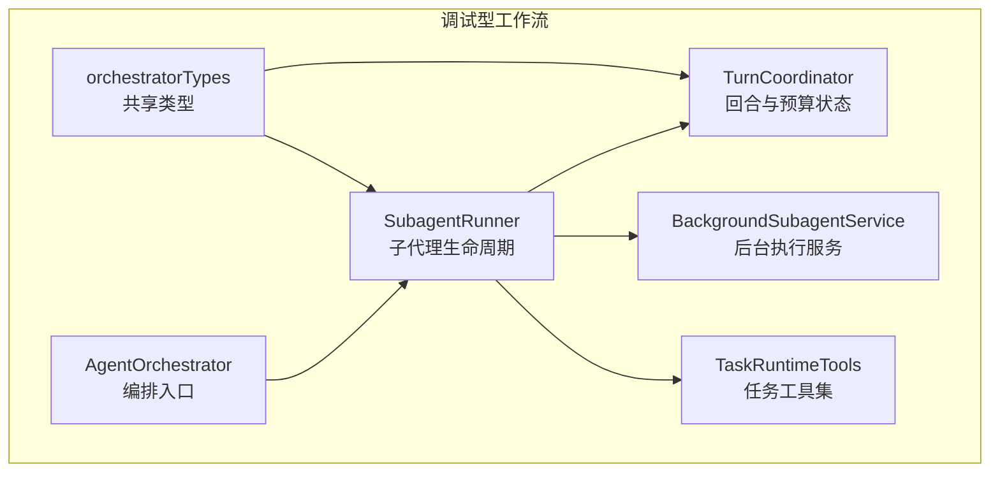
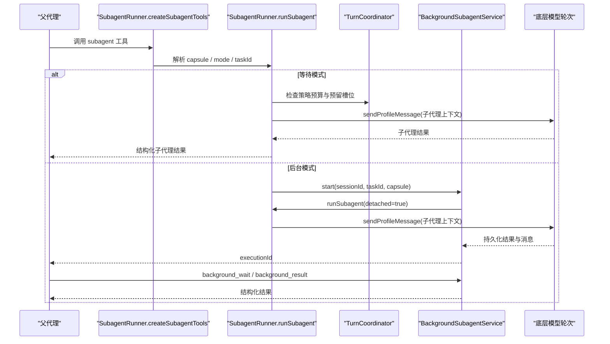
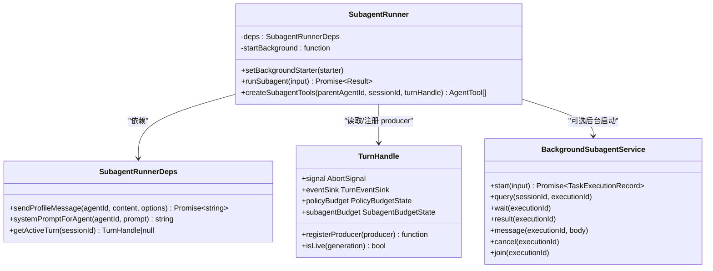
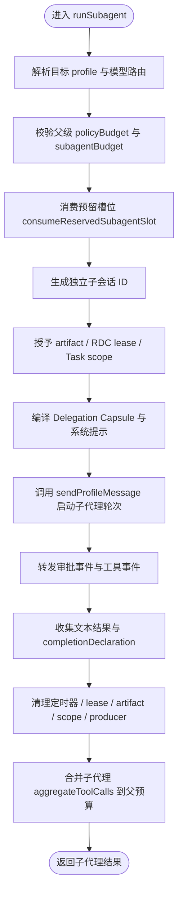
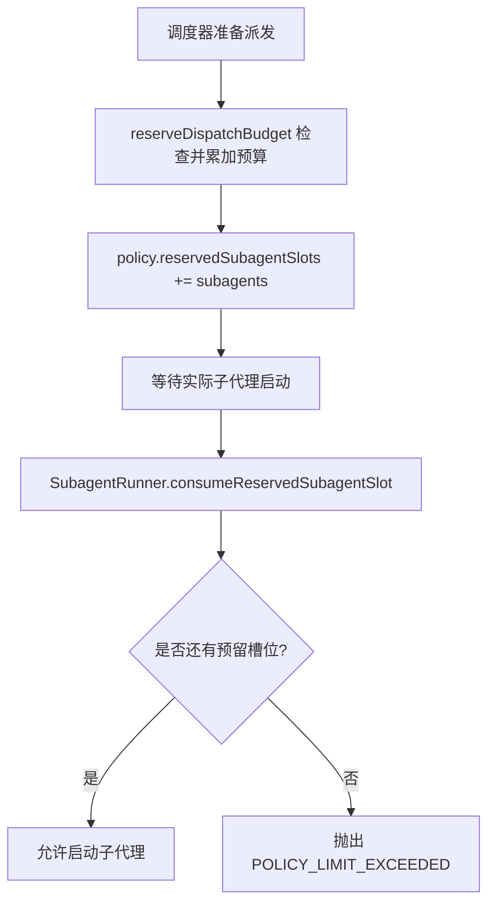
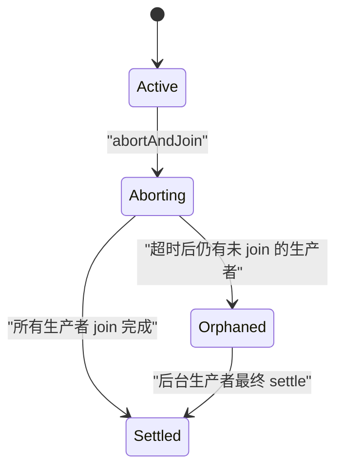
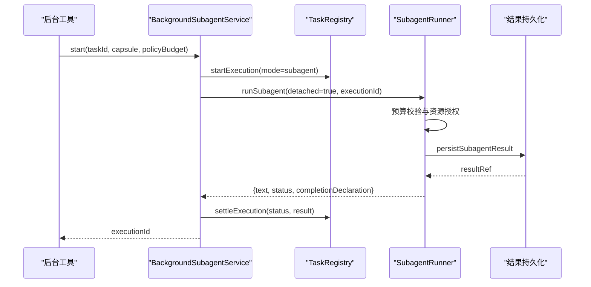
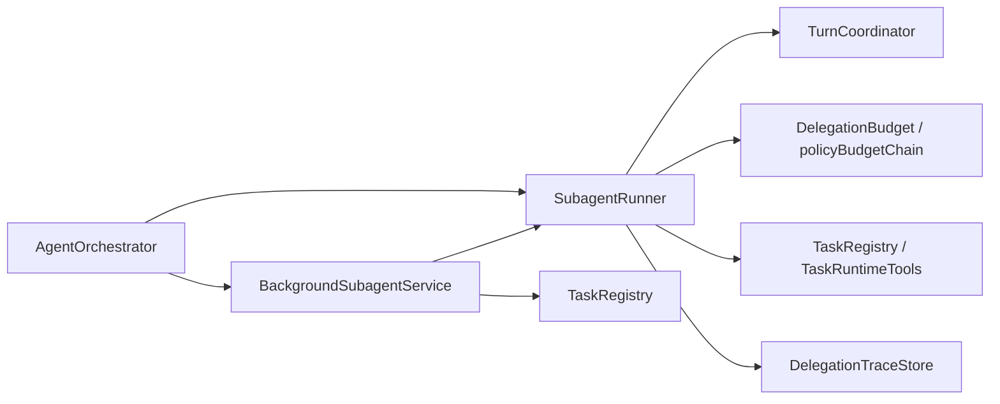

# 子代理编排器

<cite>
**本文引用的文件**   
- [SubagentRunner.ts](file://src/main/workflow/debugger/SubagentRunner.ts)
- [TurnCoordinator.ts](file://src/main/workflow/debugger/TurnCoordinator.ts)
- [BackgroundSubagentService.ts](file://src/main/workflow/debugger/BackgroundSubagentService.ts)
- [TaskRuntimeTools.ts](file://src/main/workflow/debugger/TaskRuntimeTools.ts)
- [orchestratorTypes.ts](file://src/main/workflow/debugger/orchestratorTypes.ts)
- [AgentOrchestrator.ts](file://src/main/workflow/debugger/AgentOrchestrator.ts)
</cite>

## 目录
1. [引言](#引言)
2. [项目结构](#项目结构)
3. [核心组件](#核心组件)
4. [架构总览](#架构总览)
5. [详细组件分析](#详细组件分析)
6. [依赖关系分析](#依赖关系分析)
7. [性能与预算特性](#性能与预算特性)
8. [故障排查指南](#故障排查指南)
9. [结论](#结论)
10. [附录：使用示例与最佳实践](#附录使用示例与最佳实践)

## 引言
本文聚焦 `SubagentRunner`，解释其如何在父代理下创建、委派和回收子代理执行，如何把子代理结果回传给父代理或任务系统，以及它与 `TurnCoordinator` 的预算链、预留槽位机制如何协作。文档同时说明 `createSubagentTools` 暴露给模型的工具接口，以及后台 `background tools` 的生命周期管理方式，帮助读者理解“等待模式”和“后台模式”两条路径的完整执行流。

## 项目结构
围绕子代理编排的关键代码位于主进程工作流的 debugger 模块中：

**图表来源**
- [AgentOrchestrator.ts:84-107](file://src/main/workflow/debugger/AgentOrchestrator.ts#L84-L107)
- [SubagentRunner.ts:73-81](file://src/main/workflow/debugger/SubagentRunner.ts#L73-L81)
- [TurnCoordinator.ts:1-20](file://src/main/workflow/debugger/TurnCoordinator.ts#L1-L20)
- [BackgroundSubagentService.ts:36-40](file://src/main/workflow/debugger/BackgroundSubagentService.ts#L36-L40)
- [TaskRuntimeTools.ts:1-10](file://src/main/workflow/debugger/TaskRuntimeTools.ts#L1-L10)
- [orchestratorTypes.ts:1-20](file://src/main/workflow/debugger/orchestratorTypes.ts#L1-L20)

**章节来源**
- [AgentOrchestrator.ts:84-107](file://src/main/workflow/debugger/AgentOrchestrator.ts#L84-L107)
- [SubagentRunner.ts:73-81](file://src/main/workflow/debugger/SubagentRunner.ts#L73-L81)

## 核心组件
- `SubagentRunner`：负责解析目标代理配置、构建子代理会话上下文、启动子代理轮次、处理取消、聚合结果并更新父级预算。它还对外暴露 `subagent` 工具，供父代理调用以委派子任务。
- `TurnCoordinator`：维护会话级 `TurnHandle`、事件投递、生产者注册、超时中止、孤儿清理，以及策略预算状态和子代理预算状态。
- `BackgroundSubagentService`：将 `SubagentRunner.runSubagent` 包装成可持久化、可查询、可等待、可消息交互、可取消的后台执行服务。
- `TaskRuntimeTools`：为当前轮次提供任务工具集合，包括子代理向父任务报告进度的专用工具。
- `orchestratorTypes`：定义 `AgentProfileTurnOptions`、`ToolExecutorRuntimeContext` 等跨层共享类型，其中包含策略预算、子代理预算和事件回调字段。

**章节来源**
- [SubagentRunner.ts:73-118](file://src/main/workflow/debugger/SubagentRunner.ts#L73-L118)
- [TurnCoordinator.ts:1-200](file://src/main/workflow/debugger/TurnCoordinator.ts#L1-L200)
- [BackgroundSubagentService.ts:36-40](file://src/main/workflow/debugger/BackgroundSubagentService.ts#L36-L40)
- [TaskRuntimeTools.ts:1-30](file://src/main/workflow/debugger/TaskRuntimeTools.ts#L1-L30)
- [orchestratorTypes.ts:60-130](file://src/main/workflow/debugger/orchestratorTypes.ts#L60-L130)

## 架构总览
子代理编排的整体流程分为三层：

1. **工具层**：父代理通过 `createSubagentTools` 获取名为 `subagent` 的工具；若需要长期运行，则使用后台工具集（如 `background_query`、`background_wait`）。
2. **执行层**：`SubagentRunner` 校验代理配置、预算、授权、任务作用域，然后调用底层 `sendProfileMessage` 启动一个隔离的子代理轮次。
3. **协调层**：`TurnCoordinator` 提供回合句柄、事件 sink、生产者管理和预算链；`BackgroundSubagentService` 提供持久化执行记录、消息信箱和结果归档。

**图表来源**
- [SubagentRunner.ts:381-470](file://src/main/workflow/debugger/SubagentRunner.ts#L381-L470)
- [SubagentRunner.ts:486-652](file://src/main/workflow/debugger/SubagentRunner.ts#L486-L652)
- [BackgroundSubagentService.ts:421-439](file://src/main/workflow/debugger/BackgroundSubagentService.ts#L421-L439)
- [TurnCoordinator.ts:1-120](file://src/main/workflow/debugger/TurnCoordinator.ts#L1-L120)

## 详细组件分析

### SubagentRunner：子代理生命周期与工具装配
`SubagentRunner` 是子代理编排的核心类。它接收 `sendProfileMessage`、`systemPromptForAgent`、`getActiveTurn` 等依赖，并可选注入后台启动函数。

#### 关键职责
- **代理与模型路由校验**：根据 `targetProfile` 查找可用 profile，若无配置路由且未显式传入 `model`，直接失败。
- **预算前置检查**：从父级 `policyBudget` 和 `subagentBudget` 推导子级预算，并调用 `consumeReservedSubagentSlot` 消费预留槽位。
- **会话隔离**：构造独立的 `subagentSessionId`，避免污染父会话持久化数据。
- **能力授权**：按需授予 RDC lease、artifact 访问和 Task scope。
- **事件透传与追踪**：通过 `delegationTraceStore` 记录父子委托链路，并把审批事件透传给父级。
- **资源清理**：在 finally 中释放 deadline 定时器、RDC lease、artifact 访问、Task scope、producer 注册和父信号监听。

**图表来源**
- [SubagentRunner.ts:73-118](file://src/main/workflow/debugger/SubagentRunner.ts#L73-L118)
- [SubagentRunner.ts:381-652](file://src/main/workflow/debugger/SubagentRunner.ts#L381-L652)
- [BackgroundSubagentService.ts:36-40](file://src/main/workflow/debugger/BackgroundSubagentService.ts#L36-L40)
- [TurnCoordinator.ts:201-360](file://src/main/workflow/debugger/TurnCoordinator.ts#L201-L360)

#### 子代理启动流程
`runSubagent` 的主要步骤如下：

**图表来源**
- [SubagentRunner.ts:82-200](file://src/main/workflow/debugger/SubagentRunner.ts#L82-L200)
- [SubagentRunner.ts:201-380](file://src/main/workflow/debugger/SubagentRunner.ts#L201-L380)

**章节来源**
- [SubagentRunner.ts:82-380](file://src/main/workflow/debugger/SubagentRunner.ts#L82-L380)

#### createSubagentTools：父代理可调用的子代理工具
`createSubagentTools` 返回一个 `AgentTool`，名称为 `subagent`。该工具的职责是把模型生成的参数解析为 `DelegationCapsule`，并在两种模式下分发：

| 模式 | 行为 | 返回值 |
|---|---|---|
| `wait` | 立即调用 `runSubagent`，阻塞等待子代理完成 | 结构化结果对象，包含 `subagentId`、`profile`、`status`、可选 `executionId` |
| `background` | 要求 `taskId`、`ownerSessionId` 和已注入的后台启动函数；调用 `startBackground` | 立即返回 `executionId`，后续通过后台工具查询结果 |

工具还会：
- 校验 `profileDelegates`，禁止模型选择未被冻结授权的代理。
- 校验 Task 作用域：如果存在父 Task 范围，子任务必须是该根任务的后代。
- 绑定 Task 执行记录时继承父执行预算边界，并把 `reservedSubagentSlots` 重置为零，因为后台执行由 TaskRegistry 重新计算预算。

**章节来源**
- [SubagentRunner.ts:381-470](file://src/main/workflow/debugger/SubagentRunner.ts#L381-L470)
- [SubagentRunner.ts:486-652](file://src/main/workflow/debugger/SubagentRunner.ts#L486-L652)

### TurnCoordinator：回合、生产者与预算链
`TurnCoordinator` 提供两个重要抽象：

1. **TurnHandle**：封装一次轮次的中止信号、事件 sink、生产者注册、生命周期状态和孤儿清理。
2. **PolicyBudgetState / SubagentBudgetState**：分别表示顶层策略预算和子代理树预算。

#### reservedSubagentSlots 的预留与消费
预算链中的预留机制用于防止并发调度器承诺超过上限的子代理数量：

1. 调度器调用 `reserveDispatchBudget(policy, { toolCalls, subagents })`。
2. 该方法遍历预算链，先检查所有上限，再统一累加计数器，并增加 `reservedSubagentSlots`。
3. `SubagentRunner.runSubagent` 调用 `consumeReservedSubagentSlot(policyBudget)`。
4. 只有当预留槽位大于零时才允许真正启动子代理；否则抛出策略超限错误。

**图表来源**
- [TurnCoordinator.ts:60-120](file://src/main/workflow/debugger/TurnCoordinator.ts#L60-L120)
- [SubagentRunner.ts:140-170](file://src/main/workflow/debugger/SubagentRunner.ts#L140-L170)

#### 生产者注册与取消传播
`TurnHandle.registerProducer` 允许子代理、后台执行等异步操作注册为“生产者”。当轮次被中止时：
- 立即对所有已知 producer 调用 `abort(reason)`。
- 使用 `graceMs` 和 `forceAfterMs` 两阶段等待 join。
- 若仍有未 settle 的生产者，进入 orphaned 状态并延迟清理。

**图表来源**
- [TurnCoordinator.ts:201-360](file://src/main/workflow/debugger/TurnCoordinator.ts#L201-L360)

**章节来源**
- [TurnCoordinator.ts:1-200](file://src/main/workflow/debugger/TurnCoordinator.ts#L1-L200)
- [TurnCoordinator.ts:201-641](file://src/main/workflow/debugger/TurnCoordinator.ts#L201-L641)

### BackgroundSubagentService：后台工具与持久化执行
`BackgroundSubagentService` 把 `SubagentRunner.runSubagent` 包装成可持久化的后台任务。它维护：
- 活跃执行映射 `live`。
- 每个 session 对应的 `TaskRegistry`。
- 执行与 trace owner 映射。
- 就绪锁，确保中断执行的恢复 reconcile 完成后才接受新任务。

#### 后台工具集
后台服务暴露以下工具：

| 工具名 | 用途 | 关键行为 |
|---|---|---|
| `background_query` | 查询执行状态 | 返回投影后的执行信息 |
| `background_wait` | 事件驱动等待执行完成 | 支持父轮次中止信号 |
| `background_result` | 读取结构化结果与消息游标 | 返回 `result` 与 `mailbox` |
| `background_message` | 向执行信箱追加消息 | 限制长度，不修改已冻结 prompt |
| `background_cancel` | 取消并 join 执行 | 通过 TaskRegistry 取消任务 |
| `background_join` | join 执行但不取消 | 返回最终状态投影 |

#### 与 SubagentRunner 的集成
工厂函数 `createBackgroundSubagentService` 将 `runSubagent` 包装为后台执行入口，并设置：
- `detached = true`：后台进度不属于同步回复延续。
- `childSessionId = sessionId::subagent::executionId`：保持会话隔离。
- `beforeProviderRequestMessages`：拉取待确认的子消息和子子代理消息。
- `onProviderRequestCommitted`：绑定执行计划引用。

**图表来源**
- [BackgroundSubagentService.ts:80-160](file://src/main/workflow/debugger/BackgroundSubagentService.ts#L80-L160)
- [BackgroundSubagentService.ts:201-405](file://src/main/workflow/debugger/BackgroundSubagentService.ts#L201-L405)
- [BackgroundSubagentService.ts:421-439](file://src/main/workflow/debugger/BackgroundSubagentService.ts#L421-L439)
- [SubagentRunner.ts:486-652](file://src/main/workflow/debugger/SubagentRunner.ts#L486-L652)

**章节来源**
- [BackgroundSubagentService.ts:36-200](file://src/main/workflow/debugger/BackgroundSubagentService.ts#L36-L200)
- [BackgroundSubagentService.ts:201-439](file://src/main/workflow/debugger/BackgroundSubagentService.ts#L201-L439)

### TaskRuntimeTools：任务上下文与子代理报告
`createTaskRuntimeTools` 在当前轮次上下文中创建任务工具集。它会根据是否有 delegated task scope、是否是子代理会话决定使用哪种任务 store，并注册 `task.created`、`task.updated` 事件。

特别地，当存在 delegated execution scope 时，会追加 `subagent_report` 工具，允许子代理向父任务发送 `progress`、`blocked`、`decision_required` 三类消息。这些消息会被持久化并通过 `appendExecutionMessage` 写入执行信箱，随后由后台服务或父轮次的前置消息钩子拉取。

**章节来源**
- [TaskRuntimeTools.ts:1-104](file://src/main/workflow/debugger/TaskRuntimeTools.ts#L1-L104)

## 依赖关系分析

**图表来源**
- [AgentOrchestrator.ts:84-107](file://src/main/workflow/debugger/AgentOrchestrator.ts#L84-L107)
- [SubagentRunner.ts:1-60](file://src/main/workflow/debugger/SubagentRunner.ts#L1-L60)
- [BackgroundSubagentService.ts:1-35](file://src/main/workflow/debugger/BackgroundSubagentService.ts#L1-L35)

### 耦合与内聚
- `SubagentRunner` 与 `TurnCoordinator` 高内聚：两者共同实现轮次预算、子代理预算、生产者中止和事件投递。
- `SubagentRunner` 与 `BackgroundSubagentService` 低耦合：后者通过 `setBackgroundStarter` 注入后台启动能力，便于测试和替换。
- `TaskRuntimeTools` 不直接依赖 `SubagentRunner`，但通过 `TurnHandle` 和 `policyBudget` 间接参与预算链。

**章节来源**
- [SubagentRunner.ts:1-118](file://src/main/workflow/debugger/SubagentRunner.ts#L1-L118)
- [BackgroundSubagentService.ts:36-80](file://src/main/workflow/debugger/BackgroundSubagentService.ts#L36-L80)
- [TaskRuntimeTools.ts:1-30](file://src/main/workflow/debugger/TaskRuntimeTools.ts#L1-L30)

## 性能与预算特性
- **子代理深度限制**：`assertSubagentBudgetAllowsChild` 检查 `maxDepth`、`maxChildren`、`maxAggregateToolCalls` 和 `maxAggregateWallMs`。
- **时间窗口暂停语义**：仅在子代理活动时间内消耗子代理 wall time；父代理在委派间隙不应消耗子代理预算。
- **预留槽位防超发**：`reservedSubagentSlots` 保证并发调度不会承诺超出 `maxSubagents` 的实际执行。
- **墙时保护**：子代理启动时基于 `childPolicyBudget.maxWallTimeMs` 设置 deadline 定时器，避免无限挂起。
- **生产者优雅退出**：`TurnHandle.abortAndJoin` 提供宽限期和强制期，减少孤儿线程。

**章节来源**
- [TurnCoordinator.ts:1-120](file://src/main/workflow/debugger/TurnCoordinator.ts#L1-L120)
- [TurnCoordinator.ts:201-360](file://src/main/workflow/debugger/TurnCoordinator.ts#L201-L360)
- [SubagentRunner.ts:140-200](file://src/main/workflow/debugger/SubagentRunner.ts#L140-L200)

## 故障排查指南

| 现象 | 可能原因 | 排查建议 |
|---|---|---|
| 子代理立即失败并返回 `AGENT_PROFILE_UNAVAILABLE` | 目标 profile 不存在或未启用 | 检查 `effectiveProfiles` 与 `targetProfile` |
| 子代理失败并返回 `MODEL_ROUTE_REQUIRED` | 目标 profile 无模型路由且未传入 `capsule.model` | 在 capsule 中指定 `providerId:modelId` |
| 子代理被拒绝并返回 `POLICY_LIMIT_EXCEEDED` | 达到 `maxChildDepth`、`maxWallTimeMs`、`maxSubagents` 或预留槽位不足 | 检查 `policyBudget`、`subagentBudget` 和 `reservedSubagentSlots` |
| 后台模式报错 `BACKGROUND_REQUIRES_TASK` | 未提供 `taskId`、`ownerSessionId` 或未注入后台启动函数 | 确认父会话、Task 和作用域 |
| 子代理结果无法持久化 | 结果持久化失败 | 查看 envelope 的 `error` 和 `missingRequirements` |
| 子代理长时间不结束 | 生产者未正确 unregister 或轮次 orphaned | 检查 `unregisterProducer`、`releaseTaskScope`、`releaseArtifacts` |
| 子代理无法读取父 artifact | 未声明 `inputArtifactRefs` 或未传递 `parentSessionId` | 在 capsule 中精确列出内容 URI |
| 子代理无法请求 RDC 能力 | 缺少父会话或父轮次 id | 检查 `parentSessionId` 和 `parentTurn.turnId` |

**章节来源**
- [SubagentRunner.ts:82-200](file://src/main/workflow/debugger/SubagentRunner.ts#L82-L200)
- [SubagentRunner.ts:486-652](file://src/main/workflow/debugger/SubagentRunner.ts#L486-L652)
- [BackgroundSubagentService.ts:201-405](file://src/main/workflow/debugger/BackgroundSubagentService.ts#L201-L405)

## 结论
`SubagentRunner` 是父代理与子代理之间的编排中枢：它既负责单次调用的等待模式，也负责与 `BackgroundSubagentService` 协作的后台模式；既负责预算和能力的准入控制，也负责事件、追踪、资源和结果的回收。`TurnCoordinator` 提供的预算链和预留槽位机制确保子代理不会无限扩张，而 `TaskRuntimeTools` 与 `BackgroundSubagentService` 的消息机制让父子代理之间可以安全地交换非指令性数据。

## 附录：使用示例与最佳实践

### 示例一：在父代理中串行委派多个子代理
目标：按顺序执行三个子任务，每个子任务都等待前一个完成。

推荐做法：
- 使用 `createSubagentTools` 获取 `subagent` 工具。
- 对每个子任务构造独立的 `DelegationCapsule`。
- 依次调用 `subagent` 工具，mode 为 `wait`。
- 将上一次子代理的结果作为下一次子代理的输入事实或 artifact 引用。

注意：
- 不要手动提前标记 Task 执行状态，应交由 `SubagentRunner` 或 `BackgroundSubagentService` 结算。
- 如果父轮次预算紧张，应先检查 `policyBudget` 和 `subagentBudget`，避免触发 `POLICY_LIMIT_EXCEEDED`。

参考路径：
- [SubagentRunner.ts:381-470](file://src/main/workflow/debugger/SubagentRunner.ts#L381-L470)
- [SubagentRunner.ts:486-652](file://src/main/workflow/debugger/SubagentRunner.ts#L486-L652)

### 示例二：并行委派多个子代理
目标：同时启动多个独立子任务，最后汇总结果。

推荐做法：
- 使用 `mode=background` 启动多个后台子代理。
- 保存每个任务的 `executionId`。
- 使用 `background_wait` 或 `background_result` 等待各执行完成。
- 在父代理中汇总结构化结果。

注意事项：
- 并发后台执行会消耗 `policyBudget.subagents` 和 `reservedSubagentSlots`。
- 如果父轮次预算不足，调度器应在派发前拒绝，而不是等到子代理启动后才失败。
- 使用 `subagent_report` 工具上报子代理进度，避免频繁轮询。

参考路径：
- [SubagentRunner.ts:456-470](file://src/main/workflow/debugger/SubagentRunner.ts#L456-L470)
- [BackgroundSubagentService.ts:406-439](file://src/main/workflow/debugger/BackgroundSubagentService.ts#L406-L439)
- [TaskRuntimeTools.ts:60-104](file://src/main/workflow/debugger/TaskRuntimeTools.ts#L60-L104)

### 示例三：在 Task 上下文中委派子代理
目标：子代理作为某个 Task 的执行单元，继承父执行预算，并可向父任务报告进度。

推荐做法：
- 在 `subagent` 工具参数中传入 `taskId`。
- 不手动调用 `task_update(in_progress)`，让 `SubagentRunner` 创建并结算执行记录。
- 子代理内部使用 `subagent_report` 上报进度或阻塞原因。
- 父代理通过 `background_result` 或 `background_wait` 获取结构化结果。

参考路径：
- [SubagentRunner.ts:486-652](file://src/main/workflow/debugger/SubagentRunner.ts#L486-L652)
- [TaskRuntimeTools.ts:60-104](file://src/main/workflow/debugger/TaskRuntimeTools.ts#L60-L104)

### 示例四：父代理与子代理的事件与结果回传
目标：父代理接收子代理的审批事件、工具事件和最终结构化结果。

推荐做法：
- 父代理通过 `turnHandle.eventSink.onEvent` 接收子代理事件。
- 子代理调用 `turn_complete` 提交 `completionDeclaration`，包含 `summary`、`outputs`、`counterevidence`、`unresolved`、`scope`、`sideEffects`、`recoveryState`。
- `SubagentRunner` 将 `completionDeclaration` 写入子代理结果 envelope。
- 后台执行中，`BackgroundSubagentService` 会将结果持久化为 artifact，并通过 `background_result` 暴露。

参考路径：
- [SubagentRunner.ts:201-380](file://src/main/workflow/debugger/SubagentRunner.ts#L201-L380)
- [BackgroundSubagentService.ts:201-405](file://src/main/workflow/debugger/BackgroundSubagentService.ts#L201-L405)

### 最佳实践清单
- 始终为子代理设置合理的 `budget.maxToolCalls`、`maxSubagents`、`maxWallTimeMs`。
- 需要跨代理读写的 artifact 必须显式声明 `inputArtifactRefs` 或 fact sourceRef。
- 需要 RDC 能力的子代理必须携带有效的 `parentSessionId` 和 `parentTurn.turnId`。
- 后台子代理应使用 `taskId` 和 `BackgroundSubagentService`，不要自行轮询。
- 子代理不应假设能直接继承父会话的 model override，除非通过 `capsule.model` 显式指定。
- 在父代理中编排多个子代理时，优先使用后台模式，并用 `subagent_report` 汇报进度，避免同步阻塞。

**章节来源**
- [SubagentRunner.ts:381-652](file://src/main/workflow/debugger/SubagentRunner.ts#L381-L652)
- [BackgroundSubagentService.ts:201-439](file://src/main/workflow/debugger/BackgroundSubagentService.ts#L201-L439)
- [TaskRuntimeTools.ts:60-104](file://src/main/workflow/debugger/TaskRuntimeTools.ts#L60-L104)