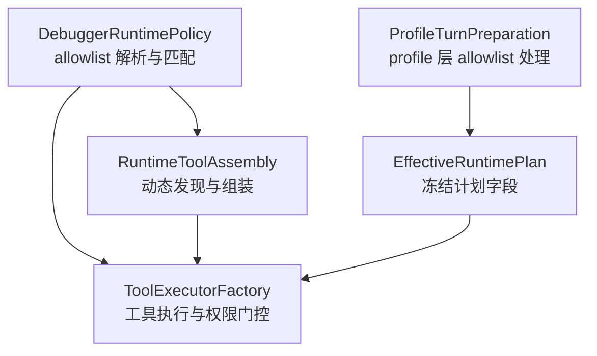
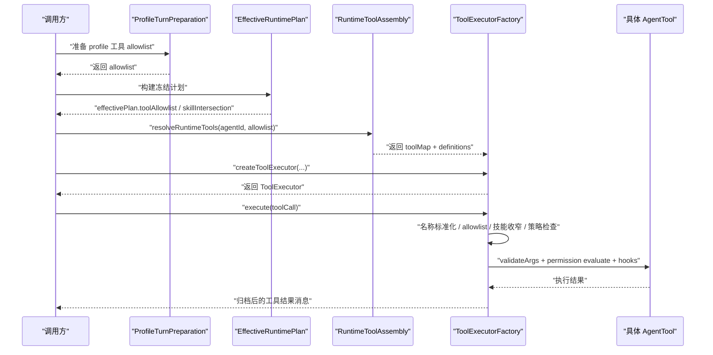
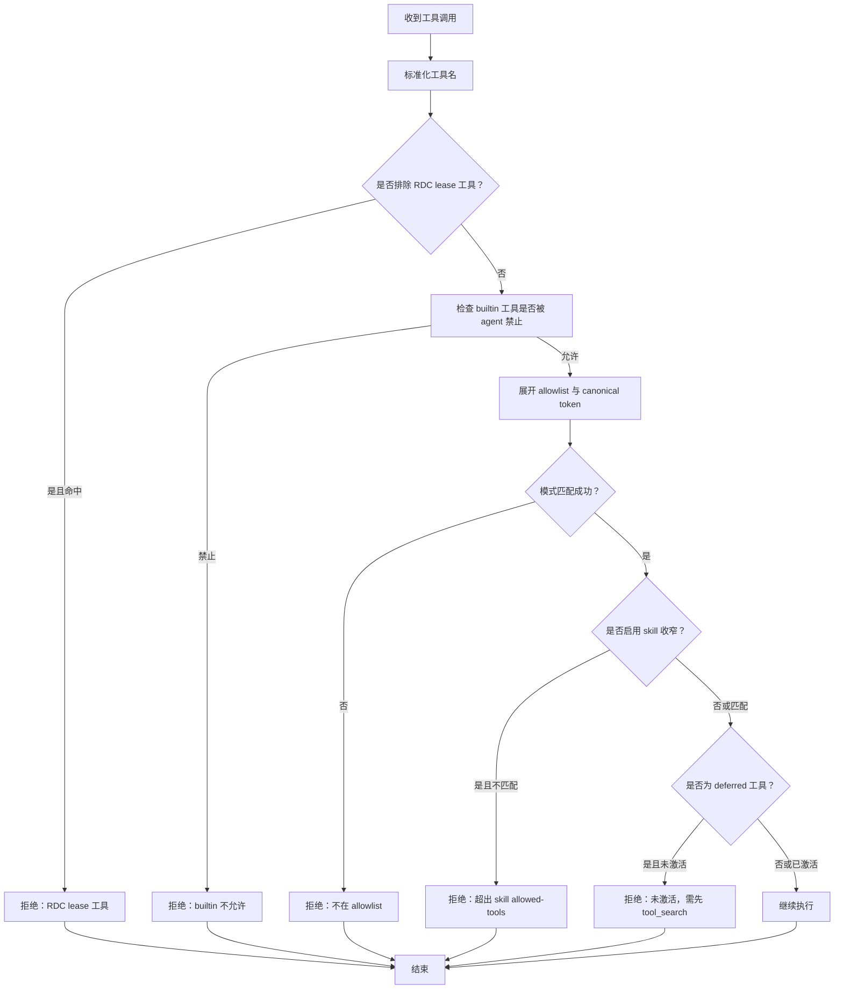
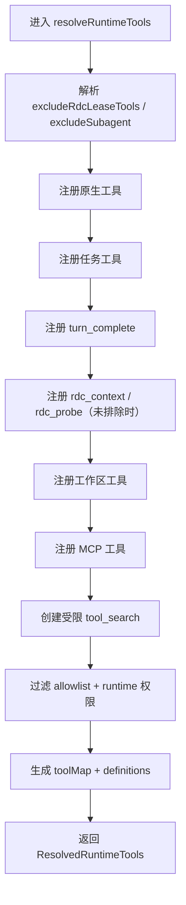
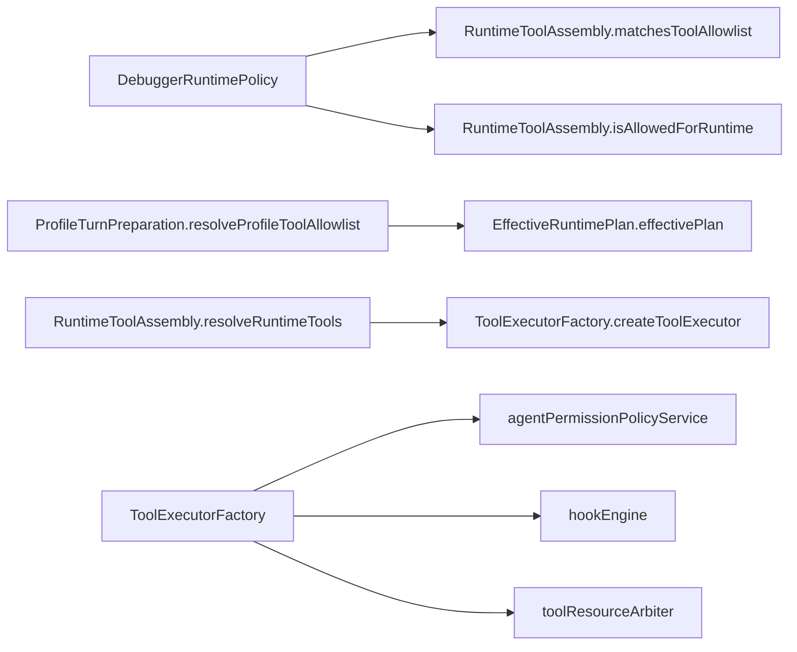

# 工具发现与组装

<cite>
**本文引用的文件**   
- [RuntimeToolAssembly.ts](file://src/main/workflow/debugger/RuntimeToolAssembly.ts)
- [ToolExecutorFactory.ts](file://src/main/workflow/debugger/ToolExecutorFactory.ts)
- [DebuggerRuntimePolicy.ts](file://src/main/workflow/debugger/DebuggerRuntimePolicy.ts)
- [ProfileTurnPreparation.ts](file://src/main/workflow/debugger/ProfileTurnPreparation.ts)
- [EffectiveRuntimePlan.ts](file://src/main/agent-runtime/EffectiveRuntimePlan.ts)
</cite>

## 目录
1. [引言](#引言)
2. [项目结构](#项目结构)
3. [核心组件](#核心组件)
4. [架构总览](#架构总览)
5. [详细组件分析](#详细组件分析)
6. [依赖关系分析](#依赖关系分析)
7. [性能考量](#性能考量)
8. [故障排查指南](#故障排查指南)
9. [结论](#结论)
10. [附录：扩展自定义工具集](#附录扩展自定义工具集)

## 引言
本文件面向需要理解“运行时工具如何被发现、筛选和组装”的读者，重点说明以下问题：
- `RuntimeToolAssembly` 如何把原生工具、任务工具、工作区工具、MCP 工具等组合成当前轮次可用的工具集。
- 工具 allowlist 解析函数 `resolveAgentToolAllowlist`、`resolveAgentToolAllowlistFromDefinition`、`resolveProfileToolAllowlist` 的区别与应用场景。
- `isAllowedForRuntime` 与 `matchesToolAllowlist` 的权限校验逻辑，包括 tool family、slot key、deferred activation 的影响。
- `ToolExecutorFactory` 如何把工具定义转换为可执行实例，以及依赖注入、上下文绑定、权限验证的流程。
- 如何注册、发现和执行工具，并安全扩展自定义工具集。

## 项目结构
工具系统主要分布在调试工作流与代理运行时之间：
- 策略与 allowlist 解析位于 `DebuggerRuntimePolicy.ts`。
- 工具装配位于 `RuntimeToolAssembly.ts`。
- 工具执行与权限门控位于 `ToolExecutorFactory.ts`。
- 配置化 profile 层 allowlist 处理位于 `ProfileTurnPreparation.ts` 与 `EffectiveRuntimePlan.ts`。



**图表来源**
- [DebuggerRuntimePolicy.ts:1-235](file://src/main/workflow/debugger/DebuggerRuntimePolicy.ts#L1-L235)
- [RuntimeToolAssembly.ts:1-681](file://src/main/workflow/debugger/RuntimeToolAssembly.ts#L1-L681)
- [ToolExecutorFactory.ts:1-675](file://src/main/workflow/debugger/ToolExecutorFactory.ts#L1-L675)
- [ProfileTurnPreparation.ts:1-80](file://src/main/workflow/debugger/ProfileTurnPreparation.ts#L1-L80)
- [EffectiveRuntimePlan.ts:40-108](file://src/main/agent-runtime/EffectiveRuntimePlan.ts#L40-L108)

**章节来源**
- [DebuggerRuntimePolicy.ts:1-235](file://src/main/workflow/debugger/DebuggerRuntimePolicy.ts#L1-L235)
- [RuntimeToolAssembly.ts:1-681](file://src/main/workflow/debugger/RuntimeToolAssembly.ts#L1-L681)
- [ToolExecutorFactory.ts:1-675](file://src/main/workflow/debugger/ToolExecutorFactory.ts#L1-L675)
- [ProfileTurnPreparation.ts:1-80](file://src/main/workflow/debugger/ProfileTurnPreparation.ts#L1-L80)
- [EffectiveRuntimePlan.ts:40-108](file://src/main/agent-runtime/EffectiveRuntimePlan.ts#L40-L108)

## 核心组件
- **DebuggerRuntimePolicy**：负责工具名标准化、canonical token 展开、builtin 工具白名单判断、allowlist 模式匹配、skill 允许工具求交。
- **RuntimeToolAssembly**：负责聚合原生工具、任务工具、工作区工具、RDC/RPC 工具、MCP 工具，并生成最终可暴露给模型的 `toolMap` 与 `definitions`。
- **ToolExecutorFactory**：负责创建 `ToolExecutor`，在每次工具调用时进行名称规范化、allowlist 校验、技能收窄、策略拒绝、参数校验、权限评估、审批、钩子、资源并发控制与结果归档。
- **ProfileTurnPreparation / EffectiveRuntimePlan**：负责从 profile 与 turn preparation 中计算最终 allowlist、冻结 `toolAllowlist` 与 `skillIntersection`，供执行期使用。

**章节来源**
- [DebuggerRuntimePolicy.ts:1-235](file://src/main/workflow/debugger/DebuggerRuntimePolicy.ts#L1-L235)
- [RuntimeToolAssembly.ts:1-681](file://src/main/workflow/debugger/RuntimeToolAssembly.ts#L1-L681)
- [ToolExecutorFactory.ts:1-675](file://src/main/workflow/debugger/ToolExecutorFactory.ts#L1-L675)
- [ProfileTurnPreparation.ts:1-80](file://src/main/workflow/debugger/ProfileTurnPreparation.ts#L1-L80)
- [EffectiveRuntimePlan.ts:40-108](file://src/main/agent-runtime/EffectiveRuntimePlan.ts#L40-L108)

## 架构总览
下图展示一次典型工具调用从准备到执行的完整路径。



**图表来源**
- [ProfileTurnPreparation.ts:26-80](file://src/main/workflow/debugger/ProfileTurnPreparation.ts#L26-L80)
- [EffectiveRuntimePlan.ts:196-241](file://src/main/agent-runtime/EffectiveRuntimePlan.ts#L196-L241)
- [RuntimeToolAssembly.ts:570-681](file://src/main/workflow/debugger/RuntimeToolAssembly.ts#L570-L681)
- [ToolExecutorFactory.ts:100-509](file://src/main/workflow/debugger/ToolExecutorFactory.ts#L100-L509)

## 详细组件分析

### 工具 allowlist 解析流程

#### 1. `resolveAgentToolAllowlistFromDefinition`
该函数直接对传入的 definition tools 做 canonical token 展开与去重，并根据 agent id 过滤 mission-only 条目；如果结果为空会抛出错误。它适用于“已知一组显式声明的工具列表”，例如 manifest 中的 `tools` 字段或测试输入。

关键点：
- 使用 `finalizeAllowlist` 统一展开 canonical token。
- 对 mission agent 使用 mission-only token 过滤。
- 不允许空 allowlist。

**章节来源**
- [DebuggerRuntimePolicy.ts:1-235](file://src/main/workflow/debugger/DebuggerRuntimePolicy.ts#L1-L235)

#### 2. `resolveAgentToolAllowlist`
该函数从全局设置读取 agent manifest，优先使用 manifest 中的 `tools`；若未启用或未找到，则回退到 execution profile 的 `toolAllowlist`；最后再走 `finalizeAllowlist`。它适用于“根据当前 agent 身份动态决定默认 allowlist”的场景。

关键点：
- 数据来源优先级：manifest.tools → runtime profile toolAllowlist → 空列表。
- 仍受 mission agent 规则与 canonical token 展开约束。

**章节来源**
- [DebuggerRuntimePolicy.ts:1-235](file://src/main/workflow/debugger/DebuggerRuntimePolicy.ts#L1-L235)

#### 3. `resolveProfileToolAllowlist`
该函数用于 profile 层 prepare 阶段，接收一个 already computed 的 allowlist，并根据子代理深度、预算、最大 child depth 决定是否移除 `subagent`。它不重新加载 manifest 或 settings，而是对已有 allowlist 做“执行期预算裁剪”。

关键点：
- 支持 `excludeRdcLeaseTools` 先剥离 RDC lease 工具。
- 当达到最大子代理深度或预算耗尽时，禁止 `subagent`。
- 常用于 subagent、sendProfileMessage 等子 turn 准备。

**章节来源**
- [ProfileTurnPreparation.ts:26-80](file://src/main/workflow/debugger/ProfileTurnPreparation.ts#L26-L80)

#### 三者的区别与适用场景
| 函数 | 输入 | 输出 | 主要职责 | 典型场景 |
|---|---|---|---|---|
| `resolveAgentToolAllowlistFromDefinition` | agent id + 显式工具列表 | 最终 allowlist | 展开、去重、mission 过滤、非空校验 | 已知 manifest/tools 或测试数据 |
| `resolveAgentToolAllowlist` | agent id | 最终 allowlist | 从 settings/manifest/profile 推导默认 allowlist | 主 agent 启动或会话初始化 |
| `resolveProfileToolAllowlist` | 已有 allowlist + profile options | 裁剪后 allowlist | 根据子代理深度/预算移除 subagent | profile turn、subagent 调用前 |

**章节来源**
- [DebuggerRuntimePolicy.ts:1-235](file://src/main/workflow/debugger/DebuggerRuntimePolicy.ts#L1-L235)
- [ProfileTurnPreparation.ts:26-80](file://src/main/workflow/debugger/ProfileTurnPreparation.ts#L26-L80)

### `isAllowedForRuntime` 与 `matchesToolAllowlist` 的权限校验逻辑

#### `matchesToolAllowlist`
该方法对单个工具名与 allowlist 进行模式匹配，支持：
- 精确匹配。
- `*` 通配所有工具。
- `*.xxx` 命名空间前缀匹配。
- `xxx*` 前缀匹配。
- 先对工具名与 allowlist 条目分别做 normalize 和 canonical 展开。

用途：
- `RuntimeToolAssembly.resolveRuntimeTools` 过滤最终暴露给模型的工具定义。
- `ToolExecutorFactory` 校验 active skill allowlist。

#### `isAllowedForRuntime`
该方法首先排除 RDC lease 工具（可选），然后委托 `isToolAllowedByFrozenAllowlist`，后者会：
- 检查 builtin 工具是否被 agent 类型禁止。
- 将 allowlist 展开为 normalized 模式集合。
- 使用与 `matchesToolAllowlist` 相同的模式匹配算法。

注意：
- `isAllowedForRuntime` 是“运行时入口级”权限检查。
- 真正执行时还会叠加 skill 收窄、compiled policy、permission policy、用户审批等更多层。

#### tool family、slot key、deferred activation 的影响
- tool family：由 canonical token 展开与 `RUNTIME_TOOL_ALIASES` 决定。例如 `read`、`search`、`web`、`git`、`memory_*`、`rdc_context` 等别名最终都映射到标准工具名。
- slot key：deferred activation 通过当前 turn 的 `deferredActivation.slotKey` 定位 slot，只有对应 slot 中的 deferred tools 才能被激活。
- deferred activation：未激活的 deferred 工具在执行时被拒绝，提示先调用 `tool_search`；只有 `tool_search` 成功返回后，才会按返回详情激活新的工具。



**图表来源**
- [DebuggerRuntimePolicy.ts:1-235](file://src/main/workflow/debugger/DebuggerRuntimePolicy.ts#L1-L235)
- [RuntimeToolAssembly.ts:1-120](file://src/main/workflow/debugger/RuntimeToolAssembly.ts#L1-L120)
- [ToolExecutorFactory.ts:100-300](file://src/main/workflow/debugger/ToolExecutorFactory.ts#L100-L300)

**章节来源**
- [DebuggerRuntimePolicy.ts:1-235](file://src/main/workflow/debugger/DebuggerRuntimePolicy.ts#L1-L235)
- [RuntimeToolAssembly.ts:1-120](file://src/main/workflow/debugger/RuntimeToolAssembly.ts#L1-L120)
- [ToolExecutorFactory.ts:100-300](file://src/main/workflow/debugger/ToolExecutorFactory.ts#L100-L300)

### `ToolExecutorFactory`：从工具定义到可执行实例

`ToolExecutorFactory.createToolExecutor` 不是简单地把定义转为函数，而是构造一个完整的执行器，包含以下阶段：

1. **选择 effective allowlist**
   - 如果存在 effective plan，优先使用 plan 中的 `toolAllowlist`。
   - 工具发现时使用 plan 的 `skillIntersection` 或 effective allowlist 作为候选集合，避免向模型暴露 frozen skill 禁止的工具。

2. **构建工具集合**
   - 调用 `deps.resolveRuntimeTools` 获取 `toolMap`。
   - 维护 active skill allowlist 收窄集。
   - 冻结 plan 中已激活的 deferred tools。

3. **调用前置校验**
   - 标准化工具名。
   - 检查 excludeRdcLeaseTools、excludeSubagent。
   - 调用 `isAllowedForRuntime`。
   - 检查 toolMap 是否存在。
   - 若启用 skill 收窄，检查是否在 skill allowlist 内。
   - 若存在 compiled policy，检查 deniedTools。
   - 若为 deferred 工具，检查是否已激活。

4. **参数校验与特殊工具分流**
   - 使用 `toolValidator` 与 `tool.validateArgs` 校验参数。
   - `ask_user`、`plan_artifact` 走专用执行路径。

5. **权限评估与审批**
   - 调用 `agentPermissionPolicyService.evaluate`。
   - deny：直接拒绝。
   - ask_user：发起人工审批。
   - auto_review：发起自动审核。

6. **生命周期钩子与上下文绑定**
   - 触发 `tool.before-call`。
   - 构造 `ToolExecutionContext`，注入 sessionId、projectRootPath、workspaceRoot、visionInputMode、knowledgeReadRoots、RDC binding 等。
   - 使用 `withProcessExecutionOwner` 与 `withTemporaryPathAccess` 限制临时路径访问。

7. **资源并发控制**
   - 根据 `tool.spec.orchestration` 与 `isAgentToolCallConcurrencySafe` 决定共享执行或独占执行。
   - 使用 `toolResourceArbiter.runShared` 或 `runExclusive`。

8. **deferred activation 与结果归档**
   - `tool_search` 成功后激活新 deferred tools。
   - 对特定工具结果进行 artifactize，支持证据钉住、结构化结果归档。

```mermaid
classDiagram
    class ToolExecutorFactory {
        +releaseSession(sessionId) void
        +activateDeferredTools(toolNames, sessionId) void
        +createToolExecutor(agentId, toolAllowlist, sessionId, runtimeContext) ToolExecutor
        -sessionFileReads(sessionId) Set~string~
        -triggerRuntimeHooks(event, agentId, runtimeContext, payload) Promise~{allowed, reason}~
        -executeAskUserTool(toolCall, agentId, runtimeContext, signal) ToolResultMessage
        -executePlanArtifactTool(toolCall, agentId, runtimeContext, signal) ToolResultMessage
    }

    class RuntimeToolAssembly {
        +matchesToolAllowlist(toolName, toolAllowlist) boolean
        +isAllowedForRuntime(agentId, toolName, frozenToolAllowlist, excludeRdcLeaseTools) boolean
        +resolveRuntimeTools(...) ResolvedRuntimeTools
    }

    class DebuggerRuntimePolicy {
        +normalizeToolName(toolName) string
        +isToolAllowedByFrozenAllowlist(toolName, agentId, toolAllowlist) boolean
        +intersectSkillAllowedTools(runtimeAllowlist, skillAllowedTools) string[]
    }

    ToolExecutorFactory --> RuntimeToolAssembly : "依赖 resolveRuntimeTools"
    ToolExecutorFactory --> DebuggerRuntimePolicy : "依赖 isAllowedForRuntime / matchesToolAllowlist / normalizeToolName"
```

**图表来源**
- [ToolExecutorFactory.ts:1-675](file://src/main/workflow/debugger/ToolExecutorFactory.ts#L1-L675)
- [RuntimeToolAssembly.ts:1-681](file://src/main/workflow/debugger/RuntimeToolAssembly.ts#L1-L681)
- [DebuggerRuntimePolicy.ts:1-235](file://src/main/workflow/debugger/DebuggerRuntimePolicy.ts#L1-L235)

**章节来源**
- [ToolExecutorFactory.ts:100-509](file://src/main/workflow/debugger/ToolExecutorFactory.ts#L100-L509)

### `RuntimeToolAssembly`：动态发现、筛选与组装

`resolveRuntimeTools` 是工具发现的核心方法，其步骤如下：

1. **确定排除选项**
   - `excludeRdcLeaseTools`：来自 options 或 turnHandle.runtimePlan。
   - `excludeSubagent`：同上。

2. **聚合可用工具**
   - 原生工具：`getPrimitiveTools()`。
   - 任务工具：`createTaskRuntimeTools`。
   - 回合完成工具：`turn_complete`，并在 completion 前校验未完成 direct task。
   - RDC 相关工具：`rdc_context`、`rdc_probe`，在未排除时加入。
   - 工作区工具：ask_user、memory_*、plan_artifact、output_register、skills、skill_read、mcp、knowledge、investigation、subagent、background tools。
   - MCP 工具：`deps.mcp.getAgentTools(projectRootPath, mcpPoolKey)`。

3. **创建受限的 `tool_search`**
   - `tool_search` 只能看到经过 `matchesToolAllowlist` 与 `isAllowedForRuntime` 过滤后的工具，防止模型看到本轮不可用的工具。

4. **生成最终暴露集合**
   - 遍历 availableTools，再次应用 allowlist 与 runtime 权限过滤。
   - 去重后生成 `toolMap` 与 `definitions`。



**图表来源**
- [RuntimeToolAssembly.ts:570-681](file://src/main/workflow/debugger/RuntimeToolAssembly.ts#L570-L681)

**章节来源**
- [RuntimeToolAssembly.ts:1-681](file://src/main/workflow/debugger/RuntimeToolAssembly.ts#L1-L681)

### 工具注册、发现与执行的完整示例

下面给出一个“从零扩展自定义工具集”的代码级步骤说明，不粘贴具体代码，仅列出关键位置与调用顺序。

1. **定义工具实现**
   - 创建一个符合 `AgentTool` 接口的对象，包含 name、label、description、parameters、spec、execute 等字段。
   - 如果需要依赖外部服务，通过构造函数或工厂函数注入。

   参考路径：
   - [RuntimeToolAssembly.ts:201-450](file://src/main/workflow/debugger/RuntimeToolAssembly.ts#L201-L450)

2. **将工具纳入 workbench 或 MCP 层**
   - 如果是内部工具：放入 `createWorkbenchTools` 返回数组。
   - 如果是外部服务工具：通过 MCP 协调器暴露。

   参考路径：
   - [RuntimeToolAssembly.ts:520-570](file://src/main/workflow/debugger/RuntimeToolAssembly.ts#L520-L570)
   - [RuntimeToolAssembly.ts:570-681](file://src/main/workflow/debugger/RuntimeToolAssembly.ts#L570-L681)

3. **将工具名加入 allowlist**
   - 如果工具是内置别名，确保 canonical token 或别名正确。
   - 在 agent manifest、execution profile 或 profile prepare 阶段将工具名加入 allowlist。

   参考路径：
   - [DebuggerRuntimePolicy.ts:1-235](file://src/main/workflow/debugger/DebuggerRuntimePolicy.ts#L1-L235)
   - [ProfileTurnPreparation.ts:26-80](file://src/main/workflow/debugger/ProfileTurnPreparation.ts#L26-L80)

4. **创建 executor 并执行工具**
   - 调用 `ToolExecutorFactory.createToolExecutor`。
   - 调用返回的 `execute(toolCall)`。
   - 框架会自动完成权限校验、参数校验、审批、钩子、资源隔离与结果归档。

   参考路径：
   - [ToolExecutorFactory.ts:100-509](file://src/main/workflow/debugger/ToolExecutorFactory.ts#L100-L509)

5. **扩展点总结**
   - 新增工具实现：放在 RuntimeToolAssembly 或 MCP 层。
   - 新增 allowlist 来源：放在 profile 或 manifest 配置。
   - 新增执行期门控：放在 ToolExecutorFactory 的执行路径或 policy 编译配置。
   - 新增元工具豁免：如需让某个工具不受 skill 收窄影响，参考 `SKILL_NARROWING_EXEMPT_TOOLS` 的设计。

**章节来源**
- [RuntimeToolAssembly.ts:201-681](file://src/main/workflow/debugger/RuntimeToolAssembly.ts#L201-L681)
- [DebuggerRuntimePolicy.ts:1-235](file://src/main/workflow/debugger/DebuggerRuntimePolicy.ts#L1-L235)
- [ProfileTurnPreparation.ts:26-80](file://src/main/workflow/debugger/ProfileTurnPreparation.ts#L26-L80)
- [ToolExecutorFactory.ts:100-509](file://src/main/workflow/debugger/ToolExecutorFactory.ts#L100-L509)

## 依赖关系分析



**图表来源**
- [DebuggerRuntimePolicy.ts:1-235](file://src/main/workflow/debugger/DebuggerRuntimePolicy.ts#L1-L235)
- [RuntimeToolAssembly.ts:570-681](file://src/main/workflow/debugger/RuntimeToolAssembly.ts#L570-L681)
- [ProfileTurnPreparation.ts:26-80](file://src/main/workflow/debugger/ProfileTurnPreparation.ts#L26-L80)
- [EffectiveRuntimePlan.ts:196-241](file://src/main/agent-runtime/EffectiveRuntimePlan.ts#L196-L241)
- [ToolExecutorFactory.ts:100-509](file://src/main/workflow/debugger/ToolExecutorFactory.ts#L100-L509)

**章节来源**
- [DebuggerRuntimePolicy.ts:1-235](file://src/main/workflow/debugger/DebuggerRuntimePolicy.ts#L1-L235)
- [RuntimeToolAssembly.ts:570-681](file://src/main/workflow/debugger/RuntimeToolAssembly.ts#L570-L681)
- [ProfileTurnPreparation.ts:26-80](file://src/main/workflow/debugger/ProfileTurnPreparation.ts#L26-L80)
- [EffectiveRuntimePlan.ts:196-241](file://src/main/agent-runtime/EffectiveRuntimePlan.ts#L196-L241)
- [ToolExecutorFactory.ts:100-509](file://src/main/workflow/debugger/ToolExecutorFactory.ts#L100-L509)

## 性能考量
- 工具发现是一次性过程：`resolveRuntimeTools` 构建 `availableTools` Map 并去重，避免重复注册。
- `tool_search` 的可见工具集合基于已经过滤后的工具集，减少模型搜索空间。
- 工具执行采用资源仲裁器：
  - 并发安全工具可共享执行。
  - 非并发安全工具独占执行，避免共享 project/session 状态竞争。
- Hook 执行使用 exclusive 资源键，避免 hook 与工具执行互相阻塞。
- successful file reads 缓存以 session 为单位清理，避免跨会话泄漏。

[本节为通用性能讨论，不直接分析具体文件片段]

## 故障排查指南

常见问题与定位建议：

| 现象 | 可能原因 | 排查位置 |
|---|---|---|
| 工具未出现在模型可调用列表中 | allowlist 未包含工具名；canonical token 未展开；被 builtin 或 mission 规则禁止 | [DebuggerRuntimePolicy.ts:1-235](file://src/main/workflow/debugger/DebuggerRuntimePolicy.ts#L1-L235) |
| 工具在 discover 中出现但 execute 被拒绝 | skill 收窄层切掉了该工具；compiled policy 将其列入 deniedTools | [ToolExecutorFactory.ts:100-300](file://src/main/workflow/debugger/ToolExecutorFactory.ts#L100-L300) |
| deferred 工具提示必须先使用 `tool_search` | 工具未在 plan 的 activatedDeferredTools 中，也未在当前 turn 中被激活 | [ToolExecutorFactory.ts:201-300](file://src/main/workflow/debugger/ToolExecutorFactory.ts#L201-L300) |
| subagent 被移除 | 子代理深度超过最大 depth，或预算耗尽 | [ProfileTurnPreparation.ts:26-80](file://src/main/workflow/debugger/ProfileTurnPreparation.ts#L26-L80) |
| RDC 工具不可用 | 会话未持有 RDC lease；或明确 excludeRdcLeaseTools | [RuntimeToolAssembly.ts:120-200](file://src/main/workflow/debugger/RuntimeToolAssembly.ts#L120-L200) |
| 工具参数校验失败 | JSON schema 不匹配或自定义 validateArgs 失败 | [ToolExecutorFactory.ts:201-300](file://src/main/workflow/debugger/ToolExecutorFactory.ts#L201-L300) |
| 工具执行被 hook 拒绝 | 生命周期 hook 返回 not allowed | [ToolExecutorFactory.ts:400-509](file://src/main/workflow/debugger/ToolExecutorFactory.ts#L400-L509) |

**章节来源**
- [DebuggerRuntimePolicy.ts:1-235](file://src/main/workflow/debugger/DebuggerRuntimePolicy.ts#L1-L235)
- [ProfileTurnPreparation.ts:26-80](file://src/main/workflow/debugger/ProfileTurnPreparation.ts#L26-L80)
- [RuntimeToolAssembly.ts:120-200](file://src/main/workflow/debugger/RuntimeToolAssembly.ts#L120-L200)
- [ToolExecutorFactory.ts:201-509](file://src/main/workflow/debugger/ToolExecutorFactory.ts#L201-L509)

## 结论
工具发现与组装是一个分层治理体系：
- **配置层**：`resolveAgentToolAllowlist`、`resolveAgentToolAllowlistFromDefinition`、`resolveProfileToolAllowlist` 决定“允许哪些工具”。
- **装配层**：`RuntimeToolAssembly` 决定“当前轮次能发现哪些工具”。
- **执行层**：`ToolExecutorFactory` 决定“本次工具调用能否执行以及如何执行”。
- **策略层**：`DebuggerRuntimePolicy`、permission policy、compiled policy、skill 收窄、hook、资源仲裁共同构成纵深防御。

扩展自定义工具时，应同时考虑四个层面：工具实现、allowlist 配置、执行期权限、资源与并发语义。这样既能保证能力扩展，又不会破坏安全边界。

[本节为总结性内容，不直接分析具体文件片段]

## 附录：扩展自定义工具集

推荐扩展步骤：

1. **实现工具**
   - 定义 `name`、`parameters`、`spec`、`execute`。
   - 如需读取知识或项目文件，使用工具上下文中提供的 `workspaceRoot`、`projectRootPath`、`sessionId`、`projectId`。

   参考路径：
   - [RuntimeToolAssembly.ts:201-450](file://src/main/workflow/debugger/RuntimeToolAssembly.ts#L201-L450)

2. **注册到工具装配**
   - 内部工具：添加到 `createWorkbenchTools`。
   - 外部工具：通过 MCP 暴露，并确保 allowlist 中包含 `mcp__*` 模式或具体工具名。

   参考路径：
   - [RuntimeToolAssembly.ts:520-681](file://src/main/workflow/debugger/RuntimeToolAssembly.ts#L520-L681)

3. **配置 allowlist**
   - 静态配置：修改 agent manifest 或 execution profile。
   - 动态配置：在 profile prepare 阶段调整 allowlist，尤其是 subagent 深度限制。

   参考路径：
   - [DebuggerRuntimePolicy.ts:1-235](file://src/main/workflow/debugger/DebuggerRuntimePolicy.ts#L1-L235)
   - [ProfileTurnPreparation.ts:26-80](file://src/main/workflow/debugger/ProfileTurnPreparation.ts#L26-L80)

4. **验证权限与执行**
   - 使用 `ToolExecutorFactory.createToolExecutor` 创建执行器。
   - 观察 permission policy 与 approval flow。
   - 确认 hook 不会阻断执行。
   - 确认资源并发行为符合预期。

   参考路径：
   - [ToolExecutorFactory.ts:100-509](file://src/main/workflow/debugger/ToolExecutorFactory.ts#L100-L509)

**章节来源**
- [RuntimeToolAssembly.ts:201-681](file://src/main/workflow/debugger/RuntimeToolAssembly.ts#L201-L681)
- [DebuggerRuntimePolicy.ts:1-235](file://src/main/workflow/debugger/DebuggerRuntimePolicy.ts#L1-L235)
- [ProfileTurnPreparation.ts:26-80](file://src/main/workflow/debugger/ProfileTurnPreparation.ts#L26-L80)
- [ToolExecutorFactory.ts:100-509](file://src/main/workflow/debugger/ToolExecutorFactory.ts#L100-L509)