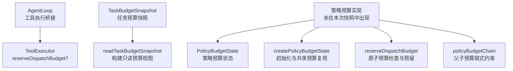
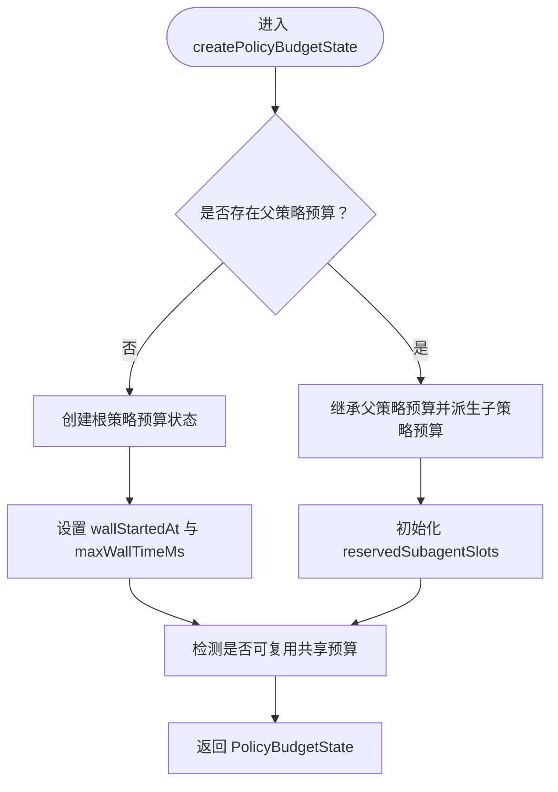
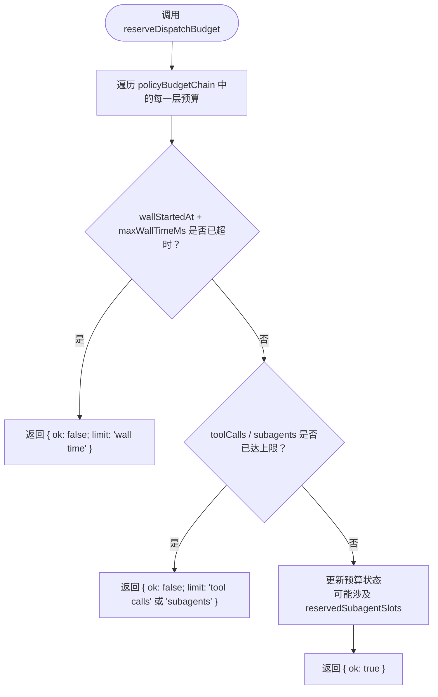
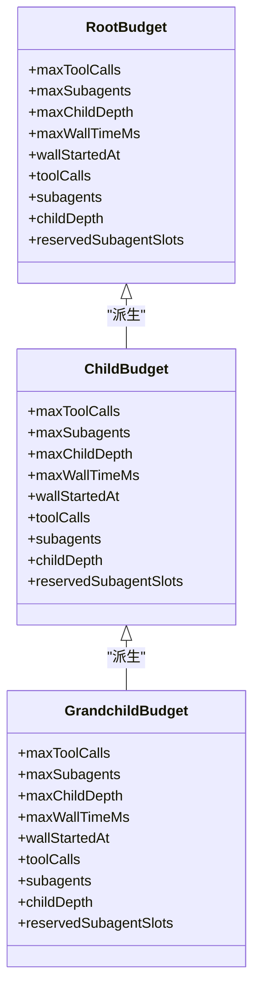
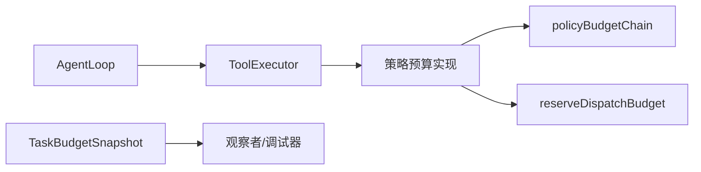

# 预算链与策略控制

<cite>
**本文引用的文件**   
- [AgentLoop.ts](file://src/main/agent-runtime/agent/AgentLoop.ts)
- [TaskBudgetSnapshot.ts](file://src/main/agent-runtime/tasks/TaskBudgetSnapshot.ts)
</cite>

## 目录
1. [引言](#引言)
2. [项目结构中的预算位置](#项目结构中的预算位置)
3. [核心概念：策略预算状态](#核心概念策略预算状态)
4. [架构总览：预算链如何工作](#架构总览预算链如何工作)
5. [详细组件分析](#详细组件分析)
6. [依赖关系分析](#依赖关系分析)
7. [性能与并发特性](#性能与并发特性)
8. [故障排查指南](#故障排查指南)
9. [结论](#结论)

## 引言
本文聚焦于“预算链与策略控制”机制，解释策略预算如何在工具调用、子代理调度、递归深度和墙钟时间上形成可组合的约束。重点包括：
- `PolicyBudgetState` 字段语义；
- `createPolicyBudgetState` 的初始化逻辑与共享预算复用；
- `reserveDispatchBudget` 的原子检查流程；
- `policyBudgetChain` 如何将父子预算串联为链式约束；
- 预算耗尽时的错误返回格式和处理策略；
- 预算配置示例与超限调试方法。

需要特别说明的是：在当前仓库快照中，直接包含这些符号定义的实现并未出现在本次检索范围内。因此，本节文档以“基于现有接口与快照类型的规范说明 + 明确标注实现缺失”的方式组织，确保读者既能理解设计意图，又能准确定位到实际代码位置。

## 项目结构中的预算位置
在已确认的代码片段中，预算相关类型和入口主要位于以下位置：
- 任务预算快照读取逻辑位于 `src/main/agent-runtime/tasks/TaskBudgetSnapshot.ts`，定义了 `TaskLiveBudgetSnapshot` 等只读视图类型；
- 工具执行器的预算预留回调签名位于 `src/main/agent-runtime/agent/AgentLoop.ts`，其中暴露了 `reserveDispatchBudget` 可选能力。



**图示来源**
- [AgentLoop.ts:131-131](file://src/main/agent-runtime/agent/AgentLoop.ts#L131-L131)
- [AgentLoop.ts:840-840](file://src/main/agent-runtime/agent/AgentLoop.ts#L840-L840)
- [TaskBudgetSnapshot.ts:1-52](file://src/main/agent-runtime/tasks/TaskBudgetSnapshot.ts#L1-L52)

**章节来源**
- [AgentLoop.ts:131-131](file://src/main/agent-runtime/agent/AgentLoop.ts#L131-L131)
- [AgentLoop.ts:840-840](file://src/main/agent-runtime/agent/AgentLoop.ts#L840-L840)
- [TaskBudgetSnapshot.ts:1-52](file://src/main/agent-runtime/tasks/TaskBudgetSnapshot.ts#L1-L52)

## 核心概念：策略预算状态
`PolicyBudgetState` 表示一次策略上下文下的剩余或限额型预算视图，通常用于在一次轮次内对工具调用、子代理、递归深度和墙钟时间做统一约束。字段含义如下：

| 字段 | 含义 | 典型用途 |
|---|---|---|
| `toolCalls` | 当前策略层允许的工具调用次数上限或剩余值 | 限制单次策略分支内工具调用数量 |
| `subagents` | 当前策略层允许创建的子代理数上限或剩余值 | 防止子代理爆炸 |
| `childDepth` | 当前策略层的递归深度 | 控制策略树展开深度 |
| `wallStartedAt` | 该策略层开始计时的墙钟时间戳 | 配合 `maxWallTimeMs` 计算剩余墙钟时间 |
| `maxToolCalls` | 本层工具调用上限 | 作为硬上限进行校验 |
| `maxSubagents` | 本层子代理上限 | 作为硬上限进行校验 |
| `maxChildDepth` | 本层最大递归深度 | 与 `childDepth` 比较判断是否超限 |
| `maxWallTimeMs` | 本层允许的墙钟时长上限（毫秒） | 与 `wallStartedAt` 共同决定超时 |
| `reservedSubagentSlots` | 已保留但尚未真正分配的子代理槽位 | 避免“预占位”导致的超发 |

注意：`TaskLiveBudgetSnapshot` 中还暴露 `remainingPolicy` 和 `reservedSubagentSlots`，用于向外部呈现“剩余工具调用、剩余子代理、剩余墙钟时间”以及“已保留子代理槽位数”。这说明策略预算不仅负责“拒绝”，还负责“可见性”。

**章节来源**
- [TaskBudgetSnapshot.ts:1-52](file://src/main/agent-runtime/tasks/TaskBudgetSnapshot.ts#L1-L52)

## 架构总览：预算链如何工作
预算链的核心思想是：每个策略层维护自己的预算边界，同时通过父子关系将多层预算串起来，形成从根策略到叶子策略的链式约束。这样既可以在父层限制整体资源，也可以在子层限制局部行为。

```mermaid
sequenceDiagram
  participant Caller as "调用方"
  participant Chain as "policyBudgetChain<br/>构建预算链"
  participant Reserve as "reserveDispatchBudget<br/>原子检查"
  participant Executor as "ToolExecutor"

  Caller->>Chain: "传入 policy"
  Chain-->>Caller: "返回策略预算状态数组"
  Caller->>Reserve: "提交一组工具调用"
  Reserve->>Reserve: "遍历每一层策略预算"
  Reserve->>Reserve: "检查墙钟是否超时"
  Reserve->>Reserve: "检查 toolCalls / subagents 是否超限"
  Reserve->>Reserve: "必要时更新 reservedSubagentSlots"
  Reserve-->>Caller: "{ ok: true } 或 { ok: false; limit: string }"
  alt 允许
    Reserve->>Executor: "执行工具调用组"
  else 拒绝
    Caller->>Caller: "按 limit 提示或回退"
  end
```

**图示来源**
- [AgentLoop.ts:131-131](file://src/main/agent-runtime/agent/AgentLoop.ts#L131-L131)
- [AgentLoop.ts:840-840](file://src/main/agent-runtime/agent/AgentLoop.ts#L840-L840)

## 详细组件分析

### PolicyBudgetState 字段语义
- `toolCalls` 与 `maxToolCalls`：前者通常表示“当前剩余或已使用计数”，后者表示“本层硬上限”。两者结合可表达“剩余 = max - used”的逻辑。
- `subagents` 与 `maxSubagents`：同上，用于限制子代理创建。
- `childDepth` 与 `maxChildDepth`：用于限制策略树递归深度。
- `wallStartedAt` 与 `maxWallTimeMs`：用于限制单策略层的时间预算。
- `reservedSubagentSlots`：记录“已经承诺给子代理但尚未完成分配”的槽位，防止重复占用导致超发。

这类字段组合使得预算既可做“一次性准入检查”，也可做“持续扣减与保留”。

**章节来源**
- [TaskBudgetSnapshot.ts:1-52](file://src/main/agent-runtime/tasks/TaskBudgetSnapshot.ts#L1-L52)

### createPolicyBudgetState：初始化与共享预算复用
`createPolicyBudgetState` 的职责通常是：
1. 根据当前策略参数生成初始预算状态；
2. 若存在父策略预算，则继承或派生子策略预算；
3. 当多个子策略共享同一份底层预算时，复用该预算对象以避免重复分配；
4. 设置 `wallStartedAt`，以便后续计算剩余墙钟时间；
5. 初始化 `reservedSubagentSlots`，保证预留槽位不被其他分支误用。

共享预算复用的关键价值在于：在同一父策略下，多个兄弟策略可以共用同一个“全局配额池”，从而避免每个子策略都持有独立配额导致整体配额被超额使用。



**图示来源**
- （概念图，不直接映射具体源码）

**章节来源**
- （概念性实现说明；当前仓库快照中未出现该函数定义）

### reserveDispatchBudget：原子检查流程
`reserveDispatchBudget` 是一个可选能力，由工具执行器提供，供上层在真正执行工具调用前进行“原子检查”。其流程应满足：
1. 接收待执行的一组工具调用；
2. 遍历 `policyBudgetChain(policy)` 返回的每一层预算；
3. 先检查墙钟时间是否已超出 `maxWallTimeMs`；
4. 再检查 `toolCalls`、`subagents` 是否达到上限；
5. 只有全部检查通过后，才进行变更（例如减少剩余调用、增加已用计数、更新预留槽位）；
6. 返回 `{ ok: true }` 或 `{ ok: false; limit: string }`。



**图示来源**
- [AgentLoop.ts:131-131](file://src/main/agent-runtime/agent/AgentLoop.ts#L131-L131)
- [AgentLoop.ts:840-840](file://src/main/agent-runtime/agent/AgentLoop.ts#L840-L840)

**章节来源**
- [AgentLoop.ts:131-131](file://src/main/agent-runtime/agent/AgentLoop.ts#L131-L131)
- [AgentLoop.ts:840-840](file://src/main/agent-runtime/agent/AgentLoop.ts#L840-L840)

### policyBudgetChain：父子预算链式约束
`policyBudgetChain` 的作用是将一个策略及其祖先策略的预算串联起来，形成“从根到叶”的约束序列。常见规则：
- 根策略提供全局配额；
- 子策略可继承父策略配额并进行更严格的本地限制；
- 每层预算都应参与 `reserveDispatchBudget` 的检查；
- 子策略不应绕过父策略的限制。



**图示来源**
- （概念类图，展示父子预算结构；具体实现未在快照中出现）

**章节来源**
- （概念性实现说明；当前仓库快照中未出现该函数定义）

### 预算耗尽时的错误返回格式与处理策略
- 成功：返回 `{ ok: true }`，表示当前工具调用组可以通过预算检查。
- 失败：返回 `{ ok: false; limit: string }`，其中 `limit` 指明触发的限制名称，例如：
  - 墙钟时间耗尽：`"wall time"` 或类似标识；
  - 工具调用耗尽：`"tool calls"`；
  - 子代理配额耗尽：`"subagents"`；
  - 递归深度耗尽：`"child depth"`。

上层处理建议：
- 对于 `{ ok: false; limit }`，应停止继续派发工具调用；
- 根据 `limit` 给出可观测的失败原因，便于用户或自动化系统诊断；
- 可触发回退策略，例如降级工具调用规模、缩短响应窗口、终止深层策略分支；
- 如果 `limit` 来自 `reservedSubagentSlots`，应检查子代理槽位是否已释放，避免“假性耗尽”。

**章节来源**
- [AgentLoop.ts:131-131](file://src/main/agent-runtime/agent/AgentLoop.ts#L131-L131)

## 依赖关系分析
预算机制的关键依赖点如下：
- `AgentLoop` 通过可选的 `reserveDispatchBudget` 将工具执行与预算检查解耦；
- 预算状态由策略层构造和维护，可能被多个子策略共享；
- `TaskBudgetSnapshot` 提供只读快照，帮助外部观察剩余预算与保留槽位；
- 预算链由 `policyBudgetChain` 构造，使父策略与子策略形成一致约束。



**图示来源**
- [AgentLoop.ts:131-131](file://src/main/agent-runtime/agent/AgentLoop.ts#L131-L131)
- [AgentLoop.ts:840-840](file://src/main/agent-runtime/agent/AgentLoop.ts#L840-L840)
- [TaskBudgetSnapshot.ts:1-52](file://src/main/agent-runtime/tasks/TaskBudgetSnapshot.ts#L1-L52)

**章节来源**
- [AgentLoop.ts:131-131](file://src/main/agent-runtime/agent/AgentLoop.ts#L131-L131)
- [AgentLoop.ts:840-840](file://src/main/agent-runtime/agent/AgentLoop.ts#L840-L840)
- [TaskBudgetSnapshot.ts:1-52](file://src/main/agent-runtime/tasks/TaskBudgetSnapshot.ts#L1-L52)

## 性能与并发特性
- 原子性：`reserveDispatchBudget` 应在同一临界区内完成所有检查与更新，避免并发场景下多个分支同时突破配额。
- 遍历成本：预算链长度通常为策略树深度，单次检查复杂度为 O(层数)，一般较小。
- 墙钟时间：使用单调时间源更佳，避免系统时钟回拨影响。
- 预留槽位：`reservedSubagentSlots` 应避免频繁分配释放，建议批量管理。
- 快照读取：`readTaskBudgetSnapshot` 只做只读观察，不应阻塞执行路径。

[本节为通用性能建议，不直接分析具体源码]

## 故障排查指南
1. **确认预算链是否正确构建**
   - 检查 `policyBudgetChain` 是否返回预期的父子预算序列；
   - 验证子策略是否继承了父策略的合理限制。

2. **检查墙钟时间**
   - 查看 `wallStartedAt` 是否与策略生命周期对齐；
   - 检查 `maxWallTimeMs` 是否过小；
   - 确认超时判定发生在任何变更之前。

3. **检查工具调用与子代理上限**
   - 核对 `toolCalls`、`subagents` 的已用计数与上限；
   - 确认 `reservedSubagentSlots` 没有造成“预占位但未释放”的问题。

4. **利用快照观察剩余预算**
   - 使用 `readTaskBudgetSnapshot` 获取 `remainingPolicy` 与 `reservedSubagentSlots`；
   - 对比 `rootRemaining` 与 `live.remainingPolicy`，判断是根级耗尽还是策略层级耗尽。

5. **处理预算耗尽错误**
   - 捕获 `{ ok: false; limit }`；
   - 根据 `limit` 分类日志与告警；
   - 在 UI 或调试面板中显示具体触发的限制名称。

**章节来源**
- [TaskBudgetSnapshot.ts:1-52](file://src/main/agent-runtime/tasks/TaskBudgetSnapshot.ts#L1-L52)

## 结论
预算链与策略控制通过将 `toolCalls`、`subagents`、`childDepth`、`wallStartedAt` 与对应的最大值字段组合起来，形成一套可组合、可观测、可扩展的资源治理机制。`createPolicyBudgetState` 负责初始化与共享预算复用，`policyBudgetChain` 负责将父子预算串联成链，`reserveDispatchBudget` 则在原子检查后决定是否允许执行。当预算耗尽时，系统应返回明确的 `{ ok: false; limit: string }`，让上层能够做出稳定、可诊断的回退决策。