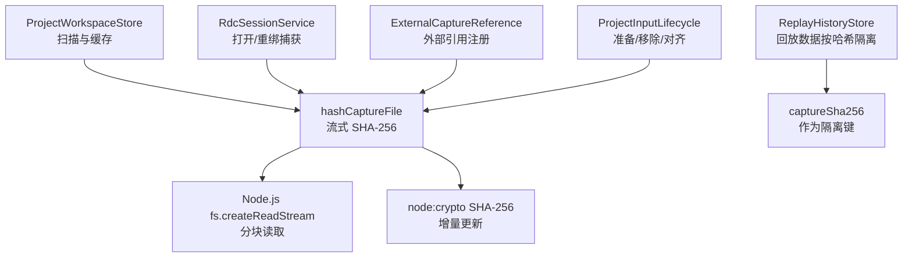
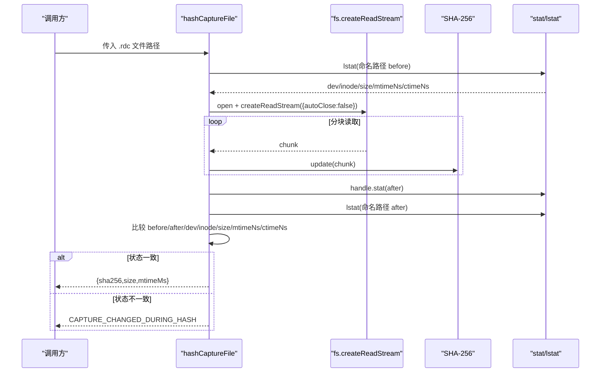
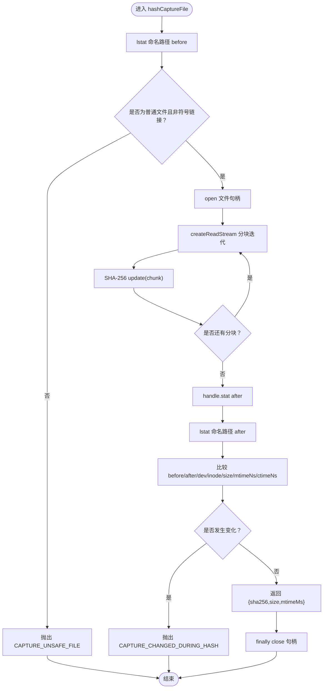
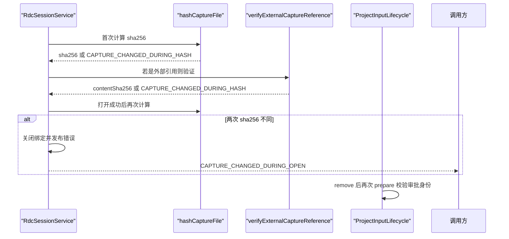
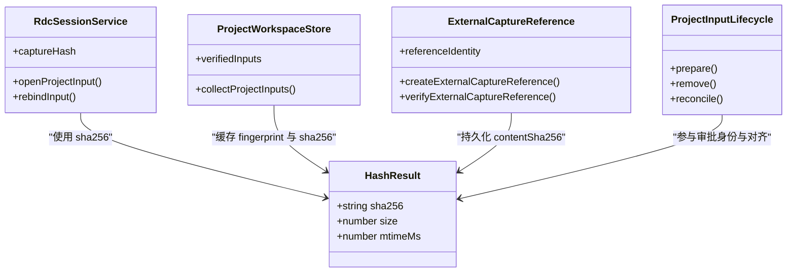
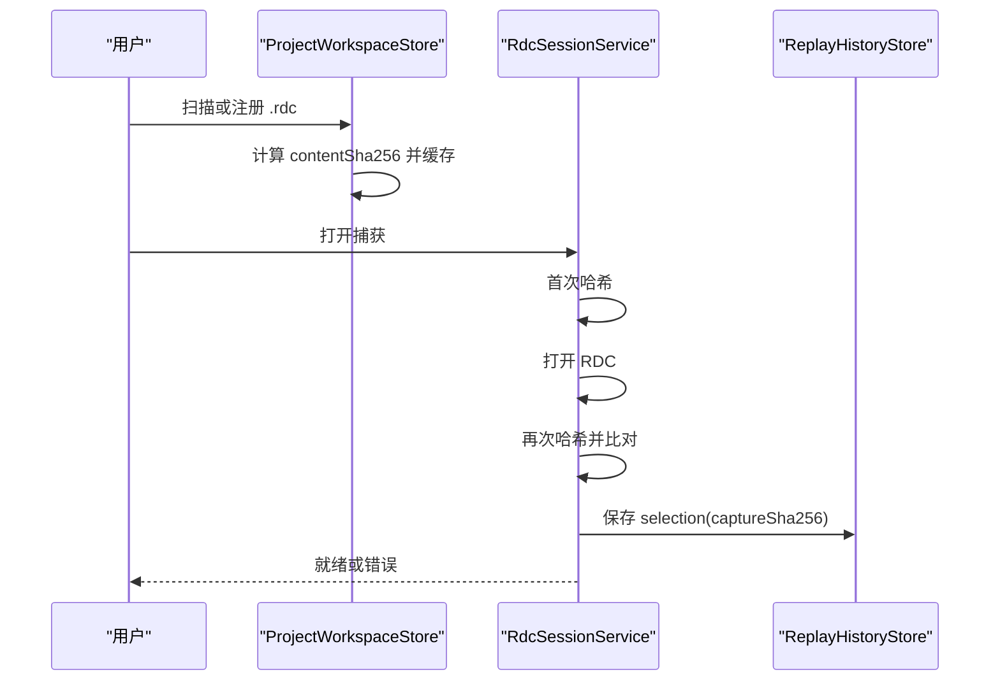
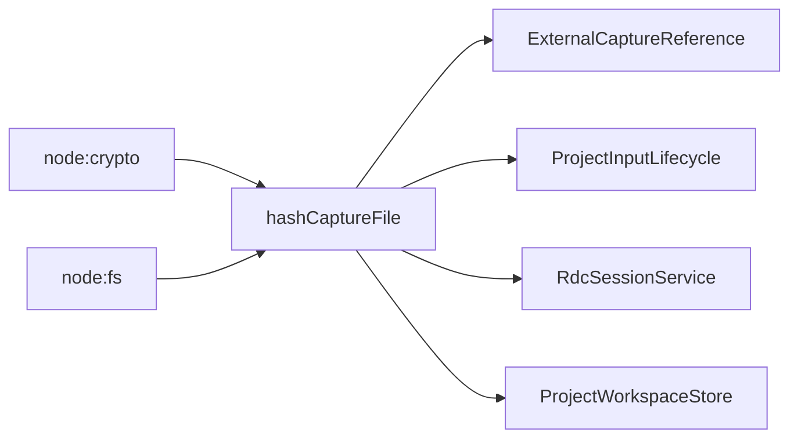

# Capture 内容哈希计算

<cite>
**本文引用的文件**
- [captureContentHash.ts](file://src/main/captures/replay/captureContentHash.ts)
- [ExternalCaptureReference.ts](file://src/main/captures/ExternalCaptureReference.ts)
- [ProjectInputLifecycle.ts](file://src/main/captures/ProjectInputLifecycle.ts)
- [RdcSessionService.ts](file://src/main/sessions/RdcSessionService.ts)
- [ProjectWorkspaceStore.ts](file://src/main/sessions/ProjectWorkspaceStore.ts)
- [ReplayHistoryStore.test.ts](file://src/main/captures/replay/ReplayHistoryStore.test.ts)
</cite>

## 目录
1. [引言](#引言)
2. [项目结构定位](#项目结构定位)
3. [核心组件](#核心组件)
4. [架构总览](#架构总览)
5. [详细组件分析](#详细组件分析)
6. [依赖关系分析](#依赖关系分析)
7. [性能与资源优化](#性能与资源优化)
8. [故障排查指南](#故障排查指南)
9. [结论](#结论)

## 引言
本文聚焦 RDC 捕获文件的“内容哈希计算”能力，重点解释 `hashCaptureFile` 的流式 SHA-256 算法、内存优化策略，以及围绕 `before/after/dev/inode/size/mtimeNs/ctimeNs` 的文件一致性校验机制。同时说明该返回值在各组件中的使用方式，并给出大文件处理、并发安全、资源清理等实践建议。

## 项目结构定位
哈希计算能力集中在捕获回放子系统中：
- 核心实现位于 `src/main/captures/replay/captureContentHash.ts`。
- 外部引用注册与验证位于 `src/main/captures/ExternalCaptureReference.ts`。
- 项目输入生命周期校验与删除流程位于 `src/main/captures/ProjectInputLifecycle.ts`。
- 会话打开、绑定、重绑与回放状态管理位于 `src/main/sessions/RdcSessionService.ts`。
- 项目扫描、缓存指纹与批量哈希调用位于 `src/main/sessions/ProjectWorkspaceStore.ts`。
- 回放历史存储行为在测试中体现对 `captureSha256` 的使用边界。

**图示来源**
- [captureContentHash.ts:1-24](file://src/main/captures/replay/captureContentHash.ts#L1-L24)
- [RdcSessionService.ts:100-190](file://src/main/sessions/RdcSessionService.ts#L100-L190)
- [ProjectWorkspaceStore.ts:560-590](file://src/main/sessions/ProjectWorkspaceStore.ts#L560-L590)
- [ExternalCaptureReference.ts:1-54](file://src/main/captures/ExternalCaptureReference.ts#L1-L54)
- [ProjectInputLifecycle.ts:20-95](file://src/main/captures/ProjectInputLifecycle.ts#L20-L95)

**章节来源**
- [captureContentHash.ts:1-24](file://src/main/captures/replay/captureContentHash.ts#L1-L24)
- [RdcSessionService.ts:100-190](file://src/main/sessions/RdcSessionService.ts#L100-L190)
- [ProjectWorkspaceStore.ts:560-590](file://src/main/sessions/ProjectWorkspaceStore.ts#L560-L590)
- [ExternalCaptureReference.ts:1-54](file://src/main/captures/ExternalCaptureReference.ts#L1-L54)
- [ProjectInputLifecycle.ts:20-95](file://src/main/captures/ProjectInputLifecycle.ts#L20-L95)

## 核心组件
- `hashCaptureFile(filePath)`
  - 功能：对 `.rdc` 捕获文件进行流式 SHA-256 计算，并在哈希前后做多重文件系统状态检查。
  - 返回：`{ sha256, size, mtimeMs }`。
- `createExternalCaptureReference(filePath)`
  - 功能：对外部 `.rdc` 文件进行路径、头标识、符号链接、硬链接与内容一致性检查，再委托 `hashCaptureFile` 计算最终内容摘要。
- `verifyExternalCaptureReference(input)`
  - 功能：根据已注册的 `referenceIdentity` 和 `contentSha256` 再次验证外部引用是否被替换或移动。
- `ProjectInputLifecycle.prepare/remove/reconcile`
  - 功能：在项目输入维度校验路径、哈希、活跃会话锁定、移除后二次校验，并对捕获哈希变化进行会话关闭与回放历史对齐。
- `RdcSessionService.openProjectInput/rebindInput`
  - 功能：打开捕获前计算哈希；打开成功后再次校验；捕获字节变化时中止打开并报错；支持输入重绑定并保持会话状态一致。
- `ProjectWorkspaceStore.collectProjectInputs`
  - 功能：扫描项目输入，基于 `dev/inode/size/mtimeMs/ctimeMs` 指纹缓存哈希结果，避免重复计算。

**章节来源**
- [captureContentHash.ts:1-24](file://src/main/captures/replay/captureContentHash.ts#L1-L24)
- [ExternalCaptureReference.ts:1-54](file://src/main/captures/ExternalCaptureReference.ts#L1-L54)
- [ProjectInputLifecycle.ts:1-95](file://src/main/captures/ProjectInputLifecycle.ts#L1-L95)
- [RdcSessionService.ts:100-220](file://src/main/sessions/RdcSessionService.ts#L100-L220)
- [ProjectWorkspaceStore.ts:520-590](file://src/main/sessions/ProjectWorkspaceStore.ts#L520-L590)

## 架构总览
`hashCaptureFile` 是底层原子能力，上层多个组件通过不同策略复用其结果：
- 会话层关心“打开过程中内容是否变更”。
- 项目层关心“输入索引是否可信任、是否发生移动或替换”。
- 外部引用关心“用户显式注册的源文件是否仍指向同一 inode 与内容摘要”。
- 回放历史层关心“以 `captureSha256` 为键隔离不同版本的内容”。

**图示来源**
- [captureContentHash.ts:1-24](file://src/main/captures/replay/captureContentHash.ts#L1-L24)

## 详细组件分析

### `hashCaptureFile` 流式哈希与一致性校验
该函数采用 Node.js 原生能力实现：
- 使用 `fs.lstat` 获取命名路径的初始元信息，排除非普通文件与符号链接。
- 使用 `fs.open` 打开句柄，并通过 `handle.createReadStream({ autoClose: false })` 迭代读取分块。
- 使用 `createHash('sha256')` 增量更新摘要。
- 读取完成后立即用 `handle.stat` 再次检查句柄对应文件状态，再用 `fs.lstat` 检查命名路径是否被替换。
- 比较 `dev`、`inode`、`size`、`mtimeNs`、`ctimeNs`，若任一阶段发生变化，抛出 `CAPTURE_CHANGED_DURING_HASH`。
- 成功时返回 `{ sha256, size, mtimeMs }`，其中 `mtimeMs` 由 `mtimeNs` 换算为毫秒时间戳。
- `finally` 中确保句柄被关闭，避免文件描述符泄漏。

**图示来源**
- [captureContentHash.ts:1-24](file://src/main/captures/replay/captureContentHash.ts#L1-L24)

**章节来源**
- [captureContentHash.ts:1-24](file://src/main/captures/replay/captureContentHash.ts#L1-L24)

### 文件一致性验证机制
一致性验证贯穿三个层面：

1. **基础类型与符号链接防护**
   - 拒绝非普通文件。
   - 拒绝符号链接，防止别名绕过权限或路径约束。
   - 外部引用额外拒绝多硬链接文件（`nlink > 1`），避免共享 inode 导致语义不稳定。

2. **before/after/dev/inode/size/mtimeNs/ctimeNs 多重状态检查**
   - `before`：命名路径初始状态。
   - `after`：句柄状态，用于检测打开到读取完成期间文件是否被替换。
   - `namedAfter`：命名路径最终状态，用于检测文件被替换或变为符号链接。
   - 比较字段包括设备号、节点号、文件大小、修改时间纳秒、创建时间纳秒。

3. **文件替换检测**
   - 如果 `dev/inode` 变化，说明文件被替换。
   - 如果 `size/mtimeNs/ctimeNs` 变化，说明内容或元数据变化。
   - 外部引用还检查原始 `ctimeNs` 是否保持，确保未发生隐式替换。

这些机制共同保证：即使并发写入、外部程序替换文件、符号链接切换、硬链接共享，只要检测到不一致，就拒绝接受当前哈希结果。

**章节来源**
- [captureContentHash.ts:1-24](file://src/main/captures/replay/captureContentHash.ts#L1-L24)
- [ExternalCaptureReference.ts:1-54](file://src/main/captures/ExternalCaptureReference.ts#L1-L54)

### `CAPTURE_CHANGED_DURING_HASH` 触发条件与处理策略
触发条件包括：
- `hashCaptureFile` 内部发现 `before`、`after`、`namedAfter` 任一状态不一致。
- 外部引用注册时在打开句柄后立即检查 `dev/inode/ctimeNs`。
- 外部引用注册完成后再检查一次 `dev/inode/ctimeNs`。
- 会话打开流程在首次哈希后、打开成功后再次哈希，若两次 `sha256` 不同，则转换为业务错误 `CAPTURE_CHANGED_DURING_OPEN`。

处理策略：
- 阻止继续使用该哈希结果。
- 会话层关闭已打开的资源并上报错误，要求重新打开。
- 项目输入移除流程在提交后再次 `prepare`，若审批身份不匹配则拒绝删除。
- 外部引用验证失败时要求用户显式重新注册。

**图示来源**
- [RdcSessionService.ts:100-190](file://src/main/sessions/RdcSessionService.ts#L100-L190)
- [ExternalCaptureReference.ts:1-54](file://src/main/captures/ExternalCaptureReference.ts#L1-L54)
- [ProjectInputLifecycle.ts:40-95](file://src/main/captures/ProjectInputLifecycle.ts#L40-L95)

**章节来源**
- [RdcSessionService.ts:100-190](file://src/main/sessions/RdcSessionService.ts#L100-L190)
- [ExternalCaptureReference.ts:1-54](file://src/main/captures/ExternalCaptureReference.ts#L1-L54)
- [ProjectInputLifecycle.ts:40-95](file://src/main/captures/ProjectInputLifecycle.ts#L40-L95)

### 返回值 `{ sha256, size, mtimeMs }` 的使用方式
- `sha256`
  - 作为捕获内容的稳定标识，用于会话状态、回放历史隔离、项目输入对齐、重绑定匹配。
- `size`
  - 用于记录输入大小，便于审计与清理策略。
- `mtimeMs`
  - 用于记录最后修改时间，作为外部引用记录的 `lastModifiedAt`。

各组件用法要点：
- `RdcSessionService`：保存 `captureSha256`，并在重绑定输入时重新计算哈希以匹配会话状态。
- `ProjectWorkspaceStore`：扫描项目输入时将 `contentSha256` 写入输入记录，并使用 `fingerprint` 缓存避免重复计算。
- `ExternalCaptureReference`：将 `contentSha256` 与 `referenceIdentity` 一起持久化，供后续验证。
- `ProjectInputLifecycle`：将 `contentSha256` 参与审批身份签名，确保输入未被替换。

**图示来源**
- [RdcSessionService.ts:100-220](file://src/main/sessions/RdcSessionService.ts#L100-L220)
- [ProjectWorkspaceStore.ts:560-590](file://src/main/sessions/ProjectWorkspaceStore.ts#L560-L590)
- [ExternalCaptureReference.ts:1-54](file://src/main/captures/ExternalCaptureReference.ts#L1-L54)
- [ProjectInputLifecycle.ts:20-95](file://src/main/captures/ProjectInputLifecycle.ts#L20-L95)

**章节来源**
- [RdcSessionService.ts:100-220](file://src/main/sessions/RdcSessionService.ts#L100-L220)
- [ProjectWorkspaceStore.ts:560-590](file://src/main/sessions/ProjectWorkspaceStore.ts#L560-L590)
- [ExternalCaptureReference.ts:1-54](file://src/main/captures/ExternalCaptureReference.ts#L1-L54)
- [ProjectInputLifecycle.ts:20-95](file://src/main/captures/ProjectInputLifecycle.ts#L20-L95)

### 与实际 RDC 文件操作的集成示例
典型流程如下：
1. 用户选择或导入一个 `.rdc` 文件。
2. 项目工作区扫描或外部引用注册调用哈希计算。
3. 会话服务打开捕获前先哈希，打开成功后再次哈希。
4. 若哈希变化，会话层关闭资源并提示重新打开。
5. 回放历史以 `captureSha256` 作为隔离键存储图像与事件。
6. 项目输入对齐逻辑根据哈希变化决定是否关闭会话或重绑定输入。

**图示来源**
- [ProjectWorkspaceStore.ts:520-590](file://src/main/sessions/ProjectWorkspaceStore.ts#L520-L590)
- [RdcSessionService.ts:100-190](file://src/main/sessions/RdcSessionService.ts#L100-L190)
- [ReplayHistoryStore.test.ts:1-180](file://src/main/captures/replay/ReplayHistoryStore.test.ts#L1-L180)

**章节来源**
- [ProjectWorkspaceStore.ts:520-590](file://src/main/sessions/ProjectWorkspaceStore.ts#L520-L590)
- [RdcSessionService.ts:100-190](file://src/main/sessions/RdcSessionService.ts#L100-L190)
- [ReplayHistoryStore.test.ts:1-180](file://src/main/captures/replay/ReplayHistoryStore.test.ts#L1-L180)

## 依赖关系分析
- `hashCaptureFile` 直接依赖 Node.js 的 `node:crypto` 和 `node:fs`。
- `ExternalCaptureReference` 依赖 `hashCaptureFile` 与路径安全检查。
- `ProjectInputLifecycle` 依赖 `hashCaptureFile` 与回放历史对齐。
- `RdcSessionService` 依赖 `hashCaptureFile` 与外部引用验证。
- `ProjectWorkspaceStore` 依赖 `hashCaptureFile` 并进行指纹缓存。

**图示来源**
- [captureContentHash.ts:1-24](file://src/main/captures/replay/captureContentHash.ts#L1-L24)
- [ExternalCaptureReference.ts:1-54](file://src/main/captures/ExternalCaptureReference.ts#L1-L54)
- [ProjectInputLifecycle.ts:1-95](file://src/main/captures/ProjectInputLifecycle.ts#L1-L95)
- [RdcSessionService.ts:100-220](file://src/main/sessions/RdcSessionService.ts#L100-L220)
- [ProjectWorkspaceStore.ts:520-590](file://src/main/sessions/ProjectWorkspaceStore.ts#L520-L590)

**章节来源**
- [captureContentHash.ts:1-24](file://src/main/captures/replay/captureContentHash.ts#L1-L24)
- [ExternalCaptureReference.ts:1-54](file://src/main/captures/ExternalCaptureReference.ts#L1-L54)
- [ProjectInputLifecycle.ts:1-95](file://src/main/captures/ProjectInputLifecycle.ts#L1-L95)
- [RdcSessionService.ts:100-220](file://src/main/sessions/RdcSessionService.ts#L100-L220)
- [ProjectWorkspaceStore.ts:520-590](file://src/main/sessions/ProjectWorkspaceStore.ts#L520-L590)

## 性能与资源优化
- 大文件处理
  - 使用流式读取避免一次性加载整个文件到内存。
  - 分块通过异步迭代器消费，降低峰值内存占用。
  - 对于超大 `.rdc` 文件，应确保磁盘 I/O 不被其他高负载任务抢占。
- 并发安全
  - `hashCaptureFile` 本身无全局锁，但上层通过会话串行化和项目输入阻塞机制限制并发访问。
  - `ProjectWorkspaceStore` 使用 `verifiedInputs` 缓存 `fingerprint` 与 `sha256`，减少重复哈希。
  - 回放历史存储通过测试覆盖串行写入、配额与锁保护。
- 资源清理
  - `createReadStream` 使用 `autoClose: false`，由 `finally` 手动关闭句柄，避免依赖默认行为导致的泄漏。
  - 会话层在异常分支也尝试关闭绑定，避免残留上下文或设备占用。
- 优化建议
  - 若频繁扫描大量小文件，可保留现有指纹缓存策略，并结合项目生命周期定期清理缓存。
  - 若并发打开大量捕获，应考虑限制并行度，避免同时持有过多文件句柄。
  - 对网络挂载或慢速磁盘，可增加重试与超时控制，但需保持一致性检查不变。

[本节提供通用指导，不直接分析具体代码行]

## 故障排查指南
常见问题与定位建议：
- `CAPTURE_UNSAFE_FILE`
  - 检查文件是否为普通文件，是否存在符号链接或多硬链接。
  - 确认路径是否经过安全校验。
- `CAPTURE_CHANGED_DURING_HASH`
  - 检查是否有外部程序在哈希期间修改 `.rdc`。
  - 检查文件是否被替换、移动到同名位置、或被软链/硬链覆盖。
- `CAPTURE_REFERENCE_INVALID_PATH` / `CAPTURE_REFERENCE_INVALID_RDC`
  - 检查外部引用路径是否为绝对路径且扩展名为 `.rdc`。
  - 检查文件头部标识是否符合预期。
- `CAPTURE_REFERENCE_INVALID_RECORD`
  - 检查已注册的外部引用记录是否包含必要字段。
- `PROJECT_INPUT_BUSY` / `PROJECT_INPUT_CHANGED_AFTER_APPROVAL`
  - 检查是否有会话仍在操作该输入，或审批身份是否因内容变化而失效。
- `REPLAY_*` 相关错误
  - 回放历史测试覆盖了配额、损坏恢复、链接保护、锁竞争等行为，可参考测试场景定位问题。

**章节来源**
- [ExternalCaptureReference.ts:1-54](file://src/main/captures/ExternalCaptureReference.ts#L1-L54)
- [ProjectInputLifecycle.ts:20-95](file://src/main/captures/ProjectInputLifecycle.ts#L20-L95)
- [RdcSessionService.ts:100-220](file://src/main/sessions/RdcSessionService.ts#L100-L220)
- [ReplayHistoryStore.test.ts:1-180](file://src/main/captures/replay/ReplayHistoryStore.test.ts#L1-L180)

## 结论
`hashCaptureFile` 以流式 SHA-256 为核心，结合严格的一致性校验，为 RDC 捕获文件提供了可靠的内容标识。上层组件通过该哈希实现会话状态管理、项目输入对齐、外部引用验证与回放历史隔离。为保证正确性与性能，系统同时引入符号链接防护、硬链接限制、before/after 状态比较、句柄手动关闭、指纹缓存与会话级串行化。在大文件或高并发场景中，应重点关注 I/O 压力、句柄数量与缓存策略，并遵循现有错误码与关闭流程进行故障排查。