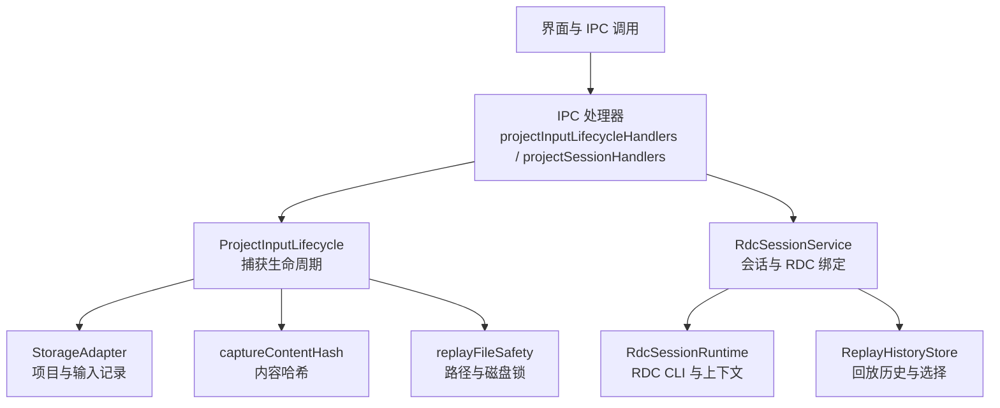
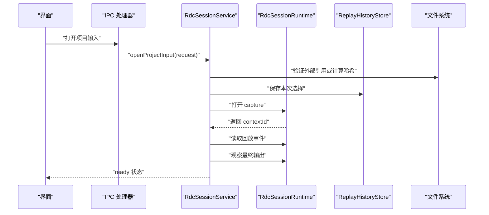
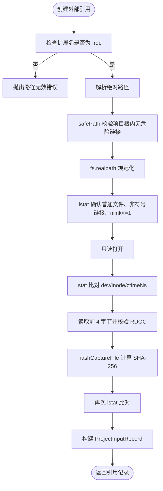
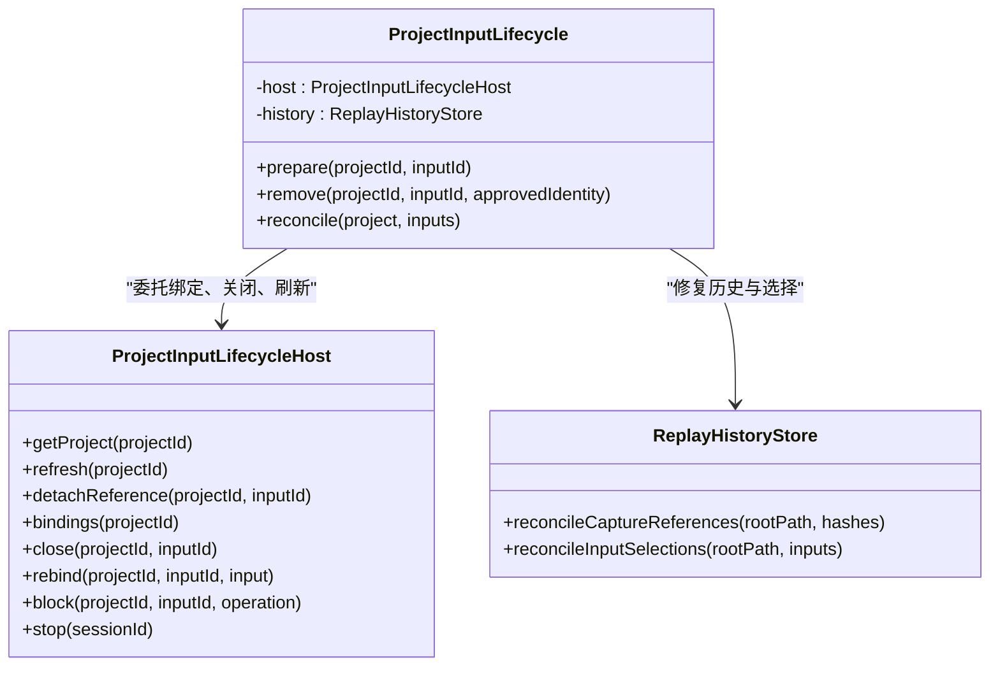
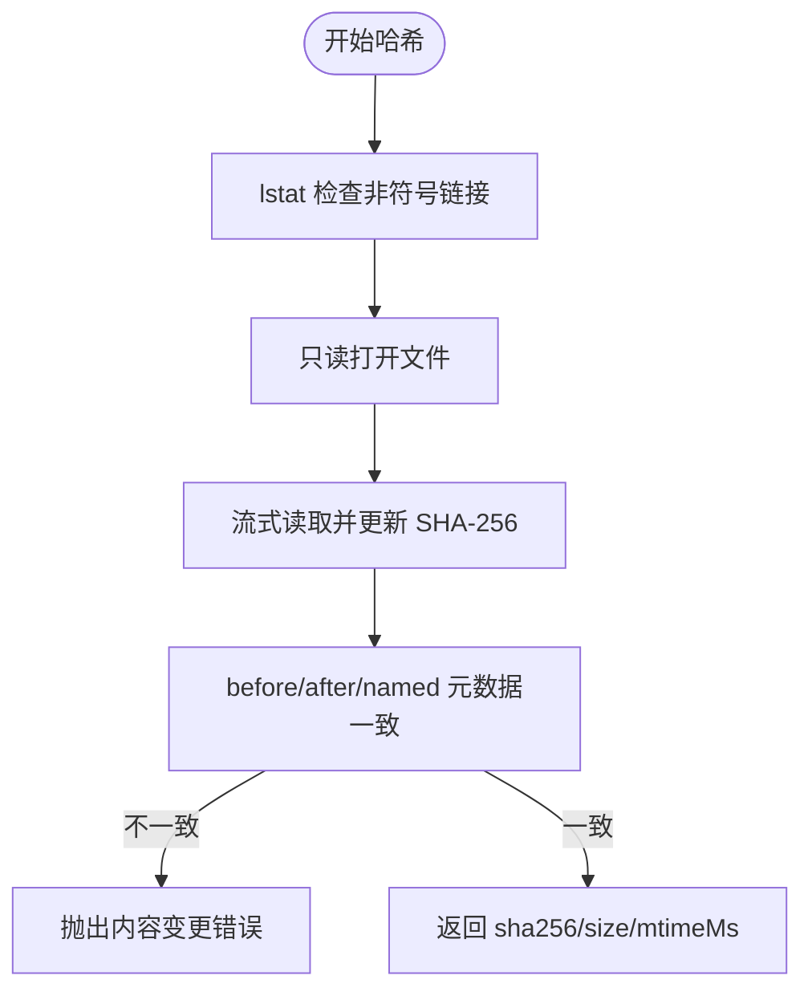
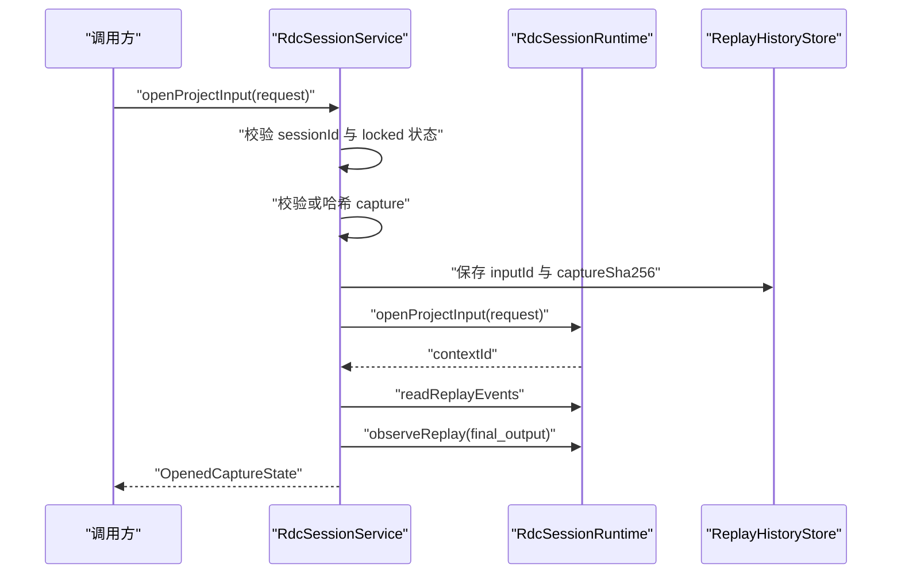
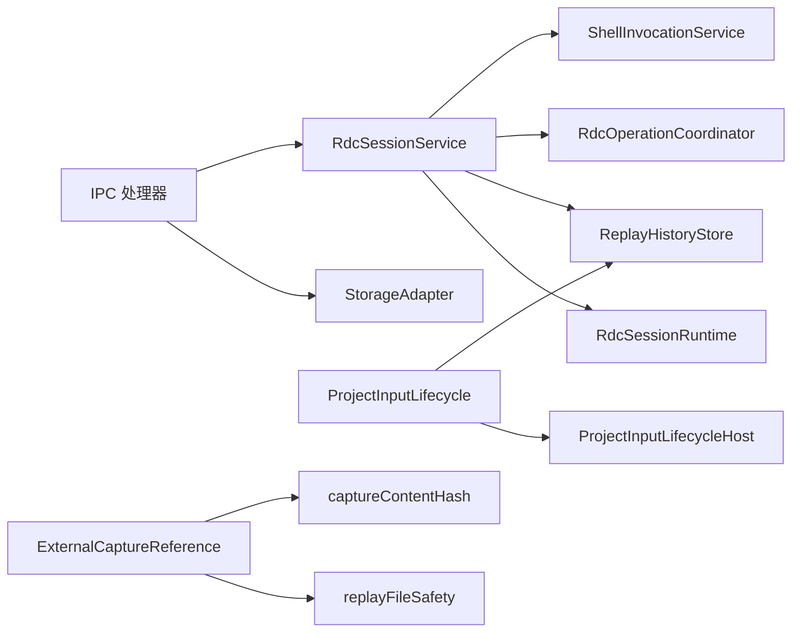

# Capture 管理

<cite>
**本文引用的文件**
- [ExternalCaptureReference.ts](file://src/main/captures/ExternalCaptureReference.ts)
- [ProjectInputLifecycle.ts](file://src/main/captures/ProjectInputLifecycle.ts)
- [captureContentHash.ts](file://src/main/captures/replay/captureContentHash.ts)
- [replayFileSafety.ts](file://src/main/captures/replay/replayFileSafety.ts)
- [RdcSessionService.ts](file://src/main/sessions/RdcSessionService.ts)
- [projectInputLifecycleHandlers.ts](file://src/main/ipc/projectInputLifecycleHandlers.ts)
- [projectSessionHandlers.ts](file://src/main/ipc/projectSessionHandlers.ts)
</cite>

## 目录
1. [引言](#引言)
2. [项目结构](#项目结构)
3. [核心组件](#核心组件)
4. [架构总览](#架构总览)
5. [详细组件分析](#详细组件分析)
6. [依赖关系分析](#依赖关系分析)
7. [性能与安全特性](#性能与安全特性)
8. [故障排查指南](#故障排查指南)
9. [结论](#结论)

## 引言
本文聚焦仓库中“抓帧 capture”的管理机制，围绕以下目标展开：
- ExternalCaptureReference 如何验证外部 capture 引用，包括路径安全检查、沙箱约束与协议白名单。
- ProjectInputLifecycle 如何管理 capture 从导入到清理的完整生命周期。
- captureContentHash 如何计算文件哈希，用于去重与完整性校验。
- RdcSessionService 中的 binding 机制如何将应用 session id 与 RDC context 关联。
- capture 文件的权限控制、安全扫描与恶意文件防护机制。
- capture 导入、验证、打开的实际代码示例路径。
- 与 RenderDoc capture 格式的兼容性与版本处理策略。

本说明面向对渲染调试回放系统有基础理解但可能不熟悉具体实现的读者，先给出高层流程，再深入到关键实现细节。

## 项目结构
Capture 相关逻辑主要分布在主进程模块中，分为三层：
- 输入与存储层：负责项目、输入记录、导入刷新等持久化操作。
- 生命周期层：负责 capture 的校验、绑定、关闭、删除、重建与历史一致性修复。
- 会话与服务层：负责将 session 与 RDC runtime/context 绑定，执行打开、回放、观察与关闭。

图表来源
- [projectInputLifecycleHandlers.ts:1-132](file://src/main/ipc/projectInputLifecycleHandlers.ts#L1-L132)
- [projectSessionHandlers.ts:1-200](file://src/main/ipc/projectSessionHandlers.ts#L1-L200)
- [ProjectInputLifecycle.ts:1-95](file://src/main/captures/ProjectInputLifecycle.ts#L1-L95)
- [RdcSessionService.ts:1-291](file://src/main/sessions/RdcSessionService.ts#L1-L291)
- [captureContentHash.ts:1-24](file://src/main/captures/replay/captureContentHash.ts#L1-L24)
- [replayFileSafety.ts:1-120](file://src/main/captures/replay/replayFileSafety.ts#L1-L120)

章节来源
- [projectInputLifecycleHandlers.ts:1-132](file://src/main/ipc/projectInputLifecycleHandlers.ts#L1-L132)
- [projectSessionHandlers.ts:1-200](file://src/main/ipc/projectSessionHandlers.ts#L1-L200)

## 核心组件
- ExternalCaptureReference：对外部 .rdc 文件建立“显式注册引用”，不做目录遍历，也不授予写权限；通过路径安全校验、符号链接拒绝、硬链接数检查、RDOC 头校验与内容哈希完成强约束。
- ProjectInputLifecycle：提供 prepare、remove、reconcile 三个入口，统一处理路径逃逸、哈希更新、交互锁、绑定查询、会话停止、物理删除或仅移除引用。
- captureContentHash：使用 SHA-256 流式计算哈希，并在读取前后比对 inode/dev/mtime/ctime/size，确保同一字节序列未被替换。
- replayFileSafety：提供 safePath 路径白名单校验、原子写入、树大小统计、项目级磁盘锁。
- RdcSessionService：维护 session 与 RDC runtime/context 的绑定，提供 open/close/rebind/observe 等操作，并协调设备占用、交互锁、隔离状态与回放事件。

章节来源
- [ExternalCaptureReference.ts:1-54](file://src/main/captures/ExternalCaptureReference.ts#L1-L54)
- [ProjectInputLifecycle.ts:1-95](file://src/main/captures/ProjectInputLifecycle.ts#L1-L95)
- [captureContentHash.ts:1-24](file://src/main/captures/replay/captureContentHash.ts#L1-L24)
- [replayFileSafety.ts:1-120](file://src/main/captures/replay/replayFileSafety.ts#L1-L120)
- [RdcSessionService.ts:1-291](file://src/main/sessions/RdcSessionService.ts#L1-L291)

## 架构总览
下图展示一次典型 capture 打开流程：界面发起请求，IPC 层进入 RdcSessionService，服务先校验输入记录或哈希，然后打开 RDC runtime，加载回放事件并观察最终输出，最后发布 ready 状态。

图表来源
- [projectSessionHandlers.ts:150-200](file://src/main/ipc/projectSessionHandlers.ts#L150-L200)
- [RdcSessionService.ts:60-180](file://src/main/sessions/RdcSessionService.ts#L60-L180)
- [captureContentHash.ts:1-24](file://src/main/captures/replay/captureContentHash.ts#L1-L24)
- [ExternalCaptureReference.ts:1-54](file://src/main/captures/ExternalCaptureReference.ts#L1-L54)

## 详细组件分析

### ExternalCaptureReference：外部引用验证
ExternalCaptureReference 的职责是“只读登记外部 .rdc 文件为项目输入”，其安全模型强调：
- 路径必须绝对且扩展名为 .rdc。
- 通过 safePath 在根卷上进行逐段解析，拒绝符号链接、拒绝跳出项目根目录、拒绝 Windows junction 等危险路径。
- 使用 fs.realpath 获取规范路径后，用 lstat 确认是普通文件、非符号链接、nlink 不大于 1，防止硬链接指向多所有者文件。
- 以只读句柄打开后再次 stat，对比 dev/inode/ctimeNs，避免竞态下被替换。
- 读取前 4 字节并校验 ASCII 头部是否为 RDOC，确保是 RenderDoc capture 格式。
- 计算完整文件 SHA-256，完成后再次 lstat 校验不变。
- 生成稳定的 inputId、contentSha256、referenceIdentity（包含 device、inode、birthtimeNs），便于后续 verifyExternalCaptureReference 重新核验。

verifyExternalCaptureReference 会重新走一遍 createExternalCaptureReference，并与原始记录逐项比对 filePath、contentSha256、device、inode、birthtimeNs，任何不一致都要求用户重新登记当前文件。

图表来源
- [ExternalCaptureReference.ts:7-54](file://src/main/captures/ExternalCaptureReference.ts#L7-L54)
- [replayFileSafety.ts:12-44](file://src/main/captures/replay/replayFileSafety.ts#L12-L44)
- [captureContentHash.ts:5-24](file://src/main/captures/replay/captureContentHash.ts#L5-L24)

章节来源
- [ExternalCaptureReference.ts:1-54](file://src/main/captures/ExternalCaptureReference.ts#L1-L54)
- [replayFileSafety.ts:1-120](file://src/main/captures/replay/replayFileSafety.ts#L1-L120)
- [captureContentHash.ts:1-24](file://src/main/captures/replay/captureContentHash.ts#L1-L24)

### ProjectInputLifecycle：capture 生命周期管理
ProjectInputLifecycle 暴露三个关键方法：
- prepare：根据 projectId 和 inputId 定位输入，若是 external_reference，则要求 referenceIdentity 与 contentSha256 存在；否则校验路径相对性、扩展名、安全路径，并重新计算哈希填充 verified 记录。随后查询该输入的所有绑定，若存在 interactionLock 则认为输入繁忙。最终返回 approvalIdentity，用于后续授权令牌校验。
- remove：在 host.block 保护下，先 prepare，再用 approvalToken 校验；调用 close 关闭绑定；再次 prepare 做二次校验；external_reference 仅 detachReference，不删原文件；其他类型则 unlink 删除文件并 refresh 项目输入。异常时返回失败结果与清理状态。
- reconcile：当扫描完成提交新 inputs 索引后，保证所有输入都有 contentSha256；按 captureHash 查找移动后的文件并重绑；若找不到且仍有 interactionLock，则 stop 对应 session；最后清理历史引用与输入选择。

图表来源
- [ProjectInputLifecycle.ts:1-95](file://src/main/captures/ProjectInputLifecycle.ts#L1-L95)

章节来源
- [ProjectInputLifecycle.ts:1-95](file://src/main/captures/ProjectInputLifecycle.ts#L1-L95)

### captureContentHash：哈希与完整性
captureContentHash.hashCaptureFile 的实现要点：
- 使用 fs.lstat 确认目标不是符号链接。
- 以只读句柄打开，并用 createReadStream 流式计算 SHA-256。
- 在读取前、读取中、读取后分别比较 before/after/named 的 dev、inode、size、mtimeNs、ctimeNs，任一变化都抛出 CAPTURE_CHANGED_DURING_HASH。
- 返回 sha256、size、mtimeMs，供 ProjectInputLifecycle 与 RdcSessionService 进行去重与完整性判断。

图表来源
- [captureContentHash.ts:5-24](file://src/main/captures/replay/captureContentHash.ts#L5-L24)

章节来源
- [captureContentHash.ts:1-24](file://src/main/captures/replay/captureContentHash.ts#L1-L24)

### RdcSessionService：session 与 RDC context 绑定
RdcSessionService 是应用 session 与 RDC 运行时上下文的桥梁，核心职责包括：
- binding：按 sessionId+projectId 映射到 Binding，Binding 内含 RdcSessionRuntime、CaptureReplayState 与 deviceId。
- lock/assertInteraction：检测是否处于 agent_running、delegated_execution、native_exit_unconfirmed 等交互锁，阻止人类操作。
- openProjectInput：先校验 request.sessionId，检查 blockedInputs，必要时独占远程设备；对外部引用走 verifyExternalCaptureReference，对其他输入走 hashCaptureFile；保存选择；打开 runtime；再次验证哈希；读取回放事件；观察 final_output；发布 ready。
- observeAgentOperation/observe：封装回放观察，区分 human/tool/frozenCli 场景，并将观察结果写入 ReplayHistoryStore。
- rebindInput：当输入被移动但内容哈希未变时，批量更新绑定并保存选择。
- blockInputOperations/listBindingsForProject/closeMatchingCaptures：为删除、刷新、停止提供并发保护与跨 session 同步。

图表来源
- [RdcSessionService.ts:60-180](file://src/main/sessions/RdcSessionService.ts#L60-L180)

章节来源
- [RdcSessionService.ts:1-291](file://src/main/sessions/RdcSessionService.ts#L1-L291)

### 实际代码示例路径
以下为常见操作的入口与参考位置，不包含具体代码内容：
- 导入 .rdc 文件：IPC 处理器弹出文件选择对话框，过滤 RenderDoc Capture 扩展名，调用 storageAdapter.importProjectInputs 并广播 project:inputsChanged。
  - 参考路径：[projectSessionHandlers.ts:150-200](file://src/main/ipc/projectSessionHandlers.ts#L150-L200)
- 导入指定路径数组：接收 filePaths 参数，直接调用 importProjectInputs 并广播变更。
  - 参考路径：[projectSessionHandlers.ts:200-230](file://src/main/ipc/projectSessionHandlers.ts#L200-L230)
- 验证外部 capture 引用：在打开 capture 前，若输入 source 为 external_reference，调用 verifyExternalCaptureReference 重新校验引用记录。
  - 参考路径：[RdcSessionService.ts:100-160](file://src/main/sessions/RdcSessionService.ts#L100-L160)
- 打开 capture：openProjectInput 中完成哈希校验、保存选择、打开 runtime、读取事件、观察输出、发布 ready。
  - 参考路径：[RdcSessionService.ts:60-180](file://src/main/sessions/RdcSessionService.ts#L60-L180)
- 删除 capture：prepareRemove 弹窗确认后颁发 approvalToken，remove 执行关闭、二次 prepare、detachReference 或 unlink。
  - 参考路径：[projectInputLifecycleHandlers.ts:40-110](file://src/main/ipc/projectInputLifecycleHandlers.ts#L40-L110)

章节来源
- [projectSessionHandlers.ts:150-230](file://src/main/ipc/projectSessionHandlers.ts#L150-L230)
- [RdcSessionService.ts:60-180](file://src/main/sessions/RdcSessionService.ts#L60-L180)
- [projectInputLifecycleHandlers.ts:40-110](file://src/main/ipc/projectInputLifecycleHandlers.ts#L40-L110)

### 与 RenderDoc capture 格式的兼容性与版本处理
当前实现通过读取文件前 4 字节并校验 ASCII 头部为 RDOC 来识别 RenderDoc capture 格式。该方式属于“文件格式存在性校验”，并未解析版本号字段或进行语义兼容分支处理。因此：
- 兼容性边界：仅保证文件头匹配 RDOC 即可进入哈希与打开流程；具体 RDC 子版本能力取决于底层 RdcSessionRuntime 与 RDC CLI。
- 版本处理策略：仓库中未发现显式的 RDC 版本解析与降级逻辑，建议未来在读取 header 后增加版本字段解析，并在打开阶段根据版本能力进行提示或限制。
- 风险点：不同 RDC 版本可能引入新的数据结构，当前哈希仅保障内容不变，无法保证回放行为完全一致；建议在日志中记录 observed 版本差异，并结合回放观察结果进行告警。

章节来源
- [ExternalCaptureReference.ts:28-38](file://src/main/captures/ExternalCaptureReference.ts#L28-L38)
- [RdcSessionService.ts:120-170](file://src/main/sessions/RdcSessionService.ts#L120-L170)

## 依赖关系分析
Capture 管理的依赖链如下：
- IPC 层依赖 storageAdapter 与 rdcSessionService。
- ProjectInputLifecycle 依赖 ProjectInputLifecycleHost 与 ReplayHistoryStore。
- RdcSessionService 依赖 RdcSessionRuntime、replayHistoryStore、shellInvocationService、RdcOperationCoordinator 等。
- ExternalCaptureReference 依赖 node:fs、node:path、node:crypto 与 replayFileSafety。
- captureContentHash 依赖 node:crypto 与 node:fs。

图表来源
- [projectInputLifecycleHandlers.ts:1-132](file://src/main/ipc/projectInputLifecycleHandlers.ts#L1-L132)
- [projectSessionHandlers.ts:1-200](file://src/main/ipc/projectSessionHandlers.ts#L1-L200)
- [RdcSessionService.ts:1-291](file://src/main/sessions/RdcSessionService.ts#L1-L291)
- [ProjectInputLifecycle.ts:1-95](file://src/main/captures/ProjectInputLifecycle.ts#L1-L95)
- [ExternalCaptureReference.ts:1-54](file://src/main/captures/ExternalCaptureReference.ts#L1-L54)
- [captureContentHash.ts:1-24](file://src/main/captures/replay/captureContentHash.ts#L1-L24)
- [replayFileSafety.ts:1-120](file://src/main/captures/replay/replayFileSafety.ts#L1-L120)

## 性能与安全特性

### 性能特性
- 哈希计算采用流式读取，避免一次性加载大文件到内存，降低峰值内存占用。
- 通过 captureHash 去重，避免重复打开相同内容的 capture。
- 生命周期操作使用 serial 队列与 Promise.allSettled 聚合，减少交叉竞争。
- 文件监听器使用防抖与定时同步，避免频繁刷新导致 IO 抖动。

### 安全特性
- 路径安全：safePath 在项目根目录下逐段解析，拒绝符号链接与越界路径，支持 Windows junction 检测。
- 文件属性：lstat 拒绝符号链接、nlink>1 的硬链接，防止多所有者文件被替换。
- 头部白名单：仅接受 RDOC 头，排除非 RenderDoc 文件。
- 内容一致性：哈希前后多次比对元数据，捕获竞态替换。
- 访问控制：仅打开只读句柄，不进行写入；删除操作需用户确认与 approvalToken。
- 隔离状态：RDC context 若处于 quarantine，会话状态会被强制标记 error，禁止回放输出。
- 磁盘锁：projectLock 使用临时文件与硬链接实现互斥，崩溃恢复由 pid/token 校验。

章节来源
- [replayFileSafety.ts:12-120](file://src/main/captures/replay/replayFileSafety.ts#L12-L120)
- [captureContentHash.ts:5-24](file://src/main/captures/replay/captureContentHash.ts#L5-L24)
- [RdcSessionService.ts:20-60](file://src/main/sessions/RdcSessionService.ts#L20-L60)

## 故障排查指南
常见错误与处理建议：
- CAPTURE_REFERENCE_INVALID_PATH：外部引用路径非绝对或非 .rdc，检查传入路径与扩展名。
  - 参考路径：[ExternalCaptureReference.ts:9-12](file://src/main/captures/ExternalCaptureReference.ts#L9-L12)
- CAPTURE_UNSAFE_FILE：目标为符号链接或 nlink>1，检查文件是否被链接到其他位置或被多个所有者拥有。
  - 参考路径：[ExternalCaptureReference.ts:14-15](file://src/main/captures/ExternalCaptureReference.ts#L14-L15)
- CAPTURE_REFERENCE_INVALID_RDC：文件头不是 RDOC，确认文件是否为有效 RenderDoc capture。
  - 参考路径：[ExternalCaptureReference.ts:32-38](file://src/main/captures/ExternalCaptureReference.ts#L32-L38)
- CAPTURE_CHANGED_DURING_HASH：哈希过程中文件元数据变化，重试打开或检查外部程序是否正在修改 capture。
  - 参考路径：[ExternalCaptureReference.ts:20-24](file://src/main/captures/ExternalCaptureReference.ts#L20-L24)
  - 参考路径：[captureContentHash.ts:15-22](file://src/main/captures/replay/captureContentHash.ts#L15-L22)
- PROJECT_INPUT_BUSY：输入仍被某个 session 持有 interactionLock，先停止相关会话再删除。
  - 参考路径：[ProjectInputLifecycle.ts:30-36](file://src/main/captures/ProjectInputLifecycle.ts#L30-L36)
- RDC_INTERACTION_LOCKED：当前处于 agent_running、delegated_execution 或 native_exit_unconfirmed，等待交互释放。
  - 参考路径：[RdcSessionService.ts:36-56](file://src/main/sessions/RdcSessionService.ts#L36-L56)
- RDC_CONTEXT_QUARANTINED：RDC context 被隔离，关闭并重新打开 capture。
  - 参考路径：[RdcSessionService.ts:48-60](file://src/main/sessions/RdcSessionService.ts#L48-L60)
- REPLAY_PATH_ESCAPE/REPLAY_UNSAFE_LINK：路径越界或检测到危险链接，检查项目根与目标路径。
  - 参考路径：[replayFileSafety.ts:12-44](file://src/main/captures/replay/replayFileSafety.ts#L12-L44)

章节来源
- [ExternalCaptureReference.ts:9-38](file://src/main/captures/ExternalCaptureReference.ts#L9-L38)
- [captureContentHash.ts:15-22](file://src/main/captures/replay/captureContentHash.ts#L15-L22)
- [ProjectInputLifecycle.ts:30-36](file://src/main/captures/ProjectInputLifecycle.ts#L30-L36)
- [RdcSessionService.ts:36-60](file://src/main/sessions/RdcSessionService.ts#L36-L60)
- [replayFileSafety.ts:12-44](file://src/main/captures/replay/replayFileSafety.ts#L12-L44)

## 结论
Capture 管理在本仓库中形成一条清晰的安全与一致性链路：
- 外部引用通过严格的路径与文件属性校验，以及 RDOC 头与 SHA-256 哈希保证不可伪造与不可替换。
- ProjectInputLifecycle 统一管理 capture 的 prepare/remove/reconcile，结合 approvalToken 与交互锁确保删除过程安全可控。
- RdcSessionService 将应用 session 与 RDC context 绑定，协调设备、回放、观察与历史记录，提供稳定可观测的会话状态。
- 当前 RenderDoc 版本兼容性以头部白名单为主，尚未实现版本解析与降级策略，可在未来增强。
- 安全方面覆盖路径逃逸、符号链接、硬链接、隔离状态、磁盘锁与只读访问，适合生产环境使用。