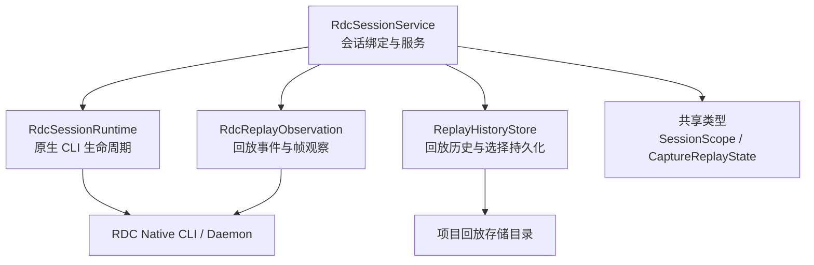
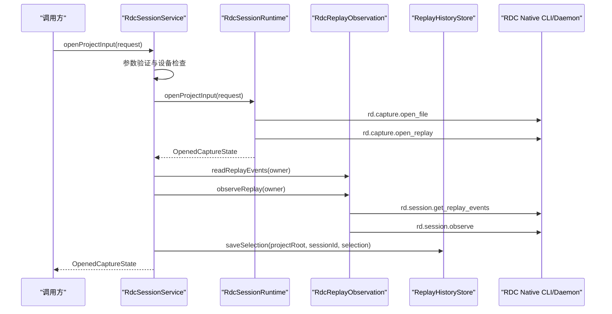
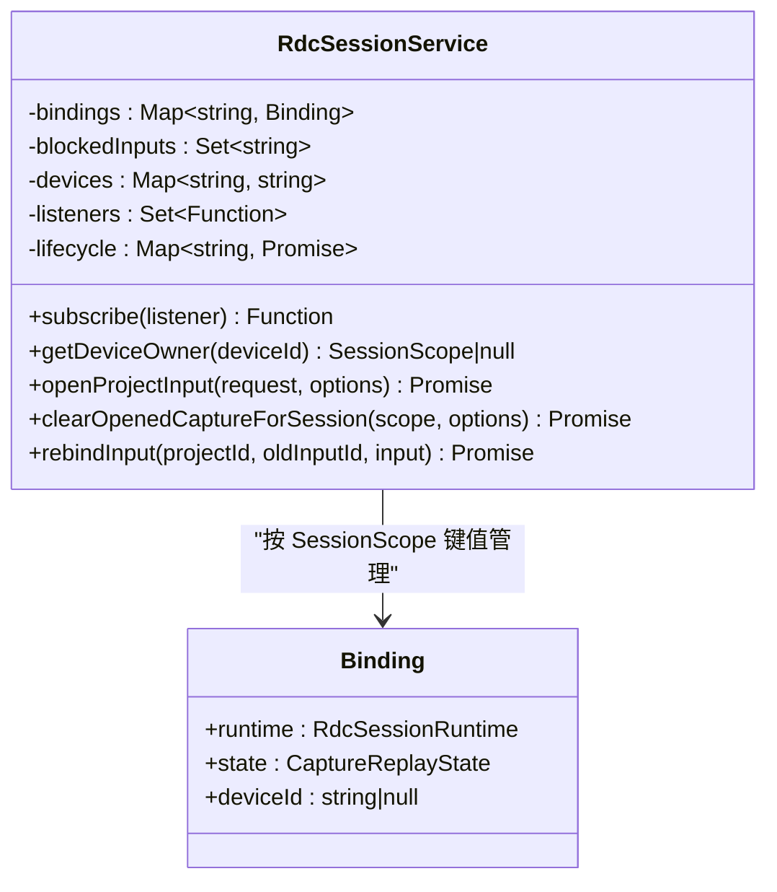
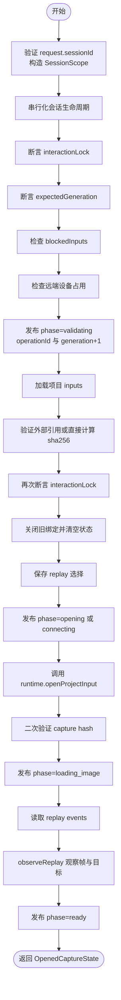
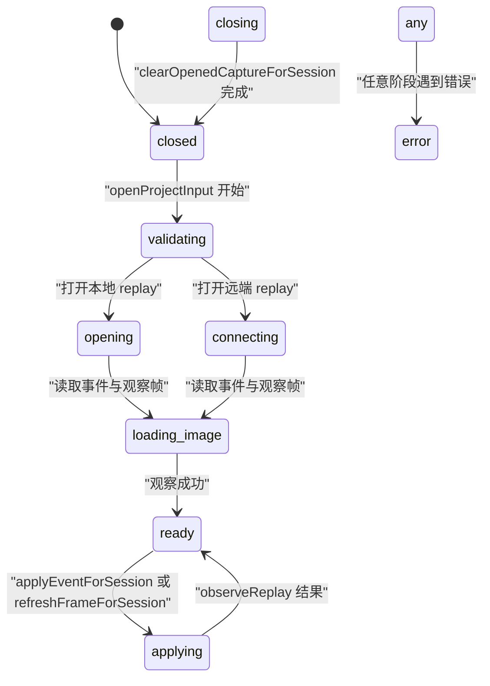
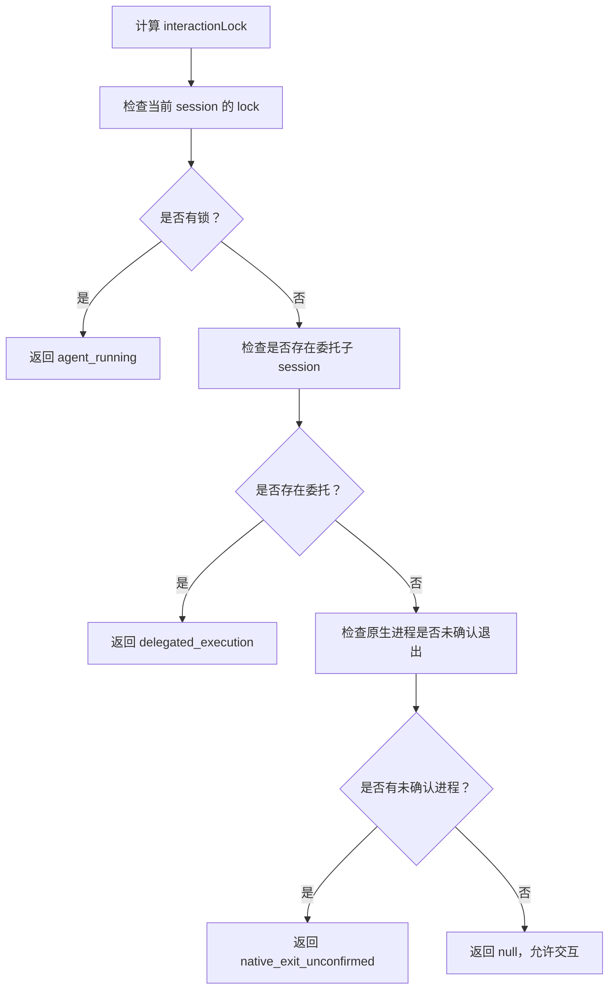
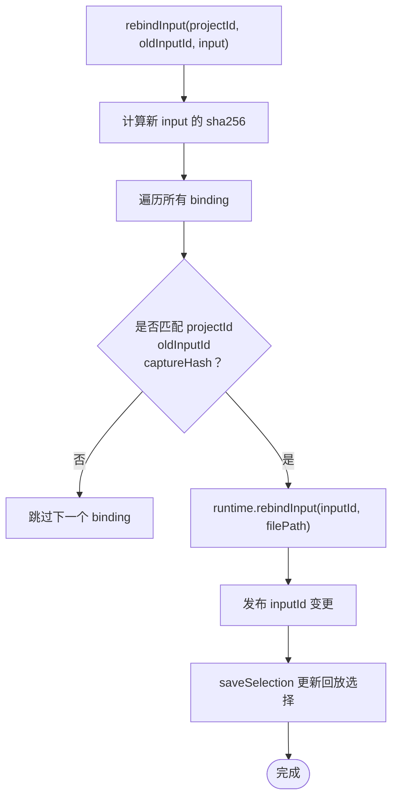
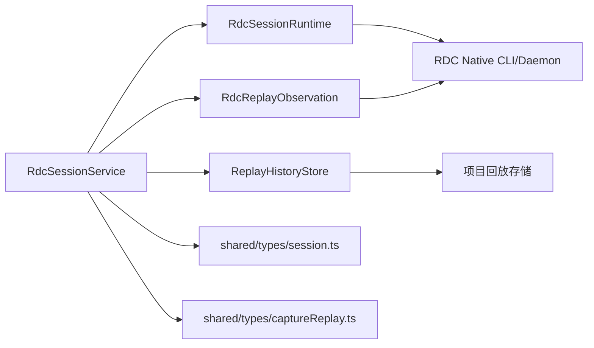

# RDC Session 绑定与状态管理

<cite>
**本文引用的文件**   
- [RdcSessionService.ts](file://src/main/sessions/RdcSessionService.ts)
- [RdcSessionRuntime.ts](file://src/main/sessions/RdcSessionRuntime.ts)
- [RdcReplayObservation.ts](file://src/main/sessions/RdcReplayObservation.ts)
- [ReplayHistoryStore.ts](file://src/main/captures/replay/ReplayHistoryStore.ts)
- [session.ts](file://src/shared/types/session.ts)
- [captureReplay.ts](file://src/shared/types/captureReplay.ts)
</cite>

## 目录
1. [引言](#引言)
2. [项目结构定位](#项目结构定位)
3. [核心组件总览](#核心组件总览)
4. [架构概览](#架构概览)
5. [详细组件分析](#详细组件分析)
6. [依赖关系分析](#依赖关系分析)
7. [性能与并发特性](#性能与并发特性)
8. [故障排查指南](#故障排查指南)
9. [结论](#结论)

## 引言
本文面向需要理解 RDC（远程调试捕获）会话绑定、设备占用、回放观察以及状态机流转的开发者。重点围绕 `RdcSessionService` 的 binding 机制、`openProjectInput` 完整流程、状态机设计、版本控制字段、操作追踪、`interactionLock` 锁定原因，以及 `rebindInput` 输入重绑定逻辑展开。文档同时提供代码级流程图和时序图，帮助读者从高层架构逐步深入到具体实现细节。

## 项目结构定位
RDC 会话相关的主要实现位于主进程 sessions 模块中：
- `RdcSessionService`：对外暴露会话绑定、打开捕获、关闭捕获、事件应用、回放刷新、输入重绑定等接口。
- `RdcSessionRuntime`：封装 RDC 原生 CLI 生命周期、上下文租约、本地或远端 replay 打开、运行时上下文提取与清理。
- `RdcReplayObservation`：通过 RDC native API 读取 replay events 并观察当前帧、目标纹理、设备展示状态。
- `ReplayHistoryStore`：持久化回放历史、截图、选择项，并提供配额校验与数据恢复。
- 共享类型定义：`SessionScope`、`OpenProjectInputRequest`、`OpenedCaptureState`、`CaptureReplayState` 等位于 shared 类型文件中。

**图表来源**
- [RdcSessionService.ts:1-200](file://src/main/sessions/RdcSessionService.ts#L1-L200)
- [RdcSessionRuntime.ts:1-200](file://src/main/sessions/RdcSessionRuntime.ts#L1-L200)
- [RdcReplayObservation.ts:1-107](file://src/main/sessions/RdcReplayObservation.ts#L1-L107)
- [ReplayHistoryStore.ts:1-200](file://src/main/captures/replay/ReplayHistoryStore.ts#L1-L200)
- [session.ts:425-455](file://src/shared/types/session.ts#L425-L455)
- [captureReplay.ts:11-23](file://src/shared/types/captureReplay.ts#L11-L23)

**章节来源**
- [RdcSessionService.ts:1-200](file://src/main/sessions/RdcSessionService.ts#L1-L200)
- [RdcSessionRuntime.ts:1-200](file://src/main/sessions/RdcSessionRuntime.ts#L1-L200)
- [RdcReplayObservation.ts:1-107](file://src/main/sessions/RdcReplayObservation.ts#L1-L107)
- [ReplayHistoryStore.ts:1-200](file://src/main/captures/replay/ReplayHistoryStore.ts#L1-L200)
- [session.ts:425-455](file://src/shared/types/session.ts#L425-L455)
- [captureReplay.ts:11-23](file://src/shared/types/captureReplay.ts#L11-L23)

## 核心组件总览
- **RdcSessionService**
  - 维护 per-session 的 `Binding`：包含 `RdcSessionRuntime`、`CaptureReplayState`、设备 id。
  - 使用 Map 键值 `[projectId, sessionId]` 作为 `SessionScope` 的唯一标识。
  - 管理设备所有权：`devices` 映射设备 id 到 `SessionScope` 字符串。
  - 对外暴露 `openProjectInput`、`clearOpenedCaptureForSession`、`rebindInput`、`applyEventForSession`、`refreshFrameForSession` 等方法。
- **RdcSessionRuntime**
  - 负责 RDC daemon 启动/停止、`rd.capture.open_file`、`rd.capture.open_replay`、`rd.session.clear_context` 调用。
  - 解析返回的 `RdcRuntimeContext`，注册 session 租约，跟踪 `contextId`、`backend`、`remoteId`、`deviceLabel` 等。
  - 提供 `rebindInput`、`switchActiveCapture`、`snapshotContextForSession`、`clearOpenedCaptureForSession`。
- **RdcReplayObservation**
  - 调用 `rd.session.get_replay_events` 获取事件列表。
  - 调用 `rd.session.observe` 获取当前帧图像、目标纹理、设备展示状态、最终输出标记。
- **ReplayHistoryStore**
  - 以 project + session + captureSha256 为根组织回放历史。
  - 写入带摘要的 PNG 图像、manifest.json，支持分页查询、图片读取、选择保存与恢复。

**章节来源**
- [RdcSessionService.ts:1-200](file://src/main/sessions/RdcSessionService.ts#L1-L200)
- [RdcSessionRuntime.ts:1-200](file://src/main/sessions/RdcSessionRuntime.ts#L1-L200)
- [RdcReplayObservation.ts:1-107](file://src/main/sessions/RdcReplayObservation.ts#L1-L107)
- [ReplayHistoryStore.ts:1-200](file://src/main/captures/replay/ReplayHistoryStore.ts#L1-L200)

## 架构概览
下图展示 RDC 会话绑定的关键交互：上层服务发起打开请求，服务层进行输入验证与设备检查，运行时层打开本地或远端 replay，观察层读取事件并观察帧，持久层记录回放历史与选择。

**图表来源**
- [RdcSessionService.ts:120-200](file://src/main/sessions/RdcSessionService.ts#L120-L200)
- [RdcSessionRuntime.ts:60-200](file://src/main/sessions/RdcSessionRuntime.ts#L60-L200)
- [RdcReplayObservation.ts:20-107](file://src/main/sessions/RdcReplayObservation.ts#L20-L107)
- [ReplayHistoryStore.ts:180-220](file://src/main/captures/replay/ReplayHistoryStore.ts#L180-L220)

## 详细组件分析

### RdcSessionService 绑定机制
- **SessionScope 键值映射**
  - 每个 binding 使用 `JSON.stringify([projectId, sessionId])` 作为 Map 键。
  - `getDeviceOwner(deviceId)` 反向查找设备被哪个 session 持有。
- **Binding 对象结构**
  - `runtime`: 当前 session 的 `RdcSessionRuntime`。
  - `state`: 当前回放状态 `CaptureReplayState`。
  - `deviceId`: 当前占用的 replay 设备 id。
- **设备所有权管理**
  - `devices: Map<string, string>` 将设备 id 映射到 `SessionScope` 字符串。
  - 打开捕获时若传入远端设备，先检查是否已被其他 session 占用；成功则登记设备。
  - 关闭捕获时释放设备，但保留由原生进程持有的 context 所有权直到明确确认关闭。
- **发布与监听**
  - `publish(binding, patch)` 合并 patch，递增 `revision`，计算新的 `interactionLock`，并通过订阅者通知。
  - 当上下文处于 quarantine 时，强制将状态切换为 error，并设置错误码 `RDC_CONTEXT_QUARANTINED`。

**图表来源**
- [RdcSessionService.ts:10-60](file://src/main/sessions/RdcSessionService.ts#L10-L60)
- [captureReplay.ts:11-23](file://src/shared/types/captureReplay.ts#L11-L23)

**章节来源**
- [RdcSessionService.ts:10-60](file://src/main/sessions/RdcSessionService.ts#L10-L60)
- [captureReplay.ts:11-23](file://src/shared/types/captureReplay.ts#L11-L23)

### openProjectInput 完整流程
该方法完成一次完整的 RDC 捕获打开过程，包括参数验证、设备占用检查、capture 哈希验证、RDC 上下文创建、replay 事件读取、帧观察与历史记录保存。

**图表来源**
- [RdcSessionService.ts:120-200](file://src/main/sessions/RdcSessionService.ts#L120-L200)
- [RdcSessionRuntime.ts:60-200](file://src/main/sessions/RdcSessionRuntime.ts#L60-L200)
- [RdcReplayObservation.ts:20-107](file://src/main/sessions/RdcReplayObservation.ts#L20-L107)
- [ReplayHistoryStore.ts:180-220](file://src/main/captures/replay/ReplayHistoryStore.ts#L180-L220)

关键步骤说明：
- 参数验证：要求 `request.sessionId` 存在；否则直接拒绝。
- 设备占用检查：若 replayDevice 是远端设备，检查该设备是否已属于其他 session；若是，抛出 `RDC_DEVICE_IN_USE`。
- capture 哈希验证：
  - 如果 input 是 external_reference，先通过 `verifyExternalCaptureReference` 校验路径和内容。
  - 否则直接计算文件 sha256。
  - 在打开成功后再次比对哈希，若不一致抛出 `CAPTURE_CHANGED_DURING_OPEN`。
- RDC 上下文创建：
  - `binding.runtime.openProjectInput` 负责连接设备、打开文件、打开 replay，并返回 `OpenedCaptureState`。
  - 远端 replay 会经过 `ensureReplayDeviceReady` 和 `consumePreparedRemote` 准备远端上下文。
- replay 事件读取：
  - 通过 `readReplayEvents(owner, cliSettings)` 获取事件列表。
  - 通过 `observeReplay(owner, args, cliSettings, liveTarget)` 获取帧图像、目标纹理、设备展示状态。
- 历史记录保存：
  - 成功打开后调用 `replayHistoryStore.saveSelection(project.rootPath, scope.sessionId, {inputId, captureSha256, deviceId})`。

**章节来源**
- [RdcSessionService.ts:120-200](file://src/main/sessions/RdcSessionService.ts#L120-L200)
- [RdcSessionRuntime.ts:60-200](file://src/main/sessions/RdcSessionRuntime.ts#L60-L200)
- [RdcReplayObservation.ts:20-107](file://src/main/sessions/RdcReplayObservation.ts#L20-L107)
- [ReplayHistoryStore.ts:180-220](file://src/main/captures/replay/ReplayHistoryStore.ts#L180-L220)

### 状态机设计与版本控制
`CaptureReplayState` 描述每次回放的状态快照，关键字段包括：
- `phase`：当前阶段，常见值包括 `closed`、`validating`、`opening`、`connecting`、`loading_image`、`applying`、`ready`、`closing`、`error`。
- `generation`：表示本次会话的“业务版本”，在打开或关闭时递增，用于防并发覆盖。
- `revision`：表示每次发布状态的“观察版本”，每次 `publish` 递增，供 UI 或观察者判断变更。
- `operationId`：本次操作的唯一标识，便于日志与审计。
- `requestedEventId`、`appliedEventId`、`imageEventId`：追踪用户或系统触发的目标事件、实际应用的事件以及图像对应事件。
- `events`、`targets`、`target`：回放事件列表与当前目标纹理信息。
- `isFinalOutput`：是否最终输出。
- `image`、`observation`、`devicePresentation`：帧预览、观察元数据、设备展示状态。
- `interactionLock`：当前交互锁原因。
- `error`：错误信息。

**图表来源**
- [captureReplay.ts:11-23](file://src/shared/types/captureReplay.ts#L11-L23)
- [RdcSessionService.ts:120-200](file://src/main/sessions/RdcSessionService.ts#L120-L200)
- [RdcSessionService.ts:201-291](file://src/main/sessions/RdcSessionService.ts#L201-L291)

版本控制说明：
- `generation`：在 `openProjectInput` 开始时递增，并在关闭成功后再次递增；用于防止旧操作覆盖新状态。
- `revision`：每次 `publish` 都会递增，反映状态快照的最新版本号。
- `operationId`：在打开、关闭、应用事件等操作开始时生成 UUID，用于追踪一次操作的生命周期。

**章节来源**
- [captureReplay.ts:11-23](file://src/shared/types/captureReplay.ts#L11-L23)
- [RdcSessionService.ts:120-200](file://src/main/sessions/RdcSessionService.ts#L120-L200)
- [RdcSessionService.ts:201-291](file://src/main/sessions/RdcSessionService.ts#L201-L291)

### interactionLock 机制
`interactionLock` 表示当前 session 是否允许人类交互。锁定原因包括：
- `agent_running`：当前 session 有代理执行任务，不允许人类手动干预。
- `delegated_execution`：当前 session 是委托子 session，禁止直接交互。
- `native_exit_unconfirmed`：原生进程退出尚未确认，避免在不稳定状态下修改状态。

锁定计算逻辑：
1. 优先检查当前 session 的交互锁。
2. 若存在委托子 session，则锁定原因为 `delegated_execution`。
3. 若当前 context 存在未确认的原生进程，则锁定原因为 `native_exit_unconfirmed`。
4. 特殊情况下，若选项允许 `binding` 且锁定原因是 `agent_running`，可绕过部分阻塞。

**图表来源**
- [RdcSessionService.ts:40-70](file://src/main/sessions/RdcSessionService.ts#L40-L70)

**章节来源**
- [RdcSessionService.ts:40-70](file://src/main/sessions/RdcSessionService.ts#L40-L70)

### rebindInput 输入重绑定逻辑
当某个项目的 input 被替换或更新时，`rebindInput` 会重新绑定所有匹配的 session：
- 计算新 input 的 sha256：如果是 external_reference，先验证；否则直接计算文件哈希。
- 遍历所有 binding，仅匹配 `projectId`、`oldInputId`、`captureHash` 三者一致的 session。
- 调用 `binding.runtime.rebindInput(input.inputId, input.filePath)` 更新 runtime 中的 inputId 与 filePath。
- 发布新 state，使 UI 看到 `inputId` 变化。
- 调用 `replayHistoryStore.saveSelection` 更新该 session 的选择项，保留 `captureSha256` 与 `deviceId`。

**图表来源**
- [RdcSessionService.ts:240-270](file://src/main/sessions/RdcSessionService.ts#L240-L270)
- [RdcSessionRuntime.ts:210-240](file://src/main/sessions/RdcSessionRuntime.ts#L210-L240)
- [ReplayHistoryStore.ts:180-220](file://src/main/captures/replay/ReplayHistoryStore.ts#L180-L220)

**章节来源**
- [RdcSessionService.ts:240-270](file://src/main/sessions/RdcSessionService.ts#L240-L270)
- [RdcSessionRuntime.ts:210-240](file://src/main/sessions/RdcSessionRuntime.ts#L210-L240)
- [ReplayHistoryStore.ts:180-220](file://src/main/captures/replay/ReplayHistoryStore.ts#L180-L220)

### 错误处理模式
RDC 会话在不同阶段抛出结构化错误，便于上层区分重试策略：
- 打开失败：`RDC_OPEN_FAILED`，可能伴随 `retry: 'open'`。
- 捕获内容在打开过程中变化：`CAPTURE_CHANGED_DURING_OPEN`。
- 外部引用路径无效：`CAPTURE_REFERENCE_INVALID_PATH`。
- 设备被占用：`RDC_DEVICE_IN_USE`。
- 上下文被隔离：`RDC_CONTEXT_QUARANTINED`。
- 回放繁忙：`RDC_REPLAY_BUSY`。
- 观察失败：`RDC_OBSERVE_FAILED`，可能伴随 `retry: 'image'`。
- 关闭失败：`RDC_CLOSE_FAILED`。
- 事件无效：`RDC_EVENT_INVALID`。
- 未打开：`RDC_NOT_OPEN`。
- 协议错误：`RDC_CLI_PROTOCOL`、`RDC_CAPTURE_MISMATCH`、`RDC_REMOTE_MISMATCH`、`RDC_CONTEXT_MISMATCH`。
- 观察身份不匹配：`RDC_OBSERVATION_IDENTITY_MISMATCH`。
- 图像读取失败：`RDC_IMAGE_UNREADABLE`、`RDC_IMAGE_ERROR_INVALID`。
- 历史存储失败：`REPLAY_SAVE_FAILED`、`REPLAY_MANIFEST_CORRUPT`、`REPLAY_IMAGE_CORRUPT`、`REPLAY_QUOTA_EXCEEDED`。

典型错误处理流程：
- 在 `openProjectInput` 的 catch 分支中，若远端设备仍由原生进程持有，则不清理设备占用；否则清理设备并发布 `phase=error`。
- 在 `observe` 方法中，若观察到错误，会将 `error` 写入 state，并将 `phase` 重置为 `ready`，同时清空 image、observation、appliedEventId 等临时状态。
- 在 `ReplayHistoryStore.append` 中，若写入失败，会尝试回滚新增的图片文件，确保 manifest 与图片一致性。

**章节来源**
- [RdcSessionService.ts:120-200](file://src/main/sessions/RdcSessionService.ts#L120-L200)
- [RdcSessionService.ts:201-291](file://src/main/sessions/RdcSessionService.ts#L201-L291)
- [RdcReplayObservation.ts:20-107](file://src/main/sessions/RdcReplayObservation.ts#L20-L107)
- [ReplayHistoryStore.ts:1-200](file://src/main/captures/replay/ReplayHistoryStore.ts#L1-L200)

## 依赖关系分析
RDC 会话系统的依赖关系如下：

**图表来源**
- [RdcSessionService.ts:1-200](file://src/main/sessions/RdcSessionService.ts#L1-L200)
- [RdcSessionRuntime.ts:1-200](file://src/main/sessions/RdcSessionRuntime.ts#L1-L200)
- [RdcReplayObservation.ts:1-107](file://src/main/sessions/RdcReplayObservation.ts#L1-L107)
- [ReplayHistoryStore.ts:1-200](file://src/main/captures/replay/ReplayHistoryStore.ts#L1-L200)
- [session.ts:425-455](file://src/shared/types/session.ts#L425-L455)
- [captureReplay.ts:11-23](file://src/shared/types/captureReplay.ts#L11-L23)

耦合与内聚性：
- `RdcSessionService` 高内聚于会话状态管理与协调，低耦合于底层 RDC 原生实现。
- `RdcSessionRuntime` 专注于原生 CLI 生命周期与上下文管理，内聚性强。
- `RdcReplayObservation` 专注于回放数据解析与帧观察，职责清晰。
- `ReplayHistoryStore` 专注于持久化与配额管理，具备独立的数据恢复能力。

潜在循环依赖：
- 各组件之间通过接口与类型解耦，未发现直接循环 import。
- 类型定义集中在 shared，避免实现层互相引用。

**章节来源**
- [RdcSessionService.ts:1-200](file://src/main/sessions/RdcSessionService.ts#L1-L200)
- [RdcSessionRuntime.ts:1-200](file://src/main/sessions/RdcSessionRuntime.ts#L1-L200)
- [RdcReplayObservation.ts:1-107](file://src/main/sessions/RdcReplayObservation.ts#L1-L107)
- [ReplayHistoryStore.ts:1-200](file://src/main/captures/replay/ReplayHistoryStore.ts#L1-L200)

## 性能与并发特性
- **串行化会话生命周期**：`serial(scope, fn)` 确保同一 session 的操作串行执行，避免竞态条件。
- **设备独占**：远端 replay 设备在同一时刻只能被一个 session 占用。
- **上下文租约**：通过 `RdcRuntimeContextRegistry` 管理 session 与原生上下文的关系，避免多 owner 冲突。
- **回放观察节流**：`observe` 方法会丢弃被更新的请求，避免旧滑块位置覆盖最新状态。
- **配额保护**：`ReplayHistoryStore` 对 session 与 project 级别存储进行配额限制，防止无限增长。

优化建议：
- 对于高频 UI 刷新，可考虑合并 `publish` 调用，减少状态克隆与订阅者通知次数。
- 对于远端 replay，可复用已准备好的 remote context，避免重复激活设备。
- 对于大图像写入，可评估异步压缩与分块写入，降低磁盘 I/O 压力。

[本节为通用性能讨论，不直接分析具体文件]

## 故障排查指南
常见问题与定位方法：
- **无法打开捕获**：检查 `RDC_OPEN_FAILED`、`CAPTURE_CHANGED_DURING_OPEN`、`RDC_CONTEXT_MISMATCH`。
- **设备被占用**：检查 `RDC_DEVICE_IN_USE`，确认其他 session 是否正在使用该设备。
- **交互被锁定**：检查 `interactionLock`，确认是否存在 `agent_running`、`delegated_execution`、`native_exit_unconfirmed`。
- **回放不可用**：检查 `RDC_REPLAY_BUSY`、`RDC_NOT_OPEN`，确认当前 phase 是否为 `ready` 或 `applying`。
- **观察失败**：检查 `RDC_OBSERVE_FAILED`、`RDC_OBSERVATION_IDENTITY_MISMATCH`、`RDC_IMAGE_UNREADABLE`。
- **历史存储异常**：检查 `REPLAY_MANIFEST_CORRUPT`、`REPLAY_IMAGE_CORRUPT`、`REPLAY_QUOTA_EXCEEDED`。

诊断建议：
- 打印 `CaptureReplayState` 的 `phase`、`generation`、`revision`、`operationId`、`interactionLock`。
- 检查 `RdcSessionService.listBindingsForProject` 返回的绑定列表，确认 inputId 与 captureHash 是否一致。
- 查看 `ReplayHistoryStore` 的 manifest 与 selection 文件，确认回放历史与选择是否正确持久化。

**章节来源**
- [RdcSessionService.ts:120-200](file://src/main/sessions/RdcSessionService.ts#L120-L200)
- [RdcSessionService.ts:201-291](file://src/main/sessions/RdcSessionService.ts#L201-L291)
- [RdcReplayObservation.ts:20-107](file://src/main/sessions/RdcReplayObservation.ts#L20-L107)
- [ReplayHistoryStore.ts:1-200](file://src/main/captures/replay/ReplayHistoryStore.ts#L1-L200)

## 结论
RDC Session 绑定与状态管理通过 `RdcSessionService` 实现了清晰的会话绑定、设备独占、状态机流转与版本控制。`openProjectInput` 流程严谨地完成了输入验证、设备检查、哈希校验、上下文创建、事件读取与帧观察。`interactionLock` 机制有效防止了在代理执行、委托执行与原生进程未确认退出时的非法交互。`rebindInput` 提供了安全的输入重绑定能力，确保历史回放与选择项同步更新。整体架构职责清晰、错误处理完善，适合扩展更多 RDC 功能。

[本节为总结性内容，不直接分析具体文件]