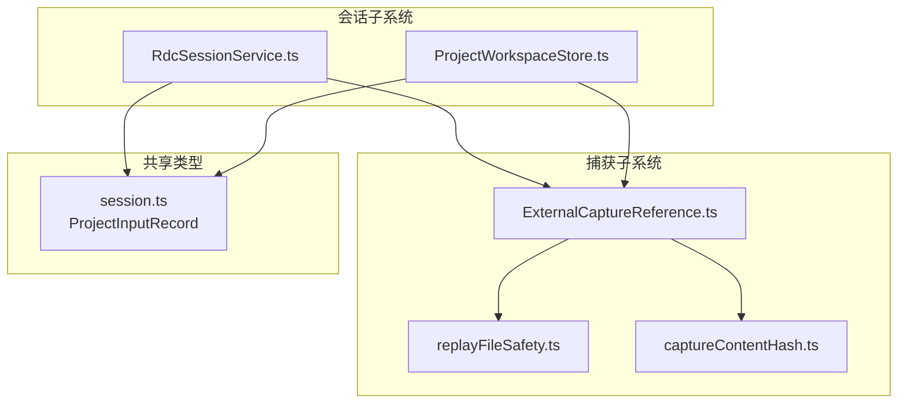
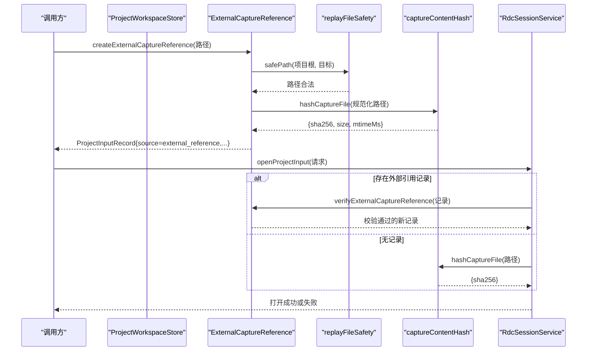
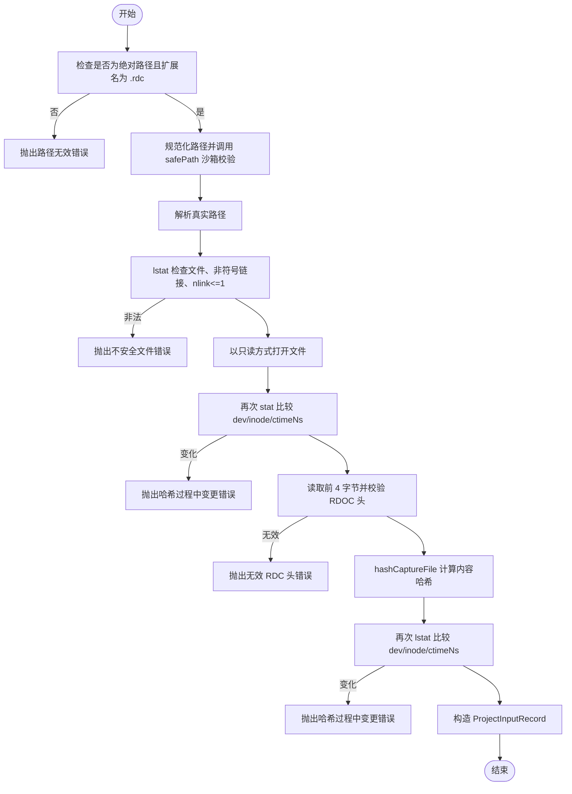
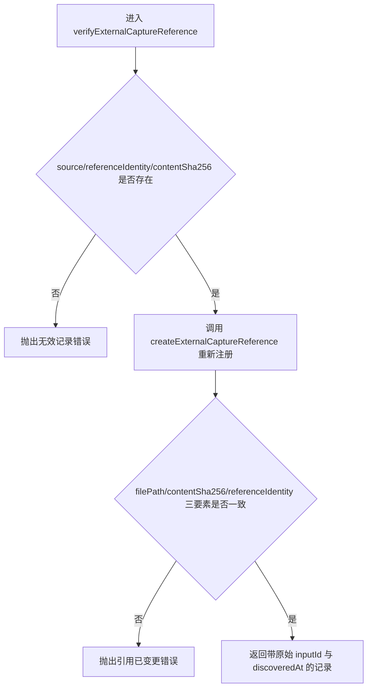
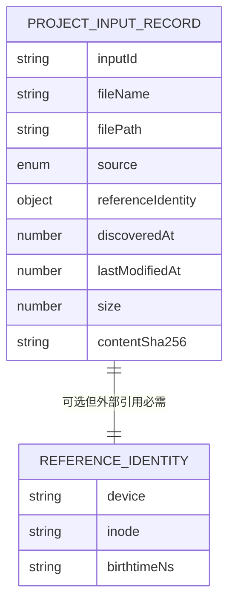
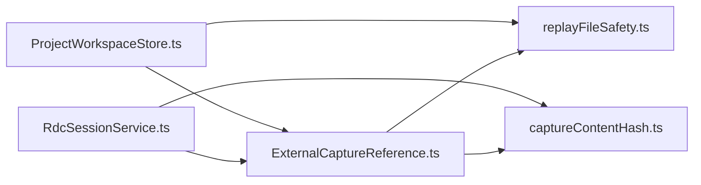

# 外部 Capture 引用验证

<cite>
**本文引用的文件**
- [ExternalCaptureReference.ts](file://src/main/captures/ExternalCaptureReference.ts)
- [ExternalCaptureReference.test.ts](file://src/main/captures/ExternalCaptureReference.test.ts)
- [replayFileSafety.ts](file://src/main/captures/replay/replayFileSafety.ts)
- [captureContentHash.ts](file://src/main/captures/replay/captureContentHash.ts)
- [RdcSessionService.ts](file://src/main/sessions/RdcSessionService.ts)
- [ProjectWorkspaceStore.ts](file://src/main/sessions/ProjectWorkspaceStore.ts)
- [session.ts](file://src/shared/types/session.ts)
</cite>

## 目录
1. [引言](#引言)
2. [项目结构](#项目结构)
3. [核心组件](#核心组件)
4. [架构总览](#架构总览)
5. [详细组件分析](#详细组件分析)
6. [依赖关系分析](#依赖关系分析)
7. [性能考虑](#性能考虑)
8. [故障排查指南](#故障排查指南)
9. [结论](#结论)

## 引言
本文聚焦“外部 Capture 引用验证”机制，系统解释如何在不复制、不写入目标文件的前提下，安全地注册和校验一个 .rdc 捕获文件。重点包括：
- `createExternalCaptureReference` 的路径安全检查与文件完整性约束。
- `verifyExternalCaptureReference` 的引用记录完整性校验。
- 基于 dev/inode/birthtimeNs 三重标识符与 ctimeNs 时间戳的文件变更检测。
- 该机制与 `ProjectInputRecord` 数据模型及会话打开流程的关系。
- 安全最佳实践与常见错误处理方案。

## 项目结构
本功能主要位于主进程 captures 与 sessions 模块之间，并共享 shared 层类型定义：

**图表来源**
- [ExternalCaptureReference.ts:1-54](file://src/main/captures/ExternalCaptureReference.ts#L1-L54)
- [replayFileSafety.ts:1-120](file://src/main/captures/replay/replayFileSafety.ts#L1-L120)
- [RdcSessionService.ts:1-200](file://src/main/sessions/RdcSessionService.ts#L1-L200)
- [ProjectWorkspaceStore.ts:1-200](file://src/main/sessions/ProjectWorkspaceStore.ts#L1-L200)
- [session.ts:1-80](file://src/shared/types/session.ts#L1-L80)

**章节来源**
- [ExternalCaptureReference.ts:1-54](file://src/main/captures/ExternalCaptureReference.ts#L1-L54)
- [replayFileSafety.ts:1-120](file://src/main/captures/replay/replayFileSafety.ts#L1-L120)
- [RdcSessionService.ts:1-200](file://src/main/sessions/RdcSessionService.ts#L1-L200)
- [ProjectWorkspaceStore.ts:1-200](file://src/main/sessions/ProjectWorkspaceStore.ts#L1-L200)
- [session.ts:1-80](file://src/shared/types/session.ts#L1-L80)

## 核心组件
- `createExternalCaptureReference(filePath)`：对传入路径进行严格安全检查，读取并哈希 .rdc 文件内容，生成只读、不可变的外部引用记录。
- `verifyExternalCaptureReference(input)`：根据已有 `ProjectInputRecord` 重新校验目标文件是否完全一致，返回可复用的验证结果。
- `safePath(projectRoot, target)`：沙箱路径检查，拒绝符号链接、硬链接与路径逃逸。
- `hashCaptureFile(canonical)`：对 .rdc 文件进行内容哈希，同时提供 mtimeMs、size、sha256 等元信息。
- `ProjectInputRecord`：描述项目输入记录的共享类型，其中 external_reference 分支包含 source、referenceIdentity、contentSha256 等字段。

**章节来源**
- [ExternalCaptureReference.ts:1-54](file://src/main/captures/ExternalCaptureReference.ts#L1-L54)
- [replayFileSafety.ts:1-120](file://src/main/captures/replay/replayFileSafety.ts#L1-L120)
- [session.ts:1-80](file://src/shared/types/session.ts#L1-L80)

## 架构总览
外部 Capture 引用在两个关键生命周期被使用：
1. **注册阶段**：用户或上层逻辑调用 `createExternalCaptureReference`，生成稳定的 `ProjectInputRecord`，用于后续会话选择。
2. **打开阶段**：`RdcSessionService.openProjectInput` 优先通过 `verifyExternalCaptureReference` 复用已验证记录；若不存在或需要重新计算，则直接哈希文件内容。

**图表来源**
- [ExternalCaptureReference.ts:1-54](file://src/main/captures/ExternalCaptureReference.ts#L1-L54)
- [RdcSessionService.ts:100-200](file://src/main/sessions/RdcSessionService.ts#L100-L200)
- [ProjectWorkspaceStore.ts:150-200](file://src/main/sessions/ProjectWorkspaceStore.ts#L150-L200)

## 详细组件分析

### 路径安全检查与注册流程
`createExternalCaptureReference` 的实现遵循“仅显式注册、不扫描目录、不写权限”的原则，按以下顺序执行安全检查：

1. **绝对路径与扩展名校验**
   - 必须为绝对路径。
   - 扩展名必须为 `.rdc`（大小写不敏感）。
   - 否则抛出“路径无效”类错误。

2. **安全路径沙箱**
   - 以项目根为基准，调用 `safePath` 校验目标路径。
   - 禁止相对路径逃逸到项目根之外。
   - 禁止路径树中出现任何符号链接。
   - 如果中间目录不存在，视为缺失而非攻击。

3. **规范化与真实路径解析**
   - 使用 `path.resolve` 规范化路径。
   - 使用 `fs.realpath` 解析最终物理路径，消除符号链影响。

4. **基础属性检查**
   - 必须是普通文件。
   - 不能是符号链接。
   - 硬链接数大于 1 会被拒绝，避免同一物理块设备上的别名混淆。

5. **打开后一致性快照**
   - 打开文件句柄后再次 stat，比较 dev、inode、ctimeNs。
   - 若在打开过程中发生变化，抛出“哈希过程中文件已变更”错误。

6. **文件头校验**
   - 读取前 4 字节，要求 ASCII 内容为 `RDOC`。
   - 否则抛出“无效的 .rdc 文件头”错误。

7. **内容哈希与变更后监控**
   - 调用 `hashCaptureFile` 计算 sha256、size、mtimeMs。
   - 再次 lstat 对比 dev、inode、ctimeNs。
   - 若发生变化，抛出“哈希过程中文件已变更”错误。

8. **构造引用记录**
   - inputId 由规范化路径的 sha256 前缀派生，保证稳定。
   - source 固定为 `external_reference`。
   - filePath 保存规范化后的真实路径。
   - referenceIdentity 使用 dev、inode、birthtimeNs 三元组作为“精确物理实体身份”。
   - contentSha256、size、lastModifiedAt 来自哈希结果。

**图表来源**
- [ExternalCaptureReference.ts:1-54](file://src/main/captures/ExternalCaptureReference.ts#L1-L54)
- [replayFileSafety.ts:1-120](file://src/main/captures/replay/replayFileSafety.ts#L1-L120)

**章节来源**
- [ExternalCaptureReference.ts:1-54](file://src/main/captures/ExternalCaptureReference.ts#L1-L54)
- [ExternalCaptureReference.test.ts:1-55](file://src/main/captures/ExternalCaptureReference.test.ts#L1-L55)

### 引用记录完整性校验
`verifyExternalCaptureReference` 的职责不是重新创建记录，而是“用当前文件系统状态重新验证旧记录”：

1. **记录必填字段检查**
   - source 必须为 `external_reference`。
   - referenceIdentity 必须存在。
   - contentSha256 必须存在。
   - 任一缺失即抛出“无效记录”错误。

2. **重新执行完整注册流程**
   - 内部调用 `createExternalCaptureReference`，重新完成路径、沙箱、头校验、哈希与变更后监控。

3. **逐字段比对**
   - filePath 必须一致。
   - contentSha256 必须一致。
   - referenceIdentity.device、inode、birthtimeNs 必须一致。

4. **返回标准化结果**
   - 校验通过后，保留原始 inputId 与 discoveredAt，确保会话历史稳定。

**图表来源**
- [ExternalCaptureReference.ts:35-54](file://src/main/captures/ExternalCaptureReference.ts#L35-L54)

**章节来源**
- [ExternalCaptureReference.ts:35-54](file://src/main/captures/ExternalCaptureReference.ts#L35-L54)
- [ExternalCaptureReference.test.ts:1-55](file://src/main/captures/ExternalCaptureReference.test.ts#L1-L55)

### 文件变更检测机制
系统使用“三重标识符 + 时间戳”的组合策略来检测文件变更：

| 标识 | 含义 | 作用 |
|---|---|---|
| dev | 文件系统设备号 | 区分不同磁盘或卷 |
| inode | 节点号 | 表示底层存储对象 |
| birthtimeNs | 创建时间纳秒级时间戳 | 增强跨平台稳定性 |
| ctimeNs | 状态变更时间纳秒级时间戳 | 快速检测内容或元数据变化 |

具体使用位置：
- **打开前后一致性**：比较 dev、inode、ctimeNs，防止文件在打开与哈希之间被替换。
- **哈希后一致性**：再次比较 dev、inode、ctimeNs，防止哈希期间发生替换。
- **引用身份**：referenceIdentity 持久化 dev、inode、birthtimeNs，用于后续验证时判断“同一个物理文件是否仍指向相同源”。

当检测到变更时，系统不会静默接受新内容，而是抛出明确错误，要求用户重新注册该文件。

**章节来源**
- [ExternalCaptureReference.ts:1-54](file://src/main/captures/ExternalCaptureReference.ts#L1-L54)

### 与 ProjectInputRecord 数据模型的关联
`ProjectInputRecord` 是外部引用的载体，关键字段如下：

| 字段 | 类型 | 说明 |
|---|---|---|
| inputId | string | 外部引用的稳定标识，由规范化路径派生 |
| fileName | string | 文件名 |
| filePath | string | 规范化后的真实路径 |
| source | string | 固定为 `external_reference` |
| referenceIdentity | object | device/inode/birthtimeNs 三元组 |
| discoveredAt | number | 首次发现时间戳 |
| lastModifiedAt | number | 最后一次修改时间 |
| size | number | 文件大小 |
| contentSha256 | string | 内容哈希，未成功验证前可能为空 |

该模型允许项目在多次刷新时保留历史输入记录，同时通过 `contentSha256` 与 `referenceIdentity` 保证引用未被替换。

**图表来源**
- [session.ts:1-80](file://src/shared/types/session.ts#L1-L80)

**章节来源**
- [session.ts:1-80](file://src/shared/types/session.ts#L1-L80)
- [ExternalCaptureReference.ts:1-54](file://src/main/captures/ExternalCaptureReference.ts#L1-L54)

### 外部引用注册与验证的实际用法

#### 场景一：注册外部 .rdc 文件
- 调用入口：`createExternalCaptureReference(filePath)`
- 适用条件：
  - 路径必须是绝对路径。
  - 扩展名必须是 `.rdc`。
  - 文件不能被符号链接或硬链接别名绕过。
  - 文件头必须是 `RDOC`。
- 输出：完整的 `ProjectInputRecord`，可用于项目输入列表与回放选择。

参考测试用例覆盖：
- 不复制、不修改原文件。
- 字节变更后拒绝旧引用。
- 同名同内容但不同文件拒绝旧引用。
- 文件删除后报告缺失错误。
- 相对路径、非 .rdc、不完整记录均被拒绝。
- 目录符号链接与硬链接被拒绝。

**章节来源**
- [ExternalCaptureReference.test.ts:1-55](file://src/main/captures/ExternalCaptureReference.test.ts#L1-L55)

#### 场景二：刷新项目输入并验证所有外部引用
- 入口：`ProjectWorkspaceStore.refreshInputsNow`
- 行为：
  - 收集本地项目输入。
  - 对所有 `source === 'external_reference'` 的记录调用 `verifyExternalCaptureReference`。
  - 将验证结果提交回项目记录。

**章节来源**
- [ProjectWorkspaceStore.ts:150-200](file://src/main/sessions/ProjectWorkspaceStore.ts#L150-L200)

#### 场景三：打开会话时优先复用已验证外部引用
- 入口：`RdcSessionService.openProjectInput`
- 行为：
  - 若项目记录中存在匹配的 `external_reference` 输入，则先尝试 `verifyExternalCaptureReference`。
  - 若验证失败或不存在，则直接对 filePath 执行内容哈希。
  - 打开成功后再次验证哈希，防止“打开过程中内容被替换”。

**章节来源**
- [RdcSessionService.ts:100-200](file://src/main/sessions/RdcSessionService.ts#L100-L200)

## 依赖关系分析
- `ExternalCaptureReference` 依赖：
  - `replayFileSafety.safePath`：路径沙箱。
  - `captureContentHash.hashCaptureFile`：内容哈希。
  - Node.js `fs.promises`：文件系统操作。
  - Node.js `path`：路径处理。
  - Node.js `crypto.createHash`：inputId 派生。
- `RdcSessionService` 依赖：
  - `ExternalCaptureReference.verifyExternalCaptureReference`：复用外部引用。
  - `captureContentHash.hashCaptureFile`：回退哈希。
  - `StorageAdapter` 与 `ReplayHistoryStore`：项目与回放历史。
- `ProjectWorkspaceStore` 依赖：
  - `ExternalCaptureReference.createExternalCaptureReference` 与 `verifyExternalCaptureReference`。
  - `replayFileSafety.safePath`：项目输入路径安全。
  - `@shared/types/session.ProjectInputRecord`：类型契约。

**图表来源**
- [ExternalCaptureReference.ts:1-54](file://src/main/captures/ExternalCaptureReference.ts#L1-L54)
- [RdcSessionService.ts:1-200](file://src/main/sessions/RdcSessionService.ts#L1-L200)
- [ProjectWorkspaceStore.ts:1-200](file://src/main/sessions/ProjectWorkspaceStore.ts#L1-L200)

**章节来源**
- [ExternalCaptureReference.ts:1-54](file://src/main/captures/ExternalCaptureReference.ts#L1-L54)
- [RdcSessionService.ts:1-200](file://src/main/sessions/RdcSessionService.ts#L1-L200)
- [ProjectWorkspaceStore.ts:1-200](file://src/main/sessions/ProjectWorkspaceStore.ts#L1-L200)

## 性能考虑
- **避免重复复制**：外部引用不复制 .rdc 文件，仅以只读方式打开，降低 I/O 与存储压力。
- **哈希成本集中在注册与验证**：
  - 注册阶段会计算完整 sha256。
  - 验证阶段会重新计算一次，以确保内容未被替换。
- **减少误判**：
  - 使用 dev/inode/birthtimeNs 三重标识提高跨平台稳定性。
  - 使用 ctimeNs 做快速变更检测，避免不必要的完整哈希。
- **批量刷新优化**：
  - `ProjectWorkspaceStore` 对输入刷新进行队列化，避免并发重复扫描。
  - 外部引用验证并行执行，但受限于文件系统 I/O。

[本节为通用性能建议，不直接分析具体代码行]

## 故障排查指南

### 常见错误与处理方案

| 错误类别 | 触发原因 | 推荐处理 |
|---|---|---|
| 路径无效 | 相对路径或非 .rdc 扩展名 | 改为绝对路径并确保扩展名为 `.rdc` |
| 路径逃逸 | 目标路径不在项目根内 | 调整目标文件位置或项目根 |
| 不安全链接 | 路径中包含符号链接 | 移除符号链接或使用真实文件 |
| 不安全文件 | 硬链接、目录、非普通文件 | 使用独立普通文件，避免 nlink>1 |
| 无效 RDC 头 | 文件头不是 `RDOC` | 确认文件确实是 RenderDoc 捕获文件 |
| 哈希过程中文件已变更 | dev/inode/ctimeNs 在打开或哈希期间变化 | 停止外部编辑，重新注册文件 |
| 无效记录 | 缺少 source、referenceIdentity 或 contentSha256 | 重新调用注册流程生成完整记录 |
| 引用已变更 | filePath、contentSha256 或 referenceIdentity 不一致 | 重新注册当前文件，不要继续使用旧记录 |
| 文件缺失 | 原文件已被删除 | 提示用户重新选择文件并注册 |

### 调试建议
- 优先检查 `filePath` 是否为规范化后的真实路径。
- 核对 `referenceIdentity` 的三个字段是否与当前文件系统状态一致。
- 若怀疑符号链接或硬链接问题，使用操作系统工具查看文件属性与链接数量。
- 在自动化脚本中，避免在注册与哈希之间修改 .rdc 文件。

**章节来源**
- [ExternalCaptureReference.test.ts:1-55](file://src/main/captures/ExternalCaptureReference.test.ts#L1-L55)
- [ExternalCaptureReference.ts:1-54](file://src/main/captures/ExternalCaptureReference.ts#L1-L54)

## 结论
外部 Capture 引用验证通过“路径沙箱 + 文件头校验 + 内容哈希 + 三重物理身份 + 时间戳监控”的多层防御，确保 .rdc 文件在注册与验证过程中不被替换、逃逸或误用。它既支持高性能复用已验证记录，又在发生变更时给出明确错误，引导用户重新注册。对于使用者而言，最关键的实践是：
- 始终使用绝对路径。
- 确保目标文件是独立的普通 .rdc 文件。
- 不要在注册与打开过程中修改原文件。
- 遇到引用变更错误时，重新注册当前文件，而不是强行复用旧记录。

[本节为总结性内容，不直接分析具体代码行]