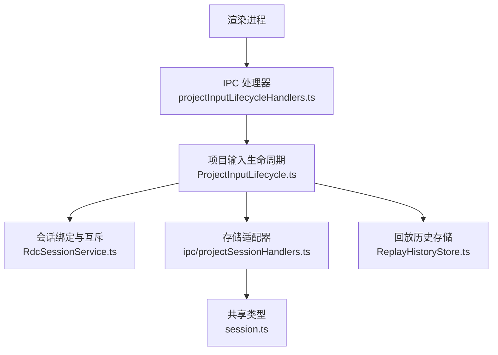
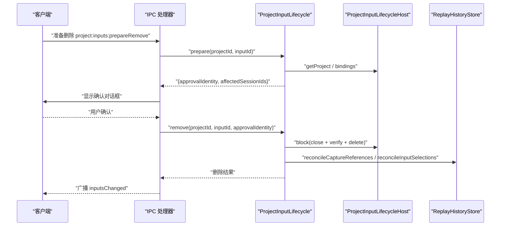
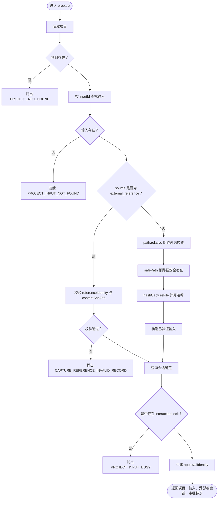
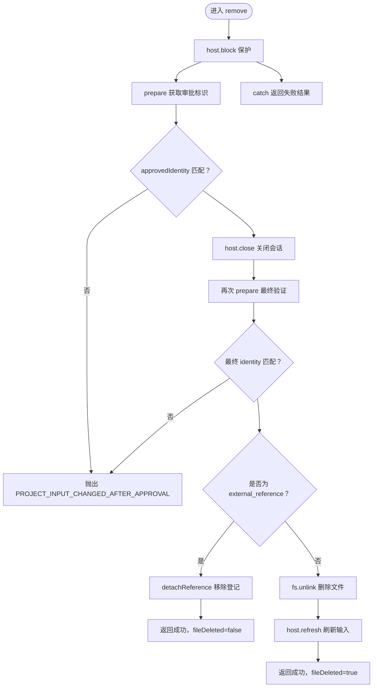
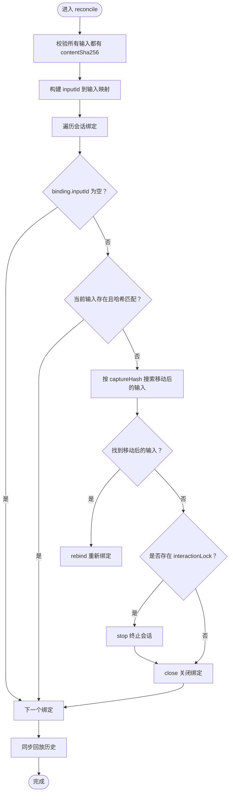
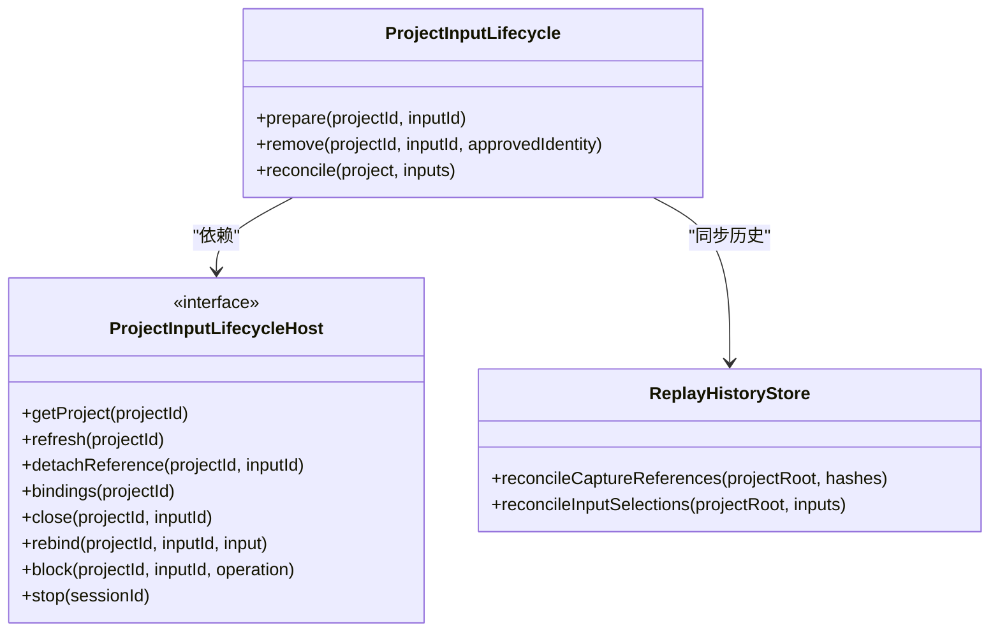
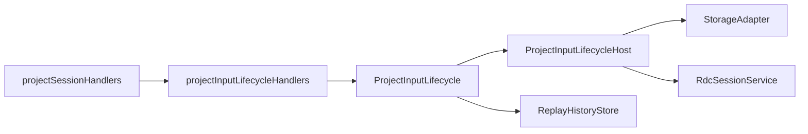

# 项目输入生命周期管理

<cite>
**本文引用的文件**
- [ProjectInputLifecycle.ts](file://src/main/captures/ProjectInputLifecycle.ts)
- [projectInputLifecycleHandlers.ts](file://src/main/ipc/projectInputLifecycleHandlers.ts)
- [projectSessionHandlers.ts](file://src/main/ipc/projectSessionHandlers.ts)
- [session.ts](file://src/shared/types/session.ts)
- [ReplayHistoryStore.ts](file://src/main/captures/replay/ReplayHistoryStore.ts)
- [RdcSessionService.ts](file://src/main/sessions/RdcSessionService.ts)
- [ProjectInputLifecycle.test.ts](file://src/main/captures/ProjectInputLifecycle.test.ts)
</cite>

## 目录
1. [引言](#引言)
2. [项目结构](#项目结构)
3. [核心组件](#核心组件)
4. [架构总览](#架构总览)
5. [详细组件分析](#详细组件分析)
6. [依赖关系分析](#依赖关系分析)
7. [性能与并发特性](#性能与并发特性)
8. [故障排查指南](#故障排查指南)
9. [结论](#结论)

## 引言
本项目输入生命周期管理围绕 `ProjectInputLifecycle` 类展开，负责在工程（Project）视角下对抓帧输入（Capture Input）进行安全验证、会话绑定清理、原子删除和扫描后同步。其设计目标包括：
- 防止路径逃逸和任意文件访问。
- 保护正在交互中的会话不被意外中断。
- 确保外部引用和本地抓帧文件在不同删除场景下的行为一致且可恢复。
- 在完整扫描提交后，将输入集合与会话回放历史重新对齐。

该模块通过 `ProjectInputLifecycleHost` 接口与存储适配器、会话服务和回放历史存储解耦，使生命周期逻辑只关注业务规则，而把 I/O、并发锁、UI 确认等职责交给宿主实现。

## 项目结构
从仓库视角看，输入生命周期相关代码主要分布在以下位置：
- 核心生命周期逻辑：`src/main/captures/ProjectInputLifecycle.ts`
- IPC 层装配与用户确认：`src/main/ipc/projectInputLifecycleHandlers.ts`
- 项目与会话 IPC 入口：`src/main/ipc/projectSessionHandlers.ts`
- 共享类型定义：`src/shared/types/session.ts`
- 回放历史持久化：`src/main/captures/replay/ReplayHistoryStore.ts`
- 会话绑定与交互锁实现：`src/main/sessions/RdcSessionService.ts`
- 单元测试：`src/main/captures/ProjectInputLifecycle.test.ts`

**图表来源**
- [projectInputLifecycleHandlers.ts:10-28](file://src/main/ipc/projectInputLifecycleHandlers.ts#L10-L28)
- [ProjectInputLifecycle.ts:1-95](file://src/main/captures/ProjectInputLifecycle.ts#L1-L95)
- [RdcSessionService.ts:20-216](file://src/main/sessions/RdcSessionService.ts#L20-L216)
- [ReplayHistoryStore.ts:1-60](file://src/main/captures/replay/ReplayHistoryStore.ts#L1-L60)
- [session.ts:12-51](file://src/shared/types/session.ts#L12-L51)

**章节来源**
- [ProjectInputLifecycle.ts:1-95](file://src/main/captures/ProjectInputLifecycle.ts#L1-L95)
- [projectInputLifecycleHandlers.ts:1-132](file://src/main/ipc/projectInputLifecycleHandlers.ts#L1-L132)
- [projectSessionHandlers.ts:1-80](file://src/main/ipc/projectSessionHandlers.ts#L1-L80)
- [session.ts:12-51](file://src/shared/types/session.ts#L12-L51)

## 核心组件
`ProjectInputLifecycle` 是输入生命周期管理的核心类，包含三个关键方法：
- `prepare`：获取并校验输入，计算哈希，识别受影响的会话，生成审批标识。
- `remove`：执行带审批、互斥保护和最终验证的删除流程。
- `reconcile`：在完整扫描提交后，重新匹配输入、移动输入、终止活跃会话并同步回放历史。

`ProjectInputLifecycleHost` 是生命周期类的宿主接口，职责清晰分离：
- `getProject`：读取项目。
- `refresh`：刷新项目输入列表。
- `detachReference`：移除外部引用登记。
- `bindings`：查询当前所有会话绑定。
- `close`：关闭匹配的捕获会话。
- `rebind`：将已存在的绑定重新绑定到新输入。
- `block`：为删除操作提供互斥保护。
- `stop`：停止指定会话的活跃交互。

**章节来源**
- [ProjectInputLifecycle.ts:1-95](file://src/main/captures/ProjectInputLifecycle.ts#L1-L95)
- [session.ts:12-51](file://src/shared/types/session.ts#L12-L51)

## 架构总览
生命周期管理由 IPC 层触发，核心逻辑委托给 `ProjectInputLifecycle`，具体资源操作由宿主注入。

**图表来源**
- [projectInputLifecycleHandlers.ts:31-101](file://src/main/ipc/projectInputLifecycleHandlers.ts#L31-L101)
- [ProjectInputLifecycle.ts:23-78](file://src/main/captures/ProjectInputLifecycle.ts#L23-L78)
- [ReplayHistoryStore.ts:1-60](file://src/main/captures/replay/ReplayHistoryStore.ts#L1-L60)

## 详细组件分析

### ProjectInputLifecycle.prepare 方法
`prepare` 负责完成输入的生命周期前置检查，重点包括：
- 通过 `host.getProject` 获取项目，不存在时抛出未找到错误。
- 在 `project.inputs` 中按 `inputId` 查找输入记录，不存在时抛出未找到错误。
- 区分两种输入源：
  - `external_reference`：外部引用不需要本地文件存在；但必须包含有效的 `referenceIdentity` 和 `contentSha256`，否则视为无效记录。
  - 非外部引用：走本地文件路径安全检查。
- 路径防护：
  - 使用相对路径比较，拒绝以 `..` 开头的路径。
  - 拒绝绝对路径或不在项目 `inputsPath` 内的路径。
  - 仅允许 `.rdc` 扩展名。
- 安全检查：
  - 调用 `safePath` 对根路径和目标路径做边界审计。
- 内容哈希：
  - 调用 `hashCaptureFile` 计算 `contentSha256`、大小和修改时间，并用这些值构造“已验证”的输入副本。
- 会话冲突检测：
  - 查询该输入的所有会话绑定。
  - 若任一绑定的 `interactionLock` 不为空，则拒绝操作，并列出占用会话 ID。
- 审批标识：
  - 基于项目 ID、输入 ID、输入源、文件路径、已验证哈希和外部引用身份序列化得到 `approvalIdentity`，用于后续 `remove` 防篡改。

**图表来源**
- [ProjectInputLifecycle.ts:23-52](file://src/main/captures/ProjectInputLifecycle.ts#L23-L52)
- [session.ts:12-39](file://src/shared/types/session.ts#L12-L39)

**章节来源**
- [ProjectInputLifecycle.ts:23-52](file://src/main/captures/ProjectInputLifecycle.ts#L23-L52)
- [ProjectInputLifecycle.test.ts:1-40](file://src/main/captures/ProjectInputLifecycle.test.ts#L1-L40)

### ProjectInputLifecycle.remove 方法
`remove` 实现原子性删除，关键点如下：
- 使用 `host.block` 包裹整个删除流程，保证同一输入在同一时刻只有一个删除操作执行。
- 首次 `prepare` 获取输入和审批标识。
- 比对传入的 `approvedIdentity`，若不匹配则拒绝，避免“批准后输入被替换”。
- 先调用 `host.close` 关闭匹配的捕获会话，释放底层句柄。
- 再次 `prepare` 做最终验证，确保路径归属和内容未被替换。
- 根据输入源决定删除策略：
  - 外部引用：调用 `detachReference` 移除登记，不删除原始文件。
  - 本地抓帧：调用 `fs.unlink` 删除文件，再调用 `host.refresh` 刷新输入列表。
- 异常处理：
  - 捕获错误后返回失败结果。
  - 如果已经删除文件，从返回的 `inputs` 中剔除该输入。
  - `cleanupPending` 标志考虑是否已有待清理的回放任务。

**图表来源**
- [ProjectInputLifecycle.ts:54-78](file://src/main/captures/ProjectInputLifecycle.ts#L54-L78)

**章节来源**
- [ProjectInputLifecycle.ts:54-78](file://src/main/captures/ProjectInputLifecycle.ts#L54-L78)
- [ProjectInputLifecycle.test.ts:41-99](file://src/main/captures/ProjectInputLifecycle.test.ts#L41-L99)

### ProjectInputLifecycle.reconcile 方法
`reconcile` 在完整扫描提交后运行，目标是让会话绑定与磁盘上的输入保持一致：
- 首先检查所有输入都包含 `contentSha256`，否则抛出未验证错误。
- 构建 `inputId -> input` 映射。
- 遍历当前所有会话绑定：
  - 跳过无 `inputId` 的绑定。
  - 若当前输入存在且哈希匹配，则继续。
  - 若当前输入不存在，则在全部输入中寻找相同 `contentSha256` 的文件，并按路径排序选择第一个作为“移动后的输入”，调用 `rebind` 重新绑定。
  - 若无法重新绑定：
    - 若绑定存在 `interactionLock`，调用 `stop` 终止会话。
    - 调用 `close` 关闭捕获绑定。
- 最后同步回放历史：
  - 对所有已验证的 `contentSha256` 调用 `history.reconcileCaptureReferences`。
  - 对所有输入调用 `history.reconcileInputSelections`。

**图表来源**
- [ProjectInputLifecycle.ts:80-94](file://src/main/captures/ProjectInputLifecycle.ts#L80-L94)
- [ReplayHistoryStore.ts:1-60](file://src/main/captures/replay/ReplayHistoryStore.ts#L1-L60)

**章节来源**
- [ProjectInputLifecycle.ts:80-94](file://src/main/captures/ProjectInputLifecycle.ts#L80-L94)
- [ProjectInputLifecycle.test.ts:100-117](file://src/main/captures/ProjectInputLifecycle.test.ts#L100-L117)

### ProjectInputLifecycleHost 接口设计模式
`ProjectInputLifecycleHost` 采用“宿主注入 + 接口隔离”的设计：
- `getProject`：只读项目数据。
- `refresh`：返回最新输入列表。
- `detachReference`：处理外部引用登记。
- `bindings`：返回会话维度的绑定快照，包含 `scope`、`inputId`、`captureHash`、`interactionLock`。
- `close`：关闭匹配的捕获。
- `rebind`：更新会话绑定到新输入。
- `block`：封装互斥保护，避免并发删除。
- `stop`：停止会话活跃交互。

这种设计使 `ProjectInputLifecycle` 不直接依赖 Electron、IPC、会话服务或文件系统，而是通过接口消费能力，便于测试和替换。

**图表来源**
- [ProjectInputLifecycle.ts:1-95](file://src/main/captures/ProjectInputLifecycle.ts#L1-L95)
- [ReplayHistoryStore.ts:1-60](file://src/main/captures/replay/ReplayHistoryStore.ts#L1-L60)

**章节来源**
- [ProjectInputLifecycle.ts:1-22](file://src/main/captures/ProjectInputLifecycle.ts#L1-L22)

### 与 ProjectRecord、ProjectInputRecord 的关系
- `ProjectRecord` 表示一个工程，包含 `rootPath`、`inputsPath`、`inputs` 以及可选的 `replayCleanupPending`。
- `ProjectInputRecord` 表示一个输入，关键字段包括：
  - `inputId`：唯一输入 ID。
  - `filePath`：本地文件路径。
  - `source`：`project_resource` 或 `external_reference`。
  - `referenceIdentity`：外部引用的设备、inode、创建时间。
  - `contentSha256`：内容哈希，仅在原文件验证通过后出现。
  - `size`、`lastModifiedAt`：文件大小和修改时间。

生命周期方法围绕这两个类型工作：
- `prepare` 读取 `ProjectRecord.inputs` 并产出“已验证”的 `ProjectInputRecord`。
- `remove` 可能删除 `filePath` 或解除 `referenceIdentity`。
- `reconcile` 对比会话绑定中的 `captureHash` 与输入 `contentSha256`。

**章节来源**
- [session.ts:12-51](file://src/shared/types/session.ts#L12-L51)
- [ProjectInputLifecycle.ts:23-94](file://src/main/captures/ProjectInputLifecycle.ts#L23-L94)

## 依赖关系分析
生命周期管理依赖多个子系统：

- `ProjectInputLifecycle` 依赖 `ProjectInputLifecycleHost` 提供的抽象能力。
- IPC 处理器装配宿主实现，注册输入变更监听器、IPC 请求处理和文件 watcher。
- `RdcSessionService` 暴露会话绑定、交互锁、关闭和重新绑定能力。
- `ReplayHistoryStore` 负责回放历史的安全写入、配额检查和清理。

**图表来源**
- [projectInputLifecycleHandlers.ts:10-28](file://src/main/ipc/projectInputLifecycleHandlers.ts#L10-L28)
- [ProjectInputLifecycle.ts:1-95](file://src/main/captures/ProjectInputLifecycle.ts#L1-L95)
- [RdcSessionService.ts:20-216](file://src/main/sessions/RdcSessionService.ts#L20-L216)

**章节来源**
- [projectInputLifecycleHandlers.ts:1-132](file://src/main/ipc/projectInputLifecycleHandlers.ts#L1-L132)
- [ProjectInputLifecycle.ts:1-95](file://src/main/captures/ProjectInputLifecycle.ts#L1-L95)
- [RdcSessionService.ts:20-216](file://src/main/sessions/RdcSessionService.ts#L20-L216)

## 性能与并发特性
- 路径检查是 O(1) 字符串判断，哈希计算是 O(n) 文件扫描。
- `reconcile` 的时间复杂度约为 O(B + I)，其中 B 是绑定数量，I 是输入数量；移动输入搜索会遍历输入列表。
- `block` 由宿主提供互斥保护，避免重复删除。
- IPC 层对文件变更做了去抖处理，250ms 内合并刷新。
- 回放历史写入使用原子写和配额限制，避免损坏和无限增长。

**章节来源**
- [projectInputLifecycleHandlers.ts:102-132](file://src/main/ipc/projectInputLifecycleHandlers.ts#L102-L132)
- [ReplayHistoryStore.ts:60-200](file://src/main/captures/replay/ReplayHistoryStore.ts#L60-L200)

## 故障排查指南
常见错误及含义：
- `PROJECT_NOT_FOUND`：项目不存在。
- `PROJECT_INPUT_NOT_FOUND`：输入 ID 在项目输入列表中不存在。
- `CAPTURE_REFERENCE_INVALID_RECORD`：外部引用缺少必要身份信息或内容哈希。
- `PROJECT_INPUT_PATH_ESCAPE`：输入路径不在项目输入目录下，或不是 `.rdc` 文件。
- `PROJECT_INPUT_BUSY`：输入正被某个会话的交互锁占用。
- `PROJECT_INPUT_CHANGED_AFTER_APPROVAL`：审批后输入内容、路径或来源发生变化。
- `PROJECT_INPUT_APPROVAL_INVALID`：IPC 审批令牌无效或不匹配。
- `PROJECT_INPUT_HASH_UNVERIFIED`：扫描输入缺少 `contentSha256`。

定位建议：
- 检查 `prepare` 返回的 `affectedSessionIds`，确认是否有会话仍持有 `interactionLock`。
- 检查 `remove` 返回值中的 `fileDeleted` 和 `cleanupPending`，判断文件是否删除、是否有回放清理任务。
- 查看 IPC 层的 `confirmRemoval` 和用户确认流程，确认前端是否取消或删除。
- 检查回放历史存储的错误日志，尤其是配额、损坏和路径安全问题。

**章节来源**
- [ProjectInputLifecycle.ts:23-94](file://src/main/captures/ProjectInputLifecycle.ts#L23-L94)
- [projectInputLifecycleHandlers.ts:31-101](file://src/main/ipc/projectInputLifecycleHandlers.ts#L31-L101)

## 结论
`ProjectInputLifecycle` 将输入生命周期分为三个阶段：准备验证、原子删除、扫描后同步。它通过严格的输入源分支、路径逃逸防护、内容哈希校验、会话锁定检测和审批标识机制，保证输入删除不会误伤其他文件或中断活跃工作。`ProjectInputLifecycleHost` 接口进一步将资源访问与会话控制抽象出来，配合 `ReplayHistoryStore` 的回放历史同步，形成完整的工程输入治理闭环。