# Context 生命周期与租约

<cite>
**本文引用的文件**   
- [RdcRuntimeContextRegistry.ts](file://src/main/sessions/RdcRuntimeContextRegistry.ts)
- [RdcDelegation.ts](file://src/main/sessions/RdcDelegation.ts)
- [OwnedRdcDaemonRegistry.ts](file://src/main/sessions/OwnedRdcDaemonRegistry.ts)
- [RdcSessionService.ts](file://src/main/sessions/RdcSessionService.ts)
- [RdcSessionRuntime.ts](file://src/main/sessions/RdcSessionRuntime.ts)
- [runtime-kernel.md](file://docs/contracts/runtime-kernel.md)
- [scoped-runtime-resources.md](file://docs/product/scoped-runtime-resources.md)
</cite>

## 目录
1. [引言](#引言)
2. [项目结构](#项目结构)
3. [核心组件](#核心组件)
4. [架构总览](#架构总览)
5. [详细组件分析](#详细组件分析)
6. [依赖关系分析](#依赖关系分析)
7. [性能考量](#性能考量)
8. [故障排查指南](#故障排查指南)
9. [结论](#结论)

## 引言
本文聚焦 RenderDoc Agent 中 RDC context 的生命周期与租约模型。它解释 per-session 的 RDC context 如何绑定、验证所有权、检测版本冲突，说明父子会话之间的上下文委托机制，以及应用 owned daemon 进程的追踪与清理流程。文档同时给出 quarantine 机制如何处理不安全的 RDC context，并总结 grant、revoke、delegate 操作的原子性保证、安全边界和集成方式。

## 项目结构
围绕 RDC context 生命周期，代码主要分布在以下位置：
- `src/main/sessions/RdcRuntimeContextRegistry.ts`：per-session 上下文租约注册表，负责绑定、查询、委派、撤销、隔离。
- `src/main/sessions/RdcDelegation.ts`：子会话的 RDC 委托能力描述与强制 lease 提示注入。
- `src/main/sessions/OwnedRdcDaemonRegistry.ts`：应用拥有的 RDC daemon 进程登记、发现、停止、回收与磁盘状态清理。
- `src/main/sessions/RdcSessionService.ts`：会话服务层使用委托子会话查询与 quarantine 状态，控制会话事件流。
- `src/main/sessions/RdcSessionRuntime.ts`：会话运行时将 RDC runtime context 绑定到会话，并在关闭时解除绑定。
- `docs/contracts/runtime-kernel.md`：定义 `RdcRuntimeContextRegistry` 在运行时内核契约中的职责范围。
- `docs/product/scoped-runtime-resources.md`：Scoped Runtime Resources 的产品边界与资源作用域约束。

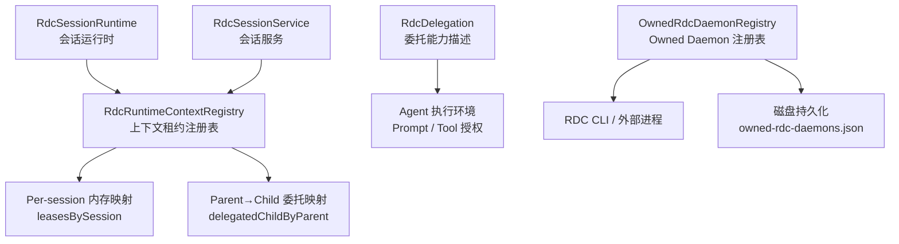

**图示来源**
- [RdcSessionRuntime.ts:319](file://src/main/sessions/RdcSessionRuntime.ts#L319)
- [RdcSessionService.ts:64](file://src/main/sessions/RdcSessionService.ts#L64)
- [RdcRuntimeContextRegistry.ts:17-20](file://src/main/sessions/RdcRuntimeContextRegistry.ts#L17-L20)
- [OwnedRdcDaemonRegistry.ts:15-22](file://src/main/sessions/OwnedRdcDaemonRegistry.ts#L15-L22)

**章节来源**
- [runtime-kernel.md:100-115](file://docs/contracts/runtime-kernel.md#L100-L115)
- [scoped-runtime-resources.md:1-20](file://docs/product/scoped-runtime-resources.md#L1-L20)

## 核心组件
本节按职责划分核心对象：

| 组件 | 职责 | 关键不变量 |
|---|---|---|
| `RdcRuntimeContextRegistry` | 维护 per-session 的 RDC context 租约；支持独立绑定、委派、撤销、隔离、最近期查询。 | 一个会话只能有一个活跃租约；父会话最多一个活跃委派子会话；委托租约不可转移。 |
| `RdcDelegation` | 解析子会话扩展字段，声明是否需要 RDC lease，并向子会话 Prompt 注入委托约束片段。 | 未声明或非法扩展被拒绝；启用后必须持有已冻结授权的 parent lease。 |
| `OwnedRdcDaemonRegistry` | 登记、发现、停止、清理应用拥有的 RDC daemon 进程及其 worker；校验上下文 ID、命令行归属与 PID。 | 仅允许 `rdc-` 开头的 application-owned context；异常退出仍需尽力清理。 |
| `RdcSessionService` | 基于当前 binding 的 quarantine 状态决定是否继续推送会话事件或刷新。 | quarantine 状态下禁止主动事件，但保留可恢复的 close 路径。 |
| `RdcSessionRuntime` | 在会话打开时绑定 RDC runtime context，在会话关闭时释放绑定。 | 绑定失败或关闭应确保无残留租约。 |

**章节来源**
- [RdcRuntimeContextRegistry.ts:17-20](file://src/main/sessions/RdcRuntimeContextRegistry.ts#L17-L20)
- [RdcDelegation.ts:1-17](file://src/main/sessions/RdcDelegation.ts#L1-L17)
- [OwnedRdcDaemonRegistry.ts:15-22](file://src/main/sessions/OwnedRdcDaemonRegistry.ts#L15-L22)
- [RdcSessionService.ts:64-72](file://src/main/sessions/RdcSessionService.ts#L64-L72)
- [RdcSessionRuntime.ts:319](file://src/main/sessions/RdcSessionRuntime.ts#L319)

## 架构总览
RDC context 的生命周期可以理解为“绑定 → 授权 → 使用 → 委托 → 撤销 → 清理”的过程。

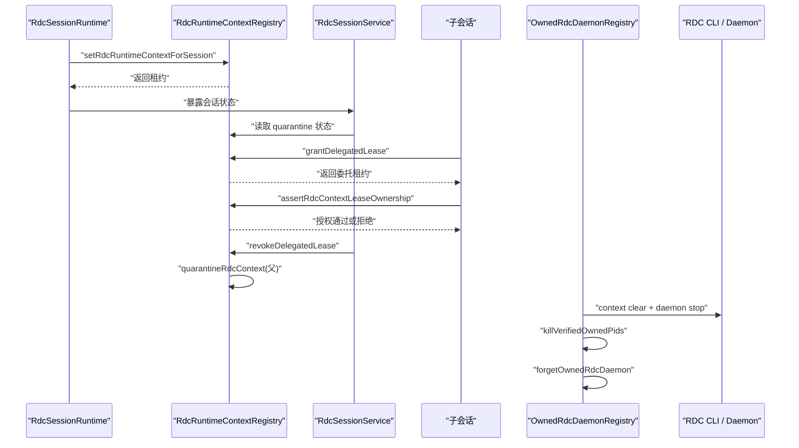

**图示来源**
- [RdcSessionRuntime.ts:319](file://src/main/sessions/RdcSessionRuntime.ts#L319)
- [RdcRuntimeContextRegistry.ts:61-101](file://src/main/sessions/RdcRuntimeContextRegistry.ts#L61-L101)
- [RdcRuntimeContextRegistry.ts:164-221](file://src/main/sessions/RdcRuntimeContextRegistry.ts#L164-L221)
- [RdcRuntimeContextRegistry.ts:221-266](file://src/main/sessions/RdcRuntimeContextRegistry.ts#L221-L266)
- [OwnedRdcDaemonRegistry.ts:94-198](file://src/main/sessions/OwnedRdcDaemonRegistry.ts#L94-L198)

## 详细组件分析

### RdcRuntimeContextRegistry：per-session 上下文租约注册表
该模块是 RDC context 生命周期的权威内存状态。它维护两个核心结构：
- `leasesBySession`：以会话 ID 为键的租约映射。
- `delegatedChildByParent`：记录父会话到其唯一活跃委派子会话的映射。

#### 数据结构与复杂度
- `RdcContextLease` 包含 `contextId`、`version`、`ownerSessionId`、`ownerProjectId`、`captureHash`、`runtimeContext`、`updatedAt`，以及可选的 `delegatedFrom`、`ownerTurnId`、`parentVersion`、`quarantineReason`。
- 查找、插入、删除均为 O(1)。
- `getMostRecentRdcContextLease` 遍历所有会话租约，时间复杂度 O(n)，仅用于 UI 汇总，不应作为工具权限判断依据。

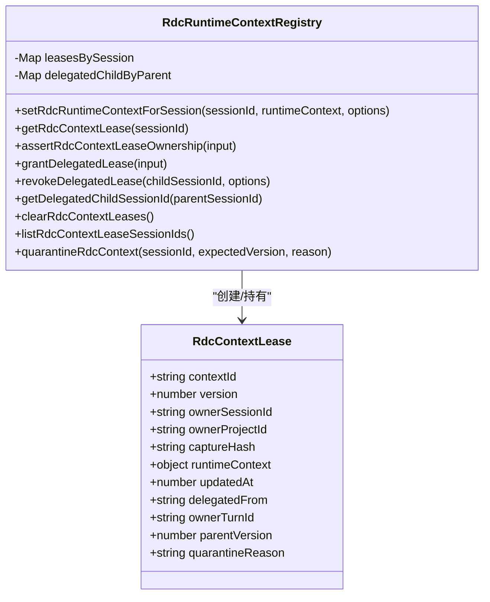

**图示来源**
- [RdcRuntimeContextRegistry.ts:17-20](file://src/main/sessions/RdcRuntimeContextRegistry.ts#L17-L20)
- [RdcRuntimeContextRegistry.ts:61-101](file://src/main/sessions/RdcRuntimeContextRegistry.ts#L61-L101)
- [RdcRuntimeContextRegistry.ts:134-161](file://src/main/sessions/RdcRuntimeContextRegistry.ts#L134-L161)
- [RdcRuntimeContextRegistry.ts:164-221](file://src/main/sessions/RdcRuntimeContextRegistry.ts#L164-L221)
- [RdcRuntimeContextRegistry.ts:221-266](file://src/main/sessions/RdcRuntimeContextRegistry.ts#L221-L266)

#### 上下文绑定与所有权验证
- `setRdcRuntimeContextForSession`：
  - 空 sessionId 直接返回 null，不写入全局状态。
  - 传入 null 表示清除绑定；若存在委派子会话则抛出双所有者错误。
  - 对已有租约递增全局版本号，并克隆 `runtimeContext.raw`，避免外部修改。
- `getRdcContextLease`：
  - 返回租约副本，防止调用方直接修改注册表内部状态。
- `assertRdcContextLeaseOwnership`：
  - 要求显式 sessionId。
  - 拒绝 quarantine 租约。
  - 拒绝当前会话是其他父会话的委派子会话。
  - 委托租约需验证父会话存在、未被隔离、版本一致且委派关系仍有效。
  - 可选校验 `contextId` 与 `projectId`。

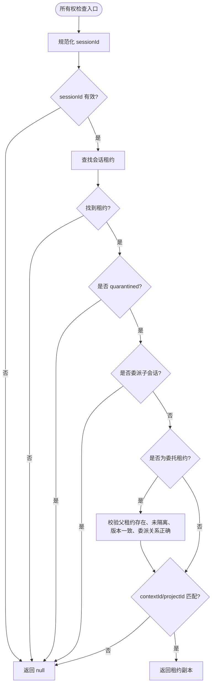

**图示来源**
- [RdcRuntimeContextRegistry.ts:134-161](file://src/main/sessions/RdcRuntimeContextRegistry.ts#L134-L161)

**章节来源**
- [RdcRuntimeContextRegistry.ts:61-101](file://src/main/sessions/RdcRuntimeContextRegistry.ts#L61-L101)
- [RdcRuntimeContextRegistry.ts:134-161](file://src/main/sessions/RdcRuntimeContextRegistry.ts#L134-L161)

#### 版本冲突与双重所有权保护
- 每次独立绑定都会递增 `versionSeq`，使旧租约在新绑定后失去语义一致性。
- 如果父会话已经委派给某个子会话，再尝试重新绑定父会话会抛出 `RDC_LEASE_DUAL_OWNER`。
- 如果子会话已经拥有非委托租约，再委派会抛出 `RDC_LEASE_DELEGATE_DENIED`。
- 这些约束由 `setRdcRuntimeContextForSession` 与 `grantDelegatedLease` 共同保证。

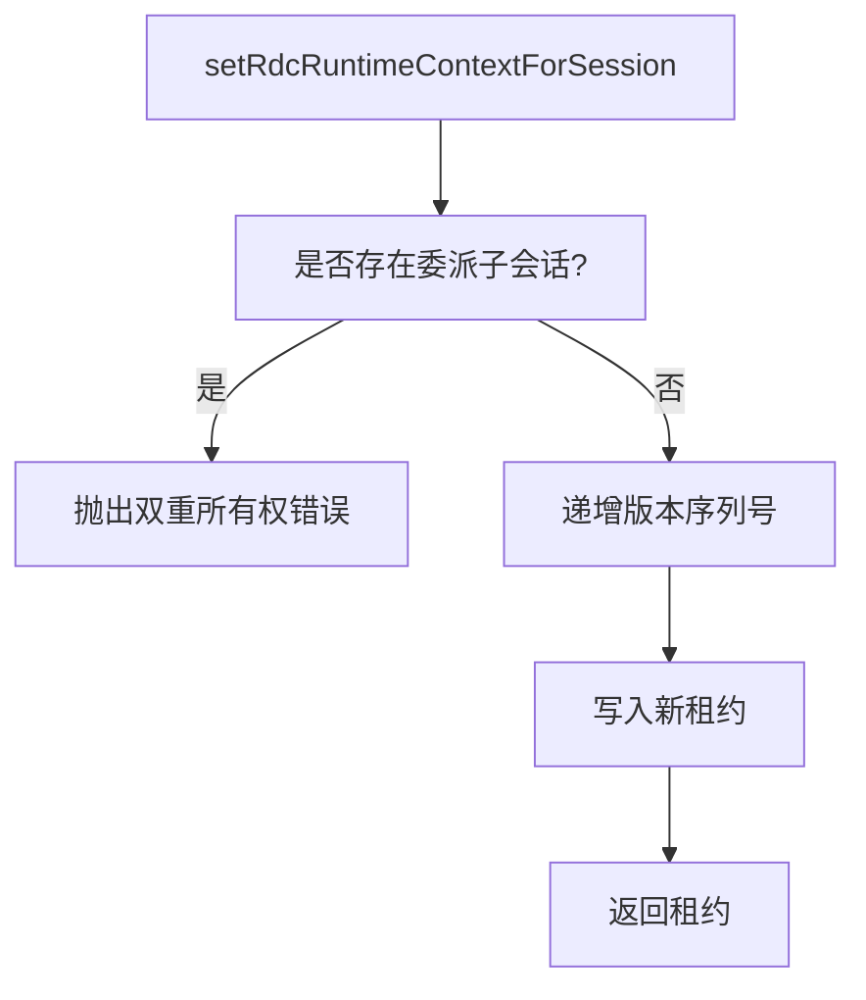

**图示来源**
- [RdcRuntimeContextRegistry.ts:61-101](file://src/main/sessions/RdcRuntimeContextRegistry.ts#L61-L101)

**章节来源**
- [RdcRuntimeContextRegistry.ts:61-101](file://src/main/sessions/RdcRuntimeContextRegistry.ts#L61-L101)

#### 委托机制：grant、revoke、delegate
- `grantDelegatedLease`：
  - 校验父会话、子会话、`ownerTurnId` 非空且互不相同。
  - 父租约不能已被隔离，也不能已经是委托租约。
  - 每个父会话最多只有一个活跃委派子会话。
  - 子会话不能已有独立租约，也不能已有来自不同父的委托租约。
  - 成功时复制父租约，标记 `delegatedFrom`、`parentVersion`、`ownerTurnId`。
- `revokeDelegatedLease`：
  - 删除子会话的委托租约。
  - 如果操作未确认或父租约处于 quarantine，则将父租约置入 quarantine。
  - 清理 `delegatedChildByParent` 中对应条目。
- `getDelegatedChildSessionId`：
  - 提供从父会话反向查找活跃子会话的能力，便于上层协调。

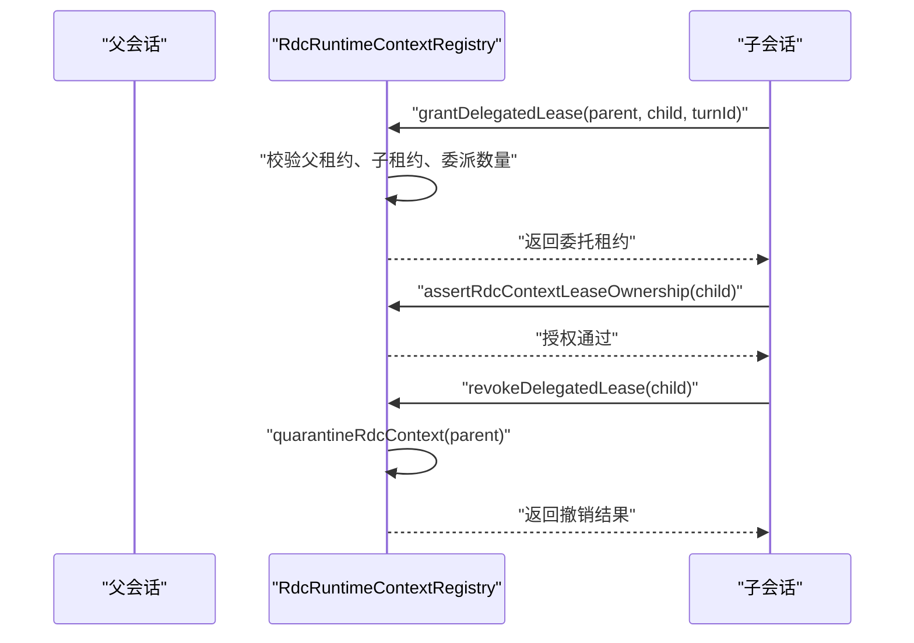

**图示来源**
- [RdcRuntimeContextRegistry.ts:164-221](file://src/main/sessions/RdcRuntimeContextRegistry.ts#L164-L221)
- [RdcRuntimeContextRegistry.ts:221-266](file://src/main/sessions/RdcRuntimeContextRegistry.ts#L221-L266)

**章节来源**
- [RdcRuntimeContextRegistry.ts:164-221](file://src/main/sessions/RdcRuntimeContextRegistry.ts#L164-L221)
- [RdcRuntimeContextRegistry.ts:221-266](file://src/main/sessions/RdcRuntimeContextRegistry.ts#L221-L266)

#### Quarantine 机制
- `quarantineRdcContext` 仅在租约存在且版本号匹配时设置 `quarantineReason`。
- quarantine 租约会被 `assertRdcContextLeaseOwnership` 拒绝，阻止进一步执行。
- `revokeDelegatedLease` 在未确认退出或父租约已隔离时，会回写 quarantine 到父会话。
- `RdcSessionService` 根据当前 binding 的 quarantine 状态拒绝普通事件刷新，但保留受控关闭路径。

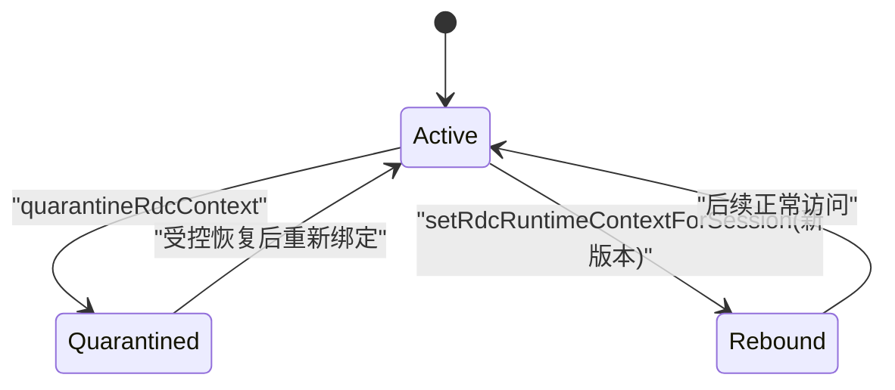

**图示来源**
- [RdcRuntimeContextRegistry.ts:263-266](file://src/main/sessions/RdcRuntimeContextRegistry.ts#L263-L266)
- [RdcSessionService.ts:64-72](file://src/main/sessions/RdcSessionService.ts#L64-L72)

**章节来源**
- [RdcRuntimeContextRegistry.ts:263-266](file://src/main/sessions/RdcRuntimeContextRegistry.ts#L263-L266)
- [RdcSessionService.ts:64-72](file://src/main/sessions/RdcSessionService.ts#L64-L72)

### RdcDelegation：父子会话间的上下文委托能力描述
`RdcDelegation.resolveRdcDelegation` 解析子会话的扩展字段，若声明需要 RDC lease，则返回：
- `requiresLease: true`
- 一条 `delegation-capsule` 类型的 prompt segment，声明委托会话必须串行、受限，并在子会话结束时释放 lease。

这保证了子会话不会绕过父级授权直接使用 RDC context。

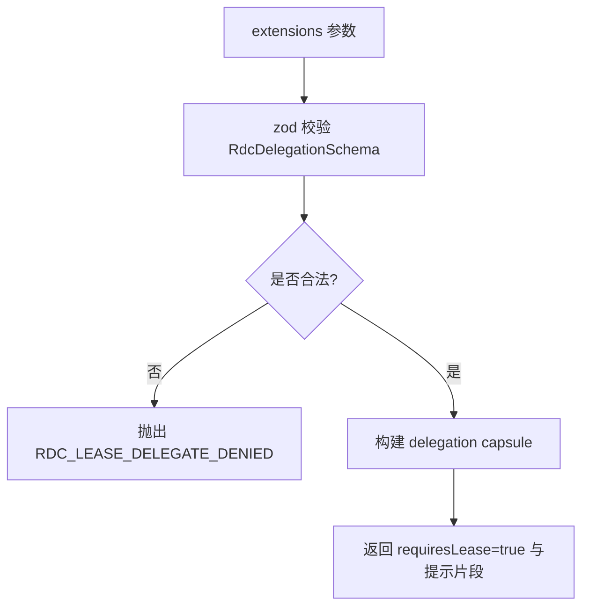

**图示来源**
- [RdcDelegation.ts:1-17](file://src/main/sessions/RdcDelegation.ts#L1-L17)

**章节来源**
- [RdcDelegation.ts:1-17](file://src/main/sessions/RdcDelegation.ts#L1-L17)

### OwnedRdcDaemonRegistry：应用 owned daemon 进程追踪与清理
该模块负责持久化并清理应用拥有的 RDC daemon。核心能力包括：
- 校验 context ID 是否属于应用 owned 格式。
- 在 intermediate root 中发现 `daemon_state_*.json` 对应的 RDC context。
- 将未知 daemon 补充为待清理记录。
- 调用 RDC CLI 执行 `context clear` 与 `daemon stop`。
- 校验 daemon 与 worker 进程命令行是否包含预期标识与 context ID。
- 必要时强制终止进程。
- 从磁盘 registry 中移除记录。

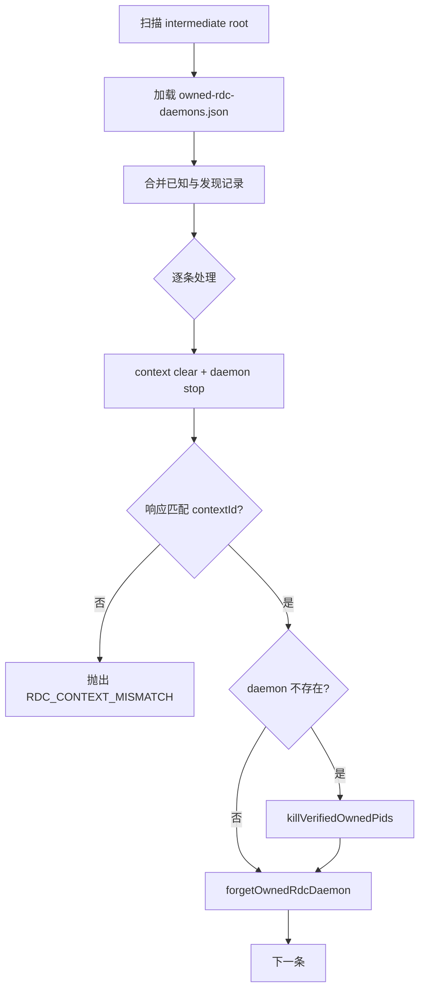

**图示来源**
- [OwnedRdcDaemonRegistry.ts:35-93](file://src/main/sessions/OwnedRdcDaemonRegistry.ts#L35-L93)
- [OwnedRdcDaemonRegistry.ts:94-198](file://src/main/sessions/OwnedRdcDaemonRegistry.ts#L94-L198)
- [OwnedRdcDaemonRegistry.ts:201-251](file://src/main/sessions/OwnedRdcDaemonRegistry.ts#L201-L251)

**章节来源**
- [OwnedRdcDaemonRegistry.ts:15-22](file://src/main/sessions/OwnedRdcDaemonRegistry.ts#L15-L22)
- [OwnedRdcDaemonRegistry.ts:35-93](file://src/main/sessions/OwnedRdcDaemonRegistry.ts#L35-L93)
- [OwnedRdcDaemonRegistry.ts:94-198](file://src/main/sessions/OwnedRdcDaemonRegistry.ts#L94-L198)
- [OwnedRdcDaemonRegistry.ts:201-251](file://src/main/sessions/OwnedRdcDaemonRegistry.ts#L201-L251)

### 与 Agent 执行环境的集成与安全边界
- `RdcRuntimeContextRegistry` 的职责被运行时内核契约明确限定为 per-session RDC context lease，不包含 global mirror。
- `RdcDelegation` 将委托约束注入 Prompt，让 Agent 知道必须在授权范围内串行操作。
- `RdcSessionService` 利用 quarantine 状态阻止不安全上下文继续驱动会话事件。
- Scoped Runtime Resources 文档强调 Electron 数据目录与应用状态不得越界写入用户或项目根目录，RDC CLI 等本机能力属于本地边界，不能被 project 覆盖。

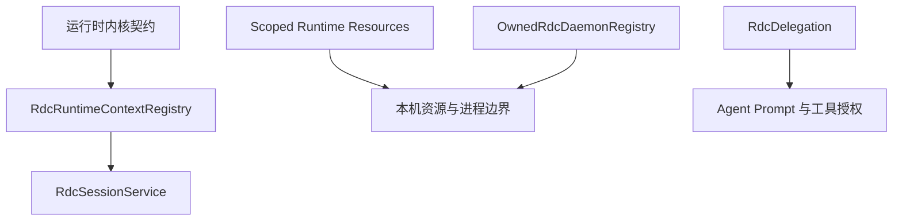

**图示来源**
- [runtime-kernel.md:100-115](file://docs/contracts/runtime-kernel.md#L100-L115)
- [scoped-runtime-resources.md:1-20](file://docs/product/scoped-runtime-resources.md#L1-L20)

**章节来源**
- [runtime-kernel.md:100-115](file://docs/contracts/runtime-kernel.md#L100-L115)
- [scoped-runtime-resources.md:1-20](file://docs/product/scoped-runtime-resources.md#L1-L20)

## 依赖关系分析

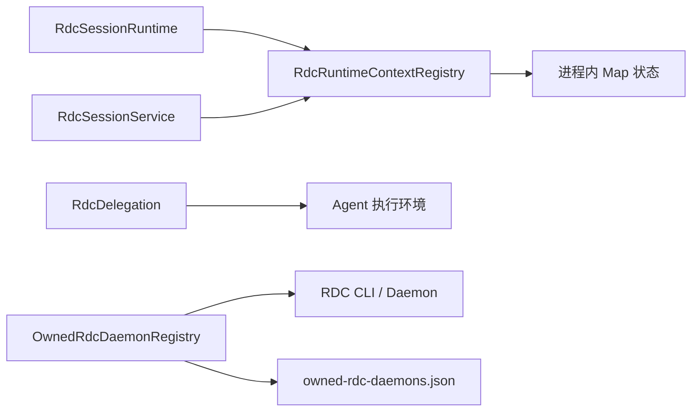

**图示来源**
- [RdcSessionRuntime.ts:319](file://src/main/sessions/RdcSessionRuntime.ts#L319)
- [RdcSessionService.ts:64](file://src/main/sessions/RdcSessionService.ts#L64)
- [RdcRuntimeContextRegistry.ts:17-20](file://src/main/sessions/RdcRuntimeContextRegistry.ts#L17-L20)
- [OwnedRdcDaemonRegistry.ts:15-22](file://src/main/sessions/OwnedRdcDaemonRegistry.ts#L15-L22)

**章节来源**
- [RdcSessionRuntime.ts:319](file://src/main/sessions/RdcSessionRuntime.ts#L319)
- [RdcSessionService.ts:64-72](file://src/main/sessions/RdcSessionService.ts#L64-L72)
- [RdcRuntimeContextRegistry.ts:17-20](file://src/main/sessions/RdcRuntimeContextRegistry.ts#L17-L20)
- [OwnedRdcDaemonRegistry.ts:15-22](file://src/main/sessions/OwnedRdcDaemonRegistry.ts#L15-L22)

## 性能考量
- 租约查找、绑定、委派、撤销都是 O(1) 内存操作，适合高频调用。
- `getMostRecentRdcContextLease` 遍历所有会话租约，应避免在热路径中频繁调用。
- Owned daemon 清理可能涉及外部 CLI 调用、进程命令读取与平台相关终止操作，属于较重副作用路径，应在会话关闭、进程退出等受控时机执行。
- 注册表持久化采用临时文件加原子重命名，降低并发写入损坏风险。

[本节为通用性能建议，不直接分析具体源码行]

## 故障排查指南

| 问题 | 可能原因 | 排查方向 |
|---|---|---|
| 子会话无法访问父 RDC context | 未调用 `grantDelegatedLease`，或父租约已 quarantine | 检查委托链路、父租约版本与 quarantine 状态 |
| 父会话被拒绝重新绑定 | 父会话已有活跃委派子会话 | 先撤销子会话委托，或使用受控恢复流程 |
| 子会话委托被拒绝 | 父租约不存在、已隔离、已是委托租约，或子会话已有独立租约 | 检查 `grantDelegatedLease` 输入与现有租约 |
| daemon 清理失败 | CLI 命令缺失、context mismatch、PID 不匹配 | 查看 `RDC_CLOSE_FAILED`、`RDC_CONTEXT_MISMATCH` 日志 |
| 会话事件不再刷新 | 当前 binding 处于 quarantine | 检查 `RdcSessionService` 中 quarantine 分支 |
| 旧 context 影响新 context | 绑定未正确更新或 quarantine 未配合版本检查 | 确认 `setRdcRuntimeContextForSession` 与 `quarantineRdcContext(expectedVersion)` |

**章节来源**
- [RdcRuntimeContextRegistry.ts:134-161](file://src/main/sessions/RdcRuntimeContextRegistry.ts#L134-L161)
- [RdcRuntimeContextRegistry.ts:164-221](file://src/main/sessions/RdcRuntimeContextRegistry.ts#L164-L221)
- [RdcRuntimeContextRegistry.ts:221-266](file://src/main/sessions/RdcRuntimeContextRegistry.ts#L221-L266)
- [OwnedRdcDaemonRegistry.ts:94-198](file://src/main/sessions/OwnedRdcDaemonRegistry.ts#L94-L198)
- [RdcSessionService.ts:64-72](file://src/main/sessions/RdcSessionService.ts#L64-L72)

## 结论
RDC context 的生命周期由 `RdcRuntimeContextRegistry` 集中管理，通过 per-session 租约实现严格的所有权验证、版本冲突防护与 quarantine 隔离。`RdcDelegation` 将委托约束注入 Agent 执行环境，确保子会话只能在授权范围内串行访问父级 context。`OwnedRdcDaemonRegistry` 将应用 owned daemon 进程纳入可追踪、可清理的资源边界，并结合命令行与 PID 校验防止误杀。整体设计遵循 fail-closed、最小授权与受控恢复原则，符合运行时内核契约与 Scoped Runtime Resources 的安全边界。

[本节为总结性内容，不直接分析具体源码行]