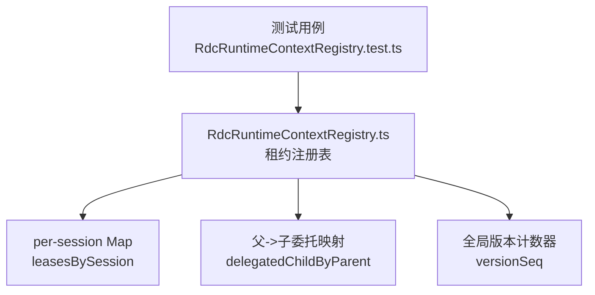
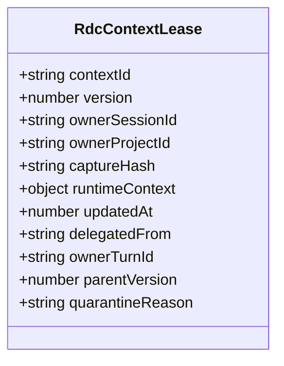
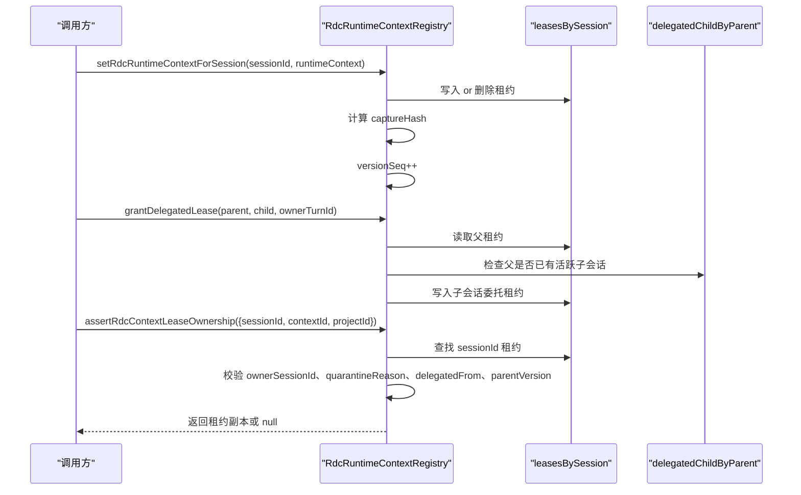
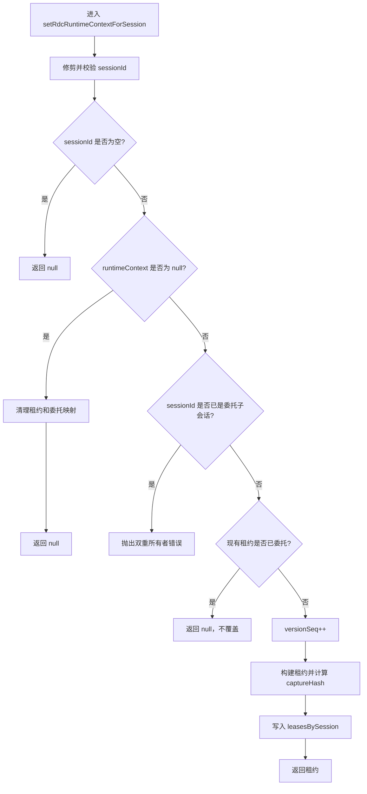
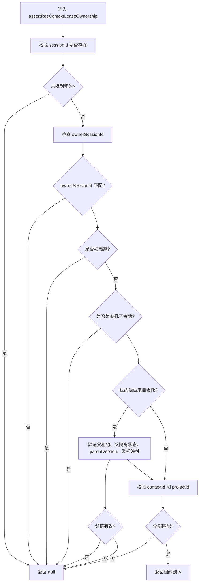
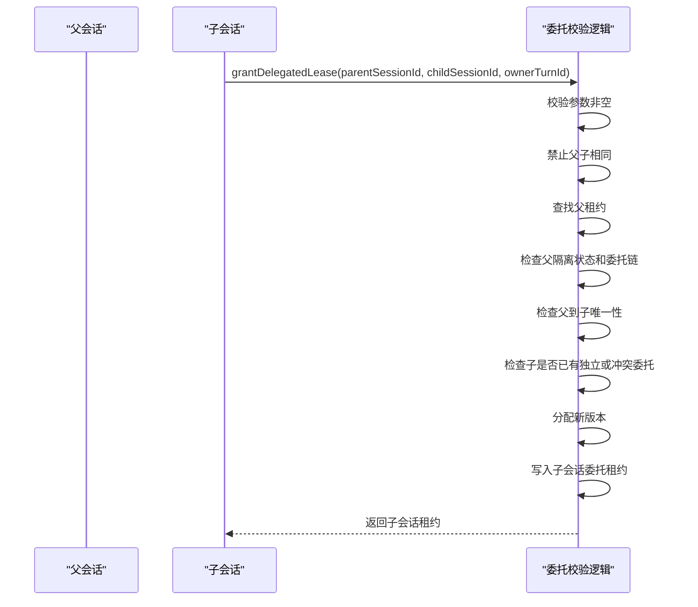
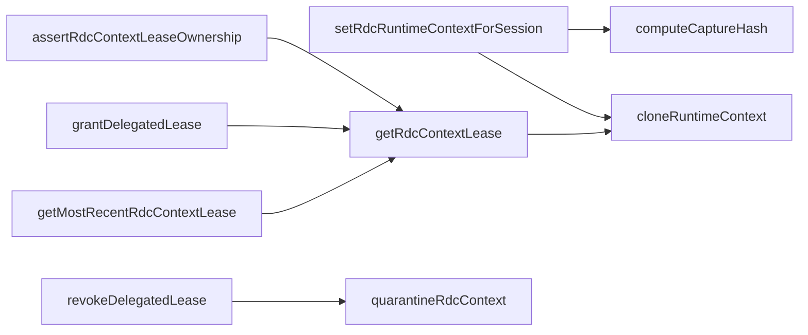

# 上下文租约管理

<cite>
**本文引用的文件**   
- [RdcRuntimeContextRegistry.ts](file://src/main/sessions/RdcRuntimeContextRegistry.ts)
- [RdcRuntimeContextRegistry.test.ts](file://src/main/sessions/RdcRuntimeContextRegistry.test.ts)
</cite>

## 目录
1. [引言](#引言)
2. [项目结构定位](#项目结构定位)
3. [核心组件](#核心组件)
4. [架构总览](#架构总览)
5. [详细组件分析](#详细组件分析)
6. [依赖关系分析](#依赖关系分析)
7. [性能与并发特性](#性能与并发特性)
8. [故障排查指南](#故障排查指南)
9. [结论](#结论)

## 引言
本文聚焦 RDC（RenderDoc Capture）上下文的 per-session 租约管理机制，围绕 `RdcRuntimeContextRegistry` 中的核心 API 展开：  
- `setRdcRuntimeContextForSession`：绑定或清理会话的 RDC 上下文租约。  
- `getRdcContextLease`：按 sessionId 读取租约副本。  
- `assertRdcContextLeaseOwnership`：在工具侧断言调用会话对指定上下文的所有权。  
- `grantDelegatedLease` / `revokeDelegatedLease`：父会话向子会话委托一次作用域受限的 RDC 上下文租约。  
- `quarantineRdcContext`：隔离存在不确定状态的上下文，阻止进一步执行或继续委托。  
- `getMostRecentRdcContextLease`：UI 辅助方法，返回最近更新的租约，但不具备所有权校验能力。

该机制的核心目标是：  
- 每个会话最多持有一个有效的 RDC 上下文租约。  
- 明确区分“独立租约”和“委托租约”。  
- 使用版本序列、捕获哈希、ownerSessionId、ownerProjectId 等字段进行严格所有权校验。  
- 采用 fail-closed 策略，在身份缺失、上下文不匹配或隔离状态下拒绝访问。

## 项目结构定位
本模块位于主进程会话层，负责维护 per-session 的 RDC 运行时上下文状态，并为工具、调试代理、子代理等工作单元提供安全的上下文访问入口。测试文件覆盖了独立租约、委托链、隔离、并发冲突及 UI 辅助方法的边界行为。

**图示来源**
- [RdcRuntimeContextRegistry.ts:1-267](file://src/main/sessions/RdcRuntimeContextRegistry.ts#L1-L267)

**章节来源**
- [RdcRuntimeContextRegistry.ts:1-267](file://src/main/sessions/RdcRuntimeContextRegistry.ts#L1-L267)
- [RdcRuntimeContextRegistry.test.ts:1-213](file://src/main/sessions/RdcRuntimeContextRegistry.test.ts#L1-L213)

## 核心组件
### 租约数据模型
`RdcContextLease` 是 per-session 租约的结构体，关键语义如下：
- `contextId`：被绑定的 RDC 上下文标识。
- `version`：由全局 `versionSeq` 递增生成的版本，用于检测更新和防止陈旧引用。
- `ownerSessionId`：当前持有租约的会话 ID。
- `ownerProjectId`：可选的项目范围，限制上下文只能在指定项目中访问。
- `captureHash`：基于 captureFileId / captureId / replaySessionId 计算的短哈希，用于快速识别捕获对象是否一致。
- `runtimeContext`：实际 RDC 运行时上下文，读取时会被克隆，避免外部直接修改。
- `updatedAt`：更新时间戳，供 UI 选择最新租约。
- `delegatedFrom`：若为委托租约，则记录父会话 ID。
- `ownerTurnId`：创建委托租约的父 turn 标识，便于审计与生命周期管理。
- `parentVersion`：委托时父租约的版本快照，用于校验委托链未被篡改。
- `quarantineReason`：隔离原因；一旦设置，租约不可用且不能继续委托。

**图示来源**
- [RdcRuntimeContextRegistry.ts:12-35](file://src/main/sessions/RdcRuntimeContextRegistry.ts#L12-L35)

**章节来源**
- [RdcRuntimeContextRegistry.ts:12-35](file://src/main/sessions/RdcRuntimeContextRegistry.ts#L12-L35)

### 内部存储与常量
- `leasesBySession`：以 sessionId 为键的租约映射。
- `delegatedChildByParent`：以父 sessionId 为键的委托子会话映射，保证每个父会话最多一个活跃委托子会话。
- `versionSeq`：全局单调递增版本号，避免并发更新导致版本回退。
- `RDC_LEASE_DELEGATE_DENIED`：委托失败错误码。
- `RDC_LEASE_DUAL_OWNER`：双重所有者冲突错误码。

这些字段均为模块级私有状态，对外只暴露安全 API。

**章节来源**
- [RdcRuntimeContextRegistry.ts:1-11](file://src/main/sessions/RdcRuntimeContextRegistry.ts#L1-L11)
- [RdcRuntimeContextRegistry.ts:201-267](file://src/main/sessions/RdcRuntimeContextRegistry.ts#L201-L267)

## 架构总览
下图展示了 per-session RDC 上下文从绑定到消费的整体流程，包括独立租约、委托租约、所有权断言和隔离路径。

**图示来源**
- [RdcRuntimeContextRegistry.ts:52-175](file://src/main/sessions/RdcRuntimeContextRegistry.ts#L52-L175)
- [RdcRuntimeContextRegistry.ts:177-243](file://src/main/sessions/RdcRuntimeContextRegistry.ts#L177-L243)

## 详细组件分析

### `setRdcRuntimeContextForSession`：绑定或清理 per-session 租约
该方法承担三类职责：
1. **空 sessionId fail-closed**：如果 sessionId 为空或仅包含空白字符，直接返回 null，不写入任何全局镜像。
2. **清理租约**：传入 null 的 runtimeContext 会删除对应 sessionId 的租约；如果该 sessionId 是委托子会话，则先释放父会话的委托映射。
3. **绑定新租约**：
   - 不允许已经作为委托子会话的 sessionId 重新绑定独立租约。
   - 如果现有租约已经是委托租约，直接返回 null，禁止覆盖。
   - 递增 `versionSeq`，生成新版本租约。
   - 通过 `computeCaptureHash` 计算捕获对象的短哈希。
   - 克隆 `runtimeContext.raw`，避免外部直接修改底层原始数据。

**图示来源**
- [RdcRuntimeContextRegistry.ts:52-110](file://src/main/sessions/RdcRuntimeContextRegistry.ts#L52-L110)

**章节来源**
- [RdcRuntimeContextRegistry.ts:52-110](file://src/main/sessions/RdcRuntimeContextRegistry.ts#L52-L110)

### `getRdcContextLease`：安全读取租约副本
- 如果 sessionId 为 null 或 undefined，返回 null。
- 从 `leasesBySession` 查找租约。
- 返回前克隆 `runtimeContext`，确保调用方无法绕过注册表直接修改共享上下文。

该方法是其他 API 的基础，但本身不做所有权断言，也不检查 `quarantineReason`。

**章节来源**
- [RdcRuntimeContextRegistry.ts:112-123](file://src/main/sessions/RdcRuntimeContextRegistry.ts#L112-L123)

### `getMostRecentRdcContextLease`：UI 辅助方法的安全边界
该方法遍历所有有效 sessionId，比较 `updatedAt`，返回最近更新的租约副本。它的设计要点是：
- 用于 UI 展示最近使用的 RDC 上下文。
- **不具备所有权校验能力**：工具必须继续使用 `assertRdcContextLeaseOwnership`，不能仅凭该方法认为某个上下文可用。
- 即使某个租约已被隔离，只要其仍存在于 `leasesBySession`，仍可能被选为最新项；因此 UI 应结合业务层展示逻辑，不应将结果当作可执行上下文。

**章节来源**
- [RdcRuntimeContextRegistry.ts:125-143](file://src/main/sessions/RdcRuntimeContextRegistry.ts#L125-L143)
- [RdcRuntimeContextRegistry.test.ts:45-62](file://src/main/sessions/RdcRuntimeContextRegistry.test.ts#L45-L62)

### `assertRdcContextLeaseOwnership`：所有权断言与 fail-closed 策略
这是工具消费 RDC 上下文的关键安全门控。校验顺序如下：
1. 从输入中提取并修剪 sessionId。
2. 如果 sessionId 为空，直接返回 null。
3. 查找 sessionId 对应的租约；不存在则返回 null。
4. 检查 `ownerSessionId` 是否与请求 sessionId 一致。
5. 检查 `quarantineReason`：一旦被隔离，立即返回 null。
6. 检查 sessionId 是否作为委托子会话存在：如果是，则不能作为父会话直接拥有独立租约，返回 null。
7. 如果租约是委托租约：
   - 查找父会话租约。
   - 父租约必须存在。
   - 父租约不能被隔离。
   - 父租约版本必须等于 `parentVersion`。
   - `delegatedChildByParent` 中父到子的映射必须指向当前子会话。
8. 如果传入 contextId，则必须与租约的 `contextId` 完全匹配。
9. 如果传入 projectId，则必须与租约的 `ownerProjectId` 完全匹配。
10. 满足条件后，通过 `getRdcContextLease` 返回租约副本。

**图示来源**
- [RdcRuntimeContextRegistry.ts:145-175](file://src/main/sessions/RdcRuntimeContextRegistry.ts#L145-L175)

**章节来源**
- [RdcRuntimeContextRegistry.ts:145-175](file://src/main/sessions/RdcRuntimeContextRegistry.ts#L145-L175)

### `grantDelegatedLease`：委托链建立
委托机制允许父会话将一个作用域受限的 RDC 上下文复制给子会话，但不能无限传递：
- 父会话必须存在。
- 父会话不能处于隔离状态。
- 父租约不能已经是委托租约，即委托链深度为一层。
- 传入的 projectId 必须与父租约一致。
- 每个父会话只能有一个活跃委托子会话。
- 子会话如果已有独立租约，委托会被拒绝。
- 子会话如果已有不同来源的委托租约，也会被拒绝。
- 成功后，子会话获得一个新租约，其中：
  - `delegatedFrom` 指向父会话。
  - `parentVersion` 保存父租约版本。
  - `ownerTurnId` 记录父 turn。
  - `ownerSessionId` 指向子会话。
  - `ownerProjectId` 继承父租约的项目范围。
  - `captureHash` 继承父租约的捕获哈希。

**图示来源**
- [RdcRuntimeContextRegistry.ts:177-243](file://src/main/sessions/RdcRuntimeContextRegistry.ts#L177-L243)

**章节来源**
- [RdcRuntimeContextRegistry.ts:177-243](file://src/main/sessions/RdcRuntimeContextRegistry.ts#L177-L243)
- [RdcRuntimeContextRegistry.test.ts:64-140](file://src/main/sessions/RdcRuntimeContextRegistry.test.ts#L64-L140)

### `revokeDelegatedLease`：委托撤销与不确定退出处理
- 如果子租约存在且不是强制停止操作，或者租约已被隔离，则对父会话调用 `quarantineRdcContext`，并带上隔离原因。
- 清理 `delegatedChildByParent` 中对应的父到子映射。
- 删除子租约。
- 如果传入的不是委托租约，返回 false。

当委托子会话退出但未确认操作停止时，系统会把父会话放入隔离状态，阻止后续重新绑定或再次委托，直到显式恢复。

**章节来源**
- [RdcRuntimeContextRegistry.ts:245-261](file://src/main/sessions/RdcRuntimeContextRegistry.ts#L245-L261)
- [RdcRuntimeContextRegistry.test.ts:142-170](file://src/main/sessions/RdcRuntimeContextRegistry.test.ts#L142-L170)

### `quarantineRdcContext`：隔离机制
隔离用于保留不确定状态的上下文以便检查，同时拒绝进一步执行或委托：
- 如果 sessionId 不存在，或传入 expectedVersion 与当前版本不一致，直接忽略。
- 否则设置 `quarantineReason`。
- 被隔离的租约在 `assertRdcContextLeaseOwnership` 中会被拒绝。
- 被隔离的父会话不能再授予新的委托。

**章节来源**
- [RdcRuntimeContextRegistry.ts:263-267](file://src/main/sessions/RdcRuntimeContextRegistry.ts#L263-L267)
- [RdcRuntimeContextRegistry.test.ts:172-213](file://src/main/sessions/RdcRuntimeContextRegistry.test.ts#L172-L213)

### `computeCaptureHash`：捕获对象指纹
哈希输入优先级为：
1. `captureFileId`
2. `captureId`
3. `replaySessionId`
4. 如果三者都为空，则返回 null。

哈希算法为 SHA-256，并取前 16 位十六进制字符串。该值用于快速判断两个 RDC 上下文是否指向同一捕获对象，但注意它不是所有权凭证，所有权仍需由 `ownerSessionId`、`delegatedFrom`、`parentVersion` 等字段共同决定。

**章节来源**
- [RdcRuntimeContextRegistry.ts:37-50](file://src/main/sessions/RdcRuntimeContextRegistry.ts#L37-L50)

## 依赖关系分析

**图示来源**
- [RdcRuntimeContextRegistry.ts:37-175](file://src/main/sessions/RdcRuntimeContextRegistry.ts#L37-L175)
- [RdcRuntimeContextRegistry.ts:245-267](file://src/main/sessions/RdcRuntimeContextRegistry.ts#L245-L267)

**章节来源**
- [RdcRuntimeContextRegistry.ts:37-175](file://src/main/sessions/RdcRuntimeContextRegistry.ts#L37-L175)
- [RdcRuntimeContextRegistry.ts:245-267](file://src/main/sessions/RdcRuntimeContextRegistry.ts#L245-L267)

## 性能与并发特性
- **时间复杂度**：主要操作为 Map 查找和赋值，平均 O(1)。
- **空间复杂度**：每个活跃会话一个租约对象，加上父到子委托映射，整体线性于活跃会话数。
- **版本序列**：全局单调递增的 `versionSeq` 用于区分不同轮次的绑定更新，避免并发场景下旧版本覆盖新版本。
- **克隆保护**：读取租约时克隆 `runtimeContext`，降低外部意外修改共享状态的风险。
- **UI 辅助方法**：`getMostRecentRdcContextLease` 需要遍历所有 sessionId，适合低频 UI 查询，不适合高频工具路径。

**章节来源**
- [RdcRuntimeContextRegistry.ts:112-143](file://src/main/sessions/RdcRuntimeContextRegistry.ts#L112-L143)
- [RdcRuntimeContextRegistry.ts:201-267](file://src/main/sessions/RdcRuntimeContextRegistry.ts#L201-L267)

## 故障排查指南
### 常见错误与诊断
- **空 sessionId 返回 null**  
  如果调用 `assertRdcContextLeaseOwnership` 时没有传入 sessionId，或 sessionId 为空，会 fail-closed 返回 null。应检查上游会话 ID 是否已初始化。
- **ownerSessionId 不匹配**  
  调用方使用了错误的 sessionId，或租约已被另一个会话替换。
- **quarantineReason 导致拒绝**  
  父会话可能因委托子会话未确认退出而被隔离。需要先恢复或重建会话上下文。
- **delegatedFrom 与 parentVersion 不一致**  
  委托链被破坏，例如父会话重新绑定后版本变化。委托子会话不再可信。
- **projectId 不匹配**  
  工具尝试跨项目访问 RDC 上下文，应检查项目范围配置。
- **双重所有者冲突**  
  试图让同一个 sessionId 既作为委托子会话又作为独立租约持有者，或父会话已有另一个活跃委托子会话。

### 典型代码行为路径参考
- 空 sessionId 不写入全局镜像：  
  [RdcRuntimeContextRegistry.ts:52-70](file://src/main/sessions/RdcRuntimeContextRegistry.ts#L52-L70)
- 委托子会话禁止重新绑定独立租约：  
  [RdcRuntimeContextRegistry.ts:72-82](file://src/main/sessions/RdcRuntimeContextRegistry.ts#L72-L82)
- 所有权断言拒绝隔离租约：  
  [RdcRuntimeContextRegistry.ts:150-165](file://src/main/sessions/RdcRuntimeContextRegistry.ts#L150-L165)
- 委托链校验父版本与委托映射：  
  [RdcRuntimeContextRegistry.ts:156-168](file://src/main/sessions/RdcRuntimeContextRegistry.ts#L156-L168)
- 委托撤销触发父会话隔离：  
  [RdcRuntimeContextRegistry.ts:245-255](file://src/main/sessions/RdcRuntimeContextRegistry.ts#L245-L255)

**章节来源**
- [RdcRuntimeContextRegistry.ts:52-175](file://src/main/sessions/RdcRuntimeContextRegistry.ts#L52-L175)
- [RdcRuntimeContextRegistry.ts:245-267](file://src/main/sessions/RdcRuntimeContextRegistry.ts#L245-L267)
- [RdcRuntimeContextRegistry.test.ts:1-213](file://src/main/sessions/RdcRuntimeContextRegistry.test.ts#L1-L213)

## 结论
`RdcRuntimeContextRegistry` 通过 per-session 租约、委托链、版本序列、捕获哈希和项目范围，构建了 RDC 上下文的安全访问边界。其核心设计原则是：
- **fail-closed**：缺失 sessionId、上下文不匹配、隔离状态均拒绝访问。
- **所有权优先**：`ownerSessionId` 是基础，委托链通过 `delegatedFrom` 和 `parentVersion` 强化。
- **作用域受限**：`projectId` 限制上下文在项目内使用。
- **生命周期清晰**：独立租约与委托租约分离，委托撤销支持不确定退出时的父会话隔离。
- **UI 与安全边界分离**：`getMostRecentRdcContextLease` 仅供 UI 展示，工具必须使用 `assertRdcContextLeaseOwnership` 完成最终授权检查。