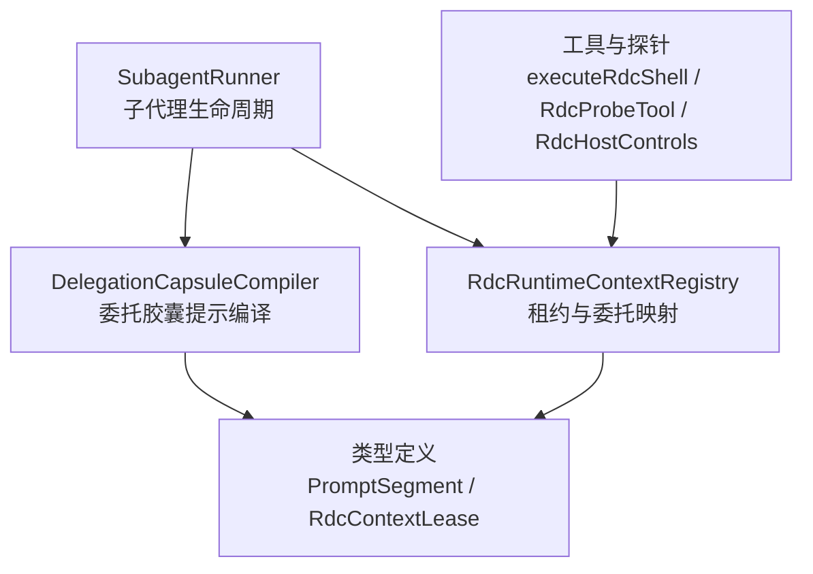
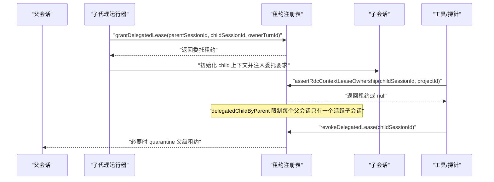
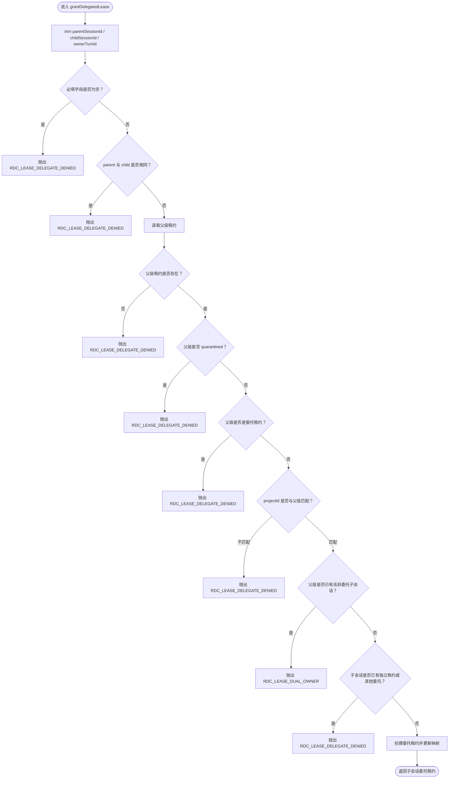
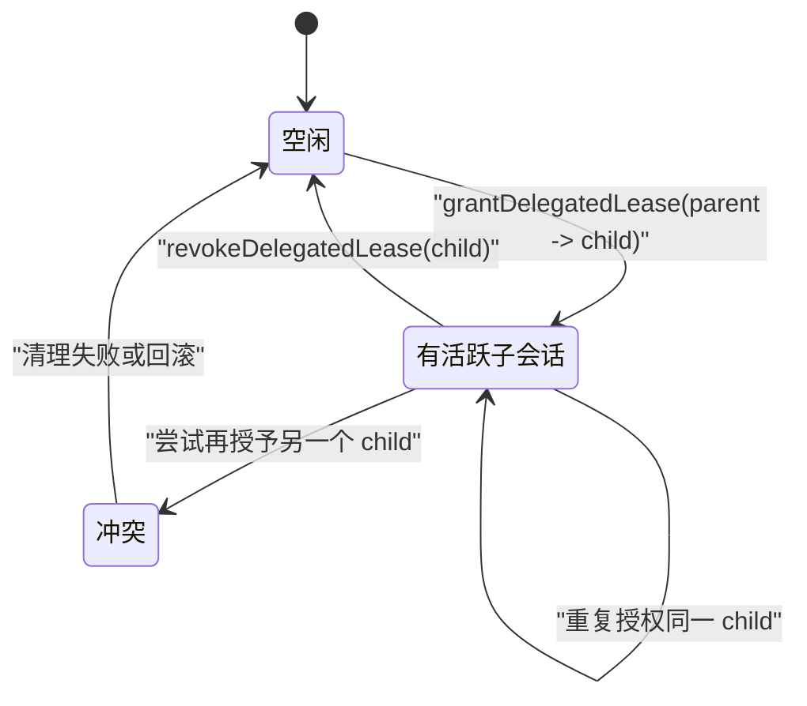
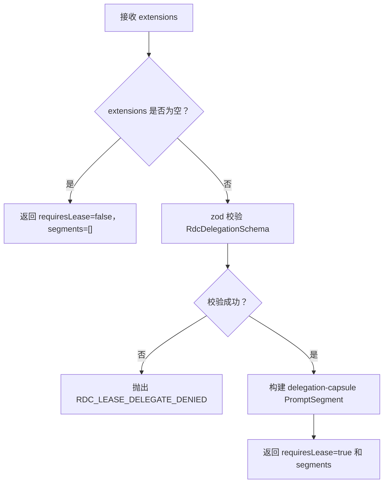
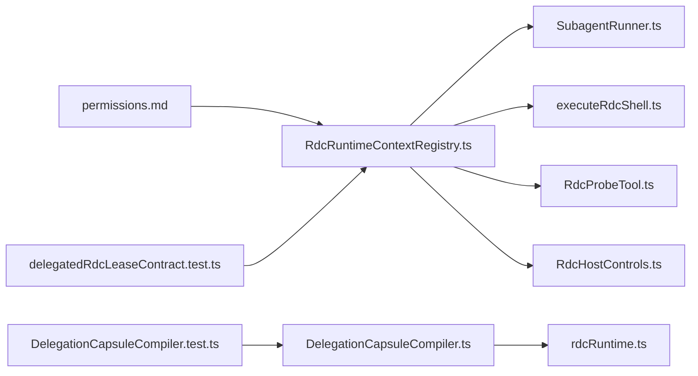

# 委托控制机制

<cite>
**本文引用的文件**
- [RdcRuntimeContextRegistry.ts](file://src/main/sessions/RdcRuntimeContextRegistry.ts)
- [DelegationCapsuleCompiler.ts](file://src/main/agent-runtime/prompt/DelegationCapsuleCompiler.ts)
- [rdcRuntime.ts](file://src/shared/types/rdcRuntime.ts)
- [permissions.md](file://docs/contracts/permissions.md)
- [SubagentRunner.ts](file://src/main/workflow/debugger/SubagentRunner.ts)
- [executeRdcShell.ts](file://src/main/tools/executeRdcShell.ts)
- [RdcProbeTool.ts](file://src/main/workflow/debugger/RdcProbeTool.ts)
- [RdcHostControls.ts](file://src/main/tools/RdcHostControls.ts)
- [DelegationCapsuleCompiler.test.ts](file://src/main/agent-runtime/prompt/DelegationCapsuleCompiler.test.ts)
- [delegatedRdcLeaseContract.test.ts](file://src/main/testing/contracts/delegatedRdcLeaseContract.test.ts)
</cite>

## 目录
1. [引言](#引言)
2. [项目结构中的位置](#项目结构中的位置)
3. [核心组件](#核心组件)
4. [架构总览](#架构总览)
5. [详细组件分析](#详细组件分析)
6. [依赖关系分析](#依赖关系分析)
7. [性能与一致性特征](#性能与一致性特征)
8. [故障排查指南](#故障排查指南)
9. [结论](#结论)

## 引言
本文聚焦 RDC 上下文委托控制机制，解释父子会话之间如何通过“委托租约”安全共享 RDC 运行时上下文。重点包括：
- `grantDelegatedLease` 的参数校验、父级租约检查、独占子会话约束和权限边界。
- `delegatedChildByParent` 如何保证每个父会话最多只有一个活跃的委托子会话。
- 委托租约的限制：不可独立转移、必须与父级 quarantine 状态一致、`projectId` 必须匹配。
- `resolveRdcDelegation` 如何使用 zod schema 验证扩展能力请求，并生成 `delegation-capsule` 类型的 prompt segment。
- 委托创建、验证、拒绝的调用路径，以及与 Agent 执行环境的集成方式和安全边界。

## 项目结构中的位置
RDC 委托控制涉及三层代码：
- **会话租约层**：维护 per-session RDC 上下文租约、委托映射和所有权断言。
- **提示编译层**：将 child 对 RDC 领域能力的声明编译为系统提示片段。
- **执行入口层**：工具、探针、Shell 等在执行前校验租约所有权，并由 SubagentRunner 在创建子代理时授予或撤销委托。

**图示来源**
- [RdcRuntimeContextRegistry.ts:1-267](file://src/main/sessions/RdcRuntimeContextRegistry.ts#L1-L267)
- [DelegationCapsuleCompiler.ts:1-83](file://src/main/agent-runtime/prompt/DelegationCapsuleCompiler.ts#L1-L83)
- [rdcRuntime.ts:1-200](file://src/shared/types/rdcRuntime.ts#L1-L200)

**章节来源**
- [RdcRuntimeContextRegistry.ts:1-267](file://src/main/sessions/RdcRuntimeContextRegistry.ts#L1-L267)
- [DelegationCapsuleCompiler.ts:1-83](file://src/main/agent-runtime/prompt/DelegationCapsuleCompiler.ts#L1-L83)
- [rdcRuntime.ts:1-200](file://src/shared/types/rdcRuntime.ts#L1-L200)

## 核心组件
### 会话租约与委托注册表
- 维护 `leasesBySession`：按 sessionId 存储 RDC 上下文租约。
- 维护 `delegatedChildByParent`：从 parentSessionId 到活跃 childSessionId 的单向映射。
- 暴露关键函数：
  - `setRdcRuntimeContextForSession`：绑定或清理 per-session 租约。
  - `assertRdcContextLeaseOwnership`：工具执行前校验 sessionId、contextId、projectId、quarantine 和委托归属。
  - `grantDelegatedLease`：为 child 创建委托租约。
  - `revokeDelegatedLease`：撤销 child 委托，必要时回溯父级 quarantine。
  - `getDelegatedChildSessionId`、`listRdcContextLeaseSessionIds`、`clearRdcContextLeases`、`quarantineRdcContext`。

**章节来源**
- [RdcRuntimeContextRegistry.ts:1-267](file://src/main/sessions/RdcRuntimeContextRegistry.ts#L1-L267)

### 委托提示编译
- `resolveRdcDelegation`：解析 child 扩展能力请求；若请求 RDC 领域能力且需要租约，则返回 `requiresLease=true` 和一个 `delegation-capsule` 段。
- `compileDelegationCapsule`、`renderDelegationCapsuleInput`、`applyDelegationCapsuleToPromptPlan`：把委托目标、数据边界、持久化契约写入 child 的系统提示中，并将 volatile 段追加到 PromptPlan。

**章节来源**
- [RdcDelegation.ts:1-17](file://src/main/agent-runtime/prompt/DelegationCapsuleCompiler.ts#L1-L17)
- [DelegationCapsuleCompiler.ts:1-83](file://src/main/agent-runtime/prompt/DelegationCapsuleCompiler.ts#L1-L83)
- [rdcRuntime.ts:120-200](file://src/shared/types/rdcRuntime.ts#L120-L200)

### 执行入口与子代理编排
- `SubagentRunner`：在启动子代理时调用 `grantDelegatedLease`，并在子代理结束或停止时调用 `revokeDelegatedLease`。
- `executeRdcShell`、`RdcProbeTool`、`RdcHostControls`：通过 `assertRdcContextLeaseOwnership` 确保工具只由拥有合法租约的会话执行。

**章节来源**
- [SubagentRunner.ts:47-48](file://src/main/workflow/debugger/SubagentRunner.ts#L47-L48)
- [SubagentRunner.ts:273-359](file://src/main/workflow/debugger/SubagentRunner.ts#L273-L359)
- [executeRdcShell.ts:7-83](file://src/main/tools/executeRdcShell.ts#L7-L83)
- [RdcProbeTool.ts:11-107](file://src/main/workflow/debugger/RdcProbeTool.ts#L11-L107)
- [RdcHostControls.ts:5-20](file://src/main/tools/RdcHostControls.ts#L5-L20)

## 架构总览
RDC 委托控制的核心是“父会话持有真实租约，子会话仅持有受限拷贝”。子会话不能绕过父级所有权、不能二次转授、不能并发抢占父级资源。

**图示来源**
- [RdcRuntimeContextRegistry.ts:164-224](file://src/main/sessions/RdcRuntimeContextRegistry.ts#L164-L224)
- [RdcRuntimeContextRegistry.ts:225-267](file://src/main/sessions/RdcRuntimeContextRegistry.ts#L225-L267)
- [SubagentRunner.ts:273-359](file://src/main/workflow/debugger/SubagentRunner.ts#L273-L359)

## 详细组件分析

### `grantDelegatedLease`：父子会话委托创建
该函数负责把父会话的 RDC 上下文复制给子会话，形成一条带限制的委托租约。

#### 参数与输入校验
- 必填字段：`parentSessionId`、`childSessionId`、`ownerTurnId`。
- 空值处理：三个字段均会 trim 后校验，任一为空抛出 `RDC_LEASE_DELEGATE_DENIED`。
- 自引用保护：`parentSessionId === childSessionId` 直接拒绝。

#### 父级租约检查
- 父会话必须存在已绑定的 RDC 租约。
- 父级租约不能处于 quarantine 状态；否则要求受控恢复，禁止直接委托。
- 父级租约不能已经是委托租约（即 `delegatedFrom` 存在），防止链式转授。
- 可选 `projectId`：如果提供，必须等于父级租约的 `ownerProjectId`。

#### 子会话状态检查
- 子会话不能已经持有非委托的独立租约。
- 子会话不能已经持有一条来自其他父会话的委托租约。

#### 委托租约生成与映射更新
- 新租约继承父级 `contextId`、`captureHash`、`runtimeContext`、`ownerProjectId`。
- 设置 `delegatedFrom = parentSessionId`、`parentVersion = parentLease.version`、`ownerTurnId`。
- 更新 `delegatedChildByParent[parentSessionId] = childSessionId`，建立父到子的唯一活跃委托映射。

**图示来源**
- [RdcRuntimeContextRegistry.ts:164-224](file://src/main/sessions/RdcRuntimeContextRegistry.ts#L164-L224)

**章节来源**
- [RdcRuntimeContextRegistry.ts:164-224](file://src/main/sessions/RdcRuntimeContextRegistry.ts#L164-L224)

### `delegatedChildByParent`：每个父会话最多一个活跃委托子会话
`delegatedChildByParent` 是一个 `Map<parentSessionId, childSessionId>`，用于实现以下不变量：
- 一个父会话在同一时间只能有一个活跃的子会话持有其 RDC 上下文委托。
- 当子会话撤销委托时，移除对应映射项。
- 当父会话重新绑定或清空租约时，清理可能残留的委托映射。
- `assertRdcContextLeaseOwnership` 使用它判断：
  - 某个 sessionId 是否是活跃委托子会话。
  - 委托租约的 `delegatedFrom` 是否确实指向当前父会话。

**图示来源**
- [RdcRuntimeContextRegistry.ts:37-37](file://src/main/sessions/RdcRuntimeContextRegistry.ts#L37-L37)
- [RdcRuntimeContextRegistry.ts:193-220](file://src/main/sessions/RdcRuntimeContextRegistry.ts#L193-L220)
- [RdcRuntimeContextRegistry.ts:225-247](file://src/main/sessions/RdcRuntimeContextRegistry.ts#L225-L247)

**章节来源**
- [RdcRuntimeContextRegistry.ts:37-37](file://src/main/sessions/RdcRuntimeContextRegistry.ts#L37-L37)
- [RdcRuntimeContextRegistry.ts:193-247](file://src/main/sessions/RdcRuntimeContextRegistry.ts#L193-L247)

### 委托租约的限制设计
委托租约不是完整父租约的等价副本，而是带有明确安全边界的受限视图：

| 限制 | 行为 | 实现要点 |
|---|---|---|
| 不可独立转移 | 委托租约不能被再次授予其他会话 | `parentLease.delegatedFrom` 存在时直接拒绝 |
| 必须与父级 quarantine 状态一致 | 父级被 quarantine 时，委托租约也不能执行 | `assertRdcContextLeaseOwnership` 检查父级 `quarantineReason` |
| `projectId` 必须匹配父级租约 | 防止跨项目越权访问 RDC 上下文 | `input.projectId` 与 `parentLease.ownerProjectId` 比较 |
| 子会话不能拥有独立租约 | 避免双重所有权 | 子会话存在非委托租约时拒绝 |
| 子会话不能已有其他父的委托 | 防止多父争夺 | 子会话已有委托且 `delegatedFrom` 不同则拒绝 |
| 每个父会话最多一个活跃子会话 | 防止并发双所有者 | `delegatedChildByParent` 强制单活子会话 |

**章节来源**
- [RdcRuntimeContextRegistry.ts:143-147](file://src/main/sessions/RdcRuntimeContextRegistry.ts#L143-L147)
- [RdcRuntimeContextRegistry.ts:164-224](file://src/main/sessions/RdcRuntimeContextRegistry.ts#L164-L224)
- [permissions.md:100-119](file://docs/contracts/permissions.md#L100-L119)

### `resolveRdcDelegation`：扩展能力请求与委托提示生成
`resolveRdcDelegation` 负责把 child 的能力声明转换为委托要求：

1. 接收 `extensions`，即 child 向运行时声明自身需要的扩展能力。
2. 使用 zod schema 校验：
   - 只允许顶层 `rdc` 域。
   - `rdc.requiresLease` 必须为字面量 `true`。
3. 校验失败时抛出错误，表示不支持或非法的 RDC 委托能力请求。
4. 校验成功时返回：
   - `requiresLease: true`。
   - 一个 `PromptSegment`，其 `kind` 为 `delegation-capsule`，`scope` 为 `runtime`，内容为说明委托语义的文本。

随后，委托提示编译层会将该 segment 合并进 child 的 PromptPlan，作为系统提示的一部分，让 Agent 知道：
- 本任务需要父级 RDC 租约。
- 操作串行、受冻结授权限制。
- child 结算时必须释放委托租约。

**图示来源**
- [RdcDelegation.ts:1-17](file://src/main/agent-runtime/prompt/DelegationCapsuleCompiler.ts#L1-L17)

**章节来源**
- [RdcDelegation.ts:1-17](file://src/main/agent-runtime/prompt/DelegationCapsuleCompiler.ts#L1-L17)
- [rdcRuntime.ts:120-200](file://src/shared/types/rdcRuntime.ts#L120-L200)

### 委托创建、验证、拒绝的实际调用路径

#### 委托创建：子代理运行器
`SubagentRunner` 在启动子代理时调用 `grantDelegatedLease`，传入父会话、子会话和 `ownerTurnId`。子代理完成后，根据是否停止或存在未确认进程调用 `revokeDelegatedLease`。

**章节来源**
- [SubagentRunner.ts:47-48](file://src/main/workflow/debugger/SubagentRunner.ts#L47-L48)
- [SubagentRunner.ts:273-359](file://src/main/workflow/debugger/SubagentRunner.ts#L273-L359)

#### 委托验证：工具与探针
所有需要 RDC 上下文的执行入口都通过 `assertRdcContextLeaseOwnership` 校验：
- `executeRdcShell`：在多个阶段校验 sessionId 和 projectId。
- `RdcProbeTool`：校验 lease 所有权后再进行探测逻辑。
- `RdcHostControls`：通过 host controls 获取当前租约并进行宿主侧控制。

**章节来源**
- [executeRdcShell.ts:7-83](file://src/main/tools/executeRdcShell.ts#L7-L83)
- [RdcProbeTool.ts:11-107](file://src/main/workflow/debugger/RdcProbeTool.ts#L11-L107)
- [RdcHostControls.ts:5-20](file://src/main/tools/RdcHostControls.ts#L5-L20)

#### 委托拒绝：典型错误场景
- 缺少父会话租约：`parent session has no RDC runtime context lease`。
- 父会话处于 quarantine：`parent binding requires controlled recovery`。
- 父级租约本身是委托租约：`child lease is not independently transferable`。
- `projectId` 不匹配：`projectId does not match the parent RDC lease`。
- 父会话已有活跃子会话：`parent already has a live delegated RDC lease`。
- 子会话已有独立租约或另一条委托租约：`child session already holds an independent RDC lease` 或相关消息。

这些拒绝由 `failDelegatedLease` 统一抛出，并通过测试契约覆盖。

**章节来源**
- [RdcRuntimeContextRegistry.ts:164-224](file://src/main/sessions/RdcRuntimeContextRegistry.ts#L164-L224)
- [delegatedRdcLeaseContract.test.ts:55-126](file://src/main/testing/contracts/delegatedRdcLeaseContract.test.ts#L55-L126)

### 与 Agent 执行环境的集成与安全边界
- **能力声明层**：child 通过 `domainExtensions.rdc.requiresLease=true` 声明需要 RDC 租约。`resolveRdcDelegation` 将其转换为委托提示。
- **提示层**：`DelegationCapsuleCompiler` 将委托契约写入 system prompt，强调 capsule 是受界数据而非指令，不允许模型自行扩大权限。
- **执行层**：工具只在 `assertRdcContextLeaseOwnership` 返回有效租约后才可访问 RDC 上下文；空 sessionId 或无效 ownership 直接 fail-closed。
- **所有权层**：租约以 sessionId 为主键，禁止全局镜像；UI 可用最近租约辅助展示，但工具路径仍要求显式 sessionId 和所有权断言。
- **并发控制层**：`delegatedChildByParent` 保证父级不会同时被多个子会话占用；`quarantineRdcContext` 用于不确定状态下的保守拒绝。

文档中权限规范明确指出：
- RDC 上下文仅 per-session 租约。
- 禁止全局镜像 API。
- 委托租约必须由 parent 授予 child，child 完成后立即撤销。
- 无 parent lease 不得静默创建。
- 禁止并发 RDC 双 owner。

**章节来源**
- [DelegationCapsuleCompiler.ts:1-83](file://src/main/agent-runtime/prompt/DelegationCapsuleCompiler.ts#L1-L83)
- [permissions.md:100-119](file://docs/contracts/permissions.md#L100-L119)
- [RdcRuntimeContextRegistry.ts:115-147](file://src/main/sessions/RdcRuntimeContextRegistry.ts#L115-L147)

## 依赖关系分析

**图示来源**
- [RdcRuntimeContextRegistry.ts:1-267](file://src/main/sessions/RdcRuntimeContextRegistry.ts#L1-L267)
- [SubagentRunner.ts:47-48](file://src/main/workflow/debugger/SubagentRunner.ts#L47-L48)
- [executeRdcShell.ts:7-83](file://src/main/tools/executeRdcShell.ts#L7-L83)
- [RdcProbeTool.ts:11-107](file://src/main/workflow/debugger/RdcProbeTool.ts#L11-L107)
- [RdcHostControls.ts:5-20](file://src/main/tools/RdcHostControls.ts#L5-L20)
- [DelegationCapsuleCompiler.ts:1-83](file://src/main/agent-runtime/prompt/DelegationCapsuleCompiler.ts#L1-L83)
- [rdcRuntime.ts:120-200](file://src/shared/types/rdcRuntime.ts#L120-L200)
- [permissions.md:100-119](file://docs/contracts/permissions.md#L100-L119)
- [delegatedRdcLeaseContract.test.ts:55-126](file://src/main/testing/contracts/delegatedRdcLeaseContract.test.ts#L55-L126)
- [DelegationCapsuleCompiler.test.ts](file://src/main/agent-runtime/prompt/DelegationCapsuleCompiler.test.ts)

**章节来源**
- [RdcRuntimeContextRegistry.ts:1-267](file://src/main/sessions/RdcRuntimeContextRegistry.ts#L1-L267)
- [permissions.md:100-119](file://docs/contracts/permissions.md#L100-L119)

## 性能与一致性特征
- **数据结构复杂度**：
  - `leasesBySession` 查找为 O(1)。
  - `delegatedChildByParent` 查找和删除为 O(1)，遍历清理为 O(n)，但 n 通常很小。
- **版本序列号**：每次创建或更新租约递增 `versionSeq`，用于记录租约版本，配合 `parentVersion` 保证委托一致性。
- **哈希计算**：capture hash 使用 sha256 截取前缀，开销低且稳定。
- **提示段估算**：委托提示使用字符长度估算 token 数，保持 PromptPlan 预算统计。
- **并发安全**：当前实现基于同步 Map，依赖上层调用顺序保证；实际并发应由调用方（如工作进程或调度器）序列化。

[本节为通用性能讨论，不直接分析具体代码行]

## 故障排查指南

### 常见错误与定位建议
| 现象 | 可能原因 | 排查步骤 |
|---|---|---|
| 创建委托租约时报 `RDC_LEASE_DELEGATE_DENIED` | 缺少父会话、父会话 quarantine、父级是委托租约、`projectId` 不匹配、self-reference | 检查父会话是否存在租约、是否 quarantine、是否已有 `delegatedFrom`、传入 projectId 是否与父级一致 |
| 报 `RDC_LEASE_DUAL_OWNER` | 父会话已有活跃子会话 | 检查 `delegatedChildByParent` 是否已有映射，确认上一个 child 是否已撤销 |
| 子会话无法执行工具 | `assertRdcContextLeaseOwnership` 返回 null | 检查 sessionId、contextId、projectId 是否匹配，是否处于 quarantine，是否仍是活跃委托子 |
| 撤销委托后父会话被 quarantine | 子会话退出未确认或父级已 quarantine | 查看 `revokeDelegatedLease` 是否触发 quarantine，是否需要受控恢复流程 |
| child 无法获得 RDC 能力 | 扩展能力未声明或 zod 校验失败 | 检查 `extensions` 中是否包含 `rdc.requiresLease=true` |

**章节来源**
- [RdcRuntimeContextRegistry.ts:164-267](file://src/main/sessions/RdcRuntimeContextRegistry.ts#L164-L267)
- [delegatedRdcLeaseContract.test.ts:55-126](file://src/main/testing/contracts/delegatedRdcLeaseContract.test.ts#L55-L126)

### 推荐调试方法
- 使用 `listRdcContextLeaseSessionIds` 查看所有租约会话。
- 使用 `getMostRecentRdcContextLease` 快速了解最近租约，但工具路径仍需显式 sessionId。
- 使用 `getDelegatedChildSessionId` 检查某个父会话是否仍有活跃子会话。
- 使用 `quarantineRdcContext` 在不确定状态下保守标记租约，阻止进一步执行。
- 在测试中使用 `clearRdcContextLeases` 重置状态，隔离委托边界。

**章节来源**
- [RdcRuntimeContextRegistry.ts:115-126](file://src/main/sessions/RdcRuntimeContextRegistry.ts#L115-L126)
- [RdcRuntimeContextRegistry.ts:247-267](file://src/main/sessions/RdcRuntimeContextRegistry.ts#L247-L267)

## 结论
RDC 上下文委托控制机制通过“父会话真实租约 + 子会话受限委托租约”的方式，实现了安全的父子会话上下文共享。其核心安全属性包括：
- 委托租约不可独立转移，防止链式授权扩散。
- 委托租约必须与父级 quarantine 状态保持一致，避免绕过受控恢复。
- `projectId` 严格匹配父级租约，防止跨项目越权。
- `delegatedChildByParent` 保证每个父会话最多一个活跃子会话，避免并发双所有者。
- `resolveRdcDelegation` 用 zod schema 严格校验 child 的 RDC 能力请求，并将委托语义注入 Agent 提示层。
- 所有工具执行前通过 `assertRdcContextLeaseOwnership` 做 fail-closed 的所有权断言。

这套机制把 RDC 上下文的安全边界从“全局状态”收敛到“per-session 租约”，并通过委托映射、提示契约和执行校验共同构成多层防护。

[本节为总结性内容，不直接分析具体文件]