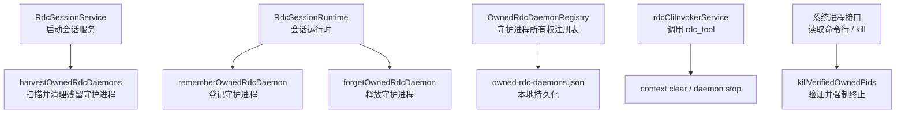
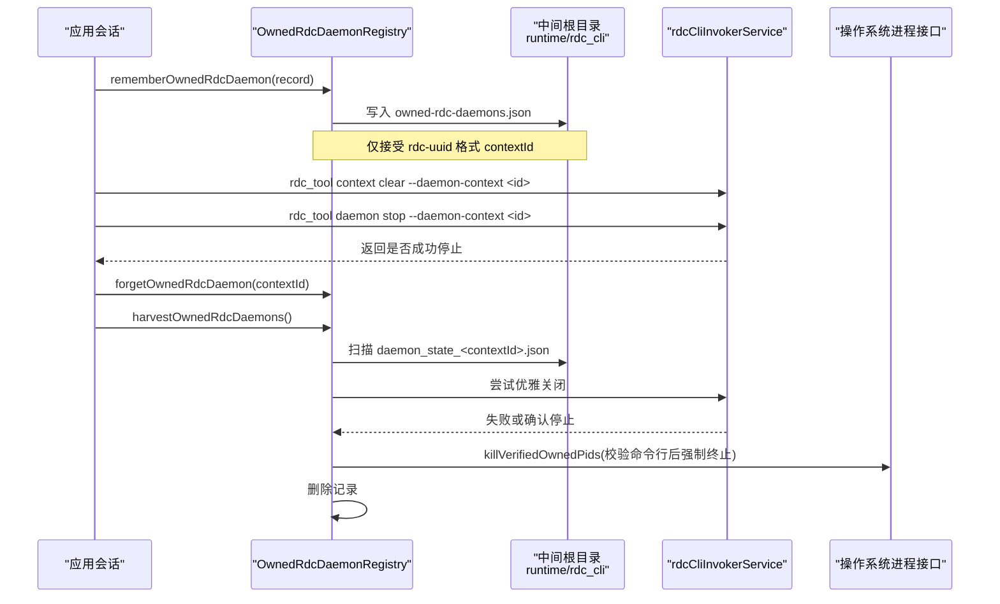
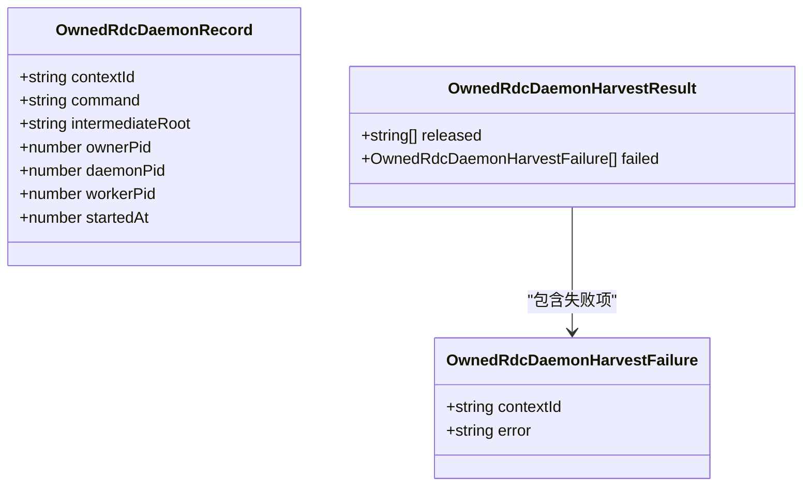
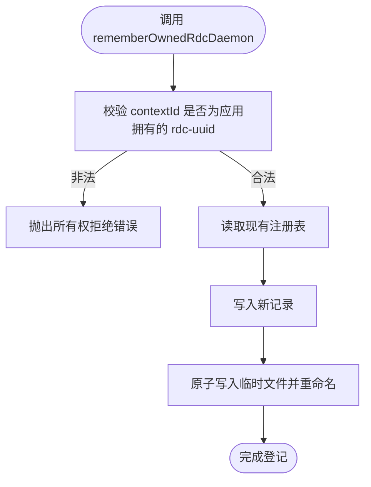
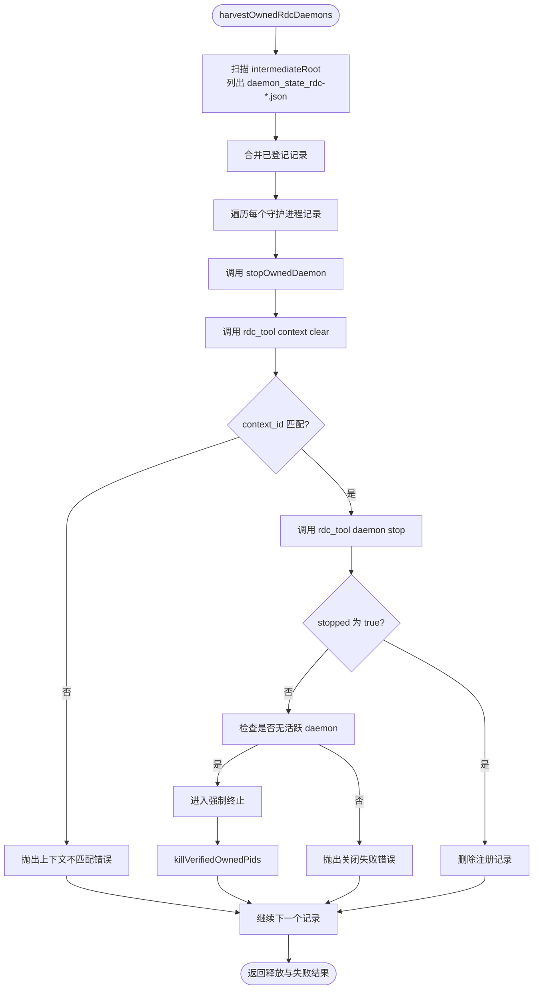
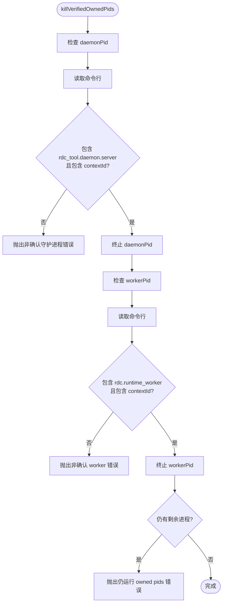
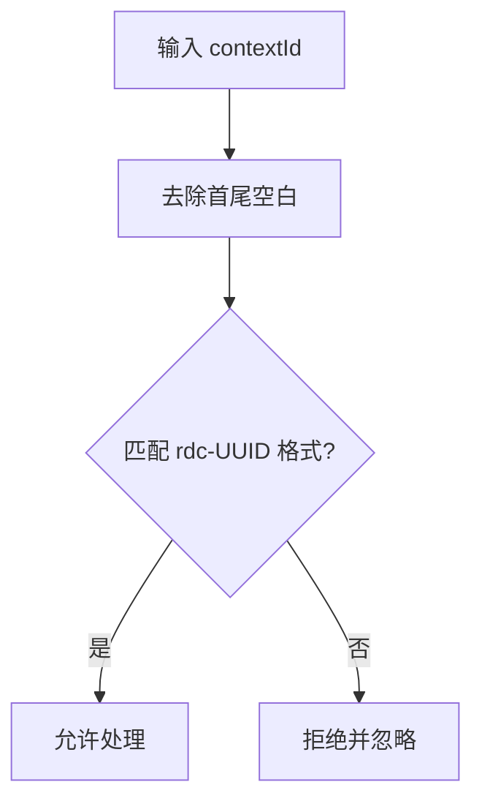
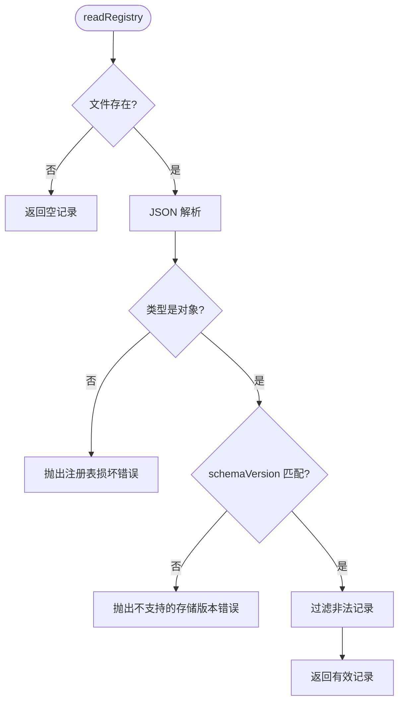
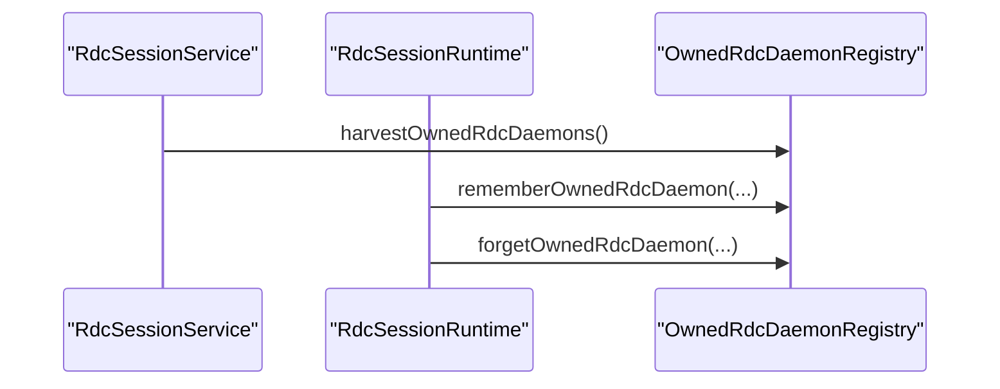
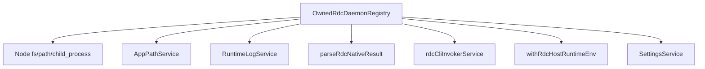

# 守护进程生命周期

<cite>
**本文引用的文件**
- [OwnedRdcDaemonRegistry.ts](file://src/main/sessions/OwnedRdcDaemonRegistry.ts)
- [OwnedRdcDaemonRegistry.test.ts](file://src/main/sessions/OwnedRdcDaemonRegistry.test.ts)
- [RdcSessionService.ts](file://src/main/sessions/RdcSessionService.ts)
- [RdcSessionRuntime.ts](file://src/main/sessions/RdcSessionRuntime.ts)
</cite>

## 目录
1. [简介](#简介)
2. [项目结构定位](#项目结构定位)
3. [核心组件](#核心组件)
4. [架构总览](#架构总览)
5. [详细组件分析](#详细组件分析)
6. [依赖关系分析](#依赖关系分析)
7. [性能与健壮性](#性能与健壮性)
8. [故障排查指南](#故障排查指南)
9. [结论](#结论)

## 简介
本文件聚焦 RDC 守护进程的生命周期管理，尤其是应用如何通过 `OwnedRdcDaemonRegistry` 追踪、清理和恢复其“拥有”的 RDC daemon 子进程。文档覆盖以下关键点：
- `rememberOwnedRdcDaemon`、`forgetOwnedRdcDaemon`、`listOwnedRdcDaemons` 的数据流和持久化语义。
- `OwnedRdcDaemonRecord` 字段含义：`contextId`、`command`、`intermediateRoot`、`ownerPid`、`daemonPid`、`workerPid`、`startedAt`。
- `harvestOwnedRdcDaemons` 如何扫描磁盘残留状态、调用 `rdcCliInvokerService` 优雅关闭，并在失败时执行双重安全检查后强制终止。
- `isAppRdcContextId` 正则如何防止恶意 contextId 注入。
- 注册、清理、异常处理的实际代码路径引用。

## 项目结构定位
该功能位于主进程的会话层中，围绕 RDC 工具链（`rdc_tool`、`rdc.runtime_worker`）进行进程级所有权管理：
- 核心实现：`src/main/sessions/OwnedRdcDaemonRegistry.ts`
- 单元测试：`src/main/sessions/OwnedRdcDaemonRegistry.test.ts`
- 生命周期集成点：
  - `RdcSessionService.ts`：启动阶段触发残留守护进程回收。
  - `RdcSessionRuntime.ts`：创建和销毁会话时登记或释放 owned daemon。

**图表来源**
- [RdcSessionService.ts:221](file://src/main/sessions/RdcSessionService.ts#L221)
- [RdcSessionRuntime.ts:470-487](file://src/main/sessions/RdcSessionRuntime.ts#L470-L487)
- [OwnedRdcDaemonRegistry.ts:1-251](file://src/main/sessions/OwnedRdcDaemonRegistry.ts#L1-L251)

**章节来源**
- [RdcSessionService.ts:13,221](file://src/main/sessions/RdcSessionService.ts#L13-L221)
- [RdcSessionRuntime.ts:29,470-487](file://src/main/sessions/RdcSessionRuntime.ts#L29-L487)
- [OwnedRdcDaemonRegistry.ts:1-251](file://src/main/sessions/OwnedRdcDaemonRegistry.ts#L1-L251)

## 核心组件
- `OwnedRdcDaemonRegistry`：提供守护进程所有权登记、查询、持久化与回收能力。
- `OwnedRdcDaemonRecord`：描述一个被应用拥有的 RDC daemon 实例及其关键元数据。
- `OwnedRdcDaemonHarvestResult`：回收操作的结果，包含成功释放的 contextId 列表与失败项。
- 辅助函数：`isAppRdcContextId`、`listAppDaemonContextsInIntermediateRoot`、`stopOwnedDaemon`、`killVerifiedOwnedPids`、`readRegistry`、`writeRegistry`、`readProcessCommandLine`、`terminatePid`。

**章节来源**
- [OwnedRdcDaemonRegistry.ts:1-60](file://src/main/sessions/OwnedRdcDaemonRegistry.ts#L1-L60)

## 架构总览
守护进程生命周期分为四个阶段：
1. **登记阶段**：应用启动某个 RDC daemon 后，通过 `rememberOwnedRdcDaemon` 将其写入本地注册表。
2. **运行阶段**：daemon 与 worker 由 `rdc_cli` 中间目录管理；上下文 id 必须匹配应用格式。
3. **清理阶段**：会话结束或应用退出时，优先尝试通过 `rdc_tool` 优雅停止。
4. **恢复阶段**：应用重启时，`harvestOwnedRdcDaemons` 扫描磁盘残留状态，对未登记的 daemon 进行安全清理。

**图表来源**
- [OwnedRdcDaemonRegistry.ts:60-200](file://src/main/sessions/OwnedRdcDaemonRegistry.ts#L60-L200)
- [OwnedRdcDaemonRegistry.ts:201-251](file://src/main/sessions/OwnedRdcDaemonRegistry.ts#L201-L251)

## 详细组件分析

### OwnedRdcDaemonRecord 数据结构
`OwnedRdcDaemonRecord` 用于描述一个受应用管理的 RDC daemon 实例。各字段含义如下：
- `contextId`：RDC 上下文标识，必须符合 `rdc-xxxxxxxx-xxxx-xxxx-xxxx-xxxxxxxxxxxx` 的 UUID 风格，由 `isAppRdcContextId` 校验。
- `command`：用于调用 `rdc_tool` 的命令路径或名称；为空或缺失时直接走强制终止流程。
- `intermediateRoot`：RDC 中间根目录，用于定位 `runtime/rdc_cli` 下的守护进程状态文件。
- `ownerPid`：拥有该守护进程的应用进程 PID。
- `daemonPid`：RDC daemon server 进程 PID，通常对应 `rdc_tool.daemon.server`。
- `workerPid`：RDC runtime worker 进程 PID，通常对应 `rdc.runtime_worker`。
- `startedAt`：守护进程启动时间戳。

该记录在 `rememberOwnedRdcDaemon` 中被持久化，并在 `harvestOwnedRdcDaemons` 中作为清理目标。

**图表来源**
- [OwnedRdcDaemonRegistry.ts:1-40](file://src/main/sessions/OwnedRdcDaemonRegistry.ts#L1-L40)

**章节来源**
- [OwnedRdcDaemonRegistry.ts:1-40](file://src/main/sessions/OwnedRdcDaemonRegistry.ts#L1-L40)

### 所有权登记与释放
- `rememberOwnedRdcDaemon`：
  - 首先校验 `contextId` 是否符合应用拥有的 RDC UUID 格式。
  - 将 record 写入本地注册表文件 `owned-rdc-daemons.json`。
  - 若 `contextId` 不合法，抛出拒绝所有权的错误。
- `forgetOwnedRdcDaemon`：
  - 从注册表中删除指定 `contextId` 的记录。
  - 如果记录不存在，则静默返回。
- `listOwnedRdcDaemons`：
  - 返回当前注册表中所有记录的数组。

这些方法构成守护进程生命周期的登记与注销入口，供 `RdcSessionRuntime` 在创建和销毁会话时调用。

**图表来源**
- [OwnedRdcDaemonRegistry.ts:60-90](file://src/main/sessions/OwnedRdcDaemonRegistry.ts#L60-L90)
- [OwnedRdcDaemonRegistry.ts:201-230](file://src/main/sessions/OwnedRdcDaemonRegistry.ts#L201-L230)

**章节来源**
- [OwnedRdcDaemonRegistry.ts:60-90](file://src/main/sessions/OwnedRdcDaemonRegistry.ts#L60-L90)
- [RdcSessionRuntime.ts:470-487](file://src/main/sessions/RdcSessionRuntime.ts#L470-L487)

### 守护进程回收与优雅关闭
`harvestOwnedRdcDaemons` 是守护进程恢复与清理的核心流程：
1. 确定 `intermediateRoot`，默认来自设置中的 RDC 中间根环境变量。
2. 扫描 `runtime/rdc_cli` 下符合 `daemon_state_rdc-*.json` 命名的状态文件，提取 contextId。
3. 合并已登记的 owned records；对未发现但存在状态文件的 contextId，构造空记录以便后续处理。
4. 逐个调用 `stopOwnedDaemon`，成功后删除注册记录并加入 `released`。
5. 捕获异常并记录到日志，加入 `failed`。

`stopOwnedDaemon` 的执行顺序为：
- 若 `command` 为空或指向不存在的路径，直接跳过优雅关闭，进入强制终止。
- 否则通过 `rdcCliInvokerService.executeCLI` 依次执行：
  - `context clear --daemon-context <contextId>`
  - `daemon stop --daemon-context <contextId>`
- 若 `daemon stop` 失败且错误表明没有活跃 daemon，则回退到强制终止。
- 若返回的 `context_id` 与预期不一致，抛出上下文不匹配错误。

**图表来源**
- [OwnedRdcDaemonRegistry.ts:90-200](file://src/main/sessions/OwnedRdcDaemonRegistry.ts#L90-L200)

**章节来源**
- [OwnedRdcDaemonRegistry.ts:90-200](file://src/main/sessions/OwnedRdcDaemonRegistry.ts#L90-L200)

### 双重安全检查与强制终止
当优雅关闭不可用时，`killVerifiedOwnedPids` 执行严格的安全检查：
- 使用 `readCommandLine(pid)` 读取进程命令行。
- 对 `daemonPid` 要求命令行包含 `rdc_tool.daemon.server` 与 `contextId`。
- 对 `workerPid` 要求命令行包含 `rdc.runtime_worker` 与 `contextId`。
- 任一条件不满足即抛出错误，避免误杀无关进程。
- 全部校验通过后，通过 `killPid` 终止进程；Windows 使用 `taskkill /F /T`，非 Windows 使用 `kill -9`。
- 若仍有剩余进程，抛出“仍运行的 owned pids”错误。

**图表来源**
- [OwnedRdcDaemonRegistry.ts:160-205](file://src/main/sessions/OwnedRdcDaemonRegistry.ts#L160-L205)

**章节来源**
- [OwnedRdcDaemonRegistry.ts:160-205](file://src/main/sessions/OwnedRdcDaemonRegistry.ts#L160-L205)

### 安全过滤：应用拥有的 contextId
`isAppRdcContextId` 使用正则表达式确保只处理以 `rdc-` 开头、后接 UUID 风格字符的 contextId。这样可防止恶意注入非应用拥有的上下文标识，从而保护守护进程清理逻辑不会误伤其他 RDC 实例。

此外，`listAppDaemonContextsInIntermediateRoot` 在扫描磁盘状态文件时也会过滤文件名，只接受 `daemon_state_rdc-*.json` 模式，进一步降低风险。

**图表来源**
- [OwnedRdcDaemonRegistry.ts:10-25](file://src/main/sessions/OwnedRdcDaemonRegistry.ts#L10-L25)
- [OwnedRdcDaemonRegistry.ts:40-55](file://src/main/sessions/OwnedRdcDaemonRegistry.ts#L40-L55)

**章节来源**
- [OwnedRdcDaemonRegistry.ts:10-25](file://src/main/sessions/OwnedRdcDaemonRegistry.ts#L10-L25)
- [OwnedRdcDaemonRegistry.ts:40-55](file://src/main/sessions/OwnedRdcDaemonRegistry.ts#L40-L55)

### 注册表读写与持久化
注册表文件名为 `owned-rdc-daemons.json`，存储结构包含 schema 版本与记录映射。读取时进行多项校验：
- 文件必须是对象而非数组。
- schemaVersion 必须等于内部定义版本。
- 每条记录的 key 与 `record.contextId` 必须一致，且 key 必须通过 `isAppRdcContextId` 校验。

写入时使用临时文件 + 重命名方式保证原子性，减少损坏风险。

**图表来源**
- [OwnedRdcDaemonRegistry.ts:201-230](file://src/main/sessions/OwnedRdcDaemonRegistry.ts#L201-L230)

**章节来源**
- [OwnedRdcDaemonRegistry.ts:201-230](file://src/main/sessions/OwnedRdcDaemonRegistry.ts#L201-L230)

### 进程命令行读取与终止
- `readProcessCommandLine`：
  - 非 Windows 平台读取 `/proc/<pid>/cmdline`。
  - Windows 平台通过 PowerShell 查询 Win32_Process 命令行。
- `terminatePid`：
  - Windows 使用 `taskkill /PID <pid> /F /T`。
  - 非 Windows 使用 `kill -9 <pid>`。

这些底层能力支撑 `killVerifiedOwnedPids` 的双重安全检查。

**章节来源**
- [OwnedRdcDaemonRegistry.ts:231-251](file://src/main/sessions/OwnedRdcDaemonRegistry.ts#L231-L251)

### 集成点：会话服务与运行时
- `RdcSessionService`：
  - 在会话服务初始化时调用 `harvestOwnedRdcDaemons`，确保应用启动时清理残留守护进程。
- `RdcSessionRuntime`：
  - 会话结束时调用 `forgetOwnedRdcDaemon` 释放记录。
  - 会话创建或守护进程启动时调用 `rememberOwnedRdcDaemon` 登记记录。

**图表来源**
- [RdcSessionService.ts:13,221](file://src/main/sessions/RdcSessionService.ts#L13-L221)
- [RdcSessionRuntime.ts:29,470-487](file://src/main/sessions/RdcSessionRuntime.ts#L29-L487)

**章节来源**
- [RdcSessionService.ts:13,221](file://src/main/sessions/RdcSessionService.ts#L13-L221)
- [RdcSessionRuntime.ts:29,470-487](file://src/main/sessions/RdcSessionRuntime.ts#L29-L487)

## 依赖关系分析
`OwnedRdcDaemonRegistry` 依赖以下模块与服务：
- Node.js 标准库：`child_process.spawnSync`、`fs`、`path`。
- 应用路径服务：`appPathService` 获取应用状态根目录。
- 日志服务：`runtimeLogService` 记录回收失败信息。
- RDC 协议解析：`parseRdcNativeResult` 解析 `rdc_tool` 返回结果。
- CLI 调用服务：`rdcCliInvokerService.executeCLI` 执行 `rdc_tool`。
- 主机运行时环境：`withRdcHostRuntimeEnv`、`RDC_INTERMEDIATE_ROOT_ENV` 注入中间根环境变量。
- 设置服务：`settingsService` 获取 RDC CLI 命令与配置。

**图表来源**
- [OwnedRdcDaemonRegistry.ts:1-30](file://src/main/sessions/OwnedRdcDaemonRegistry.ts#L1-L30)

**章节来源**
- [OwnedRdcDaemonRegistry.ts:1-30](file://src/main/sessions/OwnedRdcDaemonRegistry.ts#L1-L30)

## 性能与健壮性
- **磁盘扫描**：`listAppDaemonContextsInIntermediateRoot` 同步读取目录并过滤文件名，适合少量状态文件场景；若状态文件数量增长，可考虑异步枚举与增量扫描。
- **注册表读写**：采用临时文件+重命名实现原子写入，提升可靠性；读路径包含 schema 与内容校验，防止脏数据导致崩溃。
- **进程终止**：强制终止使用系统命令，跨平台兼容；双重命令行校验降低误杀风险。
- **异常处理**：回收过程捕获异常并记录日志，同时返回 `failed` 列表，便于上层监控与重试策略。

[本节为通用指导，不直接分析具体文件]

## 故障排查指南
常见问题与处理建议：
- **守护进程无法优雅关闭**：
  - 检查 `rdc_tool` 命令是否存在并可执行。
  - 查看 `harvestOwnedRdcDaemons` 返回的 `failed` 项，确认错误消息是否提示“无活跃 daemon”。
  - 若确实无活跃 daemon，系统将自动回退到强制终止。
- **强制终止未生效**：
  - 确认 `daemonPid` 与 `workerPid` 对应的命令行是否包含预期的模块名与 `contextId`。
  - 若非预期进程，系统会抛出“非确认守护进程”错误，避免误杀。
- **注册表损坏或不支持版本**：
  - 检查 `owned-rdc-daemons.json` 是否为合法 JSON 对象。
  - 若 schemaVersion 不匹配，需迁移或删除损坏文件。
- **上下文不匹配**：
  - 若 `context clear` 返回的 `context_id` 与记录不一致，说明可能误操作了其他守护进程，应检查 `contextId` 来源。

**章节来源**
- [OwnedRdcDaemonRegistry.ts:90-205](file://src/main/sessions/OwnedRdcDaemonRegistry.ts#L90-L205)
- [OwnedRdcDaemonRegistry.ts:201-251](file://src/main/sessions/OwnedRdcDaemonRegistry.ts#L201-L251)

## 结论
`OwnedRdcDaemonRegistry` 提供了完整的 RDC 守护进程生命周期管理能力：
- 通过严格的 contextId 正则与文件名过滤，确保只处理应用拥有的守护进程。
- 使用本地注册表持久化 owned daemon 元数据，并在应用重启时恢复清理流程。
- 优先通过 `rdc_tool` 优雅关闭，失败时执行双重安全检查后强制终止，兼顾安全性与健壮性。
- 与 `RdcSessionService` 和 `RdcSessionRuntime` 紧密集成，形成会话级的守护进程管理机制。

[本节为总结，不直接分析具体文件]