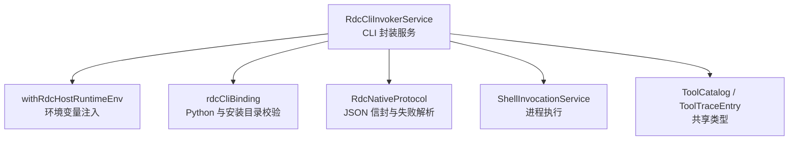
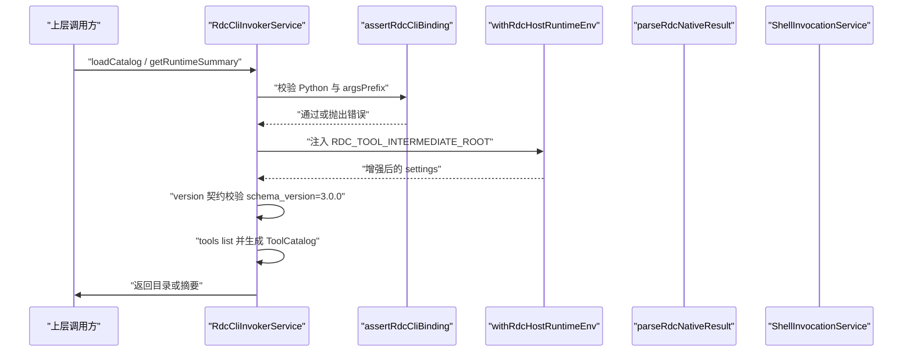
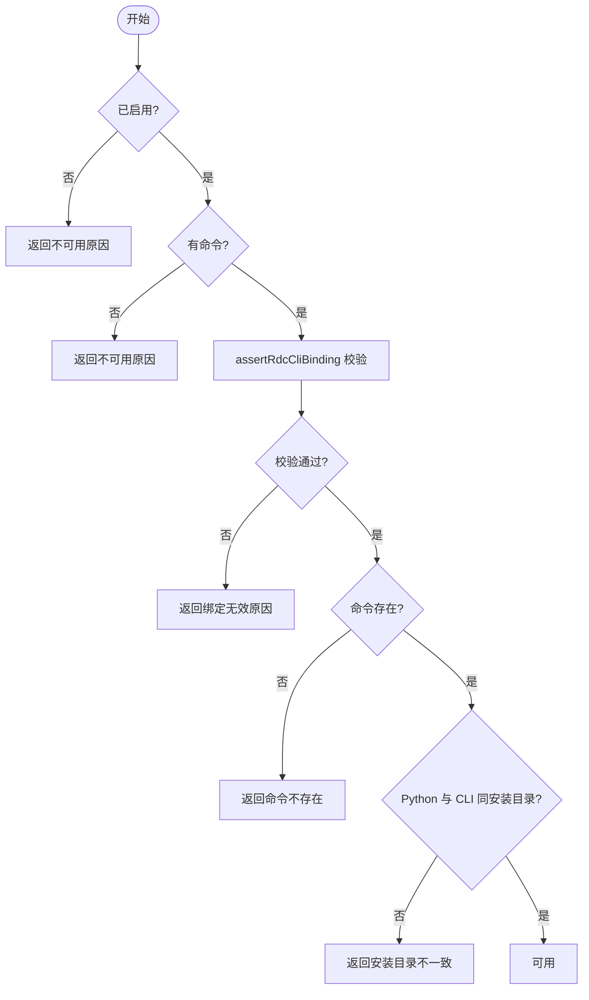
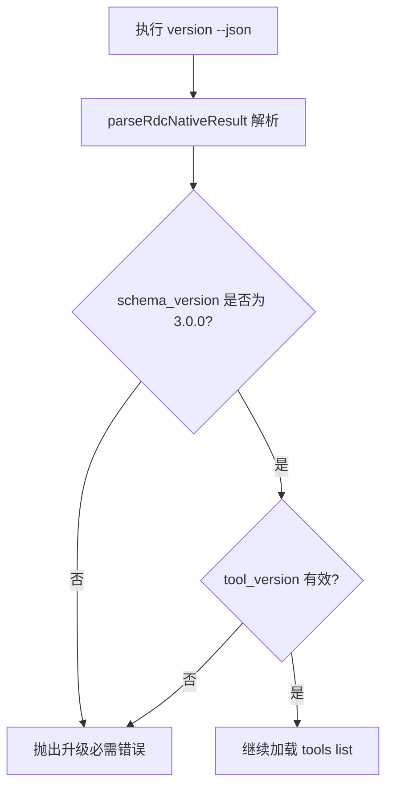
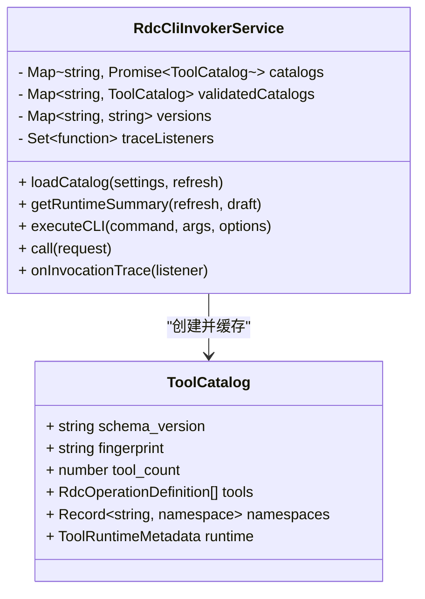
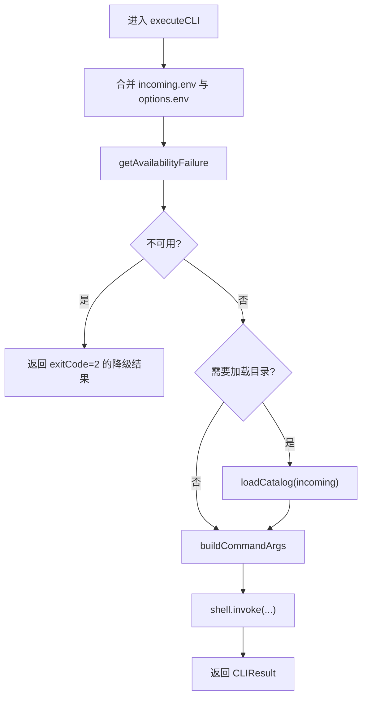
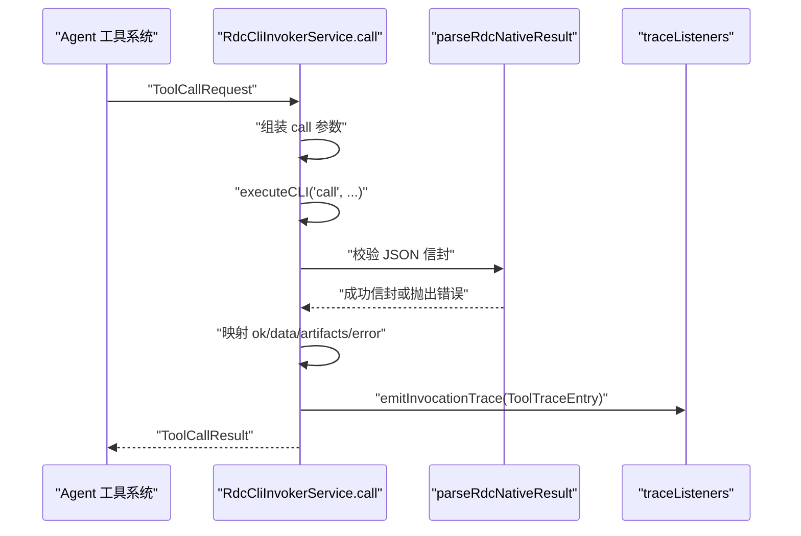
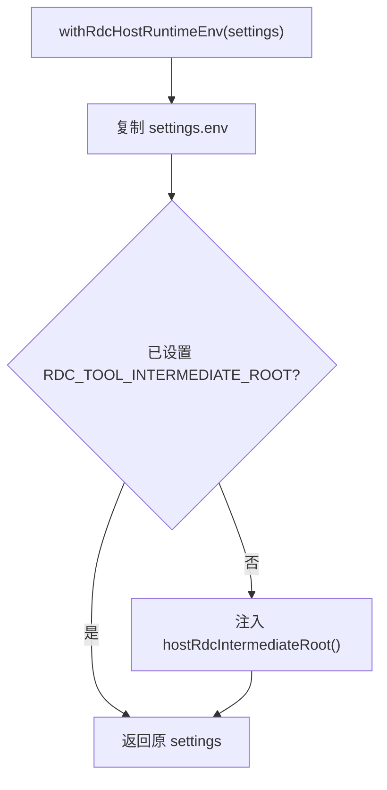
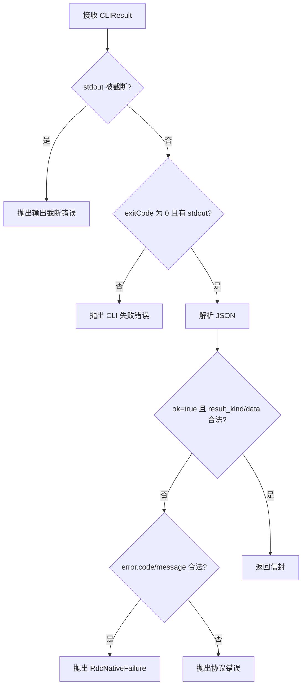
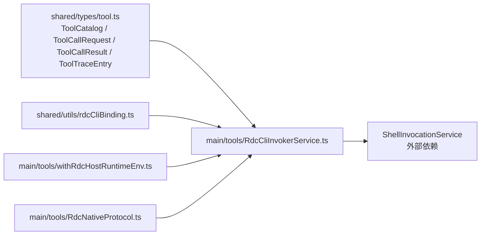

# RDC-Tool CLI 封装

<cite>
**本文引用的文件**   
- [RdcCliInvokerService.ts](file://src/main/tools/RdcCliInvokerService.ts)
- [withRdcHostRuntimeEnv.ts](file://src/main/tools/withRdcHostRuntimeEnv.ts)
- [rdcCliBinding.ts](file://src/shared/utils/rdcCliBinding.ts)
- [RdcNativeProtocol.ts](file://src/main/tools/RdcNativeProtocol.ts)
- [tool.ts](file://src/shared/types/tool.ts)
</cite>

## 目录
1. [简介](#简介)
2. [项目结构](#项目结构)
3. [核心组件](#核心组件)
4. [架构总览](#架构总览)
5. [详细组件分析](#详细组件分析)
6. [依赖关系分析](#依赖关系分析)
7. [性能与缓存特性](#性能与缓存特性)
8. [常见问题排查](#常见问题排查)
9. [结论](#结论)
10. [附录：常见调用示例](#附录常见调用示例)

## 简介
本文件详细说明 RDC-Tool CLI 的宿主侧封装层。重点包括：
- `RdcCliInvokerService` 如何校验并加载 `rdc-tool` CLI；
- Python 路径、安装目录一致性、版本契约 `schema_version 3.0.0` 的验证流程；
- `ToolCatalog` 的异步加载、缓存与失效机制；
- `executeCLI` 的命令构建、错误解析与 trace 监听；
- `withRdcHostRuntimeEnv` 注入 `RDC_TOOL_INTERMEDIATE_ROOT`，保证中间文件隔离；
- CLI 不可用时的降级策略、`available` 检测逻辑与运行时元数据；
- 与 Agent 工具系统的集成方式及 `ToolTraceEntry` 的数据流；
- 实际 CLI 调用示例，如版本检查、工具列表和工具执行。

## 项目结构
围绕 RDC-Tool CLI 的关键代码集中在以下模块：
- 服务层：`src/main/tools/RdcCliInvokerService.ts`
- 运行环境注入：`src/main/tools/withRdcHostRuntimeEnv.ts`
- 绑定与安装布局校验：`src/shared/utils/rdcCliBinding.ts`
- CLI 原生协议解析：`src/main/tools/RdcNativeProtocol.ts`
- 共享类型定义：`src/shared/types/tool.ts`

**图表来源**
- [RdcCliInvokerService.ts:1-369](file://src/main/tools/RdcCliInvokerService.ts#L1-L369)
- [withRdcHostRuntimeEnv.ts:1-16](file://src/main/tools/withRdcHostRuntimeEnv.ts#L1-L16)
- [rdcCliBinding.ts:1-54](file://src/shared/utils/rdcCliBinding.ts#L1-L54)
- [RdcNativeProtocol.ts:1-98](file://src/main/tools/RdcNativeProtocol.ts#L1-L98)
- [tool.ts:1-208](file://src/shared/types/tool.ts#L1-L208)

**章节来源**
- [RdcCliInvokerService.ts:1-369](file://src/main/tools/RdcCliInvokerService.ts#L1-L369)
- [withRdcHostRuntimeEnv.ts:1-16](file://src/main/tools/withRdcHostRuntimeEnv.ts#L1-L16)
- [rdcCliBinding.ts:1-54](file://src/shared/utils/rdcCliBinding.ts#L1-L54)
- [RdcNativeProtocol.ts:1-98](file://src/main/tools/RdcNativeProtocol.ts#L1-L98)
- [tool.ts:1-208](file://src/shared/types/tool.ts#L1-L208)

## 核心组件
- `RdcCliInvokerService`：封装 `rdc-tool` 的可用性检测、目录校验、目录清单加载、命令执行、结果解析、trace 订阅与生命周期管理。
- `withRdcHostRuntimeEnv`：确保每次调用都携带 `RDC_TOOL_INTERMEDIATE_ROOT`，指向用户级中间根目录，避免不同会话互相污染。
- `assertRdcCliBinding`：严格校验 Python 可执行文件与 CLI 入口必须来自同一安装布局，拒绝旧布局与危险环境变量。
- `parseRdcNativeResult`：解析 rdc-tool 返回的 JSON 信封，区分成功信封、结构化错误信封以及协议不匹配。
- 共享类型：`ToolCatalog`、`ToolCallRequest`、`ToolCallResult`、`ToolTraceEntry`、`ToolRuntimeMetadata`、`ToolRuntimeSummary`、`CLIResult`。

**章节来源**
- [RdcCliInvokerService.ts:1-369](file://src/main/tools/RdcCliInvokerService.ts#L1-L369)
- [withRdcHostRuntimeEnv.ts:1-16](file://src/main/tools/withRdcHostRuntimeEnv.ts#L1-L16)
- [rdcCliBinding.ts:1-54](file://src/shared/utils/rdcCliBinding.ts#L1-L54)
- [RdcNativeProtocol.ts:1-98](file://src/main/tools/RdcNativeProtocol.ts#L1-L98)
- [tool.ts:1-208](file://src/shared/types/tool.ts#L1-L208)

## 架构总览
`RdcCliInvokerService` 是上层 Agent 工具系统调用 rdc-tool 的唯一入口。它先做“静态可用性”检查，再按需“动态加载目录”，最后通过 Shell 执行具体命令。

**图表来源**
- [RdcCliInvokerService.ts:1-200](file://src/main/tools/RdcCliInvokerService.ts#L1-L200)
- [rdcCliBinding.ts:1-54](file://src/shared/utils/rdcCliBinding.ts#L1-L54)
- [withRdcHostRuntimeEnv.ts:1-16](file://src/main/tools/withRdcHostRuntimeEnv.ts#L1-L16)
- [RdcNativeProtocol.ts:1-98](file://src/main/tools/RdcNativeProtocol.ts#L1-L98)

## 详细组件分析

### RdcCliInvokerService：CLI 验证、目录加载与调用
该服务维护三类内部状态：
- `catalogs`：按设置序列化键缓存的 Promise，用于并发安全的异步目录加载；
- `validatedCatalogs`：已完成校验且冻结的 `ToolCatalog`；
- `versions`：按设置键缓存的 CLI 工具版本号；
- `traceListeners`：订阅 `ToolTraceEntry` 的监听器集合。

#### 可用性检查与安装目录一致性
`getAvailabilityFailure` 依次检查：
1. 是否启用；
2. 是否配置了命令；
3. 是否通过 `assertRdcCliBinding`；
4. 如果命令是绝对路径或包含分隔符，则要求文件存在；
5. 将命令向上回退到安装根目录，并校验 Python 与 `cli/run_cli.py` 必须位于同一安装目录下。

**图表来源**
- [RdcCliInvokerService.ts:43-78](file://src/main/tools/RdcCliInvokerService.ts#L43-L78)
- [rdcCliBinding.ts:1-54](file://src/shared/utils/rdcCliBinding.ts#L1-L54)

**章节来源**
- [RdcCliInvokerService.ts:43-78](file://src/main/tools/RdcCliInvokerService.ts#L43-L78)
- [rdcCliBinding.ts:1-54](file://src/shared/utils/rdcCliBinding.ts#L1-L54)

#### 版本契约校验
加载目录时，首先执行 `version --json`，并通过 `parseRdcNativeResult` 解析。契约要求：
- 外层信封与内层数据的 `schema_version` 均为 `3.0.0`；
- 内层 `tool_version` 为有效字符串。

若不符合，则抛出升级相关错误。

**图表来源**
- [RdcCliInvokerService.ts:93-113](file://src/main/tools/RdcCliInvokerService.ts#L93-L113)
- [RdcNativeProtocol.ts:1-98](file://src/main/tools/RdcNativeProtocol.ts#L1-L98)

**章节来源**
- [RdcCliInvokerService.ts:93-113](file://src/main/tools/RdcCliInvokerService.ts#L93-L113)
- [RdcNativeProtocol.ts:1-98](file://src/main/tools/RdcNativeProtocol.ts#L1-L98)

#### ToolCatalog 异步加载、缓存与失效
- 每个设置对象会被深拷贝并冻结，再以规范化 JSON 作为缓存键；
- `catalogs` 保存正在加载的 Promise，避免重复启动；
- `validatedCatalogs` 保存最终可用的目录；
- `refresh=true` 会删除对应 key 的三类缓存；
- 加载成功后对目录进行深度冻结；
- 失败时会清理三类缓存并抛出错误；
- 同时填充 `versions`，供 `ToolRuntimeMetadata.version` 使用。

**图表来源**
- [RdcCliInvokerService.ts:14-139](file://src/main/tools/RdcCliInvokerService.ts#L14-L139)
- [tool.ts:69-124](file://src/shared/types/tool.ts#L69-L124)

**章节来源**
- [RdcCliInvokerService.ts:14-139](file://src/main/tools/RdcCliInvokerService.ts#L14-L139)
- [tool.ts:69-124](file://src/shared/types/tool.ts#L69-L124)

#### executeCLI：命令构建、参数透传与环境控制
`executeCLI` 的核心职责：
- 合并传入环境与设置环境；
- 再次执行可用性检查；
- 对非 `version`、非 `tools list` 的命令，先触发一次目录加载以保证上下文；
- 通过 `resolveRdcBatchInvocation` 生成最终命令与参数；
- 强制清空 `PYTHONHOME` 与 `PYTHONPATH`，并设置 `RDC_TOOL_ROOT`；
- 限制 stdout 缓冲大小；
- 透传 `runId`、`contextId`、`abortSignal`、超时等。

**图表来源**
- [RdcCliInvokerService.ts:141-217](file://src/main/tools/RdcCliInvokerService.ts#L141-L217)

**章节来源**
- [RdcCliInvokerService.ts:141-217](file://src/main/tools/RdcCliInvokerService.ts#L141-L217)

#### 错误解析与 Agent 工具结果映射
`call` 方法负责把底层 `CLIResult` 转换为 Agent 工具期望的 `ToolCallResult`：
- 构造 `call` 命令与 `--args-json` 参数；
- 自动补全 `context_id`、`runtime_owner`、`owner_lease_id`；
- 使用 `parseRdcNativeResult` 校验信封；
- 根据 `ok` 字段映射成功或失败结果；
- 所有分支都会生成并广播 `ToolTraceEntry`。

**图表来源**
- [RdcCliInvokerService.ts:219-369](file://src/main/tools/RdcCliInvokerService.ts#L219-L369)
- [RdcNativeProtocol.ts:1-98](file://src/main/tools/RdcNativeProtocol.ts#L1-L98)
- [tool.ts:45-68](file://src/shared/types/tool.ts#L45-L68)

**章节来源**
- [RdcCliInvokerService.ts:219-369](file://src/main/tools/RdcCliInvokerService.ts#L219-L369)
- [RdcNativeProtocol.ts:1-98](file://src/main/tools/RdcNativeProtocol.ts#L1-L98)
- [tool.ts:45-68](file://src/shared/types/tool.ts#L45-L68)

#### withRdcHostRuntimeEnv：中间文件隔离
该函数确保每次调用前都设置 `RDC_TOOL_INTERMEDIATE_ROOT`，默认值来自宿主应用路径服务提供的用户级中间根目录。这样可避免多个工作区或会话共用临时目录。

**图表来源**
- [withRdcHostRuntimeEnv.ts:1-16](file://src/main/tools/withRdcHostRuntimeEnv.ts#L1-L16)

**章节来源**
- [withRdcHostRuntimeEnv.ts:1-16](file://src/main/tools/withRdcHostRuntimeEnv.ts#L1-L16)

#### RdcNativeProtocol：信封结构与失败恢复信息
`parseRdcNativeResult` 不仅判断 `exitCode`，还解析结构化错误信封中的 `code`、`message`、`category`、`details`，并提取可用于恢复的上下文信息，例如截图目标恢复、着色器检查恢复等。这对上层工具系统的重试、撤销、还原行为非常关键。

**图表来源**
- [RdcNativeProtocol.ts:1-98](file://src/main/tools/RdcNativeProtocol.ts#L1-L98)

**章节来源**
- [RdcNativeProtocol.ts:1-98](file://src/main/tools/RdcNativeProtocol.ts#L1-L98)

#### 运行时元数据与摘要
`createRuntimeMetadata` 暴露给 UI 与诊断层的信息包括：
- 来源：`configured` 或 `unconfigured`；
- 命令与工作目录；
- 中间根目录；
- 已缓存的 CLI 工具版本；
- 目录是否存在、schema 版本、生成时间、工具数量。

`getRuntimeSummary` 在失败时返回 `cli.available=false` 与不可用原因，并提供命名空间维度摘要。

**章节来源**
- [RdcCliInvokerService.ts:29-57](file://src/main/tools/RdcCliInvokerService.ts#L29-L57)
- [RdcCliInvokerService.ts:121-139](file://src/main/tools/RdcCliInvokerService.ts#L121-L139)
- [tool.ts:126-160](file://src/shared/types/tool.ts#L126-L160)

## 依赖关系分析

**图表来源**
- [RdcCliInvokerService.ts:1-369](file://src/main/tools/RdcCliInvokerService.ts#L1-L369)
- [tool.ts:1-208](file://src/shared/types/tool.ts#L1-L208)
- [rdcCliBinding.ts:1-54](file://src/shared/utils/rdcCliBinding.ts#L1-L54)
- [withRdcHostRuntimeEnv.ts:1-16](file://src/main/tools/withRdcHostRuntimeEnv.ts#L1-L16)
- [RdcNativeProtocol.ts:1-98](file://src/main/tools/RdcNativeProtocol.ts#L1-L98)

**章节来源**
- [RdcCliInvokerService.ts:1-369](file://src/main/tools/RdcCliInvokerService.ts#L1-L369)
- [tool.ts:1-208](file://src/shared/types/tool.ts#L1-L208)
- [rdcCliBinding.ts:1-54](file://src/shared/utils/rdcCliBinding.ts#L1-L54)
- [withRdcHostRuntimeEnv.ts:1-16](file://src/main/tools/withRdcHostRuntimeEnv.ts#L1-L16)
- [RdcNativeProtocol.ts:1-98](file://src/main/tools/RdcNativeProtocol.ts#L1-L98)

## 性能与缓存特性
- 目录加载是异步且幂等的：相同设置键的并发调用共享同一个 Promise，减少重复子进程启动。
- 成功目录被深度冻结，防止外部修改影响已发布工具清单。
- `refresh=true` 提供显式失效能力，适合设置变更后主动重建。
- `isAvailable` 同时检查“可用性无失败”和“已有验证目录”，因此 UI 可在未加载目录时显示“未就绪”。
- 命令行输出缓冲区上限为 8MB，避免异常输出占用过多内存；超过限制会通过 `stdoutTruncated` 与协议层错误提示。
- `PYTHONHOME` 与 `PYTHONPATH` 被强制清空，降低 Python 环境漂移带来的不确定性。

[本节为通用性能说明，不直接分析特定代码片段]

## 常见问题排查
- **CLI 未启用或命令为空**：`getAvailabilityFailure` 会返回明确的不可用原因，`getRuntimeSummary` 中 `cli.available=false`。
- **Python 路径不正确**：`assertRdcCliBinding` 要求必须是打包的 `binaries/windows/x64/python/python.exe`。
- **argsPrefix 不是 `cli/run_cli.py`**：同样由绑定校验拦截。
- **安装布局过时**：若路径包含 `rdx-tools`，会提示迁移到 `rdc-tool`。
- **环境变量越权**：禁止 `RDX_*` 变量、禁止覆盖 `RDC_TOOL_ROOT`、禁止设置 `PYTHONHOME` 或 `PYTHONPATH`。
- **版本契约不匹配**：`schema_version` 不为 `3.0.0` 会抛出升级必需错误。
- **stdout 过大或被截断**：`parseRdcNativeResult` 会报告输出截断或协议不匹配。
- **工具执行失败**：上层 `call` 会把 rdc-tool 的结构化错误映射为 `ToolCallResult.error`，并记录 trace。

**章节来源**
- [RdcCliInvokerService.ts:43-139](file://src/main/tools/RdcCliInvokerService.ts#L43-L139)
- [rdcCliBinding.ts:1-54](file://src/shared/utils/rdcCliBinding.ts#L1-L54)
- [RdcNativeProtocol.ts:1-98](file://src/main/tools/RdcNativeProtocol.ts#L1-L98)

## 结论
`RdcCliInvokerService` 将 rdc-tool 的 Python CLI 包装成稳定、可观测、可测试的工具执行接口。它通过严格的绑定校验、安装目录一致性检查、版本契约校验与结构化错误解析，使上层 Agent 工具系统可以安全地枚举工具、执行工具并追踪完整调用链。`withRdcHostRuntimeEnv` 保证中间文件隔离，而 `ToolCatalog` 的异步缓存机制在可用性与性能之间取得平衡。

[本节为总结性内容，不直接分析特定代码片段]

## 附录：常见调用示例

### 1. 检查 CLI 可用性
- 调用 `getRuntimeSummary()`。
- 如果返回 `cli.available=false`，应读取 `unavailableReason` 并向用户提示配置问题。
- 如果返回 `cli.available=true`，可进一步展示命名空间与工具数量。

**章节来源**
- [RdcCliInvokerService.ts:121-139](file://src/main/tools/RdcCliInvokerService.ts#L121-L139)
- [tool.ts:160-176](file://src/shared/types/tool.ts#L160-L176)

### 2. 刷新并获取工具目录
- 首次调用 `loadCatalog()`。
- 设置变更后调用 `loadCatalog(settings, true)` 强制刷新。
- 成功后可从 `catalog.tools` 获取工具定义，从 `catalog.namespaces` 获取分组信息。

**章节来源**
- [RdcCliInvokerService.ts:89-139](file://src/main/tools/RdcCliInvokerService.ts#L89-L139)
- [tool.ts:69-124](file://src/shared/types/tool.ts#L69-L124)

### 3. 执行工具
- 调用 `call({ toolName, args, contextId, runtimeOwner, ownerLeaseId, runId, abortSignal })`。
- 返回 `ToolCallResult.ok=true` 时，使用 `data` 与 `artifacts`。
- 返回 `ok=false` 时，查看 `error.code`、`error.message`、`error.category`、`error.details`。

**章节来源**
- [RdcCliInvokerService.ts:219-369](file://src/main/tools/RdcCliInvokerService.ts#L219-L369)
- [tool.ts:45-68](file://src/shared/types/tool.ts#L45-L68)

### 4. 监听工具调用 trace
- 调用 `onInvocationTrace(listener)` 注册监听器。
- 每次 `call` 都会发出 `ToolTraceEntry`，包含 `traceId`、`turnId`、`toolName`、`args`、`result`、`timestamp`、`contextId`、`runtimeOwner`、`ownerLeaseId`。
- 返回函数可注销监听器。

**章节来源**
- [RdcCliInvokerService.ts:219-267](file://src/main/tools/RdcCliInvokerService.ts#L219-L267)
- [tool.ts:178-208](file://src/shared/types/tool.ts#L178-L208)

### 5. 理解底层 CLI 调用
- 版本检查：内部执行 `version --json`，校验 `schema_version 3.0.0`。
- 工具列表：内部执行 `tools list --full --json`，生成 `ToolCatalog`。
- 工具执行：内部执行 `call`，并附带 `--args-json` 与可选 `--daemon-context`。

**章节来源**
- [RdcCliInvokerService.ts:89-217](file://src/main/tools/RdcCliInvokerService.ts#L89-L217)