# RDC/RenderDoc 集成

<cite>
**本文引用的文件**   
- [RdcCliInvokerService.ts](file://src/main/tools/RdcCliInvokerService.ts)
- [RdcSessionService.ts](file://src/main/sessions/RdcSessionService.ts)
- [OwnedRdcDaemonRegistry.ts](file://src/main/sessions/OwnedRdcDaemonRegistry.ts)
- [RdcRuntimeContextRegistry.ts](file://src/main/sessions/RdcRuntimeContextRegistry.ts)
- [RdcOperationCoordinator.ts](file://src/main/sessions/RdcOperationCoordinator.ts)
- [RdcReplayObservation.ts](file://src/main/sessions/RdcReplayObservation.ts)
- [RdcNativeProtocol.ts](file://src/main/tools/RdcNativeProtocol.ts)
- [RdcOperationPolicy.ts](file://src/main/tools/RdcOperationPolicy.ts)
- [RdcProcessIdentity.ts](file://src/main/tools/RdcProcessIdentity.ts)
- [RdcExecutionReceipts.ts](file://src/main/tools/RdcExecutionReceipts.ts)
- [RdcTurnBindings.ts](file://src/main/tools/RdcTurnBindings.ts)
- [rdcCliBinding.ts](file://src/shared/utils/rdcCliBinding.ts)
</cite>

## 目录
1. [引言](#引言)
2. [项目结构](#项目结构)
3. [核心组件](#核心组件)
4. [架构总览](#架构总览)
5. [详细组件分析](#详细组件分析)
6. [依赖关系分析](#依赖关系分析)
7. [性能与资源管理](#性能与资源管理)
8. [故障排查指南](#故障排查指南)
9. [结论](#结论)

## 引言
本文件系统化说明项目中对原生 RDC-Tool CLI 和 RenderDoc 运行时的封装与集成方式。重点包括：
- RDC-Tool CLI 的发现、版本校验、工具目录加载与安全执行；
- Capture 打开、关闭、事件回放与应用的状态机；
- Replay 控制、帧观察、图像输出与设备展示状态；
- Context 身份管理、会话租约、子会话委托与隔离；
- Daemon 上下文的所有权登记、回收与进程级安全校验；
- Lease 管理机制、上下文一致性检查、临时时间点查询防护；
- RDC 操作生命周期、错误处理策略、审计收据与可观测性；
- 与 Agent 系统的集成模式及 RenderDoc 1.45 相关兼容性约束。

## 项目结构
围绕 RDC/RenderDoc 的代码主要分布在主进程的 `tools`、`sessions`、`shared/types` 与共享工具中，形成“调用层—会话层—运行时层—协议层”的分层结构：
- `tools`：CLI 封装、参数策略、执行回执、进程身份、操作策略；
- `sessions`：Capture/Replay 会话服务、操作协调器、上下文租约、Daemon 所有权、回放观察；
- `shared/utils`：RDC-Tool 绑定路径与安装布局校验；
- 类型与常量：由其他模块引用，定义 RDC 运行时、会话、工具等契约。

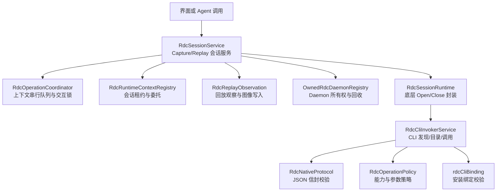

图表来源
- [RdcSessionService.ts:1-120](file://src/main/sessions/RdcSessionService.ts#L1-L120)
- [RdcOperationCoordinator.ts:1-38](file://src/main/sessions/RdcOperationCoordinator.ts#L1-L38)
- [RdcRuntimeContextRegistry.ts:1-120](file://src/main/sessions/RdcRuntimeContextRegistry.ts#L1-L120)
- [RdcReplayObservation.ts:1-107](file://src/main/sessions/RdcReplayObservation.ts#L1-L107)
- [OwnedRdcDaemonRegistry.ts:1-120](file://src/main/sessions/OwnedRdcDaemonRegistry.ts#L1-L120)
- [RdcCliInvokerService.ts:1-120](file://src/main/tools/RdcCliInvokerService.ts#L1-L120)
- [RdcNativeProtocol.ts:1-98](file://src/main/tools/RdcNativeProtocol.ts#L1-L98)
- [RdcOperationPolicy.ts:1-124](file://src/main/tools/RdcOperationPolicy.ts#L1-L124)
- [rdcCliBinding.ts:1-54](file://src/shared/utils/rdcCliBinding.ts#L1-L54)

章节来源
- [RdcSessionService.ts:1-120](file://src/main/sessions/RdcSessionService.ts#L1-L120)
- [RdcCliInvokerService.ts:1-120](file://src/main/tools/RdcCliInvokerService.ts#L1-L120)

## 核心组件
本节聚焦 RDC 集成的关键类与函数，说明职责边界与相互关系。

- RdcCliInvokerService：负责 RDC-Tool CLI 的安装绑定校验、版本与工具目录加载、批处理命令构建、CLI 调用与结果转换、工具调用跟踪。
- RdcSessionService：按应用会话维度维护 Capture/Replay 状态、设备占用、生命周期串行化、事件观察与历史快照保存。
- RdcRuntimeContextRegistry：维护每个会话的 RDC Context 租约、委托子会话、版本与隔离、检疫机制。
- OwnedRdcDaemonRegistry：登记并回收属于应用的 RDC Daemon 上下文，校验进程命令行，清理残留进程。
- RdcOperationCoordinator：为原生 Context 提供串行队列，为应用会话提供交互锁与生命周期计数。
- RdcReplayObservation：调用 RDC 回放观察接口，验证事件 ID、图像路径、显示状态，并写入实时预览。
- RdcNativeProtocol：解析原生 JSON 信封，拒绝截断输出，区分正常失败与需要恢复的场景。
- RdcOperationPolicy：限制允许的作用域、效果、前置条件，并对参数进行严格校验。
- RdcExecutionReceipts：生成不可篡改的执行回执，包含签名、证据指纹、进程身份与结果哈希。
- RdcTurnBindings：将 CLI 设置、工具目录指纹与租约身份冻结到单次 Agent 执行计划中。
- rdcCliBinding：禁止危险脚本入口，强制使用打包 Python 与 CLI 入口，拒绝过时的环境变量。

章节来源
- [RdcCliInvokerService.ts:1-120](file://src/main/tools/RdcCliInvokerService.ts#L1-L120)
- [RdcSessionService.ts:1-120](file://src/main/sessions/RdcSessionService.ts#L1-L120)
- [RdcRuntimeContextRegistry.ts:1-120](file://src/main/sessions/RdcRuntimeContextRegistry.ts#L1-L120)
- [OwnedRdcDaemonRegistry.ts:1-120](file://src/main/sessions/OwnedRdcDaemonRegistry.ts#L1-L120)
- [RdcOperationCoordinator.ts:1-38](file://src/main/sessions/RdcOperationCoordinator.ts#L1-L38)
- [RdcReplayObservation.ts:1-107](file://src/main/sessions/RdcReplayObservation.ts#L1-L107)
- [RdcNativeProtocol.ts:1-98](file://src/main/tools/RdcNativeProtocol.ts#L1-L98)
- [RdcOperationPolicy.ts:1-124](file://src/main/tools/RdcOperationPolicy.ts#L1-L124)
- [RdcExecutionReceipts.ts:1-78](file://src/main/tools/RdcExecutionReceipts.ts#L1-L78)
- [RdcTurnBindings.ts:1-37](file://src/main/tools/RdcTurnBindings.ts#L1-L37)
- [rdcCliBinding.ts:1-54](file://src/shared/utils/rdcCliBinding.ts#L1-L54)

## 架构总览
下图展示一次典型 RDC 操作的端到端流程：从 Agent 或界面发起，经过会话服务、上下文租约、CLI 调用、原生协议校验，再到回放观察与状态发布。

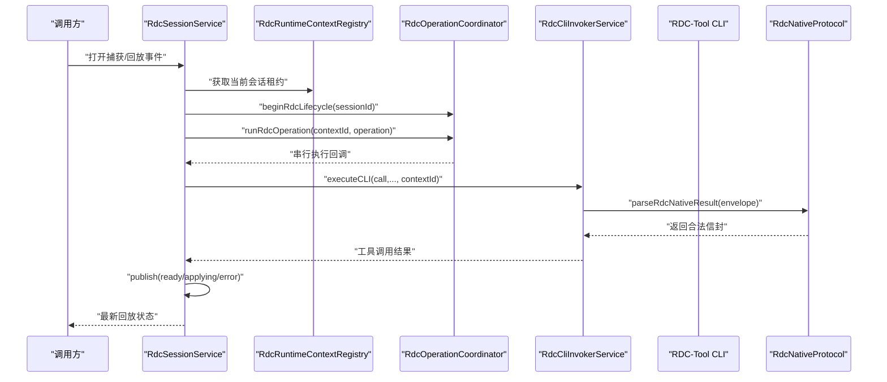

图表来源
- [RdcSessionService.ts:1-120](file://src/main/sessions/RdcSessionService.ts#L1-L120)
- [RdcRuntimeContextRegistry.ts:1-120](file://src/main/sessions/RdcRuntimeContextRegistry.ts#L1-L120)
- [RdcOperationCoordinator.ts:1-38](file://src/main/sessions/RdcOperationCoordinator.ts#L1-L38)
- [RdcCliInvokerService.ts:201-369](file://src/main/tools/RdcCliInvokerService.ts#L201-L369)
- [RdcNativeProtocol.ts:1-98](file://src/main/tools/RdcNativeProtocol.ts#L1-L98)

## 详细组件分析

### RDC-Tool CLI 封装：RdcCliInvokerService
该服务是 RDC-Tool 的原生调用门面，承担以下职责：
- 安装绑定校验：通过 `assertRdcCliBinding` 确保命令指向打包 Python，`argsPrefix` 必须唯一且指向同一安装的 `cli/run_cli.py`，拒绝 `.bat` 与过时环境变量。
- 可用性检测：判断是否启用、命令是否存在、入口是否存在，以及 Python 与 CLI 是否来自同一安装根。
- 工具目录加载：先调用 `version` 确认 JSON 契约版本，再调用 `tools list --full --json` 获取工具定义，校验 schema 与指纹后缓存。
- 批处理命令构建：过滤已传入的 `--daemon-context` 与 `--owner-pid`，必要时注入 `--owner-pid=process.pid`，并通过 `resolveRdcBatchInvocation` 包装命令。
- CLI 调用与结果转换：设置工作目录、中间根环境变量、超时与输出缓冲，调用 Shell 执行，再用 `parseRdcNativeResult` 校验 JSON 信封、result_kind 与 context_id。
- 工具调用追踪：记录 trace id、turnId、toolName、args、结果、contextId、runtimeOwner 与 ownerLeaseId。

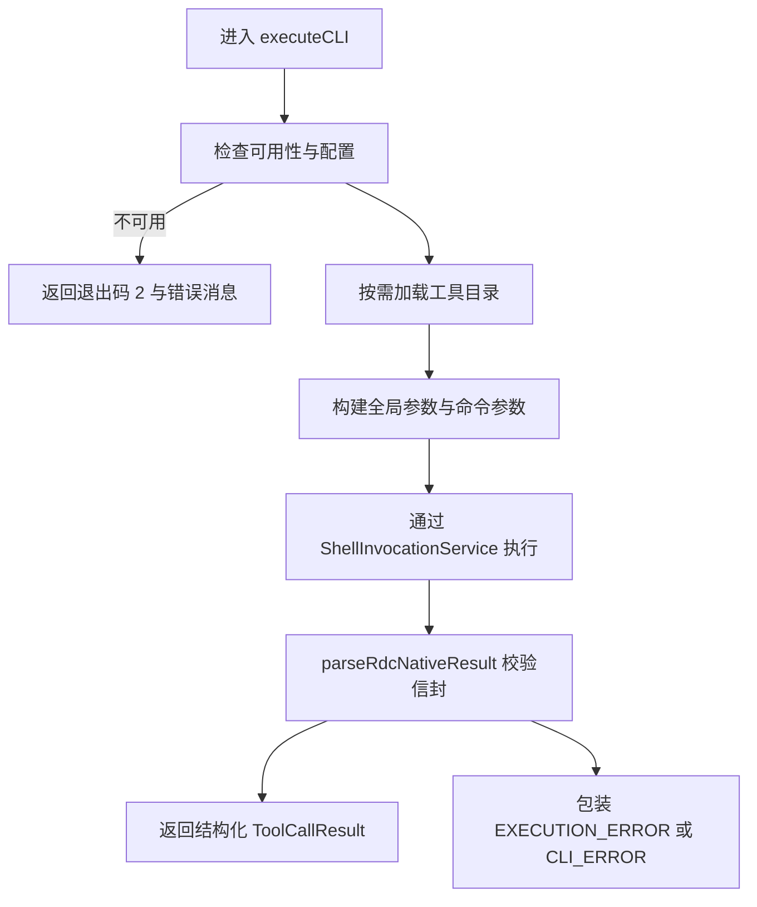

图表来源
- [RdcCliInvokerService.ts:1-120](file://src/main/tools/RdcCliInvokerService.ts#L1-L120)
- [RdcCliInvokerService.ts:201-369](file://src/main/tools/RdcCliInvokerService.ts#L201-L369)
- [rdcCliBinding.ts:1-54](file://src/shared/utils/rdcCliBinding.ts#L1-L54)

#### 关键设计要点
- 工具目录缓存键基于深度冻结的设置副本，避免不同环境误命中。
- `version` 与 `tools list` 的 schema_version 必须匹配预期，否则抛出升级要求错误。
- 非 `version` 与 `tools list` 命令会触发目录加载，失败时不污染后续调用。
- 所有外部输出都受输出缓冲限制，原始 stdout 不会直接暴露给上层。

章节来源
- [RdcCliInvokerService.ts:1-120](file://src/main/tools/RdcCliInvokerService.ts#L1-L120)
- [RdcCliInvokerService.ts:201-369](file://src/main/tools/RdcCliInvokerService.ts#L201-L369)
- [rdcCliBinding.ts:1-54](file://src/shared/utils/rdcCliBinding.ts#L1-L54)

### Capture 管理：RdcSessionService
RdcSessionService 是应用级 Capture/Replay 状态的权威持有者，每个 `projectId+sessionId` 对应一个 binding：
- 绑定创建与锁定：按会话构造 binding，内部维护 `phase`、`contextId`、`replayDeviceId`、`captureHash`、`events`、`target`、`image`、`observation`、`error` 等字段。
- 会话串行化：通过 `serial` 方法在 session 维度串行执行 open/close/observe 等操作，避免并发覆盖。
- 交互锁：结合 `getRdcInteractionLock`、`getDelegatedChildSessionId` 与未确认进程检查，阻止人类 UI 与 Agent 同时修改同一个 Capture。
- 设备占用：支持 Android 远程设备，记录设备到 binding 的映射，并在异常路径下释放。
- 打开流程：验证输入、计算哈希、关闭旧绑定、连接或打开、二次哈希校验、读取事件、观察最终输出，最后发布 ready。
- 关闭流程：串行关闭、清空设备、清理直播预览、发布空状态。
- 回放观察：封装 observe，处理请求事件去重、applying 状态、失败回退、人类与 Agent 路径差异。

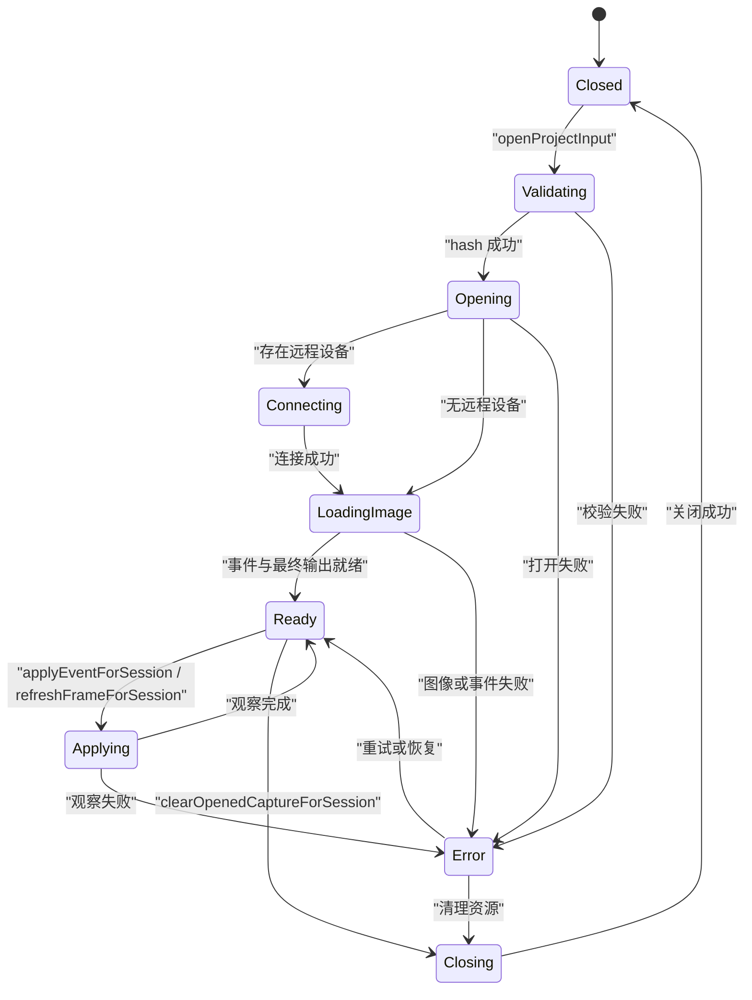

图表来源
- [RdcSessionService.ts:1-120](file://src/main/sessions/RdcSessionService.ts#L1-L120)
- [RdcSessionService.ts:201-291](file://src/main/sessions/RdcSessionService.ts#L201-L291)
- [RdcReplayObservation.ts:1-107](file://src/main/sessions/RdcReplayObservation.ts#L1-L107)

#### 关键设计要点
- 打开过程中两次校验 capture 哈希，防止文件在打开期间被替换。
- 若设备仍被原生生命周期拥有，异常路径不提前释放设备占用。
- 回放状态发布时始终携带 interactionLock，使 UI 能感知 Agent 正在执行。
- 人类操作与 Agent 操作在 apply/observe 上采用不同序列化策略，避免重复提交。

章节来源
- [RdcSessionService.ts:1-120](file://src/main/sessions/RdcSessionService.ts#L1-L120)
- [RdcSessionService.ts:201-291](file://src/main/sessions/RdcSessionService.ts#L201-L291)

### Replay 控制与观察：RdcReplayObservation
回放观察负责调用 RDC 的会话观察 API，并严格校验返回数据：
- 调用封装：固定传入 `--daemon-context` 与目标 contextId，校验 result_kind 与 replaySessionId。
- 事件列表：校验 complete 标志与事件数组结构。
- 观察响应：校验 event_id、revision、modification_state、display_parameters、target/targets、remote_display、final_output_error。
- 图像写入：若返回 image_path，则读取 PNG 字节并写入 live preview store，同时校验 image_event_id 与路径归属。
- 临时目录清理：使用系统临时目录存放图像，finally 块递归删除。

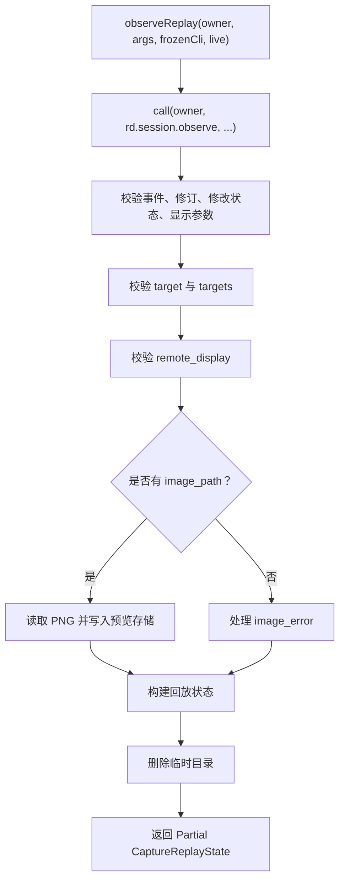

图表来源
- [RdcReplayObservation.ts:1-107](file://src/main/sessions/RdcReplayObservation.ts#L1-L107)

#### 关键设计要点
- 所有观察调用均绑定 daemon context 与 replaySessionId，避免跨上下文串读。
- 临时图像路径不允许逃逸到任意目录，必须位于预期临时目录。
- 设备展示状态与目标纹理 ID 的一致性校验，避免远端呈现信息错配。

章节来源
- [RdcReplayObservation.ts:1-107](file://src/main/sessions/RdcReplayObservation.ts#L1-L107)

### Context 身份管理与租约：RdcRuntimeContextRegistry
该模块维护“会话到 RDC Context 租约”的映射，并提供委托与隔离能力：
- 租约建立：根据 sessionId 写入 contextId、ownerSessionId、ownerProjectId、captureHash、runtimeContext、updatedAt 与版本序列号。
- 租约读取：返回浅拷贝，避免外部直接修改全局租约表。
- 所有权断言：仅当 sessionId 存在、未被隔离、没有委托子会话、可选 contextId/projectId 匹配时返回租约。
- 委托租约：父会话可向子会话授予一次性委托，最多一个活跃委托子会话；委托租约不可独立转移。
- 撤销委托：若子会话操作未确认或上下文处于隔离，将提升父会话到隔离状态。
- 隔离机制：quarantineReason 阻止进一步执行或委托，保留上下文用于检查。

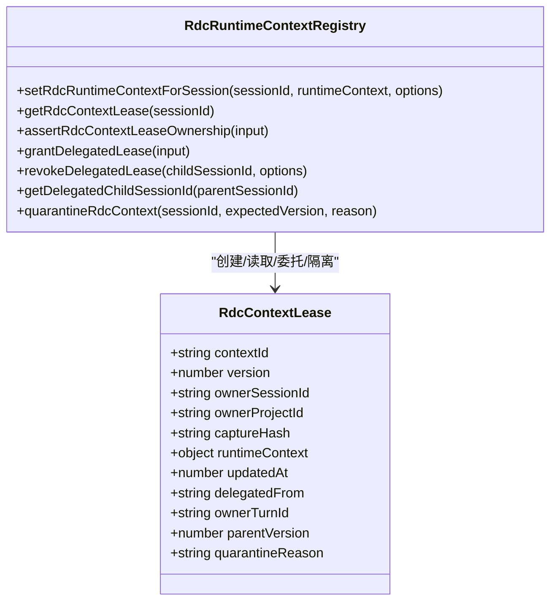

图表来源
- [RdcRuntimeContextRegistry.ts:1-120](file://src/main/sessions/RdcRuntimeContextRegistry.ts#L1-L120)
- [RdcRuntimeContextRegistry.ts:201-267](file://src/main/sessions/RdcRuntimeContextRegistry.ts#L201-L267)

#### 关键设计要点
- 委托子会话与父会话之间通过 `delegatedFrom` 与 `parentVersion` 建立强关联。
- 任何租约变更都会增加全局版本序列号，便于一致性检查。
- 空 sessionId 走 fail-closed 策略，不写入全局镜像。
- 隔离租约可用于诊断，但会阻断常规执行路径。

章节来源
- [RdcRuntimeContextRegistry.ts:1-120](file://src/main/sessions/RdcRuntimeContextRegistry.ts#L1-L120)
- [RdcRuntimeContextRegistry.ts:201-267](file://src/main/sessions/RdcRuntimeContextRegistry.ts#L201-L267)

### Daemon 上下文所有权与回收：OwnedRdcDaemonRegistry
Daemon 上下文是 RDC-Tool 内部长期运行的服务端实体，具有明确的应用所有权模型：
- 上下文 ID 格式：以 `rdc-` 开头并符合特定 UUID 风格，仅允许这类上下文被应用登记。
- 注册表持久化：`owned-rdc-rdc-daemons.json` 使用原子写入（临时文件 + rename），校验 schema 与记录完整性。
- 发现与回收：扫描 intermediate root 中的 `daemon_state_*.json`，尝试通过 CLI 清理并停止 daemon，失败时记录日志。
- 进程校验：daemonPid 与 workerPid 必须出现在操作系统进程命令行中，并包含 contextId；无法优雅关闭时使用强制终止。
- 上下文 mismatch：若 `context clear` 返回的 contextId 不属于当前 owned daemon，直接报错。

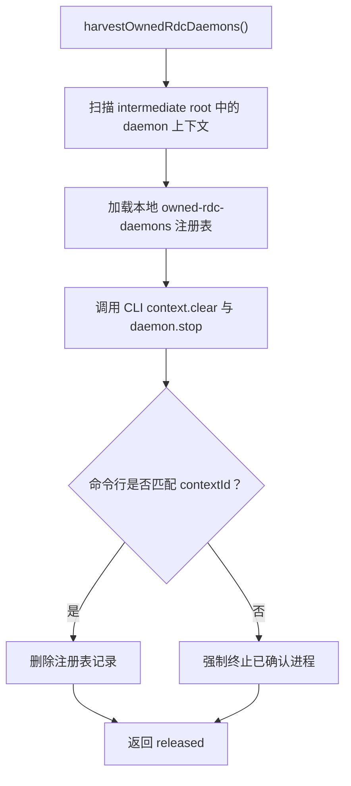

图表来源
- [OwnedRdcDaemonRegistry.ts:1-120](file://src/main/sessions/OwnedRdcDaemonRegistry.ts#L1-L120)
- [OwnedRdcDaemonRegistry.ts:201-251](file://src/main/sessions/OwnedRdcDaemonRegistry.ts#L201-L251)

#### 关键设计要点
- 回收过程容忍“无活动 daemon”的正常错误，但其他错误会向上抛出。
- 进程命令行验证是安全边界，防止误杀无关进程。
- 注册表损坏或 schema 不支持时直接报错，避免静默丢失所有权信息。

章节来源
- [OwnedRdcDaemonRegistry.ts:1-120](file://src/main/sessions/OwnedRdcDaemonRegistry.ts#L1-L120)
- [OwnedRdcDaemonRegistry.ts:201-251](file://src/main/sessions/OwnedRdcDaemonRegistry.ts#L201-L251)

### 原生协议与错误分类：RdcNativeProtocol
RdcNativeProtocol 是所有 RDC-Tool 原生输出的统一入口：
- 输出截断保护：stdoutTruncated 直接报错，避免二进制或超长输出污染上层。
- 空输出失败：非零退出码且无 stdout 视为 CLI 失败。
- JSON 信封校验：必须为对象，必须有 ok、result_kind、data。
- 错误信封：解析 error.code、message、details，并提取 recovery/cleanup 子类代码。
- 恢复语义：对截图与着色器检查失败场景，若原生侧已恢复 replay state，则标记 restoration 信息，供上层决定是否回滚。
- 上下文一致性：若 envelope.data.context_id 与期望不一致，抛出上下文不匹配错误。

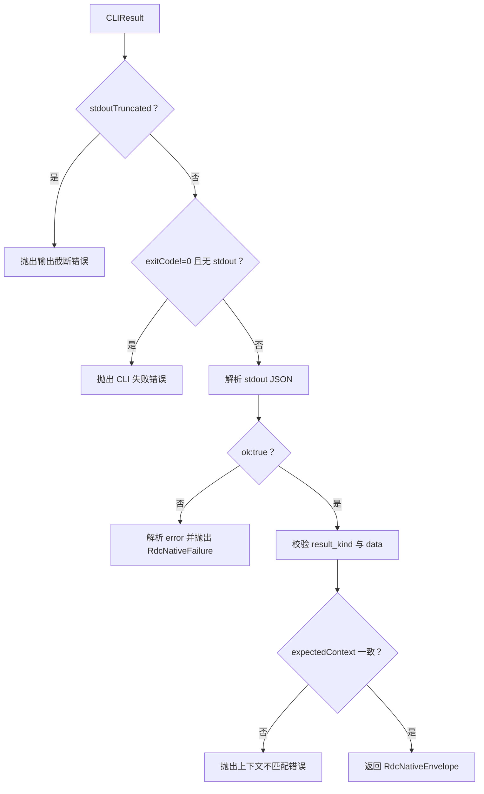

图表来源
- [RdcNativeProtocol.ts:1-98](file://src/main/tools/RdcNativeProtocol.ts#L1-L98)

#### 关键设计要点
- 所有错误都在 lease/experiment 状态提交前抛出，保证状态一致性。
- 对于已知恢复场景，上层可依据 restoration 信息跳过破坏性回滚。
- result_kind 校验确保调用方只消费预期的 RDC 操作结果。

章节来源
- [RdcNativeProtocol.ts:1-98](file://src/main/tools/RdcNativeProtocol.ts#L1-L98)

### 操作策略与参数安全：RdcOperationPolicy
RdcOperationPolicy 是 RDC 工具能力的白名单与参数校验层：
- 允许作用域：global、context、replay、capture。
- 允许效果：replay_position、replay_position_temporary、artifact_write、context_metadata、shader_debug、shader_replacement。
- 前置条件：session_id、capture_file_id 与作用域强绑定。
- 身份字段保护：禁止调用方覆盖 session_id、context_id、daemon_context、owner_session_id 等关键字段。
- VFS 路径限制：必须以 `/` 开头，仅允许 context/artifacts/draws/passes/resources/textures/buffers/pipeline/shaders/debug 作为第一级节点。
- 着色器编译逃逸防护：additional_args 只能使用有限编译器开关；source/include 预算与路径范围受限。

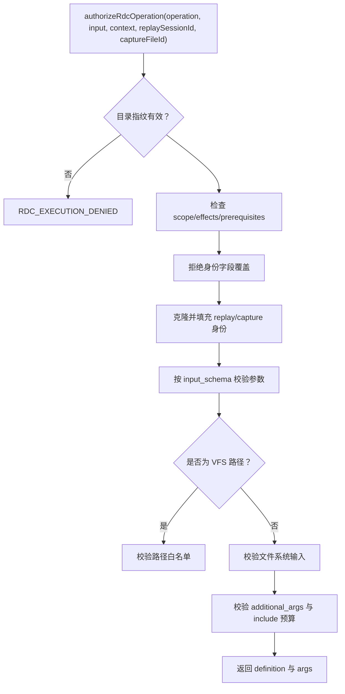

图表来源
- [RdcOperationPolicy.ts:1-124](file://src/main/tools/RdcOperationPolicy.ts#L1-L124)

#### 关键设计要点
- 策略本身不是授权机制，而是能力与参数的保守边界。
- 实际授权还需结合 Agent permission policy 与用户审批。
- VFS 与编译器 escape hatch 是安全关键路径，必须保持最小权限。

章节来源
- [RdcOperationPolicy.ts:1-124](file://src/main/tools/RdcOperationPolicy.ts#L1-L124)

### 执行回执与审计：RdcExecutionReceipts
执行回执用于记录一次 RDC 操作的不可篡改审计证据：
- 签名密钥：从 SecretStorageService 读取或生成，永不进入工具结果、IPC、Prompt 或普通会话产物。
- 写入流程：序列化 receipt body，计算 HMAC 签名，写入 session artifact resolver。
- 读取流程：校验类别、未截断、签名格式、签名值、schemaVersion、sessionId、exitCode、resultHash、argsFingerprint。
- 进程身份：可选地包含 daemon/worker 进程出生信息，增强可追溯性。

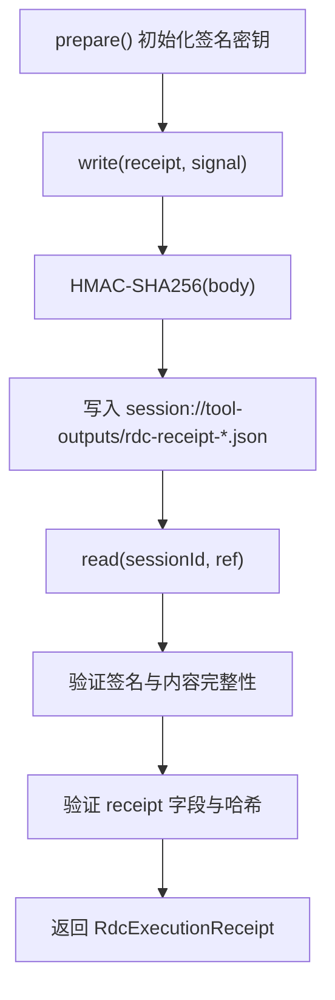

图表来源
- [RdcExecutionReceipts.ts:1-78](file://src/main/tools/RdcExecutionReceipts.ts#L1-L78)
- [RdcProcessIdentity.ts:1-16](file://src/main/tools/RdcProcessIdentity.ts#L1-L16)

#### 关键设计要点
- 新实验闭包必须提供有效的 processIdentity 证明。
- 历史回执保持可读，但签名校验失败会拒绝。
- resultHash 与 argsFingerprint 防止结果与参数被事后篡改。

章节来源
- [RdcExecutionReceipts.ts:1-78](file://src/main/tools/RdcExecutionReceipts.ts#L1-L78)
- [RdcProcessIdentity.ts:1-16](file://src/main/tools/RdcProcessIdentity.ts#L1-L16)

### Agent 集成与 Turn 绑定：RdcTurnBindings
Agent 在执行 RDC 工具时，需要将 CLI 设置、工具目录指纹与租约身份冻结到本次执行上下文中：
- freezeRdcTurnBinding：复制 cli、definitions、definitionsFingerprint 与 identity，并进行深冻结。
- 绑定存储：通过 WeakMap 绑定到 plan 对象，不序列化到 Prompt、IPC 或 Trace。
- 指纹校验：RdcOperationPolicy 会校验 definitionsFingerprint，防止目录更新导致执行环境与策略不一致。

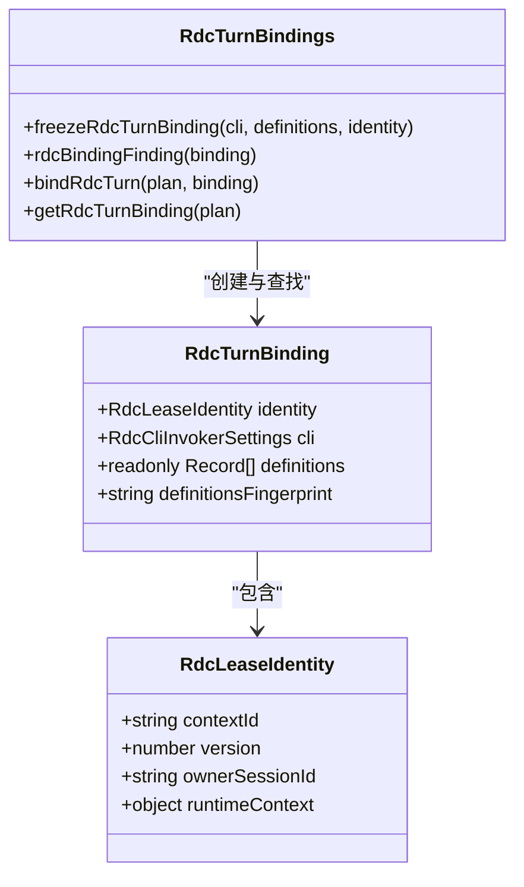

图表来源
- [RdcTurnBindings.ts:1-37](file://src/main/tools/RdcTurnBindings.ts#L1-L37)
- [RdcOperationPolicy.ts:1-124](file://src/main/tools/RdcOperationPolicy.ts#L1-L124)

#### 关键设计要点
- Turn 绑定是私有执行环境，避免敏感上下文泄露。
- definitionsFingerprint 是策略与工具目录一致性的重要保障。
- 与 RdcExecutionReceipts 配合，可形成“谁在何时使用哪个工具目录执行了哪次 RDC 操作”的完整审计链。

章节来源
- [RdcTurnBindings.ts:1-37](file://src/main/tools/RdcTurnBindings.ts#L1-L37)
- [RdcOperationPolicy.ts:1-124](file://src/main/tools/RdcOperationPolicy.ts#L1-L124)

## 依赖关系分析
RDC 集成的依赖关系可以概括为：
- 会话层依赖协调器与租约层；
- 会话层依赖回放观察与 Daemon 所有权；
- CLI 调用层依赖协议层、策略层与绑定校验；
- 审计层依赖加密与 SecretStorageService；
- 所有外部输入都经过参数校验与上下文一致性检查。

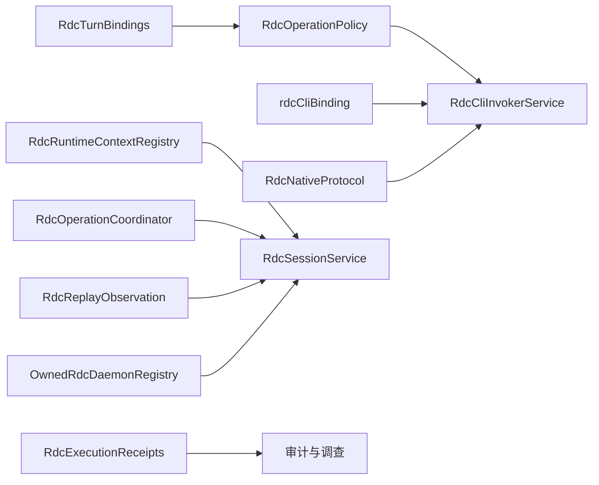

图表来源
- [RdcOperationPolicy.ts:1-124](file://src/main/tools/RdcOperationPolicy.ts#L1-L124)
- [rdcCliBinding.ts:1-54](file://src/shared/utils/rdcCliBinding.ts#L1-L54)
- [RdcNativeProtocol.ts:1-98](file://src/main/tools/RdcNativeProtocol.ts#L1-L98)
- [RdcRuntimeContextRegistry.ts:1-120](file://src/main/sessions/RdcRuntimeContextRegistry.ts#L1-L120)
- [RdcOperationCoordinator.ts:1-38](file://src/main/sessions/RdcOperationCoordinator.ts#L1-L38)
- [RdcReplayObservation.ts:1-107](file://src/main/sessions/RdcReplayObservation.ts#L1-L107)
- [OwnedRdcDaemonRegistry.ts:1-120](file://src/main/sessions/OwnedRdcDaemonRegistry.ts#L1-L120)
- [RdcExecutionReceipts.ts:1-78](file://src/main/tools/RdcExecutionReceipts.ts#L1-L78)
- [RdcTurnBindings.ts:1-37](file://src/main/tools/RdcTurnBindings.ts#L1-L37)

## 性能与资源管理
- CLI 目录缓存：工具目录按设置键缓存，避免重复解析版本与工具清单。
- 输出缓冲限制：CLI 输出缓冲区上限为 8MB，避免原生进程输出过大阻塞主进程。
- 会话串行化：每个会话的操作串行执行，减少原生状态竞争。
- 上下文串行队列：同一 native context 上的 UI 与 Agent 操作串行执行。
- 临时目录清理：回放观察使用系统临时目录，finally 块确保删除。
- Daemon 回收：启动时或关闭时回收遗留 daemon，避免僵尸进程与上下文泄漏。
- 图片编码与预览：PNG 编码写入 live preview store，避免重复解码。

[本节为通用指导，不直接分析具体文件]

## 故障排查指南
常见错误与定位建议：

- RDC_BINDING_INVALID / RDC_BAT_REJECTED：
  - 检查 RDC-Tool 安装路径是否正确，是否指向打包 Python 与 cli/run_cli.py。
  - 检查 argsPrefix 是否只有一个元素，且不包含 `.bat` 或过时环境变量。

- RDC_UPGRADE_REQUIRED：
  - RDC-Tool CLI 版本或工具目录 schema 不匹配，需要升级 RDC-Tool。

- RDC_CLI_OUTPUT_TRUNCATED / RDC_CLI_PROTOCOL：
  - 原生输出超过缓冲区或被污染，检查 RDC-Tool 是否正常返回 JSON。

- RDC_CONTEXT_MISMATCH：
  - CLI 返回的 context_id 与调用方期望不一致，检查 daemon 上下文是否被复用或切换。

- RDC_INTERACTION_LOCKED / RDC_REPLAY_BUSY：
  - 有 Agent 或其他操作正在使用 Capture，等待生命周期结束或取消冲突任务。

- RDC_CONTEXT_QUARANTINED：
  - 上下文处于隔离状态，应关闭并重新打开 Capture，避免不确定结果。

- RDC_CLOSE_FAILED / RDC_OWNERSHIP_CORRUPT：
  - Daemon 回收失败或注册表损坏，检查 owned-rdc-daemons.json 与残留进程。

- RDC_OBSERVATION_IDENTITY_MISMATCH / RDC_IMAGE_PATH_MISMATCH：
  - 回放观察返回的 session_id 或图像路径不符合预期，检查 daemon 上下文与临时目录。

章节来源
- [RdcNativeProtocol.ts:1-98](file://src/main/tools/RdcNativeProtocol.ts#L1-L98)
- [RdcSessionService.ts:1-120](file://src/main/sessions/RdcSessionService.ts#L1-L120)
- [RdcReplayObservation.ts:1-107](file://src/main/sessions/RdcReplayObservation.ts#L1-L107)
- [OwnedRdcDaemonRegistry.ts:1-120](file://src/main/sessions/OwnedRdcDaemonRegistry.ts#L1-L120)
- [RdcRuntimeContextRegistry.ts:201-267](file://src/main/sessions/RdcRuntimeContextRegistry.ts#L201-L267)

## 结论
本项目对 RDC/RenderDoc 的集成采用了多层防御与清晰的生命周期管理：
- 通过 RdcCliInvokerService 实现安全的 CLI 发现、版本校验与工具目录加载；
- 通过 RdcSessionService 实现 Capture/Replay 的状态机、设备管理与回放观察；
- 通过 RdcRuntimeContextRegistry 实现会话级租约、委托与隔离；
- 通过 OwnedRdcDaemonRegistry 实现 Daemon 上下文所有权与进程级回收；
- 通过 RdcNativeProtocol 与 RdcOperationPolicy 实现协议与参数双重校验；
- 通过 RdcExecutionReceipts 与 RdcTurnBindings 实现审计与执行环境绑定。

这些机制共同保证了 RDC 操作的可追溯性、安全性与稳定性，并为 Agent 系统提供了可靠的调试与取证能力。

[本节为总结性内容，不直接分析具体文件]