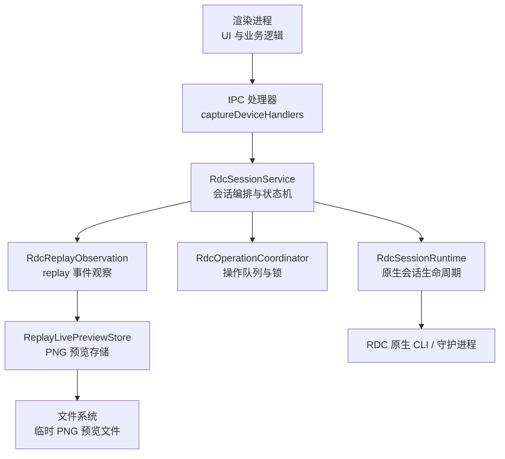
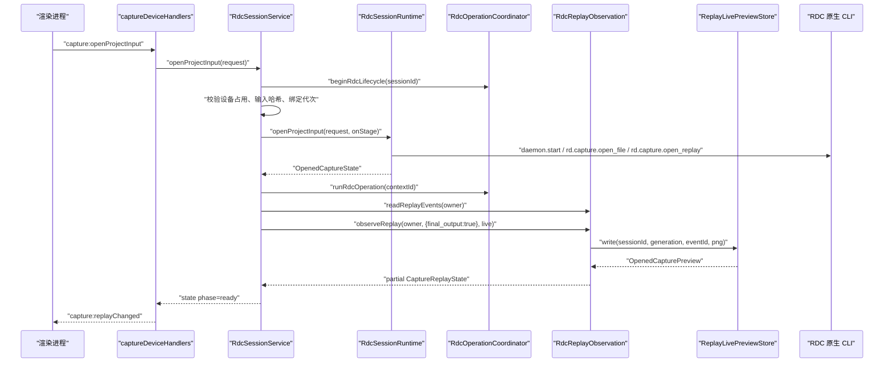
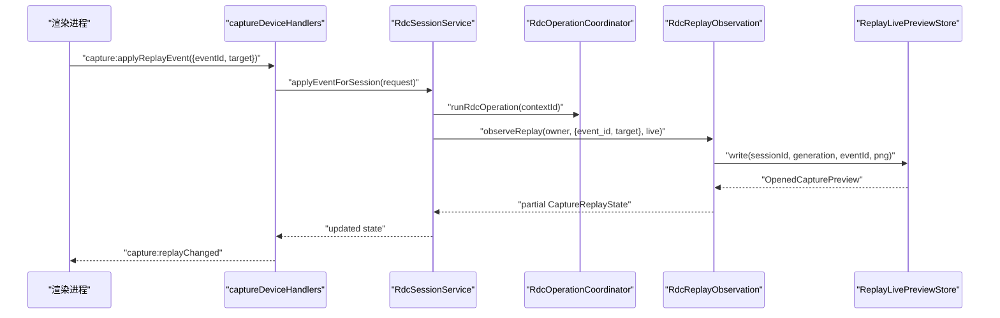
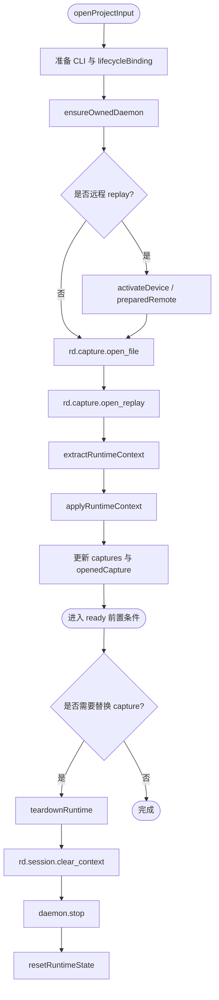
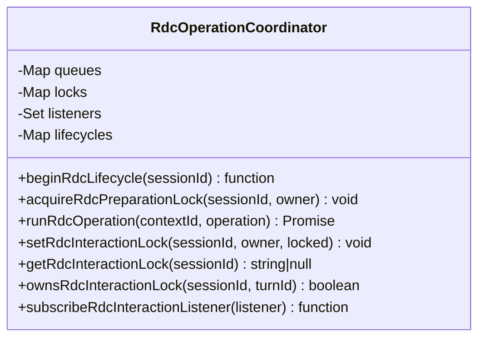
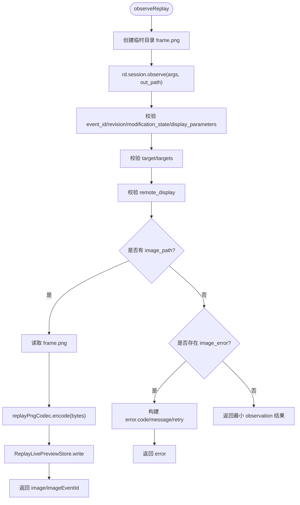
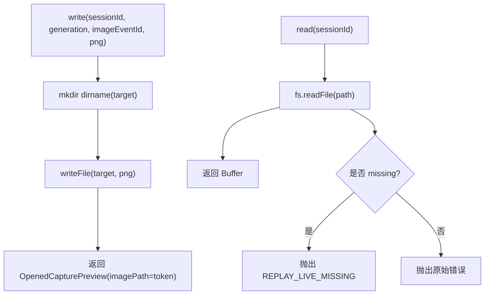
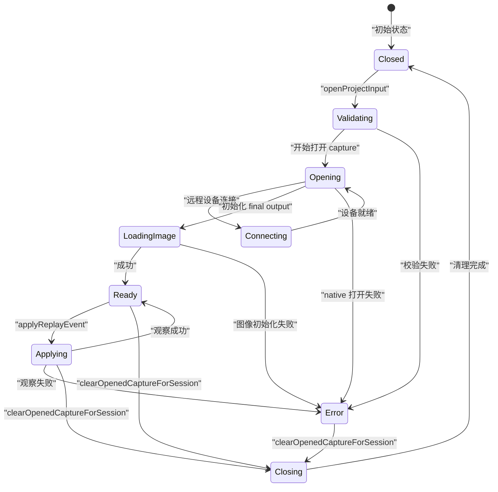

# Replay 控制

<cite>
**本文引用的文件**   
- [RdcSessionRuntime.ts](file://src/main/sessions/RdcSessionRuntime.ts)
- [RdcOperationCoordinator.ts](file://src/main/sessions/RdcOperationCoordinator.ts)
- [RdcReplayObservation.ts](file://src/main/sessions/RdcReplayObservation.ts)
- [ReplayLivePreviewStore.ts](file://src/main/captures/replay/ReplayLivePreviewStore.ts)
- [RdcSessionService.ts](file://src/main/sessions/RdcSessionService.ts)
- [captureDeviceHandlers.ts](file://src/main/ipc/captureDeviceHandlers.ts)
- [captureReplayReadHandlers.ts](file://src/main/ipc/captureReplayReadHandlers.ts)
- [session.ts](file://src/shared/types/session.ts)
- [captureReplay.ts](file://src/shared/types/captureReplay.ts)
</cite>

## 目录
1. [引言](#引言)
2. [项目结构与职责边界](#项目结构与职责边界)
3. [核心组件总览](#核心组件总览)
4. [系统架构与数据流](#系统架构与数据流)
5. [详细组件分析](#详细组件分析)
6. [原子性、失败恢复与超时机制](#原子性失败恢复与超时机制)
7. [API 使用示例](#api-使用示例)
8. [UI 交互模式与状态同步策略](#ui-交互模式与状态同步策略)
9. [性能与内存优化建议](#性能与内存优化建议)
10. [故障排查指南](#故障排查指南)
11. [结论](#结论)

## 引言
本文件面向主进程中的 Replay 控制系统，目标是解释单个 capture 的 replay 生命周期、操作协调策略、事件观察机制以及实时预览存储。重点覆盖以下对象：

- `RdcSessionRuntime`：管理单个 capture 的 RDC 原生会话、设备状态、打开与关闭流程，以及运行时上下文。
- `RdcOperationCoordinator`：保证同一原生 context 上的 RDC 调用串行执行，避免并发冲突。
- `RdcReplayObservation`：订阅 replay 事件流，校验并转换原生返回的观察结果，写入 PNG 帧到临时预览路径。
- `ReplayLivePreviewStore`：按 session 维护 PNG 预览文件，提供 token 引用、读取与清理能力。
- `RdcSessionService`：应用层会话编排器，组合上述组件，实现 open、ready、applying、closed 等状态机，并与 UI 通过 IPC 广播。
- IPC 层处理器：将渲染进程请求转发给 `RdcSessionService`，并把回放状态变化广播回渲染端。

## 项目结构与职责边界
Replay 控制位于主进程模块中，采用“服务 + 运行时 + 观察者 + 持久化”的分层结构：



**图表来源**
- [captureDeviceHandlers.ts:1-200](file://src/main/ipc/captureDeviceHandlers.ts#L1-L200)
- [RdcSessionService.ts:1-200](file://src/main/sessions/RdcSessionService.ts#L1-L200)
- [RdcSessionRuntime.ts:1-200](file://src/main/sessions/RdcSessionRuntime.ts#L1-L200)
- [RdcOperationCoordinator.ts:1-38](file://src/main/sessions/RdcOperationCoordinator.ts#L1-L38)
- [RdcReplayObservation.ts:1-107](file://src/main/sessions/RdcReplayObservation.ts#L1-L107)
- [ReplayLivePreviewStore.ts:1-46](file://src/main/captures/replay/ReplayLivePreviewStore.ts#L1-L46)

**章节来源**
- [captureDeviceHandlers.ts:1-200](file://src/main/ipc/captureDeviceHandlers.ts#L1-L200)
- [RdcSessionService.ts:1-200](file://src/main/sessions/RdcSessionService.ts#L1-L200)

## 核心组件总览

| 组件 | 主要职责 | 关键输入 | 关键输出 |
|---|---|---|---|
| `RdcSessionRuntime` | 启动/停止 RDC 守护进程；打开 capture 与 replay；解析原生上下文；切换活跃 capture；清理运行时。 | `OpenProjectInputRequest`、CLI 设置、AbortSignal | `OpenedCaptureState`、`RdcRuntimeContext`、捕获描述符列表 |
| `RdcOperationCoordinator` | 按原生 `contextId` 串行执行 RDC 调用；维护交互锁；支持生命周期阶段隔离。 | `contextId`、回调函数 | Promise 返回值；交互锁变更事件 |
| `RdcReplayObservation` | 调用 `rd.session.get_replay_events` 与 `rd.session.observe`；校验 metadata、target、remote display receipt；写出 PNG 预览。 | `RdcRuntimeContext`、可选冻结 CLI 设置、可选 live target | 部分 `CaptureReplayState`，含 observation、target、devicePresentation、warning、image |
| `ReplayLivePreviewStore` | 为每个 session 写入 PNG 文件；返回 token 形式的预览引用；读取或清理。 | sessionId、generation、imageEventId、PNG Buffer | `OpenedCapturePreview`、Buffer、void |
| `RdcSessionService` | 按 session 管理 binding；序列化生命周期；设备占用；open → ready → applying → closed 状态机；广播状态。 | `OpenProjectInputRequest`、apply/refresh 请求 | `OpenedCaptureState`、`CaptureReplayState` |
| IPC 处理器 | 暴露 `getReplayState`、`applyReplayEvent`、`refreshFrame`、`openProjectInput`、`clearOpenedState` 等接口。 | 渲染端参数 | JSON 响应；广播 `capture:replayChanged` |

**章节来源**
- [RdcSessionRuntime.ts:1-521](file://src/main/sessions/RdcSessionRuntime.ts#L1-L521)
- [RdcOperationCoordinator.ts:1-38](file://src/main/sessions/RdcOperationCoordinator.ts#L1-L38)
- [RdcReplayObservation.ts:1-107](file://src/main/sessions/RdcReplayObservation.ts#L1-L107)
- [ReplayLivePreviewStore.ts:1-46](file://src/main/captures/replay/ReplayLivePreviewStore.ts#L1-L46)
- [RdcSessionService.ts:1-291](file://src/main/sessions/RdcSessionService.ts#L1-L291)
- [captureDeviceHandlers.ts:1-200](file://src/main/ipc/captureDeviceHandlers.ts#L1-L200)

## 系统架构与数据流

### Replay 打开流程


**图表来源**
- [captureDeviceHandlers.ts:42-170](file://src/main/ipc/captureDeviceHandlers.ts#L42-L170)
- [RdcSessionService.ts:96-190](file://src/main/sessions/RdcSessionService.ts#L96-L190)
- [RdcSessionRuntime.ts:85-200](file://src/main/sessions/RdcSessionRuntime.ts#L85-L200)
- [RdcReplayObservation.ts:36-107](file://src/main/sessions/RdcReplayObservation.ts#L36-L107)
- [ReplayLivePreviewStore.ts:12-46](file://src/main/captures/replay/ReplayLivePreviewStore.ts#L12-L46)

### 帧刷新与应用事件流程


**图表来源**
- [captureDeviceHandlers.ts:42-110](file://src/main/ipc/captureDeviceHandlers.ts#L42-L110)
- [RdcSessionService.ts:200-291](file://src/main/sessions/RdcSessionService.ts#L200-L291)
- [RdcReplayObservation.ts:36-107](file://src/main/sessions/RdcReplayObservation.ts#L36-L107)
- [ReplayLivePreviewStore.ts:12-46](file://src/main/captures/replay/ReplayLivePreviewStoreStore.ts#L12-L46)

## 详细组件分析

### RdcSessionRuntime：单个 capture 的运行时状态机
`RdcSessionRuntime` 负责一个 capture 的完整原生生命周期：

- **open 阶段**：
  - 分配 `contextId`。
  - 加载或冻结 CLI catalog，构造 `lifecycleBinding`。
  - 确保 owned daemon 已启动，并记录 owner pid。
  - 处理本地或远程 replay device。
  - 调用 `rd.capture.open_file` 与 `rd.capture.open_replay`。
  - 解析原生返回，构造 `RdcRuntimeContext`。
  - 更新 `openedCapture`、`captures`、`activeCaptureId`、`runtimeContext`。
- **ready 阶段**：由上层 `RdcSessionService` 在完成 initial observe 后发布。
- **switchActiveCapture**：允许同一 runtime 内切换多个 capture，但仅能选择已打开且非 pending 的 capture。
- **close 阶段**：
  - 检查是否有未确认的原生进程退出。
  - 先尝试 `rd.session.clear_context`。
  - 再尝试 `daemon.stop`。
  - 清理 owned daemon 注册与 session-scoped runtime context。
- **替换 capture**：`closeOrReplaceOpenedCapture` 在替换前 teardown 旧 runtime，并重置状态。



**图表来源**
- [RdcSessionRuntime.ts:85-200](file://src/main/sessions/RdcSessionRuntime.ts#L85-L200)
- [RdcSessionRuntime.ts:201-521](file://src/main/sessions/RdcSessionRuntime.ts#L201-L521)

**章节来源**
- [RdcSessionRuntime.ts:85-200](file://src/main/sessions/RdcSessionRuntime.ts#L85-L200)
- [RdcSessionRuntime.ts:201-521](file://src/main/sessions/RdcSessionRuntime.ts#L201-L521)

### RdcOperationCoordinator：操作协调器
该模块实现两个关键能力：

1. **原生 context 级串行队列**：
   - `queues` 以 `contextId` 为键维护 Promise 链。
   - `runRdcOperation(contextId, operation)` 将新操作追加到上一个操作的 finally 之后。
   - 失败不会中断后续操作，因为 pending 被 `.catch(() => undefined)` 吞掉错误后再继续。

2. **会话级交互锁**：
   - `locks` 维护每个 sessionId 的 lock owner set。
   - `setRdcInteractionLock` 添加或删除 owner，并通知订阅者。
   - `getRdcInteractionLock` 返回当前锁 owner（测试中使用）。
   - `beginRdcLifecycle` 增加生命周期计数器，用于区分“生命周期进行中”和“可执行的操作”。



**图表来源**
- [RdcOperationCoordinator.ts:1-38](file://src/main/sessions/RdcOperationCoordinator.ts#L1-L38)

**章节来源**
- [RdcOperationCoordinator.ts:1-38](file://src/main/sessions/RdcOperationCoordinator.ts#L1-L38)

### RdcReplayObservation：replay 事件流与帧观察
该模块提供两个主要能力：

- **读取事件列表**：
  - 调用 `rd.session.get_replay_events`。
  - 校验 `complete`、`events` 数组、`event_id` 与 `name`。
  - 返回 `{ eventId }` 列表。

- **观察单次 replay 帧**：
  - 创建临时目录并生成 `frame.png` 路径。
  - 调用 `rd.session.observe`。
  - 严格校验返回结构：
    - `event_id`、`revision`、`modification_state`。
    - `display_parameters.mip/slice/sample/range_min/range_max`。
    - `target` 与 `targets` 的 `texture_id`、`output_slot`。
    - `remote_display.status/event_id/texture_id/sequence/reason`。
    - `is_final_output`、`final_output_error`。
  - 若包含 image_path，则读取 PNG 并通过 `replayPngCodec.encode` 编码后写入 `ReplayLivePreviewStore`。
  - 若存在 image_error，则转换为 `error.code` 与 `retry` 提示。



**图表来源**
- [RdcReplayObservation.ts:36-107](file://src/main/sessions/RdcReplayObservation.ts#L36-L107)

**章节来源**
- [RdcReplayObservation.ts:1-107](file://src/main/sessions/RdcReplayObservation.ts#L1-L107)

### ReplayLivePreviewStore：实时预览数据管理
`ReplayLivePreviewStore` 是 session 级别的 PNG 预览缓存：

- `pathFor(sessionId)`：基于 `appPathService.getLiveReplayPreviewPath(sessionId)` 生成目标路径。
- `write(sessionId, generation, imageEventId, encoded)`：
  - 创建目录。
  - 写入 PNG Buffer。
  - 返回 `OpenedCapturePreview`，其中 `imagePath` 是 `live:${generation}:${imageEventId}` token。
- `read(sessionId)`：读取 PNG Buffer；若文件缺失，抛出 `REPLAY_LIVE_MISSING`。
- `clear(sessionId)`：删除预览文件。

这种设计让渲染进程只持有 token，而不直接传输大像素数据，从而降低 IPC 负载。



**图表来源**
- [ReplayLivePreviewStore.ts:1-46](file://src/main/captures/replay/ReplayLivePreviewStore.ts#L1-L46)

**章节来源**
- [ReplayLivePreviewStore.ts:1-46](file://src/main/captures/replay/ReplayLivePreviewStore.ts#L1-L46)

### RdcSessionService：应用层会话编排与状态机
`RdcSessionService` 是 replay 控制的顶层编排器：

- **binding 模型**：每个 `(projectId, sessionId)` 对应一个 binding，包含 `RdcSessionRuntime`、`CaptureReplayState`、`deviceId`。
- **设备占用表**：`devices` 映射 `deviceId -> scope`，防止多会话同时占用同一 replay device。
- **生命周期序列化**：`serial(scope, fn)` 保证同一 session 的生命周期操作串行执行。
- **交互锁判断**：`lock(binding)` 会考虑 delegated child session、unconfirmed native process、agent running。
- **状态发布**：`publish` 递增 `revision`，注入 `interactionLock`，并向所有 listener 发送结构化克隆后的快照。
- **openProjectInput**：
  - 验证 session scope、expectedGeneration、blockedInputs。
  - 校验 capture reference path。
  - 计算 capture hash。
  - 释放旧 binding。
  - 调用 `runtime.openProjectInput`。
  - 二次验证 capture 内容未变化。
  - 初始化 events 与 final output preview。
  - 发布 `phase=ready`。
- **applyEventForSession**：
  - 检查 `ready` 或 `applying`。
  - 在 `runRdcOperation(contextId)` 中调用 `observeReplay`。
  - 根据 observation 结果更新 appliedEventId、image、observation、devicePresentation、warning。
- **clearOpenedCaptureForSession**：
  - 序列化关闭。
  - 调用 `closeBinding`。
  - 清空 preview store。
  - 重置 state 并递增 generation。



**图表来源**
- [RdcSessionService.ts:1-291](file://src/main/sessions/RdcSessionService.ts#L1-L291)

**章节来源**
- [RdcSessionService.ts:1-291](file://src/main/sessions/RdcSessionService.ts#L1-L291)

## 原子性、失败恢复与超时机制

### 原子性保证
- **会话级生命周期串行化**：`serial(scope, fn)` 使用 Promise 链保证同一 session 的 open/close/apply 不交错。
- **原生 context 级操作串行化**：`runRdcOperation(contextId, operation)` 保证同一 RDC context 的调用顺序。
- **设备占用保护**：`devices` 表阻止不同 session 同时获取同一 replay device。
- **绑定代次校验**：`expectedGeneration` 防止旧 UI 绑定覆盖新状态。
- **捕获内容一致性校验**：open 前后两次 hash 对比，防止文件在打开期间被替换。

### 失败恢复
- **open 失败**：
  - 如果 native context 仍存在，保留 context 以便显式 close。
  - 发布 `phase=error`，并附带 `code`、`message`、`retry`。
- **图像初始化失败**：
  - 发布 `RDC_IMAGE_FAILED`，允许重试。
- **关闭失败**：
  - 先尝试 `rd.session.clear_context`，失败仍保留 ownership。
  - 再尝试 `daemon.stop`，失败抛出明确错误。
- **代理执行保护**：
  - `assertInteraction` 检测 `agent_running`、`delegated_execution`、`native_exit_unconfirmed`。
  - 若处于 quarantine，强制将状态改为 `error`，并提示用户 close 后 reopen。

### 超时处理
- `RdcLifecycleOptions.signal` 可在 `openProjectInput`、`ensureOwnedDaemon`、`callNative` 等处触发中止。
- 原生调用包装了 `signal?.throwIfAborted()`，使长时间阻塞的 RDC CLI 可被取消。
- 需要注意的是，Promise 链中的 `runRdcOperation` 对异常做了 `.catch(() => undefined)`，因此“取消”本身不是失败语义，而是外部 AbortSignal 抛出异常导致调用提前终止。

**章节来源**
- [RdcSessionService.ts:85-190](file://src/main/sessions/RdcSessionService.ts#L85-L190)
- [RdcSessionRuntime.ts:85-200](file://src/main/sessions/RdcSessionRuntime.ts#L85-L200)
- [RdcOperationCoordinator.ts:1-38](file://src/main/sessions/RdcOperationCoordinator.ts#L1-L38)

## API 使用示例

### 打开 replay capture
渲染进程通过 IPC 打开一个 project input：

```text
调用方：渲染进程
方法：ipcRenderer.invoke("capture:openProjectInput", request)
参数：
  projectId
  sessionId
  inputId
  filePath
  replayDeviceId
  bindingGeneration
返回：
  success: boolean
  openedCapture?: OpenedCaptureState
  contextSnapshot?: ContextSnapshot
  error?: string
```

内部流程：
1. IPC 层校验 session、input、replay device。
2. 调用 `RdcSessionService.openProjectInput`。
3. 服务层序列化生命周期、校验设备、计算哈希、打开 capture。
4. 初始化 events 与 final output preview。
5. 广播 `capture:replayChanged`，并将 opened capture 与 context 状态推送给渲染端。

**章节来源**
- [captureDeviceHandlers.ts:80-170](file://src/main/ipc/captureDeviceHandlers.ts#L80-L170)
- [RdcSessionService.ts:96-190](file://src/main/sessions/RdcSessionService.ts#L96-L190)

### 获取 replay 状态
```text
调用方：渲染进程
方法：ipcRenderer.invoke("capture:getReplayState", scope)
参数：
  projectId
  sessionId
返回：CaptureReplayState
```

`CaptureReplayState` 包括：
- 基础 scope、generation、revision、operationId。
- phase：`validating`、`opening`、`connecting`、`loading_image`、`ready`、`applying`、`closing`、`error`、`closed`。
- events、target、targets、appliedEventId、imageEventId、image、observation、devicePresentation、warning、error、interactionLock。

**章节来源**
- [captureDeviceHandlers.ts:42-60](file://src/main/ipc/captureDeviceHandlers.ts#L42-L60)
- [captureReplay.ts:1-23](file://src/shared/types/captureReplay.ts#L1-L23)

### 应用帧跳转
```text
调用方：渲染进程
方法：ipcRenderer.invoke("capture:applyReplayEvent", request)
参数：
  projectId
  sessionId
  eventId
  target?: { textureId?, outputSlot? }
返回：CaptureReplayState
```

内部行为：
1. 授权 scope。
2. 调用 `RdcSessionService.applyEventForSession`。
3. 检查状态是否为 `ready` 或 `applying`。
4. 在 `runRdcOperation(contextId)` 中执行 `observeReplay`。
5. 更新 appliedEventId、image、observation、devicePresentation、warning。
6. 广播状态变化。

**章节来源**
- [captureDeviceHandlers.ts:60-110](file://src/main/ipc/captureDeviceHandlers.ts#L60-L110)
- [RdcSessionService.ts:200-291](file://src/main/sessions/RdcSessionService.ts#L200-L291)
- [RdcReplayObservation.ts:36-107](file://src/main/sessions/RdcReplayObservation.ts#L36-L107)

### 刷新当前帧
```text
调用方：渲染进程
方法：ipcRenderer.invoke("capture:refreshFrame", scope)
参数：
  projectId
  sessionId
返回：CaptureReplayState
```

适用场景：当 UI 需要重新拉取 final output 或最新 observation，但不改变 appliedEventId 时。

**章节来源**
- [captureDeviceHandlers.ts:60-75](file://src/main/ipc/captureDeviceHandlers.ts#L60-L75)
- [RdcSessionService.ts:200-291](file://src/main/sessions/RdcSessionService.ts#L200-L291)

### 获取截图或预览 PNG
渲染进程不能直接访问主进程的 PNG Buffer。正确方式是：

1. 等待 `CaptureReplayState.image` 不为空。
2. 调用 `ipcRenderer.invoke("capture:readLivePreview", scope)`。
3. 从返回的 Buffer 解码为图片。

注意：
- `ReplayLivePreviewStore.write` 返回的 `imagePath` 是 token，而不是像素数据。
- 渲染端应显示 token 对应的预览，并通过 readLivePreview 获取实际图像。

**章节来源**
- [ReplayLivePreviewStore.ts:12-46](file://src/main/captures/replay/ReplayLivePreviewStore.ts#L12-L46)
- [captureReplayReadHandlers.ts:1-24](file://src/main/ipc/captureReplayReadHandlers.ts#L1-L24)

### 关闭已打开的 capture
```text
调用方：渲染进程
方法：ipcRenderer.invoke("capture:clearOpenedState", scope)
参数：
  projectId
  sessionId
返回：{ success: boolean, error?: string }
```

内部行为：
1. 序列化关闭。
2. 调用 `closeBinding`。
3. 清除 `ReplayLivePreviewStore`。
4. 重置 `CaptureReplayState`。
5. 广播 opened capture 与 context 状态为空。

**章节来源**
- [captureDeviceHandlers.ts:170-200](file://src/main/ipc/captureDeviceHandlers.ts#L170-L200)
- [RdcSessionService.ts:230-291](file://src/main/sessions/RdcSessionService.ts#L230-L291)

## UI 交互模式与状态同步策略

### 状态广播
`captureDeviceHandlers` 订阅 `RdcSessionService.subscribe`，每次状态变化都广播：

```text
事件名：capture:replayChanged
载荷：CaptureReplayState
```

同时，针对 terminal 状态或 identity 变化，还会调度 trace projection refresh。

### 渲染端状态机
渲染端应基于 `phase` 展示不同 UI：

| phase | UI 含义 |
|---|---|
| `validating` | 正在校验 capture 输入与外部引用。 |
| `opening` | 正在打开 capture。 |
| `connecting` | 正在连接远程 replay device。 |
| `loading_image` | 正在初始化 final output 预览。 |
| `ready` | 可应用事件、刷新帧。 |
| `applying` | 正在应用帧跳转。 |
| `closing` | 正在关闭 capture。 |
| `error` | 发生错误，需显示 code、message、retry。 |
| `closed` | 已清理，无 active replay。 |

### 与 UI 层的交互模式
- 渲染端不应直接调用 RDC CLI。
- 渲染端应通过 IPC 调用 `capture:applyReplayEvent`、`capture:refreshFrame`、`capture:getReplayState`。
- 渲染端应订阅 `capture:replayChanged`，并根据 `phase`、`error`、`warning`、`image`、`devicePresentation` 更新 UI。
- 渲染端应避免重复 apply 相同 eventId，除非后端明确要求。
- 渲染端应在 `phase=ready` 或 `phase=error` 后触发 trace projection refresh，以反映最终输出变化。

**章节来源**
- [captureDeviceHandlers.ts:10-40](file://src/main/ipc/captureDeviceHandlers.ts#L10-L40)
- [RdcSessionService.ts:20-80](file://src/main/sessions/RdcSessionService.ts#L20-L80)

## 性能与内存优化建议

### PNG 编码与预览存储
- `ReplayLivePreviewStore.write` 直接将 PNG Buffer 写入磁盘，避免在内存中保留大图。
- `RdcReplayObservation` 通过临时目录生成 `frame.png`，并在 finally 中删除目录，减少临时文件残留风险。
- 渲染端通过 token 引用预览，而非 IPC 传输像素数据，显著降低主进程与渲染进程之间的内存压力。

### 建议优化方向
- **增量预览**：若 UI 频繁刷新，可对同一次 observation 的结果做短期缓存，避免重复写盘。
- **预览压缩**：若 PNG 体积过大，可在 `replayPngCodec.encode` 之前调整质量或尺寸，但需保持宽高信息。
- **过期清理**：为 `ReplayLivePreviewStore` 引入 generation 过期策略，自动清理旧 session 或旧 generation 的预览。
- **并发观察节流**：在渲染端限制 `refreshFrame` 频率，避免短时间内大量 observe 调用。
- **远程 display receipt 去抖**：当 `devicePresentation.status=presented` 时，UI 可延迟刷新 trace projection，避免高频重绘。

[本节为通用性能建议，不直接分析具体源码行]

## 故障排查指南

### 常见错误分类

| 错误范围 | 典型错误 | 原因 | 处理建议 |
|---|---|---|---|
| RDC 协议 | `RDC_CLI_PROTOCOL` | 原生返回缺少必要字段。 | 检查 RDC CLI 版本与返回结构。 |
| 捕获不一致 | `RDC_CAPTURE_MISMATCH` | replay 的 capture_file_id 与打开的文件不一致。 | 重新打开 capture。 |
| 远端不一致 | `RDC_REMOTE_MISMATCH` | 远端 replay 的 remoteId 与预期不符。 | 重新选择 replay device。 |
| 上下文不一致 | `RDC_CONTEXT_MISMATCH` | 原生返回的 owning context 与分配的不同。 | 重启 RDC daemon 或重建 session。 |
| 观察身份 | `RDC_OBSERVATION_IDENTITY_MISMATCH` | 观察返回的 session_id 与 owner 不一致。 | 检查是否混用不同 context。 |
| 观察元数据 | `RDC_OBSERVATION_METADATA_INVALID` | display_parameters 或 modification_state 非法。 | 检查 RDC 原生实现返回格式。 |
| 目标非法 | `RDC_OBSERVATION_TARGET_INVALID` | target 或 targets 结构无效。 | 检查前端传入的 textureId/outputSlot。 |
| 远端显示收据 | `RDC_DISPLAY_RECEIPT_*` | remote_display status、event_id、texture_id 不匹配。 | 检查远端 device 状态与序列号。 |
| 图像错误 | `RDC_IMAGE_UNREADABLE`、`RDC_IMAGE_ERROR_INVALID` | PNG 不可读或 image_error 结构非法。 | 检查临时文件权限与原生 image_error。 |
| 预览缺失 | `REPLAY_LIVE_MISSING` | 渲染端读取预览时文件不存在。 | 等待下一次 observe 写入，或重新触发 refresh。 |
| 会话锁定 | `RDC_INTERACTION_LOCKED` | agent 正在执行或存在未确认原生进程。 | 等待代理完成或等待原生进程退出。 |
| 设备占用 | `RDC_DEVICE_IN_USE` | 其他 session 正在使用该 replay device。 | 等待设备释放或更换设备。 |
| 绑定变更 | `RDC_BINDING_CHANGED` | expectedGeneration 与当前 generation 不一致。 | 刷新 UI 绑定后重试。 |

### 排查步骤
1. 查看 `CaptureReplayState.phase` 与 `error.code`。
2. 检查 `devicePresentation.status` 是否等于 `not_applicable`、`unsupported`、`unavailable` 或 `presented`。
3. 检查 `warning` 是否包含 `final_output_error`。
4. 确认 `interactionLock` 是否为 `agent_running`。
5. 若涉及远端 replay，检查 `backend=remote`、`remoteStatus` 与 `replayDeviceId`。
6. 若 PNG 预览为空，确认 `image` 是否为 null，并调用 `capture:readLivePreview`。

**章节来源**
- [RdcReplayObservation.ts:36-107](file://src/main/sessions/RdcReplayObservation.ts#L36-L107)
- [RdcSessionService.ts:40-80](file://src/main/sessions/RdcSessionService.ts#L40-L80)
- [captureReplayReadHandlers.ts:1-24](file://src/main/ipc/captureReplayReadHandlers.ts#L1-L24)

## 结论
Replay 控制的核心在于分层协作：

- `RdcSessionRuntime` 管理原生 RDC 会话的生命周期，确保 open、close、daemon 管理正确。
- `RdcOperationCoordinator` 保证同一 context 的调用串行，避免并发冲突。
- `RdcReplayObservation` 负责把原生 replay 事件安全地转换为应用层状态，并写出 PNG 预览。
- `ReplayLivePreviewStore` 将大图像数据留在主进程磁盘上，向渲染端只提供轻量 token。
- `RdcSessionService` 将这些组件组合成稳定、可观测、可恢复的状态机，并通过 IPC 与 UI 同步。

这套设计适合处理复杂调试回放场景，尤其强调原生资源安全、状态一致性、UI 可观测性与失败可恢复性。未来扩展时可围绕“预览缓存策略”“远端 display receipt 去抖”“observation 节流”“预览过期清理”进一步细化。