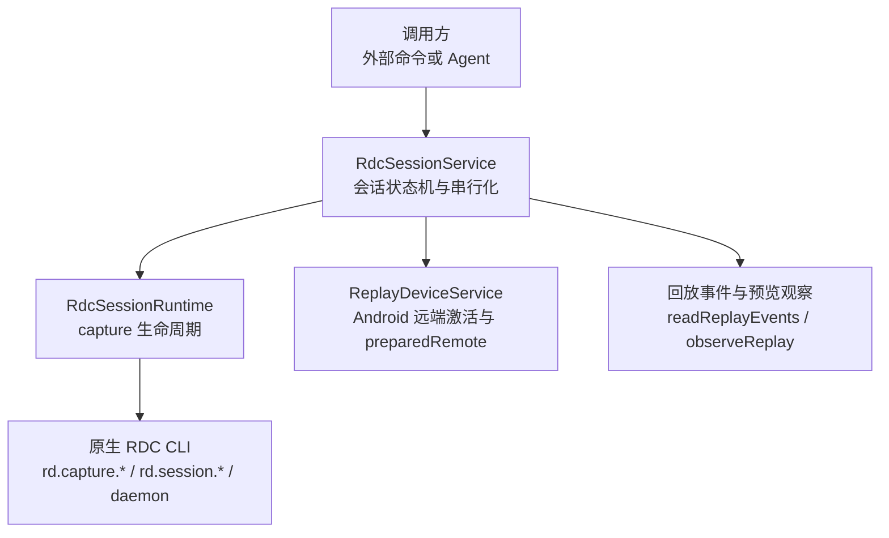
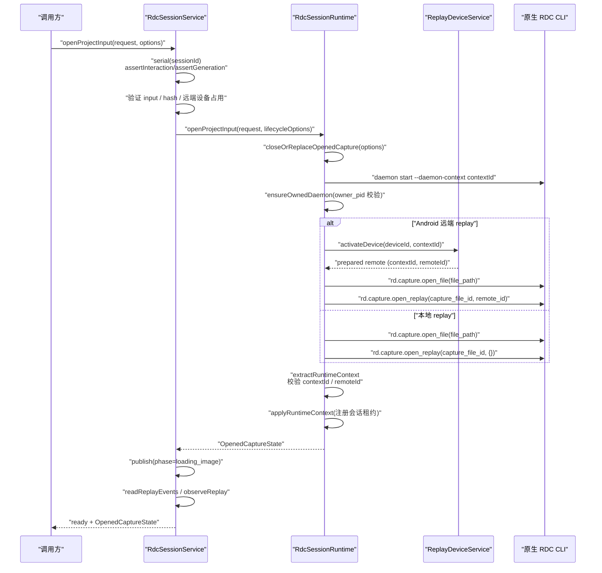
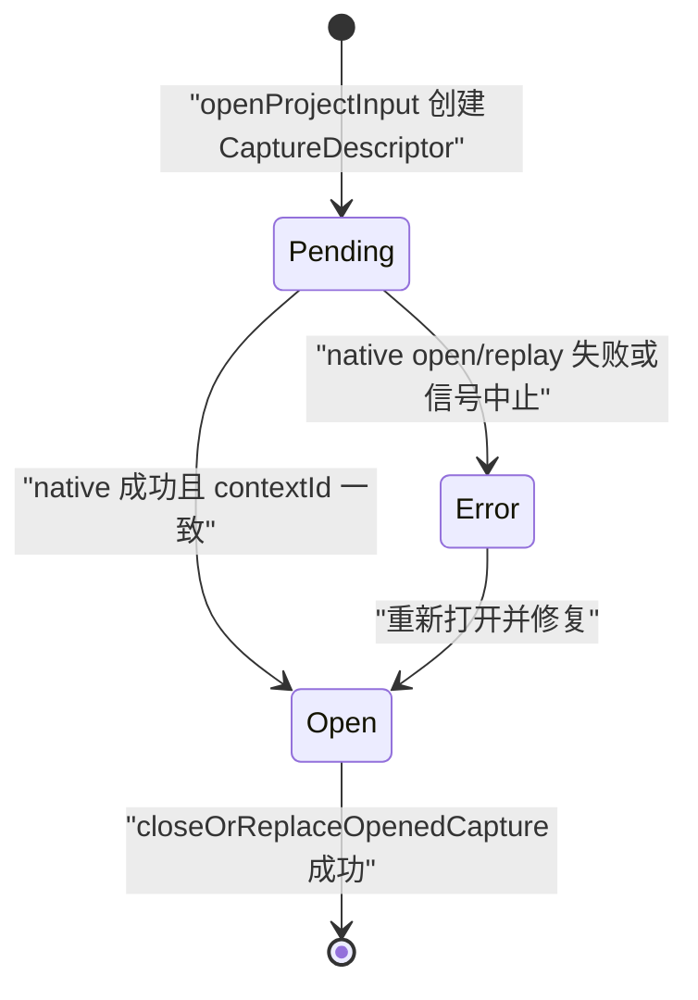
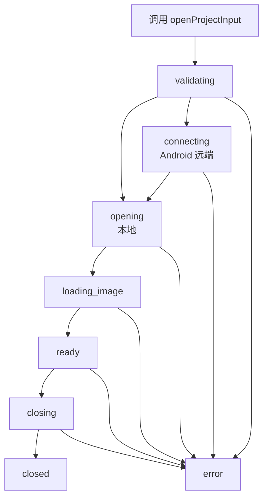
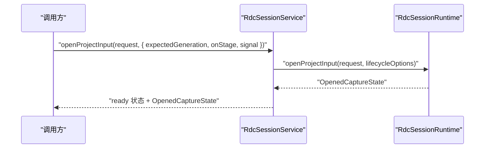
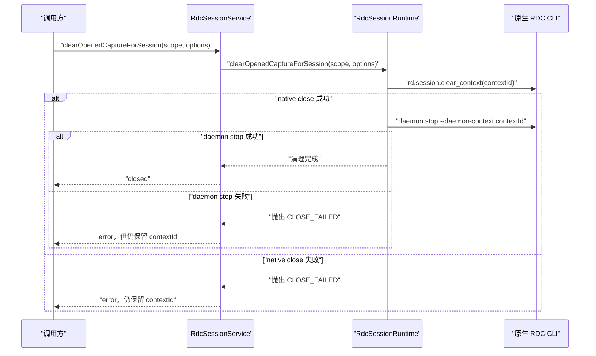
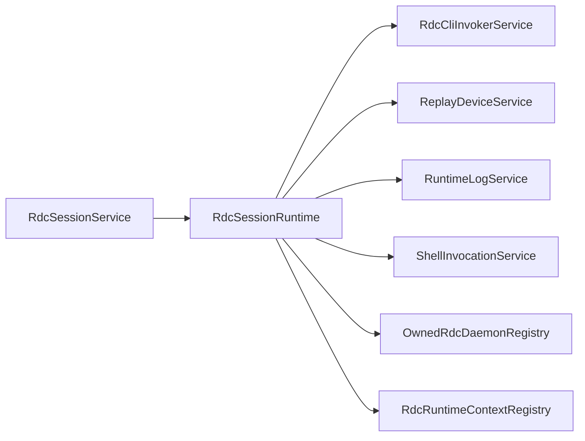

# Replay 运行时生命周期

<cite>
**本文引用的文件**   
- [RdcSessionRuntime.ts](file://src/main/sessions/RdcSessionRuntime.ts)
- [RdcSessionService.ts](file://src/main/sessions/RdcSessionService.ts)
- [RdcSessionRuntime.test.ts](file://src/main/sessions/RdcSessionRuntime.test.ts)
</cite>

## 目录
1. [引言](#引言)
2. [项目结构定位](#项目结构定位)
3. [核心组件](#核心组件)
4. [架构总览](#架构总览)
5. [详细组件分析](#详细组件分析)
6. [依赖关系分析](#依赖关系分析)
7. [性能与可靠性特征](#性能与可靠性特征)
8. [故障排查指南](#故障排查指南)
9. [结论](#结论)

## 引言
本文围绕 Replay 运行时中单个 capture 的生命周期展开，重点解释 `RdcSessionRuntime` 如何组织一次从输入到打开、远端连接、上下文绑定、预览观察再到关闭的完整流程。文档同时说明 `RdcSessionService` 在会话层面的状态机、并发串行化、设备占用和错误发布机制，并给出本地 replay 与 Android 远程 replay 的差异处理、`RdcLifecycleOptions` 中 `expectedGeneration`、`onStage`、`signal` 的作用，以及 `pending → connecting → opening → transferring → open` 等状态的转换条件与恢复策略。

## 项目结构定位
Replay 运行时相关逻辑主要位于主进程会话模块：
- `RdcSessionRuntime`：封装单次 capture 的原生 RDC CLI 调用、daemon 所有权、native context 隔离、捕获描述符、预览结果及清理逻辑。
- `RdcSessionService`：按 `SessionScope` 维护应用级绑定、会话状态机、设备占用、操作串行化、错误与阶段事件发布、图像与回放事件观察。
- 测试用例覆盖 daemon 所有权校验、context mismatch、部分打开保留、双重代理执行保护、取消后不提交等关键路径。

**图表来源**
- [RdcSessionService.ts:1-120](file://src/main/sessions/RdcSessionService.ts#L1-L120)
- [RdcSessionRuntime.ts:1-80](file://src/main/sessions/RdcSessionRuntime.ts#L1-L80)

**章节来源**
- [RdcSessionService.ts:1-120](file://src/main/sessions/RdcSessionService.ts#L1-L120)
- [RdcSessionRuntime.ts:1-80](file://src/main/sessions/RdcSessionRuntime.ts#L1-L80)

## 核心组件
- `RdcSessionRuntime`：负责一个 capture 的 native 资源生命周期，包括：
  - 生成唯一 `contextId` 并启动 owned daemon。
  - 区分本地与 Android 远端 replay。
  - 调用 `rd.capture.open_file`、`rd.capture.open_replay`。
  - 解析并校验返回的 `context_id`、`session_id`、`remote_id`。
  - 将 native runtime context 注册到会话租约。
  - 构建 `OpenedCaptureState` 并支持替换/关闭。
- `RdcSessionService`：负责：
  - 每个 `SessionScope` 一个 `Binding`（runtime + state + deviceId）。
  - 使用 `beginRdcLifecycle` 保证同一会话的操作串行执行。
  - 发布 `phase` 状态：`validating → opening/connecting → loading_image → ready → closing → closed/error`。
  - 在打开成功后读取回放事件并观察最终输出。
  - 管理 Android 远端设备占用，避免多个会话抢占。
- `RdcLifecycleOptions`：控制生命周期行为的配置对象，包含：
  - `expectedGeneration`：乐观锁，防止在旧绑定上操作。
  - `onStage`：回调通知内部 stage：`connecting`、`opening`、`transferring`。
  - `contextId`、`binding`：透传给底层 CLI 工具链。
  - `signal`：可中断整个生命周期。

**章节来源**
- [RdcSessionRuntime.ts:1-120](file://src/main/sessions/RdcSessionRuntime.ts#L1-L120)
- [RdcSessionService.ts:1-120](file://src/main/sessions/RdcSessionService.ts#L1-L120)

## 架构总览
下图展示一次 `openProjectInput` 的典型调用序列，包括本地与远端分支、daemon 启动、native 打开、上下文绑定、预览观察与状态发布。

**图表来源**
- [RdcSessionService.ts:90-210](file://src/main/sessions/RdcSessionService.ts#L90-L210)
- [RdcSessionRuntime.ts:40-220](file://src/main/sessions/RdcSessionRuntime.ts#L40-L220)

## 详细组件分析

### RdcSessionRuntime：单个 capture 的运行时生命周期
`RdcSessionRuntime` 是 Replay 原生资源的直接拥有者。它通过以下关键方法完成生命周期管理：

| 方法 | 职责 | 关键行为 |
|---|---|---|
| `openProjectInput` | 入口：打开 capture 并建立运行时上下文 | 克隆 CLI 设置、加载 catalog、生成 `contextId`、清理旧 capture、启动 owned daemon、区分本地/远端、调用 native、提取并校验 runtime context、创建 `OpenedCaptureState` |
| `ensureOwnedDaemon` | 确保 daemon 由当前进程启动并记录 ownership | 校验 `cli.enabled/command`、启动 daemon、校验 `owner_pid === process.pid`、登记 `rememberOwnedRdcDaemon` |
| `applyRuntimeContext` | 将 native runtime context 注册为会话租约 | 根据 `sessionId` 写入上下文租约、更新本机 `contextId`、`runtimeOwner`、`ownerLeaseId`、`remoteStatus` |
| `closeOrReplaceOpenedCapture` | 关闭或替换已打开的 capture | 先 `teardownRuntime`，再重置内部状态；若存在 previous capture 则记录日志 |
| `clearOpenedCaptureForSession` | 对外暴露的安全关闭接口 | 通过 `isOwnedBy(scope)` 校验所有权后调用替换逻辑 |
| `ensureReplayDeviceReady` | Android 远端设备激活 | 复用 `peekPreparedRemote`、必要时 `activateDevice`，校验状态与 `contextId`、`remoteId` |
| `extractRuntimeContext` | 解析 native 返回并构造 `RdcRuntimeContext` | 校验 `context_id`、`session_id`、推导 backend/device/remote 字段 |

#### 状态转换模型
对于单个 capture 的描述符 `CaptureDescriptor`，其状态转换如下：

- `Pending`：刚创建 capture 描述符，尚未成功打开。
- `Error`：native 调用失败、remote mismatch、context mismatch、abort 等。
- `Open`：native 返回合法 `context_id`、`session_id`，并且 `contextId` 与分配值一致。

#### 本地 vs 远端 replay 差异
- 本地 replay：
  - 不调用 `ensureReplayDeviceReady`。
  - 直接使用 `rd.capture.open_file` 与 `rd.capture.open_replay`。
  - backend 标记为 `local`。
- Android 远端 replay：
  - 先调用 `ensureReplayDeviceReady`，可能触发 `replayDeviceService.activateDevice`。
  - 通过 `replayDeviceService.consumePreparedRemote` 获取 `preparedRemote.contextId` 与 `remoteId`。
  - 校验 `preparedRemote.contextId === allocatedContextId`。
  - `open_replay` 传入 `{ remote_id }`，并校验返回 `remote_id` 一致性。
  - backend 标记为 `remote`，device 信息来自 `replayDevice`。

#### 安全与隔离机制
- **上下文隔离**：每次 `openProjectInput` 都生成新的 `contextId`，而不是复用 `inputId`。
- **daemon 所有权**：daemon 必须绑定当前进程 `owner_pid`，否则拒绝启动；成功后登记 ownership。
- **会话范围绑定**：`applyRuntimeContext` 只在 `sessionId` 非空时写入会话租约；`snapshotContextForSession`、`snapshotOpenedCaptureForSession`、`clearOpenedCaptureForSession` 都要求 `isOwnedBy(scope)`。
- **双重代理保护**：如果存在委托子会话，teardown 前会拒绝关闭，避免父会话误释放子会话资源。
- **未确认进程保护**：如果原生进程退出未被 shell 层确认，teardown 会报错，阻止不安全关闭。

**章节来源**
- [RdcSessionRuntime.ts:40-220](file://src/main/sessions/RdcSessionRuntime.ts#L40-L220)
- [RdcSessionRuntime.ts:220-521](file://src/main/sessions/RdcSessionRuntime.ts#L220-L521)

### RdcSessionService：会话状态机与服务编排
`RdcSessionService` 并不直接持有 native 资源，而是作为“服务层”协调 `RdcSessionRuntime`、设备、历史、预览与观察者。

#### 会话状态机
服务层维护 `CaptureReplayState.phase`，典型路径为：

- `validating`：校验请求、hash、外部引用、设备占用。
- `opening`：本地 replay 打开阶段。
- `connecting`：Android 远端设备激活阶段。
- `loading_image`：native 打开成功后读取回放事件与观察最终输出。
- `ready`：可用状态。
- `closing`：关闭阶段。
- `closed`：完全释放。
- `error`：任意阶段失败都会进入 error，并附带错误码与重试建议。

#### 并发与锁定
- `serial`：同一 `sessionId` 的请求通过队列串行执行，避免并发修改。
- `assertInteraction`：检查交互锁，包括 Agent 执行、委托子会话、未确认原生进程。
- `assertGeneration`：基于 `expectedGeneration` 实现乐观锁，防止在过期绑定上操作。
- `assertReplayAvailable`：对 quarantine 上下文进行 fail-closed 处理，提示用户关闭并重开。

#### 设备占用与远端校验
- 若 `replayDevice.type === 'android'`，服务层记录 `deviceId → sessionScope`。
- 重复设备会抛出 `RDC_DEVICE_IN_USE`。
- `openProjectInput` 成功后，若后续步骤失败且不再持有 context 或 device 不一致，会删除设备占用。

**章节来源**
- [RdcSessionService.ts:1-232](file://src/main/sessions/RdcSessionService.ts#L1-L232)

### RdcLifecycleOptions：生命周期控制参数
| 参数 | 类型 | 作用 |
|---|---|---|
| `expectedGeneration` | `number` 可选 | 用于 `RdcSessionService.assertGeneration`，若当前 binding generation 不同则拒绝操作，防止陈旧绑定导致状态错乱 |
| `onStage` | `(stage) => void` 可选 | 接收 `connecting`、`opening`、`transferring` 三个内部阶段，供 UI 或上层显示进度 |
| `contextId` | `string` 可选 | 透传给底层 CLI 工具链，配合 `preparedRemote.contextId` 做一致性校验 |
| `binding` | `RdcTurnBinding` 可选 | 提供冻结后的 CLI 工具集，避免重复加载 catalog |
| `signal` | `AbortSignal` 可选 | 在整个生命周期中多处调用 `throwIfAborted`，确保取消能及时停止 daemon、native 调用与状态提交 |

**章节来源**
- [RdcSessionRuntime.ts:40-60](file://src/main/sessions/RdcSessionRuntime.ts#L40-L60)
- [RdcSessionService.ts:120-210](file://src/main/sessions/RdcSessionService.ts#L120-L210)

### 生命周期 API 调用示例与错误处理模式

#### 打开 capture 的基本流程
1. 调用方构造 `OpenProjectInputRequest`，包含 `projectId`、`sessionId`、`inputId`、`filePath`、`replayDevice`。
2. 调用 `RdcSessionService.openProjectInput`。
3. 服务层串行化、校验、hash、设备占用、发布 `validating`。
4. 若远端设备，发布 `connecting`；否则发布 `opening`。
5. `RdcSessionRuntime` 启动 owned daemon、调用 native。
6. 成功后发布 `loading_image`，读取回放事件与最终输出。
7. 发布 `ready`，返回 `OpenedCaptureState`。

**图表来源**
- [RdcSessionService.ts:140-210](file://src/main/sessions/RdcSessionService.ts#L140-L210)
- [RdcSessionRuntime.ts:60-220](file://src/main/sessions/RdcSessionRuntime.ts#L60-L220)

#### 关闭 capture 的正确方式
1. 调用 `RdcSessionService.clearOpenedCaptureForSession(scope, options)`。
2. 服务层串行化并发布 `closing`。
3. 内部调用 `closeBinding`，进而调用 `RdcSessionRuntime.clearOpenedCaptureForSession`。
4. `RdcSessionRuntime.teardownRuntime`：
   - 先通过 `rd.session.clear_context` 关闭 native session。
   - 成功后尝试 `daemon stop`。
   - 若 daemon stop 失败，保留 ownership 并抛出错误，允许下次重试。
5. 成功后发布 `closed`，清空设备占用与预览缓存。

**图表来源**
- [RdcSessionService.ts:210-291](file://src/main/sessions/RdcSessionService.ts#L210-L291)
- [RdcSessionRuntime.ts:300-521](file://src/main/sessions/RdcSessionRuntime.ts#L300-L521)

#### 常见错误模式
- `RDC_CONTEXT_MISMATCH`：native 返回的 `context_id` 不是本次分配的 `allocatedContextId`。
- `RDC_REMOTE_MISMATCH`：远端 replay 的 `remote_id` 与 `preparedRemote.remoteId` 不一致。
- `RDC_CAPTURE_MISMATCH`：`open_replay` 返回的 `capture_file_id` 与请求不一致。
- `RDC_CLOSE_FAILED`：native session 关闭或 daemon stop 未确认。
- `RDC_RECOVERY_BLOCKED`：原生进程退出未被确认。
- `RDC_LEASE_DUAL_OWNER`：存在委托子会话，不允许父会话 teardown。
- `RDC_BINDING_CHANGED`：`expectedGeneration` 不匹配。
- `RDC_DEVICE_IN_USE`：Android 远端设备被其他会话占用。
- `RDC_INTERACTION_LOCKED`：存在交互锁，如 Agent 执行或未确认进程。
- `CAPTURE_CHANGED_DURING_OPEN`：打开过程中 capture 内容 hash 变化。

**章节来源**
- [RdcSessionRuntime.ts:60-220](file://src/main/sessions/RdcSessionRuntime.ts#L60-L220)
- [RdcSessionRuntime.ts:300-521](file://src/main/sessions/RdcSessionRuntime.ts#L300-L521)
- [RdcSessionService.ts:120-291](file://src/main/sessions/RdcSessionService.ts#L120-L291)
- [RdcSessionRuntime.test.ts:1-171](file://src/main/sessions/RdcSessionRuntime.test.ts#L1-L171)

## 依赖关系分析

**图表来源**
- [RdcSessionService.ts:1-120](file://src/main/sessions/RdcSessionService.ts#L1-L120)
- [RdcSessionRuntime.ts:1-60](file://src/main/sessions/RdcSessionRuntime.ts#L1-L60)

### 耦合与内聚
- `RdcSessionService` 与 `RdcSessionRuntime` 解耦：服务层关注会话状态、并发、设备占用；运行时关注 native 资源。
- `RdcSessionRuntime` 高度依赖原生 CLI 工具链与设备服务，但通过 `RdcLifecycleOptions` 提供注入点，便于测试与扩展。
- 会话租约、daemon ownership、shell 未确认进程共同构成多重安全边界。

### 潜在循环依赖
- 当前实现中，服务层不直接反向依赖运行时的具体 native 实现细节，仅通过公开方法与选项交互，未见明显循环依赖。

**章节来源**
- [RdcSessionService.ts:1-120](file://src/main/sessions/RdcSessionService.ts#L1-L120)
- [RdcSessionRuntime.ts:1-60](file://src/main/sessions/RdcSessionRuntime.ts#L1-L60)

## 性能与可靠性特征
- **串行化**：同一会话的 open/close 操作串行执行，避免竞态。
- **乐观锁**：`expectedGeneration` 防止陈旧绑定覆盖新状态。
- **分阶段回调**：`onStage` 让上层 UI 及时反映 `connecting`、`opening`、`transferring`，改善用户体验。
- **可中断**：`signal` 贯穿 daemon 启动、native 调用、状态提交，避免长时间阻塞。
- **幂等清理**：即使 native close 失败，也保留 ownership 并允许重试，直到 daemon stop 确认。
- **设备独占**：Android 远端设备在同一时间只能被一个会话占用，避免多会话争抢。

[本节为通用性能讨论，不直接分析具体代码行]

## 故障排查指南

### 打开失败
- 检查是否传入了正确的 `replayDevice`：本地使用 `type: local`，远端使用 `type: android`。
- 若出现 `RDC_CONTEXT_MISMATCH`，说明 native 返回了不属于本次分配的 context，应重新打开。
- 若出现 `RDC_REMOTE_MISMATCH`，说明远端连接身份与所选 connection 不一致。
- 若出现 `CAPTURE_CHANGED_DURING_OPEN`，说明 capture 文件在打开过程中发生变化，需重新选择。

**章节来源**
- [RdcSessionRuntime.ts:60-220](file://src/main/sessions/RdcSessionRuntime.ts#L60-L220)
- [RdcSessionService.ts:140-210](file://src/main/sessions/RdcSessionService.ts#L140-L210)

### 关闭失败
- 若 `rd.session.clear_context` 失败，仍会保留 `contextId` 和会话租约，以便下次重试。
- 若 `daemon stop` 失败，会抛出 `RDC_CLOSE_FAILED`，但不会丢弃 ownership；再次调用关闭即可重试。
- 若出现 `RDC_RECOVERY_BLOCKED`，需要先等待原生进程退出被 shell 层确认。
- 若出现 `RDC_LEASE_DUAL_OWNER`，应先结束委托子会话，再关闭父会话。

**章节来源**
- [RdcSessionRuntime.ts:300-521](file://src/main/sessions/RdcSessionRuntime.ts#L300-L521)

### 远端设备问题
- 若 `ensureReplayDeviceReady` 失败，通常是因为设备未处于 `connected` 或 `online`，或 `preparedRemote.contextId` 不匹配。
- 若 `prepareRemote` 缺失 `contextId` 或 `remoteId`，远端 replay 会被拒绝。
- 若设备被其他会话占用，服务层会抛出 `RDC_DEVICE_IN_USE`。

**章节来源**
- [RdcSessionRuntime.ts:220-300](file://src/main/sessions/RdcSessionRuntime.ts#L220-L300)
- [RdcSessionService.ts:120-210](file://src/main/sessions/RdcSessionService.ts#L120-L210)

### 测试覆盖的关键断言
- 冻结 binding 时跳过 catalog 刷新。
- daemon start 的 `owner_pid` 不匹配会失败。
- `contextId` 不与 `inputId` 复用。
- 部分打开失败仍保留 context，直到显式确认关闭。
- 双重代理执行保护生效。
- 取消后不会提交 native open 结果。

**章节来源**
- [RdcSessionRuntime.test.ts:1-171](file://src/main/sessions/RdcSessionRuntime.test.ts#L1-L171)

## 结论
`RdcSessionRuntime` 以原生 RDC CLI 为中心，围绕 `contextId`、daemon ownership、native session、远端 replay identity 构建了严格的安全边界；`RdcSessionService` 则在会话层面提供了状态机、串行化、设备占用、乐观锁与错误发布能力。两者协作使得单个 capture 的生命周期既具备细粒度的可观测性，又能在异常情况下保持可恢复性。对于 Android 远端 replay，系统通过 `preparedRemote`、`contextId`、`remoteId` 三重校验确保连接身份正确；对于本地 replay，则简化为 direct open 流程。开发者在使用时应始终通过 `RdcSessionService` 暴露的 API 进行操作，并合理使用 `expectedGeneration`、`onStage`、`signal` 来保障状态一致性与用户体验。