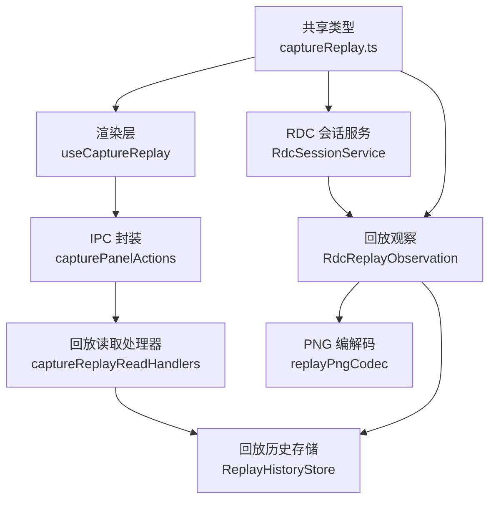
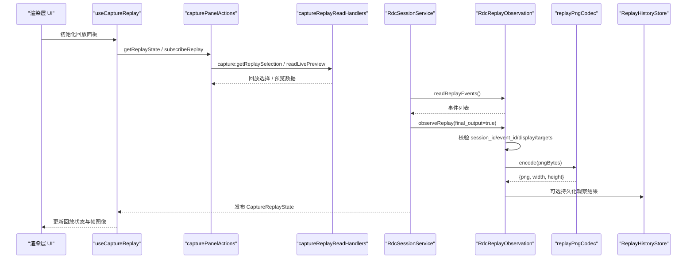
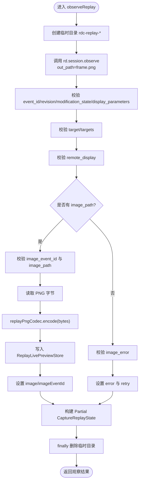
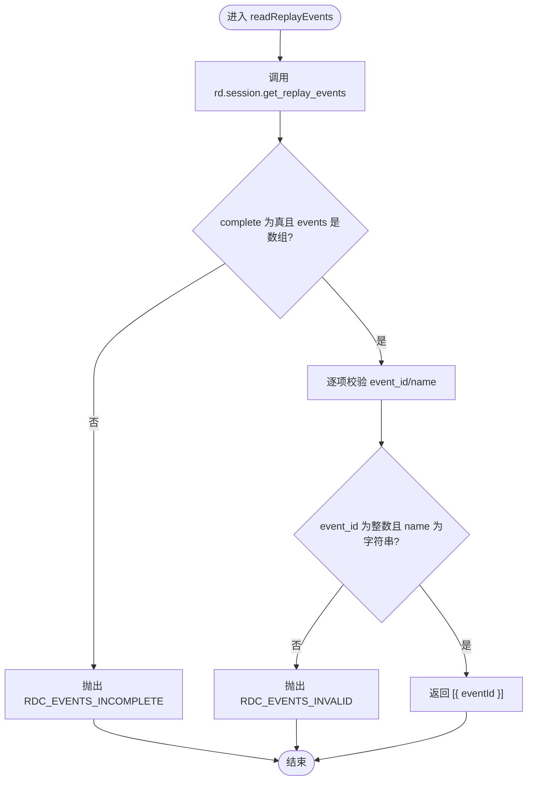
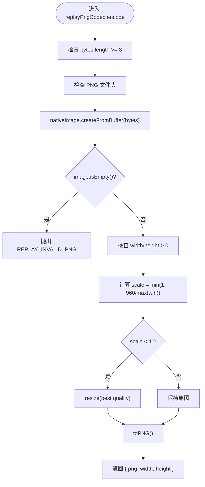
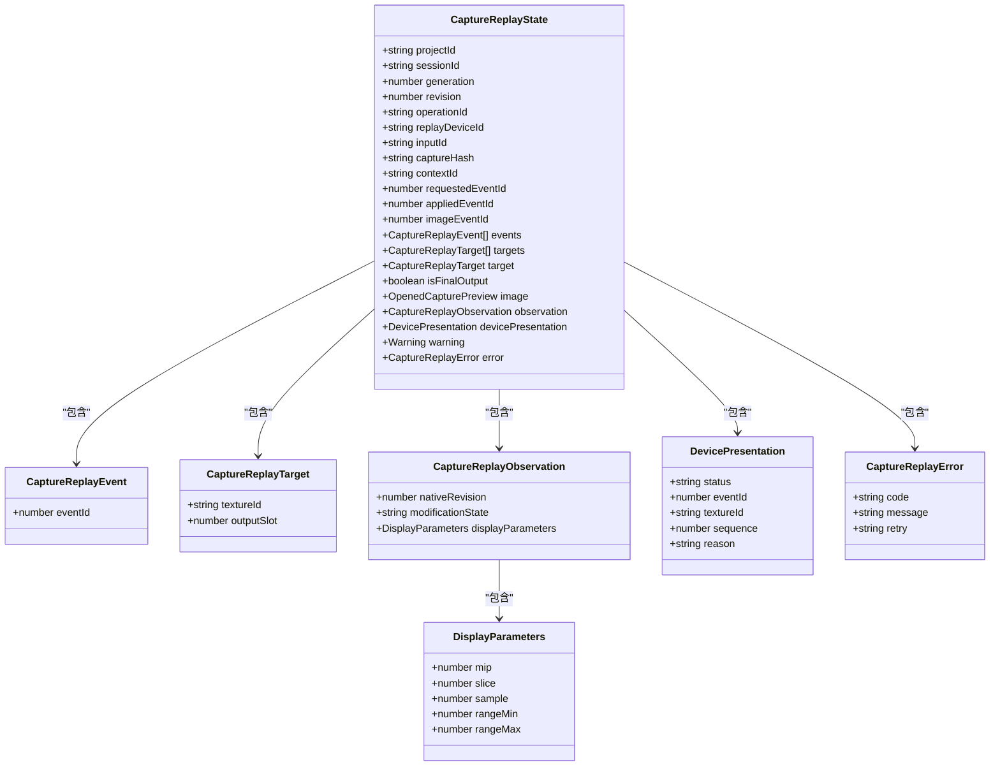
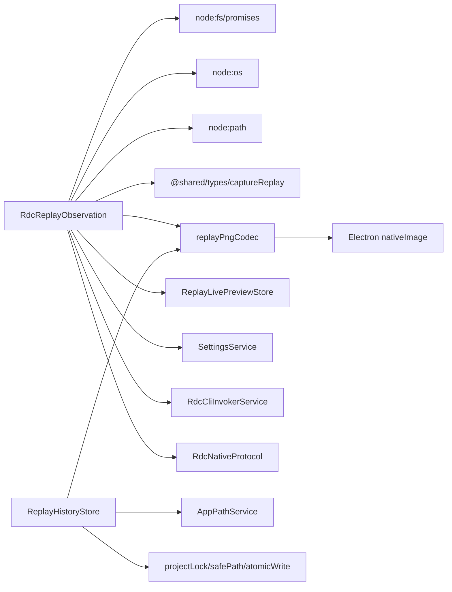

# 事件观察与帧同步

<cite>
**本文引用的文件**   
- [RdcReplayObservation.ts](file://src/main/sessions/RdcReplayObservation.ts)
- [replayPngCodec.ts](file://src/main/captures/replay/replayPngCodec.ts)
- [captureReplay.ts](file://src/shared/types/captureReplay.ts)
- [ReplayHistoryStore.ts](file://src/main/captures/replay/ReplayHistoryStore.ts)
- [replayStorageTypes.ts](file://src/main/captures/replay/replayStorageTypes.ts)
- [useCaptureReplay.ts](file://src/renderer/features/right-rail/useCaptureReplay.ts)
- [capturePanelActions.ts](file://src/renderer/features/right-rail/capturePanelActions.ts)
- [captureReplayReadHandlers.ts](file://src/main/ipc/captureReplayReadHandlers.ts)
- [RdcSessionService.ts](file://src/main/sessions/RdcSessionService.ts)
</cite>

## 目录
1. [引言](#引言)
2. [项目结构定位](#项目结构定位)
3. [核心组件](#核心组件)
4. [架构总览](#架构总览)
5. [详细组件分析](#详细组件分析)
6. [依赖关系分析](#依赖关系分析)
7. [性能与资源特性](#性能与资源特性)
8. [故障排查指南](#故障排查指南)
9. [结论](#结论)
10. [附录：API 使用示例](#附录api-使用示例)

## 引言
本文聚焦 RDC（RenderDoc Capture）回放系统中的“事件观察”和“帧同步”能力，围绕以下目标展开：
- 解释 `observeReplay` 如何订阅 RDC replay 事件流。
- 说明 `rd.session.observe` 调用参数构建、返回值验证与错误处理。
- 详解 `CaptureReplayState` 数据模型字段，包括 `observation.metadata`、`target/targets`、`devicePresentation`、`warning/error` 等。
- 说明 `replayPngCodec` 如何编码 PNG 图像数据，以及 `fs.mkdtemp` 临时目录的安全使用。
- 解释 `readReplayEvents` 如何获取完整事件序列及事件 ID 验证机制。
- 覆盖事件身份认证、数据完整性校验、远程显示状态处理。
- 提供事件订阅、帧跳转、截图获取的实际 API 使用示例。

该能力贯穿主进程 RDC 会话服务、回放观察逻辑、PNG 编解码、历史存储以及渲染侧 UI 状态管理。

## 项目结构定位
与事件观察与帧同步直接相关的代码主要分布在以下位置：
- 主进程回放观察与 RDC CLI 调用：`src/main/sessions/RdcReplayObservation.ts`
- PNG 帧编解码：`src/main/captures/replay/replayPngCodec.ts`
- 回放历史持久化：`src/main/captures/replay/ReplayHistoryStore.ts`
- 回放类型定义：`src/shared/types/captureReplay.ts`
- 回放存储类型：`src/main/captures/replay/replayStorageTypes.ts`
- 渲染侧回放 Hook：`src/renderer/features/right-rail/useCaptureReplay.ts`
- 渲染侧 IPC 封装：`src/renderer/features/right-rail/capturePanelActions.ts`
- 渲染侧回放读取 IPC 处理器：`src/main/ipc/captureReplayReadHandlers.ts`
- RDC 会话服务与生命周期编排：`src/main/sessions/RdcSessionService.ts`

**图表来源**
- [useCaptureReplay.ts:1-32](file://src/renderer/features/right-rail/useCaptureReplay.ts#L1-L32)
- [capturePanelActions.ts:1-21](file://src/renderer/features/right-rail/capturePanelActions.ts#L1-L21)
- [captureReplayReadHandlers.ts:1-24](file://src/main/ipc/captureReplayReadHandlers.ts#L1-L24)
- [ReplayHistoryStore.ts:1-120](file://src/main/captures/replay/ReplayHistoryStore.ts#L1-L120)
- [RdcReplayObservation.ts:1-107](file://src/main/sessions/RdcReplayObservation.ts#L1-L107)
- [replayPngCodec.ts:1-21](file://src/main/captures/replay/replayPngCodec.ts#L1-L21)
- [captureReplay.ts:1-25](file://src/shared/types/captureReplay.ts#L1-L25)

**章节来源**
- [RdcReplayObservation.ts:1-107](file://src/main/sessions/RdcReplayObservation.ts#L1-L107)
- [replayPngCodec.ts:1-21](file://src/main/captures/replay/replayPngCodec.ts#L1-L21)
- [captureReplay.ts:1-25](file://src/shared/types/captureReplay.ts#L1-L25)
- [ReplayHistoryStore.ts:1-200](file://src/main/captures/replay/ReplayHistoryStore.ts#L1-L200)
- [useCaptureReplay.ts:1-32](file://src/renderer/features/right-rail/useCaptureReplay.ts#L1-L32)
- [capturePanelActions.ts:1-21](file://src/renderer/features/right-rail/capturePanelActions.ts#L1-L21)
- [captureReplayReadHandlers.ts:1-24](file://src/main/ipc/captureReplayReadHandlers.ts#L1-L24)
- [RdcSessionService.ts:1-232](file://src/main/sessions/RdcSessionService.ts#L1-L232)

## 核心组件
- `RdcReplayObservation`：负责通过 RDC CLI 调用 `rd.session.get_replay_events` 和 `rd.session.observe`，完成事件列表拉取、单次观察结果解析、图像路径与设备展示状态校验，并将帧写入预览存储。
- `replayPngCodec`：对原始 PNG 字节进行签名校验、尺寸检查与缩放编码，输出带宽高信息的压缩后 PNG。
- `ReplayHistoryStore`：将回放观察结果持久化为历史记录条目，维护 manifest、图像 SHA256、配额、恢复清理等安全语义。
- `CaptureReplayState`：描述回放当前阶段、事件、目标纹理、设备呈现状态、警告与错误的统一状态模型。
- `useCaptureReplay`：渲染侧 Hook，订阅回放状态变更、加载初始状态并过滤过期更新。
- `capturePanelActions`：封装渲染层到主进程的 IPC 调用，如获取回放状态、应用事件、刷新帧、订阅变更等。
- `captureReplayReadHandlers`：主进程侧回放读取 IPC 处理器，负责权限校验与返回回放选择或实时预览。
- `RdcSessionService`：RDC 会话级回放生命周期编排，串联打开输入、读取事件、执行首次观察、发布状态。

**章节来源**
- [RdcReplayObservation.ts:1-107](file://src/main/sessions/RdcReplayObservation.ts#L1-L107)
- [replayPngCodec.ts:1-21](file://src/main/captures/replay/replayPngCodec.ts#L1-L21)
- [captureReplay.ts:1-25](file://src/shared/types/captureReplay.ts#L1-L25)
- [ReplayHistoryStore.ts:1-200](file://src/main/captures/replay/ReplayHistoryStore.ts#L1-L200)
- [useCaptureReplay.ts:1-32](file://src/renderer/features/right-rail/useCaptureReplay.ts#L1-L32)
- [capturePanelActions.ts:1-21](file://src/renderer/features/right-rail/capturePanelActions.ts#L1-L21)
- [captureReplayReadHandlers.ts:1-24](file://src/main/ipc/captureReplayReadHandlers.ts#L1-L24)
- [RdcSessionService.ts:1-232](file://src/main/sessions/RdcSessionService.ts#L1-L232)

## 架构总览
回放观察与帧同步的整体流程如下：
1. 渲染层通过 `useCaptureReplay` 初始化并订阅回放状态。
2. 渲染层通过 `capturePanelActions` 调用主进程 IPC，例如获取回放状态、应用帧事件、刷新帧。
3. 主进程 `RdcSessionService` 在打开捕获输入后，先拉取完整事件列表，再执行一次 `rd.session.observe` 作为初始帧。
4. `RdcReplayObservation` 负责：
   - 构造 RDC CLI 调用参数。
   - 校验返回的 `session_id`、`event_id`、`revision`、`modification_state`、`display_parameters`、`target/targets`、`remote_display`。
   - 如果存在 `image_path`，则读取 PNG 并通过 `replayPngCodec` 编码，写入 `ReplayLivePreviewStore`。
   - 如果存在图像错误，则填充 `error`；否则设置 `warning`。
5. `ReplayHistoryStore` 可将观察结果持久化，校验 manifest、图像哈希、配额限制，并在异常时做恢复清理。
6. 渲染层根据 `CaptureReplayState` 中的 `phase`、`appliedEventId`、`image`、`devicePresentation` 更新界面。

**图表来源**
- [useCaptureReplay.ts:1-32](file://src/renderer/features/right-rail/useCaptureReplay.ts#L1-L32)
- [capturePanelActions.ts:1-21](file://src/renderer/features/right-rail/capturePanelActions.ts#L1-L21)
- [captureReplayReadHandlers.ts:1-24](file://src/main/ipc/captureReplayReadHandlers.ts#L1-L24)
- [RdcSessionService.ts:120-232](file://src/main/sessions/RdcSessionService.ts#L120-L232)
- [RdcReplayObservation.ts:18-107](file://src/main/sessions/RdcReplayObservation.ts#L18-L107)
- [replayPngCodec.ts:1-21](file://src/main/captures/replay/replayPngCodec.ts#L1-L21)
- [ReplayHistoryStore.ts:60-120](file://src/main/captures/replay/ReplayHistoryStore.ts#L60-L120)

## 详细组件分析

### `observeReplay`：RDC 回放观察与帧同步核心
`observeReplay` 是回放帧同步的关键入口。它接收一个 RDC 运行时上下文、RDC CLI 参数、可选 CLI 配置，以及可选的“实时预览写入目标”。其职责包括：
- 创建安全临时目录：使用 `fs.mkdtemp(path.join(os.tmpdir(), 'rdc-replay-'))` 生成以 `rdc-replay-` 为前缀的临时目录，并在 finally 中递归删除，避免残留文件。
- 调用 RDC CLI：通过内部 `call` 函数调用 `rd.session.observe`，传入业务参数与 `out_path`，即期望的 PNG 输出路径。
- 身份与元数据校验：
  - `session_id` 必须等于当前回放会话 ID。
  - `event_id` 必须为非负安全整数。
  - `revision` 必须为非负安全整数。
  - `modification_state` 必须属于 `baseline`、`intervention`、`restored`。
  - `display_parameters.mip/slice/sample` 必须为非负安全整数；`range_min/range_max` 必须为有限数值。
- 目标纹理校验：
  - `target` 可为空；若不为空，必须包含非空 `texture_id`，且 `output_slot` 为空或非负安全整数。
  - `targets` 必须是数组，每项满足相同结构约束。
- 远程显示状态校验：
  - `remote_display.status` 必须属于 `not_applicable`、`unsupported`、`unavailable`、`presented`。
  - `remote_display.event_id` 必须与本次观察 `event_id` 一致。
  - `remote_display.texture_id` 为空或字符串。
  - `remote_display.sequence` 为空或正数安全整数。
  - `remote_display.reason` 为空或字符串。
  - 当 `status === presented` 时，仅允许远端后端，且必须匹配目标纹理 ID、序列非空、reason 为空。
  - 当 `status` 为 `unsupported` 或 `unavailable` 时，必须提供 reason。
- 图像与错误分支：
  - 如果返回 `image_path`：
    - 校验 `image_event_id` 必须等于本次 `event_id`。
    - 校验 `image_path` 必须解析后等于预期临时文件路径。
    - 要求提供 live 写入目标，否则报错。
    - 读取 PNG 字节，调用 `replayPngCodec.encode` 编码，写入 `ReplayLivePreviewStore`。
    - 设置 `image`、`imageEventId`。
  - 如果返回 `image_error`：
    - 必须包含 `code` 和 `message` 字符串。
    - 填充 `error`，并根据 `no_color_output` 或 `missing_target` 设置重试策略为 null，其他情况重试类型为 `image`。
- 最终输出与警告：
  - `is_final_output` 标记是否为最终输出。
  - `final_output_error` 可转换为 `warning`，但不会覆盖 `error`。
  - `devicePresentation` 映射远程显示状态，供 UI 判断是否可交互。

**图表来源**
- [RdcReplayObservation.ts:20-107](file://src/main/sessions/RdcReplayObservation.ts#L20-L107)

**章节来源**
- [RdcReplayObservation.ts:18-107](file://src/main/sessions/RdcReplayObservation.ts#L18-L107)

### `readReplayEvents`：完整事件序列与事件 ID 验证
`readReplayEvents` 用于获取完整的回放事件序列。它通过内部 `call` 调用 `rd.session.get_replay_events`，并对返回数据进行严格校验：
- 必须存在 `complete === true`。
- `events` 必须是数组。
- 每个事件项必须包含整数 `event_id` 与字符串 `name`。
- 转换后返回 `{ eventId }` 数组，供上层渲染层或回放控制使用。

该函数的错误语义：
- `RDC_EVENTS_INCOMPLETE`：RDC 未返回完整事件列表。
- `RDC_EVENTS_INVALID`：事件项缺少必要字段或类型不合法。

**图表来源**
- [RdcReplayObservation.ts:26-40](file://src/main/sessions/RdcReplayObservation.ts#L26-L40)

**章节来源**
- [RdcReplayObservation.ts:26-40](file://src/main/sessions/RdcReplayObservation.ts#L26-L40)

### `replayPngCodec`：PNG 编码与安全校验
`replayPngCodec` 的职责是将原始 PNG 字节转换为带宽高的编码对象：
- 首先检查字节长度至少为 8。
- 检查 PNG 文件头十六进制值是否为 `89504e470d0a1a0a`。
- 通过 Electron 的 `nativeImage.createFromBuffer` 创建图像对象。
- 检查图像是否为空，宽度与高度是否大于 0。
- 计算缩放比例：最大边不超过 960，按 `min(1, 960/max(width,height))` 缩放。
- 若需要缩放，使用 `best` 质量重新生成 PNG。
- 返回 `{ png: Buffer, width, height }`。

错误语义：
- `REPLAY_INVALID_PNG`：PNG 头无效、图像为空、尺寸非法。

**图表来源**
- [replayPngCodec.ts:1-21](file://src/main/captures/replay/replayPngCodec.ts#L1-L21)

**章节来源**
- [replayPngCodec.ts:1-21](file://src/main/captures/replay/replayPngCodec.ts#L1-L21)

### `CaptureReplayState`：回放状态数据模型
`CaptureReplayState` 是回放系统的核心数据结构，承载回放阶段、事件、目标、图像、观察元数据、设备呈现状态、警告与错误等信息。关键字段含义如下：
- `phase`：回放阶段，包括 `closed`、`validating`、`connecting`、`transferring`、`opening`、`loading_image`、`ready`、`applying`、`closing`、`error`。
- `generation/revision`：状态版本号，用于渲染层过滤过期更新。
- `operationId`：当前操作标识。
- `replayDeviceId/inputId/captureHash/contextId`：回放设备、输入、捕获哈希与上下文标识。
- `requestedEventId/appliedEventId/imageEventId`：请求的事件 ID、已应用的事件 ID、图像对应的事件 ID。
- `events`：回放事件列表，每项为 `{ eventId }`。
- `targets/target`：纹理目标列表与当前选中目标，包含 `textureId` 与可选 `outputSlot`。
- `isFinalOutput`：是否为最终输出。
- `image`：当前帧预览，类型为 `OpenedCapturePreview`。
- `observation`：观察元数据，包含 `nativeRevision`、`modificationState`、`displayParameters`。
- `devicePresentation`：远程显示状态，包含 `status`、`eventId`、`textureId`、`sequence`、`reason`。
- `warning/error`：警告与错误信息，错误包含 `retry` 策略。

**图表来源**
- [captureReplay.ts:1-25](file://src/shared/types/captureReplay.ts#L1-L25)

**章节来源**
- [captureReplay.ts:1-25](file://src/shared/types/captureReplay.ts#L1-L25)

### `ReplayHistoryStore`：回放历史持久化与完整性
`ReplayHistoryStore` 负责回放观察结果的持久化、清单校验、图像哈希、配额限制与恢复清理：
- `append`：追加观察条目，支持可选 PNG 字节；使用 `replayPngCodec` 编码后计算 SHA256；写入 manifest 与图片文件；原子写保障一致性。
- `list/readImage/readSelection/saveSelection`：分页列出历史、按 SHA256 读取图像、读写选择。
- `recover/clearCapture/clearSession/reconcileInputSelections/reconcileCaptureReferences`：恢复未完成文件、清理无效快照、对齐输入选择与活动哈希集合。
- 配额检查：会话与项目两级字节配额，防止回放数据膨胀。

**章节来源**
- [ReplayHistoryStore.ts:1-200](file://src/main/captures/replay/ReplayHistoryStore.ts#L1-L200)
- [ReplayHistoryStore.ts:201-264](file://src/main/captures/replay/ReplayHistoryStore.ts#L201-L264)
- [replayStorageTypes.ts:1-58](file://src/main/captures/replay/replayStorageTypes.ts#L1-L58)

### 渲染层回放状态订阅与更新
渲染层通过 `useCaptureReplay` 管理回放状态：
- 使用 `useState` 保存 `state`、`selection`、`error`。
- `acceptsReplayState` 确保只接受同项目同会话且更高 generation 或同 generation 更高 revision 的状态。
- `reload` 并行获取回放状态与选择，并清空错误。
- `subscribeReplay` 订阅回放变更事件，更新状态。
- 组件卸载时取消订阅并标记 active 为 false，避免异步回调污染状态。

**章节来源**
- [useCaptureReplay.ts:1-32](file://src/renderer/features/right-rail/useCaptureReplay.ts#L1-L32)
- [capturePanelActions.ts:1-21](file://src/renderer/features/right-rail/capturePanelActions.ts#L1-L21)

### RDC 会话服务中的回放生命周期
`RdcSessionService` 在打开捕获输入后，会：
- 发布 `validating/connecting/opening/loading_image/applying/closing/ready/error` 阶段。
- 调用 `readReplayEvents` 拉取事件列表。
- 调用 `observeReplay` 执行初始观察，并传入 `final_output=true` 与 live 预览写入目标。
- 将错误包装为 `RDC_IMAGE_FAILED` 或 `RDC_OPEN_FAILED` 等错误码。
- 在关闭绑定或切换输入时清理设备占用与预览存储。

**章节来源**
- [RdcSessionService.ts:1-232](file://src/main/sessions/RdcSessionService.ts#L1-L232)

## 依赖关系分析
回放观察与帧同步的依赖关系如下：
- `RdcReplayObservation` 依赖：
  - `node:fs/promises`、`node:os`、`node:path` 文件系统与系统临时目录。
  - `@shared/types/captureReplay` 回放类型。
  - `../captures/replay/replayPngCodec` PNG 编解码。
  - `../captures/replay/ReplayLivePreviewStore` 预览存储。
  - `../settings/SettingsService` CLI 设置。
  - `../tools/RdcCliInvokerService` RDC CLI 调用。
  - `../tools/RdcNativeProtocol` RDC 原生协议解析。
- `replayPngCodec` 依赖 Electron `nativeImage`。
- `ReplayHistoryStore` 依赖 `replayPngCodec`、`appPathService`、`projectLock`、`safePath`、`atomicWrite` 等回放安全工具。
- 渲染层依赖 `getElectronApi` 获取主进程桥接。

**图表来源**
- [RdcReplayObservation.ts:1-18](file://src/main/sessions/RdcReplayObservation.ts#L1-L18)
- [replayPngCodec.ts:1-21](file://src/main/captures/replay/replayPngCodec.ts#L1-L21)
- [ReplayHistoryStore.ts:1-60](file://src/main/captures/replay/ReplayHistoryStore.ts#L1-L60)

**章节来源**
- [RdcReplayObservation.ts:1-18](file://src/main/sessions/RdcReplayObservation.ts#L1-L18)
- [replayPngCodec.ts:1-21](file://src/main/captures/replay/replayPngCodec.ts#L1-L21)
- [ReplayHistoryStore.ts:1-60](file://src/main/captures/replay/ReplayHistoryStore.ts#L1-L60)

## 性能与资源特性
- PNG 缩放上限：最大边不超过 960，避免大图传输与渲染压力。
- 临时目录隔离：每次 `observeReplay` 都创建独立临时目录，并在 finally 中删除，降低磁盘残留风险。
- 历史配额限制：会话与项目两级字节配额，默认会话 256MB、项目 2GB，防止回放数据无限增长。
- 原子写与哈希校验：manifest 与图像文件采用原子写与 SHA256 校验，保证回放数据一致性。
- 渲染层状态过滤：通过 `generation` 与 `revision` 过滤过期状态，减少无意义重绘。

[本节为通用性能讨论，不直接分析具体代码行]

## 故障排查指南
常见错误与处理建议：
- `RDC_OBSERVATION_IDENTITY_MISMATCH`：RDC 返回的 `session_id` 与当前会话不一致，需检查 CLI 上下文与会话绑定。
- `RDC_EVENTS_INCOMPLETE`：RDC 未返回完整事件列表，需检查 RDC 版本或会话状态。
- `RDC_EVENTS_INVALID`：事件项缺少 `event_id` 或 `name`，需检查 RDC 输出格式。
- `RDC_OBSERVATION_EVENT_INVALID`：`event_id` 不是非负安全整数，需检查 RDC 返回。
- `RDC_OBSERVATION_METADATA_INVALID`：`revision/modification_state/display_parameters` 不合法，需检查 RDC 元数据。
- `RDC_OBSERVATION_TARGET_INVALID`：`target/targets` 结构不合法，需检查纹理 ID 与输出槽。
- `RDC_DISPLAY_RECEIPT_INVALID`：`remote_display` 状态或字段不合法，需检查远端显示状态。
- `RDC_DISPLAY_RECEIPT_IDENTITY_MISMATCH`：远端显示状态为 `presented` 但与目标纹理不一致，需检查后端与目标绑定。
- `RDC_IMAGE_EVENT_MISMATCH`：`image_event_id` 与 `event_id` 不一致，需检查图像对应事件。
- `RDC_IMAGE_PATH_MISMATCH`：`image_path` 不等于预期临时路径，需检查路径构造与 RDC 行为。
- `RDC_LIVE_TARGET_REQUIRED`：有图像但未提供 live 写入目标，需在调用 `observeReplay` 时传入 `sessionId/generation`。
- `RDC_IMAGE_UNREADABLE`：无法读取图像文件，需检查临时目录权限与文件是否存在。
- `RDC_IMAGE_ERROR_INVALID`：`image_error` 缺少 `code/message`，需检查 RDC 错误格式。
- `REPLAY_INVALID_PNG`：PNG 头无效或图像为空，需检查 RDC 输出是否为有效 PNG。
- `REPLAY_MANIFEST_CORRUPT`：回放清单损坏，需检查 manifest 结构与内容。
- `REPLAY_IMAGE_CORRUPT`：图像 SHA256 不匹配，需检查图像文件完整性。
- `REPLAY_QUOTA_EXCEEDED`：超出回放配额，需清理旧回放或调整配额。

**章节来源**
- [RdcReplayObservation.ts:42-107](file://src/main/sessions/RdcReplayObservation.ts#L42-L107)
- [replayPngCodec.ts:1-21](file://src/main/captures/replay/replayPngCodec.ts#L1-L21)
- [ReplayHistoryStore.ts:60-120](file://src/main/captures/replay/ReplayHistoryStore.ts#L60-L120)

## 结论
回放观察与帧同步是一个跨进程、跨模块的系统性能力。`observeReplay` 承担 RDC 事件流订阅与帧同步的核心校验逻辑，`readReplayEvents` 提供完整事件序列，`replayPngCodec` 保障 PNG 数据安全与尺寸可控，`ReplayHistoryStore` 实现回放历史的持久化与完整性，`CaptureReplayState` 统一描述回放状态，渲染层通过 `useCaptureReplay` 订阅并更新 UI。整体设计强调身份认证、数据完整性校验、远端显示状态处理与资源安全回收，适合在高可靠性的调试与回放场景中稳定运行。

[本节为总结性内容，不直接分析具体代码行]

## 附录：API 使用示例

### 事件订阅
渲染侧通过 `useCaptureReplay` 订阅回放状态变更：
- 初始化 Hook 后，自动调用 `getReplayState` 与 `getReplaySelection`。
- 使用 `subscribeReplay` 注册监听器，接收 `CaptureReplayState` 更新。
- 使用 `acceptsReplayState` 确保只接受同项目同会话且更高版本的状态。

参考路径：
- [useCaptureReplay.ts:1-32](file://src/renderer/features/right-rail/useCaptureReplay.ts#L1-L32)
- [capturePanelActions.ts:1-21](file://src/renderer/features/right-rail/capturePanelActions.ts#L1-L21)

### 帧跳转
渲染侧通过 `applyReplayEvent` 向主进程申请应用指定事件：
- 构造 `CaptureReplayApplyRequest`，包含 `bindingGeneration`、`eventId`，可选 `target`。
- 主进程 `RdcSessionService` 在生命周期内串行执行，并发布 `applying` 阶段。
- 成功后更新 `appliedEventId`、`image`、`observation`、`devicePresentation`。

参考路径：
- [capturePanelActions.ts:1-21](file://src/renderer/features/right-rail/capturePanelActions.ts#L1-L21)
- [RdcSessionService.ts:120-232](file://src/main/sessions/RdcSessionService.ts#L120-L232)
- [captureReplay.ts:1-25](file://src/shared/types/captureReplay.ts#L1-L25)

### 截图获取
渲染侧可通过 `readLivePreview` 获取当前会话的实时预览数据：
- 主进程 `captureReplayReadHandlers` 授权 scope 后，从 `ReplayLivePreviewStore` 读取预览。
- 预览数据由 `observeReplay` 写入，经过 `replayPngCodec` 编码。

参考路径：
- [capturePanelActions.ts:1-21](file://src/renderer/features/right-rail/capturePanelActions.ts#L1-L21)
- [captureReplayReadHandlers.ts:1-24](file://src/main/ipc/captureReplayReadHandlers.ts#L1-L24)
- [RdcReplayObservation.ts:80-107](file://src/main/sessions/RdcReplayObservation.ts#L80-L107)
- [replayPngCodec.ts:1-21](file://src/main/captures/replay/replayPngCodec.ts#L1-L21)