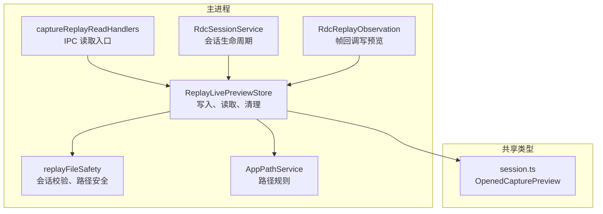
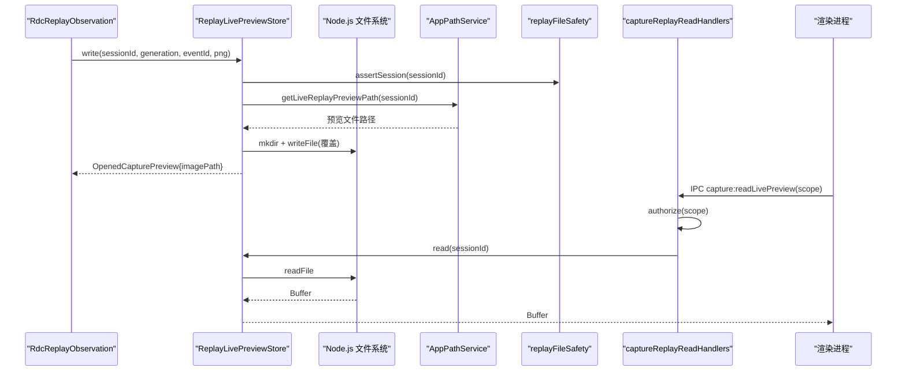
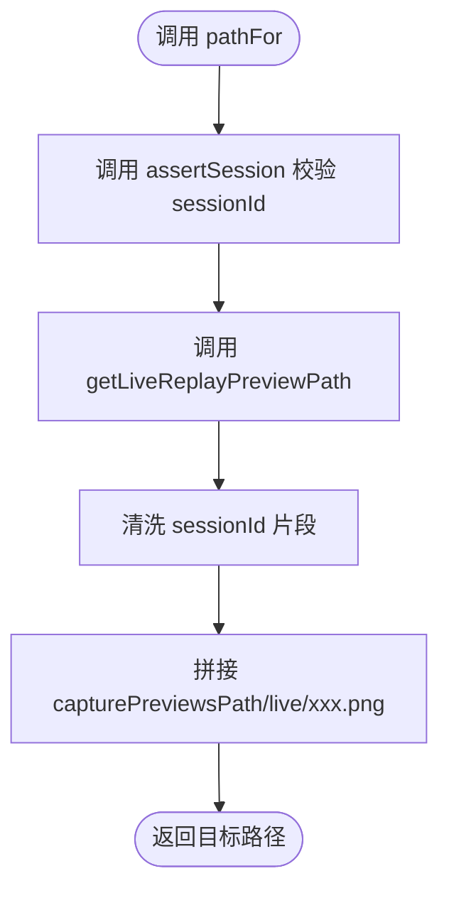
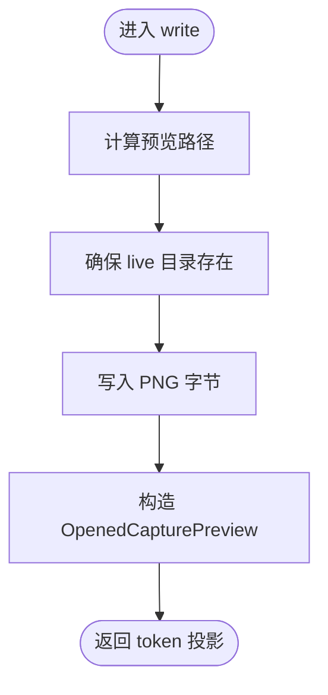
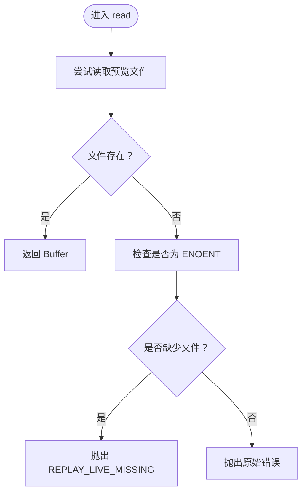
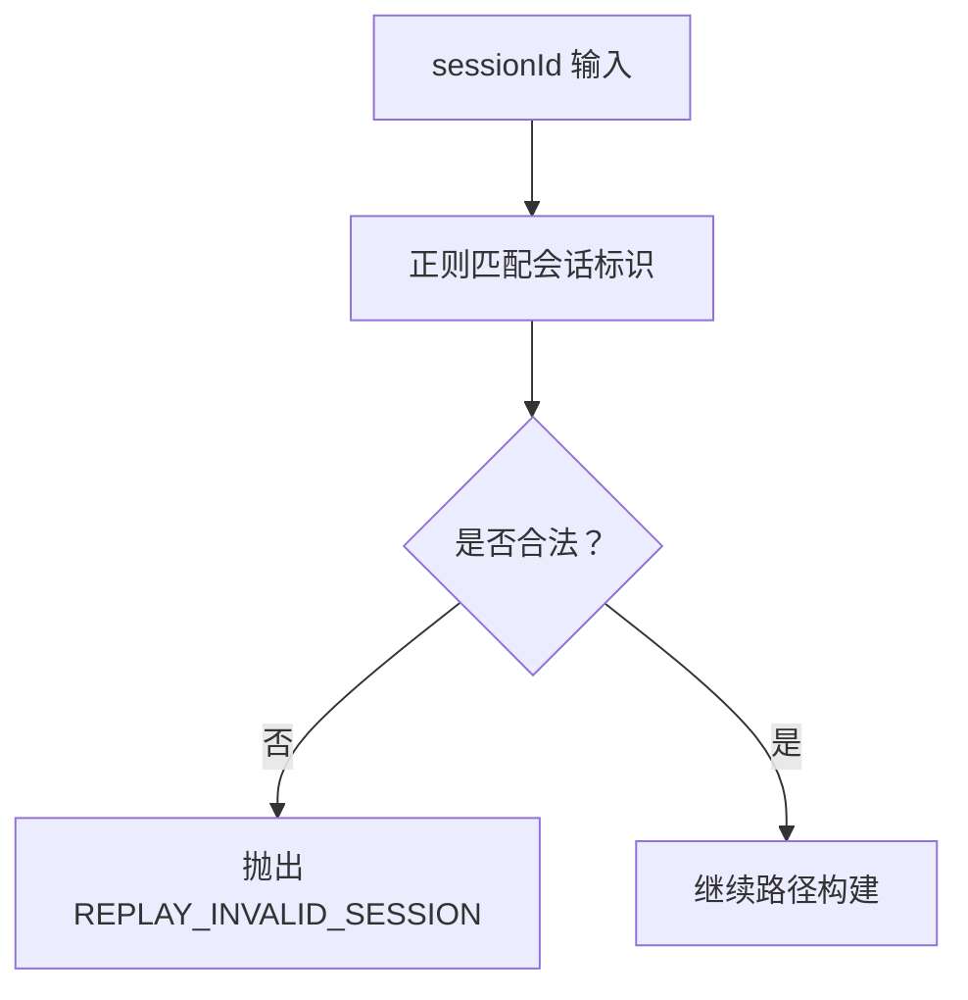
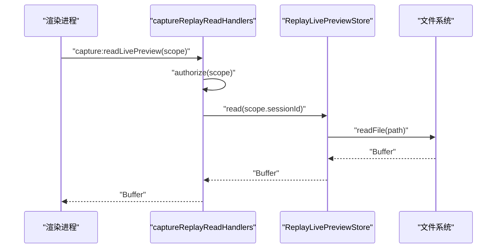

# 实时预览存储

<cite>
**本文引用的文件**   
- [ReplayLivePreviewStore.ts](file://src/main/captures/replay/ReplayLivePreviewStore.ts)
- [ReplayLivePreviewStore.test.ts](file://src/main/captures/replay/ReplayLivePreviewStore.test.ts)
- [replayFileSafety.ts](file://src/main/captures/replay/replayFileSafety.ts)
- [AppPathService.ts](file://src/main/runtime/AppPathService.ts)
- [captureReplayReadHandlers.ts](file://src/main/ipc/captureReplayReadHandlers.ts)
- [session.ts](file://src/shared/types/session.ts)
- [RdcSessionService.ts](file://src/main/sessions/RdcSessionService.ts)
- [RdcReplayObservation.ts](file://src/main/sessions/RdcReplayObservation.ts)
</cite>

## 目录
1. [引言](#引言)
2. [项目结构与职责边界](#项目结构与职责边界)
3. [核心组件：ReplayLivePreviewStore](#核心组件replaylivepreviewstore)
4. [架构总览](#架构总览)
5. [详细组件分析](#详细组件分析)
6. [依赖关系与数据流](#依赖关系与数据流)
7. [性能与容量管理](#性能与容量管理)
8. [错误处理模式](#错误处理模式)
9. [API 使用示例](#api-使用示例)
10. [故障排查](#故障排查)
11. [结论](#结论)

## 引言
本文件围绕“实时预览存储”能力，系统化说明 `ReplayLivePreviewStore` 的设计、实现与使用方式。该模块负责在捕获回放过程中，为每个会话写入一张当前帧的 PNG 预览图片，并向外部只暴露一个轻量投影对象 `OpenedCapturePreview`。它不直接传输像素数据，而是通过 token 指向主进程中的临时预览文件，从而降低渲染进程与 IPC 通道的压力。

## 项目结构与职责边界
实时预览存储位于主进程的捕获回放子系统内，属于“会话级临时资源”的管理者之一：

**图表来源**
- [ReplayLivePreviewStore.ts:1-46](file://src/main/captures/replay/ReplayLivePreviewStore.ts#L1-L46)
- [replayFileSafety.ts:1-120](file://src/main/captures/replay/replayFileSafety.ts#L1-L120)
- [AppPathService.ts:240-251](file://src/main/runtime/AppPathService.ts#L240-L251)
- [captureReplayReadHandlers.ts:1-24](file://src/main/ipc/captureReplayReadHandlers.ts#L1-L24)
- [RdcSessionService.ts:14-167](file://src/main/sessions/RdcSessionService.ts#L14-L167)
- [RdcReplayObservation.ts:8-97](file://src/main/sessions/RdcReplayObservation.ts#L8-L97)
- [session.ts:391-406](file://src/shared/types/session.ts#L391-L406)

**章节来源**
- [ReplayLivePreviewStore.ts:1-46](file://src/main/captures/replay/ReplayLivePreviewStore.ts#L1-L46)
- [captureReplayReadHandlers.ts:1-24](file://src/main/ipc/captureReplayReadHandlers.ts#L1-L24)

## 核心组件：ReplayLivePreviewStore
`ReplayLivePreviewStore` 是一个面向“会话级实时 PNG 预览”的简单文件系统封装。它的职责非常集中：

| 成员 | 职责 | 关键行为 |
|---|---|---|
| `pathFor(sessionId)` | 生成预览文件路径 | 先校验会话标识，再委托 `appPathService.getLiveReplayPreviewPath` |
| `write(sessionId, generation, imageEventId, encoded)` | 写入最新预览图 | 创建目录、覆盖写入 PNG，返回 `OpenedCapturePreview` 投影 |
| `read(sessionId)` | 读取当前预览图字节 | 封装 `ENOENT` 为统一业务错误码 |
| `clear(sessionId)` | 删除当前预览图 | 强制删除单文件 |

类设计采用“单一职责 + 状态外置”的模式：实例本身不缓存像素数据，也不维护元信息；所有位置由会话标识和路径服务决定。这样便于测试替换路径根目录，也避免在主进程中长期持有大内存缓冲区。

**章节来源**
- [ReplayLivePreviewStore.ts:1-46](file://src/main/captures/replay/ReplayLivePreviewStore.ts#L1-L46)

## 架构总览
实时预览的生命周期可以概括为：观察层发现新帧 → 编码为 PNG → 写入会话预览文件 → 向调用方返回 token 投影 → 渲染侧按需通过 IPC 读取原始字节。

**图表来源**
- [RdcReplayObservation.ts:8-97](file://src/main/sessions/RdcReplayObservation.ts#L8-L97)
- [ReplayLivePreviewStore.ts:1-46](file://src/main/captures/replay/ReplayLivePreviewStore.ts#L1-L46)
- [AppPathService.ts:240-251](file://src/main/runtime/AppPathService.ts#L240-L251)
- [replayFileSafety.ts:1-120](file://src/main/captures/replay/replayFileSafety.ts#L1-L120)
- [captureReplayReadHandlers.ts:1-24](file://src/main/ipc/captureReplayReadHandlers.ts#L1-L24)

## 详细组件分析

### 路径生成：`pathFor` 与 `getLiveReplayPreviewPath`
`pathFor` 是预览存储对外部路径的唯一出口。它先调用 `assertSession` 校验会话标识，再通过 `appPathService.getLiveReplayPreviewPath` 生成最终路径。这种分层的好处是：

- 会话校验集中在安全层，防止非法或越界会话 ID。
- 路径规则集中在路径服务中，便于统一策略、测试替换和迁移。

路径规则如下：

- 基础目录来自应用状态路径中的 `capturePreviewsPath`。
- 子目录固定为 `live`。
- 文件名格式为 `sanitizePathSegment(sessionId).png`。
- `sanitizePathSegment` 会移除非字母数字、连字符和下划线之外的字符，避免恶意或异常路径片段。

因此，预览文件通常落在类似 `<用户数据>/state/capture-previews/live/<清洗后的 sessionId>.png` 的位置。

**图表来源**
- [ReplayLivePreviewStore.ts:13-19](file://src/main/captures/replay/ReplayLivePreviewStore.ts#L13-L19)
- [AppPathService.ts:240-251](file://src/main/runtime/AppPathService.ts#L240-L251)
- [replayFileSafety.ts:10-12](file://src/main/captures/replay/replayFileSafety.ts#L10-L12)

**章节来源**
- [ReplayLivePreviewStore.ts:13-19](file://src/main/captures/replay/ReplayLivePreviewStore.ts#L13-L19)
- [AppPathService.ts:240-251](file://src/main/runtime/AppPathService.ts#L240-L251)

### Token 生成：`livePreviewToken`
`livePreviewToken(generation, imageEventId)` 生成形如 `live:${generation}:${imageEventId}` 的字符串。它不是密码，也不是加密凭证，而是一个“可消费的引用标识”。其含义包括：

| 字段 | 含义 |
|---|---|
| `live` | 表示该 token 指向实时预览资源，而非历史回放快照或其他资源 |
| `generation` | 当前回放代数，用于区分不同轮次的回放上下文 |
| `imageEventId` | 具体触发预览的图片事件编号，有助于定位是哪一帧触发的预览更新 |

安全考虑：

- Token 不包含敏感信息，但包含会话相关的上下文标识。
- Token 仅在主进程内部使用，并通过 IPC 授权机制限制读取权限。
- 渲染进程拿到的是 token，而不是像素数据；真正读取文件的操作由主进程完成。
- 实际路径由 `sessionId` 决定，token 本身并不直接映射到磁盘路径，避免泄露真实文件布局。

**章节来源**
- [ReplayLivePreviewStore.ts:7-9](file://src/main/captures/replay/ReplayLivePreviewStore.ts#L7-L9)

### 写入流程：`write`
`write` 的核心步骤是：

1. 计算目标路径。
2. 递归创建父目录。
3. 将传入的 PNG 字节写入该路径。
4. 返回 `OpenedCapturePreview` 投影对象。

关键点：

- 同一会话多次写入会覆盖同一个 `.png` 文件，符合“最新预览”语义。
- 返回值中的 `imagePath` 是 token，不是文件路径。
- `source` 固定为 `framebuffer_screenshot`，表示预览来源于帧缓冲截图。
- `updatedAt` 使用当前时间戳，供上层 UI 判断是否需要刷新。

**图表来源**
- [ReplayLivePreviewStore.ts:21-33](file://src/main/captures/replay/ReplayLivePreviewStore.ts#L21-L33)

**章节来源**
- [ReplayLivePreviewStore.ts:21-33](file://src/main/captures/replay/ReplayLivePreviewStore.ts#L21-L33)

### 读取流程：`read`
`read` 从当前会话预览路径读取 PNG 字节。如果文件不存在，它会捕获底层 `ENOENT` 错误并转换为统一的业务错误 `REPLAY_LIVE_MISSING`。其他错误原样抛出，便于上层区分“文件缺失”和“权限、磁盘损坏等系统错误”。

这个设计让调用方可以明确区分：

- 正常未生成预览：返回 `REPLAY_LIVE_MISSING`。
- 其他失败：由上层根据错误消息或类型进一步处理。

**图表来源**
- [ReplayLivePreviewStore.ts:35-43](file://src/main/captures/replay/ReplayLivePreviewStore.ts#L35-L43)

**章节来源**
- [ReplayLivePreviewStore.ts:35-43](file://src/main/captures/replay/ReplayLivePreviewStore.ts#L35-L43)

### 清理流程：`clear`
`clear` 直接删除当前会话的预览文件，并使用 `{ force: true }` 保证即使文件不存在也不会抛错。这使清理逻辑对幂等性更友好：重复清理不会报错。

注意：该实现只删除单个预览文件，不递归清理整个 `live` 目录。因此，如果需要批量回收，应由上层遍历或按会话生命周期管理。

**章节来源**
- [ReplayLivePreviewStore.ts:45-46](file://src/main/captures/replay/ReplayLivePreviewStore.ts#L45-L46)

### 投影对象：`OpenedCapturePreview`
`OpenedCapturePreview` 是预览资源的投影结构，主要字段包括：

| 字段 | 含义 |
|---|---|
| `imagePath` | 预览 token，例如 `live:${generation}:${imageEventId}` |
| `width` | 预览宽度 |
| `height` | 预览高度 |
| `source` | 来源类型，通常为 `framebuffer_screenshot` |
| `updatedAt` | 更新时间戳 |

为什么只传递 token 而不传递像素数据？

- **体积控制**：PNG 预览可能达到数百 KB 甚至更大，频繁 IPC 传输会影响性能和稳定性。
- **内存安全**：避免在渲染进程和无界面线程之间复制大量二进制数据。
- **权限隔离**：只有主进程能访问预览文件路径；渲染进程只能通过 IPC 请求读取。
- **可替换性**：未来若改为远程预览、缓存索引或压缩格式，只需调整主进程实现，投影接口仍可保持兼容。

**章节来源**
- [session.ts:391-406](file://src/shared/types/session.ts#L391-L406)
- [ReplayLivePreviewStore.ts:21-33](file://src/main/captures/replay/ReplayLivePreviewStore.ts#L21-L33)

## 依赖关系与数据流

### 会话隔离：`replayFileSafety.assertSession`
`assertSession` 要求会话 ID 匹配正则表达式，长度不超过 128，且只允许字母、数字、下划线和连字符。这一约束用于：

- 防止路径注入。
- 防止超长标识符导致文件系统异常。
- 为主进程的其他安全检查提供一致输入形态。

虽然 `ReplayLivePreviewStore` 只调用 `assertSession`，没有复用 `safePath`、`treeBytes` 或 `atomicWrite`，但它受益于这条基础输入校验。

**图表来源**
- [replayFileSafety.ts:10-12](file://src/main/captures/replay/replayFileSafety.ts#L10-L12)

**章节来源**
- [replayFileSafety.ts:10-12](file://src/main/captures/replay/replayFileSafety.ts#L10-L12)
- [ReplayLivePreviewStore.ts:13-19](file://src/main/captures/replay/ReplayLivePreviewStore.ts#L13-L19)

### IPC 读取入口
渲染进程不能直接访问预览文件，必须通过 `capture:readLivePreview` IPC 通道。该处理器会：

1. 解析并校验入参。
2. 通过 `authorize` 校验 `sessionId` 和 `projectId` 是否匹配当前会话记录。
3. 调用 `replayLivePreviewStore.read` 读取字节。
4. 返回字节给渲染进程。

**图表来源**
- [captureReplayReadHandlers.ts:1-24](file://src/main/ipc/captureReplayReadHandlers.ts#L1-L24)
- [ReplayLivePreviewStore.ts:35-43](file://src/main/captures/replay/ReplayLivePreviewStore.ts#L35-L43)

**章节来源**
- [captureReplayReadHandlers.ts:1-24](file://src/main/ipc/captureReplayReadHandlers.ts#L1-L24)

### 写入触发点
预览写入主要由回放观察层触发。当回放产生新的帧时，观察层将像素数据编码为 PNG，然后调用 `replayLivePreviewStore.write`，并把返回的 `OpenedCapturePreview` 挂到回放状态上。

**章节来源**
- [RdcReplayObservation.ts:8-97](file://src/main/sessions/RdcReplayObservation.ts#L8-L97)

## 性能与容量管理

### 写入性能
- 每次写入都是完整覆盖当前会话预览文件，适合高频小幅更新。
- 目录创建使用递归模式，首次创建开销较小，后续命中缓存。
- 没有使用原子写入或临时文件重命名；如果写入过程被中断，可能留下不完整 PNG。对于实时预览场景，容忍度通常高于持久化回放文件。

### 读取性能
- 读取是直接文件读取，返回 Buffer。
- 渲染进程需要自行解码 PNG 才能显示。
- 如果渲染端频繁轮询读取，建议在上层做去抖和变更检测，例如比较 `updatedAt` 或 token。

### 容量管理
当前实现没有内置磁盘空间监控或自动清理策略。需要注意：

- 每个活跃会话最多保留一个 `*.png` 预览文件。
- 非活跃会话的预览文件不会自动删除，需由会话生命周期或服务清理逻辑调用 `clear`。
- `live` 目录不会被递归清空，因此不应假设它是“一次性临时目录”。
- 如果会话数量很大，应定期扫描并清理过期会话预览。

### 优化建议
1. **渲染端缓存**：缓存上一次读取的 Buffer 和 `updatedAt`，仅在 token 或时间戳变化时重新读取。
2. **批量清理**：在服务关闭、会话结束或项目卸载时，显式清理对应预览文件。
3. **磁盘告警**：在应用启动或定期任务中检查 `capturePreviewsPath` 所在分区剩余空间。
4. **可选压缩**：如果预览尺寸过大，可在写入前进行有损压缩，或在 IPC 返回时采用分块传输。
5. **原子写入扩展**：如需更强健壮性，可参考同模块其他代码使用的原子写入模式，先将 PNG 写入临时文件再重命名。

[本节为通用指导，不直接分析特定代码行]

## 错误处理模式

| 场景 | 行为 | 推荐上层处理 |
|---|---|---|
| 会话 ID 非法 | `assertSession` 抛出 `REPLAY_INVALID_SESSION` | 拒绝请求并记录日志 |
| 预览文件不存在 | `read` 抛出 `REPLAY_LIVE_MISSING` | 视为无预览，显示占位图 |
| 文件被占用或权限不足 | 抛出底层 IO 错误 | 提示用户检查权限或重试 |
| 磁盘空间不足 | 写入失败 | 提示用户释放空间并暂停预览写入 |
| 重复清理 | `clear` 使用 `force: true` | 视为成功，无需额外处理 |

**章节来源**
- [ReplayLivePreviewStore.ts:21-46](file://src/main/captures/replay/ReplayLivePreviewStore.ts#L21-L46)
- [replayFileSafety.ts:10-12](file://src/main/captures/replay/replayFileSafety.ts#L10-L12)

## API 使用示例

以下示例以“如何使用”为主，不展示具体源码内容，而是给出调用流程和注意事项。

### 写入预览
适用场景：回放观察到新帧，需要更新实时预览。

调用顺序：

1. 获取当前会话 ID、回放代数 `generation`、图片事件 ID `imageEventId`。
2. 将像素数据编码为 PNG，得到宽度、高度和字节数组。
3. 调用 `replayLivePreviewStore.write(sessionId, generation, imageEventId, encoded)`。
4. 使用返回的 `OpenedCapturePreview.imagePath` 作为预览引用。
5. 将 `OpenedCapturePreview` 放入回放状态或会话视图模型中。

注意事项：

- 同一会话多次写入会覆盖旧预览。
- `imagePath` 是 token，不要当作文件路径传给渲染进程。
- 如果编码失败，应在调用层捕获并上报错误。

**章节来源**
- [ReplayLivePreviewStore.ts:21-33](file://src/main/captures/replay/ReplayLivePreviewStore.ts#L21-L33)
- [RdcReplayObservation.ts:8-97](file://src/main/sessions/RdcReplayObservation.ts#L8-L97)

### 读取预览
适用场景：渲染进程需要显示最新预览图片。

调用顺序：

1. 构造包含 `sessionId` 和 `projectId` 的会话作用域。
2. 调用 IPC 通道 `capture:readLivePreview`。
3. 主进程执行权限校验后读取预览文件。
4. 渲染进程收到 Buffer 后解码为图片并显示。

注意事项：

- 如果返回 `REPLAY_LIVE_MISSING`，表示尚未生成或已清理。
- 不要在渲染进程直接访问预览文件路径。
- 避免高频轮询；结合 token 或时间戳增量更新。

**章节来源**
- [captureReplayReadHandlers.ts:1-24](file://src/main/ipc/captureReplayReadHandlers.ts#L1-L24)
- [ReplayLivePreviewStore.ts:35-43](file://src/main/captures/replay/ReplayLivePreviewStore.ts#L35-L43)

### 清理预览
适用场景：会话结束、切换回放或卸载项目时清理临时预览。

调用顺序：

1. 确定需要清理的 `sessionId`。
2. 调用 `replayLivePreviewStore.clear(sessionId)`。
3. 如果上层仍持有旧的 `OpenedCapturePreview`，应将其标记为失效。

注意事项：

- 清理是幂等的；重复调用不会报错。
- 清理后再次读取会返回 `REPLAY_LIVE_MISSING`。

**章节来源**
- [ReplayLivePreviewStore.ts:45-46](file://src/main/captures/replay/ReplayLivePreviewStore.ts#L45-L46)
- [RdcSessionService.ts:14-167](file://src/main/sessions/RdcSessionService.ts#L14-L167)

### 单元测试中的路径约定
测试文件中模拟了 `getLiveReplayPreviewPath`，约定预览路径为 `<临时根>/live/<sessionId>.png`，并验证了：

- 第一次写入后能读取到对应字节。
- 第二次写入会覆盖前一次内容。
- 清理后读取应返回 `REPLAY_LIVE_MISSING`。

这说明 `ReplayLivePreviewStore` 的行为契约是：覆盖写入、按会话隔离、清理后缺失。

**章节来源**
- [ReplayLivePreviewStore.test.ts:1-32](file://src/main/captures/replay/ReplayLivePreviewStore.test.ts#L1-L32)

## 故障排查

| 现象 | 可能原因 | 处理建议 |
|---|---|---|
| 预览一直为空 | 尚未写入或已被清理 | 检查是否调用过 `write`，确认会话状态是否正常 |
| 读取时报 `REPLAY_LIVE_MISSING` | 预览文件不存在 | 视为无预览，等待下一次写入或恢复预览源 |
| 写入时报权限错误 | 用户数据目录不可写 | 检查 Electron 用户数据路径权限 |
| 预览不更新 | 渲染端未感知 token 变化 | 比较 `imagePath` 或 `updatedAt` 后再刷新 |
| 预览卡顿 | 渲染端频繁读取或解码 | 加入去抖、增量更新和缓存 |
| 磁盘增长过快 | 大量会话遗留预览 | 增加会话清理任务，定期扫描 `capture-previews/live` |

**章节来源**
- [ReplayLivePreviewStore.ts:21-46](file://src/main/captures/replay/ReplayLivePreviewStore.ts#L21-L46)
- [captureReplayReadHandlers.ts:1-24](file://src/main/ipc/captureReplayReadHandlers.ts#L1-L24)

## 结论
`ReplayLivePreviewStore` 是一个简洁而专注的会话级预览存储组件。它通过会话标识和路径服务保证基本隔离，通过 `assertSession` 防御非法输入，通过 token 投影避免在大对象和 IPC 通道上传输像素数据。配合 `captureReplayReadHandlers` 的权限校验，它能安全地为回放实时预览提供“写入、读取、清理”三件套。

在实际使用中，建议把预览视为“可丢失的辅助资源”：优先保证回放主流程稳定，同时做好清理、缓存和磁盘空间管理，以获得更好的用户体验和资源效率。